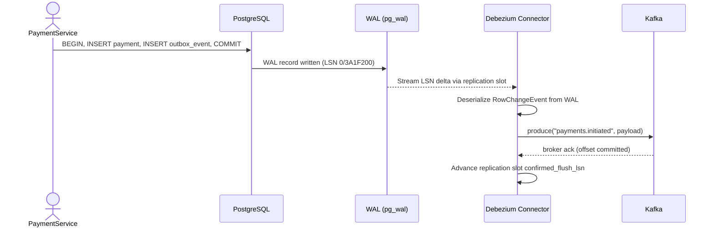

# نمط Outbox المعاملاتي — التسليم الموثوق للأحداث

## نظرة عامة

كل نظام موزع مبني على خدمات مصغرة يواجه في النهاية القيد القاسي نفسه: لا تستطيع الالتزام ذريًا بكتابة في قاعدة البيانات ونشر رسالة إلى وسيط في عملية واحدة. ويحل نمط Outbox المعاملاتي ذلك بمعاملة جدول الـ outbox كمنطقة تجهيز دائمة للإضافة فقط تكون جزءًا من معاملة ACID المحلية نفسها مع بيانات عملك. فما يصل إلى وسيط الرسائل مشتق مما التُزم به بالفعل في قاعدة البيانات — لا العكس. وفي أنظمة الدفع حيث يعني الحدث الفائت تحويلًا مجمدًا أو قيد دفتر غير مسوّى، يكون هذا التمييز الفرق بين شذوذ بسيط وحادث رقابي.

## أهداف التعلم

- شرح لماذا الكتابة المزدوجة إلى قاعدة بيانات ووسيط رسائل غير آمنة بالضبط، بالإشارة إلى نوافذ الفشل الثلاث المتمايزة.
- تصميم مخطط جدول `outbox_events` لدعم التسليم بالمرحّل المستطلع وبـ CDC.
- تنفيذ دالة خدمة `@Transactional` تحفظ ذريًا سجل دفعة وحدث outbox باستخدام Spring Data JPA.
- بناء مرحّل مستطلع بـ `SELECT … FOR UPDATE SKIP LOCKED` آمن للتشغيل عبر عدة نسخ من الخدمة في آن واحد.
- ضبط منتج Kafka بـ `acks=all` و`enable.idempotence=true` لمنع الرسائل المكررة في جانب الوسيط داخل جلسة المنتج.
- شرح بديل CDC باستخدام Debezium وWAL في PostgreSQL، والاختيار بين الاستطلاع وCDC لسياق تشغيلي معين.
- تصميم مستهلكين لاحقين idempotent حتى لا يكون التسليم مرة واحدة على الأقل من المرحّل خطرًا على الصحة.

## سياق العمل

*مثال مركّب:* فقد بنك رقمي أوروبي يعالج نحو 400,000 دفعة خلال اليوم تسليم الأحداث لمدة 11 دقيقة أثناء إعادة تشغيل متدرجة لـ JVM. وكان السبب الجذري سباق كتابة مزدوجة تقليديًا: كتبت خدمة الدفع سجل الدفعة في PostgreSQL، ثم نشرت حدث `payment.initiated` إلى Kafka، ثم أعادت HTTP 200. وخلال نافذة إعادة التشغيل قُتل JVM بعد التزام قاعدة البيانات لكن قبل أن يعيد `send()` في Kafka إقرارًا. فلم تتلقَ نحو 1,400 دفعة حدث `payment.initiated` الخاص بها. وكانت خدمة فحص الاحتيال، وخدمة ترحيل الدفتر، ومحوّل المعالج الخارجي كلها قائمة على الأحداث — فلم ترَ أي منها تلك الدفعات. وكشفت مطابقة التسوية صباح اليوم التالي فرقًا بـ 2.3 مليون يورو. وحدد تحليل ما بعد الحادث عاملين مساهمين: لا جدول outbox، ولا تصميم مستهلك idempotent. وغاب كلاهما لأن المعماريين افترضوا أن إعادة المحاولة الداخلية في عميل منتج Kafka ستغطي الإخفاقات العابرة. وهي لا تغطي تعطل JVM.

## مشكلة الكتابة المزدوجة

يبدو النمط غير الآمن بريئًا في الشيفرة:

```java
@Transactional
public PaymentResult initiatePayment(PaymentRequest request) {
    Payment payment = paymentRepository.save(toEntity(request)); // DB write
    kafkaTemplate.send("payments.initiated", toEvent(payment));  // broker write — NOT part of TX
    return toResult(payment);
}
```

تلتزم معاملة قاعدة البيانات عند القوس الختامي لـ `@Transactional`. والإرسال إلى Kafka خارج حدود ACID تلك تمامًا. وهناك ثلاث نوافذ فشل متمايزة:

1. **تعطل JVM بعد التزام قاعدة البيانات وقبل الإرسال إلى Kafka** — يضيع الحدث إلى الأبد.
2. **وسيط Kafka غير متاح وقت الإرسال** — يضيع الحدث ما لم يعد المنتج المحاولة وينجح قبل انتهاء المهلة.
3. **استثناء يُرمى بعد الإرسال فيتراجع عن معاملة قاعدة البيانات** — يكون الحدث قد سُلّم إلى Kafka بالفعل، لكن الدفعة غير موجودة في قاعدة البيانات. فيرى المستهلك حدثًا شبحيًا.

لا يغلق أي قدر من إعدادات إعادة المحاولة في منتج Kafka النافذة 1 أو النافذة 3. والحل الصحيح الوحيد نقل نشر الحدث إلى داخل حدود ACID نفسها مع بيانات العمل.

> [!WARNING]
> لا تستدعِ أبدًا `kafkaTemplate.send()` أو أي نشر إلى وسيط داخل دالة `@Transactional` وتفترض أنه يشارك في المعاملة. فـ `KafkaTemplate` في Spring لا ينضم إلى مدير معاملات JPA افتراضيًا. ونهج `@Transactional(transactionManager = "kafkaTransactionManager")` يحل جانب Kafka فقط، ويترك حد قاعدة البيانات–Kafka مفتوحًا ما لم تستخدم مدير معاملات XA حقيقيًا — الذي يدخل أنماط فشل خاصة به يغطيها الدرس 15.

## مخطط جدول Outbox

يجب أن يعيش جدول الـ outbox في مخطط قاعدة البيانات نفسه مع جداول عملك ليشارك في المعاملة المحلية نفسها.

```sql
CREATE TABLE outbox_events (
    id              UUID            NOT NULL DEFAULT gen_random_uuid(),
    aggregate_type  VARCHAR(100)    NOT NULL,
    aggregate_id    VARCHAR(255)    NOT NULL,
    event_type      VARCHAR(100)    NOT NULL,
    payload         JSONB           NOT NULL,
    created_at      TIMESTAMPTZ     NOT NULL DEFAULT now(),
    published_at    TIMESTAMPTZ     NULL,

    CONSTRAINT pk_outbox_events PRIMARY KEY (id)
);

-- Partial index: relay only scans unpublished rows
CREATE INDEX idx_outbox_unpublished
    ON outbox_events (created_at ASC)
    WHERE published_at IS NULL;
```

يعمل `published_at IS NULL` كعلامة على العمل المعلق. ويضمن الفهرس الجزئي أن استعلام المرحّل يمس فقط المجموعة غير المنشورة، لا التاريخ كله. واحتفظ بالصفوف القديمة: اضبط `published_at` بدل الحذف، وأرشف عبر دفعة ليلية تنقل الصفوف الأقدم من 7 أيام إلى جدول بارد. وهذا يحفظ سجل تدقيق كاملًا — متطلب رقابي في معظم الولايات القضائية.

> [!NOTE]
> يسمح `aggregate_type` و`aggregate_id` للمستهلكين بتوجيه الأحداث دون فك تسلسل الحمولة. فمستهلك فحص الاحتيال الذي يهتم فقط بكيانات `Payment` يستطيع الترشيح على مستوى المرحّل. ويحمل `event_type` الاسم الدلالي (`PaymentInitiated`، و`FraudCheckRequested`) فيستطيع المستهلكون التوزيع دون لمس حمولة JSONB في `payload`.

## كتابة سجل Outbox ذريًا

يعكس كيان JPA بنية الجدول:

```java
@Entity
@Table(name = "outbox_events")
public class OutboxEvent {

    @Id
    @GeneratedValue(strategy = GenerationType.UUID)
    private UUID id;

    @Column(name = "aggregate_type", nullable = false)
    private String aggregateType;

    @Column(name = "aggregate_id", nullable = false)
    private String aggregateId;

    @Column(name = "event_type", nullable = false)
    private String eventType;

    @Column(columnDefinition = "jsonb", nullable = false)
    private String payload;

    @Column(name = "created_at", nullable = false, updatable = false)
    private OffsetDateTime createdAt = OffsetDateTime.now();

    @Column(name = "published_at")
    private OffsetDateTime publishedAt;

    public static OutboxEvent of(String aggregateType,
                                 String aggregateId,
                                 String eventType,
                                 String payload) {
        var e = new OutboxEvent();
        e.aggregateType = aggregateType;
        e.aggregateId   = aggregateId;
        e.eventType     = eventType;
        e.payload       = payload;
        return e;
    }

    // getters / setters omitted for brevity
}
```

تكتب دالة الخدمة السجلين داخل معاملة واحدة:

```java
@Service
@RequiredArgsConstructor
public class PaymentService {

    private final PaymentRepository     paymentRepo;
    private final OutboxEventRepository outboxRepo;
    private final ObjectMapper          mapper;

    @Transactional
    public Payment initiatePayment(PaymentRequest request) {
        Payment payment = paymentRepo.save(Payment.from(request));

        OutboxEvent event = OutboxEvent.of(
            "Payment",
            payment.getId().toString(),
            "PaymentInitiated",
            toJson(payment)
        );
        outboxRepo.save(event);

        // Kafka is NOT called here.
        // If this method throws, BOTH inserts roll back atomically.
        return payment;
    }

    private String toJson(Object obj) {
        try {
            return mapper.writeValueAsString(obj);
        } catch (JsonProcessingException e) {
            throw new IllegalStateException("Serialization failed", e);
        }
    }
}
```

> [!IMPORTANT]
> يجب أن يكون استدعاء `outboxRepo.save(event)` داخل دالة `@Transactional` **نفسها** مع `paymentRepo.save(payment)`. ويجب أن يتشاركا `EntityManager` واحدًا واتصال قاعدة بيانات واحدًا ليشاركا في معاملة ACID واحدة. فإذا حقنت `OutboxEventRepository` مدعومًا بـ `DataSource` منفصل، تكون قد أعدت إنشاء مشكلة الكتابة المزدوجة بشكل آخر.

## المرحّل المستطلع

المرحّل مكون خلفي — عادة `@Component` في Spring مع `@Scheduled` — يستعلم الـ outbox، وينشر إلى Kafka، ويعلّم الصفوف كمنشورة. و`SELECT … FOR UPDATE SKIP LOCKED` أساسي: فهو يمنع نسختين من المرحّل من معالجة الدفعة نفسها في آن واحد مع السماح بالتوسع الأفقي.

```java
@Component
@RequiredArgsConstructor
@Slf4j
public class OutboxRelay {

    private static final int BATCH_SIZE = 100;

    private final OutboxRelayRepository         relayRepo;
    private final KafkaTemplate<String, String> kafkaTemplate;

    @Scheduled(fixedDelay = 100) // milliseconds
    @Transactional   // the row locks from FOR UPDATE SKIP LOCKED last as long as this
    public void relay() {
        List<OutboxEvent> batch = relayRepo.findPendingBatch(BATCH_SIZE);
        if (batch.isEmpty()) return;

        Set<String> blocked = new HashSet<>();   // aggregates with a failed event
        for (OutboxEvent event : batch) {
            // Do not publish a later event of an aggregate whose earlier event
            // failed — consumers would see that aggregate out of order
            if (blocked.contains(event.getAggregateId())) continue;
            String topic = resolveTopicName(event.getEventType());
            try {
                ProducerRecord<String, String> record =
                        new ProducerRecord<>(topic, event.getAggregateId(), event.getPayload());
                // The outbox row id travels as a header: consumers use it as
                // their idempotency key
                record.headers().add("outbox_event_id",
                        event.getId().toString().getBytes(StandardCharsets.UTF_8));
                kafkaTemplate.send(record).get(5, TimeUnit.SECONDS); // synchronous ack

                event.setPublishedAt(OffsetDateTime.now());
                relayRepo.save(event);

            } catch (Exception ex) {
                // Leave published_at NULL — will be retried next cycle
                blocked.add(event.getAggregateId());
                log.error("Relay failed for event {}: {}",
                    event.getId(), ex.getMessage());
            }
        }
    }

    private String resolveTopicName(String eventType) {
        return switch (eventType) {
            case "PaymentInitiated"      -> "payments.initiated";
            case "FraudCheckRequested"   -> "fraud.check.requested";
            case "LedgerPostingRequired" -> "ledger.posting.required";
            default -> throw new IllegalArgumentException(
                "Unknown event type: " + eventType);
        };
    }
}
```

يحمل معرّف صف الـ outbox كترويسة، فيستخدمه المستهلكون كمفتاح idempotency. ولا يُنشر حدث لاحق لكيان فشل حدثه السابق — وإلا سيرى المستهلكون ذلك الكيان خارج الترتيب.

يستخدم استعلام المستودع عبارة SQL أصلية:

```java
@Repository
public interface OutboxRelayRepository
        extends JpaRepository<OutboxEvent, UUID> {

    @Query(value = """
        SELECT * FROM outbox_events
        WHERE  published_at IS NULL
        ORDER  BY created_at ASC
        LIMIT  :batchSize
        FOR UPDATE SKIP LOCKED
        """, nativeQuery = true)
    List<OutboxEvent> findPendingBatch(@Param("batchSize") int batchSize);
}
```

> [!WARNING]
> الانتظار المتزامن `.get(5, TimeUnit.SECONDS)` على مستقبل Kafka يحجب خيط المجدول. وهذا مقصود: فالإرسال غير المتزامن دون انتظار سيسمح باستدعاء `save(event)` قبل أن يُقرّ الوسيط، فيعيد نافذة يستطيع فيها JVM التعطل بعد تعليم الصف كمنشور لكن قبل أن يحفظ الوسيط الرسالة. وإذا كان زمن Kafka مصدر قلق، فانتقل إلى دالة رد غير متزامنة لا تعلّم `published_at` إلا عند النجاح — لكن حينها يجب ضمان اكتمال كتابة دالة الرد في قاعدة البيانات قبل إيقاف التطبيق.

## بديل CDC: ‏Debezium وWAL في PostgreSQL

يلغي التقاط تغيير البيانات (CDC) المرحّل المستطلع كليًا. فبدل خيط خلفي يستعلم جدول الـ outbox، يتتبع موصل Debezium سجل الكتابة المسبقة (WAL) في PostgreSQL وينشر كل `INSERT` في `outbox_events` مباشرة إلى Kafka.



اضبط Debezium عبر واجهة REST في Kafka Connect:

```json
{
  "name": "outbox-connector",
  "config": {
    "connector.class":
        "io.debezium.connector.postgresql.PostgresConnector",
    "database.hostname":  "postgres",
    "database.port":      "5432",
    "database.user":      "debezium",
    "database.password":  "${file:/secrets/debezium.properties:password}",
    "database.dbname":    "payments",
    "topic.prefix":       "payments-db",
    "table.include.list": "public.outbox_events",
    "plugin.name":        "pgoutput",
    "transforms":         "outbox",
    "transforms.outbox.type":
        "io.debezium.transforms.outbox.EventRouter",
    "transforms.outbox.table.field.event.type": "event_type",
    "transforms.outbox.table.field.event.key":  "aggregate_id",
    "transforms.outbox.table.field.event.id":   "id",
    "transforms.outbox.table.field.event.payload": "payload",
    "transforms.outbox.route.by.field":         "aggregate_type",
    "transforms.outbox.table.fields.additional.placement": "id:header:outbox_event_id",
    "transforms.outbox.route.topic.replacement":
        "payments.${routedByValue}"
  }
}
```

**المرحّل المستطلع مقابل CDC — مصفوفة القرار:**

| المعيار | المرحّل المستطلع | CDC / ‏Debezium |
|---|---|---|
| متطلب الزمن | نحو 100 مللي ثانية مقبول | أقل من 10 مللي ثوانٍ مطلوب |
| التعقيد التشغيلي | منخفض (مكون JVM واحد) | عالٍ (مجموعة Kafka Connect، وإدارة فتحة النسخ) |
| حمل قاعدة البيانات لكل دورة استطلاع | مسح فهرس جزئي | قريب من الصفر (تدفق WAL) |
| النشر متعدد الخدمات | كل خدمة تشغّل مرحّلها | موصل واحد لكل مخطط قاعدة بيانات |
| ضغط WAL على القرص | لا شيء | قد ينمو تأخر فتحة النسخ إذا تأخر Kafka |

> [!NOTE]
> يربط محوّل `EventRouter` في Debezium صفوف جدول الـ outbox مباشرة بمواضيع Kafka باستخدام عمودي `aggregate_type` و`event_type`. فيصبح مخطط جدول الـ outbox عقدًا بين فريق الخدمة ونشر Kafka Connect. فعامل تغييرات المخطط بانضباط زيادة إصدار واجهة عامة نفسه.

## أنماط الفشل والمستهلكون Idempotent

ينشر المرحّل مرة واحدة على الأقل. وسيناريو الفشل الحرج: ينشر المرحّل إلى Kafka بنجاح، لكن JVM يتعطل قبل اكتمال `setPublishedAt` و`relayRepo.save`. وعند إعادة التشغيل يرى المرحّل ذلك الصف كغير منشور فينشره مجددًا. فيتلقى المستهلك نسختين.

اضبط منتج Kafka لمنع التكرارات في جانب الوسيط داخل جلسة منتج واحدة:

```java
@Configuration
public class KafkaProducerConfig {

    // "${...}" is not resolved inside a Java string literal — inject it
    @Bean
    public ProducerFactory<String, String> producerFactory(
            @Value("${kafka.bootstrap-servers}") String bootstrapServers) {
        Map<String, Object> props = new HashMap<>();
        props.put(ProducerConfig.BOOTSTRAP_SERVERS_CONFIG, bootstrapServers);
        props.put(ProducerConfig.ACKS_CONFIG, "all");
        props.put(ProducerConfig.ENABLE_IDEMPOTENCE_CONFIG, true);
        props.put(ProducerConfig.RETRIES_CONFIG, Integer.MAX_VALUE);
        props.put(ProducerConfig.MAX_IN_FLIGHT_REQUESTS_PER_CONNECTION, 5);
        props.put(ProducerConfig.KEY_SERIALIZER_CLASS_CONFIG,
            StringSerializer.class);
        props.put(ProducerConfig.VALUE_SERIALIZER_CLASS_CONFIG,
            StringSerializer.class);
        return new DefaultKafkaProducerFactory<>(props);
    }
}
```

يضمن `enable.idempotence=true` مع `acks=all` أن يزيل الوسيط تكرار إعادات المحاولة داخل جلسة المنتج نفسها باستخدام أرقام التسلسل. ولا يحمي من نشر المرحّل بعد إعادة تشغيل JVM بجلسة منتج جديدة. فتلك مسؤولية المستهلك.

يجب أن يكون المستهلكون idempotent باستخدام UUID حدث الـ outbox كمفتاح idempotency طبيعي:

```java
@KafkaListener(topics = "payments.initiated",
               groupId = "ledger-posting-service")
@Transactional
public void handlePaymentInitiated(
        ConsumerRecord<String, String> record,
        @Header("outbox_event_id") String outboxEventId) {

    UUID eventId = UUID.fromString(outboxEventId);

    // Claim first: INSERT ... ON CONFLICT (event_id) DO NOTHING.
    // (existsById-then-save is check-then-act: two deliveries of the same
    //  event, e.g. around a rebalance, could both pass the check.)
    if (processedEventRepo.insertIfAbsent(eventId) == 0) {
        log.info("Skipping duplicate event {}", eventId);
        return;
    }

    PaymentInitiatedEvent event =
        mapper.readValue(record.value(), PaymentInitiatedEvent.class);

    // Same @Transactional as the claim — both commit or neither does
    ledgerService.postEntry(event);
}
```

أبقِ الحجز في المعاملة نفسها مع `ledgerService.postEntry`. فإذا فشل ترحيل الدفتر، يُتراجع عن الحجز أيضًا، فلا يُعلّم الحدث كمعالج وتُعاد محاولته عند التسليم التالي.

## اختبار المعرفة

**س1: لماذا يلزم `SELECT … FOR UPDATE SKIP LOCKED` في استعلام المرحّل، وماذا يحدث إذا حذفته؟**

دون `FOR UPDATE SKIP LOCKED`، ستقرأ نسختا مرحّل تعملان بالتزامن الصفوف غير المنشورة نفسها من جدول الـ outbox. وستحاولان كلتاهما نشر الأحداث نفسها إلى Kafka ثم تعليمها كمنشورة. والنتيجة تسليم مكرر مضمون للمستهلكين اللاحقين في كل دورة استطلاع تنشط فيها أكثر من نسخة مرحّل. ويحصل `FOR UPDATE SKIP LOCKED` على قفل صف ذريًا مع القراءة: فتحصل كل نسخة مرحّل على دفعة حصرية غير متداخلة. وأي صف مقفل بالفعل من جلسة أخرى يُتخطى بصمت بدل التسبب في انتظار حاجب أو جمود.

**س2: قد تسبب فتحة النسخ في Debezium نمو استخدام القرص في PostgreSQL بشكل غير متوقع. تحت أي شرط يحدث ذلك، وكيف تمنعه؟**

يحتفظ PostgreSQL بمقاطع WAL حتى تؤكد كل فتحة نسخ أنها استهلكتها بتقديم `confirmed_flush_lsn` الخاص بها. فإذا تأخر موصل Debezium — لأن Kafka بطيء، أو الموصل متوقف مؤقتًا، أو عامل Kafka Connect معطل — تتوقف الفتحة عن التقدم. ولا يستطيع PostgreSQL حذف مقاطع WAL التي لم تقرأها الفتحة بعد، فيتراكم WAL على القرص. وفي المجموعات الإنتاجية ذات إنتاجية الكتابة العالية قد يستنفد ذلك مساحة القرص في ساعات. والتخفيفات: راقب تأخر فتحة النسخ بـ `pg_replication_slots`، ونبّه على `pg_wal_lsn_diff`، واضبط `max_slot_wal_keep_size` ‏(PostgreSQL 13+) بحيث *يُبطل* PostgreSQL الفتحة تحت الضغط الشديد بدل ملء القرص. فيجب حينها أن يعيد الموصل أخذ لقطة كاملة (ويجب إعادة نشر صفوف الـ outbox التي فاتته)، لكن قاعدة البيانات تبقى عاملة.

## التحدي العملي

يرحّل فريقك نظامًا متجانسًا (monolith) إلى خدمات مصغرة. ويكتب النظام المتجانس حاليًا سجلات الدفع في `payments.payment` ويستدعي فورًا خدمة تسوية لاحقة عبر HTTP. وتحتاج إلى استبدال استدعاء HTTP المتزامن هذا بتدفق قائم على الأحداث عبر Kafka، مع ضمان عدم ضياع أي أحداث حتى لو تعطلت خدمة الدفع الجديدة فور التزام دفعة.

صمم ونفّذ ما يلي:

1. أضف جدول `outbox_events` إلى مخطط PostgreSQL الحالي باستخدام سكربت ترحيل Flyway ‏(`V13__add_outbox_events.sql`).
2. عدّل `PaymentService.initiatePayment` لتكتب `OutboxEvent` داخل حدود `@Transactional` نفسها مع إدراج الدفعة.
3. نفّذ `OutboxRelay` بـ `@Scheduled(fixedDelay = 500)`، و`SELECT … FOR UPDATE SKIP LOCKED LIMIT 50`، وإقرار Kafka متزامن.
4. اكتب `SettlementConsumer` يكون idempotent باستخدام `outbox_events.id` كمفتاح إزالة التكرار، ويحفظ المعرّفات المعالجة في جدول `processed_outbox_events` في قاعدة بيانات خدمة التسوية نفسها.
5. اكتب اختبار وحدة يتحقق من: أنه عندما يرمي `KafkaTemplate.send()` في المحاولة الأولى وينجح في الثانية، يُنشر الحدث مرة واحدة بالضبط ويُضبط `published_at`.

وكتوسيع، قيّم هل CDC بـ Debezium أفضل من المرحّل المستطلع لهذا الحمل، بالنظر إلى أن خدمة الدفع تعالج 2,000 معاملة في الثانية في ساعات الذروة وأن اتفاقية خدمة التسوية تتطلب تسليم الحدث خلال 50 مللي ثانية من التزام الدفعة.

<!-- KNOWLEDGE-CHECK
{
  "questions": [
    {
      "text": "لماذا يُعد SELECT ... FOR UPDATE SKIP LOCKED أساسيًا في استعلام مرحّل الـ outbox، وماذا يحدث دونه عندما تعمل نسختا مرحّل بالتزامن؟",
      "options": [
        "يمنع SKIP LOCKED المرحّل من قراءة الصفوف المنشورة بالفعل، فيقلل مسوح قاعدة البيانات غير الضرورية",
        "دونه ستقرأ نسختا المرحّل الصفوف غير المنشورة نفسها، وتنشران الأحداث نفسها إلى Kafka، وتعلّمانها كمنشورة — فتُضمن التكرارات في كل دورة استطلاع بأكثر من نسخة مرحّل",
        "يلزم SKIP LOCKED فقط عندما يستخدم المرحّل CDC؛ والمرحّلات المستطلعة آمنة دونه",
        "دونه سيُحجب المرحّل منتظرًا صفوفًا مقفلة من مرحّلات أخرى، فيسبب زمنًا لا تكرارات"
      ],
      "correct": 1,
      "explanation": "دون FOR UPDATE SKIP LOCKED، تنفذ نسختا مرحّل متزامنتان SELECT نفسه، وتقرآن الصفوف غير المنشورة نفسها، وتنشرانها وتعلّمانها كلتاهما. ويحصل SKIP LOCKED على قفل صف حصري ذريًا مع القراءة: فتحصل كل نسخة على دفعة غير متداخلة. والصفوف المقفلة بالفعل تُتخطى بصمت. وهذا يجعل المرحّل قابلًا للتوسع أفقيًا دون تكرارات."
    },
    {
      "text": "حدد نوافذ الفشل الثلاث المتمايزة في نمط الكتابة المزدوجة حيث يُستدعى kafkaTemplate.send() بعد paymentRepository.save() داخل دالة @Transactional نفسها.",
      "options": [
        "انتهاء مهلة Kafka، وانقسام الشبكة، وإعادة توازن مجموعة المستهلكين",
        "تعطل JVM بعد التزام قاعدة البيانات وقبل الإرسال إلى Kafka (يضيع الحدث)؛ ووسيط Kafka غير متاح وقت الإرسال (يضيع الحدث ما لم تُعد المحاولة)؛ واستثناء بعد الإرسال يتراجع عن معاملة قاعدة البيانات (حدث شبحي في Kafka)",
        "انتهاء مهلة معاملة قاعدة البيانات، وفيض مخزن منتج Kafka، وإعادة ضبط إزاحة المستهلك",
        "أحداث مكررة عند إعادة المحاولة، وإزاحات مستهلك قديمة، وإعادة توازن أقسام Kafka"
      ],
      "correct": 1,
      "explanation": "النوافذ الثلاث: (1) تعطل JVM بعد أن تلتزم @Transactional بكتابة قاعدة البيانات لكن قبل تنفيذ kafkaTemplate.send() — يضيع الحدث إلى الأبد؛ (2) وسيط Kafka غير متاح عند الإرسال — يضيع الحدث ما لم يعد المنتج المحاولة وينجح ضمن المهلة؛ (3) استثناء يُرمى بعد الإرسال يتراجع عن معاملة قاعدة البيانات — سُلّم الحدث إلى Kafka بالفعل لكن الدفعة غير موجودة في قاعدة البيانات (حدث شبحي). ولا يغلق أي إعداد لإعادة المحاولة في المنتج النافذتين 1 أو 3."
    },
    {
      "text": "تتوقف فتحة نسخ Debezium في PostgreSQL عن التقدم لأن عامل Kafka Connect متوقف للصيانة. ما الخطر التشغيلي وكيف تمنعه من التسبب في انقطاع قاعدة البيانات؟",
      "options": [
        "ستنتهي صلاحية فتحة النسخ وستضيع كل الأحداث التاريخية — يُمنع بضبط مدة صلاحية كبيرة للفتحة",
        "يحتفظ PostgreSQL بمقاطع WAL حتى تقدّم الفتحة confirmed_flush_lsn الخاص بها؛ فإذا تأخرت الفتحة يتراكم WAL إلى ما لا نهاية وقد يستنفد مساحة القرص — ويُخفف بمراقبة تأخر الفتحة وضبط max_slot_wal_keep_size",
        "سيعالج Debezium كل الأحداث المتراكمة فورًا عند إعادة التشغيل، فيسبب حملًا زائدًا على منتج Kafka",
        "ستحجب الفتحة كل كتابات PostgreSQL حتى تُحذف يدويًا"
      ],
      "correct": 1,
      "explanation": "لا يستطيع PostgreSQL حذف مقاطع WAL حتى تؤكد كل فتحة نسخ أنها استهلكتها. وموصل Debezium المتوقف يتوقف عن تقديم confirmed_flush_lsn، فيتراكم WAL. وفي قاعدة بيانات كثيفة الكتابة قد يستنفد ذلك القرص في ساعات. واضبط max_slot_wal_keep_size ليُبطل PostgreSQL الفتحة تحت الضغط (فيجب أن يعيد الموصل أخذ لقطة كاملة) بدل انقطاع قاعدة البيانات كليًا. وراقب بـ pg_replication_slots ونبّه على pg_wal_lsn_diff."
    }
  ]
}
-->

<!-- PRACTICAL-CHALLENGE
{
  "title": "ترحيل التسوية عبر HTTP المتزامن إلى بنية Outbox قائمة على الأحداث",
  "difficulty": "advanced",
  "estimatedMinutes": 45,
  "tasks": [
    {"id": "1", "description": "اكتب ترحيل Flyway ‏V13__add_outbox_events.sql ينشئ جدول outbox_events مع الفهرس الجزئي على published_at IS NULL. وضمّن تعليقًا يشرح لماذا تُؤرشف الصفوف القديمة بدل حذفها، بالإشارة إلى متطلب الحفظ الرقابي. وأضف ترحيلًا ثانيًا V13b__add_outbox_relay_index.sql يحسّن استعلام المرحّل بإضافة فهرس مغطٍّ على (created_at ASC) INCLUDE (aggregate_type, aggregate_id, event_type) لمرشح WHERE published_at IS NULL."},
    {"id": "2", "description": "عدّل PaymentService.initiatePayment لتكتب OutboxEvent داخل حدود @Transactional نفسها مع إدراج الدفعة. ويجب أن تتضمن حمولة الحدث JSON الدفعة كاملًا. واكتب اختبار وحدة يحاكي مستودع الـ outbox ويؤكد: عندما يرمي paymentRepo.save() لا يُستدعى outboxRepo.save() أبدًا؛ وعندما يرمي outboxRepo.save() يُتراجع عن الدفعة؛ وعندما ينجحان يكون كلاهما مرئيًا في المعاملة نفسها."},
    {"id": "3", "description": "نفّذ OutboxRelay بـ @Scheduled(fixedDelay = 500)، وSELECT ... FOR UPDATE SKIP LOCKED LIMIT 50، وإقرار Kafka متزامن باستخدام kafkaTemplate.send(...).get(5, TimeUnit.SECONDS). وتعامل مع حالة رمي Kafka.send() بترك published_at فارغًا وزيادة عداد Micrometer ‏relay.publish.failures موسوم بـ event_type. واكتب اختبار وحدة يتحقق من أنه عندما يرمي send() في المحاولة 1 وينجح في المحاولة 2، يُنشر الحدث مرة واحدة بالضبط ولا يُضبط published_at إلا بعد الإقرار الناجح."},
    {"id": "4", "description": "نفّذ SettlementConsumer يكون idempotent باستخدام outbox_events.id كمفتاح إزالة التكرار، ويحفظ المعرّفات المعالجة في جدول processed_outbox_events في قاعدة بيانات خدمة التسوية نفسها. ويجب أن يلتزم المستهلك بإدراج processed_outbox_events وإجراء التسوية في حدود @Transactional نفسها. وقيّم هل CDC بـ Debezium أفضل من المرحّل المستطلع لـ 2,000 معاملة في الثانية مع اتفاقية تسليم 50 مللي ثانية، موثقًا تحليلك مقابل مصفوفة قرار الاستطلاع مقابل CDC."}
  ]
}
-->
