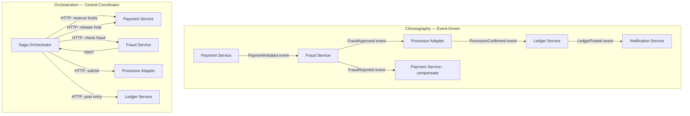

# نمط Saga — تنسيق المعاملات الموزعة

## نظرة عامة

حطّمت الأنظمة الموزعة حدود معاملة ACID. فعندما تمر دفعة عبر خدمة فحص احتيال، ومعالج بطاقات خارجي، وخدمة ترحيل دفتر، وبوابة إشعارات، لا يوجد قفل موزع يستطيع إمساك الأنظمة الأربعة في وحدة ذرية واحدة دون إدخال اقتران كارثي. ويستبدل نمط Saga المعاملة الواحدة الكبيرة بسلسلة من المعاملات المحلية — كل منها معزولة داخل خدمة واحدة — مرتبطة بأحداث أو بمنسّق، وقابلة للعكس عبر معاملات تعويضية عند فشل أي خطوة. وبالنسبة لكبار المهندسين في البنوك ليس هذا مفهومًا أكاديميًا: بل هو الطريقة التي تنسق بها معظم منصات الدفع الحديثة متعددة الخدمات العمل عبر خدماتها الداخلية ومزوديها الخارجيين. وفهم متى وكيف تطبقه بالضبط — وأين قد يفسد بياناتك بصمت — شرط مسبق لبناء أنظمة مالية تصمد في الإنتاج على نطاق واسع.

## أهداف التعلم

- شرح لماذا يفشل الالتزام على مرحلتين (2PC) كآلية تنسيق لخدمات HTTP المصغرة، بالإشارة إلى خصائص الحجب ونقطة الفشل الواحدة.
- التمييز بين التصميم الراقص (choreography) والتنسيق المركزي (orchestration) واختيار الأسلوب المناسب حسب عدد الخدمات ومتطلبات الرؤية وتعقيد الفشل.
- تصميم saga دفع من خمس خطوات مع تعويض مسمّى لكل خطوة أمامية.
- تنفيذ `PaymentSagaOrchestrator` يحفظ حالة الـ saga في جدول `payment_sagas` قبل كل استدعاء خارجي، منشئًا سجل saga للكتابة المسبقة.
- تطبيق القواعد الثلاث لتصميم التعويض: أن يكون idempotent، وأن ينجح في النهاية، وألا يعتمد على نجاح الخطوة التي يعوّضها.
- تحديد خطر القراءة القذرة في العزل بين sagas متزامنة وتنفيذ قفل دلالي باستخدام حجز `PENDING` لمنعه.

## سياق العمل

*مثال مركّب:* أطلق بنك بريطاني منافس تكامل "اشترِ الآن وادفع لاحقًا" يشمل أربع خدمات خارجية: التحقق من الهوية، ومكتب الائتمان، وإنشاء القروض، والنظام المصرفي الأساسي. وخلال الأسبوع الأول من الإنتاج تسبب انقطاع مكتب الائتمان لمدة 4 دقائق في تعليق 312 طلب قرض إلى الأبد. فكل طلب كان قد اجتاز التحقق من الهوية وحجز سعة ائتمانية في نظام إنشاء القروض، لكن منطق التعويض لم يُنفذ — فقد افترض الفريق أن مكتب الائتمان سيتعافى دائمًا بسرعة. وحين لم يحدث ذلك، أمسكت تلك الطلبات الـ 312 حدود ائتمان محجوزة إلى ما لا نهاية. ولم يكن لدى النظام المصرفي الأساسي طريقة لمعرفة أن الطلبات لن تكتمل أبدًا. وبلغ مجموع الائتمان المجمّد 1.4 مليون جنيه إسترليني. وتطلب الحل سكربت تصحيح يدويًا لقاعدة البيانات، و48 ساعة من وقت المهندسين، وشرحًا مكتوبًا إلى FCA. وكانت خلاصة تحليل ما بعد الحادث: "نفّذنا المسار السعيد للـ saga. لم ننفّذ الـ saga."

## لماذا يفشل 2PC عبر خدمات HTTP

يتطلب الالتزام على مرحلتين منسّقًا يرسل طلب تحضير (prepare) إلى كل المشاركين، وينتظر موافقة بالإجماع، ثم يرسل الالتزام. وينهار هذا النموذج عبر خدمات HTTP المصغرة لسببين بنيويين.

**الحجب عند الفشل:** خلال المرحلة 2 يمسك كل المشاركين أقفالهم المحلية منتظرين رسالة الالتزام من المنسّق. فإذا تعطل المنسّق بعد إرسال التحضير وقبل إرسال الالتزام، يُحجب كل مشارك إلى ما لا نهاية. وفي نظام متجانس بقاعدة بيانات واحدة تكون نافذة الفشل هذه أجزاء من الثانية ويعالجها التعافي من التعطل. أما عبر خدمات HTTP فلا توجد آلية تعافٍ مشتركة. فكل خدمة تمسك قفلها حتى تنتهي مهلته أو يُحرر يدويًا.

**انقسام الشبكة يخلق عدم يقين غير محدود:** إذا تلقى مشارك التحضير ورد "نعم" لكن رسالة الالتزام من المنسّق ضاعت في انقسام شبكة، فلا يستطيع المشارك أن يُجهض من طرف واحد بأمان (فربما التزم المنسّق مع مشاركين آخرين بالفعل) ولا أن يلتزم بأمان (فربما يكون المشارك الوحيد الذي يلتزم). فيجب أن يُحجب حتى يصبح المنسّق قابلًا للوصول مجددًا.

بالنسبة لخدمات تتواصل عبر HTTP على نطاق واسع — خاصة عبر مناطق توفر سحابية أو حدود شبكات خارجية — ليست أنماط الفشل هذه حالات حدية. بل روتينية. ويقبل نمط saga الاتساق النهائي مقابل تنسيق غير حاجب.

> [!WARNING]
> تحاول بعض الفرق استخدام `JtaTransactionManager` في Spring مع موارد XA للحصول على 2PC عبر قاعدة بيانات ووسيط رسائل. وهذا يعمل داخل مركز بيانات واحد ببنية تحتية متجانسة. ولا يعمل عبر حدود خدمات HTTP ولا يتركّب مع واجهات REST. ويغطي الدرس 15 تحليل فشل معاملات XA بالتفصيل.

## التصميم الراقص مقابل التنسيق المركزي

ينفّذ الأسلوبان مفهوم الـ saga نفسه. ويختلفان في مكان منطق التنسيق.



**التصميم الراقص (Choreography)** يناسب sagas بسيطة وخطية بخدمتين أو ثلاث. فكل خدمة تصدر أحداثًا وتتفاعل مع أحداث الآخرين. ولا يوجد منسّق مركزي — فحالة الـ saga ضمنية بحسب الأحداث التي نُشرت. والعيب: عند حدوث فشل، يتطلب تشخيص حالة saga استعلام عدة خدمات وربط الأحداث بمعرّف الـ saga. ومع نمو عدد الخدمات يصبح التصميم الراقص الضمني مستحيل الفهم.

**التنسيق المركزي (Orchestration)** يضع كل منطق التنسيق في مكوّن منسّق واحد. فيتتبع المنسّق حالة الـ saga صراحة، ويستدعي كل خطوة، ويعالج الإخفاقات، ويقود التعويضات. وتكون حالة الـ saga الحالية مرئية دائمًا في مكان واحد. والعيب: المنسّق مكوّن جديد يجب بناؤه واختباره وتشغيله. ولـ sagas الدفع بخمس خطوات أو أكثر، أو تفرعات غير خطية، أو دلالات إعادة محاولة جزئية، يكون التنسيق المركزي هو الخيار الصحيح دائمًا تقريبًا.

> [!NOTE]
> لا يحتوي المنسّق منطق عمل — بل منطق تنسيق. فـ `isFraudSuspect()` مكانها خدمة الاحتيال. ولا يعرف المنسّق إلا أنه يجب أن يستدعي خدمة الاحتيال وماذا يفعل بحسب الرد (موافقة ← الانتقال إلى الخطوة 3، رفض ← تعويض الخطوتين 1 و2). أبقِ المنسّق رفيعًا.

## Saga الدفع: خمس خطوات وتعويضاتها

saga دفع كاملة لمعاملة بطاقة دون حضورها:

| الخطوة | الإجراء الأمامي | التعويض | اسم التعويض |
|---|---|---|---|
| 1 | حجز الأموال (حجز على الحساب) | تحرير الحجز | `release_hold` |
| 2 | فحص الاحتيال (استدعاء متزامن) | لا يلزم تعويض (قراءة فقط) | — |
| 3 | الإرسال إلى المعالج الخارجي | إلغاء التفويض | `void_authorization` |
| 4 | ترحيل قيود الدفتر | عكس قيود الدفتر | `reverse_ledger` |
| 5 | تحرير الحجز | — (خطوة النجاح النهائية) | — |

انتقالات آلة حالة الـ saga:

```
STARTED → FUNDS_RESERVED → FRAUD_APPROVED → PROCESSOR_SUBMITTED
        → LEDGER_POSTED → COMPLETED

On failure at any step:
STARTED            → COMPENSATING → FAILED
FUNDS_RESERVED     → COMPENSATING → release_hold      → FAILED
FRAUD_APPROVED     → COMPENSATING → release_hold      → FAILED
PROCESSOR_SUBMITTED→ COMPENSATING → void_authorization
                                  → release_hold      → FAILED
LEDGER_POSTED      → COMPENSATING → reverse_ledger
                                  → void_authorization
                                  → release_hold      → FAILED
```

## منسّق الـ Saga

يحفظ جدول `payment_sagas` حالة الـ saga قبل كل استدعاء خارجي — سجل saga للكتابة المسبقة يصمد أمام تعطلات JVM:

```sql
CREATE TABLE payment_sagas (
    saga_id         UUID            NOT NULL,
    payment_id      UUID            NOT NULL,
    current_step    VARCHAR(50)     NOT NULL,
    saga_state      VARCHAR(20)     NOT NULL, -- STARTED, COMPENSATING, COMPLETED, FAILED
    step_payload    JSONB,
    created_at      TIMESTAMPTZ     NOT NULL DEFAULT now(),
    updated_at      TIMESTAMPTZ     NOT NULL DEFAULT now(),

    CONSTRAINT pk_payment_sagas PRIMARY KEY (saga_id)
);

CREATE INDEX idx_payment_sagas_state
    ON payment_sagas (saga_state)
    WHERE saga_state NOT IN ('COMPLETED', 'FAILED');
```

يحفظ المنسّق انتقالات الحالة قبل كل استدعاء صادر:

```java
@Service
@RequiredArgsConstructor
@Slf4j
public class PaymentSagaOrchestrator {

    private final PaymentSagaRepository sagaRepo;
    private final FundsReservationClient fundsClient;
    private final FraudCheckClient       fraudClient;
    private final ProcessorClient        processorClient;
    private final LedgerClient           ledgerClient;
    private final AlertingService        alertingService;

    // NOT @Transactional: every sagaRepo.save() must COMMIT immediately so the
    // saga log survives a crash. One transaction around the HTTP calls would
    // commit nothing until the very end. (@Transactional on PRIVATE methods
    // does nothing anyway — Spring's proxy cannot intercept them.)
    public void startSaga(UUID sagaId, PaymentRequest request) {
        PaymentSaga saga = PaymentSaga.builder()
            .sagaId(sagaId)
            .paymentId(request.getPaymentId())
            .currentStep("RESERVE_FUNDS")
            .sagaState("STARTED")
            .stepPayload(toJson(request))
            .build();
        sagaRepo.save(saga);              // persist before calling out

        try {
            // Every external call carries the sagaId as its idempotency key
            ReservationResult reservation =
                fundsClient.reserve(sagaId, request.getAccountId(), request.getAmount());
            saga.setHoldId(reservation.getHoldId());
            transitionTo(saga, "FRAUD_CHECK", toJson(reservation));

            FraudCheckResult fraud =
                fraudClient.check(request.getPaymentId(),
                                  request.getAmount(),
                                  request.getMerchantId());

            if (fraud.isRejected()) {
                compensate(saga, "Fraud rejection");
                return;
            }
            transitionTo(saga, "SUBMIT_PROCESSOR", toJson(fraud));

            ProcessorResult processor =
                processorClient.submit(sagaId, request, reservation);
            transitionTo(saga, "POST_LEDGER", toJson(processor));

            ledgerClient.postEntries(request.getPaymentId(),
                                     request.getAmount(),
                                     processor.getAuthorizationCode());
            transitionTo(saga, "RELEASE_HOLD", null);

            fundsClient.releaseHold(reservation.getHoldId());
            saga.setSagaState("COMPLETED");
            transitionTo(saga, "COMPLETED", null);

        } catch (Exception ex) {
            // Includes timeouts: e.g. a processor submit that timed out may or
            // may not have authorised. The void below is keyed on sagaId and is
            // a no-op if no authorisation exists — so it is safe either way.
            log.error("Saga {} failed at step {}: {}",
                sagaId, saga.getCurrentStep(), ex.getMessage());
            compensate(saga, ex.getMessage());
        }
    }

    private void compensate(PaymentSaga saga, String reason) {
        saga.setSagaState("COMPENSATING");
        sagaRepo.save(saga);

        // Arrow-style switch cases do NOT fall through, so the reverse-order
        // cascade is written out explicitly: undo every step that may have run
        String step = saga.getCurrentStep();
        boolean ledgerMayHavePosted = step.equals("POST_LEDGER") || step.equals("RELEASE_HOLD");
        boolean processorMayHaveRun = ledgerMayHavePosted || step.equals("SUBMIT_PROCESSOR");

        boolean ok = true;
        if (ledgerMayHavePosted) {
            ok &= safeCompensate(() -> ledgerClient.reverseEntries(saga.getPaymentId()),
                    "reverse_ledger", saga);
        }
        if (processorMayHaveRun) {
            ok &= safeCompensate(() -> processorClient.voidBySagaId(saga.getSagaId()),
                    "void_authorization", saga);
        }
        if (saga.getHoldId() != null) {
            ok &= safeCompensate(() -> fundsClient.releaseHold(saga.getHoldId()),
                    "release_hold", saga);
        }

        // Only a FULLY compensated saga may be marked FAILED (terminal). If a
        // compensation could not be completed, the saga stays visible to the
        // recovery job, which keeps retrying — compensations must eventually succeed.
        saga.setSagaState(ok ? "FAILED" : "COMPENSATION_PENDING");
        sagaRepo.save(saga);
    }

    /** @return true if the compensation succeeded */
    private boolean safeCompensate(Runnable action,
                                   String compensationName,
                                   PaymentSaga saga) {
        int attempts = 0;
        while (attempts < 5) {   // short in-line retries; the recovery job does the rest
            try {
                action.run();
                return true;
            } catch (Exception ex) {
                attempts++;
                log.warn("Compensation {} attempt {} failed for saga {}: {}",
                    compensationName, attempts,
                    saga.getSagaId(), ex.getMessage());
                if (attempts < 5) {
                    sleep(Duration.ofSeconds(1L << (attempts - 1))); // 1s, 2s, 4s, 8s
                }
            }
        }
        alertingService.raiseCompensationAlert(saga.getSagaId(), compensationName);
        return false;
    }

    private void transitionTo(PaymentSaga saga,
                               String nextStep,
                               String payload) {
        saga.setCurrentStep(nextStep);
        saga.setStepPayload(payload);
        saga.setUpdatedAt(OffsetDateTime.now());
        sagaRepo.save(saga);              // commits NOW — write-ahead before next external call
    }
}
```

المنسّق **ليس** `@Transactional`: فكل `sagaRepo.save()` يجب أن يلتزم فورًا ليصمد سجل الـ saga أمام التعطل؛ والمعاملة الواحدة حول استدعاءات HTTP لن تلتزم بشيء حتى النهاية (و`@Transactional` على الدوال الخاصة لا يفعل شيئًا أصلًا). وحالات `switch` بأسلوب السهم لا تسقط إلى الحالة التالية، فالتعويض المتسلسل بالترتيب العكسي مكتوب صراحة. ولا تُعلّم الـ saga كـ `FAILED` (نهائية) إلا إذا اكتملت كل تعويضاتها؛ وإلا تبقى مرئية لمهمة التعافي التي تواصل إعادة المحاولة.

> [!IMPORTANT]
> استدعاء `sagaRepo.save(saga)` في `transitionTo` يحفظ اسم الخطوة الجديدة **قبل** الاستدعاء الشبكي الصادر. وهذا هو سجل الـ saga للكتابة المسبقة. فإذا تعطل JVM بعد حفظ `SUBMIT_PROCESSOR` لكن قبل رد المعالج، تستطيع عملية تعافٍ (مهمة مجدولة أو مسح عند إعادة التشغيل) أن تجد sagas في حالات غير نهائية وتستأنفها أو تعوّضها. ودون انضباط الكتابة المسبقة هذا، تكون حالة الـ saga الحالية مجهولة بعد التعطل.

## قواعد تصميم التعويض

تحكم ثلاث قواعد تصميم التعويض. وانتهاك أي منها سينتج saga لا تستطيع التعافي من الإخفاقات.

**القاعدة 1 — يجب أن تكون التعويضات idempotent.** قد تستدعي الـ saga `releaseHold` عدة مرات إذا فشلت الشبكة بين الاستدعاء والرد. فيجب أن تتحقق خدمة الأموال هل حُرر الحجز بالفعل قبل محاولة تحريره مجددًا. واستخدم `holdId` أو `sagaId` كمفتاح idempotency.

**القاعدة 2 — يجب أن تنجح التعويضات في النهاية.** التعويض الذي قد يفشل نهائيًا يترك النظام في حالة لا يستطيع منها الوصول إلى حالة نهائية متسقة. فإذا كان `reverseEntries` قد يفشل لأن خدمة الدفتر معطلة، يجب أن تعيد الـ saga المحاولة إلى ما لا نهاية (مع تراجع) أو تصعّد إلى تدخل بشري. ويجب ألا تستسلم أبدًا وتترك قيود دفتر لم تُعكس في مكانها.

**القاعدة 3 — يجب ألا تعتمد التعويضات على نجاح الخطوة التي تعوّضها.** يجب أن يعمل `void_authorization` حتى لو أعاد `submit` الأصلي إلى المعالج ردًا ملتبسًا. ويجب أن يحمل التعويض سياقًا كافيًا — مخزنًا في `payment_sagas.step_payload` — للتنفيذ دون الاعتماد على رد الخطوة الفاشلة.

```java
// BAD: compensation depends on data from the failing step's response
public void compensateProcessor(UUID paymentId) {
    // This fails if the processor submit never returned a response
    String authCode = processorResponseCache.get(paymentId);
    processorClient.void(authCode);
}

// GOOD: compensation uses data persisted before the external call
public void compensateProcessor(UUID paymentId) {
    PaymentSaga saga = sagaRepo.findByPaymentId(paymentId);
    // sagaId is sufficient for the processor to look up and void
    processorClient.voidBySagaId(saga.getSagaId());
}
```

> [!WARNING]
> كثيرًا ما يضطر التعويض إلى استدعاء الخدمة نفسها التي فشلت للتو — فالإلغاء يجب أن يذهب إلى المعالج. فلا تصممه أبدًا بحيث *يحتاج* تلك الخدمة فورًا: إذا كان المعالج معطلًا، ضع الإلغاء في طابور للتنفيذ لاحقًا (تعيد مهمة التعافي محاولته)، أو — لتفويضات البطاقات — اعلم أن التفويض غير الملغى تنتهي صلاحيته من تلقاء نفسه، وأطلق تنبيهًا. وما يجب ألا يفعله التعويض أبدًا هو الاستسلام وتعليم الـ saga كمنتهية بينما الأثر ما زال قائمًا — فهذا ينتهك القاعدة 2.

## عزل الـ Saga: القراءات القذرة والأقفال الدلالية

لا تمسك الـ sagas أقفال قاعدة بيانات بين الخطوات. وهذا يخلق خطر عزل: فـ saga ثانية قد تقرأ بيانات عدّلتها الأولى ولم تصل بعد إلى حالة نهائية.

**مثال:** لدى العميل 1,000 جنيه. تحجز Saga A ‏800 جنيه. وتقرأ Saga B رصيد الحساب قبل اكتمال ترحيل الدفتر في Saga A فترى 1,000 جنيه — الرصيد الأصلي — لأن الحجز حجز يتجاهله فحص B، لا خصم. فتحجز Saga B ‏900 جنيه. وتنجح الـ sagas كلتاهما. فيُسحب من الحساب على المكشوف بـ 700 جنيه.

الإجراء المضاد هو **القفل الدلالي**: حقل حالة على الكيان المعدَّل يشير إلى "قيد التنفيذ" للقراء المتزامنين.

```sql
-- Reservation record with semantic lock
INSERT INTO account_holds (
    hold_id, account_id, amount, status, saga_id, created_at
) VALUES (
    gen_random_uuid(), :accountId, :amount,
    'PENDING',          -- semantic lock
    :sagaId, now()
);
```

عند حساب الرصيد المتاح، ضمّن الحجوزات المعلقة:

```sql
SELECT
    a.balance
    - COALESCE(SUM(h.amount) FILTER (WHERE h.status = 'PENDING'), 0)
    - COALESCE(SUM(h.amount) FILTER (WHERE h.status = 'RESERVED'), 0)
    AS available_balance
FROM accounts a
LEFT JOIN account_holds h
    ON h.account_id = a.id
   AND h.status IN ('PENDING', 'RESERVED')
WHERE a.id = :accountId
GROUP BY a.balance;
```

تعمل حالة `PENDING` كعلامة قيد التنفيذ. فأي saga متزامنة تقرأ الرصيد المتاح سترى بشكل صحيح الحجز قيد التنفيذ كمطالَب به بالفعل. وعندما تكتمل الـ saga بنجاح، ينتقل الحجز من `PENDING` إلى `RESERVED` ثم في النهاية إلى `RELEASED` أو يتحول إلى خصم. وعندما تعوّض الـ saga، يُضبط الحجز على `RELEASED` (لا يُحذف — احتفظ بسجل التدقيق).

وتفصيل إضافي: يجب أن تبقى خطوة الحجز نفسها متسلسلة لكل حساب. فـ sagaان تحسبان الرصيد المتاح في اللحظة نفسها، قبل أن تدرج أي منهما حجزها، ستجتازان الفحص كلتاهما. لذلك تقفل خدمة الأموال صف الحساب (`SELECT ... FOR UPDATE`) — أو تستخدم تحديثًا شرطيًا على عمود المبلغ المحجوز — أثناء فحص الحجز وإدراجه. فالقفل الدلالي يحمي *بين* خطوات الـ saga؛ وقفل الصف القصير يحمي خطوة الحجز.

## اختبار المعرفة

**س1: تستدعي دالة `compensate` في saga الدالة `fundsClient.releaseHold()`، التي ترمي `RemoteServiceException` في المحاولة الأولى. وتنجح حلقة إعادة المحاولة في النهاية في المحاولة الثالثة. ويعمل `sagaRepo.save(saga)` بـ `sagaState = "FAILED"` بعد التعويض الناجح. فإذا تعطل JVM بين نجاح `releaseHold` الثالث و`sagaRepo.save("FAILED")`، ماذا يحدث عند إعادة التشغيل — وهل هذا آمن؟**

عند إعادة التشغيل تجد مهمة التعافي الـ saga في `sagaState = "COMPENSATING"`. فتعيد تنفيذ التعويض، مستدعية `releaseHold` مجددًا. ولأن `releaseHold` مصمم ليكون idempotent (القاعدة 1)، فإن الاستدعاء الثاني إما يجد الحجز محررًا بالفعل ويعيد نجاحًا، أو لا يجد شيئًا يحرره. ثم تنتقل الـ saga إلى `FAILED` وتُحفظ. فيصل النظام إلى حالة متسقة. وهذا آمن تحديدًا لأن التعويضات idempotent تجعل مسار التعافي لا يمكن تمييزه عن مسار التعويض الأصلي.

**س2: لماذا يُفضَّل التنسيق المركزي على التصميم الراقص عندما يكون لـ saga الدفع أكثر من أربع خطوات، أو تفرعات غير خطية، أو متطلبات إعادة محاولة جزئية؟**

في التصميم الراقص تكون حالة الـ saga ضمنية — يجب استنتاجها بربط الأحداث عبر عدة خدمات. وعند حدوث فشل في منتصف الـ saga، يتطلب تشخيص الحالة الحالية استعلام كل مشارك وإعادة بناء تسلسل الأحداث، وهو عرضة للأخطاء وبطيء. والتفرعات غير الخطية (مثلًا: "إذا كانت درجة الاحتيال > 0.7 تخطَّ المعالج وارفض فورًا؛ وإذا كانت 0.4–0.7 اطلب تحققًا إضافيًا") تصبح اقترانًا خفيًا عبر الخدمات، إذ يجب أن تعرف كل خدمة منطق تفرع جيرانها. أما التنسيق المركزي فيُخرج كل هذا إلى مكوّن واحد قابل للاختبار والمراقبة. فآلة حالة المنسّق يمكن اختبارها وحدويًا بمعزل، ويوفر جدول `payment_sagas` مصدر حقيقة واحدًا لحالة الـ saga، وتستطيع لوحات المراقبة استعلام ذلك الجدول لإظهار الـ sagas العالقة والمعوِّضة والمكتملة دون لمس خدمات المشاركين.

## التحدي العملي

صمم ونفّذ saga دفع كاملة لتحويل برقي عابر للحدود يشمل خمس خدمات: فحص الامتثال، وتثبيت سعر الصرف، وخصم الحساب المصدر، وقيد البنك المراسل عبر SWIFT، وقيد الحساب الوجهة.

1. عرّف مخطط جدول `payment_sagas` بأعمدة مناسبة لـ saga من خمس خطوات، بما فيها عمود `step_payload JSONB` لحمل سياق التعويض.
2. نفّذ `WireTransferSagaOrchestrator` بكل الخطوات الأمامية الخمس وتعويضاتها. واحفظ حالة الـ saga بالكتابة المسبقة قبل كل استدعاء خارجي.
3. نفّذ دالة `safeCompensate` بتراجع أسّي (تأخيرات: 1 ث، 2 ث، 4 ث، 8 ث، 16 ث، ثم تنبيه) لكل خطوة تعويض.
4. أضف قفلًا دلاليًا على الحساب المصدر باستخدام جدول `account_holds` بحالة `PENDING`، واكتب استعلام SQL الذي يحسب الرصيد المتاح شاملًا كل الحجوزات المعلقة.
5. اكتب اختبارًا يتحقق من: أنه عندما يفشل استدعاء مراسل SWIFT، تعوّض الـ saga تثبيت سعر الصرف، والخصم، وفحص الامتثال (إن انطبق) بالترتيب العكسي الصحيح، وأن كل تعويض يُستدعى مرة واحدة بالضبط حتى لو حوكيت إعادة تشغيل JVM في منتصف التعويض.

وكتوسيع، قيّم هل ينبغي أن تستخدم هذه الـ saga التصميم الراقص لخطوتي الإشعار وسجل التدقيق (وهما بلا انتظار ولا تتطلبان تعويضًا) مع الإبقاء على التنسيق المركزي للخطوات المالية.

<!-- KNOWLEDGE-CHECK
{
  "questions": [
    {
      "text": "تستدعي دالة compensate() في saga الدالة releaseHold() بنجاح في المحاولة الثالثة. ويتعطل JVM فور الاستدعاء الشبكي الناجح، قبل أن يُحفظ sagaRepo.save(saga) بـ sagaState = FAILED. ماذا يحدث عند إعادة التشغيل، ولماذا هذا آمن؟",
      "options": [
        "تضيع الـ saga إلى الأبد لأن حالة FAILED لم تُحفظ قط",
        "عند إعادة التشغيل تجد مهمة التعافي الـ saga في حالة COMPENSATING، فتعيد تنفيذ releaseHold() الـ idempotent التي تنجح أو لا تفعل شيئًا، ثم تنتقل إلى FAILED — فيصل النظام إلى حالة نهائية متسقة",
        "تعيد الـ saga محاولة الخطوة الأمامية لأن COMPENSATING تُعامل كحالة قابلة للاستعادة",
        "لا تستطيع مهمة التعافي تحديد هل نجح releaseHold() أم فشل، فتصعّد إلى مراجعة يدوية دون إعادة المحاولة"
      ],
      "correct": 1,
      "explanation": "يحفظ سجل الـ saga للكتابة المسبقة الحالة قبل كل استدعاء صادر. والتعطل بين التعويض الناجح وكتابة حالة FAILED يترك الـ saga في COMPENSATING. فيعيد التعافي تنفيذ releaseHold(). ولأن القاعدة 1 للتعويض تتطلب الـ idempotency، فإن الاستدعاء الثاني إما يجد الحجز محررًا بالفعل (لا شيء) أو يحرره بنجاح. ثم تنتقل الـ saga إلى FAILED وتُلتزم. فالتعويضات idempotent تجعل مسار التعافي لا يمكن تمييزه عن مسار التعويض الأولي."
    },
    {
      "text": "لماذا يُفضَّل التنسيق المركزي على التصميم الراقص لـ saga دفع بخمس خطوات أو أكثر وتفرعات غير خطية؟",
      "options": [
        "يستخدم التنسيق المركزي مواضيع Kafka أقل، فيقلل تكاليف البنية التحتية",
        "في التصميم الراقص تكون حالة الـ saga ضمنية ويجب إعادة بنائها بربط الأحداث عبر الخدمات؛ ومع التفرعات غير الخطية يجب أن ترمّز كل خدمة منطق جيرانها، فيصعب تشخيص الإخفاقات ومراقبتها من مصدر حقيقة واحد",
        "لا يستطيع التصميم الراقص تنفيذ التعويض لأن الأحداث غير قابلة للتغيير",
        "تشترط الجهات الرقابية المالية التنسيق المركزي لأغراض سجل التدقيق"
      ],
      "correct": 1,
      "explanation": "في التصميم الراقص، يتطلب تشخيص saga فاشلة استعلام عدة خدمات وربط الأحداث بمعرّف الـ saga — وهو عرضة للأخطاء مع تفرعات غير خطية حيث يجب أن تعرف كل خدمة منطق عمل جيرانها. أما التنسيق المركزي فيُخرج كل التنسيق إلى مكوّن واحد قابل للاختبار. ويوفر جدول payment_sagas مصدر حقيقة واحدًا قابلًا للمراقبة؛ وتستطيع لوحات المراقبة استعلامه لإظهار الـ sagas العالقة والمعوِّضة والمكتملة دون لمس خدمات المشاركين."
    },
    {
      "text": "ما القفل الدلالي في سياق عزل الـ saga، وأي سيناريو متزامن يمنعه؟",
      "options": [
        "قفل صف في قاعدة البيانات يُمسك عبر خطوات الـ saga لمنع أي وصول متزامن",
        "حقل حالة PENDING على الكيان المعدَّل يشير إلى saga قيد التنفيذ، فتضمّنه الـ sagas المتزامنة عند حساب الرصيد المتاح — فيمنع sagaين من رؤية الرصيد الكامل كلتيهما والمضي لسحب الحساب على المكشوف",
        "قفل موزع في Redis يسلسل كل الـ sagas لحساب معين",
        "عمود إصدار تفاؤلي على الحساب يجعل الـ saga الثانية تعيد المحاولة"
      ],
      "correct": 1,
      "explanation": "دون قفل دلالي، قد ترى sagaان تقرآن رصيد الحساب نفسه قبل أن ترحّل أي منهما خصمها الرصيد الكامل كلتاهما وتحجزان مبالغ تتجاوز معًا الرصيد. والحجز PENDING المكتوب كأول خطوة في الـ saga يعمل كعلامة مرئية لقيد التنفيذ. فتضمّن الـ sagas المتزامنة الحجوزات PENDING عند حساب الرصيد المتاح، فتنقص الرصيد الظاهر بشكل صحيح. ولا يُمسك أي قفل قاعدة بيانات عبر الخدمات — فحقل الحالة في طبقة التطبيق وحده ينقل حالة قيد التنفيذ."
    }
  ]
}
-->

<!-- PRACTICAL-CHALLENGE
{
  "title": "بناء Saga تحويل برقي عابر للحدود من خمس خطوات مع تعويض كامل",
  "difficulty": "advanced",
  "estimatedMinutes": 45,
  "tasks": [
    {"id": "1", "description": "عرّف مخطط جدول payment_sagas لـ saga تحويل برقي من خمس خطوات (فحص الامتثال، وتثبيت سعر الصرف، وخصم الحساب المصدر، وقيد SWIFT، وقيد الحساب الوجهة). وضمّن عمود step_payload JSONB لحمل سياق التعويض، وsaga_state VARCHAR(20)، وفهرسًا جزئيًا يرشّح إلى الـ sagas غير النهائية فقط. ووثّق البيانات التي يجب أن تكتبها كل خطوة في step_payload لتمكين تعويضها دون الاعتماد على رد الخدمة الفاشلة."},
    {"id": "2", "description": "نفّذ WireTransferSagaOrchestrator بكل الخطوات الأمامية الخمس وتعويضاتها. ويجب أن يحفظ كل استدعاء لـ transitionTo() اسم الخطوة الجديدة في payment_sagas قبل الاستدعاء الشبكي الصادر — انضباط الكتابة المسبقة. ونفّذ التعويض المتسلسل بشكل صحيح: فشل في الخطوة 3 (خصم المصدر) يجب أن يعوّض الخطوة 2 (تثبيت سعر الصرف) والخطوة 1 (حجز الامتثال)، لا الخطوتين 4 أو 5 اللتين لم تُنفذا قط."},
    {"id": "3", "description": "نفّذ safeCompensate() بتراجع أسّي باستخدام تأخيرات 1 ث، 2 ث، 4 ث، 8 ث، 16 ث، ثم تنبيه. واستخدم @Component باسم AlertingService يطلق CompensationAlert عند استنفاد المحاولات. واكتب اختبار وحدة يحقن إجراء تعويض وهميًا يفشل 4 مرات ثم ينجح في الخامسة، ويؤكد أن التأخيرات تطابق الجدول الأسّي وأن التنبيه لا يُطلق (نجاح قبل الاستنفاد)."},
    {"id": "4", "description": "أضف جدول account_holds بحالة PENDING كقفل دلالي للحساب المصدر. واكتب استعلام SQL الذي يحسب الرصيد المتاح شاملًا كل الحجوزات PENDING وRESERVED. واكتب اختبارًا يبدأ تنفيذين متزامنين لـ WireTransferSagaOrchestrator يسحبان كلاهما من الحساب المصدر نفسه برصيد مجمّع غير كافٍ، ويؤكد أن واحدًا بالضبط ينجح والآخر يفشل أثناء خطوة الحجز — لا أثناء ترحيل الدفتر."}
  ]
}
-->
