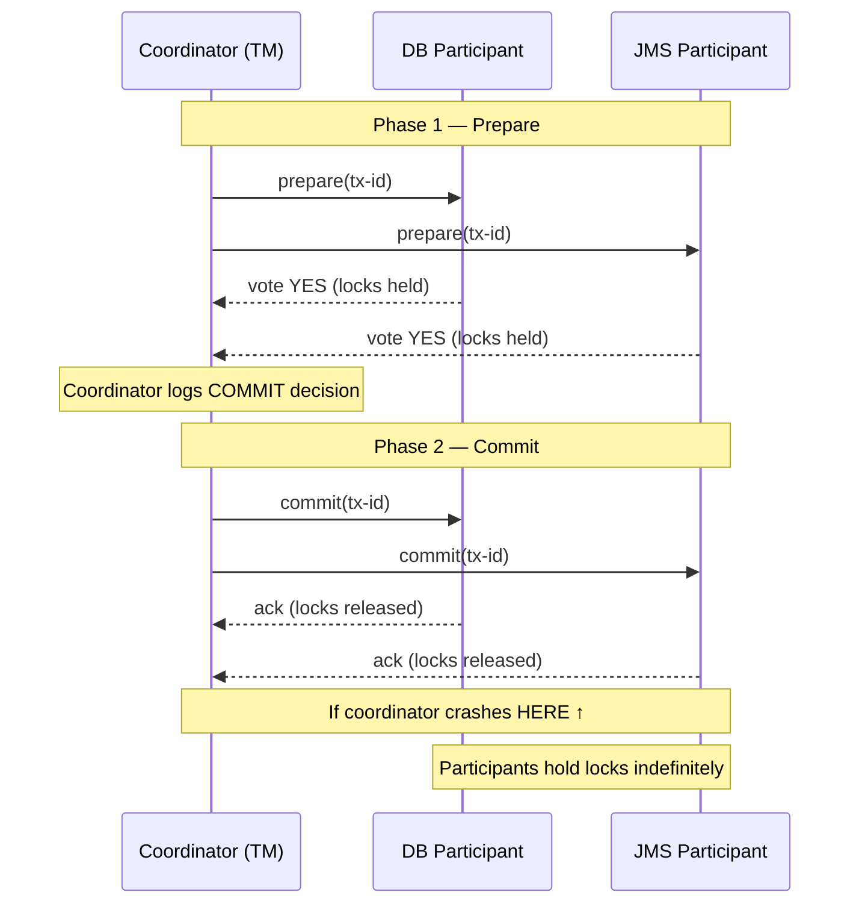
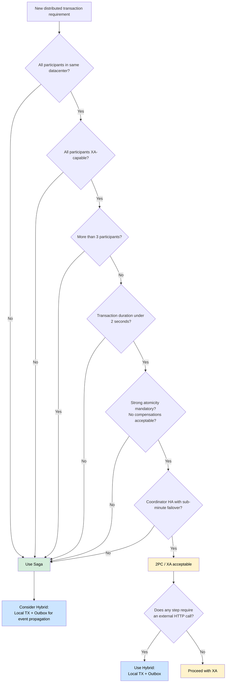
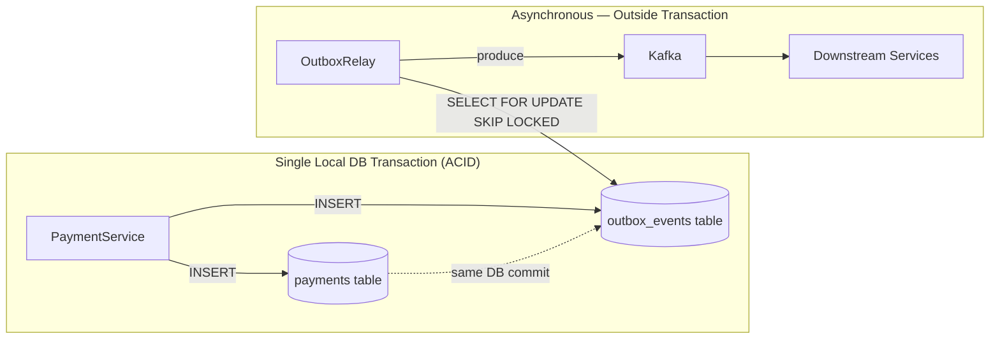

# الالتزام على مرحلتين مقابل Saga — إطار القرار

## نظرة عامة

سؤال هل تستخدم الالتزام على مرحلتين (2PC) أم saga ليس سؤالًا عقائديًا — بل قرار هندسي تقوده خصائص الفشل في بنيتك التحتية المحددة. وكبار المهندسين الذين يفترضون تلقائيًا "sagas في كل مكان لأن 2PC سيئ" أو "2PC لأننا نحتاج ACID" دون تحليل سياق النشر يستبدلون مجموعة من أنماط الفشل بأخرى دون فهم أي منهما. فالالتزام على مرحلتين يوفر الخطية (linearizability) والذرية بكلفة الحجب عند فشل المنسّق. والـ sagas توفر تنسيقًا غير حاجب بكلفة الاتساق النهائي، والقراءات القذرة، وتعقيد التعويض. وكلاهما أداة مشروعة. وهدف هذا الدرس أن يعطيك إطار القرار للاختيار الصحيح — وأن يشرح النمط الهجين الذي يتجنب المفاضلة لحالة الاستخدام الأكثر شيوعًا في التقنية المالية.

## أهداف التعلم

- وصف مرحلتي 2PC، مع تحديد الموارد المقفلة في كل مرحلة ولأي مدة.
- شرح ثلاثة أنماط فشل خاصة بـ 2PC: تعطل المنسّق في المرحلة 2، وانقسام الشبكة أثناء الالتزام، وعدم اليقين من انتهاء مهلة المشارك.
- تنفيذ معاملة XA في Java تمتد عبر قاعدة بيانات PostgreSQL وطابور JMS باستخدام `JtaTransactionManager` في Spring.
- تعداد مفاضلات الـ saga: الاتساق النهائي، والقراءات القذرة، ومتطلبات التعويض، والتنسيق غير الحاجب.
- تطبيق إطار القرار متعدد العوامل لاختيار 2PC أو saga لسياق معماري معين.
- تنفيذ النمط الهجين: معاملة ACID محلية للسجلات المالية مع نمط Outbox المعاملاتي لنشر الأحداث.
- قراءة مخطط القرار وتفسيره لتصنيف سيناريو تكامل جديد بسرعة.

## سياق العمل

*مثال مركّب:* استخدم نظام الخزينة في بنك كبير معاملات XA لتنسيق الكتابات عبر قاعدة بياناته المصرفية الأساسية، وقاعدة بيانات حساب المخاطر، وطابور رسائل JMS. وفي التشغيل العادي عالج النظام 8,000 معاملة يوميًا بأزمنة التزام أقل من ثانية. وأثناء اختبار تحول مخطط للعقدة التي تشغّل مدير معاملات XA، دخلت 23 معاملة حالة "مشكوك فيها" (in doubt): كل مشارك صوّت بـ "نعم" في المرحلة 1 لكن المنسّق تعطل قبل تسليم رسائل الالتزام في المرحلة 2. وأمسكت المعاملات الـ 23 كلها أقفال صفوف على قاعدتي البيانات لمدة 4 ساعات — مدة الاستجابة للحادث غير المخطط. وشملت الصفوف المقفلة مراكز عالية القيمة في مقايضات أسعار الفائدة. فلم يستطع نظام المخاطر إعادة حساب تقييمات تلك المراكز، فسُلّمت تقارير مخاطر خاطئة إلى مكتب التداول. وكانت خلاصة تحليل ما بعد الحادث: "يوفر XA الذرية لا التوفر. وعند فشل المنسّق لا نملك أيًا منهما." ثم انتقل الفريق إلى saga بمعاملة قاعدة بيانات محلية مع outbox، ووصفها بأنها "2PC ناقص المنسّق" — وصف سيجعله هذا الدرس دقيقًا.

## آليات 2PC: الأقفال والمراحل والمنسّق

الالتزام على مرحلتين بروتوكول ينفذه منسّق (عادة مدير معاملات) عبر مديري موارد مشاركين اثنين أو أكثر (قواعد بيانات، ووسطاء رسائل، إلخ).

**المرحلة 1 — التحضير:** يرسل المنسّق رسالة `prepare` إلى كل مشارك. فينفذ كل مشارك حصته من المعاملة، ويدفع التغييرات إلى تخزين دائم (سجل الكتابة المسبقة)، ويرد بـ `yes` (جاهز للالتزام) أو `no` (إجهاض). والأهم: المشارك لا يلتزم. بل يمسك أقفاله وينتظر المرحلة 2.

**المرحلة 2 — الالتزام أو الإجهاض:** إذا صوّت كل المشاركين بـ `yes`، يسجّل المنسّق "commit" في سجله الدائم، ثم يرسل `commit` إلى كل مشارك. فيلتزم كل مشارك، ويحرر أقفاله، ويُقرّ. وإذا صوّت أي مشارك بـ `no`، يرسل المنسّق `abort` إلى كل المشاركين.



الثغرة الحرجة ظاهرة في المخطط: إذا تعطل المنسّق بعد تسجيل قرار الالتزام لكن قبل تسليم رسائل الالتزام إلى المشاركين، يمسك أولئك المشاركون أقفالهم إلى ما لا نهاية. فلا يستطيعون الالتزام من طرف واحد (فربما يكونون الملتزمين الوحيدين) ولا الإجهاض من طرف واحد (فربما التزم المنسّق مع آخرين بالفعل). فهم محجوبون حتى يتعافى المنسّق.

## معاملات XA في Java

تعرض واجهة Java Transaction API ‏(JTA) تنسيق XA عبر `javax.transaction.xa.XAResource` (في الـ JDK)، بينما يعيش `UserTransaction` و`TransactionManager` في حزمة `jakarta.transaction` في Spring 6 / ‏Spring Boot 3. ويغلّف Spring ذلك بـ `JtaTransactionManager`. وإعداد نموذجي يمتد عبر قاعدة بيانات PostgreSQL وطابور JMS في ActiveMQ:

```java
@Configuration
public class XaTransactionConfig {

    @Bean
    public PlatformTransactionManager transactionManager(
            UserTransaction userTransaction,
            TransactionManager transactionManager) {
        return new JtaTransactionManager(
            userTransaction, transactionManager);
    }

    @Bean
    public DataSource xaDataSource() {
        // PostgreSQL XA datasource via Atomikos or Bitronix
        AtomikosDataSourceBean ds = new AtomikosDataSourceBean();
        ds.setUniqueResourceName("payments-db");
        ds.setXaDataSourceClassName(
            "org.postgresql.xa.PGXADataSource");
        ds.setXaProperties(pgXaProperties());
        ds.setMaxPoolSize(20);
        return ds;
    }

    @Bean
    public ConnectionFactory xaConnectionFactory() {
        // ActiveMQ XA connection factory
        AtomikosConnectionFactoryBean cf =
            new AtomikosConnectionFactoryBean();
        cf.setUniqueResourceName("payments-jms");
        cf.setXaConnectionFactory(
            new ActiveMQXAConnectionFactory(
                "tcp://broker:61616"));
        return cf;
    }
}
```

تبدو دالة الخدمة مطابقة لدالة `@Transactional` عادية في Spring — فتنسيق XA شفاف:

```java
@Service
@RequiredArgsConstructor
public class PaymentProcessingService {

    private final PaymentRepository paymentRepo;
    private final JmsTemplate        jmsTemplate;

    // JtaTransactionManager coordinates XA across DB + JMS
    @Transactional(transactionManager = "transactionManager")
    public void processPayment(PaymentRequest request) {
        Payment payment = paymentRepo.save(Payment.from(request));

        // This JMS send is part of the SAME XA transaction as the DB write.
        // If the DB commit fails, the JMS message is also rolled back.
        jmsTemplate.convertAndSend(
            "payments.initiated",
            new PaymentInitiatedMessage(payment.getId(),
                                        payment.getAmount()));
    }
}
```

هذه ذرية حقيقية عبر مديري موارد اثنين. ويدير منسّق XA ‏(Atomikos في هذا المثال) بروتوكول الالتزام على مرحلتين بشفافية.

> [!NOTE]
> تتطلب معاملات XA مشغّلات ومجمعات اتصال تدعم XA. ويدعم `PGXADataSource` في PostgreSQL ‏XA، لكن يجب أن يسمح الخادم بالمعاملات المحضّرة: `max_prepared_transactions` قيمته **0 افتراضيًا**، ما يجعل كل تحضير يفشل. فاضبطه على الأقل على عدد معاملات XA المتزامنة — وراقب `pg_prepared_xacts`، لأن المعاملة المحضّرة اليتيمة تمسك أقفالها وتحجب الـ vacuum حتى يحلها أحد. واختبر سيناريوهات فشل XA صراحة في بيئة تجهيز قبل الاعتماد عليها في الإنتاج. ولم يعد Bitronix مُصانًا، وأسقط Spring Boot 3 الإعداد التلقائي المدمج لـ JTA مع Atomikos؛ فاستخدم بادئ Spring Boot 3 الخاص بـ Atomikos أو Narayana.

## أنماط فشل 2PC

**نمط الفشل 1 — تعطل المنسّق في المرحلة 2.** يتعطل المنسّق بعد كتابة قرار الالتزام في سجله، قبل أن يتلقى كل المشاركين رسالة الالتزام. فالمشاركون الذين لم يتلقوا الرسالة يمسكون الأقفال ولا يستطيعون المضي. ويتطلب التعافي أن يُعاد تشغيل المنسّق، ويقرأ سجله، ويعيد إرسال رسائل الالتزام المعلقة. وخلال هذه النافذة — التي قد تدوم دقائق في حادث إنتاج — تكون كل الصفوف المقفلة غير متاحة.

**نمط الفشل 2 — انقسام الشبكة أثناء الالتزام.** يرسل المنسّق الالتزام إلى المشارك 1 بنجاح. ثم تنقسم الشبكة، فلا تصل رسالة الالتزام إلى المشارك 2 أبدًا. فيلتزم المشارك 1 ويحرر أقفاله. ويمسك المشارك 2 أقفاله منتظرًا رسالة لن تصل حتى يعود الاتصال. فالمشاركان الآن غير متسقين: أحدهما التزم والآخر لا. وهذا لا يمكن أن يحدث مع معاملة محلية على قاعدة بيانات واحدة.

**نمط الفشل 3 — انتهاء مهلة المشارك تحت حمل زائد على المنسّق.** إذا كان المنسّق بطيئًا في إرسال رسائل المرحلة 2 (توقف GC طويل، أو تشبع المعالج)، ينتظر المشاركون وأقفالهم ممسوكة. وبعد التصويت بـ "نعم" لا يسمح البروتوكول للمشارك بالإجهاض وحده. ويمكن إخبار بعض مديري الموارد باتخاذ قرار *استدلالي* (heuristic) — الالتزام أو التراجع دون المنسّق — لكن إذا قرر المنسّق العكس، فالنتيجة "heuristic mixed": بالضبط عدم الاتساق الذي كان 2PC يُفترض أن يمنعه، ويجب إصلاحه الآن يدويًا. وتحت حمل زائد مستمر على المنسّق تتوقف فعليًا كل المعاملات المنسقة بـ XA.

```java
// Demonstrating coordinator timeout — this is what NOT to do in production
// under high load: each @Transactional method holds XA locks during
// the full processing time

@Transactional(transactionManager = "transactionManager")
public void riskyPaymentWithSlowExternalCall(PaymentRequest request) {
    paymentRepo.save(Payment.from(request));      // DB lock acquired

    // DANGER: This external HTTP call holds XA locks on the DB
    // for the duration of the HTTP timeout.
    // Under slow upstream, all payment DB rows are locked.
    ExternalApiResult result = externalApi.call(request); // 30s timeout

    jmsTemplate.convertAndSend("events", result);
}
```

> [!WARNING]
> لا تُجرِ أبدًا إدخالًا/إخراجًا شبكيًا داخل حدود معاملة XA. فمدة قفل XA تساوي الزمن الفعلي لدالة `@Transactional` كلها. واستدعاء HTTP مدته 30 ثانية داخل معاملة XA يمسك أقفال صفوف قاعدة البيانات 30 ثانية، فيحجب كل معاملة أخرى تحتاج تلك الصفوف. وهذه أشيع كارثة أداء لـ XA في أنظمة التقنية المالية الإنتاجية.

## مفاضلات الـ Saga

تعالج الـ sagas إخفاقات الحجب في 2PC بقبول مجموعة مختلفة من القيود.

**الاتساق النهائي:** تلتزم المعاملات المحلية المكوّنة للـ saga بشكل مستقل. وبين الخطوة الأولى والأخيرة يكون النظام في حالة ملتزمة جزئيًا. وقد يرى المراقبون الخارجيون (خدمات أخرى، واستعلامات التقارير) حالات وسيطة. وهذا مختلف جوهريًا عن ضمان الذرية في 2PC.

**القراءات القذرة بين sagas متزامنة:** كما فُصّل في الدرس 14، قد تقرأ sagaان تعدّلان الحساب نفسه حالة قيد التنفيذ لدى بعضهما. وتلزم أقفال دلالية لمنع ذلك، لكنها تضيف تعقيدًا ويجب تصميمها صراحة لكل نوع saga.

**تعقيد التعويض:** كل خطوة تعدّل الحالة تحتاج تعويضًا idempotent. ولـ sagas من خمس خطوات يعني هذا خمس عمليات إضافية للتصميم والتنفيذ والاختبار والمراقبة. وإخفاقات التعويض تتطلب مسارات تصعيد (إعادة محاولة مع تراجع، وطابور رسائل ميتة، وتنبيه بشري).

**التنسيق غير الحاجب:** عندما تفشل خطوة saga، يبدأ المنسّق التعويض فورًا. ولا تُحجب أي saga أو معاملة أخرى. فيتدهور النظام برشاقة عند عدم توفر مشارك بدل أن يتجمد.

**يعمل عبر HTTP والأنظمة غير المتجانسة:** تنسّق الـ sagas عبر استدعاءات HTTP أو أحداث. فتعمل عبر أي خدمة تعرض واجهة أو تصدر أحداثًا، بغض النظر عن تقنية قاعدة البيانات أو المزود السحابي أو لغة البرمجة. أما 2PC فيتطلب مديري موارد يدعمون XA ومدير معاملات مشتركًا.

## إطار القرار: متى تستخدم كلًا منهما



**استخدم 2PC فقط عندما تتحقق كل هذه الشروط:**
1. كل المشاركين في مركز البيانات نفسه (رحلات ذهاب وإياب للمنسّق أقل من مللي ثانية).
2. كل المشاركين يعرضون مديري موارد يدعمون XA ‏(PostgreSQL، وActiveMQ، وIBM MQ).
3. ثلاثة مشاركين أو أقل (كل مشارك إضافي يضاعف سطح الفشل).
4. مدة المعاملة أقل من ثانيتين شاملة كل معالجة المشاركين.
5. الذرية القوية متطلب صارم والتعويضات غير مقبولة (مثلًا قيود دفتر رقابية يجب أن تقترن ذريًا برسالة تأكيدها).
6. المنسّق عالي التوفر، بسجل معاملات دائم وتحول سريع.

**استخدم Saga عندما ينطبق أي مما يلي:**
- يُوصل إلى أي مشارك عبر HTTP أو هو في مركز بيانات مختلف.
- أي مشارك خدمة طرف ثالث (معالج بطاقات، أو SWIFT، أو مكتب ائتمان).
- أكثر من ثلاثة مشاركين.
- خطوات طويلة التشغيل (فحص احتيال، أو فحص امتثال، أو مراجعة يدوية).
- التعويضات محددة جيدًا وقابلة للتنفيذ كعمليات idempotent.

> [!IMPORTANT]
> قاعدة "ثلاثة مشاركين أو أقل" لـ 2PC قاعدة استرشادية لا حد صارم. فكل مشارك إضافي مورد آخر قد يُترك "مشكوكًا فيه" وأقفاله ممسوكة، ومشغّل آخر يجب اختبار سلوك XA فيه، ونظام آخر يجب فحصه أثناء التعافي. وفي الأنظمة المالية حيث تتطلب المعاملات "المشكوك فيها" حلًا يدويًا، يرفع كل مشارك XA إضافي كلفة الاستجابة للحوادث.

## النمط الهجين: أفضل ما في العالمين

لحالة الاستخدام الأكثر شيوعًا في التقنية المالية — خدمة يجب أن تنشر أحداثًا بموثوقية بعد الالتزام بسجل مالي — ليس 2PC الخالص ولا الـ saga الخالصة الحل الأمثل. فالنمط الهجين يجمع معاملة ACID محلية (للسجل المالي) مع نمط Outbox المعاملاتي (لنشر الأحداث).

```java
@Service
@RequiredArgsConstructor
public class PaymentService {

    private final PaymentRepository     paymentRepo;
    private final OutboxEventRepository outboxRepo;

    // Single LOCAL transaction — no XA, no distributed coordinator
    @Transactional
    public Payment createPayment(PaymentRequest request) {
        // Step 1: Financial record — ACID within this single DB transaction
        Payment payment = paymentRepo.save(Payment.from(request));

        // Step 2: Outbox event — SAME local transaction, same DB, same commit
        OutboxEvent event = OutboxEvent.of(
            "Payment",
            payment.getId().toString(),
            "PaymentInitiated",
            toJson(payment)
        );
        outboxRepo.save(event);

        // Both writes commit atomically here.
        // No XA coordinator. No distributed lock.
        return payment;
    }
}
```

ثم يسلّم المرحّل (`OutboxRelay` من الدرس 13) حدث الـ outbox بشكل غير متزامن إلى Kafka، أو الخدمات اللاحقة، أو منسّق الـ saga. وهذا يحقق:

- **ACID للسجل المالي** — تلتزم الدفعة وحدث الـ outbox الخاص بها ذريًا في معاملة PostgreSQL محلية واحدة.
- **تسليم أحداث غير حاجب** — يحدث النشر إلى Kafka بشكل غير متزامن، خارج المعاملة المحلية، عبر المرحّل.
- **لا منسّق XA** — لا يوجد مدير معاملات موزع يتعطل، ولا مشاركون يُتركون "مشكوكًا فيهم"، ولا أقفال عبر الأنظمة.
- **تسليم مرة واحدة على الأقل مع مستهلكين idempotent** — قد يسلّم المرحّل الحدث أكثر من مرة بعد دورة تعطل وإعادة تشغيل؛ ويزيل المستهلكون اللاحقون التكرار بمعرّف حدث الـ outbox (يغطيه الدرس 13).

يُستخدم هذا النمط على نطاق واسع في أنظمة الدفع عالية الحجم التي ابتعدت عن XA. وهو ما اعتمده نظام الخزينة في قسم سياق العمل بعد حادثه.



> [!NOTE]
> النمط الهجين ليس التفافًا. بل هو الحل الصحيح معماريًا لنمط المعاملات الأكثر شيوعًا في التقنية المالية: "اكتب سجلًا ماليًا وأبلغ الأنظمة اللاحقة بموثوقية". والفكرة الأساسية أن جدول الـ outbox ليس اهتمامًا ثانويًا — بل جزء من السجل المالي. فالحدث دائم بقدر الدفعة نفسها لأنهما يتشاركان معاملة ACID نفسها.

## ملخص المقارنة

| البُعد | 2PC / ‏XA | Saga | الهجين (معاملة محلية + Outbox) |
|---|---|---|---|
| الذرية | ذرية حقيقية عبر المشاركين | نهائية (تعويضات) | ذرية للسجل المحلي؛ نهائية للأحداث |
| الحجب عند الفشل | نعم — المشاركون يمسكون الأقفال | لا | لا |
| يعمل عبر HTTP | لا | نعم | نعم (عبر المرحّل/المنسّق) |
| التعويض مطلوب | لا | نعم | لا للسجل المالي؛ نعم لخطوات الـ saga اللاحقة |
| التعقيد التشغيلي | عالٍ (مشغّل XA، ومدير معاملات، وتعافي "المشكوك فيها") | متوسط (منسّق، ومنطق تعويض) | منخفض (قاعدة بيانات واحدة، ومرحّل قياسي) |
| الإنتاجية | محدودة بمدة القفل | عالية | عالية |
| نموذج الاتساق | قوي | نهائي | قوي محليًا؛ نهائي للأحداث المنشورة |
| الاستخدام الموصى به | داخل مركز بيانات واحد، متجانس، ≤3 مشاركين، مدة قصيرة | خدمات مصغرة، غير متجانسة، طويلة التشغيل | سجل مالي + إشعار حدث (التوصية الافتراضية) |

## اختبار المعرفة

**س1: يتعطل منسّق في المرحلة 2 من معاملة 2PC بعد إرسال الالتزام إلى المشارك 1 (قاعدة البيانات) لكن قبل إرساله إلى المشارك 2 (وسيط JMS). ويمسك المشارك 2 رسالة JMS في حالة محضّرة. صف إجراء التعافي بالضبط وحالة النظام خلال نافذة التعافي.**

خلال نافذة التعافي يمسك المشارك 2 رسالة JMS غير ملتزمة ولا يستطيع معالجة رسائل جديدة على جلسة XA نفسها. وقد التزمت قاعدة البيانات (المشارك 1) بصفها بالفعل — فهو مرئي للمعاملات الأخرى. فالنظام غير متسق: صف الدفعة موجود في قاعدة البيانات، لكن رسالة JMS المقابلة لم تُسلّم. وعندما يُعاد تشغيل المنسّق، يقرأ سجل معاملاته، فيجد قرار الالتزام لهذه المعاملة، ويعيد إرسال رسالة الالتزام إلى المشارك 2. فيلتزم المشارك 2 برسالته المحضّرة ويحرر الجلسة. ويتطلب إجراء التعافي: (1) أن يكون للمنسّق سجل معاملات دائم صمد أمام التعطل، و(2) أن يحتفظ المشارك 2 بحالته المحضّرة طوال توقف المنسّق، و(3) أن يتواصل المنسّق مع كل المشاركين لتسليم قرارات المرحلة 2 المعلقة عند البدء. ومدة نافذة عدم الاتساق تساوي زمن تعافي المنسّق — عادة ثوانٍ إلى دقائق، لكن ربما ساعات إذا كان تخزين المنسّق غير متاح. وخلال هذه النافذة، أي عملية تقرأ صف الدفعة سترى دفعة ملتزمة لم يُرسل لها أي إشعار لاحق.

**س2: يجادل فريق بأنه يجب أن يستخدم 2PC بدل saga لنظام معالجة الدفع لأن "الـ sagas لا توفر ACID ونحن بنك". ابنِ الحجة المضادة المحددة باستخدام معايير إطار القرار، علمًا بأن نظامهم يستدعي معالج بطاقات طرفًا ثالثًا عبر HTTPS ولديه خطوة فحص احتيال تستغرق من 200 مللي ثانية إلى ثانيتين.**

يُقصي إطار القرار 2PC هنا على عدة معايير. أولًا، يُوصل إلى معالج البطاقات الطرف الثالث عبر HTTPS — فهو ليس مدير موارد يدعم XA ولا يستطيع المشاركة في معاملة XA. وهذا وحده يجعل 2PC غير قابل للتطبيق بغض النظر عن المعايير الأخرى. ثانيًا، تستغرق خطوة فحص الاحتيال حتى ثانيتين، ما يعني أن معاملة XA ستمسك أقفال قاعدة البيانات حتى ثانيتين لكل دفعة — وعند أي حجم معاملات ذي معنى، يسلسل ذلك معالجة الدفع كليًا. ثالثًا، استدعاء خدمة خارجية عبر HTTP داخل حدود XA هو بالضبط نمط الفشل الموثق في تنبيه "Warning": زمن الشبكة يصبح مدة القفل. والرد الصحيح على "نحن بنك ونحتاج ACID" هو: "نوفر ACID لسجلاتنا المالية المحلية عبر معاملة PostgreSQL واحدة. ونوفر اتساقًا نهائيًا موثوقًا للتنسيق عبر الخدمات عبر نمط saga بتعويضات محددة جيدًا. والجمع يعطينا ديمومة للبيانات المالية ومرونة للتنسيق الموزع — وهو ما تتطلبه الأنظمة المصرفية على نطاق واسع فعلًا."

## التحدي العملي

تشغّل شركة خدمات مالية سير عمل صرف قروض يمتد عبر ثلاثة أنظمة: قاعدة بيانات إنشاء القروض (PostgreSQL)، ودفتر مصرفي أساسي (Oracle)، وخدمة إشعارات (واجهة REST عبر HTTPS). ويتجادل فريق الهندسة بين XA ‏2PC (باستخدام Atomikos للامتداد عبر PostgreSQL وOracle) وsaga مع outbox.

1. طبّق إطار القرار على هذا السيناريو ووثّق التحليل لكل معيار.
2. حدد أي الأنظمة الثلاثة يُقصي 2PC، واشرح السبب.
3. صمم الحل الهجين: عرّف جدولي `loan_disbursements` و`outbox_events`، ونفّذ `LoanDisbursementService.disburse()` كدالة `@Transactional` محلية تكتب السجلين، وارسم منسّق الـ saga الذي يستخدم حدث الـ outbox لإطلاق كتابة دفتر Oracle واستدعاء واجهة الإشعارات.
4. لكتابة دفتر Oracle (وهي سجل مالي لا يجوز أن يضيع)، اشرح هل ستستخدم خطوة saga بتعويض، أم معاملة XA داخل مركز البيانات نفسه مع Oracle، أم آلية مختلفة — وبرر اختيارك باستخدام إطار القرار.
5. اكتب دليل تشغيل لحادث "saga صرف القرض عالقة في حالة COMPENSATING". وضمّن استعلامات SQL لتشخيص الخطوة التي فشلت، وإجراء التعويض اليدوي إذا استنفدت إعادة المحاولة الآلية حدها، والإشعار الذي يُرسل إلى العميل المتأثر.

<!-- KNOWLEDGE-CHECK
{
  "questions": [
    {
      "text": "يتعطل منسّق في المرحلة 2 بعد إرسال الالتزام إلى مشارك قاعدة البيانات لكن قبل إرساله إلى مشارك وسيط JMS. صف حالة النظام أثناء التعافي وإجراء التعافي بالضبط.",
      "options": [
        "يتراجع المشاركان كلاهما تلقائيًا — يضمن 2PC الذرية حتى عند فشل المنسّق",
        "التزمت قاعدة البيانات (صف الدفعة مرئي)، ويمسك وسيط JMS رسالته غير ملتزمة ولا يستطيع معالجة رسائل جديدة على جلسة XA تلك — النظام غير متسق حتى يُعاد تشغيل المنسّق ويقرأ سجله ويعيد إرسال الالتزام إلى مشارك JMS",
        "تنتهي مهلة مشارك JMS فيُجهض من طرف واحد، ثم تتراجع قاعدة البيانات لتطابقه",
        "يُعلّم صف قاعدة البيانات كـ IN_DOUBT وينتظر المشاركان كلاهما حتى يحل مدير قاعدة البيانات المعاملة يدويًا"
      ],
      "correct": 1,
      "explanation": "يمسك المشارك 2 ‏(JMS) رسالته المحضّرة ولا يستطيع معالجة رسائل جديدة على جلسة XA نفسها. وقد التزم المشارك 1 (قاعدة البيانات) بالفعل — فصفه مرئي للمعاملات الأخرى. فالنظام غير متسق: الدفعة موجودة في قاعدة البيانات لكن لم يُرسل أي إشعار لاحق. ويتطلب التعافي أن يُعاد تشغيل المنسّق، ويقرأ سجل معاملاته الدائم، فيجد قرار الالتزام، ويعيد إرسال الالتزام إلى المشارك 2. ومدة عدم الاتساق تساوي زمن تعافي المنسّق — ثوانٍ إلى دقائق عادة، وربما ساعات إذا كان تخزين المنسّق غير متاح."
    },
    {
      "text": "يجادل فريق بأنه يحتاج 2PC لنظام الدفع لأن الـ sagas لا توفر ACID. ونظامهم يستدعي معالج بطاقات طرفًا ثالثًا عبر HTTPS ولديه خطوة فحص احتيال تستغرق 200 مللي ثانية إلى ثانيتين. أي معيار في إطار القرار يُقصي 2PC هنا بشكل قاطع؟",
      "options": [
        "أكثر من ثلاثة مشاركين — للنظام أربع خدمات",
        "يُوصل إلى معالج البطاقات الطرف الثالث عبر HTTPS وهو ليس مدير موارد يدعم XA — فلا يستطيع 2PC التنسيق معه بغض النظر عن أي معايير أخرى",
        "مدة المعاملة تتجاوز ثانيتين — ستُمسك أقفال XA مدة طويلة جدًا",
        "النظام في مركز بيانات مختلف عن المنسّق"
      ],
      "correct": 1,
      "explanation": "يُوصل إلى معالج البطاقات الطرف الثالث عبر HTTPS. وليس لديه واجهة XA، ولا مدير موارد يدعم XA، ولا يستطيع المشاركة في بروتوكول التزام على مرحلتين. وهذا المعيار وحده يجعل 2PC غير قابل للتطبيق بغض النظر عن عدد المشاركين أو المدة أو الطوبولوجيا. فحتى لو تحققت كل المعايير الأخرى، لا تستطيع تضمين واجهة REST خارجية في معاملة XA. والرد الصحيح saga بتعويض."
    },
    {
      "text": "ما الذي يجعل النمط الهجين (معاملة ACID محلية + Outbox معاملاتي) متفوقًا على 2PC الخالص والـ saga الخالصة كليهما لحالة الاستخدام الأكثر شيوعًا في التقنية المالية؟",
      "options": [
        "يلغي الحاجة إلى مستهلكين idempotent لأن الـ outbox يضمن التسليم مرة واحدة بالضبط",
        "يوفر ACID للسجل المالي عبر معاملة PostgreSQL محلية واحدة، وتسليم أحداث غير حاجب عبر المرحّل، ولا منسّق موزعًا — فيجمع الاتساق المحلي القوي مع التوفر العالي في طبقة نشر الأحداث",
        "يستخدم معاملات XA داخليًا لكنه يخفيها عن شيفرة التطبيق للبساطة",
        "يتطلب معاملات تعويضية أقل من الـ saga لأن الـ outbox يعالج التراجعات تلقائيًا"
      ],
      "correct": 1,
      "explanation": "النمط الهجين صحيح معماريًا لـ 'اكتب سجلًا ماليًا وأبلغ الأنظمة اللاحقة بموثوقية'. فتلتزم الدفعة وحدث الـ outbox ذريًا في معاملة PostgreSQL محلية واحدة — لا منسّق XA، ولا أقفال موزعة. ثم ينشر المرحّل بشكل غير متزامن بدلالات مرة واحدة على الأقل، ويعالج المستهلكون الـ idempotent التكرارات. وهذا يحقق ACID محليًا، وتسليمًا غير حاجب عالميًا، ويتجنب إخفاقات الحجب في 2PC وتعقيد التعويض في الـ saga لمسار الكتابة."
    }
  ]
}
-->

<!-- PRACTICAL-CHALLENGE
{
  "title": "تصميم بنية هجينة لصرف القروض باستخدام إطار القرار",
  "difficulty": "advanced",
  "estimatedMinutes": 45,
  "tasks": [
    {"id": "1", "description": "طبّق إطار القرار على سيناريو صرف القروض (قاعدة بيانات إنشاء القروض PostgreSQL، ودفتر Oracle المصرفي، وواجهة إشعارات REST). ووثّق كل معيار صراحة: مركز البيانات نفسه؟، مشاركون يدعمون XA؟، عدد المشاركين، مدة المعاملة، ومتطلب الذرية. وحدد المعيار الذي يُقصي 2PC واشرح السبب."},
    {"id": "2", "description": "صمم الحل الهجين: عرّف جدولي loan_disbursements وoutbox_events (‏DDL)، ونفّذ LoanDisbursementService.disburse() كدالة @Transactional محلية تكتب السجلين ذريًا، وارسم منسّق الـ saga الذي يستخدم حدث الـ outbox لإطلاق كتابة دفتر Oracle (التي يجب معاملتها كخطوة مالية حرجة لا كإشعار) واستدعاء إشعار REST."},
    {"id": "3", "description": "لكتابة دفتر Oracle، قيّم ثلاثة خيارات: (أ) خطوة saga بتعويض، (ب) معاملة XA داخل مركز البيانات نفسه مع Oracle باستخدام Atomikos، (ج) معاملة محلية منفصلة على Oracle يقودها الـ outbox. وطبّق إطار القرار على كل منها وبرر توصيتك النهائية. وفكّر تحديدًا: ماذا يحدث إذا فشلت كتابة Oracle ولم يُعرّف أي تعويض."},
    {"id": "4", "description": "اكتب دليل التشغيل لحادث 'saga صرف القرض عالقة في حالة COMPENSATING'. وضمّن: استعلام SQL لإيجاد كل الـ sagas في حالات غير نهائية أقدم من 30 دقيقة، وSQL لتحديد آخر حمولة خطوة حُفظت، وإجراء التعويض اليدوي (أي استدعاءات SQL أو API تُجرى)، وشرط توقيع موظفَين، وقالب إشعار العميل بما فيه ما يُقال وما لا يُوعد به."}
  ]
}
-->
