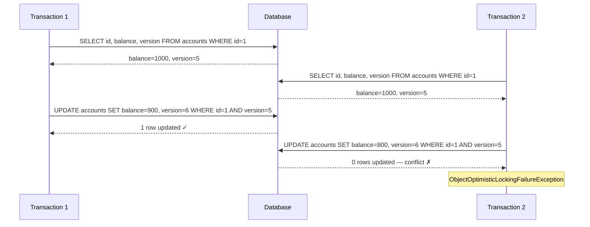
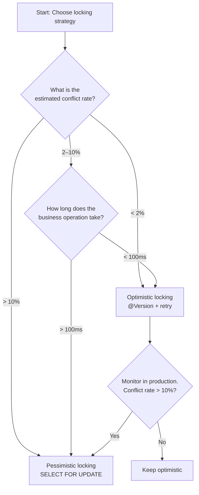

# القفل التفاؤلي — الإصدارات والمقارنة-ثم-التبديل

## نظرة عامة

القفل التفاؤلي هو البديل عالي الإنتاجية لأقفال الصفوف. فبدل إمساك قفل في قاعدة البيانات طوال المعاملة، تقرأ بحرية ثم تتحقق وقت الكتابة من أن أحدًا لم يعدّل الصف منذ قرأته. وفي الأنظمة المصرفية حيث تُقرأ معظم الحسابات أكثر بكثير مما تُكتب، يستطيع القفل التفاؤلي إلغاء التنازع على الأقفال كليًا — حتى لا يستطيع، ونمط الفشل ذاك هو الجزء الذي يستهين به معظم المهندسين.

## أهداف التعلم

- شرح آلية القراءة-ثم-CAS ومتى تتفوق على القفل التشاؤمي
- تنفيذ `@Version` في JPA على كيان مالي ومعالجة `ObjectOptimisticLockingFailureException`
- بناء غلاف إعادة محاولة يعزل كل محاولة في معاملتها الخاصة
- حساب معدل التعارض عند نقطة التعادل الذي يكلّف بعده القفل التفاؤلي أكثر مما يوفر
- كتابة تحديث CAS بـ SQL خام يحمي من السحب على المكشوف والتعديل المتزامن معًا
- تطبيق الإصدار على الأب لحماية مجموعة أبناء (عناصر دفعة مدفوعات) من التعديل المتزامن

## سياق العمل

*مثال مركّب:* يدير بنك رقمي أوروبي حملة تسويقية أطلقت 40,000 طلب تحديث رصيد متزامن عبر 8,000 حساب — نحو خمسة كتّاب متزامنين لكل حساب في المتوسط. واستخدم تنفيذهم `@Version` وأعاد محاولة كل تعارض حتى ثلاث مرات. وتحت ذلك الحمل بلغ معدل التعارض على الحسابات الشائعة 60%، ودفعت إعادات المحاولة النظام إلى نحو 2.4 ضعف كتابات قاعدة البيانات المقصودة، فأشبعت مجمع اتصالات قاعدة البيانات الرئيسية. وتدهورت الخدمة 11 دقيقة بينما سارع المهندسون لرفع حد المجمع.

لم يكن السبب الجذري اختيار القفل التفاؤلي نفسه — بل نشره في سيناريو اندفاع كثيف الكتابة دون قاطع دائرة للرجوع إلى القفل التشاؤمي. والقاعدة التي اعتمدوها بعد الحادث: **قِس معدل التعارض لكل نوع كيان في الإنتاج؛ وإذا تجاوز معدل التعارض P95 نسبة 10% لأي كيان، فانقل ذلك الكيان إلى `SELECT FOR UPDATE`.**

تلك القاعدة، والقياس اللازم لفرضها، هي ما يعلّمه هذا الدرس.

## كيف يعمل القفل التفاؤلي

يفترض القفل التفاؤلي أن التعارضات نادرة. والبروتوكول:

1. اقرأ الصف (دون الحصول على قفل). وسجّل قيمة `version` الحالية.
2. عدّل الحالة في الذاكرة.
3. نفّذ `UPDATE … WHERE id = ? AND version = ?`. وزِد الإصدار.
4. إذا أثّر التحديث في 0 صفوف، فقد غيّر كاتب آخر الصف بالفعل. تعارض — أعد المحاولة أو افشل.

لا يُمسك أي قفل بين الخطوتين 1 و3. فإذا كان النظام تحت تنازع كتابة منخفض، ينجح كل تحديث من المحاولة الأولى وتكون الإنتاجية محدودة فقط بالمعالج والشبكة، لا بطوابير انتظار الأقفال.



## تنفيذ `@Version` في JPA

تدير JPA عمود الإصدار تلقائيًا. علّم حقلًا واحدًا بـ `@Version` ويتولى الـ ORM الباقي.

```java
@Entity
@Table(name = "accounts")
public class Account {

    @Id
    @GeneratedValue(strategy = GenerationType.UUID)
    private UUID id;

    @Column(nullable = false, unique = true)
    private String accountNumber;

    @Column(nullable = false, precision = 19, scale = 4)
    private BigDecimal balance;

    @Enumerated(EnumType.STRING)
    @Column(nullable = false)
    private AccountStatus status;

    @Version
    @Column(nullable = false)
    private long version;   // JPA increments this on every UPDATE

    @Column(nullable = false)
    private Currency currency;

    @Column(nullable = false, updatable = false)
    private Instant createdAt;

    @Column(nullable = false)
    private Instant updatedAt;

    // Domain method — business logic stays in the entity
    public void debit(BigDecimal amount) {
        Objects.requireNonNull(amount, "amount must not be null");
        if (amount.compareTo(BigDecimal.ZERO) <= 0) {
            throw new IllegalArgumentException("Debit amount must be positive");
        }
        if (status != AccountStatus.ACTIVE) {
            throw new AccountNotActiveException(id);
        }
        if (balance.compareTo(amount) < 0) {
            throw new InsufficientFundsException(id, balance, amount);
        }
        this.balance = balance.subtract(amount);
        this.updatedAt = Instant.now();
    }

    public void credit(BigDecimal amount) {
        Objects.requireNonNull(amount, "amount must not be null");
        if (amount.compareTo(BigDecimal.ZERO) <= 0) {
            throw new IllegalArgumentException("Credit amount must be positive");
        }
        if (status != AccountStatus.ACTIVE) {
            throw new AccountNotActiveException(id);
        }
        this.balance = balance.add(amount);
        this.updatedAt = Instant.now();
    }

    // Getters omitted for brevity
}
```

الـ DDL الذي يدعم هذا الكيان:

```sql
CREATE TABLE accounts (
    id            UUID         NOT NULL DEFAULT gen_random_uuid(),
    account_number VARCHAR(34)  NOT NULL,
    balance        NUMERIC(19,4) NOT NULL DEFAULT 0,
    status         VARCHAR(20)  NOT NULL DEFAULT 'ACTIVE',
    currency       CHAR(3)      NOT NULL DEFAULT 'GBP',
    version        BIGINT       NOT NULL DEFAULT 0,
    created_at     TIMESTAMPTZ  NOT NULL DEFAULT now(),
    updated_at     TIMESTAMPTZ  NOT NULL DEFAULT now(),

    CONSTRAINT pk_accounts PRIMARY KEY (id),
    CONSTRAINT uq_account_number UNIQUE (account_number),
    CONSTRAINT chk_balance_non_negative CHECK (balance >= 0)
);
```

تولّد JPA هذا الـ SQL عند كل `save()`:

```sql
UPDATE accounts
   SET balance    = ?,
       status     = ?,
       updated_at = ?,
       version    = version + 1
 WHERE id      = ?
   AND version = ?;   -- the CAS predicate
```

> [!IMPORTANT]
> لا تستدعِ `setVersion()` يدويًا أبدًا. فـ JPA تملك حقل الإصدار. وإذا نسخت كيانًا من سياق إلى آخر وأعدت ضبط الإصدار صدفة إلى 0، سينجح الحفظ التالي خطأً — فيكتب فوق التغييرات التي حدثت منذ كان الإصدار 0 هو الحالي.

## معالجة `ObjectOptimisticLockingFailureException`

يرمي التعارض `ObjectOptimisticLockingFailureException` ‏(Spring Data) أو `OptimisticLockException` ‏(JPA). ويجب التقاط كليهما **خارج** حدود المعاملة — فالمعاملة تكون مُعلّمة للتراجع بالفعل عند رمي الاستثناء.

```java
@Service
@RequiredArgsConstructor
public class AccountDebitService {

    private final AccountRepository accountRepository;

    // Each attempt runs in its own transaction so we re-read the latest version.
    // REQUIRES_NEW suspends any outer transaction — critical for correctness.
    @Transactional(propagation = Propagation.REQUIRES_NEW)
    public void debitOnce(UUID accountId, BigDecimal amount, String idempotencyKey) {
        Account account = accountRepository.findById(accountId)
            .orElseThrow(() -> new AccountNotFoundException(accountId));
        account.debit(amount);
        // JPA flush on commit — version check happens here
    }
}
```

```java
@Service
@RequiredArgsConstructor
public class RetryingDebitService {

    private final AccountDebitService accountDebitService;
    private final ConflictRateRecorder conflictRateRecorder;

    // @Retryable is applied at the proxy level, outside any transaction.
    @Retryable(
        retryFor  = ObjectOptimisticLockingFailureException.class,
        maxAttempts = 3,
        backoff = @Backoff(delay = 50, multiplier = 2, random = true)
    )
    public void debit(UUID accountId, BigDecimal amount, String idempotencyKey) {
        try {
            accountDebitService.debitOnce(accountId, amount, idempotencyKey);
        } catch (ObjectOptimisticLockingFailureException ex) {
            conflictRateRecorder.increment(accountId);
            throw ex;   // rethrow so @Retryable sees it
        }
    }

    @Recover
    public void recoverFromConflict(
            ObjectOptimisticLockingFailureException ex,
            UUID accountId,
            BigDecimal amount,
            String idempotencyKey) {
        // All 3 attempts exhausted. Log with full context, alert on-call.
        throw new OptimisticLockExhaustedException(
            "Failed to debit account %s after 3 attempts".formatted(accountId), ex);
    }
}
```

> [!WARNING]
> لا تعلّم دالة `@Retryable` بـ `@Transactional`. فإن فعلت، تعمل حلقة إعادة المحاولة كلها داخل معاملة واحدة، وتُتراجع المعاملة عند أول تعارض، وتحاول إعادة المحاولة دفع كيان قديم من سياق حفظ تراجع بالفعل. ويجب أن تبدأ كل محاولة معاملة جديدة بتحميل كيان جديد — وهذا غرض `Propagation.REQUIRES_NEW` على الخدمة الداخلية.

## كلفة التعارضات تحت الحمل

يبدو القفل التفاؤلي مجانيًا لأنه لا يمسك أقفالًا. لكن كل تعارض يهدر عملًا:

- رحلة ذهاب وإياب كاملة إلى قاعدة البيانات لـ `UPDATE` الفاشل
- رحلة ذهاب وإياب كاملة لإعادة القراءة عند إعادة المحاولة
- وقت معالج لمنطق التطبيق المنفّذ في المحاولة الفاشلة

**حساب نقطة التعادل:**

| السيناريو | معاملة/ث | معدل التعارض | المحاولات | استدعاءات مهدرة/ث |
|---|---|---|---|---|
| تنازع منخفض | 100 | 2% | 1.02 متوسط | نحو 4 |
| تنازع متوسط | 100 | 20% | 1.24 متوسط | نحو 48 |
| تنازع عالٍ | 100 | 40% | 1.56 متوسط | نحو 112 |

(نموذج مبسط: كل محاولة تتعارض بالاحتمال نفسه p، و3 محاولات كحد أقصى، وكل محاولة مهدرة تكلّف رحلتين — `UPDATE` الفاشل وإعادة القراءة.)

عند معدل تعارض 20% مع 3 محاولات كحد أقصى، العدد المتوقع لمحاولات الكتابة في قاعدة البيانات لكل عملية منطقية:

```
E[attempts] = 1 + p + p²            (at most 3 attempts)
           = 1 + 0.20 + 0.04 = 1.24
Wasted calls = 100 TPS × (1.24 - 1.0) × 2 round-trips ≈ 48 extra round-trips/sec
```

هذه نحو 48 رحلة إضافية في الثانية لا تنتج أي قيمة تجارية — وفي الاندفاعات الحقيقية يرتفع احتمال التعارض مع كل إعادة محاولة، فالكلفة الفعلية أعلى. والقاعدة الاسترشادية الشائعة: بعد نحو 10% معدل تعارض، يكلّف القفل التفاؤلي عادة أكثر من `SELECT FOR UPDATE`. وقِس ذلك لحملك أنت.

> [!NOTE]
> قِس معدل التعارض الفعلي باستخدام عداد Micrometer. وأضف القياس إلى دالة `@Recover` وكتلة الالتقاط في غلاف إعادة المحاولة. فإذا كان `conflict_rate_per_minute / total_writes > 0.10` لنوع كيان معين، فقد حان وقت الانتقال إلى القفل التشاؤمي لذلك الكيان.

## CAS على مستوى قاعدة البيانات

لأعلى مسار إنتاجية، تجاوز JPA كليًا ونفّذ تحديث CAS كجملة SQL واحدة. فهي رحلة واحدة، دون تحميل كيان، ودون كلفة سياق الحفظ.

```java
@Repository
public interface AccountRepository extends JpaRepository<Account, UUID> {

    /**
     * Atomically debits an account.
     * Returns 1 if the update succeeded, 0 if version mismatch or insufficient funds.
     */
    @Modifying
    @Query(nativeQuery = true, value = """
        UPDATE accounts
           SET balance    = balance - :amount,
               version    = version + 1,
               updated_at = now()
         WHERE id         = :accountId
           AND version    = :expectedVersion
           AND balance   >= :amount
           AND status     = 'ACTIVE'
        """)
    int casDebit(
        @Param("accountId") UUID accountId,
        @Param("amount") BigDecimal amount,
        @Param("expectedVersion") long expectedVersion
    );
}
```

```java
@Service
@RequiredArgsConstructor
public class HighThroughputDebitService {

    private final AccountRepository accountRepository;
    private final AccountQueryRepository accountQueryRepository;

    @Transactional
    public void debit(UUID accountId, BigDecimal amount) {
        // Read current version — lightweight projection, no full entity load
        AccountVersionProjection current =
            accountQueryRepository.findVersionById(accountId)
                .orElseThrow(() -> new AccountNotFoundException(accountId));

        int updated = accountRepository.casDebit(accountId, amount, current.version());

        if (updated == 0) {
            // Version mismatch, insufficient funds OR account not active — distinguish
            AccountVersionProjection now = accountQueryRepository.findVersionById(accountId).orElseThrow();
            if (now.status() != AccountStatus.ACTIVE) {
                throw new AccountNotActiveException(accountId);
            }
            if (now.balance().compareTo(amount) < 0) {
                throw new InsufficientFundsException(accountId, now.balance(), amount);
            }
            throw new OptimisticLockConflictException(accountId, current.version());
        }
    }
}
```

```sql
-- The projection query — avoids loading the full entity for the version check
SELECT id, version, balance, status
  FROM accounts
 WHERE id = ?;
```

> [!TIP]
> للخصم الخالص لا تحتاج حتى شرط الإصدار: `UPDATE accounts SET balance = balance - :amount WHERE id = :id AND balance >= :amount AND status = 'ACTIVE'` ذري بذاته — فقاعدة البيانات تعيد فحص الشرط على أحدث إصدار للصف. وحينها لا يوجد تعارض لإعادة محاولته، بل فقط "رصيد غير كافٍ". ويلزم فحص الإصدار عندما تعتمد الحالة الجديدة على قيم *أخرى* قرأتها سابقًا (مثلًا قرار اتُّخذ في شيفرة التطبيق).

## القفل التفاؤلي للمجموعات — الإصدار على الأب

خطأ شائع: الكيانات الأبناء (`PaymentBatchItem`) لا تحمل `@Version` على نفسها. فيضيف خيطان بالتزامن عناصر إلى `PaymentBatch` نفسها وينجح كل منهما مستقلًا، فتنتج دفعة تالفة. والإصلاح أن تضع الإصدار على الكيان **الأب** وتُبطل أي رؤية قديمة للمجموعة.

```java
@Entity
@Table(name = "payment_batches")
public class PaymentBatch {

    @Id
    @GeneratedValue(strategy = GenerationType.UUID)
    private UUID id;

    @Column(nullable = false)
    private String batchReference;

    @Enumerated(EnumType.STRING)
    private BatchStatus status;

    @Version
    private long version;

    @OneToMany(mappedBy = "batch", cascade = CascadeType.ALL, orphanRemoval = true)
    @OrderBy("sequenceNumber ASC")
    private List<PaymentBatchItem> items = new ArrayList<>();

    public void addItem(PaymentBatchItem item) {
        if (status != BatchStatus.OPEN) {
            throw new BatchNotOpenException(id);
        }
        item.setBatch(this);
        item.setSequenceNumber(items.size() + 1);
        items.add(item);
        // JPA will increment version on flush because the parent is dirty
    }

    public void submit() {
        if (items.isEmpty()) {
            throw new EmptyBatchException(id);
        }
        this.status = BatchStatus.SUBMITTED;
    }
}
```

عندما يضيف الخيط A العنصر 5 ويضيف الخيط B بالتزامن العنصر 5 إلى الدفعة نفسها، يعيد أحد استدعاءي `UPDATE payment_batches SET version=? WHERE id=? AND version=?` صفر صفوف — تعارض. فيعيد الخيط الخاسر المحاولة ويعيد قراءة الدفعة، فيرى الآن العنصر الذي أضافه الخيط الفائز، قبل إضافة عنصره برقم التسلسل الصحيح.

لا تعتمد على فحص اتساخ المجموعة في الـ ORM وحده لزيادة إصدار الأب — فهل يزيده تغيير في مجموعة عكسية (`mappedBy`) يعتمد على التعيين. اجعله صريحًا: حمّل الدفعة بـ `LockModeType.OPTIMISTIC_FORCE_INCREMENT` (يُزاد الإصدار عند الالتزام حتى لو لم يتغير أي عمود في الأب)، وأضف `UNIQUE (batch_id, sequence_number)` على جدول العناصر كسند في قاعدة البيانات.

## التفاؤلي مقابل التشاؤمي: إطار القرار



| البُعد | التفاؤلي | التشاؤمي |
|---|---|---|
| مدة إمساك القفل | لا شيء بين القراءة والكتابة (فقط قفل صف الـ UPDATE حتى الالتزام) | من القراءة القافلة حتى الالتزام |
| الإنتاجية تحت تنازع منخفض | ممتازة | جيدة |
| الإنتاجية تحت تنازع عالٍ | ضعيفة (إعادات المحاولة تتتالى) | قابلة للتنبؤ |
| خطر الجمود | لا يوجد | موجود |
| قابلية توسع القراءة | القراءات مجانية دائمًا | القراءات العادية مجانية؛ والقراءات القافلة تنتظر بعضها وتنتظر الكتّاب |
| التعقيد | منخفض | متوسط (يلزم ترتيب) |
| الأنسب لـ | قراءات الحسابات، والإعدادات | التحويلات، ومعالجة الدفع |

## اختبار المعرفة

**س1: لماذا يجب أن تعمل كل محاولة إعادة بعد تعارض قفل تفاؤلي في معاملة جديدة (`REQUIRES_NEW`) بدل إعادة المحاولة ببساطة داخل المعاملة الأصلية؟**

ج: عند رمي `ObjectOptimisticLockingFailureException` تُعلّم المعاملة الحالية للتراجع. ويكون سياق حفظ JPA المرتبط بتلك المعاملة في حالة غير متسقة — فالكيان الذي يمسكه ما زال يحمل رقم الإصدار القديم الذي سبّب التعارض. فإذا التقطت الاستثناء وأعدت المحاولة داخل المعاملة نفسها، تعيد استخدام الكيان القديم وتنفذ تحديث CAS الفاشل نفسه مجددًا. ويفرض `REQUIRES_NEW` حدود معاملة جديدة، تنشئ سياق حفظ جديدًا، يفرض إعادة القراءة من قاعدة البيانات — فيقرأ هذه المرة الإصدار الذي كتبته المعاملة المتعارضة.

**س2: يبلّغ فريق أن تنفيذهم للقفل التفاؤلي يسبب تلفًا متقطعًا في البيانات: أحيانًا ينجح خصمان متزامنان كلاهما ولا ينقص الرصيد النهائي إلا بمبلغ واحد بدل اثنين. ما السبب الأرجح؟**

ج: عمود الإصدار لا يُفحص في مسار الكتابة ذاك. والأسباب الأرجح: (أ) يمر الخصم عبر `UPDATE` جماعي بـ JPQL أو SQL أصلي (`@Modifying @Query`) — والتحديثات الجماعية تتجاوز `@Version` كليًا، فلا تفحصه ولا تزيده ما لم تكتب ذلك بنفسك؛ أو (ب) يكتب ذلك الاستعلام قيمة مطلقة (`SET balance = :newBalance`، محسوبة في Java من قراءة سابقة) دون شرط `AND version = ?`؛ أو (ج) تنسخ الخدمة الإصدار من قراءة جديدة بدل الإصدار الذي رآه العميل أصلًا، فينجح الفحص دائمًا. وفي كل الحالات يجب أن تتضمن جملة `UPDATE` الشرط `AND version = ?` لضمان دلالة CAS.

## التحدي العملي

**السيناريو:** تبني خدمة تحديث الرصيد لمُصدر بطاقات مسبقة الدفع. وتُشحن البطاقات من مزود طرف ثالث يرسل دفعات من 500 طلب إيداع متزامن وقت إعادة شحن البطاقات (مثلًا يوم الراتب). وتلاحظ معدلات تعارض 35% على أكثر البطاقات نشاطًا خلال أول 60 ثانية من كل نافذة شحن.

**المهمة:**

1. أضف قياسًا إلى خدمة الخصم الحالية بـ `@Retryable` لإصدار `Counter` في Micrometer باسم `optimistic.lock.conflicts` موسوم بـ `aggregate_type` و`account_id` (مقتطعًا لمنع انفجار التعدد — استخدم فئة الحساب بدل المعرّف الخام).

2. اكتب مكوّن Spring باسم `ConflictRateCircuitBreaker` يقرأ معدل التعارض لكل فئة كل 30 ثانية. فإذا تجاوز المعدل 10%، يقلب علَمًا `boolean` لتلك الفئة. ويفحص `RetryingDebitService` هذا العلَم ويوجّه إلى `PessimisticDebitService` (باستخدام `SELECT FOR UPDATE`) بدل المسار التفاؤلي.

3. اكتب تحديث CAS بـ SQL يعالج فحص الرصيد وفحص الإصدار في جملة واحدة، ويعيد `result_code` بقيمة `'OK'` أو `'INSUFFICIENT_FUNDS'` أو `'VERSION_CONFLICT'` باستخدام دالة PL/pgSQL (كتلة `DO` لا تستطيع إعادة قيمة).

4. اكتب اختبار JUnit 5 يطلق 50 خيطًا متزامنًا تحاول كلها خصم 10 جنيهات من حساب رصيده 100 جنيه، باستخدام `CountDownLatch` و`ExecutorService`. وأكد عدم ضياع أي تحديث: `عدد النجاحات × 10 جنيهات + الرصيد النهائي = 100 جنيه`، وأن الرصيد النهائي لا يكون سالبًا أبدًا، وأن كل فشل هو `InsufficientFundsException` أو `OptimisticLockExhaustedException`. (في الوضع التفاؤلي قد تستنفد بعض الخصومات محاولاتها بينما ما زال هناك مال، فـ "10 بالضبط" غير مضمون هناك؛ وفي الوضع التشاؤمي أكد 10 نجاحات بالضبط ورصيدًا نهائيًا 0.00 جنيه.)

> [!IMPORTANT]
> يجب أن يكون قاطع الدائرة آمنًا للقراءة من عدة خيوط في آن واحد. استخدم `ConcurrentHashMap` لتخزين الأعلام وتجنب أي كتل متزامنة في مسار القراءة الساخن — فقرار التوجيه يُتخذ في كل معاملة ويجب أن يضيف أقل من ميكروثانية واحدة من الكلفة.

<!-- KNOWLEDGE-CHECK
{
  "questions": [
    {
      "text": "لماذا يجب أن تعمل كل محاولة إعادة بعد تعارض قفل تفاؤلي في معاملة جديدة (Propagation.REQUIRES_NEW) بدل إعادة المحاولة داخل المعاملة الأصلية؟",
      "options": [
        "لأن REQUIRES_NEW يقلل استخدام اتصالات قاعدة البيانات بتحرير الاتصال وإعادة الحصول عليه بين المحاولات",
        "لأنه عند رمي ObjectOptimisticLockingFailureException تُعلّم المعاملة الحالية للتراجع، ويمسك سياق حفظ JPA إصدار الكيان القديم — فإعادة المحاولة في السياق نفسه تعيد تنفيذ تحديث CAS الفاشل نفسه بالإصدار القديم نفسه",
        "لأن @Retryable في Spring لا يعمل داخل حدود معاملة نشطة",
        "لأن القفل التفاؤلي يتطلب عزل SERIALIZABLE الذي لا يمكن تداخله"
      ],
      "correct": 1,
      "explanation": "عند رمي تعارض قفل تفاؤلي تُعلّم المعاملة الحالية للتراجع ويكون سياق حفظ JPA في حالة غير متسقة — فالكيان ما زال يحمل الإصدار القديم الذي سبّب التعارض. وإعادة المحاولة داخل المعاملة نفسها تعيد استخدام الكيان القديم وتنفذ UPDATE الفاشل نفسه بـ version = الإصدار القديم. ويفرض REQUIRES_NEW معاملة وسياق حفظ جديدين، فيفرض إعادة القراءة من قاعدة البيانات — فيقرأ هذه المرة الإصدار الذي التزمت به المعاملة المتعارضة."
    },
    {
      "text": "يبلّغ فريق أن تنفيذهم للقفل التفاؤلي بـ @Version يسبب تلفًا متقطعًا في البيانات: ينجح خصمان متزامنان كلاهما لكن لا ينعكس في الرصيد النهائي إلا مبلغ واحد. ما السبب الجذري الأرجح؟",
      "options": [
        "قيمة maxAttempts في @Retryable منخفضة جدًا، فتُسقط بعض المحاولات بصمت",
        "فحص الإصدار لا يُطبق في مسار الكتابة ذاك — مثلًا يستخدم الخصم UPDATE جماعيًا بـ @Modifying في JPQL/SQL أصلي (يتجاوز @Version كليًا) يكتب رصيدًا مطلقًا دون AND version = ?",
        "نوع حقل @Version هو long بدل Long، فيسبب استثناءات مؤشر فارغ تُبتلع",
        "سياق الحفظ مشترك بين الخيوط، فيسمح لخيط بالكتابة فوق حالة كيان خيط آخر"
      ],
      "correct": 1,
      "explanation": "إذا لم يتضمن UPDATE الشرط AND version = ? تنكسر دلالة CAS — فينجح التحديثان المتزامنان لأن أيًا منهما لا يفحص الإصدار. والأسباب الشائعة: يمر الخصم عبر @Modifying @Query جماعي، يتجاوز إدارة الإصدار في JPA (لا فحص ولا زيادة)؛ أو يضبط ذلك الاستعلام رصيدًا مطلقًا محسوبًا من قراءة سابقة؛ أو تنسخ الخدمة الإصدار من قراءة جديدة بدل الذي رآه العميل. والإصلاح التحقق من أن الـ SQL المولّد يتضمن شرط الإصدار في كل مسار كتابة — أو استخدام تحديث نسبي شرطي (balance = balance - :amount WHERE balance >= :amount)."
    },
    {
      "text": "عند أي معدل تعارض يُظهر حساب نقطة التعادل أن القفل التفاؤلي يكلّف أكثر مما يوفر، وماذا يجب أن تفعل عند تجاوز هذه العتبة في الإنتاج؟",
      "options": [
        "5% — انتقل إلى عزل SERIALIZABLE عند هذه العتبة",
        "10% — أضف قياسًا بعداد Micrometer، وعندما يتجاوز معدل التعارض P95 نسبة 10% لنوع كيان، انقل ذلك الكيان إلى SELECT FOR UPDATE",
        "25% — القفل التفاؤلي ما زال أكفأ تحت 25% لأن إعادات المحاولة سريعة",
        "1% — أي تعارض يدل على تنازع عالٍ يتطلب القفل التشاؤمي فورًا"
      ],
      "correct": 1,
      "explanation": "كقاعدة استرشادية، فوق نحو 10% معدل تعارض تتجاوز كلفة القفل التفاؤلي (UPDATE فاشل + إعادة قراءة + دورة إعادة محاولة لكل تعارض) عادة فائدته مقارنة بـ SELECT FOR UPDATE. فكل تعارض يهدر رحلة إلى قاعدة البيانات لـ UPDATE الفاشل وأخرى لإعادة القراءة عند إعادة المحاولة. وقِس بعداد Micrometer على دالة @Recover وكتلة الالتقاط. فإذا كان conflict_rate_per_minute / total_writes > 0.10 لنوع كيان معين، انتقل إلى القفل التشاؤمي لذلك الكيان."
    }
  ]
}
-->

<!-- PRACTICAL-CHALLENGE
{
  "title": "بناء قاطع دائرة لمعدل التعارض يوجّه بين القفل التفاؤلي والتشاؤمي",
  "difficulty": "advanced",
  "estimatedMinutes": 45,
  "tasks": [
    {"id": "1", "description": "أضف قياسًا إلى خدمة الخصم الحالية بـ @Retryable لإصدار Counter في Micrometer باسم optimistic.lock.conflicts موسوم بـ aggregate_type وaccount_tier (لا account_id الخام — استخدم تعداد فئة STANDARD/PREMIUM/ENTERPRISE لمنع انفجار التعدد). وأصدر أيضًا Counter باسم optimistic.lock.attempts لكل محاولة خصم. ومعدل التعارض هو التعارضات/المحاولات لكل نافذة 30 ثانية."},
    {"id": "2", "description": "نفّذ ConflictRateCircuitBreaker كـ @Component في Spring يقرأ معدل التعارض لكل فئة من سجل Micrometer كل 30 ثانية باستخدام دالة @Scheduled. فإذا تجاوز المعدل 10% لفئة، اضبط علَمًا في ConcurrentHashMap<AccountTier, Boolean>. ويفحص RetryingDebitService هذا العلَم في كل استدعاء ويوجّه إلى PessimisticDebitService ‏(SELECT FOR UPDATE) بدل المسار التفاؤلي. استخدم ConcurrentHashMap — دون كتل synchronized في مسار القراءة."},
    {"id": "3", "description": "اكتب دالة تحديث CAS بـ PL/pgSQL تعالج فحص الرصيد وفحص الإصدار في جملة ذرية واحدة، وتعيد result_code بقيمة OK أو INSUFFICIENT_FUNDS أو VERSION_CONFLICT دون الحاجة إلى SELECT منفصل. ويجب أن يكون توقيع الدالة: SELECT * FROM debit_account(p_account_id UUID, p_amount NUMERIC, p_expected_version BIGINT)."},
    {"id": "4", "description": "اكتب اختبار JUnit 5 يطلق 50 خيطًا متزامنًا تحاول كلها خصم 10 جنيهات من حساب رصيده 100 جنيه باستخدام CountDownLatch وExecutorService. وأكد عدم ضياع أي تحديث: عدد النجاحات × 10 جنيهات + الرصيد النهائي = 100 جنيه، وأن الرصيد لا يكون سالبًا أبدًا، وأن كل فشل هو InsufficientFundsException أو OptimisticLockExhaustedException. وشغّل الاختبار مرتين — مرة بقاطع الدائرة في الوضع التفاؤلي ومرة مفروضًا على الوضع التشاؤمي. وفي الوضع التشاؤمي أكد أيضًا 10 نجاحات بالضبط ورصيدًا نهائيًا 0.00 جنيه."}
  ]
}
-->
