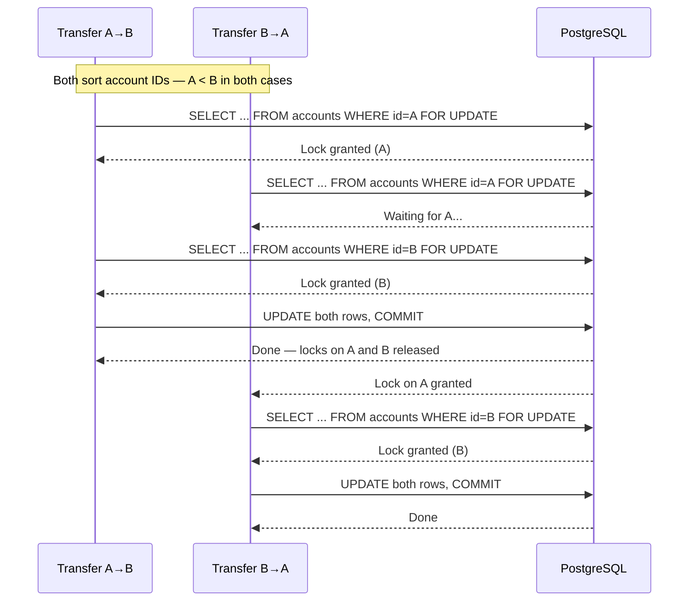

# القفل التشاؤمي — SELECT FOR UPDATE والأقفال الاستشارية

## نظرة عامة

يفترض القفل التشاؤمي الأسوأ: معاملة أخرى على وشك لمس الصف نفسه، فتحصل قاعدة البيانات على قفل حصري لحظة قراءتك له. وفي أنظمة الدفع ليس هذا ارتيابًا — بل الافتراض الصحيح لأي عملية تتجاوز فيها كلفة التعارض كلفة الانتظار. فالقفل التفاؤلي يربح عندما تكون التعارضات نادرة؛ والقفل التشاؤمي يربح عندما لا تكون كذلك، وعندما لا تتحمل الصحة الظاهرة للمستخدم حلقة إعادة محاولة.

## أهداف التعلم

- شرح دلالات `SELECT FOR UPDATE` و`SKIP LOCKED` و`NOWAIT` ومتى تختار كلًا منها
- تنفيذ `@Lock(LockModeType.PESSIMISTIC_WRITE)` على دالة مستودع في Spring Data
- منع الجمود في تدفقات تحويل الأموال بفرض ترتيب أقفال قياسي
- وصف كيف يكتشف PostgreSQL الجمود عبر خوارزمية مخطط الانتظار
- استخدام الأقفال الاستشارية في PostgreSQL لانتخاب القائد الموزع وحصرية المهام الخلفية
- استعلام `pg_locks` و`pg_stat_activity` لتشخيص التنازع على الأقفال في الإنتاج

## سياق العمل

*مثال مركّب:* يتعرض معالج مدفوعات بريطاني متوسط الحجم لحادث P1 أثناء التسوية الجماعية في نهاية الشهر. فقد أعادت مهمة دفعية محاولة 12,000 سجل دفع فاشل بينما كانت مهمة المطابقة تعمل بالتزامن. واستخدمت المهمتان القفل التفاؤلي بإعادة محاولة واحدة. ولأن 94% من السجلات كانت متنازعًا عليها من المهمتين في آن واحد، انفجر معدل التعارض إلى 87% ودخلت كل إعادة محاولة الصفوف الساخنة نفسها مجددًا. فأصدر النظام 3.1 ضعف كتابات قاعدة البيانات المتوقعة قبل أن يُستنفد مجمع الاتصالات. وتأخرت التسوية 47 دقيقة، ففاتت موعد تسوية داخلي وأطلقت مراجعة حادث رسمية.

خلصت مراجعة ما بعد الحادث إلى أن المهمة الدفعية — التي عالجت الصفوف تتابعيًا ولم تحتج قط وصولًا متزامنًا إلى الصف *نفسه* من خيطين — كان ينبغي أن تستخدم `SELECT FOR UPDATE SKIP LOCKED` من البداية. فهذا الشكل غير حاجب كليًا: كل عامل يحجز صفًا حصريًا ويتخطى أي صف حجزه نظير بالفعل. ودفع الحادث الفريق إلى فرض القفل التشاؤمي على كل المستهلكين الدفعيين وحصر القفل التفاؤلي في التعديلات الآنية التي يبدؤها المستخدم على حسابات منخفضة التنازع.

## SELECT FOR UPDATE: أقفال صفوف حصرية

يضيف `SELECT FOR UPDATE` قفلًا حصريًا على كل صف في مجموعة النتائج قبل إعادتها إلى التطبيق. ولا تستطيع أي معاملة أخرى الحصول على قفل متعارض على تلك الصفوف حتى تلتزم المعاملة الممسكة أو تتراجع. وتبقى الصفوف مرئية لاستعلامات `SELECT` العادية (يستخدم PostgreSQL ‏MVCC للقراء)، لكن أي محاولة لقفلها — بما فيها `SELECT FOR UPDATE` آخر — ستُحجب.

```sql
-- PostgreSQL: lock one account row for the duration of this transaction
BEGIN;
SELECT id, balance, version
  FROM accounts
 WHERE id = $1
   FOR UPDATE;

UPDATE accounts
   SET balance = balance - $2
 WHERE id = $1;

COMMIT;
```

في JPA المكافئ هو `LockModeType.PESSIMISTIC_WRITE`. صرّح بدالة مستودع مخصصة ليكون قصد القفل صريحًا في موضع الاستدعاء.

```java
@Repository
public interface AccountRepository extends JpaRepository<Account, UUID> {

    // Standard read — no lock
    Optional<Account> findById(UUID id);

    // Exclusive lock — must be called inside a transaction
    @Lock(LockModeType.PESSIMISTIC_WRITE)
    @Query("SELECT a FROM Account a WHERE a.id = :id")
    Optional<Account> findByIdForUpdate(@Param("id") UUID id);
}
```

```java
@Service
@RequiredArgsConstructor
public class WithdrawalService {

    private final AccountRepository accountRepository;

    @Transactional
    public void withdraw(UUID accountId, BigDecimal amount) {
        Account account = accountRepository.findByIdForUpdate(accountId)
            .orElseThrow(() -> new AccountNotFoundException(accountId));

        if (account.getBalance().compareTo(amount) < 0) {
            throw new InsufficientFundsException(accountId, amount);
        }

        account.setBalance(account.getBalance().subtract(amount));
        // JPA flushes the UPDATE on commit; the lock is released at that point
    }
}
```

> [!IMPORTANT]
> يجب استدعاء `findByIdForUpdate` داخل دالة `@Transactional` نفسها التي تجري التحديث. فخارج المعاملة يرفض Hibernate الاستعلام القافل بـ `TransactionRequiredException`. والأسوأ هو الحالة الصامتة: إذا عمل استدعاء المستودع وحده في معاملة صغيرة خاصة به، يُحرر القفل لحظة عودة ذلك الاستدعاء — قبل تحديثك — فلا يحمي شيئًا.

## SKIP LOCKED وNOWAIT

يوفر PostgreSQL شكلين غير حاجبين لحالات استخدام محددة.

**`SKIP LOCKED`** يتخطى الصفوف المقفلة بالفعل بدل انتظارها. وهذا الخيار الصحيح لمستهلكي طوابير العمل: فعدة خيوط تستطيع معالجة صفوف مستقلة بالتوازي دون أي تنازع.

```java
@Repository
public interface PaymentJobRepository extends JpaRepository<PaymentJob, UUID> {

    // Claim up to 50 unprocessed jobs; skip any already claimed by a peer worker
    @Lock(LockModeType.PESSIMISTIC_WRITE)
    @QueryHints(@QueryHint(name = "jakarta.persistence.lock.timeout", value = "-2"))
    @Query("""
        SELECT j FROM PaymentJob j
         WHERE j.status = com.example.payments.JobStatus.PENDING
         ORDER BY j.createdAt
         LIMIT 50
        """)
    List<PaymentJob> claimNextBatch();
}
```

قيمة التلميح `-2` تُترجم إلى `FOR UPDATE SKIP LOCKED` في لهجة PostgreSQL في Hibernate. والقيمة `0` تُترجم إلى `FOR UPDATE NOWAIT`. (يتطلب `LIMIT` في استعلام JPQL ‏Hibernate 6؛ وفي الإصدارات الأقدم استخدم استعلامًا أصليًا.) وتبقى الصفوف المحجوزة مقفلة فقط حتى تنتهي المعاملة، فعالجها — أو علّمها `PROCESSING` — داخل تلك المعاملة.

**`NOWAIT`** يرمي خطأً فورًا إذا كان أي صف في النتيجة مقفلًا بالفعل. استخدمه للعمليات الظاهرة للمستخدم حيث يكون إجباره على الانتظار غير مقبول — فيستطيع التطبيق إعادة 409 Conflict سريعًا بدل التعلق حتى يلتزم الممسك.

```java
@Lock(LockModeType.PESSIMISTIC_WRITE)
@QueryHints(@QueryHint(name = "jakarta.persistence.lock.timeout", value = "0"))
@Query("SELECT a FROM Account a WHERE a.id = :id")
Optional<Account> findByIdNowait(@Param("id") UUID id);
```

```java
@Transactional
public void processUserTransfer(UUID accountId, BigDecimal amount) {
    try {
        Account account = accountRepository.findByIdNowait(accountId)
            .orElseThrow(() -> new AccountNotFoundException(accountId));
        // ... debit logic
    } catch (PessimisticLockingFailureException ex) {
        // Another request is mid-flight on this account; tell the caller to retry
        throw new AccountTemporarilyUnavailableException(accountId);
    }
}
```

> [!NOTE]
> القيمة `-2` خاصة بـ Hibernate. وفي نشر PostgreSQL تُترجم `jakarta.persistence.lock.timeout = 0` إلى `FOR UPDATE NOWAIT` و`-2` إلى `FOR UPDATE SKIP LOCKED` (استخدم Spring Boot 2 / ‏Hibernate 5 الاسم `javax.persistence.*`). وتحقق دائمًا من الـ SQL المولّد بعد ترقية Hibernate أو تغيير مزود قاعدة البيانات.

## منع الجمود: ترتيب الأقفال القياسي

يحدث الجمود عندما تمسك المعاملة A قفلًا تريده المعاملة B، بينما تمسك B قفلًا تريده A. وفي تحويلات الأموال — التي يجب أن تقفل صفّي حسابين — الخطر حقيقي: فتحويلان متزامنان في اتجاهين متعاكسين سيتجمدان إذا قفلت كل معاملة حسابها المصدر أولًا.

```
Transfer A→B: locks account A, then tries to lock account B  ─┐
Transfer B→A: locks account B, then tries to lock account A  ─┴─ DEADLOCK
```

يكتشف PostgreSQL الجمود بمخطط الانتظار (مخطط موجّه حيث تعني الحافة من T1 إلى T2 أن T1 ينتظر قفلًا يمسكه T2). والعملية التي انتظرت قفلًا أطول من `deadlock_timeout` (ثانية واحدة افتراضيًا) تفحص المخطط؛ فإذا وجدت دورة، تُتراجع إحدى المعاملات برمز الخطأ `40P01`. لذلك يكلّف الجمود ثانية على الأقل من التعلق قبل رمي الخطأ.

تقنية المنع الكلاسيكية هي **ترتيب الأقفال القياسي**: احصل على الأقفال دائمًا بالترتيب العام نفسه. ولتحويلات الحسابات رتّب بمعرّف الحساب قبل القفل. فإذا حصلت كل معاملة على الـ UUID الأصغر أولًا، تصبح الدورة في مخطط الانتظار مستحيلة بنيويًا.

```java
@Service
@RequiredArgsConstructor
public class TransferService {

    private final AccountRepository accountRepository;

    @Transactional
    public void transfer(UUID fromId, UUID toId, BigDecimal amount) {
        if (fromId.equals(toId)) {
            throw new IllegalArgumentException("Source and destination must differ");
        }
        // Canonical ordering: lock the account with the smaller UUID value first.
        // Both transfer directions will acquire locks in the same order,
        // making a deadlock cycle impossible.
        UUID firstId  = fromId.compareTo(toId) < 0 ? fromId : toId;
        UUID secondId = fromId.compareTo(toId) < 0 ? toId   : fromId;

        Account first  = accountRepository.findByIdForUpdate(firstId)
            .orElseThrow(() -> new AccountNotFoundException(firstId));
        Account second = accountRepository.findByIdForUpdate(secondId)
            .orElseThrow(() -> new AccountNotFoundException(secondId));

        // Re-map to semantic roles now that both rows are safely locked
        Account source      = first.getId().equals(fromId) ? first  : second;
        Account destination = first.getId().equals(fromId) ? second : first;

        if (source.getBalance().compareTo(amount) < 0) {
            throw new InsufficientFundsException(source.getId(), amount);
        }

        source.setBalance(source.getBalance().subtract(amount));
        destination.setBalance(destination.getBalance().add(amount));
    }
}
```



> [!WARNING]
> يمنع الترتيب القياسي الجمود فقط داخل مسار شيفرة واحد. فإذا حصلت خدمة ثالثة على أقفال الصفوف نفسها بترتيب مختلف — مثلًا مهمة مطابقة خلفية ترتّب بـ `account_number` بدل UUID — سيظل الجمود يحدث بين الخدمات. افرض ترتيب الأقفال عبر *كل* الخدمات التي تلمس الجداول نفسها ووثّق القاعدة في سجل قرار معماري مشترك. ولاحظ أن "الترتيب بـ UUID" نفسه ليس قاعدة واحدة تلقائيًا: فـ `UUID.compareTo` في Java يقارن النصفين كأعداد long *بإشارة*، وقد يختلف ذلك عن `ORDER BY` في PostgreSQL على عمود `uuid`. والشكل الأكثر أمانًا قفل كل الصفوف في جملة واحدة — `SELECT ... WHERE id IN (...) ORDER BY id FOR UPDATE` — فيُطبق ترتيب قاعدة البيانات نفسه في كل مكان.

## الأقفال الاستشارية في PostgreSQL

الأقفال الاستشارية (advisory locks) أقفال على مستوى التطبيق يديرها PostgreSQL لكن خارج نظام قفل الصفوف/الجداول كليًا. ولا تحمل أي معنى دلالي لقاعدة البيانات؛ فهي ببساطة خانات قفل متبادل مسماة يستطيع تطبيقك الحصول عليها وتحريرها. وهي مثالية لـ:

- **انتخاب القائد الموزع**: ضمان أن نسخة واحدة فقط تشغّل مهمة مجدولة في وقت واحد عبر نشر متعدد النسخ
- **حصرية المهام الخلفية**: منع نسختين من معالجة الكيان المنطقي نفسه في آن واحد دون إمساك قفل صف طوال مدة المعالجة

المفتاح من نوع `BIGINT`. ولكائنات المجال ينتج `hashtext(key_string)::bigint` تجزئة ثابتة (تجزئة 32 بت، فقد تتصادم مفاتيح غير مرتبطة — والتصادم يجعل مهمتين تنتظران بعضهما فقط، لكن ضعه في حسبانك). واستخدم `pg_try_advisory_xact_lock` للأقفال بنطاق المعاملة (تُحرر تلقائيًا عند الالتزام/التراجع) أو `pg_try_advisory_lock` للأقفال بنطاق الجلسة التي يجب تحريرها صراحة.

```java
@Component
@RequiredArgsConstructor
public class AdvisoryLocks {

    private final JdbcTemplate jdbc;   // joins the current Spring transaction's connection

    // Transaction-scoped: automatically released when the transaction ends.
    // Must be called inside a @Transactional method.
    // Returns true if the lock was acquired; false if another holder exists.
    public boolean tryAcquireTransactionLock(long key) {
        return Boolean.TRUE.equals(jdbc.queryForObject(
                "SELECT pg_try_advisory_xact_lock(?)", Boolean.class, key));
    }
}
```

```java
@Service
@RequiredArgsConstructor
public class SettlementJobService {

    private final AdvisoryLocks       advisoryLocks;
    private final SettlementProcessor processor;

    // A fixed key ensures only one JVM instance runs settlement at a time.
    private static final long SETTLEMENT_LOCK_KEY = 0x5345544C4D4E5401L;

    @Transactional
    public void runDailySettlement(LocalDate settlementDate) {
        boolean acquired = advisoryLocks.tryAcquireTransactionLock(SETTLEMENT_LOCK_KEY);
        if (!acquired) {
            log.info("Settlement already running on another instance — skipping");
            return;
        }
        // Lock held for the duration of this transaction; released on commit
        processor.settle(settlementDate);
    }
}
```

للمعالجة الطويلة التي تمتد عبر عدة معاملات، استخدم قفلًا استشاريًا بنطاق الجلسة. وقفل الجلسة ملك *اتصال قاعدة بيانات* واحد، فيجب أن يحدث القفل والتحرير على الاتصال نفسه — لا عبر استدعاء مجمّع لكل جملة، قد يعطيك اتصالًا مختلفًا في كل مرة:

```java
// Runs outside any transaction; holds ONE dedicated connection for the lock
public void processPaymentFile(UUID fileId) throws SQLException {
    long lockKey = fileId.getMostSignificantBits() ^ fileId.getLeastSignificantBits();

    try (Connection lockConn = dataSource.getConnection()) {
        if (!tryLock(lockConn, "SELECT pg_try_advisory_lock(?)", lockKey)) {
            log.warn("File {} is already being processed on another instance", fileId);
            return;
        }
        try {
            fileProcessor.process(fileId); // may span several internal transactions
        } finally {
            // Unlock on the SAME connection that took the lock
            tryLock(lockConn, "SELECT pg_advisory_unlock(?)", lockKey);
        }
    }
}

private static boolean tryLock(Connection c, String sql, long key) throws SQLException {
    try (PreparedStatement ps = c.prepareStatement(sql)) {
        ps.setLong(1, key);
        try (ResultSet rs = ps.executeQuery()) {
            rs.next();
            return rs.getBoolean(1);
        }
    }
}
```

> [!NOTE]
> الأقفال الاستشارية بنطاق الجلسة **لا** يحررها تراجع المعاملة — بل فقط التحرير الصريح أو إغلاق الاتصال. فإذا مات التطبيق، تُغلق اتصالاته وتذهب الأقفال معها. والحالة الخطرة هي الاتصال المجمّع: إذا تُخطي التحرير، أو نُفذ على اتصال مختلف، يبقى القفل ممسوكًا من اتصال يعيش في المجمع، ربما لساعات. لهذا السبب، فضّل الأقفال الاستشارية بنطاق المعاملة كلما اتسع العمل لحدود معاملة واحدة.

## مراقبة التنازع على الأقفال

عرضان من عروض نظام PostgreSQL أساسيان لتشخيص مشكلات الأقفال في الإنتاج.

**`pg_locks`** يُظهر كل قفل ممسوك أو منتظر حاليًا عبر كل الجلسات؛ ومع الدالة `pg_blocking_pids()` يخبرك من يحجب من:

```sql
-- Find all blocked sessions and the sessions blocking them.
-- pg_blocking_pids() covers every lock type (row, table, advisory).
SELECT
    blocked.pid                          AS blocked_pid,
    left(blocked.query, 120)             AS blocked_query,
    blocking.pid                         AS blocking_pid,
    left(blocking.query, 120)            AS blocking_query,
    blocking.state                       AS blocking_state,   -- 'idle in transaction' is a red flag
    blocked.wait_event                   AS wait_event,
    now() - blocked.query_start          AS blocked_duration
FROM pg_stat_activity AS blocked
JOIN LATERAL unnest(pg_blocking_pids(blocked.pid)) AS b(pid) ON true
JOIN pg_stat_activity AS blocking
    ON blocking.pid = b.pid
ORDER BY blocked_duration DESC;
```

**`pg_stat_activity`** يوفر نص الاستعلام كاملًا ونوع حدث الانتظار. رشّح على `wait_event_type = 'Lock'` لعزل المعاملات المنتظرة على الأقفال تحديدًا:

```sql
SELECT
    pid,
    usename,
    application_name,
    state,
    wait_event_type,
    wait_event,
    now() - query_start  AS query_age,
    left(query, 120)     AS query_snippet
FROM pg_stat_activity
WHERE wait_event_type = 'Lock'
ORDER BY query_age DESC;
```

أضف تنبيهًا عندما تنتظر أي معاملة أطول من 5 ثوانٍ. ففي نظام سليم تحت حمل عادي يجب أن تكون انتظارات الأقفال أقل من مللي ثانية؛ والانتظارات بالثواني تدل على غياب الترتيب القياسي، أو معاملة طويلة تمسك أقفالًا، أو قفزة حمل غير متوقعة.

```java
@Component
public class LockWaitMetrics {

    private final JdbcTemplate jdbc;
    private final AtomicInteger waiting = new AtomicInteger();

    public LockWaitMetrics(JdbcTemplate jdbc, MeterRegistry meterRegistry) {
        this.jdbc = jdbc;
        // Register the gauge ONCE; it reads the AtomicInteger on every scrape.
        // (Re-registering inside the scheduled method would return the first
        //  gauge again, frozen on its first value.)
        Gauge.builder("db.lock.waiting_transactions", waiting, AtomicInteger::get)
             .description("Transactions currently waiting for a lock")
             .register(meterRegistry);
    }

    @Scheduled(fixedDelay = 10_000)
    public void recordLockWaitCount() {
        Integer count = jdbc.queryForObject("""
            SELECT COUNT(*)
              FROM pg_stat_activity
             WHERE wait_event_type = 'Lock'
            """, Integer.class);
        waiting.set(count != null ? count : 0);
    }
}
```

> [!WARNING]
> احذر عند تشغيل استعلامات تشخيص الأقفال على قاعدة بيانات إنتاجية محمّلة بكثافة. فـ `pg_locks` و`pg_stat_activity` عروض افتراضية، لكن ربطهما على نسخة بـ 1,000 اتصال قد يستهلك وقت معالج ملحوظًا. ويجب أن تعمل على الخادم **الرئيسي** — فمعلومات الأقفال لكل خادم، ولا تستطيع النسخة الاحتياطية رؤية أقفال الرئيسي — فاستخدم مجمع اتصالات صغيرًا مخصصًا مع `statement_timeout`، ولا تستطلع أكثر من مرة كل بضع ثوانٍ.

## اختبار المعرفة

**س1: يجب أن تخصم نقطة واجهة دفع من حساب وتعيد ردًا خلال 200 مللي ثانية. وصف الحساب مقفل حاليًا من معاملة أخرى أمسكته 150 مللي ثانية. أي شكل يجب أن تستخدم — `FOR UPDATE` أم `FOR UPDATE NOWAIT` أم `FOR UPDATE SKIP LOCKED` — ولماذا؟**

استخدم `FOR UPDATE NOWAIT`. فيجب ألا تنتظر النقطة مدة مجهولة حتى يحرر الممسك. ويجعل `NOWAIT` قاعدة PostgreSQL ترمي خطأً فورًا، تترجمه الخدمة إلى رد HTTP 409 Conflict. ويستطيع العميل إعادة المحاولة بعد تراجع قصير. ولا ينطبق `SKIP LOCKED` هنا لأن النقطة يجب أن تعالج *هذا الحساب بعينه*، لا أي صف متاح من مجمع. و`FOR UPDATE` العادي سيُحجب حتى يلتزم الممسك، فينتهك على الأرجح اتفاقية الـ 200 مللي ثانية. (والحل الوسط `SET LOCAL lock_timeout = '50ms'` قبل القراءة القافلة: انتظار قصير محدود بدل لا شيء.)

**س2: تستخدم خدمتان ترتيب الأقفال القياسي، لكن خدمة التحويل ترتّب بـ UUID بينما حُدّثت خدمة المطابقة مؤخرًا لترتّب بـ `account_number` ‏(VARCHAR). هل ما زال الجمود ممكنًا؟**

نعم. يمنع الترتيب القياسي الجمود فقط عندما يستخدم *كل* المشاركين الترتيب *نفسه*. فالترتيب بـ UUID قد ينتج الترتيب [A, B] لحسابين. والترتيب بـ `account_number` قد ينتج [B, A] للحسابين نفسيهما. وهذا يخلق الشروط الكلاسيكية لدورة في مخطط الانتظار. والإصلاح وضع قاعدة ترتيب عامة واحدة — UUID أو بديل رقمي ثابت — وفرضها عبر دالة مكتبة مشتركة مثل `LockOrderingUtils.sortForLocking(List<UUID> ids)` تستخدمها كل خدمة.

## التحدي العملي

تشغّل شركة تقنية مالية ناشئة منصة إقراض صغير. وكل مساء تعالج مهمة دفعية حتى 50,000 سجل سداد قرض. وتعمل المهمة عبر أربع نسخ، تسحب كل منها سجلات من جدول PostgreSQL ‏`loan_repayments(id UUID, loan_id UUID, status TEXT, amount NUMERIC, due_at TIMESTAMPTZ)`. وتكون للسجلات `status = 'PENDING'` أثناء انتظار المعالجة.

**المهمة 1 — الحجز دون تنازع.** نفّذ دالة مستودع في Spring Data ‏`claimNextBatch(int batchSize)` تختار حتى `batchSize` سجلًا بحالة PENDING، وتقفلها بـ `SKIP LOCKED` فلا تتنافس النسخ، وتعيد السجلات المحجوزة. وقدّم استعلام SQL الأصلي وتوقيع دالة المستودع بتعليقات JPA المناسبة.

**المهمة 2 — تحويل متزامن آمن.** عند معالجة سداد، يجب أن تخصم المهمة الدفعية من صف `wallet_accounts` للمقترض وتقيّد لصف المقرض في معاملة واحدة. ويجب قفل الصفين قبل تعديل أي رصيد. نفّذ `RepaymentProcessor.applyRepayment(UUID borrowerId, UUID lenderId, BigDecimal amount)` بترتيب أقفال قياسي صحيح. وأظهر كيف ترتّب المعرّفين قبل استدعاء `findByIdForUpdate`.

**المهمة 3 — حارس مهمة حصري.** يجب أن تشغّل نسخة واحدة فقط مهمة احتساب الفائدة اليومية. نفّذ `InterestAccrualJob.run(LocalDate date)` باستخدام قفل استشاري بنطاق المعاملة. واشتق مفتاح القفل حتميًا من اسم المهمة والتاريخ باستخدام `hashtext('interest_accrual:' || date::text)::bigint`. وقدّم الاستعلام الأصلي ودالة الخدمة.

**المهمة 4 — تنبيه المراقبة.** اكتب استعلام SQL يعيد، لكل جدول مشارك حاليًا في انتظار قفل، اسم الجدول، وعدد المعاملات المحجوبة، وأقصى مدة انتظار. واشرح كيف ستعرض هذا كمقياس Gauge في Micrometer داخل تطبيق Spring Boot وأي عتبة تنبيه ستضبط لنظام دفع باتفاقية P99 ‏500 مللي ثانية.

<!-- KNOWLEDGE-CHECK
{
  "questions": [
    {
      "text": "يجب أن تخصم نقطة واجهة دفع من حساب محدد وتعيد ردًا خلال 200 مللي ثانية. وصف الحساب مقفل حاليًا من معاملة أخرى أمسكته 150 مللي ثانية. أي شكل من SELECT FOR UPDATE يجب أن تستخدم ولماذا؟",
      "options": [
        "FOR UPDATE — انتظر تحرير القفل؛ إمساك 150 مللي ثانية يعني أن الحساب سيصبح حرًا في الوقت المناسب",
        "FOR UPDATE SKIP LOCKED — تخطَّ هذا الحساب وعالج حسابًا آخر من المجمع",
        "FOR UPDATE NOWAIT — ارمِ خطأً فورًا لتعيد الخدمة 409 سريعًا، فيعيد العميل المحاولة بعد تراجع قصير بدل التعلق وانتهاك الاتفاقية",
        "SELECT عادي دون قفل — لا تحتاج النقطة تعديل الصف لفحص الرصيد"
      ],
      "correct": 2,
      "explanation": "يجعل FOR UPDATE NOWAIT قاعدة PostgreSQL ترمي خطأً فورًا إذا كان أي صف في النتيجة مقفلًا بالفعل. فتلتقط الخدمة PessimisticLockingFailureException وتعيد HTTP 409 Conflict، فيعيد العميل المحاولة. أما FOR UPDATE فسيُحجب مدة مجهولة — فزمن الإمساك المتبقي لدى الممسك مجهول وقد يتجاوز بسهولة اتفاقية الـ 200 مللي ثانية. وSKIP LOCKED ينطبق على طوابير العمل حيث يُقبل أي صف متاح، لا على نقاط يجب أن تعالج حسابًا بعينه."
    },
    {
      "text": "تستخدم خدمتان ترتيب الأقفال القياسي، لكن خدمة التحويل ترتّب بـ UUID بينما حُدّثت خدمة المطابقة مؤخرًا لترتّب بـ account_number ‏(VARCHAR). هل يمكن أن يحدث جمود بينهما؟",
      "options": [
        "لا — ما زالت الخدمتان تحصلان على قفلين بالضبط، فإجمالي عدد الأقفال يمنع الدورات",
        "نعم — الترتيب بـ UUID قد ينتج [A, B] بينما الترتيب بـ account_number قد ينتج [B, A] للحسابين نفسيهما، فتنشأ دورة في مخطط الانتظار",
        "لا — خوارزمية اكتشاف الجمود في PostgreSQL تحل هذا تلقائيًا خلال ثانية",
        "نعم — لكن فقط عندما تشغّل الخدمتان المعاملة نفسها بالضبط بالتزامن، وهذا نادر"
      ],
      "correct": 1,
      "explanation": "يمنع الترتيب القياسي الجمود فقط عندما يستخدم كل المشاركين الترتيب نفسه. فإذا أنتج ترتيب UUID ‏[A, B] لكن ترتيب account_number أنتج [B, A] للحسابين A وB، تتوفر شروط الجمود الكلاسيكية: الخدمة 1 تقفل A ثم تنتظر B، والخدمة 2 تقفل B ثم تنتظر A — دورة. والإصلاح قاعدة ترتيب عامة واحدة تُفرض عبر دالة مشتركة LockOrderingUtils.sortForLocking() تستخدمها كل خدمة تلمس الجداول نفسها."
    },
    {
      "text": "ما حالة الاستخدام الصحيحة للأقفال الاستشارية بنطاق المعاملة (pg_try_advisory_xact_lock) مقابل الأقفال الاستشارية بنطاق الجلسة (pg_try_advisory_lock)، وما الخطر التشغيلي لاستخدام أقفال الجلسة؟",
      "options": [
        "أقفال نطاق المعاملة للعمليات على صف واحد؛ وأقفال نطاق الجلسة للعمليات متعددة الجداول",
        "أقفال نطاق المعاملة تُحرر تلقائيًا عند الالتزام/التراجع وتُفضّل عندما يتسع العمل لمعاملة واحدة؛ وأقفال نطاق الجلسة تستمر عبر المعاملات ولا يحررها التراجع — فإذا تُخطي التحرير أو نُفذ على اتصال مجمّع مختلف، يبقى القفل ممسوكًا من اتصال يعيش في المجمع",
        "أقفال الجلسة أكفأ لأنها تتجنب إعادة الحصول على القفل في كل إعادة محاولة للمعاملة",
        "أقفال نطاق المعاملة لا تُستخدم إلا مع FOR UPDATE بينما تعمل أقفال الجلسة مستقلة"
      ],
      "correct": 1,
      "explanation": "الأقفال الاستشارية بنطاق المعاملة (pg_try_advisory_xact_lock) تُحرر تلقائيًا عند التزام المعاملة أو تراجعها. وأقفال نطاق الجلسة (pg_try_advisory_lock) ملك اتصال قاعدة بيانات واحد، وتستمر عبر المعاملات ويجب تحريرها صراحة بـ pg_advisory_unlock على الاتصال نفسه. والخطر الحرج هو تجميع الاتصالات: التحرير المتخطى، أو التحرير المرسل على اتصال مجمّع مختلف، يترك القفل ممسوكًا من اتصال يبقى حيًا في المجمع. ففضّل أقفال نطاق المعاملة كلما اتسع العمل لمعاملة واحدة."
    }
  ]
}
-->

<!-- PRACTICAL-CHALLENGE
{
  "title": "تنفيذ القفل التشاؤمي لمعالج دفعي متعدد النسخ لسداد القروض",
  "difficulty": "advanced",
  "estimatedMinutes": 45,
  "tasks": [
    {"id": "1", "description": "نفّذ دالة مستودع في Spring Data ‏claimNextBatch(int batchSize) لجدول loan_repayments تختار حتى batchSize سجلًا بحالة PENDING باستخدام FOR UPDATE SKIP LOCKED فلا تتنافس عدة نسخ على الصفوف نفسها. وقدّم استعلام SQL الأصلي وتوقيع دالة المستودع بتعليقات @Lock و@QueryHints و@Query. واشرح لماذا SKIP LOCKED صحيح هنا بدل NOWAIT."},
    {"id": "2", "description": "نفّذ RepaymentProcessor.applyRepayment(UUID borrowerId, UUID lenderId, BigDecimal amount) الذي يخصم من صف wallet_accounts للمقترض ويقيّد لصف المقرض في معاملة واحدة. ويجب قفل الصفين قبل تعديل أي رصيد. ونفّذ ترتيب الأقفال القياسي بترتيب الـ UUIDين قبل استدعاء findByIdForUpdate. واشرح في تعليق شيفرة لماذا يمنع هذا الترتيب الجمود عندما يشمل سدادان متزامنان المحفظتين نفسيهما في دورين متعاكسين."},
    {"id": "3", "description": "نفّذ InterestAccrualJob.run(LocalDate date) باستخدام قفل استشاري بنطاق المعاملة. واشتق مفتاح القفل حتميًا باستخدام hashtext('interest_accrual:' || date::text)::bigint عبر استعلام أصلي. ويجب أن تفحص المهمة نتيجة القفل وتسجّل رسالة إذا كانت نسخة أخرى تعمل بالفعل، وتعود فورًا دون معالجة. وقدّم مكوّن الاستعلام ودالة الخدمة كليهما."},
    {"id": "4", "description": "اكتب استعلام SQL على pg_locks وpg_stat_activity يعيد: table_name وblocked_transaction_count وmax_wait_duration_ms لكل الجداول المشاركة حاليًا في انتظارات أقفال. ونفّذ هذا كمقياس Gauge في Micrometer يُحدّث كل 10 ثوانٍ باستخدام @Scheduled. واضبط عتبة تنبيه: لاتفاقية P99 ‏500 مللي ثانية، عند أي max_wait_duration_ms يجب إطلاق تنبيه P2؟ وبرر عتبتك بالإشارة إلى قانون Little وأزمنة إمساك الأقفال النموذجية."}
  ]
}
-->
