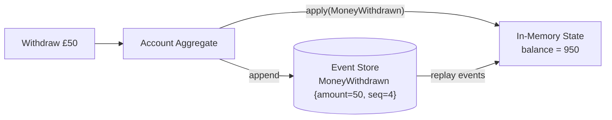

# تخزين الأحداث (Event Sourcing) للدفاتر المالية

## نظرة عامة

تخزين الأحداث ليس تحسينًا للتخزين — بل إجابة مختلفة جوهريًا عن سؤال "ما الحقيقة؟". ففي النظام التقليدي تكون الحقيقة هي الصف الحالي في جدول الحسابات. أما في النظام القائم على تخزين الأحداث فالحقيقة هي السجل المرتب للأشياء التي *حدثت*، والرصيد مشتق تحسبه بإعادة تشغيل ذلك السجل. وفي الدفاتر المالية هذا التمييز تحويلي: تحصل على سجل تدقيق كامل غير قابل للتغيير دون جدول تدقيق منفصل، وعلى القدرة على إعادة حساب أي رصيد تاريخي في أي لحظة، وعلى نقطة تكامل طبيعية للإسقاطات اللاحقة والتقارير الرقابية.

## أهداف التعلم

- شرح كيف تُشتق الحالة بإعادة تشغيل الأحداث، ولماذا يهم ذلك لسجلات التدقيق المالية
- تصميم مخطط مخزن أحداث بتزامن تفاؤلي على أرقام التسلسل
- تنفيذ تسلسل `AccountEvent` مختوم (`sealed`) وطيّ `Account.apply` في Java 21
- بناء منطق اللقطات (snapshots) الذي يقلل كلفة إعادة التشغيل للكيانات طويلة العمر
- إسقاط الأحداث في جدول قراءة غير مطبّع يدعم استعلامات رصيد عالية الإنتاجية
- تحديد المفاضلات التي تجعل تخزين الأحداث غير مناسب للكيانات البسيطة منخفضة متطلبات التدقيق

## سياق العمل

*مثال مركّب:* يخضع بنك رقمي أوروبي لتحقيق من الجهة الرقابية المالية الوطنية بعد شكوى عميل. فقد ادعى العميل أن رسمًا خُصم مرتين من حسابه. واستطاع فريق الهندسة تأكيد الرصيد الحالي لكنه لم يستطع إعادة بناء التسلسل الدقيق للعمليات التي أدت إليه بشكل قاطع. فقد كان سجل التدقيق موجودًا، لكنه كُتب كأثر جانبي بأفضل جهد للتعديلات — فالتطبيق حدّث صف `accounts` *ثم* أدرج في `audit_log`. وفي مناسبتين ذلك الشهر، تسبب فشل اتصال بقاعدة البيانات في التزام التحديث وضياع إدراج التدقيق في إعادة محاولة قيد التنفيذ. فوجدت الجهة الرقابية حفظ السجلات غير كافٍ وأمرت بتدقيق مستقل للنظام.

أعاد البنك بناء نظام الحسابات الفرعي باستخدام تخزين الأحداث. فأصبح مخزن الأحداث مصدر الحقيقة الذي يُكتب مرة واحدة؛ وأصبح صف الرصيد إسقاطًا مشتقًا منه. وبهذه البنية يكون الرصيد وسجل التدقيق القطعة نفسها — لا نظامين منفصلين قد ينجرفان عن بعضهما. وحين عادت الجهة الرقابية لمراجعة المتابعة، استطاع الفريق إعادة بناء حالة أي حساب في أي لحظة سابقة بإعادة تشغيل أحداثه.

## أساسيات تخزين الأحداث

في النظام التقليدي يعدّل السحب صف الرصيد. وفي النظام القائم على تخزين الأحداث يُلحق السحب *سجلًا* بسجل الأحداث. ولا يُخزن الرصيد مباشرة أبدًا — بل يُحسب بطيّ سجل الأحداث من البداية (أو من لقطة).



يعالج الكيان (aggregate) الأوامر، ويتحقق من قواعد العمل، ويصدر الأحداث. ولا يقرأ حالته أبدًا من صف قابل للتغيير — بل يشتق حالته بإعادة تشغيل سجل الأحداث.

```java
// Java 21 sealed interface: exhaustive switch possible, no unknown subtypes
public sealed interface AccountEvent
    permits MoneyDeposited, MoneyWithdrawn, AccountFrozen, AccountUnfrozen {

    UUID accountId();
    long sequenceNumber();
    Instant occurredAt();
}

public record MoneyDeposited(
    UUID        accountId,
    long        sequenceNumber,
    Instant     occurredAt,
    BigDecimal  amount,
    String      reference
) implements AccountEvent {}

public record MoneyWithdrawn(
    UUID        accountId,
    long        sequenceNumber,
    Instant     occurredAt,
    BigDecimal  amount,
    String      reference
) implements AccountEvent {}

public record AccountFrozen(
    UUID        accountId,
    long        sequenceNumber,
    Instant     occurredAt,
    String      reason
) implements AccountEvent {}

public record AccountUnfrozen(
    UUID        accountId,
    long        sequenceNumber,
    Instant     occurredAt
) implements AccountEvent {}
```

## مخطط مخزن الأحداث

مخزن الأحداث جدول للإلحاق فقط. وقيد `UNIQUE(account_id, sequence_number)` هو حارس التزامن: فأمران متزامنان يحاولان كلاهما إلحاق التسلسل 7 للحساب نفسه سينتجان انتهاكًا لقيد التفرد — وهو فحص التزامن التفاؤلي.

```sql
CREATE TABLE account_events (
    id               UUID         NOT NULL DEFAULT gen_random_uuid(),
    account_id       UUID         NOT NULL,
    sequence_number  BIGINT       NOT NULL,
    event_type       TEXT         NOT NULL,
    payload          JSONB        NOT NULL,
    occurred_at      TIMESTAMPTZ  NOT NULL DEFAULT now(),

    CONSTRAINT pk_account_events PRIMARY KEY (id),
    -- This constraint IS the optimistic concurrency mechanism
    CONSTRAINT uq_account_events_seq UNIQUE (account_id, sequence_number)
);

-- No extra index needed: the UNIQUE constraint already creates a B-tree index
-- on (account_id, sequence_number), which serves replay "from snapshot + N events".
```

يجب أن يتحقق إلحاق الحدث من أن رقم التسلسل المتوقع غير مأخوذ بالفعل:

```java
@Repository
public interface AccountEventRepository extends JpaRepository<AccountEventEntity, UUID> {

    @Query("""
        SELECT e FROM AccountEventEntity e
         WHERE e.accountId = :accountId
         ORDER BY e.sequenceNumber ASC
        """)
    List<AccountEventEntity> findAllByAccountId(@Param("accountId") UUID accountId);

    @Query("""
        SELECT e FROM AccountEventEntity e
         WHERE e.accountId    = :accountId
           AND e.sequenceNumber > :afterSequence
         ORDER BY e.sequenceNumber ASC
        """)
    List<AccountEventEntity> findByAccountIdAfterSequence(
        @Param("accountId")       UUID accountId,
        @Param("afterSequence")   long afterSequence
    );

    @Query("SELECT COALESCE(MAX(e.sequenceNumber), -1) FROM AccountEventEntity e WHERE e.accountId = :accountId")
    long findMaxSequenceNumber(@Param("accountId") UUID accountId);
}
```

## تطبيق الأحداث: طيّ الكيان

لا يحمل كيان `Account` حقول حفظ قابلة للتغيير — بل فقط حالة في الذاكرة مشتقة باستدعاء `apply` لكل حدث بترتيب التسلسل. وتعبير `switch` في Java 21 مع الأنواع المختومة يجعل الطيّ شاملًا وقت الترجمة.

```java
public class Account {

    private UUID        id;
    private String      accountNumber;
    private BigDecimal  balance    = BigDecimal.ZERO;
    private boolean     frozen     = false;
    private long        version    = -1L; // last applied sequence number

    // Factory: reconstruct from an ordered event list
    public static Account reconstitute(UUID accountId, List<AccountEvent> events) {
        Account account = new Account();
        account.id = accountId;
        for (AccountEvent event : events) {
            account.apply(event);
        }
        return account;
    }

    // Apply a single event — updates in-memory state only, never persists
    public void apply(AccountEvent event) {
        switch (event) {
            case MoneyDeposited  e -> this.balance = this.balance.add(e.amount());
            case MoneyWithdrawn  e -> this.balance = this.balance.subtract(e.amount());
            case AccountFrozen   e -> this.frozen  = true;
            case AccountUnfrozen e -> this.frozen  = false;
        }
        this.version = event.sequenceNumber();
    }

    // Command handler: validate business rules, produce next event
    public MoneyWithdrawn withdraw(BigDecimal amount, String reference) {
        if (frozen) {
            throw new AccountFrozenException(id);
        }
        if (balance.compareTo(amount) < 0) {
            throw new InsufficientFundsException(id, amount);
        }
        return new MoneyWithdrawn(id, version + 1, Instant.now(), amount, reference);
    }
}
```

```java
@Service
@RequiredArgsConstructor
public class AccountCommandService {

    private final AccountEventRepository eventRepository;
    private final EventSerializer        serializer;

    @Transactional
    public void withdraw(UUID accountId, BigDecimal amount, String reference) {
        // Replay all events to reconstitute the aggregate
        List<AccountEvent> events = eventRepository
            .findAllByAccountId(accountId)
            .stream()
            .map(serializer::deserialize)
            .toList();
        if (events.isEmpty()) {
            throw new AccountNotFoundException(accountId);
        }

        Account account = Account.reconstitute(accountId, events);

        // Command → event (business rules validated here)
        MoneyWithdrawn event = account.withdraw(amount, reference);

        // Append — the UNIQUE constraint on (account_id, sequence_number)
        // rejects a concurrent writer who appended the same sequence first.
        // saveAndFlush: send the INSERT now, so the violation surfaces HERE and
        // not later at commit. We only translate and rethrow — the transaction
        // is aborted, so the caller retries in a NEW transaction.
        try {
            eventRepository.saveAndFlush(serializer.serialize(event));
        } catch (DataIntegrityViolationException ex) {
            throw new ConcurrentModificationException(
                "Concurrent write on account " + accountId + "; caller should retry", ex);
        }
    }
}
```

> [!IMPORTANT]
> فحص التزامن التفاؤلي ضمني في قيد `UNIQUE(account_id, sequence_number)`. فلا توجد عبارة `WHERE version = ?` — بل تكتشف قاعدة البيانات نفسها التعارض عندما يتسابق إلحاقان على رقم التسلسل نفسه. وهذا أبسط وأكثر أمانًا من فحوص الإصدار على مستوى التطبيق لأن قاعدة البيانات تفرضه ذريًا.

## اللقطات: إبقاء إعادة التشغيل فعّالة

تصبح إعادة تشغيل كل حدث منذ إنشاء الحساب مكلفة للحسابات طويلة العمر. فحساب بـ 10,000 حدث يتطلب 10,000 استدعاء لـ `apply` في كل أمر. وتحل اللقطات ذلك بحفظ حالة الكيان دوريًا لتبدأ إعادة التشغيل من اللقطة بدل البداية.

```sql
CREATE TABLE account_snapshots (
    account_id       UUID         NOT NULL,
    sequence_number  BIGINT       NOT NULL,  -- highest event applied
    state            JSONB        NOT NULL,  -- serialised aggregate state
    created_at       TIMESTAMPTZ  NOT NULL DEFAULT now(),

    CONSTRAINT pk_account_snapshots PRIMARY KEY (account_id, sequence_number)
);

-- The primary key index (account_id, sequence_number) also finds the latest
-- snapshot per account (B-tree indexes can be scanned backwards).
```

```java
@Service
@RequiredArgsConstructor
public class SnapshotService {

    private static final int SNAPSHOT_THRESHOLD = 100; // events between snapshots

    private final AccountSnapshotRepository snapshotRepository;
    private final AccountEventRepository    eventRepository;
    private final SnapshotSerializer        snapshotSerializer;
    private final EventSerializer           eventSerializer;

    // Load aggregate: start from snapshot if available, replay remaining events
    public Account load(UUID accountId) {
        Optional<AccountSnapshotEntity> snapshotEntity =
            snapshotRepository.findLatestByAccountId(accountId);

        Account account;
        long    replayFromSequence;

        if (snapshotEntity.isPresent()) {
            account             = snapshotSerializer.deserialize(snapshotEntity.get());
            replayFromSequence  = snapshotEntity.get().getSequenceNumber();
        } else {
            account             = new Account();
            replayFromSequence  = -1L;
        }

        List<AccountEvent> tail = eventRepository
            .findByAccountIdAfterSequence(accountId, replayFromSequence)
            .stream()
            .map(eventSerializer::deserialize)
            .toList();

        tail.forEach(account::apply);
        return account;
    }

    // Called after a command succeeds — snapshot if threshold crossed
    @Transactional
    public void maybeSnapshot(Account account) {
        long eventsSinceLastSnapshot =
            account.getVersion() % SNAPSHOT_THRESHOLD;

        if (eventsSinceLastSnapshot == 0) {
            AccountSnapshotEntity snapshot =
                snapshotSerializer.serialize(account);
            snapshotRepository.save(snapshot);
        }
    }
}
```

> [!NOTE]
> اللقطات تحسين للأداء، لا متطلب للصحة. فيجب أن يبقى النظام صحيحًا حتى لو حُذفت كل اللقطات — فسجل الأحداث الكامل هو دائمًا المصدر المرجعي. وتحقق من ذلك دوريًا بتشغيل مهمة مطابقة تعيد حساب الأرصدة من الأحداث الخام وتقارنها بأحدث لقطة.

## الإسقاطات والارتباط بـ CQRS

إعادة تشغيل الأحداث في كل استعلام قراءة غير عملية على نطاق واسع. وتحل الإسقاطات (projections) مشكلة جانب القراءة: يحافظ مستهلك أحداث على جدول قراءة غير مطبّع يُحدّث بشكل غير متزامن مع إلحاق الأحداث.

```sql
CREATE TABLE account_balance_projection (
    account_id          UUID           NOT NULL PRIMARY KEY,
    balance             NUMERIC(19, 4) NOT NULL,
    frozen              BOOLEAN        NOT NULL DEFAULT FALSE,
    last_event_seq      BIGINT         NOT NULL,
    updated_at          TIMESTAMPTZ    NOT NULL
);
```

```java
@Component
@RequiredArgsConstructor
public class AccountBalanceProjector {

    // Named parameters (:id) need NamedParameterJdbcTemplate, not JdbcTemplate
    private final NamedParameterJdbcTemplate jdbc;

    // Called by an event consumer (e.g., a Kafka listener or outbox poller)
    public void on(AccountEvent event) {
        switch (event) {
            case MoneyDeposited e  -> credit(e.accountId(), e.amount(),  e.sequenceNumber());
            case MoneyWithdrawn e  -> debit(e.accountId(),  e.amount(),  e.sequenceNumber());
            case AccountFrozen  e  -> setFrozen(e.accountId(), true,     e.sequenceNumber());
            case AccountUnfrozen e -> setFrozen(e.accountId(), false,    e.sequenceNumber());
        }
    }

    // Every update accepts ONLY the next event: last_event_seq = seq - 1
    private void credit(UUID id, BigDecimal amount, long seq) {
        int rows = jdbc.update("""
            INSERT INTO account_balance_projection
                        (account_id, balance, last_event_seq, updated_at)
                 SELECT :id, :amount, :seq, now()
                  WHERE :seq = 0                       -- a new row only for the first event
            ON CONFLICT (account_id) DO UPDATE
                SET balance        = account_balance_projection.balance + EXCLUDED.balance,
                    last_event_seq = EXCLUDED.last_event_seq,
                    updated_at     = now()
              WHERE account_balance_projection.last_event_seq = EXCLUDED.last_event_seq - 1
            """,
            Map.of("id", id, "amount", amount, "seq", seq));
        if (rows == 0 && seq > 0) {
            rows = jdbc.update("""
                UPDATE account_balance_projection
                   SET balance = balance + :amount, last_event_seq = :seq, updated_at = now()
                 WHERE account_id = :id AND last_event_seq = :seq - 1
                """, Map.of("id", id, "amount", amount, "seq", seq));
        }
        requireApplied(rows, id, seq);
    }

    private void debit(UUID id, BigDecimal amount, long seq) {
        int rows = jdbc.update("""
            UPDATE account_balance_projection
               SET balance        = balance - :amount,
                   last_event_seq = :seq,
                   updated_at     = now()
             WHERE account_id     = :id
               AND last_event_seq = :seq - 1
            """,
            Map.of("id", id, "amount", amount, "seq", seq));
        requireApplied(rows, id, seq);
    }

    private void setFrozen(UUID id, boolean frozen, long seq) {
        int rows = jdbc.update("""
            UPDATE account_balance_projection
               SET frozen         = :frozen,
                   last_event_seq = :seq,
                   updated_at     = now()
             WHERE account_id     = :id
               AND last_event_seq = :seq - 1
            """,
            Map.of("id", id, "frozen", frozen, "seq", seq));
        requireApplied(rows, id, seq);
    }

    // 0 rows means: a duplicate (already applied → ignore) or a GAP (an earlier
    // event is missing → fail, so the consumer retries later instead of skipping it)
    private void requireApplied(int rows, UUID id, long seq) {
        if (rows == 1) return;
        List<Long> last = jdbc.queryForList(
            "SELECT last_event_seq FROM account_balance_projection WHERE account_id = :id",
            Map.of("id", id), Long.class);
        if (!last.isEmpty() && last.get(0) >= seq) return;   // duplicate
        throw new ProjectionGapException(id, last.isEmpty() ? null : last.get(0), seq);
    }
}
```

يقبل الحارس `WHERE last_event_seq = :seq - 1` الحدث *التالي* فقط. فيجعل الإسقاط idempotent — إعادة تشغيل حدث طُبّق بالفعل لا أثر لها، وهذا حرج لمستهلكي الأحداث مرة واحدة على الأقل — ويرفض أيضًا القفز إلى الأمام.

> [!WARNING]
> التسليم خارج الترتيب ممكن في الأنظمة الموزعة. فالحارس الأضعف مثل `last_event_seq < :seq` يحمي من التكرارات لا من الفجوات: إذا وصل الحدث 7 قبل الحدث 6، يطبّق 7 ثم يرفض 6 كقديم، فيبقى الإسقاط خاطئًا إلى الأبد. أما الحارس الصارم `last_event_seq = :seq - 1` فيرفض الحدث 7 بـ `ProjectionGapException`، فيعيد المستهلك محاولته لاحقًا (بعد 6). ولجعل الفجوات نادرة أصلًا، قسّم مستهلكي الأحداث حسب `account_id` فتُعالج كل أحداث الحساب الواحد بالترتيب.

## المفاضلات ومتى لا تستخدم تخزين الأحداث

يضيف تخزين الأحداث تعقيدًا كبيرًا. وقبل اعتماده تحقق من أن التعقيد مبرر.

| الاهتمام | التفصيل |
|---|---|
| تطور المخطط | تغيير شكل نوع حدث سابق يتطلب استراتيجية ترحيل. فالأحداث غير القابلة للتغيير لا يمكن تعديلها في مكانها؛ فيجب إما إصدار أنواع الأحداث أو استخدام محوّلات ترقية (upcasters) تحوّل أشكال الأحداث القديمة عند القراءة. |
| الكلفة التشغيلية للقطات | يجب إبطال اللقطات وإعادة بنائها كلما تغير منطق apply في الكيان. وخطأ في `Account.apply` قد يفسد كل لقطة بصمت. |
| تعقيد الاستعلام | الاستعلامات العشوائية على مخزن الأحداث مكلفة. فيجب أن تمر كل التقارير عبر إسقاطات، يجب بناؤها وصيانتها صراحة. |
| عدم نضج الأدوات | تفترض معظم أدوات ORM والترحيل حالة قابلة للتغيير. والكيانات القائمة على تخزين الأحداث تتطلب بنية مخصصة للتحميل والحفظ وأخذ اللقطات. |

**استخدم تخزين الأحداث عندما:**
- تتطلب المتطلبات الرقابية أو التعاقدية سجل تدقيق كاملًا غير قابل للتغيير
- يكون منطق العمل معقدًا بما يكفي لأن تكون لمعرفة *لماذا* الرصيد على ما هو عليه قيمة تشغيلية
- يكون المجال مبنيًا حول وقائع حدثت (مدفوعات، وصفقات، ومطالبات) لا حول الحالة الحالية

**لا تستخدم تخزين الأحداث عندما:**
- يكون الكيان بسيطًا ومتطلبات التدقيق مغطاة بالتقاط تغيير البيانات القياسي في قاعدة البيانات
- يفتقر الفريق إلى الخبرة في صيانة أنظمة تخزين الأحداث — فالعبء التشغيلي ليس هيّنًا

## اختبار المعرفة

**س1: لحساب 5,000 حدث ولا لقطات. ويصل أمر بسحب 100 جنيه. كم استعلام SQL يُنفذ قبل التحقق من الأمر وإلحاق الحدث الجديد؟ وماذا يفعل كل استعلام؟**

استعلامان. الأول `SELECT` يجلب كل صفوف `AccountEventEntity` الـ 5,000 مرتبة بـ `sequence_number` للحساب `account_id` المعني. فيعيد التطبيق تشغيلها في الذاكرة لإعادة بناء كيان `Account`، مشغّلًا دالة `apply` ‏5,000 مرة. والثاني `INSERT` في `account_events` لحدث `MoneyWithdrawn` الجديد. ولو وُجدت لقطة عند التسلسل 4,900، لجلب الاستعلام الأول 100 صف فقط ولعملت إعادة التشغيل 100 مرة بدل 5,000. وهذه بالضبط المشكلة التي تحلها اللقطات.

**س2: يعالج محدّث الإسقاط الأحداث من موضوع Kafka. وبسبب إعادة توازن مجموعة مستهلكين في Kafka، سُلّم حدث التسلسل 12 للحساب A مرتين. ما الذي يمنع الإسقاط من تطبيق خصم مزدوج؟**

الشرط `WHERE last_event_seq = :seq - 1` في جملة `UPDATE`. ففي التسليم الأول يكون `last_event_seq` هو 11، فالشرط 11 = 12 − 1 صحيح ويُنفذ التحديث. وبعد التحديث يصبح `last_event_seq` هو 12. وفي التسليم الثاني (المكرر) يكون 12 = 11 خاطئًا ويؤثر `UPDATE` في صفر صفوف؛ فيرى المُسقِط أن 12 طُبّق بالفعل ويتجاهل الرسالة. فالإسقاط idempotent: إعادة تشغيل أي حدث طُبّق بالفعل لا أثر لها على الرصيد المخزن.

## التحدي العملي

يجب أن تعيد منصة استثمار منظَّمة بناء نظام حسابات النقد الفرعي بعد أن حدد تدقيق رقابي ثغرات في سجل التدقيق. فالنظام الحالي يخزن الأرصدة الحالية فقط وسجل تدقيق بأفضل جهد. ومتطلبات النظام الجديد:

**المهمة 1 — تسلسل الأحداث.** صمم واجهة `sealed` باسم `CashAccountEvent` بأربعة أنواع record ملموسة على الأقل مناسبة لحسابات الاستثمار (إيداعات، وسحوبات، وأرباح أسهم، ورسوم المنصة). وضمّن كل الحقول اللازمة لإعادة بناء الرصيد في أي لحظة.

**المهمة 2 — الإلحاق مع التحكم بالتزامن.** نفّذ `CashAccountEventStore.append(CashAccountEvent event)`. ويجب أن تلتقط الدالة انتهاك قيد التفرد على `(account_id, sequence_number)` وترمي `ConcurrentAppendException` مُنمّطًا يتضمن رقم التسلسل المتعارض. والمستدعي مسؤول عن إعادة تحميل الكيان وإعادة المحاولة.

**المهمة 3 — استعلام الرصيد التاريخي.** نفّذ `CashAccountQueryService.balanceAt(UUID accountId, Instant pointInTime)`. ويجب أن تعيد الدالة تشغيل الأحداث ذات `occurred_at <= pointInTime` فقط. ولا تستخدم لقطة — فيجب حساب النتيجة كليًا من سجل الأحداث الخام لضمان الدقة. وهذه الدالة التي يستخدمها فريق التدقيق الرقابي.

**المهمة 4 — كشف فجوات الإسقاط.** يتلقى مستهلك الإسقاط الأحداث خارج الترتيب بشكل متقطع. نفّذ مهمة مطابقة ليلية `ProjectionReconciliationJob` تحسب، لكل حساب، الرصيد من الأحداث الخام وتقارنه بـ `account_balance_projection.balance`. وسجّل أي فرق كخطأ مع معرّف الحساب، والرصيد من الأحداث، والرصيد المُسقَط، والفرق. واشرح لماذا يكشف حارس التسلسل التالي الصارم (`last_event_seq = seq - 1`) فجوات قد يتخطاها حارس `last_event_seq < seq` بصمت.

<!-- KNOWLEDGE-CHECK
{
  "questions": [
    {
      "text": "لحساب 5,000 حدث ولا لقطات. ويصل أمر سحب. كم استعلام SQL يُنفذ قبل إلحاق الحدث الجديد، وماذا يفعل كل استعلام؟",
      "options": [
        "استعلام واحد — INSERT واحد يُلحق الحدث الجديد دون الحاجة لإعادة تشغيل التاريخ",
        "ثلاثة استعلامات — SELECT لأحدث تسلسل، وSELECT لكل الأحداث، وINSERT للحدث الجديد",
        "استعلامان — SELECT يجلب كل صفوف AccountEventEntity الـ 5,000 لإعادة التشغيل (لإعادة بناء الكيان)، يليه INSERT لحدث MoneyWithdrawn الجديد",
        "5,001 استعلام — واحد لكل حدث تاريخي بالإضافة إلى INSERT واحد"
      ],
      "correct": 2,
      "explanation": "دون لقطة، يجب أن تعيد خدمة الأوامر تشغيل سجل الأحداث كاملًا لإعادة بناء الكيان. الاستعلام 1: ‏SELECT لكل صفوف AccountEventEntity الـ 5,000 مرتبة بـ sequence_number للحساب — فيعيد التطبيق تشغيلها في الذاكرة مستدعيًا apply() ‏5,000 مرة. الاستعلام 2: ‏INSERT لحدث MoneyWithdrawn الجديد. ويعمل قيد UNIQUE(account_id, sequence_number) كفحص التزامن التفاؤلي — فالكاتب المتزامن الذي يُلحق التسلسل نفسه ينتج DataIntegrityViolationException (يظهر فورًا مع saveAndFlush). وتقلل اللقطات الاستعلام 1 إلى جلب الأحداث بعد تسلسل اللقطة فقط."
    },
    {
      "text": "يتلقى محدّث الإسقاط حدث التسلسل 12 للحساب A مرتين بسبب إعادة توازن مجموعة مستهلكين في Kafka. ما الذي يمنع الإسقاط من تطبيق خصم مزدوج؟",
      "options": [
        "قيد UNIQUE(account_id, sequence_number) على account_events يرفض التكرار",
        "الشرط WHERE last_event_seq = :seq - 1 في جملة UPDATE — ففي التسليم الثاني يكون last_event_seq هو 12 بالفعل، فيكون 12 = 11 خاطئًا ويؤثر UPDATE في صفر صفوف",
        "يزيل @KafkaListener في مستهلك الإسقاط التكرار تلقائيًا بإزاحة القسم",
        "إعداد enable.idempotence=true في Kafka يمنع تسليم الحدث نفسه مرتين"
      ],
      "correct": 1,
      "explanation": "يقبل الحارس WHERE last_event_seq = :seq - 1 الحدث التالي فقط، فيجعل تحديثات الإسقاط idempotent. التسليم الأول: last_event_seq = 11، والشرط 11 = 12 − 1 صحيح، فيُطبق الخصم ويُحدّث last_event_seq إلى 12. التسليم الثاني (المكرر): last_event_seq = 12، والشرط 12 = 11 خاطئ، فيؤثر UPDATE في صفر صفوف، ويتجاهل المُسقِط الحدث المطبّق بالفعل. ويرفض الحارس نفسه أيضًا الحدث الذي يصل مبكرًا جدًا (فجوة) بدل تخطي الحدث المفقود."
    },
    {
      "text": "متى لا يكون تخزين الأحداث مناسبًا لكيان مالي، رغم فوائد سجل التدقيق؟",
      "options": [
        "عندما يكون للكيان أكثر من 100 حدث — فتصبح اللقطات أعقد من أن تُصان",
        "عندما يكون الكيان بسيطًا بمتطلبات تدقيق منخفضة، ويفتقر الفريق إلى خبرة تخزين الأحداث، ويستطيع التقاط تغيير البيانات القياسي تلبية متطلب سجل التدقيق — فلا يكون العبء التشغيلي لتطور المخطط وإدارة اللقطات وصيانة الإسقاطات مبررًا",
        "عندما يُشارك الكيان بين عدة خدمات مصغرة — فتخزين الأحداث يتطلب مالكًا واحدًا",
        "عندما يجب أن يدعم النظام استعلامات الرصيد التاريخي — فتخزين الأحداث يجعل استعلامات نقطة زمنية مكلفة جدًا"
      ],
      "correct": 1,
      "explanation": "يضيف تخزين الأحداث تعقيدًا كبيرًا: يتطلب تطور المخطط محوّلات ترقية أو أنواع أحداث بإصدارات، ويجب إبطال اللقطات عند تغير منطق apply()، وتتطلب الاستعلامات العشوائية إسقاطات صريحة، وتفترض معظم أدوات ORM حالة قابلة للتغيير. وهذه الكلفة مبررة عندما تتطلب المتطلبات الرقابية سجل تدقيق كاملًا غير قابل للتغيير، أو عندما تكون لمعرفة لماذا الرصيد على ما هو عليه قيمة تشغيلية، أو عندما يكون المجال مبنيًا حول وقائع حدثت. وللكيانات البسيطة بمتطلبات تدقيق قياسية يكون CDC في قاعدة البيانات أبسط وفعالًا بالقدر نفسه."
    }
  ]
}
-->

<!-- PRACTICAL-CHALLENGE
{
  "title": "إعادة بناء نظام حسابات النقد الفرعي لمنصة استثمار باستخدام تخزين الأحداث",
  "difficulty": "advanced",
  "estimatedMinutes": 45,
  "tasks": [
    {"id": "1", "description": "صمم واجهة مختومة CashAccountEvent بأربعة أنواع record ملموسة مناسبة لحسابات الاستثمار: CashDeposited وCashWithdrawn وDividendCredited وPlatformFeeCharged. ويجب أن يتضمن كل record كل الحقول اللازمة لإعادة بناء الرصيد في أي لحظة (accountId وsequenceNumber وoccurredAt وamount وreference). ونفّذ Account.apply() كتعبير switch شامل باستخدام مطابقة أنماط الأنواع المختومة في Java 21."},
    {"id": "2", "description": "نفّذ CashAccountEventStore.append(CashAccountEvent event) التي تُدرج في account_events وتلتقط DataIntegrityViolationException على قيد UNIQUE(account_id, sequence_number)، وتعيد رميه كـ ConcurrentAppendException مُنمّط يتضمن رقم التسلسل المتعارض ورسالة توجّه المستدعي لإعادة تحميل الكيان وإعادة المحاولة."},
    {"id": "3", "description": "نفّذ CashAccountQueryService.balanceAt(UUID accountId, Instant pointInTime) التي تعيد تشغيل الأحداث ذات occurred_at <= pointInTime فقط من سجل الأحداث الخام دون استخدام أي لقطة. فهذه دالة التدقيق الرقابي — والدقة غير قابلة للتفاوض. واكتب اختبارًا يرحّل 10 أحداث بطوابع زمنية معروفة، ثم يستعلم balanceAt() عند طوابع بين الأحداث، مؤكدًا الرصيد الوسيط الصحيح عند كل نقطة."},
    {"id": "4", "description": "نفّذ ProjectionReconciliationJob التي تستعلم، لكل حساب، سجل الأحداث الكامل لحساب الرصيد من الأحداث، ثم تقارنه بـ account_balance_projection.balance. وسجّل الفروق مع account_id وevent_sourced_balance وprojected_balance وdifference_cents. واشرح لماذا يكشف حارس التسلسل التالي الصارم (last_event_seq = seq - 1) فجوات التسليم خارج الترتيب التي قد يتخطاها حارس last_event_seq < seq بصمت."}
  ]
}
-->
