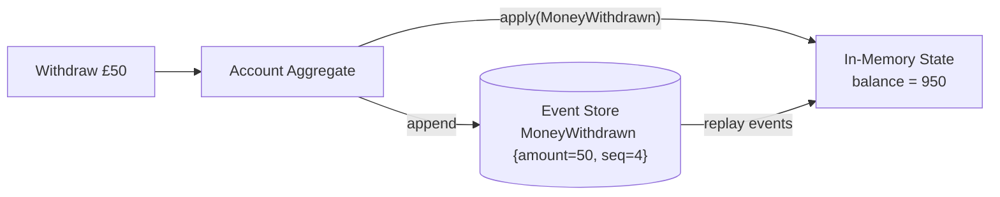

## Overview

Event sourcing is not a storage optimisation — it is a fundamentally different answer to the question "what is the truth?" In a conventional system the truth is the current row in the accounts table. In an event-sourced system the truth is the ordered log of things that *happened*, and the balance is a derivative you compute by replaying that log. For financial ledgers this distinction is transformative: you get a full, immutable audit trail without a separate audit table, the ability to recompute any historical balance at any point in time, and a natural integration point for downstream projections and regulatory reports.

## Learning Objectives

- Explain how state is derived by replaying events, and why this matters for financial audit trails
- Design an event store schema with optimistic concurrency on sequence numbers
- Implement a `sealed` `AccountEvent` hierarchy and an `Account.apply` fold in Java 21
- Build snapshot logic that reduces replay cost for long-lived aggregates
- Project events into a denormalised read table that supports high-throughput balance queries
- Identify the trade-offs that make event sourcing inappropriate for simple, low-audit-requirement aggregates

## Business Context

*Composite example:* a European digital bank is investigated by its national financial regulator following a customer complaint. The customer alleged that a fee had been deducted twice from their account. The bank's engineering team could confirm the current balance but could not definitively reconstruct the exact sequence of operations that led to it. Their audit log existed, but it was written as a best-effort side effect of mutations — the application updated the `accounts` row and *then* inserted into `audit_log`. On two occasions that month, a database connection failure caused the update to commit but the audit insert to be lost in an in-flight retry. The regulator found the record-keeping inadequate and ordered an independent system audit.

The bank rebuilt the accounts subsystem using event sourcing. The event store became the write-once source of truth; the balance row became a projection derived from it. With this architecture, the balance and the audit trail are the same artefact — not two separate systems that can drift apart. By the time the regulator returned for a follow-up review, the team could reconstruct the state of any account at any past moment by replaying its events.

## Event Sourcing Fundamentals

In a conventional system, a withdrawal mutates the balance row. In an event-sourced system, a withdrawal *appends a record* to the event log. The balance is never stored directly — it is computed by folding the event log from the beginning (or from a snapshot).



The aggregate handles commands, validates business rules, and emits events. It never reads its own state from a mutable row — it derives its state by replaying the event log.

```java
// Java 21 sealed interface: exhaustive switch possible, no unknown subtypes
public sealed interface AccountEvent
    permits MoneyDeposited, MoneyWithdrawn, AccountFrozen, AccountUnfrozen {

    UUID accountId();
    long sequenceNumber();
    Instant occurredAt();
}

public record MoneyDeposited(
    UUID        accountId,
    long        sequenceNumber,
    Instant     occurredAt,
    BigDecimal  amount,
    String      reference
) implements AccountEvent {}

public record MoneyWithdrawn(
    UUID        accountId,
    long        sequenceNumber,
    Instant     occurredAt,
    BigDecimal  amount,
    String      reference
) implements AccountEvent {}

public record AccountFrozen(
    UUID        accountId,
    long        sequenceNumber,
    Instant     occurredAt,
    String      reason
) implements AccountEvent {}

public record AccountUnfrozen(
    UUID        accountId,
    long        sequenceNumber,
    Instant     occurredAt
) implements AccountEvent {}
```

## The Event Store Schema

The event store is an append-only table. The `UNIQUE(account_id, sequence_number)` constraint is the concurrency guard: two concurrent commands that both attempt to append sequence 7 for the same account will produce a unique-constraint violation — the optimistic concurrency check.

```sql
CREATE TABLE account_events (
    id               UUID         NOT NULL DEFAULT gen_random_uuid(),
    account_id       UUID         NOT NULL,
    sequence_number  BIGINT       NOT NULL,
    event_type       TEXT         NOT NULL,
    payload          JSONB        NOT NULL,
    occurred_at      TIMESTAMPTZ  NOT NULL DEFAULT now(),

    CONSTRAINT pk_account_events PRIMARY KEY (id),
    -- This constraint IS the optimistic concurrency mechanism
    CONSTRAINT uq_account_events_seq UNIQUE (account_id, sequence_number)
);

-- No extra index needed: the UNIQUE constraint already creates a B-tree index
-- on (account_id, sequence_number), which serves replay "from snapshot + N events".
```

Appending an event must check that the expected sequence number is not already taken:

```java
@Repository
public interface AccountEventRepository extends JpaRepository<AccountEventEntity, UUID> {

    @Query("""
        SELECT e FROM AccountEventEntity e
         WHERE e.accountId = :accountId
         ORDER BY e.sequenceNumber ASC
        """)
    List<AccountEventEntity> findAllByAccountId(@Param("accountId") UUID accountId);

    @Query("""
        SELECT e FROM AccountEventEntity e
         WHERE e.accountId    = :accountId
           AND e.sequenceNumber > :afterSequence
         ORDER BY e.sequenceNumber ASC
        """)
    List<AccountEventEntity> findByAccountIdAfterSequence(
        @Param("accountId")       UUID accountId,
        @Param("afterSequence")   long afterSequence
    );

    @Query("SELECT COALESCE(MAX(e.sequenceNumber), -1) FROM AccountEventEntity e WHERE e.accountId = :accountId")
    long findMaxSequenceNumber(@Param("accountId") UUID accountId);
}
```

## Applying Events: The Aggregate Fold

The `Account` aggregate holds no mutable persistence fields — only in-memory state derived by calling `apply` for each event in sequence order. The Java 21 `switch` expression with sealed types makes the fold exhaustive at compile time.

```java
public class Account {

    private UUID        id;
    private String      accountNumber;
    private BigDecimal  balance    = BigDecimal.ZERO;
    private boolean     frozen     = false;
    private long        version    = -1L; // last applied sequence number

    // Factory: reconstruct from an ordered event list
    public static Account reconstitute(UUID accountId, List<AccountEvent> events) {
        Account account = new Account();
        account.id = accountId;
        for (AccountEvent event : events) {
            account.apply(event);
        }
        return account;
    }

    // Apply a single event — updates in-memory state only, never persists
    public void apply(AccountEvent event) {
        switch (event) {
            case MoneyDeposited  e -> this.balance = this.balance.add(e.amount());
            case MoneyWithdrawn  e -> this.balance = this.balance.subtract(e.amount());
            case AccountFrozen   e -> this.frozen  = true;
            case AccountUnfrozen e -> this.frozen  = false;
        }
        this.version = event.sequenceNumber();
    }

    // Command handler: validate business rules, produce next event
    public MoneyWithdrawn withdraw(BigDecimal amount, String reference) {
        if (frozen) {
            throw new AccountFrozenException(id);
        }
        if (balance.compareTo(amount) < 0) {
            throw new InsufficientFundsException(id, amount);
        }
        return new MoneyWithdrawn(id, version + 1, Instant.now(), amount, reference);
    }
}
```

```java
@Service
@RequiredArgsConstructor
public class AccountCommandService {

    private final AccountEventRepository eventRepository;
    private final EventSerializer        serializer;

    @Transactional
    public void withdraw(UUID accountId, BigDecimal amount, String reference) {
        // Replay all events to reconstitute the aggregate
        List<AccountEvent> events = eventRepository
            .findAllByAccountId(accountId)
            .stream()
            .map(serializer::deserialize)
            .toList();
        if (events.isEmpty()) {
            throw new AccountNotFoundException(accountId);
        }

        Account account = Account.reconstitute(accountId, events);

        // Command → event (business rules validated here)
        MoneyWithdrawn event = account.withdraw(amount, reference);

        // Append — the UNIQUE constraint on (account_id, sequence_number)
        // rejects a concurrent writer who appended the same sequence first.
        // saveAndFlush: send the INSERT now, so the violation surfaces HERE and
        // not later at commit. We only translate and rethrow — the transaction
        // is aborted, so the caller retries in a NEW transaction.
        try {
            eventRepository.saveAndFlush(serializer.serialize(event));
        } catch (DataIntegrityViolationException ex) {
            throw new ConcurrentModificationException(
                "Concurrent write on account " + accountId + "; caller should retry", ex);
        }
    }
}
```

> [!IMPORTANT]
> The optimistic concurrency check is implicit in the `UNIQUE(account_id, sequence_number)` constraint. There is no `WHERE version = ?` clause — the conflict is detected by the database itself when two appends race for the same sequence number. This is simpler and safer than application-level version checks because the database enforces it atomically.

## Snapshots: Keeping Replay Efficient

Replaying every event since account creation becomes expensive for long-lived accounts. An account with 10,000 events requires 10,000 `apply` calls on every command. Snapshots solve this by periodically persisting the aggregate state so replay can start from the snapshot rather than the beginning.

```sql
CREATE TABLE account_snapshots (
    account_id       UUID         NOT NULL,
    sequence_number  BIGINT       NOT NULL,  -- highest event applied
    state            JSONB        NOT NULL,  -- serialised aggregate state
    created_at       TIMESTAMPTZ  NOT NULL DEFAULT now(),

    CONSTRAINT pk_account_snapshots PRIMARY KEY (account_id, sequence_number)
);

-- The primary key index (account_id, sequence_number) also finds the latest
-- snapshot per account (B-tree indexes can be scanned backwards).
```

```java
@Service
@RequiredArgsConstructor
public class SnapshotService {

    private static final int SNAPSHOT_THRESHOLD = 100; // events between snapshots

    private final AccountSnapshotRepository snapshotRepository;
    private final AccountEventRepository    eventRepository;
    private final SnapshotSerializer        snapshotSerializer;
    private final EventSerializer           eventSerializer;

    // Load aggregate: start from snapshot if available, replay remaining events
    public Account load(UUID accountId) {
        Optional<AccountSnapshotEntity> snapshotEntity =
            snapshotRepository.findLatestByAccountId(accountId);

        Account account;
        long    replayFromSequence;

        if (snapshotEntity.isPresent()) {
            account             = snapshotSerializer.deserialize(snapshotEntity.get());
            replayFromSequence  = snapshotEntity.get().getSequenceNumber();
        } else {
            account             = new Account();
            replayFromSequence  = -1L;
        }

        List<AccountEvent> tail = eventRepository
            .findByAccountIdAfterSequence(accountId, replayFromSequence)
            .stream()
            .map(eventSerializer::deserialize)
            .toList();

        tail.forEach(account::apply);
        return account;
    }

    // Called after a command succeeds — snapshot if threshold crossed
    @Transactional
    public void maybeSnapshot(Account account) {
        long eventsSinceLastSnapshot =
            account.getVersion() % SNAPSHOT_THRESHOLD;

        if (eventsSinceLastSnapshot == 0) {
            AccountSnapshotEntity snapshot =
                snapshotSerializer.serialize(account);
            snapshotRepository.save(snapshot);
        }
    }
}
```

> [!NOTE]
> Snapshots are a performance optimisation, not a correctness requirement. The system must remain correct even if all snapshots are deleted — the full event log is always the authoritative source. Periodically validate this by running a reconciliation job that recomputes balances from raw events and compares them against the latest snapshot.

## Projections and CQRS Connection

Replaying events on every read query is impractical at scale. Projections solve the read-side problem: an event consumer maintains a denormalised read table that is updated asynchronously as events are appended.

```sql
CREATE TABLE account_balance_projection (
    account_id          UUID           NOT NULL PRIMARY KEY,
    balance             NUMERIC(19, 4) NOT NULL,
    frozen              BOOLEAN        NOT NULL DEFAULT FALSE,
    last_event_seq      BIGINT         NOT NULL,
    updated_at          TIMESTAMPTZ    NOT NULL
);
```

```java
@Component
@RequiredArgsConstructor
public class AccountBalanceProjector {

    // Named parameters (:id) need NamedParameterJdbcTemplate, not JdbcTemplate
    private final NamedParameterJdbcTemplate jdbc;

    // Called by an event consumer (e.g., a Kafka listener or outbox poller)
    public void on(AccountEvent event) {
        switch (event) {
            case MoneyDeposited e  -> credit(e.accountId(), e.amount(),  e.sequenceNumber());
            case MoneyWithdrawn e  -> debit(e.accountId(),  e.amount(),  e.sequenceNumber());
            case AccountFrozen  e  -> setFrozen(e.accountId(), true,     e.sequenceNumber());
            case AccountUnfrozen e -> setFrozen(e.accountId(), false,    e.sequenceNumber());
        }
    }

    // Every update accepts ONLY the next event: last_event_seq = seq - 1
    private void credit(UUID id, BigDecimal amount, long seq) {
        int rows = jdbc.update("""
            INSERT INTO account_balance_projection
                        (account_id, balance, last_event_seq, updated_at)
                 SELECT :id, :amount, :seq, now()
                  WHERE :seq = 0                       -- a new row only for the first event
            ON CONFLICT (account_id) DO UPDATE
                SET balance        = account_balance_projection.balance + EXCLUDED.balance,
                    last_event_seq = EXCLUDED.last_event_seq,
                    updated_at     = now()
              WHERE account_balance_projection.last_event_seq = EXCLUDED.last_event_seq - 1
            """,
            Map.of("id", id, "amount", amount, "seq", seq));
        if (rows == 0 && seq > 0) {
            rows = jdbc.update("""
                UPDATE account_balance_projection
                   SET balance = balance + :amount, last_event_seq = :seq, updated_at = now()
                 WHERE account_id = :id AND last_event_seq = :seq - 1
                """, Map.of("id", id, "amount", amount, "seq", seq));
        }
        requireApplied(rows, id, seq);
    }

    private void debit(UUID id, BigDecimal amount, long seq) {
        int rows = jdbc.update("""
            UPDATE account_balance_projection
               SET balance        = balance - :amount,
                   last_event_seq = :seq,
                   updated_at     = now()
             WHERE account_id     = :id
               AND last_event_seq = :seq - 1
            """,
            Map.of("id", id, "amount", amount, "seq", seq));
        requireApplied(rows, id, seq);
    }

    private void setFrozen(UUID id, boolean frozen, long seq) {
        int rows = jdbc.update("""
            UPDATE account_balance_projection
               SET frozen         = :frozen,
                   last_event_seq = :seq,
                   updated_at     = now()
             WHERE account_id     = :id
               AND last_event_seq = :seq - 1
            """,
            Map.of("id", id, "frozen", frozen, "seq", seq));
        requireApplied(rows, id, seq);
    }

    // 0 rows means: a duplicate (already applied → ignore) or a GAP (an earlier
    // event is missing → fail, so the consumer retries later instead of skipping it)
    private void requireApplied(int rows, UUID id, long seq) {
        if (rows == 1) return;
        List<Long> last = jdbc.queryForList(
            "SELECT last_event_seq FROM account_balance_projection WHERE account_id = :id",
            Map.of("id", id), Long.class);
        if (!last.isEmpty() && last.get(0) >= seq) return;   // duplicate
        throw new ProjectionGapException(id, last.isEmpty() ? null : last.get(0), seq);
    }
}
```

The `WHERE last_event_seq = :seq - 1` guard accepts only the *next* event. It makes the projection idempotent — replaying an event that was already applied has no effect, which is critical for at-least-once event consumers — and it also refuses to skip ahead.

> [!WARNING]
> Out-of-order event delivery is possible in distributed systems. A weaker guard such as `last_event_seq < :seq` protects against duplicates but not against gaps: if event 7 arrives before event 6, it applies 7 and then rejects 6 as stale, leaving the projection permanently wrong. The strict guard `last_event_seq = :seq - 1` rejects event 7 with a `ProjectionGapException`, so the consumer retries it later (after 6). To make gaps rare in the first place, partition event consumers by `account_id` so all events for a given account are processed in order.

## Trade-offs and When Not to Use Event Sourcing

Event sourcing adds significant complexity. Before adopting it, verify that the complexity is justified.

| Concern | Detail |
|---|---|
| Schema evolution | Changing the shape of a past event type requires a migration strategy. Immutable events cannot be altered in place; you must either version event types or use upcasters that transform old event shapes on read. |
| Snapshot operational overhead | Snapshots must be invalidated and rebuilt whenever the aggregate's apply logic changes. A bug in `Account.apply` can corrupt every snapshot silently. |
| Query complexity | Ad-hoc queries against the event store are expensive. All reporting must go through projections, which must be explicitly built and maintained. |
| Tooling immaturity | Most ORMs and migration tools assume mutable state. Event-sourced aggregates require custom infrastructure for loading, saving, and snapshotting. |

**Use event sourcing when:**
- Regulatory or contractual requirements demand a complete, immutable audit trail
- The business logic is complex enough that knowing *why* the balance is what it is has operational value
- The domain is built around facts that happened (payments, trades, claims) rather than around current state

**Do not use event sourcing when:**
- The aggregate is simple and audit requirements are covered by standard database change-data-capture
- The team lacks experience maintaining event-sourced systems — the operational burden is non-trivial

## Knowledge Check

**Q1: An account has 5,000 events and no snapshots. A command arrives to withdraw £100. How many SQL queries execute before the command is validated and the new event is appended? What does each query do?**

Two queries. The first is a `SELECT` that fetches all 5,000 `AccountEventEntity` rows ordered by `sequence_number` for the given `account_id`. The application replays them in memory to reconstitute the `Account` aggregate, running the `apply` method 5,000 times. The second is an `INSERT` into `account_events` for the new `MoneyWithdrawn` event. If a snapshot existed at sequence 4,900, the first query fetches only 100 rows and the replay runs 100 times instead of 5,000. This is exactly the problem that snapshots solve.

**Q2: The projection updater processes events from a Kafka topic. Due to a Kafka consumer group rebalance, event sequence 12 for account A is delivered twice. What prevents the projection from applying a double debit?**

The `WHERE last_event_seq = :seq - 1` predicate in the `UPDATE` statement. On the first delivery, `last_event_seq` is 11, so the condition 11 = 12 − 1 is true and the update executes. After the update, `last_event_seq` is 12. On the second (duplicate) delivery, 12 = 11 is false and the `UPDATE` affects zero rows; the projector sees that 12 was already applied and ignores the message. The projection is idempotent: replaying any already-applied event has no effect on the stored balance.

## Practical Challenge

A regulated investment platform must rebuild its cash account subsystem after a regulatory audit identified gaps in its audit trail. The existing system stores only current balances and a best-effort audit log. Requirements for the new system:

**Task 1 — Event hierarchy.** Design a `sealed` interface `CashAccountEvent` with at least four concrete record types relevant to investment accounts (deposits, withdrawals, dividends, platform fees). Include all fields necessary to reconstruct the balance at any point in time.

**Task 2 — Append with concurrency control.** Implement `CashAccountEventStore.append(CashAccountEvent event)`. The method must catch the unique constraint violation on `(account_id, sequence_number)` and throw a typed `ConcurrentAppendException` that includes the conflicting sequence number. The caller is responsible for reloading the aggregate and retrying.

**Task 3 — Historical balance query.** Implement `CashAccountQueryService.balanceAt(UUID accountId, Instant pointInTime)`. The method must replay only events with `occurred_at <= pointInTime`. Do not use a snapshot — the result must be computed entirely from the raw event log to guarantee accuracy. This is the method used by the regulatory audit team.

**Task 4 — Projection gap detection.** The projection consumer receives events out of order intermittently. Implement a nightly reconciliation job `ProjectionReconciliationJob` that, for each account, computes the balance from raw events and compares it against `account_balance_projection.balance`. Log any discrepancy as an error with account ID, event-sourced balance, projected balance, and the difference. Explain why the strict next-sequence guard (`last_event_seq = seq - 1`) detects gaps that a `last_event_seq < seq` guard would silently skip.

<!-- KNOWLEDGE-CHECK
{
  "questions": [
    {
      "text": "An account has 5,000 events and no snapshots. A withdraw command arrives. How many SQL queries execute before the new event is appended, and what does each query do?",
      "options": [
        "One query — a single INSERT appends the new event without needing to replay history",
        "Three queries — SELECT for the latest sequence, SELECT all events, INSERT for the new event",
        "Two queries — a SELECT that fetches all 5,000 AccountEventEntity rows for replay (to reconstitute the aggregate), followed by an INSERT for the new MoneyWithdrawn event",
        "5,001 queries — one per historical event plus one INSERT"
      ],
      "correct": 2,
      "explanation": "Without a snapshot, the command service must replay the entire event log to reconstitute the aggregate. Query 1: SELECT all 5,000 AccountEventEntity rows ordered by sequence_number for the account_id — the application replays them in memory calling apply() 5,000 times. Query 2: INSERT of the new MoneyWithdrawn event. The UNIQUE(account_id, sequence_number) constraint acts as the optimistic concurrency check — a concurrent writer appending the same sequence produces a DataIntegrityViolationException (surfaced at once with saveAndFlush). Snapshots reduce query 1 to only fetching events after the snapshot sequence."
    },
    {
      "text": "The projection updater receives event sequence 12 for account A twice due to a Kafka consumer group rebalance. What prevents the projection from applying a double debit?",
      "options": [
        "The UNIQUE(account_id, sequence_number) constraint on account_events rejects the duplicate",
        "The WHERE last_event_seq = :seq - 1 predicate in the UPDATE statement — on the second delivery last_event_seq is already 12, so 12 = 11 is false and the UPDATE affects zero rows",
        "The projection consumer's @KafkaListener automatically deduplicates by partition offset",
        "Kafka's enable.idempotence=true setting prevents the same event from being delivered twice"
      ],
      "correct": 1,
      "explanation": "The WHERE last_event_seq = :seq - 1 guard accepts only the next event, which makes projection updates idempotent. First delivery: last_event_seq = 11, condition 11 = 12 − 1 is true, debit applied, last_event_seq updated to 12. Second (duplicate) delivery: last_event_seq = 12, condition 12 = 11 is false, the UPDATE affects zero rows, and the projector ignores the already-applied event. The same guard also rejects an event that arrives too early (a gap) instead of skipping the missing one."
    },
    {
      "text": "When is event sourcing NOT appropriate for a financial aggregate, despite its audit trail benefits?",
      "options": [
        "When the aggregate has more than 100 events — snapshots become too complex to maintain",
        "When the aggregate is simple with low audit requirements, the team lacks event-sourcing experience, and standard change-data-capture can satisfy the audit trail requirement — the operational burden of schema evolution, snapshot management, and projection maintenance is not justified",
        "When the aggregate is shared across multiple microservices — event sourcing requires a single owner",
        "When the system must support historical balance queries — event sourcing makes point-in-time queries too expensive"
      ],
      "correct": 1,
      "explanation": "Event sourcing adds significant complexity: schema evolution requires upcasters or versioned event types, snapshots must be invalidated when apply() logic changes, ad-hoc queries require explicit projections, and most ORMs assume mutable state. These costs are justified when regulatory requirements demand a complete immutable audit trail, when knowing why the balance is what it is has operational value, or when the domain is built around facts that happened. For simple aggregates with standard audit requirements, database CDC is simpler and equally effective."
    }
  ]
}
-->

<!-- PRACTICAL-CHALLENGE
{
  "title": "Rebuild an Investment Platform Cash Account Subsystem Using Event Sourcing",
  "difficulty": "advanced",
  "estimatedMinutes": 45,
  "tasks": [
    {
      "id": "1",
      "description": "Design a sealed interface CashAccountEvent with four concrete record types relevant to investment accounts: CashDeposited, CashWithdrawn, DividendCredited, and PlatformFeeCharged. Each record must include all fields needed to reconstruct the balance at any point in time (accountId, sequenceNumber, occurredAt, amount, reference). Implement Account.apply() as an exhaustive switch expression using Java 21 sealed type pattern matching."
    },
    {
      "id": "2",
      "description": "Implement CashAccountEventStore.append(CashAccountEvent event) that inserts into account_events and catches DataIntegrityViolationException on the UNIQUE(account_id, sequence_number) constraint, rethrowing it as a typed ConcurrentAppendException that includes the conflicting sequence number and a message instructing the caller to reload the aggregate and retry."
    },
    {
      "id": "3",
      "description": "Implement CashAccountQueryService.balanceAt(UUID accountId, Instant pointInTime) that replays ONLY events with occurred_at <= pointInTime from the raw event log without using any snapshot. This is the regulatory audit method — accuracy is non-negotiable. Write a test that posts 10 events at known timestamps, then queries balanceAt() at timestamps between events, asserting the correct intermediate balance at each point."
    },
    {
      "id": "4",
      "description": "Implement ProjectionReconciliationJob that, for each account, queries the full event log to compute the event-sourced balance, then compares it against account_balance_projection.balance. Log discrepancies with account_id, event_sourced_balance, projected_balance, and difference_cents. Explain why the strict next-sequence guard (last_event_seq = seq - 1) detects out-of-order delivery gaps that a last_event_seq < seq guard would silently skip."
    }
  ]
}
-->
