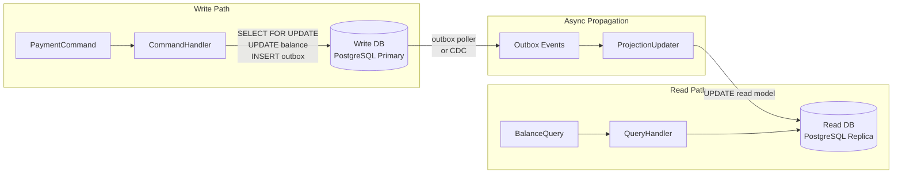

# CQRS في أنظمة الدفع — فصل الكتابة عن القراءة

## نظرة عامة

فصل مسؤولية الأوامر عن الاستعلامات (CQRS) ليس نمطًا معماريًا يحل الأداء — بل نمط يعكس بصدق أن الكتابة والقراءة في نظام دفع عالي الإنتاجية لهما متطلبات مختلفة جوهريًا. فالكتابات تحتاج عزلًا قويًا (أقفال صفوف أو معاملات serializable) واتساقًا صارمًا؛ والقراءات تحتاج زمنًا أقل من مللي ثانية على نطاق واسع، وغالبًا تخدم مئات الاستعلامات في الثانية للوحات المعلومات وتطبيقات الجوال والواجهات اللاحقة في آن واحد. ومحاولة خدمة الاثنين من مخطط مطبّع واحد تحت نموذج بيانات واحد هي السبب الجذري لمعظم مشكلات أداء القراءة في أنظمة الدفع.

## أهداف التعلم

- شرح لماذا لنموذج الكتابة ونموذج القراءة في أنظمة الدفع متطلبات اتساق غير متوافقة
- تنفيذ `PaymentCommandHandler` يعالج الأوامر على مخزن الكتابة بـ `SELECT FOR UPDATE`
- تصميم جدول قراءة غير مطبّع `AccountSummaryView` محسّن لاستعلامات الرصيد عالية التكرار
- بناء `AccountProjectionUpdater` يستهلك أحداث الـ outbox ويحافظ على نموذج القراءة بشكل غير متزامن
- ضبط مكوّنات `DataSource` منفصلة لقاعدة بيانات الكتابة (القائد) وقاعدة بيانات القراءة (النسخة) في Spring Boot
- اختبار تدفقات CQRS من طرف إلى طرف باستخدام `Awaitility` للتعامل مع الاتساق النهائي في التأكيدات

## سياق العمل

*مثال مركّب:* يعالج تطبيق خارق (super-app) في جنوب شرق آسيا 2.4 مليون معاملة دفع في الساعة أثناء تخفيضات double-11 الإقليمية. وكان لدى فريق الهندسة خادم PostgreSQL رئيسي واحد للكتابة يخدم تعديلات الدفع واستعلامات الرصيد معًا. وعند ذروة الحمل استهلكت استعلامات قراءة الرصيد — التي يطلقها تطبيق الجوال باستطلاع كل 3 ثوانٍ لملايين المستخدمين النشطين — 60% من سعة الإدخال/الإخراج في الخادم الرئيسي. (القراءات العادية لا تأخذ أقفال صفوف في PostgreSQL، لكن تشبع الإدخال/الإخراج أبطأ كل معاملة كتابة، فأُمسكت الأقفال مدة أطول.) وبلغت أزمنة انتظار الأقفال على جدول `accounts` ‏800 مللي ثانية. فتدهور زمن تفويض الدفع من P99 ‏90 مللي ثانية إلى 4.2 ثانية، وفشلت 340,000 محاولة دفع بأخطاء انتهاء مهلة خلال نافذة الذروة البالغة 90 دقيقة. وبلغت الإيرادات الضائعة ملايين.

بعد الحادث نفّذ الفريق CQRS بنسخ PostgreSQL متدفقة تخدم كل حركة القراءة، مع فاصل استطلاع أقل حدة في التطبيق. وتولى الخادم الرئيسي للكتابة التعديلات فقط. وخلال حدث double-11 في العام التالي تحت حمل أعلى، بقي زمن P99 لمسار الكتابة تحت 100 مللي ثانية ولم يُعزَ أي فشل دفع إلى التنازع في قاعدة البيانات.

## الفصل الأساسي: لماذا تحتاج المدفوعات إلى CQRS

لمسار الكتابة ومسار القراءة في نظام الدفع متطلبات متعارضة لا يمكن تلبيتها في آن واحد من نموذج بيانات واحد.

| البُعد | مسار الكتابة | مسار القراءة |
|---|---|---|
| الاتساق | قوي (أقفال أو serializable)؛ السحب على المكشوف مستحيل | نهائي؛ تأخر بأجزاء من الثانية مقبول |
| القفل | أقفال صفوف حصرية لتعديلات الرصيد | لا أقفال؛ `SELECT` عادي |
| المخطط | مطبّع؛ يفرض السلامة المرجعية | غير مطبّع؛ الرصيد مجمّع مسبقًا |
| الإنتاجية | محدودة بالتنازع على الأقفال في الحسابات الساخنة | قابلة للتوسع أفقيًا عبر النسخ |
| نمط الفشل | يجب أن يفشل بسرعة وبحزم | يستطيع خدمة بيانات قديمة برشاقة |



## جانب الأوامر

تمر كل التعديلات على حالة الحساب عبر معالج الأوامر. فيحصل المعالج على قفل حصري، ويتحقق من قواعد العمل، ويعدّل الصف، ويُلحق حدث outbox في المعاملة نفسها.

```java
public sealed interface PaymentCommand permits DebitAccountCommand, CreditAccountCommand,
                                               FreezeAccountCommand, ReversePaymentCommand {
    UUID accountId();
    UUID idempotencyKey();
}

public record DebitAccountCommand(
    UUID        accountId,
    UUID        idempotencyKey,
    BigDecimal  amount,
    String      reference,
    UUID        correlationId
) implements PaymentCommand {}
```

```java
@Service
@RequiredArgsConstructor
public class PaymentCommandHandler {

    private final AccountRepository    accountRepository;
    private final OutboxRepository     outboxRepository;
    private final IdempotencyRepository idempotencyRepository;

    @Transactional
    public void handle(DebitAccountCommand command) {
        // Idempotency guard — CLAIM first: INSERT ... ON CONFLICT DO NOTHING.
        // (exists()-then-record() is check-then-act: two concurrent duplicates
        //  could both pass the check.) A concurrent duplicate waits on the
        //  unique index until this transaction commits, then gets false.
        if (!idempotencyRepository.claim(command.idempotencyKey())) {
            log.info("Duplicate command {}; skipping", command.idempotencyKey());
            return;
        }

        // Exclusive lock — no concurrent mutation can proceed until this transaction commits
        Account account = accountRepository.findByIdForUpdate(command.accountId())
            .orElseThrow(() -> new AccountNotFoundException(command.accountId()));

        if (account.getBalance().compareTo(command.amount()) < 0) {
            throw new InsufficientFundsException(command.accountId(), command.amount());
        }

        account.setBalance(account.getBalance().subtract(command.amount()));

        // Append to outbox in the same transaction — guaranteed delivery to projection
        OutboxEvent outbox = OutboxEvent.builder()
            .aggregateId(command.accountId())
            .eventType("AccountDebited")
            .payload(toJson(command))
            .build();

        outboxRepository.save(outbox);
    }
}
```

> [!IMPORTANT]
> يجب أن يكون إدراج الـ outbox وتحديث الرصيد في معاملة قاعدة البيانات **نفسها**. فإذا فُصلا عبر عمليتين، يترك تعطل بينهما مخزن الكتابة محدّثًا والإسقاط قديمًا إلى الأبد. ويضمن نمط Outbox المعاملاتي أن ينجح الاثنان أو لا ينجح أي منهما.

## جانب القراءة: عرض غير مطبّع

نموذج القراءة ليس مخططًا علائقيًا مطبّعًا — بل إجابة محسوبة مسبقًا عن أكثر الاستعلامات التي يطرحها التطبيق شيوعًا.

```sql
CREATE TABLE account_summary_view (
    account_id              UUID           NOT NULL PRIMARY KEY,
    account_number          VARCHAR(34)    NOT NULL,
    owner_user_id           UUID           NOT NULL,
    owner_display_name      TEXT           NOT NULL,
    current_balance         NUMERIC(19, 4) NOT NULL,
    available_balance       NUMERIC(19, 4) NOT NULL,  -- balance minus pending holds
    currency_code           CHAR(3)        NOT NULL,
    frozen                  BOOLEAN        NOT NULL DEFAULT FALSE,
    last_transaction_at     TIMESTAMPTZ,
    last_transaction_amount NUMERIC(19, 4),
    monthly_debit_total     NUMERIC(19, 4) NOT NULL DEFAULT 0,
    monthly_credit_total    NUMERIC(19, 4) NOT NULL DEFAULT 0,
    updated_at              TIMESTAMPTZ    NOT NULL DEFAULT now()
);

-- Supports the common "accounts owned by user" query
CREATE INDEX ix_account_summary_view_owner
    ON account_summary_view (owner_user_id);
```

يقرأ معالج الاستعلامات حصريًا من هذا العرض — عبر مصدر بيانات **القراءة**. (مستودع Spring Data JPA سيستخدم `EntityManagerFactory` الرئيسي الوحيد، المربوط بقاعدة بيانات الكتابة، لذلك يستخدم جانب الاستعلام هنا `JdbcTemplate` خاصًا به.)

```java
@Service
public class AccountQueryHandler {

    private final JdbcTemplate readJdbc;   // bound to the READ replica

    public AccountQueryHandler(@Qualifier("readJdbcTemplate") JdbcTemplate readJdbc) {
        this.readJdbc = readJdbc;
    }

    // No transaction needed — read replica, plain SELECT
    public AccountSummaryDto getAccountSummary(UUID accountId) {
        List<AccountSummaryDto> rows = readJdbc.query(
            "SELECT * FROM account_summary_view WHERE account_id = ?",
            this::mapRow, accountId);
        if (rows.isEmpty()) {
            throw new AccountNotFoundException(accountId);
        }
        return rows.get(0);
    }

    public List<AccountSummaryDto> getAccountsForUser(UUID userId) {
        return readJdbc.query(
            "SELECT * FROM account_summary_view WHERE owner_user_id = ?",
            this::mapRow, userId);
    }
}
```

## محدّث الإسقاط

يستهلك محدّث الإسقاط أحداث الـ outbox ويطبقها على نموذج القراءة. ويعمل بشكل غير متزامن — عادة يستطلع كل 50–200 مللي ثانية. ولأن الـ outbox وعرض الملخص يعيشان في قاعدة البيانات **نفسها**، فإن تطبيق الحدث وتعليمه كمنشور يلتزمان في معاملة واحدة: يتراجع التعطل عن الاثنين، فلا يُتخطى أي حدث ولا يُطبق مرتين.

```java
@Component
@RequiredArgsConstructor
public class AccountProjectionUpdater {

    private final OutboxRepository         outboxRepository;
    private final AccountSummaryRepository summaryRepository;
    private final TransactionTemplate      tx;            // write-side transaction manager
    private final ObjectMapper             objectMapper;

    @Scheduled(fixedDelay = 100) // poll every 100 ms
    public void pollAndProject() {
        try {
            tx.executeWithoutResult(status -> {
                // FOR UPDATE SKIP LOCKED, ordered by id — locks last until commit
                List<OutboxEvent> events = outboxRepository.claimUnpublished(50);
                for (OutboxEvent event : events) {
                    applyToReadModel(event);
                    outboxRepository.markPublished(event.getId()); // same transaction
                }
            });
        } catch (Exception ex) {
            // The whole batch rolled back. A failed statement aborts a PostgreSQL
            // transaction, so we cannot "skip" one bad event and continue inside
            // it. The batch is retried on the next poll; an event that keeps
            // failing must be moved to a quarantine table by a separate job.
            log.error("Projection batch failed; will retry", ex);
        }
    }

    private void applyToReadModel(OutboxEvent event) {
        switch (event.getEventType()) {
            case "AccountDebited"  -> applyDebit(event);
            case "AccountCredited" -> applyCredit(event);
            case "AccountFrozen"   -> applyFreeze(event);
            default -> throw new IllegalStateException("Unknown event type: " + event.getEventType());
        }
    }

    private void applyDebit(OutboxEvent event) {
        DebitAccountCommand cmd = deserialize(event.getPayload(), DebitAccountCommand.class);
        summaryRepository.applyDebit(
            cmd.accountId(),
            cmd.amount(),
            event.getCreatedAt()   // when it happened — not when we projected it
        );
    }
}
```

```java
@Repository
public interface AccountSummaryRepository extends JpaRepository<AccountSummaryView, UUID> {

    @Modifying
    @Query("""
        UPDATE AccountSummaryView v SET
            v.currentBalance       = v.currentBalance - :amount,
            v.availableBalance     = v.availableBalance - :amount,
            v.lastTransactionAt    = :transactedAt,
            v.lastTransactionAmount = :amount,
            v.monthlyDebitTotal    = v.monthlyDebitTotal + :amount,
            v.updatedAt            = CURRENT_TIMESTAMP
         WHERE v.accountId = :accountId
        """)
    void applyDebit(
        @Param("accountId")    UUID accountId,
        @Param("amount")       BigDecimal amount,
        @Param("transactedAt") Instant transactedAt
    );
}
```

> [!NOTE]
> يعمل محدّث الإسقاط على قاعدة بيانات **الكتابة** — فهو يقرأ من جدول الـ outbox ويكتب في عرض الملخص، وكلاهما يعيش في جانب الكتابة. وتتلقى نسخة القراءة هذه التغييرات عبر النسخ المتدفق في PostgreSQL، عادة خلال 10–100 مللي ثانية. وهذا مسار الانتشار الذي ينشئ نافذة الاتساق النهائي. (هنا يغذي الـ outbox هذا المُسقِط فقط. وإذا كان الـ outbox نفسه يغذي أيضًا مرحّل Kafka، فأعطِ كل مستهلك علامة "منشور" خاصة به.)

## إعداد DataSource منفصل

يجب أن يوجّه Spring Boot الأوامر إلى القائد والاستعلامات إلى النسخة. استخدم مكوّنات `DataSource` منفصلة مع تعليقات المؤهلات.

```java
@Configuration
public class DataSourceConfig {

    @Bean
    @Primary
    @ConfigurationProperties("spring.datasource.write")
    public DataSource writeDataSource() {
        return DataSourceBuilder.create().build();
    }

    @Bean("readDataSource")
    @ConfigurationProperties("spring.datasource.read")
    public DataSource readDataSource() {
        return DataSourceBuilder.create().build();
    }

    @Bean
    @Primary
    public JdbcTemplate writeJdbcTemplate(@Qualifier("writeDataSource") DataSource ds) {
        return new JdbcTemplate(ds);
    }

    @Bean("readJdbcTemplate")
    public JdbcTemplate readJdbcTemplate(@Qualifier("readDataSource") DataSource ds) {
        return new JdbcTemplate(ds);
    }

    @Bean
    @Primary
    public LocalContainerEntityManagerFactoryBean entityManagerFactory(
            @Qualifier("writeDataSource") DataSource dataSource,
            EntityManagerFactoryBuilder builder) {
        return builder.dataSource(dataSource)
                      .packages("com.bank.payments.domain")
                      .build();
    }
}
```

```yaml
# application.yml
# DataSourceBuilder creates a HikariDataSource and binds these properties
# DIRECTLY to it — so the key is jdbc-url (not url), and pool settings sit at
# this level (not under "hikari:").
spring:
  datasource:
    write:
      jdbc-url: jdbc:postgresql://payments-primary.internal:5432/payments
      username: ${DB_WRITE_USER}
      password: ${DB_WRITE_PASSWORD}
      maximum-pool-size: 20
      connection-timeout: 3000
    read:
      jdbc-url: jdbc:postgresql://payments-replica.internal:5432/payments
      username: ${DB_READ_USER}
      password: ${DB_READ_PASSWORD}
      maximum-pool-size: 50       # read replica serves more concurrent queries
      connection-timeout: 1000
      read-only: true
```

> [!WARNING]
> حقن `DataSource` الخطأ في المعالج الخطأ خطأ صامت. فمعالج استعلامات يستهدف صدفة قاعدة بيانات الكتابة تحت حمل قراءة كثيف يعيد إدخال مشكلة التنازع نفسها التي اعتُمد CQRS لحلها. استخدم اختبارات تكامل تتحقق من اتصال كل معالج — استعلم الدالة `inet_server_addr()` أو `pg_is_in_recovery()` وأكد القيمة المتوقعة.

## التعامل مع الاتساق النهائي

نموذج القراءة متأخر بأجزاء من الثانية عن نموذج الكتابة. ولمعظم الاستعلامات هذا مقبول. أما لقراءة كتاباتك الخاصة (read-your-own-writes) — مستخدم يرسل دفعة ويفحص رصيده فورًا — فالتأخر ملحوظ وقد يكون مربكًا.

ثلاث استراتيجيات تعالج ذلك:

**1. وجّه القراءات الفورية إلى مخزن الكتابة.** لنافذة قصيرة بعد الكتابة (عادة 500 مللي ثانية)، وجّه استعلامات الرصيد لذلك الحساب إلى قاعدة بيانات الكتابة. وبعد تلك النافذة تكون النسخة قد لحقت عادة ويُستأنف التوجيه العادي. (الكاش أدناه لكل نسخة تطبيق؛ وخلف موازن حمل قد تصل القراءة التالية إلى نسخة أخرى، فاستخدم توجيهًا لاصقًا أو مخزنًا مشتركًا — أو فضّل الاستراتيجية 2.)

```java
@Service
@RequiredArgsConstructor
public class BalanceQueryRouter {

    private final AccountSummaryRepository readRepository;
    private final AccountRepository        writeRepository;
    private final Cache<UUID, Instant>     recentWriteCache; // Caffeine, TTL 500ms

    public AccountSummaryDto getBalance(UUID accountId) {
        if (recentWriteCache.getIfPresent(accountId) != null) {
            // Recent write detected — read from write store for consistency
            Account account = writeRepository.findById(accountId)
                .orElseThrow(() -> new AccountNotFoundException(accountId));
            return toSummaryDto(account);
        }
        return readRepository.findById(accountId)
            .map(this::toDto)
            .orElseThrow(() -> new AccountNotFoundException(accountId));
    }

    public void recordRecentWrite(UUID accountId) {
        recentWriteCache.put(accountId, Instant.now());
    }
}
```

**2. أعد الرصيد الجديد في رد الأمر.** حسب معالج الأوامر الرصيد الجديد قبل الالتزام. فأعده مباشرة في رد HTTP فلا يحتاج العميل إلى إصدار قراءة أصلًا.

**3. ضع ختم إصدار على نموذج القراءة.** ضمّن معرّف معاملة الكتابة أو تسلسل الحدث في صف نموذج القراءة. ويستطيع العميل تمرير الإصدار المتوقع كمعامل استعلام؛ فينتظر معالج الاستعلام (بمهلة) حتى يطبق نموذج القراءة ذلك الإصدار.

## اختبار CQRS بـ Awaitility

تدفقات CQRS غير متزامنة بطبيعتها. والتأكيدات المتزامنة القياسية تفشل لأن نموذج القراءة لم يُحدّث بعد عندما يؤكد الاختبار فور الأمر. استخدم `Awaitility` للاستطلاع حتى تتحقق الحالة المتوقعة.

```java
@SpringBootTest
@Transactional(propagation = Propagation.NOT_SUPPORTED) // prevent test transaction wrapping
class PaymentCqrsIntegrationTest {

    @Autowired PaymentCommandHandler   commandHandler;
    @Autowired AccountQueryHandler     queryHandler;
    @Autowired AccountRepository       accountRepository;

    @Test
    void debitCommandUpdatesReadModelWithinOneSecond() {
        // Arrange: create account with balance 500
        UUID accountId = createTestAccount(new BigDecimal("500.00"));

        DebitAccountCommand command = new DebitAccountCommand(
            accountId,
            UUID.randomUUID(),   // idempotencyKey
            new BigDecimal("150.00"),
            "TEST-REF-001",
            UUID.randomUUID()
        );

        // Act: submit command to write path
        commandHandler.handle(command);

        // Assert write store updated immediately
        Account written = accountRepository.findById(accountId).orElseThrow();
        assertThat(written.getBalance()).isEqualByComparingTo("350.00");

        // Assert read model updated within 1 second (projection runs every 100 ms)
        await()
            .atMost(1, SECONDS)
            .pollInterval(50, MILLISECONDS)
            .untilAsserted(() -> {
                AccountSummaryDto summary = queryHandler.getAccountSummary(accountId);
                assertThat(summary.currentBalance())
                    .isEqualByComparingTo("350.00");
                assertThat(summary.lastTransactionAmount())
                    .isEqualByComparingTo("150.00");
            });
    }

    @Test
    void duplicateCommandIsIdempotent() {
        UUID accountId       = createTestAccount(new BigDecimal("1000.00"));
        UUID idempotencyKey  = UUID.randomUUID();

        DebitAccountCommand command = new DebitAccountCommand(
            accountId, idempotencyKey, new BigDecimal("200.00"), "REF-002", UUID.randomUUID()
        );

        // Submit the same command twice
        commandHandler.handle(command);
        commandHandler.handle(command); // should be a no-op

        // Balance should reflect only one debit
        await()
            .atMost(1, SECONDS)
            .pollInterval(50, MILLISECONDS)
            .untilAsserted(() -> {
                AccountSummaryDto summary = queryHandler.getAccountSummary(accountId);
                assertThat(summary.currentBalance()).isEqualByComparingTo("800.00");
            });
    }
}
```

> [!NOTE]
> `Propagation.NOT_SUPPORTED` على صنف الاختبار أساسي. فإذا عمل الاختبار داخل معاملة يديرها Spring، يكون إدراج الـ outbox وتحديث الرصيد مرئيين داخل معاملة الاختبار لكن غير ملتزمين في قاعدة البيانات بعد. ومُستطلع الإسقاط، الذي يعمل في معاملته الخاصة، لا يستطيع رؤية الصفوف غير الملتزمة ولن يُسقط أبدًا. فستنتهي مهلة `await` في كل مرة.

## اختبار المعرفة

**س1: يعرض تطبيق مصرفي على الجوال رصيد الحساب فور إرسال دفعة ناجحة. ويعيد معالج الأوامر HTTP 200 لكن نموذج القراءة متأخر 200 مللي ثانية. ما الاستراتيجيات الثلاث التي تمنع المستخدم من رؤية رصيد قديم، وما مفاضلات كل منها؟**

أولًا، أعد الرصيد المحسوب في جسم رد الأمر — فالمعالج يعرف الرصيد الجديد بالفعل قبل الالتزام، فضمّنه في حمولة JSON. ويعرض العميل هذه القيمة مباشرة دون إصدار GET لاحق. والمفاضلة: يجب أن يعالج العميل الرد معالجة خاصة؛ ويبقى نموذج القراءة متسقًا نهائيًا للمستدعين الآخرين. ثانيًا، وجّه القراءة التالية للمستخدم إلى قاعدة بيانات الكتابة لمدة صلاحية قصيرة (مثلًا 500 مللي ثانية) باستخدام كاش Caffeine مفتاحه معرّف الحساب. والمفاضلة: تتلقى قاعدة بيانات الكتابة بعض حركة القراءة، فيُهزم جزئيًا هدف العزل في CQRS، وإن كان الحجم منخفضًا (قراءة واحدة لكل كتابة حديثة). ثالثًا، ضع ختم إصدار على صفوف نموذج القراءة واجعل العميل يضمّن التسلسل المتوقع في الاستعلام؛ فينتظر معالج الاستعلام حتى 500 مللي ثانية لتصل النسخة إلى ذلك الإصدار. والمفاضلة: يضيف تعقيدًا إلى واجهة الاستعلام ويربط العميل بمفاهيم التسلسل الداخلية.

**س2: يعالج محدّث الإسقاط أحداث الـ outbox كل 100 مللي ثانية. وأثناء تحول قاعدة البيانات يفشل المحدّث 45 ثانية. وعندما يتعافى الخادم الرئيسي، تكون 450 حدث outbox قد تراكمت. ما الذي يجب أن يكون صحيحًا بشأن المحدّث ليصبح نموذج القراءة متسقًا كليًا بعد التعافي، وكيف تتحقق من ذلك في اختبار؟**

يجب ألا يتخطى المحدّث حدثًا أبدًا وألا يطبق حدثًا مرتين. وفي هذا التصميم ينتج كلاهما من حقيقة واحدة: تحديث نموذج القراءة و`markPublished` يلتزمان في المعاملة **نفسها** على قاعدة البيانات نفسها، فيتراجع التعطل أو التحول عن الاثنين، ويلتقط الاستطلاع التالي الأحداث مجددًا ببساطة. (لو عاش نموذج القراءة في قاعدة بيانات مختلفة، لزال ذلك الضمان؛ وحينها ستحتاج حارس idempotency مثل فحص `last_event_seq = seq - 1` لكل حساب.) وللتحقق: في اختبار تكامل، أدرج 100 حدث outbox اصطناعي بمبالغ معروفة، وشغّل المحدّث، واقتله بعد 30 حدثًا، وأعد تشغيله، ثم أكد عبر `Awaitility` أن الأحداث الـ 100 كلها منعكسة في نموذج القراءة وأن الرصيد النهائي يساوي مجموع مبالغ الأحداث الـ 100 (لا 130).

## التحدي العملي

يعيد مزود محفظة رقمية بناء ميزة سجل المعاملات. فحاليًا يستعلم تطبيق الجوال قاعدة بيانات الكتابة مباشرة عن سجل المعاملات، مساهمًا بـ 70% من كل استعلامات قاعدة البيانات. وزمن P99 لاستعلامات السجل على قاعدة بيانات الكتابة 320 مللي ثانية.

**المهمة 1 — معالج الأوامر.** نفّذ `WalletCommandHandler.handle(TransferCommand)` حيث يحمل `TransferCommand` معرّف المرسل، ومعرّف المستلم، والمبلغ، ومفتاح idempotency. ويجب أن يخصم المعالج من المرسل ويقيّد للمستلم في معاملة واحدة باستخدام ترتيب أقفال قياسي. ويجب الالتزام ذريًا بتغييري الرصيد وبحدثَي outbox ‏(`WalletDebited` و`WalletCredited`).

**المهمة 2 — مخطط نموذج القراءة.** صمم جدول `wallet_transaction_history_view` يدعم الاستعلام "أعد آخر 50 معاملة للمحفظة X، مع الرصيد الجاري". وضمّن كل الأعمدة اللازمة لخدمة هذا الاستعلام دون ربط بأي جدول آخر. واكتب جملة `SELECT` التي سينفذها معالج الاستعلام.

**المهمة 3 — محدّث الإسقاط.** نفّذ `WalletHistoryProjectionUpdater` الذي يستهلك أحداث outbox ‏`WalletDebited` و`WalletCredited` ويحافظ على `wallet_transaction_history_view`. ويجب أن يكون المحدّث idempotent — فإذا عولج الحدث نفسه مرتين، يجب ألا يحتوي جدول السجل صفًا مكررًا.

**المهمة 4 — اختبار توجيه DataSource.** اكتب اختبار تكامل في Spring يرسل `TransferCommand` ويتحقق من أن (أ) قاعدة بيانات الكتابة تعكس الأرصدة الصحيحة فور الأمر، و(ب) نموذج القراءة يعكس سجل المعاملات الصحيح خلال ثانية، و(ج) معالج الاستعلام لا يلمس قاعدة بيانات الكتابة أبدًا — يُتحقق منه بتأكيد أن `pg_is_in_recovery()` يعيد `true` لكل اتصال يستخدمه معالج الاستعلام.

<!-- KNOWLEDGE-CHECK
{
  "questions": [
    {
      "text": "يعرض تطبيق مصرفي على الجوال رصيد الحساب فور إرسال دفعة ناجحة. ويعيد معالج الأوامر HTTP 200 لكن نموذج القراءة متأخر 200 مللي ثانية. أي استراتيجية هي الأبسط ولا تضيف أي حركة قراءة إلى قاعدة بيانات الكتابة؟",
      "options": [
        "وجّه قراءة الرصيد التالية للمستخدم إلى قاعدة بيانات الكتابة لمدة 500 مللي ثانية باستخدام كاش Caffeine مفتاحه معرّف الحساب",
        "أعد الرصيد الجديد المحسوب مباشرة في جسم رد الأمر HTTP 200 — فمعالج الأوامر يعرف الرصيد بالفعل قبل الالتزام، فيعرضه العميل دون إصدار GET لاحق",
        "ضع ختم إصدار على نموذج القراءة واجعل العميل يستطلع برقم التسلسل المتوقع حتى تلحق النسخة",
        "خفّض اتفاقية تأخر النسخ في نسخة القراءة من 200 مللي ثانية إلى 50 مللي ثانية"
      ],
      "correct": 1,
      "explanation": "إعادة الرصيد الجديد في رد الأمر لا تتطلب أي بنية إضافية، ولا تضيف حركة قراءة إلى قاعدة بيانات الكتابة، ولا تتطلب استطلاعًا من العميل. فقد حسب معالج الأوامر الرصيد الجديد (خصم مخزن الكتابة) قبل الالتزام — وتضمينه في جسم رد JSON لا يكلف شيئًا. فتُحل مشكلة قراءة كتاباتك الخاصة من المصدر. والاستراتيجيات الأخرى كلها تضيف تعقيدًا أو حركة قراءة على قاعدة بيانات الكتابة."
    },
    {
      "text": "لماذا يجب أن يستخدم اختبار تكامل CQRS التعليق @Transactional(propagation = Propagation.NOT_SUPPORTED) على مستوى صنف الاختبار بدل @Transactional الافتراضي؟",
      "options": [
        "يعطّل NOT_SUPPORTED تجميع الاتصالات فيحصل الاختبار دائمًا على اتصال قاعدة بيانات جديد",
        "إذا عمل الاختبار داخل معاملة يديرها Spring، يكون إدراج الـ outbox وتحديث الرصيد غير ملتزمين — ومُستطلع الإسقاط يعمل في معاملته الخاصة ولا يستطيع رؤية الصفوف غير الملتزمة، فتنتهي مهلة تأكيد Awaitility في كل مرة",
        "يمنع NOT_SUPPORTED ‏Hibernate من دفع الكيانات المتسخة، ما قد يفسد بيانات الاختبار",
        "يستخدم الاختبار عدة DataSources ولا يستطيع @Transactional في Spring الامتداد عبر اثنين منها"
      ],
      "correct": 1,
      "explanation": "إذا عمل الاختبار داخل حدود @Transactional في Spring، يكون إدراج الـ outbox وتحديث الرصيد مرئيين داخل معاملة الاختبار لكن غير ملتزمين في قاعدة البيانات بعد. ومُستطلع الإسقاط يعمل في معاملته المنفصلة ويستخدم عزل READ COMMITTED — فلا يستطيع رؤية الصفوف غير الملتزمة. فتستطلع كتلة await في Awaitility نموذج القراءة بلا نهاية، وتنتهي مهلتها في كل مرة. ويضمن NOT_SUPPORTED أن تلتزم كل عملية قاعدة بيانات فورًا، فتصبح البيانات مرئية للمُستطلع."
    },
    {
      "text": "يعمل محدّث الإسقاط على قاعدة بيانات الكتابة ويحدّث account_summary_view. كيف تتلقى نسخة القراءة هذه التغييرات، وما اسم نموذج الاتساق الناتج؟",
      "options": [
        "يكتب محدّث الإسقاط مباشرة في قاعدة بيانات الكتابة ونسخة القراءة في آن واحد عبر نمط كتابة مزدوجة",
        "تنشر قاعدة بيانات الكتابة التغييرات إلى نسخة القراءة عبر النسخ المتدفق في PostgreSQL (تأخر 10–100 مللي ثانية عادة)؛ وترى الاستعلامات على النسخة لقطة متسقة لكنها قديمة قليلًا — وهذا هو الاتساق النهائي",
        "تستطلع نسخة القراءة قاعدة بيانات الكتابة كل 100 مللي ثانية بحثًا عن صفوف account_summary_view جديدة باستخدام نمط مرحّل الـ outbox",
        "تُنسخ التغييرات بشكل متزامن عبر معاملات XA قبل أن يعود معالج الأوامر"
      ],
      "correct": 1,
      "explanation": "يكتب محدّث الإسقاط في account_summary_view على قاعدة بيانات الكتابة (الرئيسية). وينشر النسخ المتدفق في PostgreSQL التغييرات الملتزمة بشكل غير متزامن إلى نسخة القراءة، عادة خلال 10–100 مللي ثانية تحت الحمل العادي. وترى الاستعلامات على النسخة لقطة متسقة قد تكون متأخرة قليلًا عن الرئيسية. وهذا هو الاتساق النهائي: نموذج القراءة ليس متسقًا فورًا مع مخزن الكتابة، لكنه يتقارب إلى الاتساق خلال نافذة تأخر النسخ."
    }
  ]
}
-->

<!-- PRACTICAL-CHALLENGE
{
  "title": "بناء ميزة سجل معاملات المحفظة بـ CQRS مع توجيه DataSource",
  "difficulty": "advanced",
  "estimatedMinutes": 45,
  "tasks": [
    {"id": "1", "description": "نفّذ WalletCommandHandler.handle(TransferCommand) حيث يحمل TransferCommand ‏sender_id وrecipient_id وamount وidempotency_key. ويجب أن يخصم المعالج من المرسل ويقيّد للمستلم في معاملة واحدة باستخدام ترتيب أقفال قياسي (رتّب الـ UUIDين قبل استدعاء findByIdForUpdate). ويجب الالتزام ذريًا بتغييري الرصيد وبحدثَي outbox ‏(WalletDebited وWalletCredited). وأضف حارس idempotency بالحجز أولًا (INSERT ... ON CONFLICT DO NOTHING على مفتاح الـ idempotency، في المعاملة نفسها) قبل لمس أي محفظة."},
    {"id": "2", "description": "صمم wallet_transaction_history_view بكل الأعمدة اللازمة لخدمة 'أعد آخر 50 معاملة للمحفظة X مع الرصيد الجاري' دون ربط أي جدول آخر. والأعمدة المطلوبة: wallet_id وtransaction_id (فريد) وdirection ‏(DEBIT/CREDIT) وamount وrunning_balance_after وcounterparty_wallet_id وreference وcreated_at وevent_sequence. واكتب جملة SELECT التي ينفذها معالج الاستعلام، مرتبة بـ created_at DESC مع LIMIT 50."},
    {"id": "3", "description": "نفّذ WalletHistoryProjectionUpdater الذي يستهلك أحداث outbox ‏WalletDebited وWalletCredited ويحافظ على wallet_transaction_history_view. استخدم INSERT ... ON CONFLICT (transaction_id) DO NOTHING لجعل المحدّث idempotent — فإذا عولج الحدث نفسه مرتين، يجب ألا يحتوي جدول السجل صفًا مكررًا. واكتب اختبارًا يعالج الحدث نفسه مرتين ويؤكد وجود صف واحد بالضبط بـ COUNT(id) = 1."},
    {"id": "4", "description": "اكتب اختبار تكامل في Spring يرسل TransferCommand ويتحقق من ثلاث خصائص: (أ) تعكس قاعدة بيانات الكتابة الأرصدة الصحيحة فور عودة الأمر؛ (ب) يعكس wallet_transaction_history_view المعاملة خلال ثانية باستخدام Awaitility بفاصل استطلاع 50 مللي ثانية؛ (ج) كل اتصال JDBC يستخدمه AccountQueryHandler يستهدف نسخة القراءة — يُتحقق منه بتنفيذ SELECT pg_is_in_recovery() على DataSource الخاص بمعالج الاستعلام وتأكيد أنه يعيد true."}
  ]
}
-->
