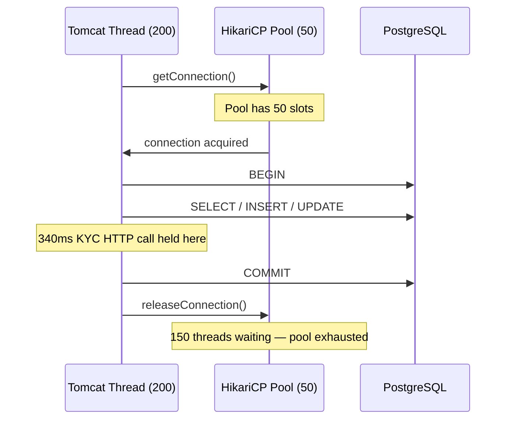
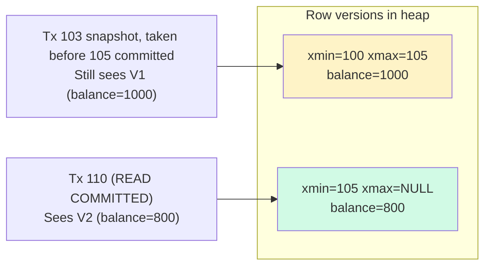

# التزامن بين قاعدة البيانات وJVM — المعاملات والعزل والكاش

## نظرة عامة

الفجوة بين أدوات التزامن في JVM ودلالات المعاملات في قاعدة البيانات من أكثر مصادر حوادث الإنتاج تكرارًا في الأنظمة المصرفية. فالخيط يمسك اتصال قاعدة بيانات طوال مدة دالة `@Transactional`، ومستويات العزل تحدد أي الشذوذات المتزامنة ممكنة، وكاش المستوى الأول في Hibernate قد يقدّم بصمت بيانات قديمة بينما تتباعد الأرصدة على الشاشة. وهذه ليست مخاوف نظرية — بل تظهر مرارًا في مراجعات ما بعد الحوادث لدى البنوك الرقمية ومعالجي المدفوعات وموردي الأنظمة المصرفية الأساسية. ويرسم هذا الدرس نقاط التفاعل الدقيقة بين Spring وHibernate وPostgreSQL لتستطيع التفكير فيها بدقة قبل أن تسبب انقطاعًا في الإنتاج.

## أهداف التعلم

في نهاية هذا الدرس ستستطيع:

- شرح لماذا يحدث استنفاد مجمع الاتصالات وكيف تغيّر الخيوط الافتراضية الحسابات
- تحديد قواعد حدود الخيوط في `@Transactional` في Spring وتجنب فخ نشر `@Async`
- اختيار مستوى العزل الصحيح لسيناريو شذوذ متزامن معين
- شرح MVCC في PostgreSQL وكيف يختلف عن العزل القائم على الأقفال
- إعادة إنتاج خطأ القراءة القديمة الذي يسببه كاش المستوى الأول في Hibernate وإصلاحه
- تطبيق `@Transactional(readOnly = true)` بشكل صحيح لتوجيه النسخ وتوفير فحص الاتساخ
- تشخيص `LazyInitializationException` وحله دون النمط المضاد OSIV

## سياق العمل

*مثال مركّب:* يتعرض بنك رقمي أوروبي يعمل على منظومة Spring Boot 3 / ‏PostgreSQL لانقطاع كامل في معالجة الدفع استمر 47 دقيقة خلال ساعات ذروة الصباح. وكان السبب الجذري استنفاد مجمع الاتصالات: فقد ضُبط HikariCP على `maximumPoolSize=50`، بينما نما مجمع خيوط Tomcat إلى 200 خيط تحت الحمل. وأمسك كل طلب HTTP وارد اتصالًا مفتوحًا 340 مللي ثانية في المتوسط بسبب استدعاء خدمة KYC لاحقة أُجري *داخل* حدود `@Transactional`. فوصل المجمع إلى صفر اتصالات متاحة، واصطفت الطلبات الجديدة، وتتالت انتهاءات المهلة، وأعادت واجهة الدفع 503 إلى 180,000 عميل.

تطلب الإصلاح ثلاثة تغييرات: نقل استدعاء KYC خارج حدود المعاملة، وتقليص مجمع خيوط Tomcat، والانتقال إلى الخيوط الافتراضية مع مجمع اتصالات بحجم السعة الحقيقية لقاعدة البيانات. واضطر البنك أيضًا إلى تعويض العملاء المتأثرين وشرح الانقطاع للجهة الرقابية.

> [!WARNING]
> لا تستدعِ أبدًا خدمة HTTP بعيدة، أو ترسل رسالة Kafka، أو تجري أي إدخال/إخراج بزمن غير متوقع داخل دالة `@Transactional`. فاتصال قاعدة البيانات يبقى مفتوحًا طوال مدة الدالة.

## مشكلة استنفاد مجمع الاتصالات

تحصل كل دالة `@Transactional` على اتصال من المجمع عند الدخول ولا تعيده إلا عند الخروج (الالتزام أو التراجع). ومع نموذج خيط لكل طلب التقليدي، يساوي خيط HTTP واحد ممسكًا محتملًا واحدًا لاتصال متزامن.



مع 200 خيط Tomcat ومجمع من 50 اتصالًا، يتوقف 150 خيطًا لحظة أخذ كل الاتصالات. والإصلاح ليس ببساطة زيادة المجمع — فلـ PostgreSQL حدود صارمة على الاتصالات المتزامنة (عادة `max_connections = 100–200` على النسخ المُدارة)، وكل اتصال عملية خلفية منفصلة تستخدم عدة ميغابايتات من ذاكرة الخادم.

**قاعدة التحجيم:** `pool_size ≈ (db_cpu_cores × 2) + effective_spindle_count`. ولنسخة RDS بـ 32 vCPU: ‏`32 × 2 = 64` اتصالًا سقف معقول.

### الخيوط الافتراضية تغيّر النموذج

الخيوط الافتراضية في Java 21 ‏(JEP 444) رخيصة: قد يوجد منها الملايين في آن واحد، وعندما يُحجب خيط افتراضي على إدخال/إخراج ينفك عن خيطه الحامل دون استهلاك خيط نظام تشغيل. وهذا يعني أنك تستطيع امتلاك آلاف الطلبات قيد التنفيذ دون آلاف خيوط نظام التشغيل. لكن **اتصالات قاعدة البيانات ما زالت موردًا محدودًا** — فالخيوط الافتراضية لا تلغي استنفاد المجمع؛ بل تجعله *أكثر* احتمالًا دون تحجيم مدروس لأن JVM يستطيع الآن إنشاء سياقات `@Transactional` متزامنة أكثر بكثير من قبل.

```properties
# application.properties — Project Loom virtual thread executor
spring.threads.virtual.enabled=true

# HikariCP — size to DB capacity, NOT to request concurrency
spring.datasource.hikari.maximum-pool-size=64
spring.datasource.hikari.minimum-idle=16
spring.datasource.hikari.connection-timeout=3000
spring.datasource.hikari.keepalive-time=60000
```

> [!NOTE]
> مع تفعيل الخيوط الافتراضية يصبح `maximumPoolSize` مقبض الضغط العكسي الأساسي. اضبطه عن قصد. ومهلة مجمع 3 ثوانٍ أفضل من اصطفاف الطلبات بصمت 30 ثانية، ما يخفي المشكلة الحقيقية.

## `@Transactional` في Spring وحدود الخيوط

يربط Spring المعاملة النشطة بـ **الخيط الحالي** عبر `TransactionSynchronizationManager`، الذي يغلّف `ThreadLocal`. ولهذا تبعة حرجة: **إطلاق خيط جديد من داخل معاملة لا ينقل تلك المعاملة إلى الخيط الجديد**.

### فخ @Async

```java
@Service
@RequiredArgsConstructor
public class PaymentService {

    private final LedgerRepository ledgerRepository;
    private final AuditService auditService;

    // BUG: @Async method does NOT participate in the caller's transaction.
    @Transactional
    public void processPayment(PaymentRequest request) {
        ledgerRepository.post(request.toJournalEntry());

        // This runs in a NEW thread managed by the @Async executor.
        // It sees its own transaction context — or none at all.
        // The audit write may commit even if the outer transaction rolls back.
        auditService.recordAsync(request.getId());
    }
}

@Service
public class AuditService {

    private final AuditRepository auditRepository;

    @Async
    @Transactional  // Opens a NEW, independent transaction on a different thread
    public void recordAsync(UUID paymentId) {
        auditRepository.save(new AuditEntry(paymentId));
        // This commits independently — orphaned audit record if payment fails.
    }
}
```

**الإصلاح الصحيح:** نفّذ كتابة التدقيق بشكل متزامن داخل المعاملة نفسها، أو انشر حدث مجال ودع outbox/مستمعًا منفصلًا يعالج التدقيق بشكل غير متزامن *بعد* التزام المعاملة.

```java
@Transactional
public void processPayment(PaymentRequest request) {
    ledgerRepository.post(request.toJournalEntry());

    // Synchronous — participates in the same transaction.
    // Both commit or both roll back together.
    auditRepository.save(new AuditEntry(request.getId()));
}
```

> [!IMPORTANT]
> `@Async` و`@Transactional` على موضع الاستدعاء نفسه يعنيان معاملتين مستقلتين على خيطين مختلفين. وهذا يكسر الذرية. فقد يبقى قيد التدقيق حتى عندما لا يبقى قيد دفتر الدفع.

## مستويات العزل وسيناريو التحديث الضائع

يدعم PostgreSQL ثلاثة مستويات عزل عملية. والافتراضي لمعظم التطبيقات — ومعظم إعدادات مصادر البيانات في Spring — هو `READ COMMITTED`.

| المستوى | القراءة القذرة | القراءة غير القابلة للتكرار | القراءة الشبحية | التحديث الضائع |
|---|---|---|---|---|
| READ COMMITTED | ممنوعة | ممكنة | ممكنة | ممكن |
| REPEATABLE READ | ممنوعة | ممنوعة | ممنوعة* | ممنوع |
| SERIALIZABLE | ممنوعة | ممنوعة | ممنوعة | ممنوع |

*يمنع REPEATABLE READ في PostgreSQL القراءات الشبحية عبر عزل لقطة MVCC.

### التحديث الضائع في READ_COMMITTED

```sql
-- Transaction A (account balance = 1000)
BEGIN;
SELECT balance FROM accounts WHERE id = 42;
-- returns 1000

-- Transaction B starts concurrently
BEGIN;
SELECT balance FROM accounts WHERE id = 42;
-- also returns 1000

-- Transaction A writes
UPDATE accounts SET balance = 1000 - 200 WHERE id = 42; -- balance = 800
COMMIT;

-- Transaction B writes (based on stale read of 1000)
-- (this UPDATE waits for A's row lock, then overwrites A's result)
UPDATE accounts SET balance = 1000 - 300 WHERE id = 42; -- balance = 700
COMMIT;

-- Final balance: 700 — the 200 debit from Transaction A is LOST
-- Correct balance should be: 1000 - 200 - 300 = 500
```

الخطأ هو القيمة *المطلقة* المحسوبة في التطبيق من قراءة قديمة. أما التحديث النسبي الشرطي — `UPDATE accounts SET balance = balance - 300 WHERE id = 42 AND balance >= 300` — فآمن حتى في `READ COMMITTED`: فبعد انتظار قفل A، يعيد PostgreSQL فحص أحدث إصدار للصف.

### REPEATABLE_READ يمنعه

تحت `REPEATABLE READ` تؤخذ لقطة المعاملة B عند أول استعلام فيها. وعندما تحاول `UPDATE`، يكتشف PostgreSQL التعارض ويرمي:

```
ERROR: could not serialize access due to concurrent update
```

يجب أن يلتقط التطبيق هذا الخطأ (SQLSTATE ‏`40001`، يعرضه Spring كنوع فرعي من `ConcurrencyFailureException`)، ويعيد المعاملة كاملة في معاملة **جديدة**، ويعيد قراءة الرصيد.

```java
@Transactional(isolation = Isolation.REPEATABLE_READ)
public void debit(UUID accountId, long amountCents) {
    Account account = accountRepository.findById(accountId)
        .orElseThrow(() -> new AccountNotFoundException(accountId));

    if (account.getBalanceCents() < amountCents) {
        throw new InsufficientFundsException(accountId);
    }

    account.setBalanceCents(account.getBalanceCents() - amountCents);
    accountRepository.save(account);
    // PostgreSQL raises a serialization failure (40001) if a concurrent
    // UPDATE has committed since this transaction's snapshot.
    // The caller must catch and retry OUTSIDE this @Transactional method.
}
```

> [!TIP]
> بدائل تتجنب إعادات المحاولة بسبب التسلسل: اقفل الصف أولًا (`SELECT ... FOR UPDATE`، الدرس 17)، أو استخدم تحديثًا نسبيًا شرطيًا (الدرس 16).

### MVCC في PostgreSQL

لا يستخدم PostgreSQL أقفال قراءة للعزل. بل يستخدم **التحكم بالتزامن متعدد الإصدارات (MVCC)**: كل إصدار صف موسوم بمعرّفي المعاملتين اللتين أنشأتاه وأنهتاه (`xmin` و`xmax`). والقراءة المتسقة مع لقطة تعيد الإصدار المرئي عند نقطة اللقطة دون حجب الكتّاب.



تُنظف إصدارات الصفوف الميتة بـ `VACUUM`. وتأخر الـ autovacuum تحت حمل كتابة كثيف سبب شائع لانتفاخ الجداول في أنظمة الدفع عالية الإنتاجية.

## كاش المستوى الأول في Hibernate والقراءات القديمة

داخل معاملة واحدة (`Session` في Hibernate)، يُخزن كل كيان محمّل بالمفتاح الأساسي في كاش المستوى الأول (سياق الحفظ). وتحميل لاحق للمعرّف نفسه يعيد الكائن المخزن دون الوصول إلى قاعدة البيانات.

```java
@Transactional
public void demonstrateStaleness(UUID accountId) {
    // First load — hits the database
    Account account = accountRepository.findById(accountId).orElseThrow();
    System.out.println(account.getBalanceCents()); // 1000

    // Another thread commits an UPDATE: balance = 800

    // Second load — returns CACHED object, no DB round-trip
    Account sameAccount = accountRepository.findById(accountId).orElseThrow();
    System.out.println(sameAccount.getBalanceCents()); // Still 1000 — STALE
}
```

**الإصلاح:** استدعِ `entityManager.refresh(entity)` لتجاهل الإصدار المخزن وإعادة التحميل من قاعدة البيانات. وللفحص الذي تعتمد عليه كتابة (مثل التفويض)، أعد التحميل *مع قفل*، فلا يتغير الصف بين الفحص والكتابة.

```java
@Service
@RequiredArgsConstructor
public class BalanceService {

    private final AccountRepository accountRepository;
    private final EntityManager entityManager;

    @Transactional   // READ COMMITTED
    public long getAuthorizedBalance(UUID accountId) {
        Account account = accountRepository.findById(accountId).orElseThrow();

        // Reload the latest committed row, bypassing the first-level cache,
        // AND lock it (SELECT ... FOR UPDATE), so no one can change it between
        // this check and the hold we insert next in the same transaction.
        // (Under REPEATABLE READ a plain refresh() would only re-read this
        //  transaction's snapshot — it could never see newer commits.)
        entityManager.refresh(account, LockModeType.PESSIMISTIC_WRITE);

        return account.getBalanceCents();
    }
}
```

> [!WARNING]
> يُصدر `entityManager.refresh()` استعلام `SELECT` على قاعدة البيانات، ويتجاهل أي تغييرات غير محفوظة على الكيان في الذاكرة. فلا تستدعه أبدًا بعد تعديل كيان وقبل حفظه — فستضيع تعديلاتك بصمت.

## `@Transactional(readOnly = true)`

تعليم المعاملة للقراءة فقط يحقق أمرين في منظومة Spring + Hibernate:

1. **يتخطى Hibernate فحص الاتساخ** وقت الدفع، إذ لا يُتوقع كتابات. وللجلسات التي تحمّل كيانات كثيرة، يتجنب هذا مسح المقارنة الكامل للكيانات عند الدفع.
2. **يوجّه Spring إلى نسخة قراءة** إذا ضُبط `LazyConnectionDataSourceProxy` مع مصدر بيانات توجيهي — نمط شائع للوحات الدفع كثيفة القراءة. وتذكر أن النسخة قد تتأخر: لا تستخدم أبدًا معاملة قراءة فقط على النسخة لقراءة تعتمد عليها كتابة لاحقة.

```java
@Service
@RequiredArgsConstructor
public class AccountQueryService {

    private final AccountRepository accountRepository;
    private final LedgerRepository ledgerRepository;

    // Routes to replica; Hibernate skips dirty checking at flush
    @Transactional(readOnly = true)
    public AccountStatement getStatement(UUID accountId, LocalDate from, LocalDate to) {
        Account account = accountRepository.findById(accountId).orElseThrow();
        // Half-open range [from, to + 1 day): no gap in the last second of the day
        List<LedgerEntry> entries = ledgerRepository
            .findByAccountIdAndCreatedAtGreaterThanEqualAndCreatedAtLessThan(
                accountId,
                from.atStartOfDay(),
                to.plusDays(1).atStartOfDay());
        return AccountStatement.of(account, entries);
    }
}
```

```java
// Replica routing datasource configuration
@Bean
@Primary
public DataSource dataSource(
        @Qualifier("primaryDataSource") DataSource primary,
        @Qualifier("replicaDataSource") DataSource replica) {
    TransactionRoutingDataSource routing = new TransactionRoutingDataSource();
    routing.setTargetDataSources(Map.of("primary", primary, "replica", replica));
    routing.setDefaultTargetDataSource(primary);
    routing.afterPropertiesSet();
    // Lazy proxy: the real connection is fetched at the first statement, when
    // the transaction's read-only flag is already known
    return new LazyConnectionDataSourceProxy(routing);
}

public class TransactionRoutingDataSource extends AbstractRoutingDataSource {
    @Override
    protected Object determineCurrentLookupKey() {
        return TransactionSynchronizationManager.isCurrentTransactionReadOnly()
            ? "replica"
            : "primary";
    }
}
```

## `LazyInitializationException` والنمط المضاد OSIV

يحمّل Hibernate ارتباطات `@OneToMany` و`@ManyToMany` بكسل افتراضيًا. والوصول إلى المجموعة خارج `Session` نشطة (معاملة) يطلق `LazyInitializationException`.

```java
// BROKEN — no transaction context in the controller layer
@GetMapping("/accounts/{id}")
public AccountDto getAccount(@PathVariable UUID id) {
    Account account = accountService.findById(id); // transaction closes here
    // Session is closed. Accessing the lazy collection throws:
    // org.hibernate.LazyInitializationException: failed to lazily initialize
    //   a collection of role: Account.entries, no session or session was closed
    account.getEntries().size(); // BOOM
}
```

### النمط المضاد OSIV

"الجلسة المفتوحة في العرض" (OSIV) تبقي جلسة Hibernate مفتوحة طوال دورة حياة طلب HTTP — بما فيها تنفيذ المتحكم وعرض الواجهة. ويفعّل Spring Boot الـ OSIV افتراضيًا (`spring.jpa.open-in-view=true`). وهذا يمنع `LazyInitializationException` لكن بكلفة إمساك اتصال قاعدة بيانات مفتوحًا أثناء مرحلة العرض، فيساهم مباشرة في مشكلة استنفاد الاتصالات الموصوفة أعلاه.

```properties
# Disable OSIV — the correct production setting for banking applications
spring.jpa.open-in-view=false
```

**الإصلاحات الصحيحة:**

```java
// Option 1: Load within a @Transactional(readOnly=true) service method
@Transactional(readOnly = true)
public AccountDto findById(UUID id) {
    Account account = accountRepository.findById(id).orElseThrow();
    // Eagerly initialise within the transaction
    Hibernate.initialize(account.getEntries());
    return AccountDto.from(account);
}

// Option 2: DTO projection — no entity loaded, no lazy associations
@Query("""
    SELECT new com.bank.dto.AccountSummaryDto(
        a.id, a.iban, a.balanceCents, COUNT(e.id)
    )
    FROM Account a
    LEFT JOIN LedgerEntry e ON e.accountId = a.id
    WHERE a.id = :accountId
    GROUP BY a.id, a.iban, a.balanceCents
    """)
AccountSummaryDto findSummaryById(@Param("accountId") UUID accountId);
```

> [!NOTE]
> إسقاطات DTO هي النمط المفضل للوحات الدفع كثيفة القراءة. فهي تنقل الأعمدة اللازمة فقط، وتتجنب كلفة إدارة دورة حياة الكيانات، وتعمل بشكل صحيح مع توجيه النسخ بـ `readOnly = true`.

## اختبار المعرفة

**س1: لدى خدمة دفع 300 خيط افتراضي تنفذ بالتزامن دوال `@Transactional` على نسخة PostgreSQL بـ `max_connections = 100`. وHikariCP مضبوط على `maximumPoolSize = 300`. ماذا سيحدث؟**

ج: سيرفض PostgreSQL محاولات الاتصال بعد حد `max_connections` بالرسالة `FATAL: sorry, too many clients already`. وسيعرض HikariCP ذلك كـ `SQLException`. وحتى لو زيد `max_connections`، يتدهور أداء PostgreSQL بحدة فوق نحو `2 × cpu_cores` استعلامًا نشطًا متزامنًا بسبب التنازع على الأقفال وتبديل السياق في العمليات الخلفية. والإعداد الصحيح `maximumPoolSize` بنحو `2 × db_cpu_cores` — أقل بكثير من `max_connections` لترك هامش لاتصالات الإدارة ووكلاء المراقبة.

**س2: دالة خدمة معلّمة بـ `@Transactional` تستدعي دالة `@Async` على مكوّن آخر. وترمي الدالة الخارجية استثناءً وتتراجع. هل سيتراجع العمل المنجز داخل دالة `@Async` أيضًا؟**

ج: لا. يشغّل `@Async` الدالة في خيط منفصل بسياق معاملة خاص به (أو بلا معاملة إذا لم تُعلّم بـ `@Transactional`). ويخزن `TransactionSynchronizationManager` في Spring المعاملة النشطة في `ThreadLocal`، لا ترثه الخيوط الأبناء. فيعمل عمل `@Async` مستقلًا، وإذا التزم قبل التراجع الخارجي فذلك الالتزام دائم. والحل الصحيح إما تنفيذ العمليتين بشكل متزامن في معاملة واحدة، أو استخدام نمط Outbox المعاملاتي لتأجيل العمل غير المتزامن حتى يلتزم التعامل الخارجي بنجاح.

## التحدي العملي

يشغّل فريقك خدمة تفويض بطاقات تعالج 2,000 تفويض في الثانية في الذروة. وتعمل الخدمة على Spring Boot 3.2 وJava 21 وHibernate 6 وPostgreSQL 15، مدعومة بنسخة RDS بـ 24 vCPU.

**المهمة 1 — تحجيم المجمع:** احسب `maximumPoolSize` الأمثل في HikariCP. وأظهر استدلالك. وأي قيمة `connection-timeout` ستضبط، ولماذا؟

**المهمة 2 — خطأ العزل:** يكشف اختبار حمل إنفاقًا مزدوجًا عرضيًا: يصبح رصيد العميل سالبًا رغم فحص في بداية المعاملة. حدد أي مستوى عزل يمنع ذلك، واكتب تعليق `@Transactional` المصحح، واشرح ما يحدث على مستوى قاعدة البيانات عند اكتشاف تعارض. ثم سمِّ بديلًا واحدًا لا يحتاج إعادات محاولة بسبب التسلسل.

**المهمة 3 — خطأ الكاش:** تحمّل خدمة التفويض كيان `Account`، وتفحص الائتمان المتاح، ثم ترحّل قيد حجز. وتحت الحمل تُستخدم أرصدة قديمة لفحص الائتمان لأن قراءة سابقة في الجلسة نفسها خزّنت الحساب. اكتب دالة الخدمة المصححة باستخدام `entityManager.refresh(account, LockModeType.PESSIMISTIC_WRITE)`. واشرح متى *لا* تستخدم `refresh()`.

**المهمة 4 — إزالة OSIV:** ‏`spring.jpa.open-in-view` قيمته `true` (الافتراضي في Spring Boot). وللخدمة نقطة REST تعيد `AccountDto` يتضمن قائمة المعاملات الأخيرة المجلوبة عبر `@OneToMany` كسول. عطّل OSIV وأعد كتابة طبقة الخدمة لإصلاح `LazyInitializationException` الناتج باستخدام استعلام JPQL بإسقاط DTO.

<!-- KNOWLEDGE-CHECK
{
  "questions": [
    {
      "text": "تشغّل خدمة دفع 300 خيط افتراضي بالتزامن، ينفذ كل منها دالة @Transactional. وHikariCP مضبوط على maximumPoolSize=300. ولـ PostgreSQL ‏max_connections=100. ماذا سيحدث؟",
      "options": [
        "الخيوط الافتراضية تتوقف بكلفة زهيدة فتستطيع الـ 300 كلها العمل بالتزامن دون بلوغ حد الاتصالات",
        "يرفض PostgreSQL الاتصالات بعد max_connections بالرسالة FATAL: sorry, too many clients already. ويعرض HikariCP ذلك كـ SQLException. والإصلاح الصحيح maximumPoolSize ≈ 2 × db_cpu_cores، أقل بكثير من max_connections",
        "يصفّ HikariCP الطلبات الزائدة داخليًا حتى تتحرر الاتصالات — فلا تحدث أخطاء",
        "يقبل PostgreSQL الاتصالات الـ 300 كلها لكنه يتدهور خطيًا — فينخفض الأداء 3 أضعاف"
      ],
      "correct": 1,
      "explanation": "يفرض PostgreSQL ‏max_connections كحد صارم. وأي محاولة اتصال بعده تفشل فورًا بـ FATAL. والخيوط الافتراضية تجعل استنفاد المجمع أكثر احتمالًا لا أقل — فهي تسمح بسياقات @Transactional متزامنة أكثر بكثير من خيوط المنصة، فيبلغ المجمع سيئ الضبط سقفه أسرع. وقاعدة التحجيم الصحيحة pool_size ≈ 2 × db_cpu_cores (لا تزامن الطلبات)، مع ترك هامش لاتصالات الإدارة. والخيوط الافتراضية ليست بديلًا عن تحجيم المجمع المدروس."
    },
    {
      "text": "دالة خدمة معلّمة بـ @Transactional تستدعي دالة @Async على مكوّن آخر. وترمي الدالة الخارجية استثناءً وتتراجع. هل سيتراجع العمل داخل دالة @Async أيضًا؟",
      "options": [
        "نعم — ينقل Spring التراجع إلى كل العمليات الأبناء بما فيها دوال @Async",
        "لا — يعمل @Async على خيط منفصل بسياق معاملة خاص به عبر ThreadLocal؛ فيعمل عمل @Async مستقلًا وإذا التزم قبل التراجع الخارجي فذلك الالتزام دائم",
        "يعتمد — إذا عُلّمت دالة @Async بـ @Transactional(propagation = MANDATORY) فستتراجع",
        "نعم — إذا استخدمت الدالتان EntityManager نفسه فهما تتشاركان المعاملة نفسها"
      ],
      "correct": 1,
      "explanation": "يخزن TransactionSynchronizationManager في Spring المعاملة النشطة في ThreadLocal. وقيم ThreadLocal لا ترثها الخيوط الأبناء. ويرسل @Async الدالة إلى خيط من مجمع خيوط منفصل يبدأ بلا سياق معاملة موروث. وإذا عُلّمت دالة @Async بـ @Transactional، فإنها تفتح معاملة جديدة مستقلة على خيطها. وتلتزم تلك المعاملة مستقلة — ولا يستطيع تراجع لاحق للمعاملة الخارجية إلغاء التزامها. فيبقى سجل التدقيق اليتيم رغم أن الدفعة لم تبقَ."
    },
    {
      "text": "ما الفائدتان المحددتان لـ @Transactional(readOnly = true) في منظومة Spring + Hibernate، وما الذي يجب ضبطه لتوجيه الاستعلامات إلى نسخة قراءة؟",
      "options": [
        "يجعل كل الاستعلامات تستخدم عزل SERIALIZABLE لاتساق أقوى؛ ويتطلب التوجيه مكوّن DataSource منفصلًا",
        "يتخطى فحص الاتساخ في Hibernate وقت الدفع (لا مسح مقارنة للكيانات في جلسات القراءة فقط)، ويوجّه إلى نسخة قراءة عندما يُضبط LazyConnectionDataSourceProxy مع TransactionRoutingDataSource يفحص TransactionSynchronizationManager.isCurrentTransactionReadOnly()",
        "يفعّل تعدد إرسال الاتصالات فتتشارك عدة استعلامات قراءة اتصال قاعدة بيانات واحدًا",
        "يخزن كل نتائج الاستعلامات تلقائيًا في كاش المستوى الثاني في Hibernate طوال مدة المعاملة"
      ],
      "correct": 1,
      "explanation": "يقدم readOnly=true فائدتين: (1) يتخطى Hibernate مسح فحص الاتساخ وقت الدفع — فللجلسات التي تحمّل كيانات كثيرة، يتجنب هذا مقارنة كل كيان محمّل بلقطته قبل إغلاق المعاملة. (2) مع LazyConnectionDataSourceProxy يغلّف TransactionRoutingDataSource يفحص isCurrentTransactionReadOnly()، يُؤجل الحصول على الاتصال حتى أول استعلام فعلي، وعندها يوجّه مصدر البيانات التوجيهي معاملات القراءة فقط إلى النسخة ومعاملات القراءة والكتابة إلى الرئيسي."
    }
  ]
}
-->

<!-- PRACTICAL-CHALLENGE
{
  "title": "إصلاح استنفاد مجمع الاتصالات وأخطاء العزل ومشكلات OSIV في خدمة تفويض بطاقات",
  "difficulty": "advanced",
  "estimatedMinutes": 45,
  "tasks": [
    {"id": "1", "description": "احسب maximumPoolSize الأمثل في HikariCP لنسخة RDS PostgreSQL بـ 24 vCPU تشغّل خدمة تفويض البطاقات. وأظهر استدلالك باستخدام الصيغة pool_size ≈ (db_cpu_cores × 2) + effective_spindle_count. واضبط connection-timeout على 3000 مللي ثانية واشرح لماذا 3 ثوانٍ أفضل من 30 ثانية كقيمة مهلة. وحدد النمط المضاد الحالي في الإنتاج حيث يعمل استدعاء HTTP لـ KYC بمهلة 10 ثوانٍ داخل حدود @Transactional واحسب كم طلبًا متزامنًا يستنفد المجمع."},
    {"id": "2", "description": "يكشف اختبار حمل إنفاقًا مزدوجًا عرضيًا: يصبح رصيد العميل سالبًا رغم فحص الرصيد غير الكافي في بداية المعاملة. اكتب تعليق @Transactional المصحح باستخدام عزل REPEATABLE_READ واشرح ما يفعله PostgreSQL على مستوى قاعدة البيانات عندما يكتشف UPDATE متزامنًا على الصف نفسه أثناء المعاملة (فشل تسلسل، SQLSTATE 40001). واكتب اختبارًا يطلق خيطي خصم متزامنين: يلتزم أحدهما أولًا، ويصطدم الآخر بفشل التسلسل، فيُعاد في معاملة جديدة، ثم إما ينجح أو يفشل بنظافة برصيد غير كافٍ — ولا يكون الرصيد النهائي سالبًا أبدًا."},
    {"id": "3", "description": "تحمّل خدمة التفويض كيان Account، وتفحص الائتمان المتاح، ثم ترحّل قيد حجز. وتحت الحمل تُستخدم أرصدة قديمة من كاش المستوى الأول في Hibernate لفحص الائتمان. اكتب دالة BalanceService.getAuthorizedBalance() المصححة باستخدام entityManager.refresh(account, LockModeType.PESSIMISTIC_WRITE) لتجاوز الكاش وقفل الصف حتى يُدرج الحجز. واشرح في تعليقات تحت أي شرطين لا تستدعي refresh(): ‏(أ) بعد تعديل الكيان وقبل حفظه، و(ب) في معاملات القراءة فقط حيث يقدم كاش المستوى الأول لقطة متسقة عن قصد."},
    {"id": "4", "description": "‏spring.jpa.open-in-view قيمته true. وتعيد نقطة REST ‏AccountDto يتضمن المعاملات الأخيرة من @OneToMany كسول. عطّل OSIV بضبط spring.jpa.open-in-view=false في application.properties. وأصلح LazyInitializationException الناتج بإعادة كتابة دالة الخدمة كاستعلام JPQL بإسقاط DTO يختار id وiban وbalanceCents وعدد المعاملات الأخيرة في استعلام واحد دون تحميل كائنات كيانات كاملة. وعلّم الدالة الجديدة بـ @Transactional(readOnly = true) واشرح كيف يمكّن هذا توجيه النسخ."}
  ]
}
-->
