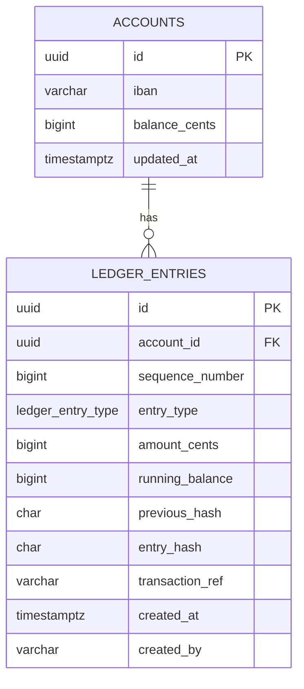
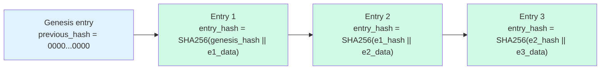

# سجلات التدقيق غير القابلة للتغيير — دفاتر الإلحاق فقط وسلاسل التجزئة

## نظرة عامة

سجل التدقيق المالي ليس ميزة — بل التزام قانوني. فمعيار PCI DSS يتطلب حماية سجلات التدقيق من التعديل؛ وقانون SOX يتطلب سجلات مالية موثوقة وضوابط داخلية عليها؛ وقواعد الدفع ومكافحة غسل الأموال تتطلب حفظ سجلات المعاملات لفترات محددة. وعندما يفحص المنظمون أو المدققون الجنائيون نظامًا بعد حدث احتيال، سيطرحون سؤالين: هل تستطيع إثبات ما حدث، وهل تستطيع إثبات أن السجلات لم تُعدّل؟ ويبني هذا الدرس سجل تدقيق يجيب عن السؤالين بشكل قاطع، من مخطط قاعدة البيانات وطبقة الصلاحيات وصولًا إلى سلسلة التجزئة المشفرة وواجهة الاستعلام في نقطة زمنية.

## أهداف التعلم

في نهاية هذا الدرس ستستطيع:

- تحديد الدوافع الرقابية لسجلات التدقيق غير القابلة للتغيير (PCI DSS، وSOX، وقواعد حفظ سجلات الدفع ومكافحة غسل الأموال)
- تصميم مخطط دفتر للإلحاق فقط برصيد جارٍ وفرضه على مستوى قاعدة البيانات
- تنفيذ أمان الصفوف وسحب الصلاحيات في PostgreSQL لمنع التعديلات
- بناء سلسلة تجزئة SHA-256 في Java تربط كل قيد دفتر بسابقه
- استخدام `@Audited` و`AuditReader` في Hibernate Envers لاستعلامات الكيانات في نقطة زمنية
- تصميم استراتيجية تقسيم وأرشفة لدفتر ينمو بلا حدود
- كتابة مهمة تحقق تكشف العبث بسلسلة التجزئة

## سياق العمل

*مثال مركّب:* يواجه معالج مدفوعات أمريكي إجراءً رقابيًا بعد أن يكشف تحقيق احتيال داخلي أن مدير قاعدة بيانات عدّل بأثر رجعي الطوابع الزمنية للمعاملات للتغطية على خطأ في توقيت التسوية. وكان التعديل ممكنًا لأن دور التطبيق امتلك صلاحيتي `UPDATE` و`DELETE` على جدول المعاملات. ولم توجد سلسلة تجزئة ولا فرض للكتابة مرة واحدة. وبقيت أفعال مدير قاعدة البيانات غير مكتشفة 11 شهرًا لأن سجل التدقيق نُفّذ كجدول قابل للتغيير في قاعدة البيانات نفسها — وعُدّل هو أيضًا.

تطلب الإصلاح إعادة بناء تاريخ المعاملات كاملًا من تغذيات كشوف الحسابات البنكية الخارجية — أشهر من العمل الهندسي. ولو نفّذ الفريق دفترًا للإلحاق فقط بعدم قابلية تغيير تفرضه قاعدة البيانات وسلسلة تجزئة مشفرة، لكان العبث قابلًا للكشف حسابيًا في تشغيل التحقق الليلي التالي.

> [!IMPORTANT]
> يجب ألا يملك دور التطبيق الذي يكتب قيود الدفتر صلاحيتي `UPDATE` أو `DELETE` على جدول الدفتر أبدًا. فيجب أن تفرض قاعدة البيانات عدم القابلية للتغيير — لا انضباط التطبيق وحده.

## مخطط دفتر الإلحاق فقط

قيد التصميم الأساسي بسيط: **لا `UPDATE` ولا `DELETE` لقيد دفتر أبدًا**. فكل حدث مالي صف جديد. ويُحسب الرصيد الجاري وقت الإدراج ويُخزن مع القيد للاسترجاع السريع، لكن مصدر الحقيقة دائمًا هو التسلسل الكامل للقيود.

```sql
CREATE TYPE ledger_entry_type AS ENUM (
    'CREDIT',
    'DEBIT',
    'FEE',
    'INTEREST',
    'REVERSAL',
    'ADJUSTMENT'
);

CREATE TABLE ledger_entries (
    id               UUID         NOT NULL DEFAULT gen_random_uuid(),
    account_id       UUID         NOT NULL,
    entry_type       ledger_entry_type NOT NULL,
    sequence_number  BIGINT       NOT NULL,       -- 1, 2, 3 ... per account: the chain order
    amount_cents     BIGINT       NOT NULL,       -- always positive; sign from entry_type
    running_balance  BIGINT       NOT NULL,       -- balance after this entry
    previous_hash    CHAR(64)     NOT NULL,       -- SHA-256 of previous entry (hex)
    entry_hash       CHAR(64)     NOT NULL,       -- SHA-256(previous_hash || entry_data)
    transaction_ref  VARCHAR(64)  NOT NULL,       -- idempotency key / external reference
    created_at       TIMESTAMPTZ  NOT NULL DEFAULT now(),
    created_by       VARCHAR(128) NOT NULL,       -- service account or user principal
    CONSTRAINT pk_ledger_entries PRIMARY KEY (id),
    CONSTRAINT uq_transaction_ref UNIQUE (transaction_ref),
    -- one entry per position in each account's chain: a forked chain is impossible
    CONSTRAINT uq_account_sequence UNIQUE (account_id, sequence_number),
    CONSTRAINT chk_amount_positive CHECK (amount_cents > 0)
);

-- Account + time range queries, also covering running-balance lookups
CREATE INDEX idx_ledger_account_time
    ON ledger_entries (account_id, created_at DESC)
    INCLUDE (running_balance);
```



> [!NOTE]
> يُخزن `amount_cents` دائمًا كعدد صحيح موجب. وتُشتق الإشارة الدلالية (الإيداع يزيد الرصيد، والخصم ينقصه) من `entry_type`. وهذا يتجنب التباس المبلغ ذي الإشارة حيث يجب أن يعرف المستدعي نوع الحساب لتفسير الإشارة بشكل صحيح. و`REVERSAL` و`ADJUSTMENT` قد يذهبان في أي اتجاه، فتحمل تلك الأوامر اتجاهًا صريحًا.

## الفرض في قاعدة البيانات: أمان الصفوف وسحب الصلاحيات

التحقق في طبقة التطبيق غير كافٍ. فحساب خدمة مخترق، أو ORM سيئ الضبط، أو اتصال مباشر بقاعدة البيانات يتجاوز كل حراس التطبيق. فيجب فرض عدم القابلية للتغيير على مستوى قاعدة البيانات.

```sql
-- Step 1: Revoke mutation privileges from the application role
REVOKE UPDATE, DELETE ON ledger_entries FROM app_role;
REVOKE TRUNCATE ON ledger_entries FROM app_role;

-- Step 2: Row-level security as a belt-and-suspenders measure
ALTER TABLE ledger_entries ENABLE ROW LEVEL SECURITY;
ALTER TABLE ledger_entries FORCE ROW LEVEL SECURITY;

-- Allow INSERT (new entries only) and SELECT for the application role
CREATE POLICY ledger_insert ON ledger_entries
    FOR INSERT TO app_role
    WITH CHECK (true);

CREATE POLICY ledger_select ON ledger_entries
    FOR SELECT TO app_role
    USING (true);

-- Explicitly deny UPDATE and DELETE (belt-and-suspenders)
CREATE POLICY no_update ON ledger_entries
    FOR UPDATE USING (false);

CREATE POLICY no_delete ON ledger_entries
    FOR DELETE USING (false);

-- Step 3: Grant DBA role SELECT-only for audits; separate privileged role for schema changes
GRANT SELECT ON ledger_entries TO dba_audit_role;
```

> [!WARNING]
> يطبّق `FORCE ROW LEVEL SECURITY` السياسات حتى على مالك الجدول. ودونه يتجاوز مالك الجدول أمان الصفوف. اضبط دائمًا `ENABLE` و`FORCE` كليهما على جداول التدقيق. وقاعدتان إضافيتان: يجب **ألا يملك** دور التطبيق الجدول (فالمالك يستطيع ببساطة منح نفسه الصلاحيات مجددًا أو تعديل السياسات)، والمستخدمون الخارقون والأدوار ذات `BYPASSRLS` يتجاهلون أمان الصفوف كليًا — فأبقِ تلك الحسابات القليلة منفصلة ومسجلة ومضبوطة بإحكام.

## سلسلة التجزئة لإثبات العبث

تجعل سلسلة التجزئة العبث قابلًا للكشف. فكل قيد يخزن تجزئة SHA-256 لتجزئة القيد السابق موصولة ببيانات القيد الحالي. وتعديل أي قيد تاريخي يُبطل كل تجزئة لاحقة في السلسلة، وهو ما ستكشفه مهمة تحقق ليلية.

وهناك حد مهم: من يستطيع الكتابة في الجدول يستطيع أيضًا *إعادة حساب* السلسلة كاملة بعد تغيير قيد. لذلك **ثبّت** السلسلة خارج قاعدة البيانات: انسخ بانتظام (مثلًا كل ساعة) آخر `entry_hash` لكل حساب — أو تجزئة واحدة فوقها كلها — إلى نظام منفصل لا يستطيع مديرو قاعدة البيانات تغييره، مثل تخزين كائنات WORM، أو وقّعها بمفتاح محفوظ في HSM. وتقارن مهمة التحقق بتلك المراسي.



```java
@Component
@RequiredArgsConstructor
public class LedgerHashChain {

    public static final String GENESIS_HASH = "0".repeat(64);
    private static final String HASH_ALGORITHM = "SHA-256";

    /**
     * Compute the entry_hash for a new ledger entry.
     * previousHash is the entry_hash of the previous entry for this account
     * (by sequence_number), or GENESIS_HASH if this is the first entry.
     */
    public String computeEntryHash(String previousHash, LedgerEntryData data) {
        // A delimiter between fields: without it "12"+"3" and "1"+"23" hash the same
        String input = String.join("|",
            previousHash,
            data.id(),
            data.accountId(),
            Long.toString(data.sequenceNumber()),
            data.entryType(),
            Long.toString(data.amountCents()),
            Long.toString(data.runningBalance()),
            data.transactionRef(),
            data.createdAt().toString());   // Instant, truncated to microseconds
        try {
            MessageDigest digest = MessageDigest.getInstance(HASH_ALGORITHM);
            byte[] hashBytes = digest.digest(input.getBytes(StandardCharsets.UTF_8));
            return HexFormat.of().formatHex(hashBytes);
        } catch (NoSuchAlgorithmException e) {
            throw new IllegalStateException("SHA-256 not available", e);
        }
    }

    /**
     * Verify the full hash chain for a given account.
     * entries must be ordered by sequence_number ascending.
     * Returns the index of the first broken link, or -1 if the chain is intact.
     */
    public int verifyChain(List<LedgerEntry> entriesAscending) {
        String expectedPreviousHash = GENESIS_HASH;
        for (int i = 0; i < entriesAscending.size(); i++) {
            LedgerEntry entry = entriesAscending.get(i);
            if (entry.getSequenceNumber() != i + 1                      // a deleted entry
                    || !entry.getPreviousHash().equals(expectedPreviousHash)) {
                return i;
            }
            String recomputedHash = computeEntryHash(
                expectedPreviousHash,
                LedgerEntryData.from(entry));
            if (!recomputedHash.equals(entry.getEntryHash())) {
                return i;
            }
            expectedPreviousHash = entry.getEntryHash();
        }
        return -1; // chain intact (then compare the last hash with the external anchor)
    }
}
```

```java
@Service
@RequiredArgsConstructor
public class LedgerEntryWriter {

    private final LedgerEntryRepository repository;
    private final AccountRepository     accountRepository;
    private final LedgerHashChain       hashChain;

    @Transactional
    public LedgerEntry post(PostEntryCommand command) {
        // Serialise posts per account: lock the account row (SELECT ... FOR UPDATE).
        // Without it, two concurrent posts read the same previous entry and
        // fork the chain / compute a wrong running balance. The UNIQUE
        // (account_id, sequence_number) constraint is the backstop.
        accountRepository.findByIdForUpdate(command.accountId())
            .orElseThrow(() -> new AccountNotFoundException(command.accountId()));

        Optional<LedgerEntry> previous =
            repository.findTopByAccountIdOrderBySequenceNumberDesc(command.accountId());
        String previousHash = previous.map(LedgerEntry::getEntryHash)
                                      .orElse(LedgerHashChain.GENESIS_HASH);
        long   sequence     = previous.map(e -> e.getSequenceNumber() + 1).orElse(1L);
        long   current      = previous.map(LedgerEntry::getRunningBalance).orElse(0L);
        long   runningBalance = applyEntry(current, command);

        UUID    entryId   = UUID.randomUUID();
        // The SAME timestamp goes into the hash and into the row (PostgreSQL
        // stores microseconds), so the verifier can recompute the hash later
        Instant createdAt = Instant.now().truncatedTo(ChronoUnit.MICROS);

        String entryHash = hashChain.computeEntryHash(previousHash,
            new LedgerEntryData(
                entryId.toString(), command.accountId().toString(), sequence,
                command.entryType().name(), command.amountCents(),
                runningBalance, command.transactionRef(), createdAt));

        LedgerEntry entry = LedgerEntry.builder()
            .id(entryId)
            .accountId(command.accountId())
            .sequenceNumber(sequence)
            .entryType(command.entryType())
            .amountCents(command.amountCents())
            .runningBalance(runningBalance)
            .previousHash(previousHash)
            .entryHash(entryHash)
            .transactionRef(command.transactionRef())
            .createdAt(createdAt)
            .createdBy(command.principal())
            .build();

        return repository.save(entry);
    }

    private long applyEntry(long current, PostEntryCommand command) {
        long amount = command.amountCents();
        return switch (command.entryType()) {
            case CREDIT, INTEREST -> current + amount;
            case DEBIT, FEE       -> current - amount;
            // A reversal undoes either a credit or a debit, an adjustment can go
            // either way: these commands carry an explicit direction
            case REVERSAL, ADJUSTMENT ->
                command.direction() == Direction.CREDIT ? current + amount : current - amount;
        };
    }
}
```

## Hibernate Envers للاستعلامات في نقطة زمنية

يوفر Hibernate Envers تاريخ تدقيق على مستوى الكيانات دون منطق مشغلات مخصص. فهو يعترض عمليات Hibernate ويكتب سجلات المراجعة في جداول `*_aud` إلى جانب جدول `revinfo`.

```java
@Entity
@Table(name = "accounts")
@Audited  // Envers will track all changes to this entity
@Data
public class Account {

    @Id
    private UUID id;

    private String iban;

    private long balanceCents;

    @Enumerated(EnumType.STRING)
    private AccountStatus status;

    @Version
    private long version;
}
```

```sql
-- Tables created by Envers automatically:
-- revinfo          (rev SERIAL, revtstmp BIGINT)
-- accounts_aud     (id UUID, rev INT FK revinfo, revtype SMALLINT,
--                   iban VARCHAR, balance_cents BIGINT, status VARCHAR)
-- revtype: 0=INSERT, 1=UPDATE, 2=DELETE
```

```java
@Service
@RequiredArgsConstructor
public class AccountAuditService {

    private final AuditReader auditReader;  // a bean you define: AuditReaderFactory.get(entityManager)

    /**
     * Retrieve the state of an account as it was at a specific point in time.
     * Used by compliance officers during fraud investigations.
     */
    public Optional<Account> getAccountAtPointInTime(UUID accountId, Instant asOf) {
        try {
            // Highest (global) revision committed at or before asOf ...
            Number rev = auditReader.getRevisionNumberForDate(Date.from(asOf));
            // ... and the entity state as of that revision (null if it did not exist yet)
            return Optional.ofNullable(auditReader.find(Account.class, accountId, rev));
        } catch (RevisionDoesNotExistException e) {
            return Optional.empty();   // no revision at all before asOf
        }
    }

    /**
     * Return the full revision history of an account for an audit report.
     */
    public List<AccountRevision> getFullHistory(UUID accountId) {
        AuditQuery query = auditReader.createQuery()
            .forRevisionsOfEntity(Account.class, false, true)
            .add(AuditEntity.id().eq(accountId))
            .addOrder(AuditEntity.revisionNumber().asc());

        return ((List<?>) query.getResultList()).stream()
            .map(row -> {
                Object[] tuple = (Object[]) row;
                Account snapshot = (Account) tuple[0];
                DefaultRevisionEntity revision = (DefaultRevisionEntity) tuple[1];
                RevisionType revType = (RevisionType) tuple[2];
                return new AccountRevision(snapshot, revision.getRevisionDate(), revType);
            })
            .toList();
    }
}
```

> [!NOTE]
> تاريخ Envers **ليس** دليلًا على العبث: فجداول `*_aud` جداول عادية يستطيع أي شخص يملك صلاحية الكتابة تغييرها. استخدم Envers لـ *عروض* مريحة للكيانات في نقطة زمنية، والدفتر للإلحاق فقط المسلسل بالتجزئة كدليل. وجداول تدقيق Envers تنمو أيضًا بلا حدود. وللحسابات عالية الحجم بآلاف تغييرات الحالة يوميًا، فكّر في أرشفة صفوف `*_aud` الأقدم من أفق قابل للضبط إلى تخزين بارد، مع إبقاء لقطة ملخص فقط في الجدول الساخن.

## التشغيل: التقسيم والأرشفة

يتراكم في دفتر بنك متوسط الحجم بمليون حساب نشط و10 معاملات لكل حساب يوميًا 3.65 مليار صف سنويًا بنحو 350 بايت لكل صف — أي نحو 1.3 تيرابايت سنويًا. قسّم حسب السنة لتمكين الأرشفة الفعّالة واستعلامات النطاق الزمني. وفيما يلي النسخة المقسّمة من الجدول نفسه. ولاحظ قاعدة في PostgreSQL: المفتاح الأساسي أو قيد التفرد على جدول مقسّم يجب أن يتضمن مفتاح التقسيم، فقاعدة التفرد *العامة* مثل `UNIQUE (transaction_ref)` يجب أن تعيش في جدول صغير منفصل غير مقسّم.

```sql
-- Range-partition the ledger by year for archival efficiency
CREATE TABLE ledger_entries (
    id               UUID         NOT NULL,
    account_id       UUID         NOT NULL,
    sequence_number  BIGINT       NOT NULL,
    entry_type       ledger_entry_type NOT NULL,
    amount_cents     BIGINT       NOT NULL,
    running_balance  BIGINT       NOT NULL,
    previous_hash    CHAR(64)     NOT NULL,
    entry_hash       CHAR(64)     NOT NULL,
    transaction_ref  VARCHAR(64)  NOT NULL,
    created_at       TIMESTAMPTZ  NOT NULL,
    created_by       VARCHAR(128) NOT NULL,
    PRIMARY KEY (id, created_at)          -- must include the partition key
) PARTITION BY RANGE (created_at);

-- Global uniqueness of external references (cannot be a constraint on the
-- partitioned table, because it does not include created_at)
CREATE TABLE ledger_transaction_refs (
    transaction_ref  VARCHAR(64)  PRIMARY KEY,
    entry_id         UUID         NOT NULL
);

-- Create annual partitions; automate with pg_partman
CREATE TABLE ledger_entries_2024
    PARTITION OF ledger_entries
    FOR VALUES FROM ('2024-01-01') TO ('2025-01-01');

CREATE TABLE ledger_entries_2025
    PARTITION OF ledger_entries
    FOR VALUES FROM ('2025-01-01') TO ('2026-01-01');

CREATE TABLE ledger_entries_2026
    PARTITION OF ledger_entries
    FOR VALUES FROM ('2026-01-01') TO ('2027-01-01');

-- Index on the most selective columns per partition
CREATE INDEX ON ledger_entries_2026 (account_id, created_at DESC);
```

```java
// Archival job — runs annually, exports the oldest partition to cold storage.
// Runs under a separate, privileged archival role: the application role cannot
// detach or drop ledger partitions.
@Component
@RequiredArgsConstructor
public class LedgerArchivalJob {

    private final JdbcTemplate archivalJdbc;   // connected as the archival role
    private final S3LedgerArchive s3Archive;

    @Scheduled(cron = "0 0 2 1 1 *") // 02:00 on 1 Jan every year
    public void archiveOldestYear() {
        int archiveYear = Year.now().getValue() - 8; // keep the last 7 full years hot
        String partition = "ledger_entries_" + archiveYear;

        // 1. Export the partition (with its hash chain) to Parquet on WORM storage
        s3Archive.exportPartition(partition, archiveYear);

        // 2. Verify the export: row count and the last entry_hash per account match
        if (!s3Archive.verifyExport(partition, archiveYear)) {
            throw new IllegalStateException("Archive verification failed for " + partition);
        }

        // 3. Only then detach and drop the hot partition
        archivalJdbc.execute("ALTER TABLE ledger_entries DETACH PARTITION " + partition);
        archivalJdbc.execute("DROP TABLE " + partition);
    }
}
```

تختلف قواعد الحفظ حسب نوع السجل. فلـ *سجلات تدقيق الأنظمة* يطلب المتطلب 10.5.1 في PCI DSS v4.0 تاريخًا لا يقل عن 12 شهرًا، مع إتاحة الأشهر الثلاثة الأخيرة فورًا. أما حفظ *السجلات المالية* نفسها فتحكمه قوانين المحاسبة والضرائب ومكافحة غسل الأموال (في الاتحاد الأوروبي والمملكة المتحدة تُحفظ سجلات مكافحة غسل الأموال عادة خمس سنوات بعد انتهاء العلاقة مع العميل) والقانون المصرفي المحلي — وفي الممارسة غالبًا 7–10 سنوات. وتأكد من الفترات الدقيقة مع فريق الامتثال لديك.

## اختبار المعرفة

**س1: يقترح مطوّر إضافة عمود `status` إلى جدول `ledger_entries` ليمكن تعليم القيود كـ `PENDING` أو `SETTLED`. لماذا يمثل هذا مشكلة لدفتر غير قابل للتغيير، وما التصميم الصحيح؟**

ج: تحديث عمود `status` على صف موجود ينتهك قيد الإلحاق فقط. ويجعل أيضًا سلسلة التجزئة لإثبات العبث غير قابلة للتحقق، إذ حُسبت التجزئة على بيانات الصف الأصلية. والتصميم الصحيح ترحيل قيد دفتر جديد من نوع `SETTLEMENT` يشير إلى `transaction_ref` للقيد الأصلي. فتُعبّر انتقالات الحالة كقيود جديدة، لا تعديلات. وإذا لزم عرض "الحالة الحالية"، فإنه يُشتق من أحدث قيد لـ `transaction_ref` معين، ولا يُخزن على أي صف منفرد.

**س2: يدقق Hibernate Envers كيان `Account`. ويطلب مسؤول امتثال رصيد الحساب كما كان في 14 مارس 2025 الساعة 09:47 بالتوقيت العالمي. ما استدعاءات Envers التي تحقق ذلك، وما حدود هذا النهج؟**

ج: استخدم `AuditReader.getRevisionNumberForDate(Date.from(instant))` لإيجاد أحدث مراجعة عند ذلك الطابع الزمني أو قبله، ثم `AuditReader.find(Account.class, accountId, revisionNumber)` لاسترجاع لقطة الكيان كما كانت عند تلك المراجعة. والحدود: ينشئ Envers **مراجعة واحدة لكل معاملة**، فإذا تغير الكيان عدة مرات داخل معاملة واحدة، تُسجل الحالة النهائية فقط، والطابع الزمني للمراجعة هو ساعة خادم التطبيق عند الالتزام. ولا يرى Envers إلا التغييرات التي تمر عبر Hibernate — فالأعمدة المحدّثة عبر SQL أصلي أو تحديثات JPQL جماعية تتجاوزه كليًا. وجداول التدقيق جداول عادية قابلة للتغيير، فهي ليست دليلًا على العبث.

## التحدي العملي

يبني فريقك بنية سجل التدقيق لمؤسسة دفع جديدة متوافقة مع PSD2. وتتطلب الجهة الرقابية أن تكون كل أحداث الدفع غير قابلة للتغيير، وتثبت العبث، وقابلة للاستعلام في أي نقطة زمنية خلال السنوات السبع السابقة.

**المهمة 1 — المخطط:** صمم الـ DDL الكامل لـ `ledger_entries` شاملًا استراتيجية التقسيم والفهارس والقيود و`CREATE TYPE` لأنواع القيود. وبرر كل فهرس.

**المهمة 2 — الفرض:** اكتب الـ SQL لسحب صلاحيات التعديل من دور التطبيق وتنفيذ سياسات أمان الصفوف. واشرح لماذا تلزم الآليتان كلتاهما.

**المهمة 3 — سلسلة التجزئة:** نفّذ `HashChainVerificationJob` يستعلم كل القيود لحساب معين بترتيب تصاعدي ويتحقق من سلسلة التجزئة كاملة، مسجلًا أول رابط مكسور بسياق كافٍ (معرّف القيد، ورقم التسلسل، والتجزئة المخزنة، والتجزئة المحسوبة) ليحقق فيه محلل جنائي. ويجب أن تعمل المهمة ليلًا وتنبّه عبر `VerificationFailureEvent`.

**المهمة 4 — النقطة الزمنية:** يبلّغ محلل احتيال عن معاملة مشبوهة ويطلب رصيد الحساب قبل 72 ساعة بالضبط من الطابع الزمني للمعاملة. باستخدام Hibernate Envers، نفّذ نقطة REST ‏`GET /accounts/{id}/balance?asOf={iso8601}` تعيد لقطة الحساب في تلك اللحظة، شاملة بيانات المراجعة الوصفية (من غيّرها ومتى).

<!-- KNOWLEDGE-CHECK
{
  "questions": [
    {
      "text": "يقترح مطوّر إضافة عمود status إلى ledger_entries ليمكن تعليم القيود كـ PENDING أو SETTLED. لماذا يمثل هذا مشكلة لدفتر غير قابل للتغيير، وما التصميم الصحيح؟",
      "options": [
        "إضافة أعمدة إلى ledger_entries تتطلب ترحيل مخطط قد يقفل الجدول — استخدم جدول حالة منفصلًا بدلًا من ذلك",
        "تحديث عمود status على صف موجود ينتهك قيد الإلحاق فقط ويكسر سلسلة التجزئة (حُسبت التجزئة على بيانات الصف الأصلية) — والتصميم الصحيح ترحيل قيد دفتر جديد من نوع SETTLEMENT يشير إلى transaction_ref الأصلي، معبّرًا عن انتقالات الحالة كقيود جديدة لا تعديلات",
        "يجب أن يستخدم عمود status نوع VARCHAR بدل ENUM للسماح بقيم مستقبلية دون تغييرات في المخطط",
        "عمود status مقبول ما دام غير مضمّن في حساب سلسلة التجزئة"
      ],
      "correct": 1,
      "explanation": "تحديث قيد دفتر مرحّل ينتهك قيد الإلحاق فقط الذي تتطلبه لوائح حفظ السجلات المالية. ويُبطل أيضًا سلسلة التجزئة المشفرة — فقد حُسب entry_hash على بيانات الصف الأصلية، فأي تعديل ينتج تجزئة لم تعد مطابقة. والنمط الصحيح ترحيل قيد جديد (مثلًا من نوع SETTLEMENT) بإشارة إلى transaction_ref الأصلي. فتُعبّر انتقالات الحالة كوقائع حدثت، لا كتعديلات لوقائع موجودة."
    },
    {
      "text": "ما الذي يجب أن يكون صحيحًا بشأن صلاحيات دور التطبيق على جدول ledger_entries لفرض عدم القابلية للتغيير، ولماذا لا يكفي التحقق في طبقة التطبيق وحده؟",
      "options": [
        "يحتاج دور التطبيق SELECT وINSERT فقط؛ ويجب سحب UPDATE وDELETE على مستوى قاعدة البيانات — فالفحوص في طبقة التطبيق يمكن تجاوزها بحساب خدمة مخترق، أو ORM سيئ الضبط، أو اتصال مباشر بقاعدة البيانات",
        "يحتاج دور التطبيق كل الصلاحيات لكن يجب أن تفحص شيفرة التطبيق علَمًا منطقيًا قبل تنفيذ أي UPDATE",
        "أمان الصفوف وحده كافٍ — لا يلزم أي تغيير في الصلاحيات",
        "يجب أن يستخدم دور التطبيق اتصال قراءة فقط يمنع كل التعديلات"
      ],
      "correct": 0,
      "explanation": "في سياق العمل، كان العبث ممكنًا تحديدًا لأن دور التطبيق امتلك صلاحيتي UPDATE وDELETE — فاستخدمهما مدير قاعدة بيانات مباشرة. والتحقق في طبقة التطبيق يتجاوزه أي اتصال مباشر بقاعدة البيانات، أو ORM سيئ الضبط، أو حساب خدمة مخترق. والفرض على مستوى قاعدة البيانات (REVOKE UPDATE, DELETE, TRUNCATE من app_role لا يملك الجدول) هو الضمان الدائم. ويضيف أمان الصفوف (FORCE ROW LEVEL SECURITY) طبقة احتياطية لكنه ثانوي مقارنة بسحب الصلاحيات."
    },
    {
      "text": "ما الخطر التشغيلي لاستخدام pg_partman لإدارة أقسام الدفتر السنوية، وما الطريقة الصحيحة لإنهاء قسم تجاوز فترة الحفظ؟",
      "options": [
        "الأقسام السنوية تسبب انتفاخ الفهارس — استخدم أقسامًا شهرية بدلًا منها واحتفظ بـ 84 قسمًا شهريًا",
        "إذا فشل pg_partman في إنشاء قسم السنة التالية قبل نهاية العام، ستفشل الإدراجات — فراقب إنشاء الأقسام؛ ولإنهاء قسم قديم، صدّره إلى تخزين بارد (مثلًا Parquet على تخزين WORM)، وتحقق من التصدير، ثم افصله واحذفه تحت دور أرشفة ذي صلاحيات",
        "لا يمكن فصل الأقسام دون توقف — فأرشف بنقل الصفوف إلى جدول بارد منفصل في قاعدة البيانات نفسها",
        "يتطلب PCI DSS بقاء كل بيانات الدفتر في التخزين الساخن 10 سنوات — فلا يُسمح بأي أرشفة"
      ],
      "correct": 1,
      "explanation": "يؤتمت pg_partman إنشاء الأقسام لكنه يتطلب مراقبة لضمان وجود القسم التالي قبل نهاية العام — فالإدراج في نطاق تاريخي بلا قسم مطابق يفشل. وتعتمد فترات الحفظ على نوع السجل: يطلب PCI DSS v4.0 ‏(10.5.1) تاريخ سجلات تدقيق 12 شهرًا مع إتاحة ثلاثة أشهر فورًا، بينما تتبع السجلات المالية قوانين المحاسبة والضرائب ومكافحة غسل الأموال والقانون المصرفي — غالبًا 7–10 سنوات في الممارسة. والإجراء الصحيح للإنهاء: صدّر القسم إلى تخزين بارد، وتحقق من التصدير (أعداد الصفوف، وآخر تجزئة لكل حساب)، ثم افصل القسم واحذفه من قاعدة البيانات الساخنة."
    }
  ]
}
-->

<!-- PRACTICAL-CHALLENGE
{
  "title": "بناء سجل تدقيق غير قابل للتغيير متوافق مع PSD2 مع التحقق من سلسلة التجزئة",
  "difficulty": "advanced",
  "estimatedMinutes": 45,
  "tasks": [
    {"id": "1", "description": "صمم الـ DDL الكامل لـ ledger_entries بتقسيم نطاقي حسب created_at (أقسام سنوية)، وكل الفهارس المطلوبة (مركّب على account_id+created_at DESC، وفهرس مغطٍّ يتضمن running_balance، وفهرس جزئي على transaction_ref)، و CREATE TYPE لأنواع القيود. وبرر كل فهرس بنمط الاستعلام الذي يدعمه. وضمّن القيدين CONSTRAINT chk_amount_positive وCONSTRAINT uq_transaction_ref."},
    {"id": "2", "description": "اكتب الـ SQL لسحب UPDATE وDELETE وTRUNCATE من دور التطبيق app_role على ledger_entries. وفعّل أمان الصفوف وافرضه بـ FORCE. وأنشئ السياسات: ledger_insert ‏(FOR INSERT WITH CHECK (true))، وledger_select ‏(FOR SELECT USING (true))، وno_update ‏(FOR UPDATE USING (false))، وno_delete ‏(FOR DELETE USING (false)). واشرح لماذا يلزم REVOKE وRLS كلاهما — أي سيناريو يدافع عنه كل منهما ولا يدافع عنه الآخر؟"},
    {"id": "3", "description": "نفّذ HashChainVerificationJob كمهمة @Scheduled ليلية تمر على كل الحسابات ذات النشاط في آخر 7 أيام، وتستدعي LedgerHashChain.verifyChain() لكل منها، وتسجل لأول رابط مكسور: account_id وsequence_number_of_broken_entry وstored_previous_hash وexpected_previous_hash وstored_entry_hash وrecomputed_entry_hash. وانشر VerificationFailureEvent عبر نمط الـ outbox ليُسلّم التنبيه حتى لو أُعيد تشغيل التطبيق فور الكشف."},
    {"id": "4", "description": "نفّذ نقطة REST ‏GET /accounts/{id}/balance?asOf={iso8601} باستخدام AuditReader في Hibernate Envers. ويجب أن تعيد النقطة: account_id، وbalance_cents في النقطة الزمنية المطلوبة، ورقم المراجعة، والطابع الزمني للمراجعة، والهوية التي أجرت آخر تغيير قبل asOf. وتعامل مع حالة عدم وجود مراجعة قبل asOf (لم يكن الحساب موجودًا بعد) بإعادة HTTP 404 برسالة وصفية. ووثّق حدّي Envers اللذين يجب أن يفهمهما مسؤول الامتثال عند تفسير نتائج النقطة الزمنية."}
  ]
}
-->
