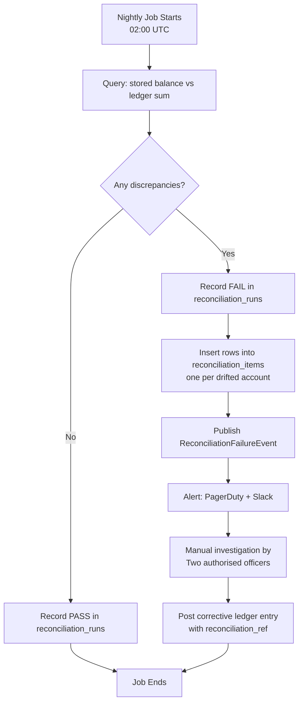
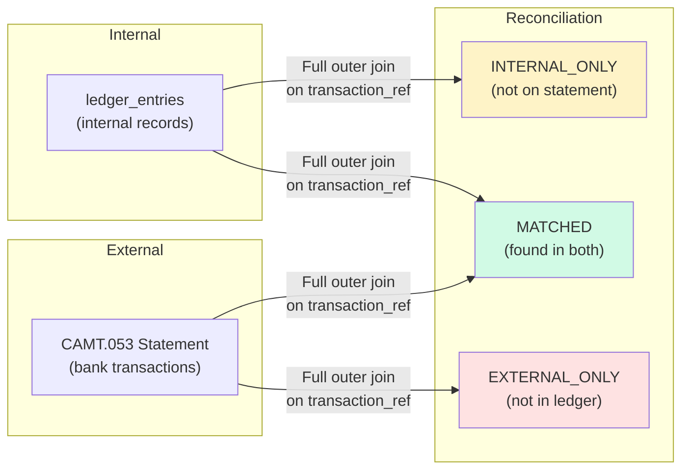

# مطابقة الأرصدة — الفحوص الداخلية والأرصدة الظلية وكشوف CAMT.053

## نظرة عامة

مطابقة الأرصدة هي آلية الرقابة التي تكشف متى يكذب النظام المالي. فالرصيد الجاري المخزن على صف الحساب تحسين للأداء — كاش للحقيقة الرياضية التي تعيش في تسلسل قيود الدفتر. ومثل كل كاش، قد ينجرف. فسباقات التحديث المتزامن، والمعاملات المتراجعة التي وصل تحديث رصيدها، وتحول البنية التحتية في منتصف الكتابة، أو خطأ صامت في ORM، كلها قد تجعل صف الحساب يُبلغ عن رصيد يخالف مجموع قيوده. وتجد المطابقة تلك الاختلافات قبل أن يجدها عميل أو جهة رقابية أو مدقق. ويبني هذا الدرس منظومة المطابقة الكاملة: الفحوص الداخلية الموضعية، والأرصدة الظلية، ومطابقة كشوف ISO 20022 الخارجية، والمخطط الذي يجعل النتائج قابلة للتدقيق.

## أهداف التعلم

في نهاية هذا الدرس ستستطيع:

- شرح لماذا قد ينجرف رصيد جارٍ غير مطبّع عن مجموع الدفتر
- كتابة استعلام SQL للفحص الموضعي يحدد الحسابات المنجرفة
- تنفيذ رصيد ظلي يُحدّث عبر مسار شيفرة مستقل
- تطبيق سياسة عدم التسامح والتمييز بين الكشف والتصحيح
- تحليل كشف حساب بنكي ISO 20022 ‏CAMT.053 ومطابقة قيوده مع سجلات الدفتر الداخلي
- تصميم جدولي `reconciliation_runs` و`reconciliation_items` لجعل النتائج قابلة للتدقيق
- تنفيذ `ReconciliationJob` ليلية باستخدام Spring Batch

## سياق العمل

*مثال مركّب:* يكتشف بنك بريطاني منافس خلال تدقيق روتيني أن 1,247 حساب عميل لها أرصدة تخالف مجموع قيود دفترها، بفروق تتراوح من سنت واحد إلى 4,312 جنيهًا. وبلغ إجمالي الفرق 127,000 جنيه. وكان السبب الجذري مستهلك Kafka حدّث رصيد الحساب بنمط قفل تفاؤلي لكنه ابتلع `OptimisticLockingFailureException` بصمت وسجّل تحذيرًا بدل إعادة المحاولة. وكان المستهلك قد نُشر قبل تسعة أشهر؛ وكان الفرق يتراكم منذ ذلك الحين.

اضطر البنك إلى إبلاغ الجهة الرقابية بالحادث. واستغرق الأمر ثلاثة أسابيع من العمل الهندسي لمطابقة الحسابات المتأثرة مع مجاميع الدفتر الصحيحة وتحديد العملاء المستحقين للاسترداد. وحُسب الرصيد الصحيح من الدفتر للإلحاق فقط، ما أكد قيمة إبقاء الدفتر مصدر الحقيقة. ولو وُجدت مهمة مطابقة ليلية تلتقط أول تباعد صباح اليوم التالي للنشر السيئ، لانخفضت نافذة التصحيح من تسعة أشهر إلى 24 ساعة.

> [!IMPORTANT]
> لا تصحح أبدًا فرق رصيد تلقائيًا من الشيفرة. بل أطلق دائمًا تنبيهًا، وأنتج سجل تدقيق، واشترط توقيعًا يدويًا من موظفَين مخوّلَين قبل ترحيل أي قيد تصحيحي. فالتصحيح التلقائي قد يخفي السبب الجذري ويضاعف الأخطاء.

## الفحص الداخلي الموضعي: مجموع الدفتر مقابل الرصيد المخزن

الاختبار الحاسم استعلام SQL يحسب مجموع كل قيود الدفتر لكل حساب ويقارنه بالرصيد المخزن. ويجب أن يعمل ليلًا، ويُفضّل على نسخة قراءة لتجنب التنازع على الخادم الرئيسي.

```sql
-- Identify accounts where the stored balance disagrees with the ledger sum.
-- Run against a consistent read snapshot (REPEATABLE READ or point-in-time replica).
-- REVERSAL and ADJUSTMENT can go either way, so they carry an explicit direction.
WITH ledger_sum AS (
    SELECT
        le.account_id,
        SUM(CASE
                WHEN le.entry_type IN ('CREDIT', 'INTEREST')
                  OR (le.entry_type IN ('REVERSAL', 'ADJUSTMENT') AND le.direction = 'CREDIT')
                    THEN  le.amount_cents
                ELSE      -le.amount_cents
            END) AS computed_balance
    FROM ledger_entries le
    GROUP BY le.account_id
)
SELECT
    a.id                                        AS account_id,
    a.iban,
    a.balance_cents                             AS stored_balance,
    COALESCE(ls.computed_balance, 0)            AS computed_balance,
    a.balance_cents - COALESCE(ls.computed_balance, 0) AS drift_cents
FROM accounts a
LEFT JOIN ledger_sum ls ON ls.account_id = a.id
WHERE a.balance_cents <> COALESCE(ls.computed_balance, 0)
ORDER BY ABS(a.balance_cents - COALESCE(ls.computed_balance, 0)) DESC;
```



> [!WARNING]
> شغّل استعلام الفحص الموضعي داخل معاملة `REPEATABLE READ` للحصول على لقطة متسقة. فدون لقطة متسقة، قد تسبب الالتزامات المتزامنة إيجابيات كاذبة — فقيد كُتب بعد قراءة رصيد الحساب سيجعل الحساب يبدو وكأن لديه فائضًا.

## نمط الرصيد الظلي

الرصيد الظلي رصيد ثانٍ يُحدّث عبر مسار شيفرة مستقل كليًا — عادة مستهلك Kafka يعالج تدفق أحداث الدفع، باستخدام استعلامات مختلفة ومجمع اتصالات مختلف. فإذا اتفق الرصيدان، فالمساران صحيحان على الأرجح. وإذا تباعدا، فأحدهما على الأقل معطوب. واحفظ الظل في **جدوله الخاص**: فعمود ظلي على صف `accounts` سيجعل كل تحديث ظلي يقفل الصف الساخن نفسه الذي يقفله المسار الأساسي.

```sql
-- Separate table: shadow updates never contend with the primary path's row locks
CREATE TABLE shadow_balances (
    account_id            UUID        PRIMARY KEY,
    balance_cents         BIGINT      NOT NULL DEFAULT 0,
    last_event_at         TIMESTAMPTZ NOT NULL DEFAULT now()
);

-- Consumer-side deduplication: each event is applied at most once
CREATE TABLE processed_shadow_events (
    event_id              UUID        PRIMARY KEY,
    processed_at          TIMESTAMPTZ NOT NULL DEFAULT now()
);
```

```java
// Primary path — HTTP request handler → @Transactional service
@Transactional
public void creditAccount(UUID accountId, long amountCents, String ref) {
    Account account = accountRepository.findByIdForUpdate(accountId)
        .orElseThrow(() -> new AccountNotFoundException(accountId));
    account.setBalanceCents(account.getBalanceCents() + amountCents);
    ledgerRepository.save(LedgerEntry.credit(accountId, amountCents, ref));
}

// Shadow path — independent Kafka consumer on its own consumer group and
// its own data source / transaction manager. Deliberately different queries.
@KafkaListener(topics = "payment-events", groupId = "shadow-balance-consumer")
@Transactional("shadowTransactionManager")   // the offset is acked after this commits
public void updateShadowBalance(PaymentEvent event) {
    // Claim first: a redelivered event must not be counted twice
    int claimed = shadowJdbc.update(
        "INSERT INTO processed_shadow_events (event_id) VALUES (?) ON CONFLICT DO NOTHING",
        event.eventId());
    if (claimed == 0) {
        return;   // duplicate delivery
    }
    shadowJdbc.update("""
        INSERT INTO shadow_balances (account_id, balance_cents, last_event_at)
        VALUES (?, ?, now())
        ON CONFLICT (account_id) DO UPDATE
           SET balance_cents = shadow_balances.balance_cents + EXCLUDED.balance_cents,
               last_event_at = now()
        """,
        event.accountId(), event.signedAmountCents());   // + for credits, - for debits
}
```

```sql
-- Nightly shadow balance comparison (outside the grace window)
SELECT
    a.id,
    a.iban,
    a.balance_cents,
    COALESCE(sb.balance_cents, 0)                 AS shadow_balance_cents,
    a.balance_cents - COALESCE(sb.balance_cents, 0) AS drift_cents
FROM accounts a
LEFT JOIN shadow_balances sb ON sb.account_id = a.id
WHERE a.balance_cents <> COALESCE(sb.balance_cents, 0)
  AND COALESCE(sb.last_event_at, 'epoch') < now() - INTERVAL '60 seconds'
ORDER BY ABS(a.balance_cents - COALESCE(sb.balance_cents, 0)) DESC;
```

> [!NOTE]
> سيتباعد الرصيد الظلي والرصيد الأساسي طبيعيًا لفترة قصيرة أثناء التشغيل العادي بسبب تأخر معالجة الأحداث. فطبّق نافذة سماح (مثلًا الحسابات التي لا نشاط لها في آخر 60 ثانية) قبل اعتبار التباعد فرقًا.

## سياسة عدم التسامح

تعمل المطابقة في البنوك على أساس عدم التسامح. فأي فرق أكبر من صفر سنت يتطلب تحقيقًا. ولا يوجد "خطأ تقريب مقبول" — فمع المبالغ بالوحدات الصغرى الصحيحة لا شيء يُقرّب. والأسباب رقابية (الضوابط الداخلية على التقارير المالية بموجب المادة 404 من SOX؛ وقواعد حماية الأموال مثل نظام CASS 15 البريطاني لشركات الدفع والنقود الإلكترونية، النافذ منذ مايو 2026، الذي يتطلب مطابقات داخلية وخارجية منتظمة) وتشغيلية — فالفروق الصغيرة المتسامح معها تميل إلى النمو.

```java
@Component
@RequiredArgsConstructor
public class ReconciliationPolicy {

    // No tolerance. Any non-zero drift is a failure.
    private static final long DRIFT_TOLERANCE_CENTS = 0L;

    public ReconciliationResult evaluate(List<BalanceDrift> drifts) {
        List<BalanceDrift> failures = drifts.stream()
            .filter(d -> Math.abs(d.driftCents()) > DRIFT_TOLERANCE_CENTS)
            .toList();

        if (failures.isEmpty()) {
            return ReconciliationResult.pass();
        }

        long totalGrossDrift = failures.stream()
            .mapToLong(d -> Math.abs(d.driftCents()))
            .sum();

        return ReconciliationResult.fail(failures, totalGrossDrift);
    }
}
```

يتطلب التصحيح إجراءً رسميًا: يوقّع موظفان مخوّلان، ويُرحّل قيد دفتر تصحيحي بـ `entry_type = ADJUSTMENT` و`transaction_ref` يشير إلى معرّف تشغيل المطابقة، ويُضمّن القيد التصحيحي في سجل التدقيق. ويجب ألا تصحح الشيفرة تلقائيًا بصمت أبدًا.

## المطابقة الخارجية: ISO 20022 ‏CAMT.053

تفحص المطابقة الداخلية قيود الدفتر مقابل أرصدة الحسابات. وتفحص المطابقة الخارجية قيود الدفتر مقابل كشف الحساب البنكي للمؤسسة نفسها — كشف CAMT.053 "Bank-to-Customer Statement" الذي يرسله البنك الماسك للحساب (مثلًا بنك مراسل أو بنك حماية الأموال) كل يوم عمل.



```java
@Component
@RequiredArgsConstructor
public class Camt053Parser {

    /**
     * Parse a CAMT.053 XML statement using JAXB (jakarta.xml.bind) classes
     * generated from the ISO 20022 schema camt.053.001.08.
     */
    public List<ExternalTransaction> parse(InputStream camt053Xml) {
        try {
            JAXBContext context = JAXBContext.newInstance(Document.class);
            Unmarshaller unmarshaller = context.createUnmarshaller();
            // Bank files are external input: parse with external entities disabled (no XXE)
            XMLStreamReader reader = secureXmlInputFactory().createXMLStreamReader(camt053Xml);
            // The root element is <Document>, which wraps <BkToCstmrStmt>
            Document document = unmarshaller.unmarshal(reader, Document.class).getValue();
            BankToCustomerStatementV08 statement = document.getBkToCstmrStmt();

            return statement.getStmt().stream()
                .flatMap(stmt -> stmt.getNtry().stream())
                .map(entry -> new ExternalTransaction(
                    matchingReference(entry),   // see note below
                    // to minor units — assumes a 2-decimal currency; use the
                    // currency's exponent for JPY (0) or BHD (3)
                    entry.getAmt().getValue().movePointRight(2).longValueExact(),
                    entry.getCdtDbtInd().value(),  // "CRDT" or "DBIT"
                    entry.getBookgDt().getDt().toGregorianCalendar()
                        .toZonedDateTime().toLocalDate()))
                .toList();
        } catch (JAXBException | XMLStreamException e) {
            throw new Camt053ParseException("Failed to parse CAMT.053 statement", e);
        }
    }
}
```

> [!NOTE]
> اختيار مفتاح المطابقة أصعب جزء في المطابقة الخارجية. فـ `NtryRef` اختياري وغالبًا فارغ؛ والمرجع الذي أرسلته يعود عادة كـ `EndToEndId` (أو `AcctSvcrRef` الخاص بالبنك) داخل `NtryDtls/TxDtls/Refs`. وقد يكون قيد كشف واحد أيضًا *دفعة* تضم معاملات كثيرة. فخزّن المرجع الذي أرسلته على كل قيد دفتر ليكون هذا الربط ممكنًا.

```java
@Component
@RequiredArgsConstructor
public class ExternalReconciliationJob {

    private final LedgerEntryRepository ledgerRepository;
    private final Camt053Parser camt053Parser;
    private final ReconciliationRunRepository runRepository;
    private final ReconciliationItemRepository itemRepository;

    @Transactional
    public ReconciliationRun reconcile(UUID accountId, InputStream statementXml, LocalDate valueDate) {
        List<ExternalTransaction> external = camt053Parser.parse(statementXml);
        List<LedgerEntry> internal = ledgerRepository
            .findByAccountIdAndCreatedAtBetween(
                accountId,
                valueDate.atStartOfDay(ZoneOffset.UTC).toInstant(),
                valueDate.plusDays(1).atStartOfDay(ZoneOffset.UTC).toInstant());

        // toMap() throws on duplicate keys — a duplicated statement line is itself
        // a break, so detect it explicitly instead of crashing
        Map<String, ExternalTransaction> externalByRef = new HashMap<>();
        List<ExternalTransaction> duplicates = new ArrayList<>();
        for (ExternalTransaction ext : external) {
            if (externalByRef.putIfAbsent(ext.reference(), ext) != null) {
                duplicates.add(ext);
            }
        }
        Map<String, LedgerEntry> internalByRef = internal.stream()
            .collect(Collectors.toMap(LedgerEntry::getTransactionRef, Function.identity()));

        ReconciliationRun run = runRepository.save(ReconciliationRun.builder()
            .accountId(accountId)
            .valueDate(valueDate)
            .runAt(Instant.now())
            .status(ReconciliationStatus.IN_PROGRESS)
            .build());

        List<ReconciliationItem> items = new ArrayList<>();

        // MATCHED — found in both internal and external
        internalByRef.forEach((ref, internalEntry) -> {
            if (externalByRef.containsKey(ref)) {
                ExternalTransaction ext = externalByRef.get(ref);
                // Compare the amount AND the direction (a credit is not a debit)
                boolean sameDirection = internalEntry.isCredit() == ext.isCredit();
                ReconciliationItemStatus status =
                    internalEntry.getAmountCents() == ext.amountCents() && sameDirection
                    ? ReconciliationItemStatus.MATCHED
                    : ReconciliationItemStatus.AMOUNT_MISMATCH;
                items.add(ReconciliationItem.matched(run, ref, internalEntry, ext, status));
            } else {
                // INTERNAL_ONLY — in ledger but not on bank statement
                items.add(ReconciliationItem.internalOnly(run, ref, internalEntry));
            }
        });

        // EXTERNAL_ONLY — on bank statement but not in ledger
        externalByRef.forEach((ref, ext) -> {
            if (!internalByRef.containsKey(ref)) {
                items.add(ReconciliationItem.externalOnly(run, ref, ext));
            }
        });

        duplicates.forEach(ext -> items.add(ReconciliationItem.duplicateExternal(run, ext.reference(), ext)));

        itemRepository.saveAll(items);

        long breakCount = items.stream()
            .filter(i -> i.getStatus() != ReconciliationItemStatus.MATCHED)
            .count();

        run.setStatus(breakCount == 0
            ? ReconciliationStatus.PASSED
            : ReconciliationStatus.FAILED);
        run.setBreakCount((int) breakCount);

        return runRepository.save(run);
    }
}
```

## مخطط المطابقة

مخطط المطابقة نفسه للإلحاق فقط من حيث الروح: لا تُغيّر العناصر بعد اكتمال التشغيل، والتصحيحات تنتج تشغيلات جديدة. والتحديث الوحيد المسموح هو حالة التشغيل نفسه — `IN_PROGRESS` ← `PASSED`/`FAILED`، ثم لاحقًا `SUPERSEDED` عندما يحل محله تشغيل جديد.

وتفصيل عملي: قيد داخلي حُجز الساعة 23:59 قد يظهر في كشف اليوم التالي. فالمطابقة الصارمة بالتاريخ التقويمي تنتج حينها فروقًا كاذبة. عامل العنصر غير المطابق كفرق *توقيت* ليوم عمل واحد، ولا تصعّده إلا إذا بقي غير مطابق في كشف اليوم التالي.

```sql
CREATE TYPE reconciliation_status AS ENUM (
    'IN_PROGRESS', 'PASSED', 'FAILED', 'SUPERSEDED'
);

CREATE TYPE reconciliation_item_status AS ENUM (
    'MATCHED',
    'AMOUNT_MISMATCH',
    'INTERNAL_ONLY',
    'EXTERNAL_ONLY',
    'DUPLICATE_EXTERNAL'
);

CREATE TABLE reconciliation_runs (
    id              UUID                  NOT NULL DEFAULT gen_random_uuid(),
    account_id      UUID                  NOT NULL,
    value_date      DATE                  NOT NULL,
    run_at          TIMESTAMPTZ           NOT NULL DEFAULT now(),
    status          reconciliation_status NOT NULL,
    break_count     INT                   NOT NULL DEFAULT 0,
    run_by          VARCHAR(128)          NOT NULL,
    CONSTRAINT pk_reconciliation_runs PRIMARY KEY (id)
);

CREATE TABLE reconciliation_items (
    id                    UUID                        NOT NULL DEFAULT gen_random_uuid(),
    run_id                UUID                        NOT NULL,
    transaction_ref       VARCHAR(64)                 NOT NULL,
    status                reconciliation_item_status  NOT NULL,
    internal_amount_cents BIGINT,
    external_amount_cents BIGINT,
    internal_entry_id     UUID,
    external_booking_date DATE,
    notes                 TEXT,
    CONSTRAINT pk_reconciliation_items PRIMARY KEY (id),
    CONSTRAINT fk_reconciliation_items_run
        FOREIGN KEY (run_id) REFERENCES reconciliation_runs (id)
);

-- Fast lookup of all breaks for a given run
CREATE INDEX idx_recon_items_run_status
    ON reconciliation_items (run_id, status)
    WHERE status != 'MATCHED';

-- Look up all reconciliation runs for a given account and date
CREATE INDEX idx_recon_runs_account_date
    ON reconciliation_runs (account_id, value_date DESC);
```

> [!NOTE]
> تتطلب عناصر `INTERNAL_ONLY` تحقيقًا: فقد تكون دفعة رُحّلت إلى الدفتر لكنها لم تُسوَّ بعد مع البنك المراسل، أو قد تمثل حالة احتيال نُقلت فيها أموال في الدفتر الداخلي دون تحويل خارجي مقابل. ولا ينبغي تجاهل أي منهما دون مراجعة.

## اختبار المعرفة

**س1: يعمل استعلام الفحص الموضعي الليلي الساعة 02:00 بالتوقيت العالمي ولا يُبلغ عن أي فروق. وفي الساعة 09:00 يلاحظ محلل أن الحساب `acc-7781` له رصيد مخزن 10,000 جنيه لكن قيود دفتره مجموعها 9,850 جنيهًا. كيف ظهر هذا الفرق بعد تشغيل ليلي نظيف، وماذا يخبرك ذلك عن البنية؟**

ج: أدخلت الفرق معاملة التزمت بين 02:00 (حين أُخذت اللقطة) و09:00 (حين لاحظه المحلل). فالتشغيل الليلي كان صحيحًا وقت لقطته — وظهر الخطأ في الساعات السبع التالية. وهذا يخبرك بأمرين: (1) الفحص الموضعي ليس آنيًا؛ فقد تتراكم الفروق حتى 24 ساعة قبل الكشف، و(2) للنظام مسار شيفرة يستطيع تحديث `balance_cents` دون ترحيل قيد دفتر مقابل، أو العكس. وكان نمط الرصيد الظلي سيقدم تحذيرًا أبكر: إذا أظهر الرصيد الظلي (الذي يحدّثه مستهلك Kafka المستقل) أيضًا 10,000 جنيه، فالخطأ في مسار الكتابة الأساسي؛ وإذا أظهر 9,850 جنيهًا، فالخطأ في الحدث الذي يقود الظل.

**س2: أثناء المطابقة الخارجية مع كشف CAMT.053، صُنّف 23 عنصرًا كـ `EXTERNAL_ONLY` — موجودة في الكشف البنكي وغائبة عن الدفتر الداخلي. ما السببان الأرجح، وما الذي يجب أن يفحصه المهندس قبل الحكم بأي منهما؟**

ج: السببان الأرجح: (1) مفتاح الـ idempotency / ‏`transaction_ref` المستخدم خارجيًا لا يطابق `transaction_ref` المخزن في الدفتر — فمفتاح الربط هو الخاطئ لا البيانات؛ و(2) فشل ترحيل حقيقي — وصلت المعاملة الخارجية (خصم البنك الحساب المراسل) لكن كتابة الدفتر الداخلي فشلت بصمت، ربما بسبب تعطل مستهلك Kafka أو استثناء قاعدة بيانات غير معالج التُقط وسُجّل بدل إعادة رميه. وقبل الحكم بأي منهما، يجب أن يفحص المهندس: (أ) منطق الربط بين `NtryRef` (أو `EndToEndId`) في CAMT.053 وصيغة `transaction_ref` الداخلية لكل عنصر `EXTERNAL_ONLY`، و(ب) سجلات التطبيق لنافذة تاريخ الحجز بحثًا عن آثار استثناءات أو عدم تطابق idempotency، و(ج) طابور الرسائل الميتة لمستهلك معالجة الدفع بحثًا عن رسائل غير معالجة من ذلك التاريخ.

## التحدي العملي

يبني فريقك بنية المطابقة لمؤسسة دفع مرخصة بموجب PSD2 تعالج 50,000 معاملة يوميًا عبر 200,000 حساب نشط.

**المهمة 1 — استعلام الفحص الموضعي:** اكتب استعلام الفحص الموضعي بجودة إنتاجية باستخدام معاملة `REPEATABLE READ` وتضمين دوال النوافذ لتحديد أيضًا الحسابات التي يخالف فيها `running_balance` المخزن على أحدث قيد دفتر قيمة `balance_cents` على صف الحساب. وهذان نمطا فشل متمايزان — اشرح كليهما.

**المهمة 2 — الرصيد الظلي:** صمم مستهلك Kafka الذي يحافظ على الرصيد الظلي. ما الضمانات التي يحتاجها المستهلك من حيث دلالات التسليم (مرة واحدة على الأقل مقابل مرة واحدة بالضبط)؟ وكيف تتعامل مع نافذة السماح للأحداث قيد التنفيذ؟ واكتب استعلام المقارنة الليلي.

**المهمة 3 — سير عمل عدم التسامح:** نفّذ `ReconciliationAlertService` الذي يرسل، عند تلقي `ReconciliationFailureEvent`، تنبيهًا منظمًا (معرّف الحساب، والانجراف بالسنتات، ومعرّف التشغيل، ورابط عناصر المطابقة) إلى webhook في Slack وينشئ `IncidentTicket` في نظام إدارة الحوادث. ويجب ألا يصحح التنبيه الرصيد تلقائيًا.

**المهمة 4 — المطابقة الخارجية:** تتلقى ملف CAMT.053 ليوم العمل السابق يحتوي 1,847 قيدًا. اكتب خطوة Spring Batch الكاملة لـ `ExternalReconciliationJob` التي: تقرأ ملف CAMT.053، وتجري الربط الخارجي الكامل مع الدفتر، وتكتب `reconciliation_items`، وتنتج تقرير ملخص بأعداد MATCHED / ‏INTERNAL_ONLY / ‏EXTERNAL_ONLY / ‏AMOUNT_MISMATCH. ويجب أن تكون المهمة idempotent — فإعادة تشغيلها للحساب وتاريخ القيمة نفسيهما يجب أن تحل محل التشغيل السابق، لا أن تكرره.

<!-- KNOWLEDGE-CHECK
{
  "questions": [
    {
      "text": "يعمل الفحص الموضعي الليلي الساعة 02:00 بالتوقيت العالمي ولا يُبلغ عن أي فروق. وفي الساعة 09:00 يلاحظ محلل أن الحساب acc-7781 رصيده المخزن 10,000 جنيه لكن قيود دفتره مجموعها 9,850 جنيهًا. كيف ظهر فرق بعد تشغيل نظيف؟",
      "options": [
        "كان في التشغيل الليلي خطأ وفاته هذا الحساب — يجب إصلاح استعلام الفحص الموضعي",
        "أدخلت الفرق معاملة التزمت بين 02:00 (وقت اللقطة) و09:00 — كان التشغيل الليلي صحيحًا وقت اللقطة؛ وللنظام مسار شيفرة يستطيع تحديث balance_cents دون ترحيل قيد دفتر مقابل",
        "عدّل مدير قاعدة بيانات جدول قيود الدفتر يدويًا بعد اكتمال التشغيل الليلي",
        "تراكم تقريب الفاصلة العائمة في تحويل عملة على مدى 9 ساعات"
      ],
      "correct": 1,
      "explanation": "كان التشغيل الليلي صحيحًا وقت اللقطة — فالفرق لم يكن موجودًا الساعة 02:00. بل أُدخل في وقت ما خلال الساعات السبع التالية. وهذا يكشف أمرين: (1) قد تتراكم الفروق حتى 24 ساعة قبل الكشف؛ و(2) يوجد مسار شيفرة يحدّث balance_cents دون ترحيل قيد دفتر مطابق، أو يرحّل قيد دفتر دون تحديث الرصيد. ونمط الرصيد الظلي يقدم تحذيرًا أبكر: فمقارنة الظل بالرصيد الأساسي تحدد أي مسار شيفرة معطوب."
    },
    {
      "text": "أثناء المطابقة الخارجية مع كشف CAMT.053، صُنّف 23 عنصرًا كـ EXTERNAL_ONLY. ما السببان الجذريان الأرجح، وما الذي يجب أن تفحصه قبل الحكم بأي منهما؟",
      "options": [
        "تأخر نسخ قاعدة البيانات وتأخر مستهلك Kafka — افحص حالة فتحة النسخ وإزاحات مجموعة المستهلكين",
        "مفتاح ربط خاطئ (عدم تطابق صيغة transaction_ref بين مرجع CAMT.053 والمرجع الداخلي) أو فشل ترحيل حقيقي (وصلت المعاملة الخارجية لكن كتابة الدفتر الداخلي فشلت بصمت) — افحص منطق ربط المراجع لكل عنصر EXTERNAL_ONLY وسجلات التطبيق/طابور الرسائل الميتة بحثًا عن استثناءات في تاريخ الحجز",
        "فروق توقيت التسوية التي تُحل في يوم العمل التالي — انتظر 24 ساعة قبل التحقيق",
        "تلف ملف CAMT.053 وأخطاء تحليل XML — اطلب الملف مجددًا من البنك المراسل"
      ],
      "correct": 1,
      "explanation": "يعني EXTERNAL_ONLY أن للكشف البنكي معاملة لا يملكها دفترك. وقبل الحكم باحتيال أو فشل ترحيل، افحص: (أ) الربط بين مرجع CAMT.053 ‏(NtryRef أو EndToEndId) وصيغة transaction_ref الداخلية — فعدم تطابق الصيغة يجعل معاملة مطابقة تبدو EXTERNAL_ONLY؛ و(ب) سجلات التطبيق وطوابير الرسائل الميتة لنافذة تاريخ الحجز بحثًا عن استثناءات غير معالجة أو عدم تطابق idempotency. والعناصر ذات مفاتيح الربط الخاطئة تُحل بإصلاح الربط. أما العناصر ذات فشل الترحيل الحقيقي فتتطلب قيد دفتر تصحيحيًا بتوقيع موظفَين."
    },
    {
      "text": "لماذا يجب الحفاظ على سياسة عدم التسامح (أي انجراف > 0 سنت يتطلب تحقيقًا) في مطابقة الأرصدة، وما الإجراء الصحيح عند اكتشاف فرق؟",
      "options": [
        "عدم التسامح متطلب رقابي؛ ويمكن تصحيح الفروق الصغيرة تلقائيًا بالشيفرة إذا كانت أقل من دولار لتجنب إرهاق التنبيهات",
        "ينبع عدم التسامح من قواعد الضوابط الداخلية وحماية الأموال (مثل المادة 404 من SOX، ونظام CASS 15 البريطاني لحماية الأموال) ومن الخبرة بأن الفروق الصغيرة المتسامح معها تنمو؛ والإجراء الصحيح تنبيه، وسجل تدقيق، وتوقيع يدوي من موظفَين مخوّلَين قبل ترحيل أي قيد تصحيحي — ويجب ألا تصحح الشيفرة تلقائيًا بصمت أبدًا",
        "عدم التسامح يعني أن كل الفروق توقف معالجة الدفع حتى تُحل",
        "عدم التسامح ينطبق فقط على المطابقة الخارجية؛ والمطابقة الداخلية تسمح بتسامح تقريب 0.01 دولار"
      ],
      "correct": 1,
      "explanation": "عدم التسامح رقابي (الضوابط الداخلية على التقارير المالية، وقواعد مطابقة حماية الأموال) وتشغيلي معًا — فالتسامح مع الفروق الصغيرة يخلق تطبيعًا للانحراف تمر فيه الأخطاء المتنامية دون ملاحظة. ومع الوحدات الصغرى الصحيحة لا يوجد تقريب يُعتذر به. ويتطلب إجراء التصحيح الصحيح: (1) إطلاق تنبيه وإنشاء سجل تدقيق للفرق، (2) تحقيقًا يدويًا لتحديد السبب الجذري، (3) توقيعًا صريحًا من موظفَين مخوّلَين (ضابط العيون الأربع)، (4) ترحيل قيد دفتر تصحيحي من نوع ADJUSTMENT يشير إلى معرّف تشغيل المطابقة. والتصحيح التلقائي من الشيفرة يخفي الأسباب الجذرية وقد يضاعف الأخطاء."
    }
  ]
}
-->

<!-- PRACTICAL-CHALLENGE
{
  "title": "بناء بنية مطابقة بجودة إنتاجية لمؤسسة دفع بموجب PSD2",
  "difficulty": "advanced",
  "estimatedMinutes": 45,
  "tasks": [
    {"id": "1", "description": "اكتب استعلام الفحص الموضعي الإنتاجي داخل كتلة BEGIN; SET TRANSACTION ISOLATION LEVEL REPEATABLE READ;. ووسّعه بدالة نافذة (LAST_VALUE أو first_value OVER PARTITION BY account_id ORDER BY created_at DESC) لتحديد أيضًا الحسابات التي يخالف فيها running_balance على أحدث قيد دفتر قيمة balance_cents على صف الحساب. وهذان نمطا فشل متمايزان — اشرح كليهما: (أ) رصيد حُدّث دون قيد دفتر، و(ب) قيد دفتر رُحّل دون تحديث الرصيد."},
    {"id": "2", "description": "صمم مستهلك Kafka الذي يحافظ على جدول shadow_balances. ويجب أن يكون المستهلك idempotent (تسليم مرة واحدة على الأقل) باستخدام جدول processed_shadow_events يُحجز بـ INSERT ... ON CONFLICT DO NOTHING في المعاملة نفسها مع تحديث الرصيد. وعرّف سياسة نافذة السماح: تخطَّ مقارنة الظل للحسابات ذات الأحداث في آخر 60 ثانية. واكتب استعلام المقارنة الليلي ونفّذ مهمة @Scheduled تنشر ShadowBalanceDriftEvent لأي حساب يكون فيه |balance_cents - الرصيد الظلي| > 0 خارج نافذة السماح."},
    {"id": "3", "description": "نفّذ ReconciliationAlertService الذي يرسل، عند تلقي ReconciliationFailureEvent، تنبيه webhook منظمًا في Slack ‏(account_id وdrift_cents وrun_id ورابط reconciliation_items) وينشئ IncidentTicket في نظام إدارة الحوادث. ويجب أن تكون الخدمة idempotent على مستوى التنبيه — فإذا أطلق run_id نفسه الحدث مرتين، تُنشأ رسالة Slack واحدة وتذكرة واحدة فقط. ويجب ألا تتضمن حمولة التنبيه أي تعليمة لتصحيح الرصيد تلقائيًا."},
    {"id": "4", "description": "نفّذ خطوة Spring Batch لـ ExternalReconciliationJob كمهمة idempotent: قبل المعالجة، افحص هل يوجد reconciliation_run بالفعل لـ account_id وvalue_date نفسيهما بحالة != SUPERSEDED — فإن وُجد، حدّث حالته إلى SUPERSEDED قبل إنشاء تشغيل جديد. واستخدم JobParameters في Spring Batch بـ account_id+value_date كمفتاح فريد لمنع تشغيلين متزامنين بالمعاملات نفسها. ويجب أن تنتج المهمة ملخصًا بأعداد MATCHED/INTERNAL_ONLY/EXTERNAL_ONLY/AMOUNT_MISMATCH وتخزن الأعداد في reconciliation_runs.break_count."}
  ]
}
-->
