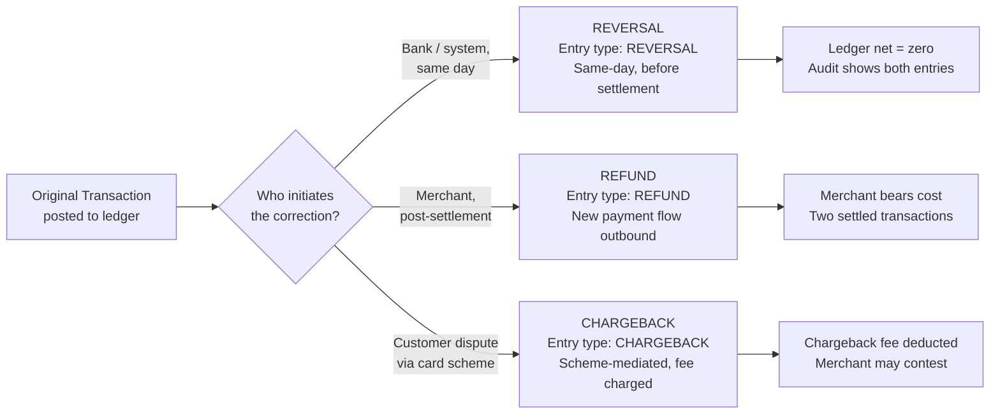
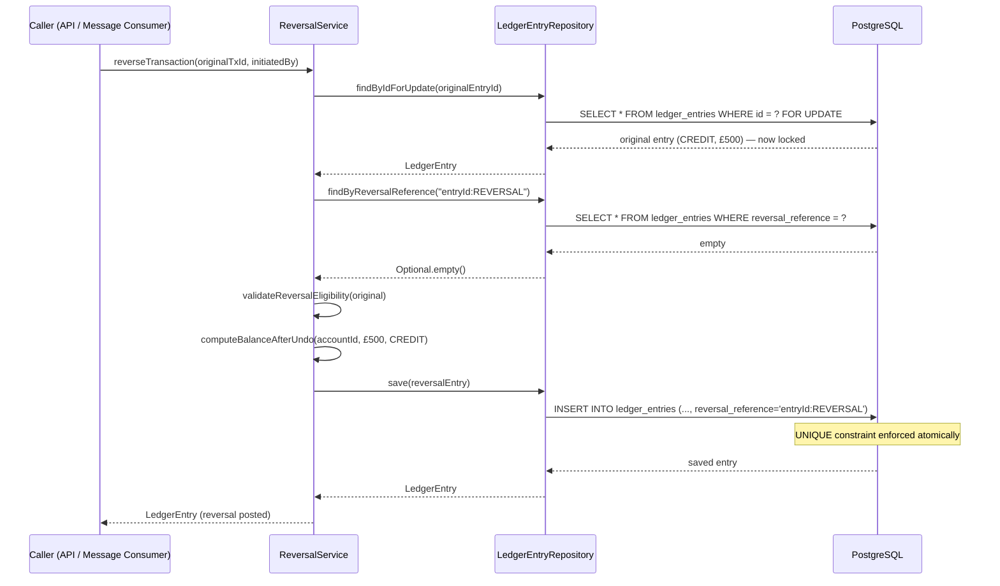

# المعاملات التعويضية — العكس والاسترداد والاسترجاع

## نظرة عامة

في الأنظمة المالية تحدث الأخطاء: تُرسل دفعة إلى الحساب الخطأ، أو يُعترض على معاملة بطاقة، أو ترحّل مهمة دفعية قيدًا مرتين. والاستجابة المنضبطة ليست حذف السجل الأصلي أو تحديثه أبدًا. بل تُلحق معاملة جديدة تُبطل أثر الأولى. وهذه هي **المعاملة التعويضية** — تصحيح غير قابل للتغيير وقابل للتتبع يحفظ سجل التدقيق الكامل الذي تتطلبه الجهات الرقابية وأنظمة المطابقة. وإتقان التعويض من أوضح علامات المهندس المالي على مستوى كبار المهندسين.

## أهداف التعلم

- التمييز بين العكس (reversal) والاسترداد (refund) والاسترجاع (chargeback) واختيار نوع قيد الدفتر الصحيح لكل منها
- تصميم مخطط تعويض يجعل العكس المزدوج مستحيلًا بنيويًا عبر قيود قاعدة البيانات
- تنفيذ منطق عكس idempotent في Java بمفتاح `reversal_reference` حتمي
- فرض قاعدة العمل للعكس الجزئي: لا يجوز أن تتجاوز العكوس التراكمية المبلغ الأصلي
- تحليل رسالة استدعاء دفعة ISO 20022 ‏CAMT.056 في Java باستخدام JAXB
- كتابة اختبارات تتحقق من ثوابت الرصيد والـ idempotency والحالات الحدية للعكوس الجزئية

## سياق العمل

*مثال مركّب:* يتعرض معالج مدفوعات أوروبي لحادث P1 أثناء دفعة رواتب. فقد أرسل خطأ في مهمته الليلية 14,000 إيداع رواتب مرتين. وكانت الغريزة الأولى لفريق الهندسة إصدار دفعة تصحيحية تحذف الصفوف المكررة من الدفتر. فأوقفهم مسؤول الامتثال: حذف قيود دفتر مرحّلة سينتهك التزامات حفظ السجلات لدى الشركة وسيجعل تشغيل المطابقة يفشل فشلًا كارثيًا لأن كشوف الحسابات البنكية الخارجية عكست بالفعل الإيداعات الأصلية.

كان الإصلاح الصحيح ترحيل 14,000 قيد خصم تعويضي — واحد لكل إيداع مكرر — يشير كل منها إلى المعاملة الأصلية التي يعكسها. فعاد رصيد الدفتر صحيحًا، وبقي سجل التدقيق سليمًا، وكان كل قيد قابلًا للتتبع، وعالجت مهمة المطابقة الأمر بشكل طبيعي صباح اليوم التالي. واستغرق التعافي أربع ساعات بدل اليومين اللذين كان سيتطلبهما نهج الحذف وإعادة الترحيل.

يوضح ذلك الحادث القاعدة التأسيسية لهندسة الدفاتر المالية: **الدفتر للإلحاق فقط. والتصحيحات قيود جديدة، لا تعديلات على القائمة.**

## العكس مقابل الاسترداد مقابل الاسترجاع

تُستخدم هذه المصطلحات الثلاثة بالتبادل في الحديث لكنها تمثل سير عمل مختلفة جوهريًا، وأنواع قيود دفتر مختلفة، ومعاملات رقابية مختلفة.



| البُعد | العكس | الاسترداد | الاسترجاع |
|---|---|---|---|
| المبادر | البنك / النظام | التاجر | العميل عبر شبكة البطاقات |
| التوقيت | يوم العمل نفسه، قبل التسوية | بعد التسوية، في أي وقت | عادة حتى 120 يومًا من المعاملة (تختلف قواعد الشبكات) |
| أثر التسوية | يلغي الأصلية | دفعة صادرة جديدة | استرداد من التاجر |
| نوع قيد الدفتر | `REVERSAL` | `REFUND` | `CHARGEBACK` |
| الرسوم | لا شيء | لا شيء | رسم استرجاع يفرضه المستحوذ على التاجر (غالبًا 15–25 جنيهًا) |
| التصنيف الرقابي | تصحيح داخلي | اتفاق تجاري | حل نزاع |

التمييز مهم للأنظمة اللاحقة. فيجب أن تعرف مهام المطابقة هل القيد السالب يقابل إيداعًا من اليوم نفسه (عكس) أم يمثل دفعة صادرة مستقلة (استرداد). ويجب أن تميز تحليلات الاحتيال الاستردادات التي يبدؤها التاجر عن الاسترجاعات التي تتوسط فيها الشبكة. فلا تخلطها أبدًا في عمود واحد `entry_type = 'NEGATIVE'`.

## مخطط الدفتر للإلحاق فقط

يوسّع مخطط المعاملات التعويضية الدفتر بمفتاح خارجي يشير إلى الجدول نفسه: كل صف تعويض يشير إلى المعاملة الأصلية التي يقابلها.

```sql
CREATE TABLE ledger_entries (
    id                    UUID          NOT NULL DEFAULT gen_random_uuid(),
    account_id            UUID          NOT NULL,
    transaction_id        UUID          NOT NULL,  -- the business transaction this entry belongs to
    entry_type            VARCHAR(20)   NOT NULL,  -- CREDIT, DEBIT, REVERSAL, REFUND, CHARGEBACK
    amount                NUMERIC(19,4) NOT NULL,
    currency              CHAR(3)       NOT NULL,
    running_balance       NUMERIC(19,4) NOT NULL,
    reversal_of_entry_id  UUID          NULL REFERENCES ledger_entries(id),
    reversal_reference    VARCHAR(100)  NULL,      -- deterministic key for idempotency
    posted_at             TIMESTAMPTZ   NOT NULL DEFAULT now(),
    value_date            DATE          NOT NULL,
    description           VARCHAR(255)  NOT NULL,
    created_by            VARCHAR(100)  NOT NULL,  -- service or operator that created the entry
    metadata              JSONB         NULL,

    CONSTRAINT pk_ledger_entries PRIMARY KEY (id),
    CONSTRAINT uq_reversal_reference UNIQUE (reversal_reference),  -- prevents double-reversal
    CONSTRAINT chk_entry_type CHECK (entry_type IN ('CREDIT','DEBIT','REVERSAL','REFUND','CHARGEBACK')),
    CONSTRAINT chk_amount_positive CHECK (amount > 0)  -- amount is always positive; sign comes from entry_type
);

CREATE INDEX idx_ledger_account_posted ON ledger_entries (account_id, posted_at DESC);
CREATE INDEX idx_ledger_reversal_of    ON ledger_entries (reversal_of_entry_id)
    WHERE reversal_of_entry_id IS NOT NULL;
```

> [!IMPORTANT]
> قيد `UNIQUE(reversal_reference)` هو الضمان البنيوي ضد العكس المزدوج. وليس اختياريًا. ففحوص منطق العمل ضرورية لكنها غير كافية — وقيد قاعدة البيانات وحده يوفر ضمانًا دائمًا وآمنًا مع التزامن.

## العكس الـ Idempotent: مفتاح المرجع الحتمي

يُبنى مرجع العكس حتميًا من معرّف القيد الأصلي مع لاحقة. وهذا يعني أنه مهما استُدعيت خدمة العكس — بسبب إعادات المحاولة، أو انتهاء مهلات الشبكة، أو التسليم مرة واحدة على الأقل من طابور رسائل — لا يُدرج إلا قيد عكس واحد.

```java
public final class ReversalReferenceGenerator {

    private ReversalReferenceGenerator() {}

    /**
     * Generates a deterministic reversal reference for a full reversal.
     * Format: "{originalEntryId}:REVERSAL"
     */
    public static String forFullReversal(UUID originalEntryId) {
        return originalEntryId.toString() + ":REVERSAL";
    }

    /**
     * Generates a deterministic reversal reference for one partial reversal.
     * The caller's idempotency key (one per partial-reversal REQUEST) makes
     * several partial reversals of the same entry possible, while a retry of
     * the same request maps to the same reference. (A reason code would not
     * work: two genuine partial reversals can share the same reason.)
     * Format: "{originalEntryId}:PARTIAL:{idempotencyKey}"
     */
    public static String forPartialReversal(UUID originalEntryId, String idempotencyKey) {
        Objects.requireNonNull(idempotencyKey, "idempotencyKey must not be null");
        if (idempotencyKey.isBlank() || idempotencyKey.length() > 50) {
            throw new IllegalArgumentException("idempotencyKey must be 1–50 characters");
        }
        return originalEntryId.toString() + ":PARTIAL:" + idempotencyKey;
    }
}
```

تقفل الخدمة القيد الأصلي أولًا، ثم تستخدم هذا المفتاح كحارس idempotency قبل محاولة الإدراج:

```java
@Service
@RequiredArgsConstructor
@Slf4j
public class ReversalService {

    private final LedgerEntryRepository ledgerEntryRepository;
    private final AccountRepository accountRepository;

    @Transactional
    public LedgerEntry reverseTransaction(ReversalRequest request) {
        String reversalReference = ReversalReferenceGenerator
            .forFullReversal(request.originalEntryId());

        // Lock the ORIGINAL entry row (SELECT ... FOR UPDATE): all reversals of
        // this entry — full or partial — are serialised from here on
        LedgerEntry original = ledgerEntryRepository.findByIdForUpdate(request.originalEntryId())
            .orElseThrow(() -> new EntryNotFoundException(request.originalEntryId()));

        // Idempotency check — after the lock, so a concurrent duplicate that
        // committed first is visible here
        Optional<LedgerEntry> existing =
            ledgerEntryRepository.findByReversalReference(reversalReference);
        if (existing.isPresent()) {
            log.info("Reversal already exists for entry {}, returning existing entry {}",
                request.originalEntryId(), existing.get().getId());
            return existing.get();
        }

        validateReversalEligibility(original);

        // A "full" reversal reverses what is LEFT: earlier partial reversals count
        BigDecimal alreadyReversed = ledgerEntryRepository
            .sumReversedAmountForEntry(original.getId());
        BigDecimal remaining = original.getAmount().subtract(alreadyReversed);
        if (remaining.signum() <= 0) {
            throw new AlreadyFullyReversedException(original.getId());
        }

        // The balance effect is the mirror of the ORIGINAL entry type:
        // undoing a credit lowers the balance, undoing a debit raises it.
        // (Locks the account row and applies the delta.)
        BigDecimal newBalance = computeBalanceAfterUndo(
            original.getAccountId(), remaining, original.getEntryType());

        LedgerEntry reversal = LedgerEntry.builder()
            .accountId(original.getAccountId())
            .transactionId(UUID.randomUUID())
            .entryType(EntryType.REVERSAL)
            .amount(remaining)
            .currency(original.getCurrency())
            .runningBalance(newBalance)
            .reversalOfEntryId(original.getId())
            .reversalReference(reversalReference)
            .valueDate(request.valueDate())
            .description("Reversal of entry " + original.getId())
            .createdBy(request.initiatedBy())
            .build();

        return ledgerEntryRepository.save(reversal);
    }

    private void validateReversalEligibility(LedgerEntry original) {
        // Only CREDIT and DEBIT entries can be reversed; never a reversal itself
        if (original.getEntryType() == EntryType.REVERSAL
                || original.getReversalOfEntryId() != null) {
            throw new ReversalOfReversalException(original.getId());
        }
        if (original.getEntryType() != EntryType.CREDIT
                && original.getEntryType() != EntryType.DEBIT) {
            throw new IllegalArgumentException(
                "Cannot reverse entry of type: " + original.getEntryType());
        }
    }
}
```

> [!NOTE]
> تستخدم عكوس الإيداع وعكوس الخصم كلاهما `EntryType.REVERSAL`. ويُستنتج اتجاه أثر الرصيد: عكس الإيداع ينقص الرصيد؛ وعكس الخصم يزيده. ولهذا تمرر الخدمة نوع القيد **الأصلي** إلى `computeBalanceAfterUndo` — فنوع العكس نفسه لا يقول في أي اتجاه نذهب. والتكرار المتزامن الذي يفلت من فحص الـ idempotency (مثلًا من مسار شيفرة آخر لا يأخذ القفل) سيفشل مع ذلك على `UNIQUE(reversal_reference)` عند الدفع؛ فترجم ذلك الاستثناء، خارج المعاملة، إلى "أعد العكس الموجود".

## العكس الجزئي: فرض قاعدة العمل

يحرر العكس الجزئي جزءًا فقط من مبلغ المعاملة الأصلية. وقاعدة العمل الأساسية: **مجموع كل العكوس الجزئية على قيد أصلي واحد يجب ألا يتجاوز مبلغ ذلك القيد.** ويتطلب ذلك استعلام مجموع قبل إدراج العكس الجديد.

```java
@Transactional
public LedgerEntry partiallyReverse(PartialReversalRequest request) {
    String reversalReference = ReversalReferenceGenerator
        .forPartialReversal(request.originalEntryId(), request.idempotencyKey());

    // Lock the original entry first — this serialises concurrent partial
    // reversals of the same entry and closes the check-then-insert race
    LedgerEntry original = ledgerEntryRepository.findByIdForUpdate(request.originalEntryId())
        .orElseThrow(() -> new EntryNotFoundException(request.originalEntryId()));

    // Idempotency check: a retry of the same request returns the same entry —
    // but only if it really is the same request
    Optional<LedgerEntry> existing =
        ledgerEntryRepository.findByReversalReference(reversalReference);
    if (existing.isPresent()) {
        if (existing.get().getAmount().compareTo(request.reversalAmount()) != 0) {
            throw new IdempotencyKeyReusedException(request.idempotencyKey());
        }
        return existing.get();
    }

    validateReversalEligibility(original);

    // Business rule: sum of all prior reversals + this reversal <= original amount
    BigDecimal alreadyReversed = ledgerEntryRepository
        .sumReversedAmountForEntry(request.originalEntryId());

    BigDecimal totalAfterThisReversal = alreadyReversed.add(request.reversalAmount());

    if (totalAfterThisReversal.compareTo(original.getAmount()) > 0) {
        throw new PartialReversalExceedsOriginalException(
            request.originalEntryId(),
            original.getAmount(),
            alreadyReversed,
            request.reversalAmount()
        );
    }

    BigDecimal newBalance = computeBalanceAfterUndo(
        original.getAccountId(), request.reversalAmount(), original.getEntryType());

    LedgerEntry reversal = LedgerEntry.builder()
        .accountId(original.getAccountId())
        .transactionId(UUID.randomUUID())
        .entryType(EntryType.REVERSAL)
        .amount(request.reversalAmount())
        .currency(original.getCurrency())
        .runningBalance(newBalance)
        .reversalOfEntryId(original.getId())
        .reversalReference(reversalReference)
        .valueDate(request.valueDate())
        .description("Partial reversal of entry " + original.getId()
            + ": " + request.reasonCode())
        .createdBy(request.initiatedBy())
        .build();

    return ledgerEntryRepository.save(reversal);
}
```

استعلام المستودع الذي يجمع العكوس السابقة:

```sql
-- Sum all reversal amounts already posted against a given original entry
SELECT COALESCE(SUM(amount), 0)
  FROM ledger_entries
 WHERE reversal_of_entry_id = :originalEntryId
   AND entry_type = 'REVERSAL';
```

```java
@Repository
public interface LedgerEntryRepository extends JpaRepository<LedgerEntry, UUID> {

    Optional<LedgerEntry> findByReversalReference(String reversalReference);

    @Lock(LockModeType.PESSIMISTIC_WRITE)
    @Query("SELECT e FROM LedgerEntry e WHERE e.id = :id")
    Optional<LedgerEntry> findByIdForUpdate(@Param("id") UUID id);

    // COALESCE: SUM over no rows is NULL. Compare the enum to its constant,
    // not to a string literal.
    @Query("""
        SELECT COALESCE(SUM(e.amount), 0)
          FROM LedgerEntry e
         WHERE e.reversalOfEntryId = :originalEntryId
           AND e.entryType = com.bank.ledger.EntryType.REVERSAL
        """)
    BigDecimal sumReversedAmountForEntry(@Param("originalEntryId") UUID originalEntryId);

    long countByReversalOfEntryId(UUID originalEntryId);
}
```

> [!WARNING]
> دون القفل، يكون فحص العكس الجزئي سباق فحص-ثم-استخدام (TOCTOU): فطلبان متزامنان للقيد الأصلي نفسه قد يجتازان فحص المجموع كلاهما ويتجاوزان معًا المبلغ الأصلي. وقيد `UNIQUE(reversal_reference)` يوقف التكرارات المطابقة فقط (مفتاح الـ idempotency نفسه). ولهذا تبدأ الدالتان كلتاهما بـ `SELECT ... FOR UPDATE` على صف القيد الأصلي. (والمشغّل في قاعدة البيانات الذي يعيد الجمع آمن فقط إذا أخذ القفل نفسه أولًا — وإلا فله السباق نفسه.)

## استدعاء الدفعة ISO 20022 ‏CAMT.056

‏CAMT.056 ‏(`FIToFIPaymentCancellationRequest`) رسالة ISO 20022 تستخدمها مؤسسة مالية لتطلب من أخرى إلغاء دفعة بدأتها أو إعادتها. وهي الآلية القياسية لاستدعاء المدفوعات بين البنوك في SEPA وكثير من الأنظمة المحلية.

يبدو هيكل CAMT.056 مبسط هكذا:

```xml
<?xml version="1.0" encoding="UTF-8"?>
<Document xmlns="urn:iso:std:iso:20022:tech:xsd:camt.056.001.08">
  <FIToFIPmtCxlReq>
    <Assgnmt>
      <Id>RECALL-2024-001-XYZ</Id>
      <Assgnr><Agt><FinInstnId><BICFI>BARCGB22XXX</BICFI></FinInstnId></Agt></Assgnr>
      <Assgne><Agt><FinInstnId><BICFI>HSBCGB2LXXX</BICFI></FinInstnId></Agt></Assgne>
      <CreDtTm>2024-03-15T10:30:00Z</CreDtTm>
    </Assgnmt>
    <Undrlyg>
      <TxInf>
        <CxlId>CXL-20240315-001</CxlId>
        <OrgnlGrpInf>
          <OrgnlMsgId>MSG-20240315-PAY-001</OrgnlMsgId>
          <OrgnlMsgNmId>pacs.008.001.08</OrgnlMsgNmId>
        </OrgnlGrpInf>
        <OrgnlTxId>TXN-20240315-98765</OrgnlTxId>
        <OrgnlIntrBkSttlmAmt Ccy="GBP">5000.00</OrgnlIntrBkSttlmAmt>
        <CxlRsnInf>
          <Rsn><Cd>DUPL</Cd></Rsn>
          <AddtlInf>Duplicate salary payment identified during reconciliation</AddtlInf>
        </CxlRsnInf>
      </TxInf>
    </Undrlyg>
  </FIToFIPmtCxlReq>
</Document>
```

رموز أسباب الإلغاء الشائعة في CAMT.056 عمليًا:

| الرمز | المعنى | المحفّز النموذجي |
|---|---|---|
| `DUPL` | دفعة مكررة | ترحيل مزدوج من مهمة دفعية |
| `FRAD` | منشأ احتيالي | كشف من نظام مكافحة غسل الأموال / الاحتيال |
| `TECH` | مشكلة تقنية | خطأ في نظام التسوية |
| `CUST` | طلب العميل | العميل يتصل بالبنك |
| `UPAY` | دفعة غير مستحقة | ما كان ينبغي إجراء الدفعة |
| `AC03` | حساب مستفيد خاطئ (IBAN) | العميل كتب IBAN خاطئًا |
| `AM09` | مبلغ خاطئ | خطأ في المبلغ |

الاستدعاء **طلب**، لا تعليمة. فالبنك المستقبل (بنك المستفيد) هو من يقرر: بحسب السبب وقواعد النظام قد يحتاج موافقة المستفيد، وقد تكون الأموال قد ذهبت بالفعل. والإجابة الإيجابية تعيد المال بـ `pacs.004` (إعادة دفعة)؛ والإجابة السلبية تُرسل كـ `camt.029` (حل تحقيق). لذلك يسجّل المعالج أدناه الاستدعاء أولًا كحالة؛ ولا يُرحّل العكس إلا بعد **قبول** الاستدعاء.

تحليل الاستدعاء في Java باستخدام JAXB بمساحة أسماء Jakarta:

```java
import jakarta.xml.bind.JAXBContext;
import jakarta.xml.bind.JAXBException;
import jakarta.xml.bind.Unmarshaller;
import java.io.StringReader;

@Service
@Slf4j
public class Camt056RecallProcessor {

    private final JAXBContext jaxbContext;
    private final ReversalService reversalService;
    private final LedgerEntryRepository ledgerEntryRepository;
    private final RecallCaseRepository recallCases;

    public Camt056RecallProcessor(ReversalService reversalService,
                                  LedgerEntryRepository ledgerEntryRepository,
                                  RecallCaseRepository recallCases) throws JAXBException {
        // JAXBContext is thread-safe and expensive to create — build once at startup
        this.jaxbContext = JAXBContext.newInstance(Document.class);
        this.reversalService = reversalService;
        this.ledgerEntryRepository = ledgerEntryRepository;
        this.recallCases = recallCases;
    }

    /** Step 1: register the recall as a case — idempotent on the assignment id. */
    public RecallCase registerRecall(String camt056Xml) {
        Document document = unmarshal(camt056Xml);
        FIToFIPaymentCancellationRequestV08 request = document.getFIToFIPmtCxlReq();

        TransactionInformation32 txInfo = request.getUndrlyg()
            .getFirst()
            .getTxInf()
            .getFirst();

        String originalTxId  = txInfo.getOrgnlTxId();   // interbank id, NOT our UUID
        String reasonCode    = txInfo.getCxlRsnInf().getFirst().getRsn().getCd();
        String assignmentId  = request.getAssgnmt().getId();

        log.info("Registering CAMT.056 recall: assignmentId={}, originalTxId={}, reason={}",
            assignmentId, originalTxId, reasonCode);

        // INSERT ... ON CONFLICT (assignment_id) DO NOTHING, then read back
        return recallCases.registerOnce(assignmentId, originalTxId, reasonCode);
    }

    /** Step 2: after the recall is ACCEPTED, post the reversal (then send pacs.004). */
    public RecallResult executeAcceptedRecall(RecallCase recall) {
        // Resolve our ledger entry from the scheme's transaction id
        Optional<LedgerEntry> original =
            ledgerEntryRepository.findByExternalTransactionId(recall.originalTxId());
        if (original.isEmpty()) {
            log.warn("CAMT.056 recall references unknown transaction: {}", recall.originalTxId());
            return RecallResult.rejected(recall.assignmentId(), "TRANSACTION_NOT_FOUND"); // camt.029
        }

        ReversalRequest reversalRequest = ReversalRequest.builder()
            .originalEntryId(original.get().getId())
            .initiatedBy("CAMT056:" + recall.assignmentId())
            .valueDate(LocalDate.now())
            .build();

        try {
            LedgerEntry reversal = reversalService.reverseTransaction(reversalRequest);
            return RecallResult.accepted(recall.assignmentId(), reversal.getId()); // pacs.004
        } catch (ReversalOfReversalException | AlreadyFullyReversedException ex) {
            log.warn("CAMT.056 recall targets an already-reversed entry: {}", recall.originalTxId());
            return RecallResult.rejected(recall.assignmentId(), "ALREADY_REVERSED");  // camt.029
        }
    }

    private Document unmarshal(String xml) {
        try {
            Unmarshaller unmarshaller = jaxbContext.createUnmarshaller();
            // Interbank messages are external input: parse with external
            // entities disabled (no XXE). The generated Document class usually
            // has no @XmlRootElement, so ask for the declared type.
            XMLStreamReader reader = secureXmlInputFactory()
                .createXMLStreamReader(new StringReader(xml));
            return unmarshaller.unmarshal(reader, Document.class).getValue();
        } catch (JAXBException | XMLStreamException ex) {
            throw new InvalidCamt056MessageException("Failed to parse CAMT.056 message", ex);
        }
    }
}
```

> [!NOTE]
> أصناف JAXB ‏(`Document`، و`FIToFIPaymentCancellationRequestV08`، إلخ) تُولّد من مخططات ISO 20022 XSD المنشورة على `https://www.iso20022.org/catalogue-messages/iso-20022-messages-archive`. وفي مشروع إنتاجي تعيش هذه الأصناف المولّدة في وحدة Maven منفصلة `iso20022-model` تتشاركها كل معالجات أنواع الرسائل.

## تدفق العكس من طرف إلى طرف



## اختبار منطق العكس

تتحقق الاختبارات جيدة البنية من أربعة سلوكيات مستقلة: ثابت الرصيد بعد العكس، ورفض العكس المزدوج، والعكس الجزئي ضمن الحد، والعكس الجزئي فوق الحد.

```java
@SpringBootTest
@Transactional
class ReversalServiceTest {

    @Autowired ReversalService reversalService;
    @Autowired LedgerEntryRepository ledgerEntryRepository;
    @Autowired AccountRepository accountRepository;

    private UUID accountId;
    private LedgerEntry originalCredit;

    @BeforeEach
    void setUp() {
        accountId = createTestAccount(new BigDecimal("1000.00"));
        originalCredit = postCredit(accountId, new BigDecimal("500.00"));
    }

    @Test
    @DisplayName("Balance after full reversal equals balance before original transaction")
    void fullReversal_restoresBalanceToPreTransactionState() {
        BigDecimal balanceBeforeOriginal =
            originalCredit.getRunningBalance().subtract(originalCredit.getAmount());

        LedgerEntry reversal = reversalService.reverseTransaction(ReversalRequest.builder()
            .originalEntryId(originalCredit.getId())
            .initiatedBy("test-service")
            .valueDate(LocalDate.now())
            .build());

        assertThat(reversal.getRunningBalance())
            .isEqualByComparingTo(balanceBeforeOriginal);
    }

    @Test
    @DisplayName("Calling reverseTransaction twice returns the same entry — idempotent")
    void doubleReversal_isIdempotent_returnsSameEntry() {
        ReversalRequest request = ReversalRequest.builder()
            .originalEntryId(originalCredit.getId())
            .initiatedBy("test-service")
            .valueDate(LocalDate.now())
            .build();

        LedgerEntry first  = reversalService.reverseTransaction(request);
        LedgerEntry second = reversalService.reverseTransaction(request);

        assertThat(second.getId()).isEqualTo(first.getId());
        assertThat(ledgerEntryRepository.countByReversalOfEntryId(originalCredit.getId()))
            .isEqualTo(1);
    }

    @Test
    @DisplayName("Partial reversal within original amount is accepted")
    void partialReversal_withinLimit_succeeds() {
        LedgerEntry partial = reversalService.partiallyReverse(PartialReversalRequest.builder()
            .originalEntryId(originalCredit.getId())
            .reversalAmount(new BigDecimal("200.00"))
            .reasonCode("PARTIAL_DISPUTE")
            .idempotencyKey("partial_dispute-req-1")
            .initiatedBy("test-service")
            .valueDate(LocalDate.now())
            .build());

        assertThat(partial.getAmount()).isEqualByComparingTo("200.00");
        assertThat(partial.getEntryType()).isEqualTo(EntryType.REVERSAL);
    }

    @Test
    @DisplayName("Partial reversal that would exceed original amount is rejected")
    void partialReversal_exceedingOriginal_throwsException() {
        // Post £300 partial reversal — within the £500 limit
        reversalService.partiallyReverse(PartialReversalRequest.builder()
            .originalEntryId(originalCredit.getId())
            .reversalAmount(new BigDecimal("300.00"))
            .reasonCode("FIRST_PARTIAL")
            .idempotencyKey("first_partial-req-1")
            .initiatedBy("test-service")
            .valueDate(LocalDate.now())
            .build());

        // Attempt £250 more — total would be £550, exceeding £500
        assertThatThrownBy(() -> reversalService.partiallyReverse(
            PartialReversalRequest.builder()
                .originalEntryId(originalCredit.getId())
                .reversalAmount(new BigDecimal("250.00"))
                .reasonCode("SECOND_PARTIAL")
                .idempotencyKey("second_partial-req-1")
                .initiatedBy("test-service")
                .valueDate(LocalDate.now())
                .build()))
            .isInstanceOf(PartialReversalExceedsOriginalException.class)
            .hasMessageContaining("500.00");
    }
}
```

> [!IMPORTANT]
> يجب أيضًا تشغيل اختبار `doubleReversal_isIdempotent_returnsSameEntry` بمستدعين متزامنين للتحقق من القفل وقيد `UNIQUE(reversal_reference)` تحت سباق حقيقي. استخدم `@RepeatedTest(10)` بخيطين يُطلقان عبر `CompletableFuture`. ويجب **ألا** يكون ذلك الاختبار المتزامن `@Transactional`: فداخل معاملة اختبار واحدة لا يُلتزم بشيء، فلن يرى الخيط الثاني عمل الأول أبدًا.

## اختبار المعرفة

**س1: يقترح مطوّر التعامل مع العكوس بإضافة علَم `reversed = true` إلى قيد الدفتر الأصلي وتخطيه في حسابات الرصيد. ما المشكلتان الحرجتان في هذا النهج؟**

ج: أولًا، ينتهك متطلب سجل التدقيق للإلحاق فقط. فتعديل قيد دفتر مرحّل يكسر التزامات حفظ السجلات (مثلًا قواعد حفظ السجلات SYSC 9 لدى FCA) والممارسة المحاسبية الأساسية. وأنظمة المطابقة الخارجية — بما فيها كشوف التسوية في SWIFT وISO 20022 — ستكون قد سجلت القيد الأصلي بالفعل؛ وتغيير الدفتر الداخلي يخلق عدم تطابق يكسر المطابقة. ثانيًا، النهج ليس ذريًا. فإذا كان `UPDATE` لضبط `reversed = true` وتعديل الرصيد عمليتين منفصلتين، فإن فشلًا بينهما ينتج حالة غير متسقة: القيد معلّم كمعكوس لكن الرصيد لم يُصحح، أو العكس. أما نهج المعاملة التعويضية فيجمع الأثرين في INSERT جديد واحد ذري، ويترك القيد الأصلي دون تغيير، ويمكن إعادة تشغيله بأمان عند إعادة المحاولة.

**س2: تجتاز خدمة العكس الجزئي كل اختبارات الوحدة لكنك تلاحظ حالات عرضية في الإنتاج يتجاوز فيها مبلغ العكس التراكمي مبلغ المعاملة الأصلية. واستعلام فحص المجموع والإدراج داخل دالة `@Transactional` واحدة. ما السبب الجذري وما العلاجان الصالحان؟**

ج: السبب الجذري سباق فحص-ثم-استخدام (TOCTOU). فطلبا عكس جزئي متزامنان يقرآن كلاهما المجموع الحالي (مثلًا 0 جنيه)، ويحسب كلاهما أن مبلغه المطلوب (مثلًا 400 جنيه لكل منهما) يتسع ضمن الأصلي البالغ 500 جنيه، ويمضيان كلاهما إلى الإدراج. ولأن أيًا من المعاملتين لا تمسك قفلًا على صف القيد الأصلي، ينجح الإدراجان — فيصبح الإجمالي التراكمي 800 جنيه. العلاج الأول: أضف `SELECT ... FOR UPDATE` على صف قيد الدفتر الأصلي في بداية معاملة العكس الجزئي، فتتسلسل العكوس الجزئية المتزامنة للقيد الأصلي نفسه. العلاج الثاني: شغّل الفحص والإدراج في معاملات `SERIALIZABLE` وأعد المحاولة عند فشل التسلسل — فيكتشف PostgreSQL حينها أن قراءات المعاملتين وكتاباتهما متعارضة. (المشغّل الذي يعيد الجمع عند كل إدراج *ليس* كافيًا وحده: فتحت `READ COMMITTED` يفوّت مشغّلان متزامنان صفوف بعضهما غير الملتزمة، ما لم يأخذ المشغّل قفل الصف نفسه أولًا.)

## التحدي العملي

**السيناريو:** تبني وحدة التعويض لمنصة مدفوعات آنية. وتعالج المنصة تحويلات SEPA الائتمانية الفورية ويجب أن تتعامل مع استدعاءات CAMT.056 ضمن نافذة الاستدعاء في النظام (10 أيام عمل بنكية لأسباب التكرار والمشكلات التقنية والاحتيال؛ ويمكن تقديم الاستدعاءات التي يطلبها العميل بسبب IBAN خاطئ أو مبلغ خاطئ أو سبب من العميل حتى 13 شهرًا).

**المهمة:**

1. وسّع مخطط `ledger_entries` بإضافة عمود `recall_window_expires_at` (يُحسب كـ `posted_at + INTERVAL '10 business days'`). واكتب دالة PostgreSQL ‏`is_within_recall_window(entry_id UUID) RETURNS BOOLEAN` تعيد `true` إذا كان الطابع الزمني الحالي قبل انتهاء نافذة الاستدعاء. وادمج هذا الفحص في دالة `validateReversalEligibility`.

2. نفّذ مكوّن Spring باسم `RecallWindowScheduler` باستخدام `@Scheduled(cron = "0 0 18 * * MON-FRI")` يستعلم كل القيود التي تنتهي نافذة استدعائها في نهاية اليوم وينشر `RecallWindowClosingEvent` إلى موضوع Kafka لإشعار المُنشئين لاحقًا.

3. اكتب `Camt056MessageValidator` يتحقق من XML لـ CAMT.056 الوارد مقابل مخطط ISO 20022 XSD قبل فك التسلسل. استخدم `javax.xml.validation.SchemaFactory` مع تحميل الـ XSD من مسار الأصناف. وأعد record باسم `ValidationResult` يحتوي `boolean valid` و`List<String> errors`.

4. اكتب اختبار تكامل يرحّل قيد إيداع، ثم يرسل طلبي استدعاء CAMT.056 متزامنين للمعاملة نفسها باستخدام `CompletableFuture.allOf(...)`. وأكد أن عكسًا واحدًا بالضبط يُلتزم به وأن الآخر إما يعيد العكس الموجود (المسار الـ idempotent) أو يُرفض بانتهاك قيد قاعدة بيانات تترجمه الخدمة إلى `DuplicateReversalException`.

> [!IMPORTANT]
> يجب أن يكون معالج CAMT.056 idempotent على مستوى الرسالة وكذلك على مستوى المعاملة. استخدم `Assgnmt/Id` (معرّف التكليف) في CAMT.056 كمفتاح idempotency ثانٍ في جدول `processed_recalls` منفصل. فهذا يحمي من حالة تسليم رسالة الاستدعاء نفسها مرتين عبر الشبكة بين البنوك، حتى لو أشارت إلى معرّفي معاملات داخليين مختلفين.

<!-- KNOWLEDGE-CHECK
{
  "questions": [
    {
      "text": "يقترح مطوّر التعامل مع العكوس بإضافة علَم reversed=true إلى قيد الدفتر الأصلي وتخطيه في حسابات الرصيد. ما المشكلتان الحرجتان في هذا النهج؟",
      "options": [
        "نهج العلَم أبطأ من ترحيل قيد جديد لأنه يتطلب UPDATE بدل INSERT",
        "ينتهك متطلب حفظ السجلات للإلحاق فقط (تعديل السجلات المرحّلة يكسر التزامات حفظ السجلات ويُبطل المطابقة الخارجية) كما أن UPDATE ليس ذريًا مع تعديل الرصيد — فالفشل بينهما يترك النظام في حالة غير متسقة يكون فيها القيد معلّمًا كمعكوس لكن الرصيد غير مصحح",
        "الأعلام غير مدعومة في محللات JAXB القياسية المستخدمة لرسائل ISO 20022",
        "لا يستطيع العلَم التمييز بين العكوس الكاملة والجزئية دون عمود مبلغ إضافي"
      ],
      "correct": 1,
      "explanation": "مشكلتان حرجتان: (1) تعديل قيد دفتر مرحّل ينتهك التزامات حفظ السجلات للإلحاق فقط (مثلًا قواعد SYSC 9 لدى FCA) والممارسة المحاسبية. وأنظمة المطابقة الخارجية سجلت القيد الأصلي بالفعل — فتغييره داخليًا يخلق عدم تطابق. (2) ‏UPDATE لضبط reversed=true وتعديل الرصيد عمليتان غير ذريتين. والفشل بينهما ينتج حالة غير متسقة. أما نهج المعاملة التعويضية فيجمع الأثرين في INSERT واحد ذري، ويترك الأصلي دون تغيير، ويمكن إعادة تشغيله عند إعادة المحاولة، ويحفظ سجل التدقيق الكامل."
    },
    {
      "text": "ما سباق TOCTOU في معالجة العكس الجزئي، وما العلاجان الصالحان؟",
      "options": [
        "يصل عكسان جزئيان بمفتاح الـ idempotency نفسه في آن واحد — يتعامل قيد UNIQUE(reversal_reference) مع ذلك",
        "يجتاز عكسان جزئيان بمفتاحي idempotency مختلفين فحص المجموع التراكمي بالتزامن ويتجاوزان معًا المبلغ الأصلي — العلاج 1: ‏SELECT ... FOR UPDATE على القيد الأصلي أثناء التحقق؛ والعلاج 2: معاملات SERIALIZABLE مع إعادة المحاولة عند فشل التسلسل",
        "استعلام المجموع وINSERT ليسا في المعاملة نفسها، فيسمح ذلك بتغير المجموع بين الفحص والإدراج",
        "يعمل العكس الجزئي بعزل READ COMMITTED الذي يسمح للقراءات الشبحية بإظهار مجموع تراكمي قديم"
      ],
      "correct": 1,
      "explanation": "يمنع UNIQUE(reversal_reference) التكرارات المطابقة فقط (مفتاح الـ idempotency نفسه). فطلبان متزامنان بمفتاحين مختلفين ينفذان كلاهما استعلام المجموع التراكمي قبل أن يلتزم أي منهما، ويرى كلاهما المجموع الحالي مثلًا 0 جنيه، ويحسب كلاهما أن طلبه البالغ 400 جنيه يتسع ضمن أصلي بـ 500 جنيه، ويدرجان كلاهما — فيصبح الإجمالي 800 جنيه. العلاج 1: ‏SELECT ... FOR UPDATE على القيد الأصلي يسلسل العكوس الجزئية المتزامنة للأصلي نفسه. العلاج 2: عزل SERIALIZABLE يجعل PostgreSQL يكتشف القراءات والكتابات المتعارضة فيُجهض إحدى المعاملتين، التي تُعاد محاولتها. والمشغّل الذي يجمع وحده غير كافٍ تحت READ COMMITTED ما لم يأخذ القفل نفسه."
    },
    {
      "text": "ما الذي يميز REVERSAL عن REFUND، ولماذا يهم هذا التمييز لأنظمة المطابقة اللاحقة؟",
      "options": [
        "هما متطابقان وظيفيًا — والتمييز شكلي فقط لكشوف العملاء",
        "‏REVERSAL تصحيح في اليوم نفسه قبل التسوية يبدؤه البنك/النظام ومحصلته صفر؛ وREFUND دفعة صادرة جديدة بعد التسوية يبدؤها التاجر — ويجب أن تميزهما أنظمة المطابقة لأن العكس يلغي المعاملة الأصلية بينما يمثل الاسترداد معاملتين مسوّاتين منفصلتين بتدفقات نقدية مختلفة",
        "لا يمكن بدء REVERSAL إلا من شبكة البطاقات بينما يستطيع التاجر بدء REFUND",
        "يتطلب REFUND رسالة ISO 20022 ‏CAMT.056 جديدة بينما يستخدم REVERSAL ‏CAMT.053"
      ],
      "correct": 1,
      "explanation": "التمييز حرج للمطابقة. فالـ REVERSAL يلغي المعاملة الأصلية قبل التسوية أو عندها — والأثر الصافي صفر، بقيدي دفتر مجموعهما صفر. أما الـ REFUND فدفعة صادرة جديدة مستقلة تُسوّى منفصلة — فيظهر الخصم الأصلي وإيداع الاسترداد كلاهما في الكشوف البنكية كمعاملتين مسوّاتين منفصلتين. وخلطهما يكسر المطابقة الخارجية: فالنظام الذي يتوقع زوجين متطابقين يرى بدلًا من ذلك زوجًا متطابقًا واحدًا وعنصرين منفردين غير متطابقين، فتتولد عناصر INTERNAL_ONLY وEXTERNAL_ONLY كاذبة."
    }
  ]
}
-->

<!-- PRACTICAL-CHALLENGE
{
  "title": "بناء نظام استدعاء SEPA Instant بمعالجة CAMT.056 وعكس Idempotent",
  "difficulty": "advanced",
  "estimatedMinutes": 45,
  "tasks": [
    {"id": "1", "description": "وسّع مخطط ledger_entries بعمود recall_window_expires_at يُحسب كـ posted_at + INTERVAL '10 business days' (استخدم دالة PostgreSQL تتخطى عطلات نهاية الأسبوع). واكتب دالة PostgreSQL ‏is_within_recall_window(entry_id UUID) RETURNS BOOLEAN. وادمج هذا الفحص في validateReversalEligibility() — ارمِ RecallWindowExpiredException إذا أُغلقت النافذة، مع طابع الانتهاء الزمني في رسالة الاستثناء."},
    {"id": "2", "description": "نفّذ RecallWindowScheduler باستخدام @Scheduled(cron = '0 0 18 * * MON-FRI') يستعلم كل قيود الدفتر التي يكون فيها recall_window_expires_at < now() + INTERVAL '1 hour' وrecall_window_expires_at > now() ولا يوجد عكس. ولكل قيد كهذا، انشر RecallWindowClosingEvent إلى Kafka عبر نمط الـ outbox. واكتب اختبارًا يدرج قيدًا بـ recall_window_expires_at = now() + 30 minutes ويتحقق من نشر الحدث في نبضة المجدول التالية."},
    {"id": "3", "description": "اكتب Camt056MessageValidator يتحقق من XML لـ CAMT.056 الوارد مقابل مخطط ISO 20022 XSD باستخدام javax.xml.validation.SchemaFactory قبل فك التسلسل. وحمّل الـ XSD من مسار الأصناف عند البدء (لا لكل طلب). وأعد record ‏ValidationResult(boolean valid, List<String> errors). واكتب اختبار وحدة يقدم CAMT.056 مشوهًا (ينقصه عنصر Assgnmt/Id المطلوب) ويؤكد valid=false مع قائمة أخطاء غير فارغة تحتوي مسار العنصر المفقود."},
    {"id": "4", "description": "اكتب اختبار تكامل يرحّل قيد إيداع، ثم يرسل طلبي استدعاء CAMT.056 متزامنين للمعاملة نفسها باستخدام CompletableFuture.allOf() مع مجمع خيوط ثابت من 2. وأكد: وجود صف عكس واحد بالضبط في ledger_entries ‏(countByReversalOfEntryId = 1)، وأن الاستدعاء المتزامن الثاني إما يعيد العكس الموجود (المسار الـ idempotent) أو يُترجم إلى DuplicateReversalException من انتهاك قيد UNIQUE(reversal_reference). واستخدم @RepeatedTest(10) للتحقق من أن السباق يُعالج باتساق."}
  ]
}
-->
