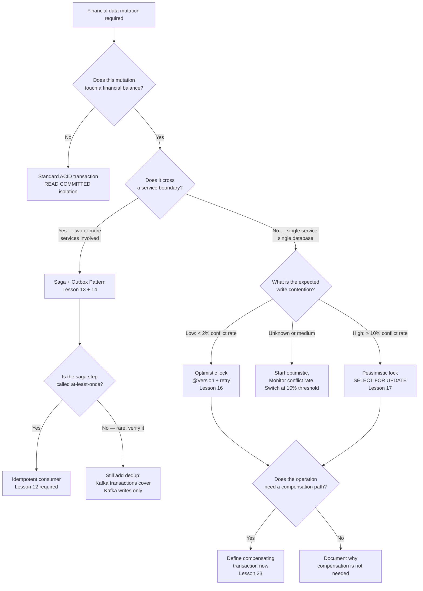
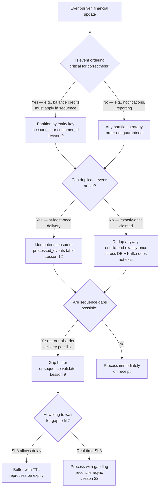
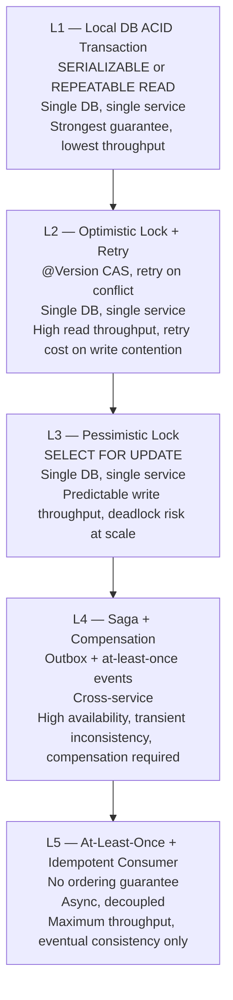

# إطار قرار سلامة البيانات المالية — الدرس الختامي

## نظرة عامة

عبر الدروس الثلاثة والعشرين من المسار 5 بنيت صندوق أدوات: الأقفال التفاؤلية، والأقفال التشاؤمية، وأنماط الـ outbox، والـ sagas، والمستهلكين الـ idempotent، وتخزين الأحداث، وسجلات التدقيق، والمعاملات التعويضية، ومهام المطابقة. والجزء الأصعب في الهندسة على مستوى كبار المهندسين ليس تنفيذ أي واحدة منها — بل اختيار الأداة الصحيحة للموقف الذي أمامك، وشرح المفاضلات لفريقك، والالتزام بتصميم سيصمد تحت ظروف إنتاج لم ترها بعد. ويجمع هذا الدرس الختامي المسار 5 في إطار قرار تستطيع تطبيقه فورًا.

## أهداف التعلم

- شرح التوتر الأساسي بين الاتساق القوي والإنتاجية العالية في الأنظمة المالية
- تطبيق شجرة قرار على أي تعديل لبيانات مالية لاختيار استراتيجية التزامن والديمومة الصحيحة
- تطبيق شجرة قرار ثانية على سيناريوهات معالجة الأحداث حيث يكون الترتيب والتكرار والفجوات ممكنة
- ترتيب مستويات الصحة الخمسة في التسلسل ومعرفة متى تنزل إلى مستوى أدنى
- تحديد أشيع أربعة أنماط مضادة في الأنظمة المالية وحوادث الإنتاج التي تسببها
- استخدام قائمة فحص كبير المهندسين لمراجعة أي تعديل مالي قبل وصوله إلى الإنتاج
- إكمال سجل قرار سلامة مالية لميزة جديدة

## سياق العمل

*مثال مركّب:* يطلق فريق المدفوعات في بنك بريطاني كبير محرك أوامر دفع دائمة (standing orders) آنيًا جديدًا. وتحت اختبار الحمل اجتاز كل فحوص الصحة. وفي أول جمعة رواتب حقيقية، مع 400,000 أمر دائم ينطلق بالتزامن بين 06:00 و08:00، تجمد النظام. فقد استخدمت خدمتان — خدمة خصم الرصيد وخدمة إيداع المستفيد — `SELECT FOR UPDATE` وحصلتا على الأقفال بترتيب متعاكس بحسب الطرف الذي بدأ التحويل. وخلال أربع دقائق كانت 90% من المعاملات تنتظر أقفالًا تمسكها معاملات منتظرة أخرى. وبقيت الخدمة غير متاحة 47 دقيقة.

حدد تحليل ما بعد الحادث الهندسي السبب الجذري كقرار تصميم اتُّخذ دون إطار: فقد طبّق الفريق `SELECT FOR UPDATE` في كل مكان لأنه "الخيار الآمن". والقفل التشاؤمي آمن لخدمة واحدة. لكن عبر خدمتين تحصلان على الأقفال بترتيب غير منسق، يصبح آلة جمود. والتصميم الصحيح للتعديلات المالية عبر الخدمات saga بتعويض — لا قفل موزع على مرحلتين.

ذلك الانقطاع البالغ 47 دقيقة هو ما صُمم هذا الإطار لمنعه.

## التوتر الأساسي

يعيش كل نظام مالي على طيف بين قطبين:

**الاتساق القوي (عزل SERIALIZABLE + ‏FOR UPDATE):** تضمن قاعدة البيانات أن كل معاملة ترى عرضًا للبيانات متسقًا مع ترتيب تنفيذ تسلسلي. لا شذوذات — لا قراءات قذرة، ولا قراءات غير قابلة للتكرار، ولا قراءات شبحية. والثمن أن المعاملات المتعارضة يجب أن تنتظر بعضها. وتحت تزامن عالٍ يعني ذلك الاصطفاف، والاصطفاف يعني الزمن. وعند الحمل الأقصى يعني جمودًا وإخفاقات تسلسل يجب إعادة محاولتها.

**الاتساق النهائي (saga + ‏idempotency + تسليم مرة واحدة على الأقل):** تجري كل خدمة معاملة ACID خاصة بها. ويتحقق الاتساق عبر الخدمات بتنفيذ كل خطوات الـ saga في النهاية والتعويض إذا فشلت أي خطوة. لا أقفال عبر الخدمات، ولا طوابير انتظار موزعة. والثمن التعقيد: يجب أن تكون كل خطوة idempotent، ويجب أن يكون لكل فشل تعويض، والنظام غير متسق مؤقتًا بين خطوات الـ saga.

لا توجد إجابة صحيحة عامة. فالإجابة الصحيحة تعتمد على طبيعة البيانات، وتسامح العمل مع عدم الاتساق المؤقت، وحجم المعاملات، ومتطلب الزمن. ويعطيك الإطار أدناه تسلسل الأسئلة للوصول إلى الإجابة الصحيحة بشكل منهجي.

## شجرة القرار: تعديلات البيانات

استخدم هذه الشجرة كلما صممت خدمة تعدّل بيانات مالية.



> [!TIP]
> لتغيير صف رصيد واحد، غالبًا لا يكون الخيار الأول أيًا من نوعي القفل: فالتحديث الذري الشرطي — `UPDATE accounts SET balance = balance - :amt WHERE id = :id AND balance >= :amt` — صحيح تحت `READ COMMITTED`، ولا يحتاج حلقة إعادة محاولة، ويمسك قفل الصف طوال الجملة فقط (الدرس 16).

أهم فرع هو الانقسام عبر الخدمات عند العقدة D. فإذا عبر التعديل حدود خدمة، يكون القفل التشاؤمي غير متوافق بنيويًا مع التصميم — فلا تستطيع إمساك قفل قاعدة بيانات عبر استدعاء HTTP أو رسالة Kafka. والأداة الصحيحة دائمًا saga.

## شجرة القرار: معالجة الأحداث

استخدم هذه الشجرة عند تصميم مستهلك Kafka أو معالج قائم على الأحداث يحدّث حالة مالية.



## تسلسل الصحة

ليست كل ضمانات الصحة متساوية. يرتب التسلسل أدناه خمسة مستويات. وتعطي المستويات L1–L3 كلها الصحة القوية نفسها داخل قاعدة بيانات **واحدة** — وتختلف في طريقة تعاملها مع التنازع. والنزول الحقيقي في الضمانات هو من L3 إلى L4 (عبر الخدمات، غير متسق مؤقتًا) ثم L5. ولا تنزل إلا بقدر ما تتطلبه متطلبات العمل — فكل خطوة نزول تضيف تعقيدًا يجب أن يبرره متطلب أداء أو توفر حقيقي.



| المستوى | استخدمه عندما | لا تستخدمه عندما |
|---|---|---|
| L1 | تحديثات الرصيد في خدمة واحدة، وترحيلات الدفتر | عبر الخدمات، وإنتاجية عالية |
| L2 | كيانات كثيفة القراءة، وتنازع كتابة منخفض | اندفاعات الكتابة، ومعدل تعارض > 10% |
| L3 | التحويلات، ومعالجة المدفوعات الدفعية | عبر الخدمات (خطر جمود) |
| L4 | سير عمل مالية عبر الخدمات | خدمة واحدة (هندسة مفرطة) |
| L5 | الإشعارات، والتحليلات، وتوزيع سجلات التدقيق | تعديلات الرصيد (خطر على الصحة) |

**النزول في التسلسل مفاضلة متعمدة، لا اختصار.** فعندما تنتقل من L1 إلى L4، تبادل ضمان ACID في قاعدة البيانات بـ saga موزعة يجب أن تصممها وتنفذها وتراقبها وتعوّضها. وهذه مفاضلة صالحة للمدفوعات عبر الخدمات. وليست مفاضلة صالحة لتحديث رصيد بسيط في خدمة واحدة حيث يكفي L1 تمامًا.

> [!IMPORTANT]
> لا تستخدم أبدًا L5 (مرة واحدة على الأقل + مستهلك idempotent، دون ترتيب) وحده لتعديلات الرصيد. فدون ترتيب ومعالجة فجوات وتعويضات محددة، يترك الحدث الذي يصل خارج الترتيب أو يفشل رصيدًا خاطئًا دون أي شيء لإصلاحه. ولإسقاطات القراءة فقط، وتوزيع سجلات التدقيق، وخطوط الإشعارات، يكون L5 ممتازًا. ولأي شيء يغيّر رصيدًا ماليًا، الحد الأدنى L4: تطبّق الخدمة المالكة التغيير في معاملة ACID خاصة بها، ويكون التعويض محددًا.

## جدول الأنماط المضادة

تظهر الأنماط المضادة التالية مرارًا في تحليلات ما بعد الحوادث للأنظمة المالية. ولكل منها توقيع حادث إنتاج مميز.

| النمط المضاد | الوصف | حادث الإنتاج الذي يسببه |
|---|---|---|
| إصلاح التكرارات يدويًا | تُصحح الأحداث المكررة المكتشفة في الإنتاج بـ SQL عشوائي يشغّله مهندس | يُشغّل SQL التصحيح مرتين؛ أو يخطئ المهندس في الإشارة؛ فينجرف الرصيد بضعف المبلغ. ويُكتشف بعد أيام في المطابقة. |
| القفل التفاؤلي في كل مكان | `@Version` مطبّق على كل الكيانات بغض النظر عن ملف تنازع الكتابة | يوم الراتب: اندفاع 500 تحديث متزامن على الحساب نفسه. يبلغ معدل التعارض 60%. وتُشبع عاصفة إعادات المحاولة مجمع اتصالات قاعدة البيانات. وتتدهور الخدمة 11 دقيقة. |
| معاملة واحدة كبيرة | معاملة قاعدة بيانات واحدة تمتد عبر خصم الرصيد، وترحيل الدفتر، والنشر إلى Kafka، واستدعاء واجهة خارجية | تنتهي مهلة استدعاء الواجهة الخارجية عند 30 ثانية. وتبقى المعاملة مفتوحة، ممسكة أقفال الصفوف، 30 ثانية × 100 طلب متزامن = استنفاد مجمع الاتصالات. |
| 2PC عبر الخدمات | الالتزام على مرحلتين مستخدم لتنسيق التحديثات عبر قاعدتي بيانات خدمتين مصغرتين | يتعطل المنسّق بعد المرحلة 1. فيعلق كل المشاركين في حالة التحضير. ويلزم تدخل يدوي للحل. وتُحجب الأوامر الدائمة ساعتين. |

الخيط المشترك بين الأنماط المضادة الأربعة واحد: طبّق مهندس أداة يفهمها جيدًا (SQL، أو `@Version`، أو المعاملات، أو 2PC) دون أن يسأل هل تناسب الأداة المشكلة. والإطار في هذا الدرس هو تسلسل الأسئلة الذي يكشف عدم التطابق قبل كتابة الشيفرة.

> [!WARNING]
> يجب معاملة الالتزام على مرحلتين (2PC) عبر قواعد بيانات الخدمات المصغرة كملاذ أخير، لا كخيار أول. فهو يربط توفر قاعدتي البيانات بتوفر المنسّق. وفي بنية خدمات مصغرة صُممت فيها الخدمات لتفشل مستقلة، يعيد 2PC إدخال نقطة فشل واحدة على مستوى المعاملة الموزعة. فاستخدم saga + تعويض بدلًا منه.

## قائمة فحص كبير المهندسين

قبل وصول أي تعديل لبيانات مالية إلى الإنتاج، تحقق من الخصائص الخمس التالية. ويقابل كل بند في القائمة درسًا في المسار 5.

**الـ Idempotency** — هل يمكن إعادة محاولة هذه العملية بأمان؟ هل يوجد قيد تفرد، أو جدول `processed_events`، أو مفتاح idempotency على مستوى قاعدة البيانات يمنع الترحيل المزدوج؟ (الدرسان 3 و12)

**سجل التدقيق** — هل سينتج كل تنفيذ لهذه العملية سجلًا قابلًا للتتبع يتضمن من بدأها، ومتى، وما الذي تغير، ومن أي حالة سابقة؟ وهل جدول التدقيق للإلحاق فقط؟ (الدرس 21)

**التعويض محدد** — إذا نجحت هذه العملية لكن فشلت خطوة لاحقة، هل توجد معاملة تعويض محددة ومختبرة؟ وهل التعويض idempotent؟ (الدرسان 14 و23)

**المراقبة** — هل توجد مقاييس لمعدل أخطاء هذه العملية، وزمنها، ومعدل التعارض (إن كانت تفاؤلية)، وزمن انتظار القفل (إن كانت تشاؤمية)؟ وهل يوجد تنبيه ينطلق قبل خرق اتفاقية الخدمة؟ (الدرسان 16 و17)

**مهمة المطابقة** — هل توجد مهمة مجدولة تتحقق مستقلة من صحة مخرجات هذه العملية بمقارنتها بمصدر حقيقة خارجي؟ وهل تنبّه عند وجود فرق؟ (الدرس 22)

```java
/**
 * Checklist as code — a marker annotation that documents compliance.
 * Applied at the service class level to signal that the five properties
 * have been reviewed for this service.
 */
@Target(ElementType.TYPE)
@Retention(RetentionPolicy.RUNTIME)
@Documented
public @interface FinancialIntegrityReviewed {
    String idempotencyKey();          // e.g., "UNIQUE(idempotency_key) on payments table"
    String auditTrail();              // e.g., "LedgerAuditInterceptor + append-only audit_log"
    String compensationDefined();     // e.g., "ReversalService.reverseTransaction()"
    String monitoring();              // e.g., "payment.error.rate + payment.lock.wait Micrometer"
    String reconciliationJob();       // e.g., "DailyBalanceReconciliationJob @ 02:00 UTC"
}

// Applied to a service:
@Service
@FinancialIntegrityReviewed(
    idempotencyKey      = "UNIQUE(idempotency_key) on ledger_entries",
    auditTrail          = "LedgerAuditInterceptor writes to audit_log on every mutation",
    compensationDefined = "ReversalService.reverseTransaction() tested in ReversalServiceTest",
    monitoring          = "ledger.posting.errors + ledger.lock.wait.p99 in Grafana dashboard",
    reconciliationJob   = "NightlyLedgerReconciliationJob compares to core banking GL @ 03:00 UTC"
)
public class LedgerPostingService {
    // ...
}
```

## سجل قرار السلامة المالية

سجل قرار السلامة المالية (FIDR) سجل قرار معماري خفيف نطاقه تعديلات البيانات المالية. ويوثق الخيارات المتخذة، والمفاضلات المقبولة، والضمانات القائمة. وهو القطعة التي تتيح لمهندس جديد فهم لماذا صُمم النظام على ما هو عليه، وتتيح لجهة رقابية أو مدقق التحقق من أن الصحة كانت متعمدة.

```
# Financial Integrity Decision Record

## Service / Feature
Standing Order Execution Engine — v2 real-time processing

## Date
2024-03-15

## Authors
Jane Smith (Principal Engineer), Raj Patel (Tech Lead)

## Context
The existing batch standing order engine runs nightly. Business requirement: execute
standing orders in real-time within 10 seconds of trigger time. Expected volume:
400,000 standing orders on payroll Fridays between 06:00–08:00 UTC.

## Decision

### Concurrency strategy
Saga + Outbox (Correctness Level 4).
Rationale: standing order execution touches two service boundaries (Balance Service,
Beneficiary Notification Service). Single-service pessimistic locking cannot span
service boundaries without introducing deadlock risk (see the incident post-mortem).

### Idempotency mechanism
Each saga step carries a deterministic idempotency key:
  "{standingOrderId}:{executionDate}:{stepName}"
Stored in processed_saga_steps (UNIQUE constraint). At-least-once Kafka delivery
is safe because duplicate messages are detected and skipped at the step boundary.

### Compensation
If the beneficiary credit step fails after the balance deduction succeeds,
ReversalService.reverseTransaction() is called with reason code TECH.
Compensation is idempotent (UNIQUE reversal_reference).

### Audit trail
Every saga step transition is written to saga_execution_log (append-only).
Balance deductions write to ledger_entries (append-only).
Both tables are retained for 7 years per our record-keeping policy
(regulatory minimum plus margin; confirmed with Compliance).

### Monitoring
Alerts:
- standing_order.saga.failure.rate > 0.1% over 5 minutes → PagerDuty P2
- standing_order.execution.p99 > 8 seconds → PagerDuty P2 (SLA is 10 seconds)
- compensation.trigger.rate > 0.01% over 1 hour → PagerDuty P1

### Reconciliation
NightlyStandingOrderReconciliationJob (03:00 UTC) compares executed standing orders
to the core banking system's standing order register. Discrepancy > 0 → alert.

## Trade-offs accepted
Transient inconsistency: between balance deduction and beneficiary credit, the
ledger balance is reduced but the beneficiary has not yet received the credit.
This window is bounded by the Kafka consumer SLA (< 500ms in normal operation).
Business has accepted this window; it is disclosed in the product terms.

## Alternatives considered
L3 (pessimistic lock across services): rejected — deadlock risk demonstrated
in load test (see the incident post-mortem).
L1 (single distributed transaction / 2PC): rejected — couples availability of
Balance DB and Notification DB; not acceptable per our HA requirements.

## Reviewed by
[ ] Architecture review board
[ ] Compliance (FCA SYSC record-keeping checklist)
[ ] Security (data classification review)
```

> [!NOTE]
> سجل FIDR ليس وثيقة إجراءات ثقيلة. بل ملف Markdown يُحفظ في المستودع إلى جانب الشيفرة التي يصفها. وكتابة FIDR جيد تستغرق 30–60 دقيقة وتمنع ساعات من الهندسة العكسية عندما يتصرف النظام بشكل غير متوقع في الإنتاج. واجعل من أعراف الفريق أن يتطلب كل تعديل جديد لبيانات مالية سجلًا كهذا.

## الجمع بين كل شيء: جولة قرار

لتوضيح الإطار عمليًا، تأمل ميزة جديدة: **سلفة راتب في اليوم نفسه** — يطلب العميل 500 جنيه مقابل إيداع راتبه التالي، متاحة فورًا.

**الخطوة 1 — هل يمس التعديل رصيدًا ماليًا؟** نعم — فالسلفة تنقص الرصيد المتاح وتنشئ التزامًا.

**الخطوة 2 — هل يعبر حدود خدمة؟** نعم — يجب أن تنسق خدمة السلف مع خدمة الدفتر (خصم الرصيد المتاح) وخدمة السداد (تسجيل التزام السداد في تاريخ الراتب).

**القرار: Saga + Outbox ‏(L4).** يُستبعد القفل التشاؤمي و2PC في هذه الخطوة.

**الخطوة 3 — هل تُستدعى خطوات الـ saga مرة واحدة على الأقل؟** نعم — يستخدم مستهلك الـ outbox ‏Kafka بتسليم مرة واحدة على الأقل.

**القرار: يلزم مستهلك idempotent.** فتخزن كل خطوة saga مفتاح الـ idempotency الخاص بها في `processed_saga_steps`.

**الخطوة 4 — هل الترتيب حرج؟** نعم — يجب ترحيل خصم السلفة قبل تسجيل التزام السداد. فاستخدم saga واحدة بخطوات مرتبة، لا توزيعًا متوازيًا.

**الخطوة 5 — قائمة الفحص:**
- الـ Idempotency: ‏`UNIQUE("{advanceId}:{stepName}")` في `processed_saga_steps`. تم.
- سجل التدقيق: يلتقط `LedgerAuditInterceptor` كل تعديل. تم.
- التعويض: إذا فشل تسجيل السداد، يعكس `ReversalService` خصم السلفة. تم.
- المراقبة: تنبيه `advance.saga.failure.rate` مضبوط على 0.1%. تم.
- المطابقة: تقارن `NightlyAdvanceReconciliationJob` السلف القائمة بالدفتر العام الأساسي. تم.

**المخرج: كُتب FIDR، وروجع التصميم، وأُعطي الضوء الأخضر للميزة.**

تستغرق الجولة كلها أقل من 10 دقائق بعد استيعاب الإطار. وهذا عائد الاستثمار الذي بذلته عبر الدروس الأربعة والعشرين من المسار 5.

## تنفيذ آلة حالة الـ Saga

لسير العمل المالية عبر الخدمات عند L4، يكون منسّق الـ saga هو المكوّن الذي يفرض الصحة. والمنسّق جيد التنفيذ آلة حالة ونظام نقاط تفتيش معًا: يحفظ كل انتقال حالة في قاعدة البيانات قبل إجراء الاستدعاء التالي للخدمة، فيترك التعطل في أي نقطة الـ saga في حالة قابلة للاستعادة.

```sql
CREATE TABLE saga_executions (
    id               UUID         NOT NULL DEFAULT gen_random_uuid(),
    saga_type        VARCHAR(50)  NOT NULL,  -- e.g., 'STANDING_ORDER', 'ADVANCE', 'BNPL'
    business_key     VARCHAR(100) NOT NULL,  -- e.g., standingOrderId:executionDate
    state            VARCHAR(30)  NOT NULL,
    payload          JSONB        NOT NULL,  -- saga context: amounts, account IDs, step results
    last_error       TEXT         NULL,
    created_at       TIMESTAMPTZ  NOT NULL DEFAULT now(),
    updated_at       TIMESTAMPTZ  NOT NULL DEFAULT now(),
    completed_at     TIMESTAMPTZ  NULL,

    CONSTRAINT pk_saga_executions PRIMARY KEY (id),
    CONSTRAINT uq_saga_business_key UNIQUE (saga_type, business_key)
);

CREATE INDEX idx_saga_state ON saga_executions (state) WHERE state NOT IN ('COMPLETED', 'FAILED');
```

هيكل آلة الحالة الجزئي لـ saga دفع عبر الخدمات:

```java
public enum SagaState {
    INITIATED,
    STEP_1_BALANCE_RESERVED,
    STEP_2_LEDGER_POSTED,
    STEP_3_NOTIFICATION_SENT,
    COMPLETED,
    COMPENSATING_STEP_2,
    COMPENSATING_STEP_1,
    COMPENSATED,
    FAILED
}

// NOT @Transactional: no transaction may stay open across the remote calls.
// Every sagaExecutionRepository.save() commits on its own (Spring Data's save
// is transactional), so each checkpoint is durable before the next call.
@Service
@RequiredArgsConstructor
@Slf4j
public class PaymentSagaOrchestrator {

    private final SagaExecutionRepository sagaExecutionRepository;
    private final BalanceService balanceService;
    private final LedgerService ledgerService;
    private final NotificationOutboxService notificationOutboxService;
    private final ReversalService reversalService;

    public SagaExecution startOrResume(String sagaType, String businessKey, SagaPayload payload) {
        // Resume if already started (idempotent at the saga level)
        Optional<SagaExecution> existing =
            sagaExecutionRepository.findBySagaTypeAndBusinessKey(sagaType, businessKey);
        if (existing.isPresent()) {
            return resume(existing.get());
        }
        try {
            return start(sagaType, businessKey, payload);
        } catch (DataIntegrityViolationException raced) {
            // A concurrent call inserted the same (saga_type, business_key) first
            return resume(sagaExecutionRepository
                .findBySagaTypeAndBusinessKey(sagaType, businessKey).orElseThrow());
        }
    }

    private SagaExecution start(String sagaType, String businessKey, SagaPayload payload) {
        SagaExecution execution = SagaExecution.builder()
            .sagaType(sagaType)
            .businessKey(businessKey)
            .state(SagaState.INITIATED)
            .payload(payload)
            .build();
        // Persist INITIATED state before any service call
        execution = sagaExecutionRepository.saveAndFlush(execution);
        return advance(execution);
    }

    private SagaExecution resume(SagaExecution execution) {
        log.info("Resuming saga {} from state {}", execution.getBusinessKey(), execution.getState());
        return switch (execution.getState()) {
            case INITIATED                -> advance(execution);
            case STEP_1_BALANCE_RESERVED  -> advanceFromStep1(execution);
            case STEP_2_LEDGER_POSTED     -> advanceFromStep2(execution);
            case COMPENSATING_STEP_2      -> compensateStep2(execution);
            case COMPENSATING_STEP_1      -> compensateStep1(execution);
            case COMPLETED, COMPENSATED, FAILED -> execution;  // terminal states
            default -> throw new IllegalSagaStateException(execution.getId(), execution.getState());
        };
    }

    private SagaExecution advance(SagaExecution execution) {
        try {
            // Step 1: reserve balance — the idempotency key makes a retry safe
            BalanceReservationResult reservation = balanceService.reserve(
                execution.getPayload().accountId(),
                execution.getPayload().amount(),
                execution.getBusinessKey() + ":RESERVE"
            );
            execution.getPayload().setReservationId(reservation.reservationId());
            execution = transitionTo(execution, SagaState.STEP_1_BALANCE_RESERVED);
            return advanceFromStep1(execution);
        } catch (Exception ex) {
            // A timeout is an UNKNOWN outcome: the reservation may exist. Release
            // it by its idempotency key — a no-op if it was never created.
            execution.setLastError("Step 1 (balance reserve) failed: " + ex.getMessage());
            execution = transitionTo(execution, SagaState.COMPENSATING_STEP_1);
            return compensateStep1(execution);
        }
    }

    private SagaExecution advanceFromStep1(SagaExecution execution) {
        try {
            // Step 2: post to ledger
            LedgerEntry entry = ledgerService.postDebit(
                execution.getPayload().accountId(),
                execution.getPayload().amount(),
                execution.getBusinessKey() + ":LEDGER"
            );
            execution.getPayload().setLedgerEntryId(entry.getId());
            execution = transitionTo(execution, SagaState.STEP_2_LEDGER_POSTED);
            return advanceFromStep2(execution);
        } catch (Exception ex) {
            // The posting may have happened before the failure (e.g. a timeout):
            // compensate step 2 too — it reverses the entry only if it exists
            execution = transitionTo(execution, SagaState.COMPENSATING_STEP_2);
            return compensateStep2(execution);
        }
    }

    private SagaExecution advanceFromStep2(SagaExecution execution) {
        try {
            // Step 3: publish notification via outbox (fire-and-forget at L5)
            notificationOutboxService.enqueue(execution.getPayload().toNotificationEvent());
            return transitionTo(execution, SagaState.COMPLETED);
        } catch (Exception ex) {
            // Notification failure does not warrant compensation of the financial
            // steps. Log, alert, and record a pending notification for a retry job.
            log.error("Notification outbox enqueue failed for saga {}: {}",
                execution.getBusinessKey(), ex.getMessage());
            notificationOutboxService.recordPendingRetry(execution.getId());
            return transitionTo(execution, SagaState.COMPLETED);
        }
    }

    // Each transition is its own committed write (repository save), so a crash
    // after the write but before the next service call leaves the saga in a
    // known, resumable state.
    private SagaExecution transitionTo(SagaExecution execution, SagaState newState) {
        execution.setState(newState);
        execution.setUpdatedAt(Instant.now());
        if (newState == SagaState.COMPLETED || newState == SagaState.COMPENSATED
                || newState == SagaState.FAILED) {
            execution.setCompletedAt(Instant.now());
        }
        return sagaExecutionRepository.save(execution);
    }

    // If a compensation throws, the saga simply stays in its COMPENSATING_*
    // state; the recovery job (stuck-saga scan) calls startOrResume() again.
    private SagaExecution compensateStep2(SagaExecution execution) {
        ledgerService.findByIdempotencyKey(execution.getBusinessKey() + ":LEDGER")
            .ifPresent(entry -> reversalService.reverseTransaction(ReversalRequest.builder()
                .originalEntryId(entry.getId())
                .initiatedBy("SAGA_COMPENSATION:" + execution.getBusinessKey())
                .valueDate(LocalDate.now())
                .build()));
        SagaExecution next = transitionTo(execution, SagaState.COMPENSATING_STEP_1);
        return compensateStep1(next);
    }

    private SagaExecution compensateStep1(SagaExecution execution) {
        // Release by the reservation's idempotency key — works even if we never
        // received the reservation id, and is a no-op if nothing was reserved
        balanceService.releaseReservationByKey(
            execution.getBusinessKey() + ":RESERVE",
            execution.getBusinessKey() + ":RELEASE"
        );
        return transitionTo(execution, SagaState.COMPENSATED);
    }
}
```

> [!WARNING]
> ليس للمنسّق عن قصد **أي** `@Transactional` محيط. فيجب أن يُلتزم بكل انتقال حالة وحده، قبل الاستدعاء البعيد التالي، لتُستأنف الـ saga من نقطة التفتيش الصحيحة بعد تعطل. والمعاملة الواحدة الكبيرة ستمسك أيضًا اتصال قاعدة بيانات عبر كل استدعاء بعيد (النمط المضاد "معاملة واحدة كبيرة"). ومن الأخطاء الشائعة محاولة إصلاح ذلك بـ `@Transactional(propagation = REQUIRES_NEW)` على دالة `transitionTo` تُستدعى عبر `this` — فوكيل Spring لا يرى الاستدعاء الذاتي أبدًا، فيُتجاهل التعليق بصمت. وإذا احتجت معاملة حول نقطة تفتيش، فضع تلك الدالة في مكوّن منفصل.

## مراقبة السلامة المالية على نطاق واسع

تتضمن قائمة فحص كبير المهندسين المراقبة، لكن مراقبة السلامة المالية أكثر تحديدًا من مقاييس الخدمة العامة. وفئات المقاييس الأربع التالية غير قابلة للتفاوض لأي خدمة تعديل مالي.

**معدل تصادم مفاتيح الـ idempotency:** عُدّ كم مرة يصل مفتاح idempotency موجود بالفعل في جدول `processed_events` أو `processed_saga_steps`. وللنظام السليم معدل تصادم منخفض لكنه غير صفري (من إعادات المحاولة المشروعة). والقفزة المفاجئة في معدل التصادم تشير إلى خطأ في المنتج أو حلقة إعادة محاولة منفلتة — وكلاهما يتطلب تحقيقًا فوريًا.

```java
@EventListener
public void onDuplicateDetected(IdempotencyKeyCollisionEvent event) {
    meterRegistry.counter("financial.idempotency.collision",
        "service", event.serviceName(),
        "operation", event.operationName()
    ).increment();
}
```

**معدل إطلاق التعويض:** عُدّ كم مرة تدخل saga حالة `COMPENSATING_*`. وفي النظام السليم يكون هذا المعدل منخفضًا جدًا — أقل بكثير من 0.1%. والمعدل المتصاعد يشير إلى تدهور خدمة لاحقة أو إلى حالة سباق تنتج إخفاقات لم تظهر في الاختبار.

**معدل الـ sagas العالقة:** عُدّ الـ sagas التي بقيت في حالة غير نهائية أطول من ضعف اتفاقيتها المتوقعة. فـ saga عالقة في `STEP_1_BALANCE_RESERVED` أكثر من 30 ثانية (حين تكون الاتفاقية العادية 5 ثوانٍ) إشارة قوية إلى انقطاع خدمة لاحقة. نبّه بمستوى P1.

**عدد فروق المطابقة:** مهمة المطابقة الليلية خط الدفاع الأخير. ومخرجها — عدد المعاملات التي لا تطابق مصدر الحقيقة الخارجي — يجب أن يكون صفرًا. وقِسه كمقياس gauge. وأي قراءة غير صفرية يجب أن تستدعي المناوب فورًا.

```java
// Registered ONCE: a gauge keeps only a weak reference to the object it reads,
// and re-registering the same name just returns the first gauge
private final AtomicInteger discrepancyCount = meterRegistry.gauge(
    "financial.reconciliation.discrepancy_count", new AtomicInteger(0));

@Scheduled(cron = "0 30 3 * * *", zone = "UTC")  // 03:30 UTC nightly
public void runReconciliation() {
    ReconciliationResult result = reconciliationEngine.reconcile(
        LocalDate.now(ZoneOffset.UTC).minusDays(1));

    // This gauge is read by the alerting system.
    // Any value > 0 triggers a P1 alert.
    discrepancyCount.set(result.discrepancyCount());

    if (result.discrepancyCount() > 0) {
        alertingService.raiseP1(
            "Reconciliation discrepancy detected: %d transactions mismatch"
                .formatted(result.discrepancyCount()),
            result.discrepancies()
        );
    }
}
```

> [!NOTE]
> فروق المطابقة لا تسببها دائمًا أخطاء في النظام قيد المراجعة. ومن الإيجابيات الكاذبة الشائعة: فروق التوقيت (معاملة رُحّلت الساعة 23:59:59 يسجلها النظام الخارجي في اليوم التالي)، وفروق تحويل العملات (حوّل الطرفان بأسعار مختلفة أو بقواعد تقريب مختلفة — جد القاعدة وأصلحها، ولا تقبل الفرق تلقائيًا أبدًا)، وتأخر تسليم التغذيات من النظام الخارجي. فابنِ مصنّف فروق في مهمة المطابقة يميز هذه الفئات المعروفة عن الأخطاء الحقيقية، ليتلقى المهندس المناوب تنبيهًا مفرزًا مسبقًا بدل بيانات خام.

## اختبار المعرفة

**س1: يبني فريق ميزة تحويل عملات جديدة. ويمس التحويل حساب العميل بالجنيه الإسترليني (خصم)، وينشئ رصيدًا باليورو (إيداع)، وينشر لقطة سعر صرف إلى خدمة تقارير. ويقترح الفريق تغليف العمليات الثلاث في دالة `@Transactional` واحدة. ما الخطأ في هذا التصميم وإلى أي شيء يجب تغييره؟**

ج: هناك مشكلتان. أولًا، النشر إلى Kafka داخل دالة `@Transactional` يخلق مشكلة كتابة مزدوجة: إذا التزمت معاملة قاعدة البيانات لكن فشل النشر إلى Kafka (أو العكس)، يكون النظامان غير متسقين إلى الأبد. والنمط الصحيح Outbox المعاملاتي (الدرس 13): تُكتب رسالة Kafka كصف في جدول `outbox` داخل معاملة قاعدة البيانات نفسها. وتقرأ عملية مرحّل منفصلة من الـ outbox وتنشر إلى Kafka، فتضمن أن النشر يحدث إذا وفقط إذا التزمت المعاملة. ثانيًا، النشر إلى خدمة تقارير عملية غير مالية بلا انتظار تنتمي إلى L5 (مرة واحدة على الأقل + مستهلك idempotent) — ويجب ألا تُربط بصحة تحويل العملات. فإذا كان حسابا الجنيه واليورو في قاعدة بيانات الدفتر نفسها، فإن الخصم والإيداع ينتميان معًا إلى معاملة ACID محلية **واحدة** (L1)، مع كتابة حدث التقارير كصف outbox في المعاملة نفسها. ولا تلزم saga ‏(L4) إلا إذا كان الرصيدان في خدمتين مختلفتين. وفي الحالتين، يجب ألا يتراجع فشل نشر التقارير أبدًا عن تحويل عملات صالح.

**س2: يراجع كبير مهندسين طلب سحب لمعالج مدفوعات دفعي جديد. وتستخدم الشيفرة `@Version` على كيان `Account` بإعادة محاولة واحدة. وتعالج الدفعة 50,000 دفعة مقابل 5,000 حساب. ما السؤال الذي يجب أن يطرحه كبير المهندسين في المراجعة وما التغيير الذي يجب أن يشترطه قبل الموافقة؟**

ج: السؤال الحرج: ما معدل التعارض المتوقع لكل حساب أثناء تشغيل الدفعة؟ مع 50,000 دفعة عبر 5,000 حساب، توجد في المتوسط 10 كتابات لكل حساب في نافذة الدفعة. فإذا شغّلت الدفعة كل المدفوعات بالتزامن، سيكون معدل التعارض لكل حساب عاليًا جدًا — ربما 50–80% — فوق عتبة 10% بكثير حيث يكلّف القفل التفاؤلي أكثر مما يوفر. والتغيير المطلوب: قِس معدل التعارض بعداد Micrometer قبل الدمج، وأضف قاطع دائرة (أو استخدم ببساطة `SELECT FOR UPDATE` للتشغيلات الدفعية) ينتقل إلى القفل التشاؤمي للحسابات التي تتجاوز عتبة 10%. وبالإضافة إلى ذلك، يجب زيادة إعداد إعادة المحاولة الواحدة إلى ثلاث محاولات على الأقل مع تراجع أسّي، ويجب أن تنبّه دالة `@Recover` فريق التشغيل بدل إفشال الدفعة بصمت.

## التحدي العملي

**السيناريو:** تنضم ككبير مهندسين لمنتج "اشترِ الآن وادفع لاحقًا" (BNPL) جديد في بنك تجزئة. وسُلّمت وثيقة تصميم تصف تدفق البيانات التالي:

1. يوافق العميل على شراء BNPL عند الدفع.
2. تستدعي خدمة BNPL خدمة التاجر لحجز مبلغ الشراء.
3. تستدعي خدمة BNPL خدمة الائتمان لفتح خط ائتمان وخصم القسط الأول.
4. تستدعي خدمة BNPL خدمة الدفتر لترحيل إيداع الشراء إلى حساب العميل.
5. تنشر خدمة BNPL حدث `BnplPurchaseApproved` إلى Kafka لخدمة الإشعارات.

يستخدم التنفيذ الحالي دالة `@Transactional` واحدة تجري الاستدعاءات الأربعة للخدمات والنشر إلى Kafka داخل معاملة Spring واحدة.

**المهمة:**

1. حدد كل انتهاك لتسلسل الصحة، وجدول الأنماط المضادة، وقائمة فحص كبير المهندسين في التصميم الحالي. واكتب نتائجك كتعليقات مراجعة، مشيرًا إلى الدرس المحدد من المسار 5 لكل نتيجة.

2. أعد تصميم تدفق BNPL كـ saga مع outbox. وعرّف خطوات الـ saga، ومفتاح الـ idempotency لكل خطوة، وإجراء التعويض لكل خطوة. وقدّم ذلك كمخطط تسلسل Mermaid.

3. اكتب هيكل صنف `BnplSagaOrchestrator` في Java. ويجب أن يستخدم نمط آلة حالة (تعداد `BnplSagaState`) بالحالات `INITIATED` و`MERCHANT_RESERVED` و`CREDIT_OPENED` و`LEDGER_POSTED` و`COMPLETED` و`COMPENSATING` و`COMPENSATED` و`FAILED`. ويجب حفظ كل انتقال حالة في جدول `bnpl_saga_executions` قبل محاولة الخطوة التالية.

4. أكمل سجل قرار سلامة مالية لتدفق BNPL المعاد تصميمه، مالئًا الأقسام السبعة كلها من القالب في هذا الدرس.

> [!IMPORTANT]
> يجب أن تكون آلة حالة الـ saga idempotent على مستوى المنسّق: إذا تعطل المنسّق وأُعيد تشغيله، يجب أن يستطيع الاستئناف من آخر حالة محفوظة دون إعادة تنفيذ الخطوات المكتملة أو تخطي غير المكتملة. وهذا يتطلب أن تفحص كل خطوة حالة الـ saga الحالية قبل التنفيذ وأن تُكتب انتقالات الحالة معاملاتيًا مع الأثر الجانبي للخطوة باستخدام نمط الـ outbox.

<!-- KNOWLEDGE-CHECK
{
  "questions": [
    {
      "text": "يبني فريق ميزة تحويل عملات تخصم من حساب بالجنيه، وتقيّد لحساب باليورو، وتنشر لقطة سعر صرف إلى خدمة تقارير — كلها داخل دالة @Transactional واحدة باستدعاء kafkaTemplate.send(). ما المشكلتان المحددتان في هذا التصميم؟",
      "options": [
        "المعاملة طويلة جدًا وستسبب استنفاد مجمع الاتصالات؛ ويجب أن يكون نشر التقارير على خيط منفصل",
        "النشر إلى Kafka داخل @Transactional يخلق مشكلة كتابة مزدوجة (قد تلتزم قاعدة البيانات ويفشل النشر إلى Kafka أو العكس، فيبقى النظامان غير متسقين إلى الأبد) كما أنه يربط نشر تقارير غير مالي (L5) بالتحويل المالي — ويجب ألا يتراجع فشل نشر التقارير عن تحويل عملات صالح",
        "يتطلب حسابا الجنيه واليورو معاملتين منفصلتين لأنهما عملتان مختلفتان",
        "kafkaTemplate.send() غير آمن للخيوط ويجب استدعاؤه خارج @Transactional"
      ],
      "correct": 1,
      "explanation": "مشكلتان متمايزتان: (1) خطر الكتابة المزدوجة — kafkaTemplate.send() ليس جزءًا من معاملة JPA. فإذا التزمت قاعدة البيانات لكن Kafka غير متاح، يضيع الحدث إلى الأبد. والإصلاح Outbox المعاملاتي: اكتب رسالة Kafka كصف outbox في معاملة قاعدة البيانات نفسها. (2) خلط مستويات الصحة — توزيع التقارير ينتمي إلى L5 (مرة واحدة على الأقل، مستهلك idempotent) ويجب ألا يستطيع التراجع عن التحويل. وإذا كان الحسابان في قاعدة بيانات الدفتر نفسها، فخصم الجنيه وإيداع اليورو ينتميان إلى معاملة ACID محلية واحدة (L1) مع صف outbox؛ ولا تحتاج saga ‏(L4) إلا الأرصدة في خدمات مختلفة."
    },
    {
      "text": "يراجع كبير مهندسين معالج مدفوعات دفعيًا يستخدم @Version بإعادة محاولة واحدة لـ 50,000 دفعة عبر 5,000 حساب. ما السؤال الحرج الذي يُطرح في مراجعة الشيفرة، وما التغيير المطلوب قبل الموافقة؟",
      "options": [
        "اسأل هل تستخدم الدفعة Spring Batch أم حلقة عادية — فـ Spring Batch مطلوب للمهام التي تتجاوز 10,000 سجل",
        "اسأل ما معدل التعارض المتوقع لكل حساب أثناء تشغيل الدفعة — مع 10 كتابات في المتوسط لكل حساب بالتزامن، سيتجاوز معدل التعارض بكثير عتبة 10% حيث يكلّف القفل التفاؤلي أكثر مما يوفر؛ واشترط قاطع دائرة يستخدم SELECT FOR UPDATE للحسابات التي تتجاوز العتبة، وزد الحد الأقصى لإعادات المحاولة إلى 3 مع تراجع أسّي",
        "اسأل هل نوع عمود @Version هو long أم Long — فالأنواع البدائية تسبب NullPointerException عند أول إدراج",
        "اسأل هل تعمل الدفعة في ساعات الذروة — فإن لم تكن، فالقفل التفاؤلي آمن دائمًا بغض النظر عن معدل التعارض"
      ],
      "correct": 1,
      "explanation": "مع 50,000 دفعة عبر 5,000 حساب، توجد في المتوسط 10 كتابات متزامنة لكل حساب في نافذة الدفعة. وتحت التنفيذ المتزامن قد يبلغ معدل التعارض 50–80% لكل حساب — فوق عتبة 10% بكثير. وعند معدل التعارض هذا، يصدر القفل التفاؤلي كتابات قاعدة بيانات لكل عملية منطقية أكثر من القفل التشاؤمي وقد يُشبع مجمع الاتصالات. والتغييرات المطلوبة: (1) قِس معدل التعارض بعداد Micrometer؛ (2) أضف قاطع دائرة يوجّه الحسابات عالية التنازع إلى SELECT FOR UPDATE؛ (3) زد الحد الأقصى لإعادات المحاولة إلى 3 مع تراجع أسّي؛ (4) يجب أن تنبّه دالة @Recover فريق التشغيل، لا أن تُفشل الدفعة بصمت."
    },
    {
      "text": "بحسب تسلسل الصحة، عند أي مستوى يجب تنفيذ تدفق دفع عبر الخدمات يعدّل قاعدتي بيانات لخدمتين مصغرتين منفصلتين، ولماذا؟",
      "options": [
        "L1 — عزل SERIALIZABLE يوفر أقوى ضمان وهو دائمًا الخيار الأكثر أمانًا",
        "L3 — ‏SELECT FOR UPDATE عبر الخدمتين يوفر اتساقًا تسلسليًا دون كلفة 2PC",
        "L4 — ‏Saga + تعويض عبر Outbox، لأن L3 (القفل التشاؤمي) لا يستطيع إمساك قفل قاعدة بيانات عبر حدود خدمة أو استدعاء HTTP دون إدخال خطر جمود واقتران أقفال موزع",
        "L5 — التسليم مرة واحدة على الأقل مع مستهلكين idempotent كافٍ لمعظم حالات استخدام الدفع"
      ],
      "correct": 2,
      "explanation": "الفرع الحرج في شجرة القرار: عندما يعبر التعديل حدود خدمة، يكون القفل التشاؤمي غير متوافق بنيويًا — فلا تستطيع إمساك قفل قاعدة بيانات عبر استدعاء HTTP أو رسالة Kafka. ويُستبعد 2PC عندما يشمل المشاركون خدمات HTTP خارجية أو عندما يكون توفر المنسّق مصدر قلق. والأداة الصحيحة L4: ‏Saga + Outbox. فتجري كل خدمة معاملة ACID خاصة بها؛ ويتحقق الاتساق عبر الخدمات بتنفيذ كل الخطوات في النهاية مع تعويضات محددة جيدًا لكل مسار فشل."
    }
  ]
}
-->

<!-- PRACTICAL-CHALLENGE
{
  "title": "تصميم Saga لـ BNPL وتوثيقها مع الامتثال الكامل لقائمة فحص السلامة",
  "difficulty": "advanced",
  "estimatedMinutes": 45,
  "tasks": [
    {"id": "1", "description": "راجع تنفيذ BNPL الحالي (@Transactional واحدة تمتد عبر أربعة استدعاءات خدمات HTTP واستدعاء kafkaTemplate.send() واحد). واكتب تعليقات مراجعة تحدد كل انتهاك: (أ) أي نمط مضاد من جدول الأنماط المضادة تطابقه كل مشكلة، (ب) أي مستوى من تسلسل الصحة منتهك وأي مستوى مطلوب، (ج) أي بند في قائمة فحص كبير المهندسين غير محقق، مع الإشارة إلى درس المسار 5 المحدد لكل نتيجة."},
    {"id": "2", "description": "أعد تصميم تدفق BNPL كـ saga مع outbox. وعرّف خطوات الـ saga الخمس (حجز التاجر، وفتح خط الائتمان، وخصم القسط الأول، وإيداع الدفتر، والإشعار)، وصيغة مفتاح الـ idempotency لكل خطوة (مثلًا '{bnplPurchaseId}:{stepName}')، وإجراء التعويض لكل خطوة. وقدّم ذلك كمخطط sequenceDiagram في Mermaid يُظهر المسار السعيد ومسار التعويض عند فشل خطوة إيداع الدفتر."},
    {"id": "3", "description": "اكتب BnplSagaOrchestrator كـ @Service في Spring مع تعداد BnplSagaState ‏(INITIATED، MERCHANT_RESERVED، CREDIT_OPENED، LEDGER_POSTED، COMPLETED، COMPENSATING، COMPENSATED، FAILED). ويجب حفظ كل انتقال حالة في bnpl_saga_executions عبر transitionTo() ملتزمًا وحده قبل تنفيذ الخطوة التالية — دون @Transactional يحيط بالاستدعاءات البعيدة (وتذكر أن REQUIRES_NEW على دالة تُستدعى عبر this يُتجاهل). ونفّذ startOrResume() التي تجد saga موجودة بـ business_key وتستأنف من آخر حالة محفوظة بدل إعادة تنفيذ الخطوات المكتملة."},
    {"id": "4", "description": "أكمل سجل قرار سلامة مالية (FIDR) لتدفق BNPL المعاد تصميمه بأقسامه السبعة كلها: الخدمة/الميزة، والتاريخ/المؤلفون، والسياق، والقرار (استراتيجية التزامن، وآلية الـ idempotency، والتعويض، وسجل التدقيق، والمراقبة)، والمفاضلات المقبولة، والبدائل المدروسة مع أسباب الرفض، وخانات المراجعة. ويجب أن يشير FIDR إلى مستوى الصحة المختار (L4)، وعتبات تنبيهات المراقبة، ومهمة المطابقة التي ستتحقق من الصحة ليلًا."}
  ]
}
-->
