# أهداف مستوى الخدمة وميزانيات الأخطاء — هندسة الموثوقية للتمويل

> [!NOTE]
> أهداف مستوى الخدمة (SLOs) هي العقد التأسيسي لهندسة الموثوقية. وفي الأنظمة المالية تترجم متطلبات "التوفر العالي" الغامضة إلى أهداف هندسية قابلة للقياس والتنفيذ.

## تسلسل SLI ← SLO ← SLA

**مؤشر مستوى الخدمة (SLI)** — قياس كمي لسلوك الخدمة. المقياس الخام.

**هدف مستوى الخدمة (SLO)** — نطاق مستهدف لمؤشر SLI. الهدف الهندسي.

**اتفاقية مستوى الخدمة (SLA)** — التزام تعاقدي تجاه أطراف خارجية، بعواقب عند الخرق. الوعد التجاري.

```
SLI: "Payment API success rate = successful_requests / total_requests"
SLO: "Payment API success rate must be ≥ 99.95% over a 28-day rolling window"
SLA: "Customers are compensated £X per hour of downtime beyond 99.9% monthly uptime"
```

> [!NOTE]
> يجب أن يكون الـ SLO لديك دائمًا **أشد** من الـ SLA. فالـ SLO هو ما تعمل وفقه؛ والـ SLA هو الحد الأدنى الذي يجب ألا تخرقه أبدًا.

## تعريف مؤشرات SLI ذات معنى للخدمات المالية

ليست كل المقاييس مؤشرات SLI جيدة. فالمؤشرات الجيدة تقيس ما يهتم به المستخدمون فعلًا.

### الإشارات الذهبية الأربع مطبّقة على التمويل

يسمّي كتاب SRE من Google أربع إشارات ذهبية: الزمن، وحجم الحركة، والأخطاء، والتشبع. ومطبّقة على خدمة مالية:

| الإشارة | مؤشر SLI للخدمة المالية | لماذا يهم |
|---|---|---|
| **الزمن** | مدة الطلب عند P50 وP95 وP99 | يختبر المستخدمون سرعة مقبولة |
| **حجم الحركة** | طلبات الدفع في الثانية | السياق: هل انخفاض الأخطاء حقيقي، أم توقفت الحركة؟ |
| **الأخطاء** | `5xx_responses / total_responses` | يتلقى المستخدمون ردودًا صحيحة |
| **التشبع** | عمق الطابور، واستخدام مجمع الخيوط | مؤشر بديل على الاقتراب من الفشل |

يُشتق مؤشر التوفر من إشارة الأخطاء: `1 - (failed_requests / total_requests)`، حيث يعني "فاشل" أن *الخدمة* فشلت — لا رفضًا تجاريًا صحيحًا.

### تصميم مؤشر الزمن — النسب المئوية لا المتوسطات

> [!WARNING]
> لا تستخدم أبدًا المتوسطات لمؤشرات SLI المالية. فالمتوسطات تخفي تجربة الذيل التي يمر بها أهم عملائك.

```
Average latency: 45ms  → Sounds great
P95 latency:    180ms  → 1 in 20 requests is slow
P99 latency:    850ms  → 1 in 100 requests is very slow
P99.9 latency: 3,200ms → 1 in 1,000 is unacceptable

For a bank processing 10M payments/day:
  P99.9 = 10,000 payments per day taking 3+ seconds
```

### أمثلة على مؤشرات SLI للأنظمة المالية

```yaml
# Payment authorisation service SLIs
slis:
  - name: payment_success_rate
    description: "Fraction of payment requests the service handled correctly (business declines count as success)"
    numerator: "sum(rate(payment_requests_total{status!~\"5..\"}[5m]))"
    denominator: "sum(rate(payment_requests_total[5m]))"

  - name: payment_p99_latency
    description: "99th percentile end-to-end payment authorisation latency"
    query: "histogram_quantile(0.99, sum(rate(payment_duration_seconds_bucket[5m])) by (le))"

  - name: settlement_completeness
    description: "Fraction of settlements initiated more than 24h ago that completed within 24h"
    # Not a Prometheus metric: computed from the settlement database (or exported by a job)
    numerator: "SELECT count(*) FROM settlements WHERE initiated_at < now() - interval '24 hours' AND completed_at <= initiated_at + interval '24 hours'"
    denominator: "SELECT count(*) FROM settlements WHERE initiated_at < now() - interval '24 hours'"
```

## ميزانيات الأخطاء — الوقت الهندسي والموثوقية

**ميزانية الأخطاء** هي القدر المسموح من عدم الموثوقية داخل نافذة الـ SLO. وهي العملة التشغيلية لهندسة الموثوقية.

```
SLO: 99.95% availability over 28 days
Total window: 28 days × 24 hours × 60 minutes = 40,320 minutes
Allowed downtime: 40,320 × (1 - 0.9995) = 20.16 minutes
Error budget: 20 minutes and 10 seconds
```

### سياسة ميزانية الأخطاء

ميزانية الأخطاء هي إذن الفريق بتحمّل المخاطر. فعندما تكون الميزانية سليمة، تستطيع:
- نشر ميزات جديدة
- إجراء تجارب
- تحمّل مخاطر تشغيلية

وعندما تنفد الميزانية:
- جمّد نشر الميزات
- ركّز كليًا على الموثوقية
- أجرِ مراجعات ما بعد الحوادث

```java
// Error budget burn rate alerting (Prometheus recording rules)
// Multi-window burn rate: catch both fast burns and slow drains
//
// 1-hour window burn rate — catches outages
// 6-hour window burn rate — catches degraded performance
// 3-day window burn rate — catches slow reliability erosion

// burn rate 1 = spending the budget exactly over the whole window.
// At 14.4x a 28-day budget is gone in 28 / 14.4 ≈ 2 days.

double burnRate = currentErrorRate / allowedErrorRate;   // allowed = 1 - SLO
// burnRate > 14.4 over 1h → page on-call immediately
// burnRate > 6    over 6h → page
// burnRate > 1    over 3d → ticket for investigation
// (Each long window is paired with a short one — 5m, 30m, 6h — so the alert
//  stops firing soon after the problem is fixed.)
```

```yaml
# Prometheus alert: fast burn (14.4x over 1h, confirmed by a 5m window)
# This is the multi-window, multi-burn-rate approach from the Google SRE Workbook
groups:
  - name: payment_slo_alerts
    rules:
      - alert: PaymentSLOBudgetBurnRateCritical
        expr: |
          (
            sum(rate(payment_requests_total{status=~"5.."}[1h]))
            /
            sum(rate(payment_requests_total[1h]))
          ) / (1 - 0.9995) > 14.4
          and
          (
            sum(rate(payment_requests_total{status=~"5.."}[5m]))
            /
            sum(rate(payment_requests_total[5m]))
          ) / (1 - 0.9995) > 14.4
        for: 2m
        labels:
          severity: page
        annotations:
          summary: "Payment SLO: fast burn — at this rate the 28-day budget is gone in about 2 days"
```

## تنفيذ تتبع الـ SLO في Spring Boot

```java
// SLO tracker — records SLI observations; budget maths happens in Prometheus
@Component
public class PaymentSloTracker {

    private final MeterRegistry meterRegistry;

    // ONE counter name with an outcome tag — one increment per request.
    // (Two counters "success" and "all" under the same name would double
    //  count when summed. Micrometer adds "_total" for Prometheus itself.)
    private final Counter successCounter;
    private final Counter failureCounter;
    private final Timer latencyTimer;

    public PaymentSloTracker(MeterRegistry meterRegistry) {
        this.meterRegistry = meterRegistry;

        this.successCounter = Counter.builder("payment.requests")
            .tag("outcome", "success")
            .description("Payment requests handled correctly")
            .register(meterRegistry);

        this.failureCounter = Counter.builder("payment.requests")
            .tag("outcome", "failure")
            .description("Payment requests that failed because of the service")
            .register(meterRegistry);

        // Histogram buckets (aggregatable across instances) — not client-side
        // percentiles, which cannot be averaged across pods
        this.latencyTimer = Timer.builder("payment.duration")   // -> payment_duration_seconds_*
            .description("Payment authorisation latency")
            .publishPercentileHistogram()
            .register(meterRegistry);
    }

    public <T> T track(Supplier<T> operation, Predicate<T> successPredicate) {
        Timer.Sample sample = Timer.start(meterRegistry);
        try {
            T result = operation.get();
            (successPredicate.test(result) ? successCounter : failureCounter).increment();
            return result;
        } catch (RuntimeException e) {
            failureCounter.increment();   // exception = failure
            throw e;
        } finally {
            sample.stop(latencyTimer);
        }
    }
}

// Usage in payment service
@Service
public class PaymentService {

    private final PaymentSloTracker sloTracker;

    public PaymentResult authorise(PaymentRequest request) {
        return sloTracker.track(
            () -> doAuthorise(request),
            result -> result.getStatus() != PaymentStatus.SYSTEM_ERROR
            // Declined payments are NOT errors from SLO perspective
            // (user has insufficient funds — that's correct behaviour)
        );
    }
}
```

## ميزانيات SLO لنوافذ الامتثال المالية

للأنظمة المالية قيود إضافية تتجاوز التوفر المستمر. فالعمليات الرقابية تعمل وفق جداول ثابتة.

```mermaid
gantt
    title End-of-Day Processing Window (illustrative times)
    dateFormat  HH:mm
    axisFormat  %H:%M
    section Retail Payments
    Internal BACS file cut-off (sponsor bank) :crit, 15:30, 30m

    section Settlement
    CHAPS operating day          :active, 06:00, 720m
    CHAPS day closes             :crit, 18:00, 15m

    section Reporting
    Regulatory Report Generation :20:00, 180m

    section Maintenance
    Planned Maintenance Window   :23:00, 60m
```



الأوقات أعلاه توضيحية — خذ دائمًا مواعيد القطع من جداول النظام والبنك الراعي الحالية. وفي هذا المثال يحتاج البنك الراعي ملف BACS الخاص بنا بحلول 15:30 (قبل موعد الإدخال الخاص بالنظام نفسه، ليستطيع معالجته وتمريره). وتفويت موعد القطع ذاك يعني تأخر المدفوعات يوم عمل واحدًا — فشل رقابي ويمس السمعة. وهذا **SLO صارم بميزانية أخطاء صفرية لوظيفة الإرسال**.

```java
// Hard SLO enforcement: BACS submission cut-off
// This job MUST complete before 15:30 UK time on each business day.
// Start early enough to allow a retry; 15:00 leaves only one attempt.
@Scheduled(cron = "0 0 14 * * MON-FRI", zone = "Europe/London")
public void submitBacsFile() {
    ZoneId london = ZoneId.of("Europe/London");
    LocalDate processingDate = LocalDate.now(london);
    Instant deadline = LocalTime.of(15, 30).atDate(processingDate).atZone(london).toInstant();

    // Several instances may run this schedule: only one may submit the file.
    // claim() = INSERT ... ON CONFLICT (processing_date) DO NOTHING
    if (!submissionLog.claim(processingDate)) {
        return;
    }

    Instant startTime = Instant.now();
    try {
        BacsSubmission submission = bacsSubmissionService.prepareSubmission(processingDate);
        bacsGateway.submit(submission, deadline); // throws if deadline cannot be met

        auditLog.record(AuditEvent.BACS_SUBMITTED, submission.getFileId(),
            Duration.between(startTime, Instant.now()));

    } catch (BacsDeadlineMissedException e) {
        // This is a P1 incident — wake up on-call immediately
        alertingService.page(OnCallTier.P1,
            "BACS submission deadline missed — manual intervention required");
    } catch (RuntimeException e) {
        // ANY other failure also threatens the deadline: page, don't just log
        alertingService.page(OnCallTier.P1,
            "BACS submission failed: " + e.getMessage() + " — deadline " + deadline);
    }
}
```

## قائمة كبير المهندسين لتصميم الـ SLO

قبل نشر أهداف SLO لخدمة مالية:

- [ ] **مؤشرات SLI تقيس سلوكًا يراه المستخدم** — لا مقاييس داخلية مثل المعالج (قِس نسبة نجاح الدفع، لا استخدام مجمع اتصالات قاعدة البيانات)
- [ ] **مؤشرات الزمن تستخدم P99 أو P99.9** — لا المتوسط أو الوسيط
- [ ] **الـ SLO أشد من الـ SLA** — مثلًا SLO بنسبة 99.95% مقابل SLA بنسبة 99.9%، ما ينصّف وقت التوقف المسموح
- [ ] **سياسة ميزانية الأخطاء موثقة** — ماذا يحدث عندما تكون الميزانية أقل من 50%؟ أقل من 0%؟
- [ ] **تنبيهات معدل الاستهلاك متعددة النوافذ مضبوطة** — ساعة و6 ساعات (استدعاء المناوب)، و3 أيام (تذكرة)
- [ ] **نوافذ الامتثال محددة** — مواعيد نهاية اليوم ومواعيد قطع التسوية لها أهداف SLO صارمة
- [ ] **أهداف SLO لرحلات المستخدم محددة** — لا لاستدعاءات واجهات منفردة فقط، بل لتدفقات من طرف إلى طرف
- [ ] **وتيرة مراجعة الـ SLO مقررة** — مراجعة شهرية لتشديده أو تخفيفه بناءً على البيانات

<!-- KNOWLEDGE-CHECK
{
  "questions": [
    {
      "id": "q1",
      "text": "لواجهة الدفع لديك SLO توفر بنسبة 99.95% على 28 يومًا. وفي أول 7 أيام استهلكت 3 حوادث 18 دقيقة من ميزانية الأخطاء البالغة 20 دقيقة. ماذا يجب أن يفعل فريقك؟",
      "options": [
        "لا شيء — بقيت دقيقتان والشهر يُعاد ضبطه بعد 21 يومًا",
        "جمّد نشر الميزات وركّز على الموثوقية؛ فالميزانية المتبقية دقيقتان على مدى 21 يومًا",
        "مدّد نافذة الـ SLO إلى 60 يومًا لإعطاء ميزانية أكبر",
        "قدّم مطالبة رصيد SLA إلى فريق التشغيل"
      ],
      "correct": 1,
      "explanation": "مع بقاء دقيقتين من 20 و21 يومًا متبقية، يكون معدل الاستهلاك عاليًا بشكل خطير. والاستمرار في النشر العادي يخاطر باستنفاد الميزانية المتبقية وخرق الـ SLA. ويجب أن تطلق سياسة ميزانية الأخطاء تجميدًا للميزات وتركيزًا على الموثوقية. وتمديد النافذة بأثر رجعي تلاعب، لا ممارسة تشغيلية سليمة."
    },
    {
      "id": "q2",
      "text": "يقترح مهندس SLO توفر بنسبة 99.999% (خمس تسعات) لواجهة معالجة الدفع. ما ميزانية الأخطاء الشهرية ولماذا قد يكون هذا غير حكيم؟",
      "options": [
        "43.8 ثانية شهريًا — قابل للتحقيق بممارسات مناوبة جيدة",
        "4.38 دقيقة شهريًا — مناسب لواجهة دفع",
        "26.3 ثانية شهريًا — قد يكون هذا أشد مما يستطيع خط النشر لديك استيعابه، إذ قد يستهلك نشر واحد الميزانية كلها",
        "ساعة واحدة شهريًا — ميزانية سخية تشجع الابتكار"
      ],
      "correct": 2,
      "explanation": "خمس تسعات = نحو 26 ثانية شهريًا. ونشر سيئ واحد، أو تحول، أو طرح بطيء لفحوص الصحة قد يستهلك ذلك دفعة واحدة. فإذا استغرق التراجع عن إصدار معيب 5 دقائق، تكون قد خرقت الـ SLO مرات عديدة. ولهذا توصي كتب SRE من Google بالبدء بأهداف SLO قابلة للتحقيق وتشديدها بناءً على البيانات — ولهذا يجب دفع ثمن كل تسعة إضافية بالتكرار والأتمتة والكلفة."
    },
    {
      "id": "q3",
      "text": "تُعاد دفعة مرفوضة (رصيد غير كافٍ) كـ HTTP 402. هل يجب أن تُحسب ضد SLO توفر واجهة الدفع لديك؟",
      "options": [
        "نعم — أي رد غير 200 يعني أن الخدمة غير متاحة",
        "لا — الرد 402 سلوك صحيح (حددت الخدمة بشكل صحيح عدم كفاية الرصيد)، لا فشل في الخدمة",
        "فقط إذا اشتكى العميل",
        "نعم إذا كانت دفعة بطاقة، ولا إذا كانت تحويلًا بنكيًا"
      ],
      "correct": 1,
      "explanation": "يجب أن تقيس مؤشرات SLI هل تصرفت الخدمة بشكل صحيح، لا هل حصل المستخدم على النتيجة التي أرادها. والرد 402 لعدم كفاية الرصيد سلوك صحيح — فقد قيّمت الخدمة الرصيد وأعادت الرد الصحيح. وتضمين الرفض التجاري في مؤشرات التوفر سيجعل التمييز بين إخفاقات الخدمة ومنطق العمل المشروع مستحيلًا."
    },
    {
      "id": "q4",
      "text": "ما ميزة تنبيه معدل الاستهلاك متعدد النوافذ (مثلًا نافذتا ساعة و6 ساعات) على تنبيه عتبة معدل أخطاء بسيط؟",
      "options": [
        "التنبيهات متعددة النوافذ تولّد استدعاءات أقل إجمالًا",
        "التنبيهات متعددة النوافذ تكشف الانقطاعات سريعة الاستهلاك والتدهور بطيء الاستنزاف معًا، بينما تنبيهات العتبة إما تستدعي كثيرًا (عتبة منخفضة) أو تفوّت الاستهلاك البطيء (عتبة عالية)",
        "التنبيهات متعددة النوافذ أبسط في الضبط في Prometheus",
        "تنبيهات النافذة الواحدة لا تعمل مع Prometheus"
      ],
      "correct": 1,
      "explanation": "لا تستطيع عتبة معدل أخطاء واحدة التمييز بين قفزة قصيرة وتدهور مستمر. ويلتقط معدل الاستهلاك متعدد النوافذ: (1) الاستهلاك السريع (معدل 14.4 ضعفًا على ساعة = انقطاع، استدعِ فورًا) و(2) الاستهلاك البطيء (معدل 6 أضعاف على 6 ساعات = تدهور، استدعِ أيضًا). وإقران كل نافذة طويلة بنافذة قصيرة يجعل التنبيه يتوقف بعد التعافي بقليل. وهذا يقلل إرهاق التنبيهات مقارنة بعتبة ثابتة مع ضمان عدم تفويت شيء."
    }
  ]
}
-->

<!-- PRACTICAL-CHALLENGE
{
  "title": "أهداف مستوى الخدمة وميزانيات الأخطاء — التنفيذ الإنتاجي",
  "difficulty": "advanced",
  "estimatedMinutes": 85,
  "tasks": [
    {"id": "1", "description": "احسب ميزانية الأخطاء لواجهة دفع بـ SLO توفر بنسبة 99.95% على نافذة متدحرجة من 28 يومًا، بالدقائق والثواني. ثم احسب كم تدوم الميزانية عند معدلات استهلاك 1 ضعف و6 أضعاف و14.4 ضعفًا."},
    {"id": "2", "description": "اكتب استعلامات Prometheus لمؤشرات SLI: نسبة النجاح (ردود 5xx إخفاقات، والرفض التجاري ليس كذلك) وزمن P99 من خانات المدرج التكراري. واشرح لماذا لا يمكن تجميع النسب المئوية المحسوبة في جانب العميل عبر النسخ."},
    {"id": "3", "description": "عرّف تنبيهات معدل استهلاك ميزانية الأخطاء: استدعاء للاستهلاك السريع (14.4 ضعفًا على ساعة، مؤكدًا بنافذة 5 دقائق)، واستدعاء للاستهلاك البطيء (6 أضعاف على 6 ساعات، مؤكدًا بـ 30 دقيقة)، وتذكرة (ضعف واحد على 3 أيام، مؤكدًا بـ 6 ساعات)."},
    {"id": "4", "description": "صمم سياسة ميزانية الأخطاء: ماذا يفعل الفريق عندما تنخفض الميزانية المتبقية تحت 50% وتحت 25% وتحت 0%، ومن يستطيع الموافقة على استثناء، وكيف تُعامل مواعيد الامتثال (مثل موعد قطع ملف BACS) كأهداف SLO صارمة بميزانية صفرية."}
  ]
}
-->
