# SLOs and Error Budgets — Reliability Engineering for Finance

> [!NOTE]
> Service Level Objectives are the foundational contract of reliability engineering. In financial systems, they translate vague "high availability" requirements into measurable, actionable engineering goals.

## The SLI → SLO → SLA Hierarchy

**Service Level Indicator (SLI)** — A quantitative measure of service behaviour. The raw metric.

**Service Level Objective (SLO)** — A target range for an SLI. The engineering goal.

**Service Level Agreement (SLA)** — A contractual commitment to external parties, with consequences for breach. The business promise.

```
SLI: "Payment API success rate = successful_requests / total_requests"
SLO: "Payment API success rate must be ≥ 99.95% over a 28-day rolling window"
SLA: "Customers are compensated £X per hour of downtime beyond 99.9% monthly uptime"
```

> [!NOTE]
> Your SLO should always be **tighter** than your SLA. The SLO is what you operate to; the SLA is the floor you must never breach.

---

## Defining Meaningful SLIs for Financial Services

Not all metrics make good SLIs. Good SLIs measure what users actually care about.

### The Four Golden Signals Applied to Finance

Google's SRE book names four golden signals: latency, traffic, errors and saturation. Applied to a financial service:

| Signal | Financial Service SLI | Why It Matters |
|---|---|---|
| **Latency** | P50, P95, P99 request duration | Users experience acceptable speed |
| **Traffic** | Payment requests per second | Context: is a drop in errors real, or did traffic stop? |
| **Errors** | `5xx_responses / total_responses` | Users receive correct responses |
| **Saturation** | Queue depth, thread pool utilisation | Proxy for approaching failure |

The availability SLI is derived from the errors signal: `1 - (failed_requests / total_requests)`, where "failed" means the *service* failed — not a correct business decline.

### Latency SLI Design — Percentiles Not Averages

> [!WARNING]
> Never use averages for financial SLIs. Averages hide the tail experience that your most important customers have.

```
Average latency: 45ms  → Sounds great
P95 latency:    180ms  → 1 in 20 requests is slow
P99 latency:    850ms  → 1 in 100 requests is very slow
P99.9 latency: 3,200ms → 1 in 1,000 is unacceptable

For a bank processing 10M payments/day:
  P99.9 = 10,000 payments per day taking 3+ seconds
```

### Financial System SLI Examples

```yaml
# Payment authorisation service SLIs
slis:
  - name: payment_success_rate
    description: "Fraction of payment requests the service handled correctly (business declines count as success)"
    numerator: "sum(rate(payment_requests_total{status!~\"5..\"}[5m]))"
    denominator: "sum(rate(payment_requests_total[5m]))"

  - name: payment_p99_latency
    description: "99th percentile end-to-end payment authorisation latency"
    query: "histogram_quantile(0.99, sum(rate(payment_duration_seconds_bucket[5m])) by (le))"

  - name: settlement_completeness
    description: "Fraction of settlements initiated more than 24h ago that completed within 24h"
    # Not a Prometheus metric: computed from the settlement database (or exported by a job)
    numerator: "SELECT count(*) FROM settlements WHERE initiated_at < now() - interval '24 hours' AND completed_at <= initiated_at + interval '24 hours'"
    denominator: "SELECT count(*) FROM settlements WHERE initiated_at < now() - interval '24 hours'"
```

---

## Error Budgets — Engineering Time and Reliability

The **error budget** is the allowed amount of unreliability within your SLO window. It is the operational currency of reliability engineering.

```
SLO: 99.95% availability over 28 days
Total window: 28 days × 24 hours × 60 minutes = 40,320 minutes
Allowed downtime: 40,320 × (1 - 0.9995) = 20.16 minutes
Error budget: 20 minutes and 10 seconds
```

### Error Budget Policy

The error budget is the team's permission to take risk. When the budget is healthy, you can:
- Deploy new features
- Run experiments
- Take on operational risk

When the budget is depleted:
- Freeze feature deployments
- Focus entirely on reliability
- Conduct post-incident reviews

```java
// Error budget burn rate alerting (Prometheus recording rules)
// Multi-window burn rate: catch both fast burns and slow drains
//
// 1-hour window burn rate — catches outages
// 6-hour window burn rate — catches degraded performance
// 3-day window burn rate — catches slow reliability erosion

// burn rate 1 = spending the budget exactly over the whole window.
// At 14.4x a 28-day budget is gone in 28 / 14.4 ≈ 2 days.

double burnRate = currentErrorRate / allowedErrorRate;   // allowed = 1 - SLO
// burnRate > 14.4 over 1h → page on-call immediately
// burnRate > 6    over 6h → page
// burnRate > 1    over 3d → ticket for investigation
// (Each long window is paired with a short one — 5m, 30m, 6h — so the alert
//  stops firing soon after the problem is fixed.)
```

```yaml
# Prometheus alert: fast burn (14.4x over 1h, confirmed by a 5m window)
# This is the multi-window, multi-burn-rate approach from the Google SRE Workbook
groups:
  - name: payment_slo_alerts
    rules:
      - alert: PaymentSLOBudgetBurnRateCritical
        expr: |
          (
            sum(rate(payment_requests_total{status=~"5.."}[1h]))
            /
            sum(rate(payment_requests_total[1h]))
          ) / (1 - 0.9995) > 14.4
          and
          (
            sum(rate(payment_requests_total{status=~"5.."}[5m]))
            /
            sum(rate(payment_requests_total[5m]))
          ) / (1 - 0.9995) > 14.4
        for: 2m
        labels:
          severity: page
        annotations:
          summary: "Payment SLO: fast burn — at this rate the 28-day budget is gone in about 2 days"
```

---

## Implementing SLO Tracking in Spring Boot

```java
// SLO tracker — records SLI observations; budget maths happens in Prometheus
@Component
public class PaymentSloTracker {

    private final MeterRegistry meterRegistry;

    // ONE counter name with an outcome tag — one increment per request.
    // (Two counters "success" and "all" under the same name would double
    //  count when summed. Micrometer adds "_total" for Prometheus itself.)
    private final Counter successCounter;
    private final Counter failureCounter;
    private final Timer latencyTimer;

    public PaymentSloTracker(MeterRegistry meterRegistry) {
        this.meterRegistry = meterRegistry;

        this.successCounter = Counter.builder("payment.requests")
            .tag("outcome", "success")
            .description("Payment requests handled correctly")
            .register(meterRegistry);

        this.failureCounter = Counter.builder("payment.requests")
            .tag("outcome", "failure")
            .description("Payment requests that failed because of the service")
            .register(meterRegistry);

        // Histogram buckets (aggregatable across instances) — not client-side
        // percentiles, which cannot be averaged across pods
        this.latencyTimer = Timer.builder("payment.duration")   // -> payment_duration_seconds_*
            .description("Payment authorisation latency")
            .publishPercentileHistogram()
            .register(meterRegistry);
    }

    public <T> T track(Supplier<T> operation, Predicate<T> successPredicate) {
        Timer.Sample sample = Timer.start(meterRegistry);
        try {
            T result = operation.get();
            (successPredicate.test(result) ? successCounter : failureCounter).increment();
            return result;
        } catch (RuntimeException e) {
            failureCounter.increment();   // exception = failure
            throw e;
        } finally {
            sample.stop(latencyTimer);
        }
    }
}

// Usage in payment service
@Service
public class PaymentService {

    private final PaymentSloTracker sloTracker;

    public PaymentResult authorise(PaymentRequest request) {
        return sloTracker.track(
            () -> doAuthorise(request),
            result -> result.getStatus() != PaymentStatus.SYSTEM_ERROR
            // Declined payments are NOT errors from SLO perspective
            // (user has insufficient funds — that's correct behaviour)
        );
    }
}
```

---

## SLO Budgets for Financial Compliance Windows

Financial systems have additional constraints beyond continuous availability. Regulatory processes run on fixed schedules.

```mermaid
gantt
    title End-of-Day Processing Window (illustrative times)
    dateFormat  HH:mm
    axisFormat  %H:%M
    section Retail Payments
    Internal BACS file cut-off (sponsor bank) :crit, 15:30, 30m

    section Settlement
    CHAPS operating day          :active, 06:00, 720m
    CHAPS day closes             :crit, 18:00, 15m

    section Reporting
    Regulatory Report Generation :20:00, 180m

    section Maintenance
    Planned Maintenance Window   :23:00, 60m
```



The times above are illustrative — always take cut-offs from the current scheme and sponsor-bank timetables. In this example the sponsor bank needs our BACS file by 15:30 (earlier than the scheme's own input deadline, so it can process and forward it). Missing that cut-off means payments are delayed by one business day — a regulatory and reputational failure. This is a **hard SLO with zero error budget for the submission function**.

```java
// Hard SLO enforcement: BACS submission cut-off
// This job MUST complete before 15:30 UK time on each business day.
// Start early enough to allow a retry; 15:00 leaves only one attempt.
@Scheduled(cron = "0 0 14 * * MON-FRI", zone = "Europe/London")
public void submitBacsFile() {
    ZoneId london = ZoneId.of("Europe/London");
    LocalDate processingDate = LocalDate.now(london);
    Instant deadline = LocalTime.of(15, 30).atDate(processingDate).atZone(london).toInstant();

    // Several instances may run this schedule: only one may submit the file.
    // claim() = INSERT ... ON CONFLICT (processing_date) DO NOTHING
    if (!submissionLog.claim(processingDate)) {
        return;
    }

    Instant startTime = Instant.now();
    try {
        BacsSubmission submission = bacsSubmissionService.prepareSubmission(processingDate);
        bacsGateway.submit(submission, deadline); // throws if deadline cannot be met

        auditLog.record(AuditEvent.BACS_SUBMITTED, submission.getFileId(),
            Duration.between(startTime, Instant.now()));

    } catch (BacsDeadlineMissedException e) {
        // This is a P1 incident — wake up on-call immediately
        alertingService.page(OnCallTier.P1,
            "BACS submission deadline missed — manual intervention required");
    } catch (RuntimeException e) {
        // ANY other failure also threatens the deadline: page, don't just log
        alertingService.page(OnCallTier.P1,
            "BACS submission failed: " + e.getMessage() + " — deadline " + deadline);
    }
}
```

---

## Principal Engineer's SLO Design Checklist

Before publishing SLOs for a financial service:

- [ ] **SLIs measure user-visible behaviour** — not internal metrics like CPU (measure payment success rate, not database connection pool usage)
- [ ] **Latency SLIs use P99 or P99.9** — not average or median
- [ ] **SLO is tighter than SLA** — e.g. a 99.95% SLO against a 99.9% SLA, which halves the allowed downtime
- [ ] **Error budget policy is documented** — what happens when budget is <50%? <0%?
- [ ] **Multi-window burn rate alerts configured** — 1h and 6h (page), 3d (ticket)
- [ ] **Compliance windows identified** — EOD deadlines, settlement cut-offs have hard SLOs
- [ ] **User journey SLOs defined** — not just individual API calls, but end-to-end flows
- [ ] **SLO review cadence established** — monthly review to tighten or loosen based on data

<!-- KNOWLEDGE-CHECK
{
  "questions": [
    {
      "id": "q1",
      "text": "Your payment API has a 99.95% availability SLO over 28 days. In the first 7 days, 3 incidents consume 18 of your 20-minute error budget. What should your team do?",
      "options": [
        "Nothing — 2 minutes remain and the month resets in 21 days",
        "Freeze feature deployments and focus on reliability; the remaining budget is 2 minutes over 21 days",
        "Extend the SLO window to 60 days to give more budget",
        "File an SLA credit with the operations team"
      ],
      "correct": 1,
      "explanation": "With 2 minutes remaining out of 20 and 21 days left, the burn rate is dangerously high. Continuing normal deployments risks exhausting the remaining budget and breaching the SLA. The error budget policy should trigger a feature freeze and reliability focus. Extending the window retroactively is manipulative, not operational hygiene."
    },
    {
      "id": "q2",
      "text": "An engineer proposes an SLO of 99.999% (five-nines) availability for a payment processing API. What is the monthly error budget and why might this be unwise?",
      "options": [
        "43.8 seconds per month — this is achievable with good on-call practices",
        "4.38 minutes per month — appropriate for a payment API",
        "26.3 seconds per month — this may be tighter than your deployment pipeline can accommodate, as a single deployment could consume the entire budget",
        "1 hour per month — a generous budget that encourages innovation"
      ],
      "correct": 2,
      "explanation": "Five-nines = about 26 seconds per month. A single bad deployment, a failover or a slow health-check rollout can consume that in one go. If a faulty release takes 5 minutes to roll back, you've breached the SLO many times over. This is why the Google SRE books recommend starting with achievable SLOs and tightening them based on data — and why each extra nine must be paid for with redundancy, automation and cost."
    },
    {
      "id": "q3",
      "text": "A declined payment (insufficient funds) is returned as an HTTP 402. Should this count against your payment API availability SLO?",
      "options": [
        "Yes — any non-200 response means the service is unavailable",
        "No — a 402 is correct behaviour (the service correctly identified insufficient funds), not a service failure",
        "Only if the customer complains",
        "Yes if it's a card payment, no if it's a bank transfer"
      ],
      "correct": 1,
      "explanation": "SLIs should measure whether the service behaved correctly, not whether the user got the outcome they wanted. A 402 for insufficient funds is correct behaviour — the service evaluated the balance and returned the right response. Including business declines in availability SLIs would make it impossible to distinguish service failures from legitimate business logic."
    },
    {
      "id": "q4",
      "text": "What is the advantage of multi-window burn rate alerting (e.g., 1h + 6h windows) over a simple error rate threshold alert?",
      "options": [
        "Multi-window alerts generate fewer pages overall",
        "Multi-window alerts detect both fast-burning outages and slow-draining degradation, while threshold alerts either page too often (low threshold) or miss slow burns (high threshold)",
        "Multi-window alerts are simpler to configure in Prometheus",
        "Single-window alerts don't work with Prometheus"
      ],
      "correct": 1,
      "explanation": "A single error rate threshold can't distinguish a brief spike from sustained degradation. Multi-window burn rate catches: (1) fast burns (14.4x rate over 1h = outage, page immediately) and (2) slow burns (6x rate over 6h = degradation, also page). Pairing each long window with a short one makes the alert stop soon after recovery. This reduces alert fatigue compared to a fixed threshold while ensuring nothing is missed."
    }
  ]
}
-->

<!-- PRACTICAL-CHALLENGE
{
  "title": "SLOs and Error Budgets — Production Implementation",
  "difficulty": "advanced",
  "estimatedMinutes": 85,
  "tasks": [
    {
      "id": "1",
      "description": "Calculate the error budget for a payment API with a 99.95% availability SLO over a 28-day rolling window, in minutes and seconds. Then calculate how long the budget lasts at burn rates of 1x, 6x and 14.4x."
    },
    {
      "id": "2",
      "description": "Write the SLI Prometheus queries: the success rate (5xx responses are failures, business declines are not) and the P99 latency from histogram buckets. Explain why client-side percentiles cannot be aggregated across pods."
    },
    {
      "id": "3",
      "description": "Define the error budget burn rate alerts: a fast-burn page (14.4x over 1h, confirmed by a 5m window), a slow-burn page (6x over 6h, confirmed by 30m) and a ticket (1x over 3 days, confirmed by 6h)."
    },
    {
      "id": "4",
      "description": "Design the error budget policy: what the team does when the remaining budget drops below 50%, below 25% and below 0%, who can approve an exception, and how compliance deadlines (such as a BACS file cut-off) are treated as hard SLOs with zero budget."
    }
  ]
}
-->
