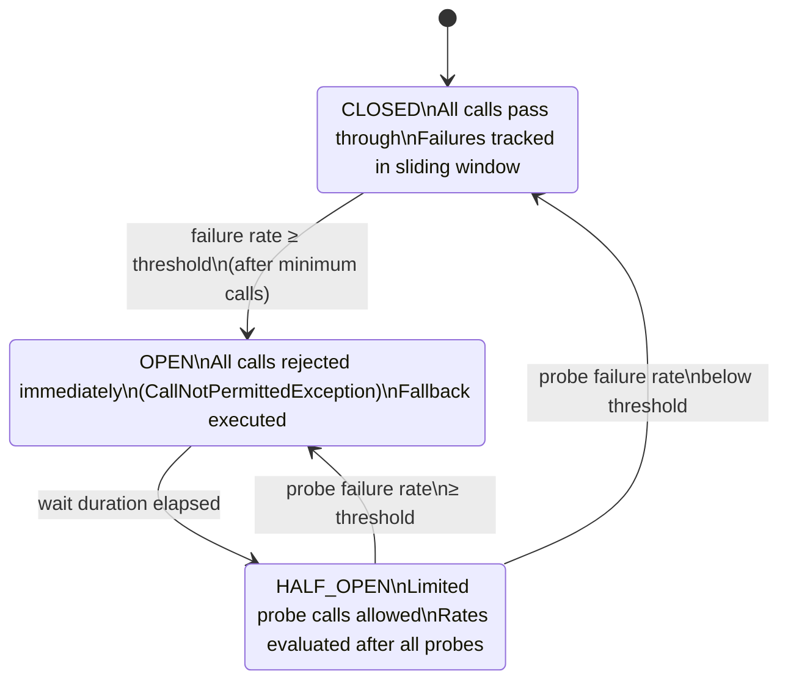

# قاطع الدائرة — حماية الخدمات من الاعتماديات المتعطلة

## نظرة عامة

في أنظمة الدفع الموزعة تفشل الاعتماديات البعيدة. فواجهات شبكات البطاقات تعيد 504. وخدمات تقييم الاحتيال تدخل في توقفات جمع القمامة. وموصلات الأنظمة المصرفية الأساسية تنتهي مهلتها أثناء نوافذ المعالجة الدفعية. ودون أنماط حماية، تتتالى اعتمادية بطيئة واحدة إلى عدم توفر كامل للخدمة — فشل تجويع الخيوط الكلاسيكي. و**قاطع الدائرة** هو خط الدفاع الأول: يكتشف الإخفاقات المتكررة على اعتمادية، ويتوقف عن إرسال الطلبات بينما تتعافى، ويعيد إدخال الحركة بحذر حين تتحسن الظروف. وفهم متى وكيف تفتح الدائرة بالضبط هو الفرق بين حادث من خمس دقائق وانقطاع من ثلاث ساعات.

## أهداف التعلم

في نهاية هذا الدرس ستستطيع:

- وصف حالات قاطع الدائرة الثلاث (CLOSED وOPEN وHALF_OPEN) والانتقالات بينها
- ضبط `CircuitBreaker` في Resilience4j لتكامل بوابة دفع، بما فيه `slidingWindowType` و`failureRateThreshold` و`waitDurationInOpenState`
- تنفيذ `@CircuitBreaker` مع دالة رجوع (fallback) مُنمّطة في خدمة Spring Boot
- التمييز بين الإخفاقات التي يجب أن تفتح الدائرة (5xx، وانتهاء المهلة) وتلك التي يجب ألا تفتحها (أخطاء التحقق 4xx)
- استعلام `CircuitBreakerRegistry` لعرض حالة الدائرة في فحوص صحة Actuator
- الجمع بين قاطع الدائرة والحاجز (bulkhead) لعزل دفاعي متعدد الطبقات
- ضبط عتبات قاطع الدائرة باستخدام نسب مئوية من الحركة الحقيقية بدل القيم الافتراضية
- تفسير مقاييس Micrometer ‏`resilience4j.circuitbreaker.*` وإعداد التنبيهات

## سياق العمل

*مثال مركّب:* يتعرض معالج مدفوعات أوروبي لفشل متتالٍ أوقف خدمة الدفع المستضافة لديه 4 ساعات و20 دقيقة. وكشف تقرير ما بعد الحادث نمطًا مألوفًا: بدأت واجهة تفويض لشبكة بطاقات تعيد ردود 503 متقطعة بسبب استنفاد اتصالات قاعدة البيانات لديها. ولم يكن لخدمة الدفع لدى المعالج قاطع دائرة — فكل محاولة دفع واردة أنشأت خيطًا جديدًا حُجب على استدعاء التفويض الفاشل حتى انقضت مهلة القراءة البالغة 30 ثانية. وخلال 90 ثانية كانت كل خيوط Tomcat المتاحة البالغة 800 مشغولة بانتظار طرف علوي ميت. فتلقت طلبات الدفع الجديدة أخطاء رفض الاتصال من موازن الحمل، ما ترجم مباشرة إلى تفويضات ضائعة. وبلغ أثر الإيرادات ملايين اليوروهات. والإصلاح — قاطع دائرة بعتبة فشل 50% يفتح بعد 10 طلبات — نُشر بتغيير إعداد من سطرين. ونمط الفشل نفسه بعد أسبوعين أسفر عن أثر على العملاء لمدة 23 ثانية بدل 260 دقيقة.

## آلة حالة قاطع الدائرة

يغلّف قاطع الدائرة استدعاء دالة ويتتبع النتائج الأخيرة. ويعمل كآلة حالة محدودة بثلاث حالات:



| الحالة | السلوك | محفّز الانتقال |
|---|---|---|
| **CLOSED** | تشغيل عادي؛ تمر كل الاستدعاءات | معدل الفشل ≥ `failureRateThreshold` بعد `minimumNumberOfCalls` |
| **OPEN** | تفشل كل الاستدعاءات فورًا بـ `CallNotPermittedException`؛ وتعمل دالة الرجوع | انقضاء `waitDurationInOpenState` |
| **HALF_OPEN** | يُسمح بعدد `permittedNumberOfCallsInHalfOpenState` من الاستدعاءات الاستكشافية | بعد اكتمال كل الاستكشافات يُقيّم معدل الفشل (والاستدعاءات البطيئة): تحت العتبة ← CLOSED؛ عندها أو فوقها ← OPEN |

يمكن أن تكون النافذة المنزلقة **قائمة على العدد** (آخر N استدعاء) أو **قائمة على الوقت** (الاستدعاءات في آخر N ثانية). والقائمة على العدد أبسط في التفكير لمعظم خدمات الدفع.

## إعداد Resilience4j

### application.yml

```yaml
resilience4j:
  circuitbreaker:
    instances:
      paymentGateway:
        # Count-based sliding window: evaluate last 20 calls
        slidingWindowType: COUNT_BASED
        slidingWindowSize: 20
        minimumNumberOfCalls: 10

        # Open circuit when ≥ 50% of calls fail
        failureRateThreshold: 50

        # Also open when ≥ 30% of calls are slow (> 2 seconds)
        slowCallRateThreshold: 30
        slowCallDurationThreshold: 2000ms

        # Stay OPEN for 30 seconds before trying HALF_OPEN
        waitDurationInOpenState: 30s

        # Allow 5 probe calls in HALF_OPEN
        permittedNumberOfCallsInHalfOpenState: 5

        # Automatically transition OPEN → HALF_OPEN after wait (no trigger needed)
        automaticTransitionFromOpenToHalfOpenEnabled: true

        # 4xx errors (bad request, unauthorized) are NOT failures — don't count them.
        # Careful: once recordExceptions is set, any exception NOT listed counts
        # as a SUCCESS — so map 5xx responses to an exception that is listed.
        recordExceptions:
          - java.io.IOException
          - java.util.concurrent.TimeoutException
          - feign.RetryableException
          - com.example.payments.exception.GatewayServerErrorException   # 5xx
        ignoreExceptions:
          - com.example.payments.exception.ValidationException
          - com.example.payments.exception.AuthenticationException

      fraudCheck:
        slidingWindowType: COUNT_BASED
        slidingWindowSize: 10
        minimumNumberOfCalls: 5
        failureRateThreshold: 60
        waitDurationInOpenState: 15s
        permittedNumberOfCallsInHalfOpenState: 3
        automaticTransitionFromOpenToHalfOpenEnabled: true
```

> [!IMPORTANT]
> لا تسجّل أبدًا رموز الحالة 4xx كإخفاقات لقاطع الدائرة. فالرد `400 Bad Request` يعني أن طلبك غير صالح — والخدمة اللاحقة تعمل بشكل صحيح. وفتح الدائرة على أخطاء 4xx سيجعل الدائرة تفتح في الظروف العادية عندما يرسل العملاء طلبات مشوهة، فتخلق حجب خدمة من حركتك أنت.

## تنفيذ خدمة Spring Boot

```java
// Java 17 — PaymentGatewayService with @CircuitBreaker
@Service
@Slf4j
public class PaymentGatewayService {

    private final PaymentGatewayClient gatewayClient;
    private final PaymentRepository     paymentRepository;

    public PaymentGatewayService(PaymentGatewayClient gatewayClient,
                                  PaymentRepository paymentRepository) {
        this.gatewayClient    = gatewayClient;
        this.paymentRepository = paymentRepository;
    }

    /**
     * Authorise a payment via the external card network gateway.
     * Circuit breaker wraps the remote call; fallback returns PENDING
     * so the payment is queued for async retry rather than failing the customer.
     */
    @CircuitBreaker(name = "paymentGateway", fallbackMethod = "authoriseFallback")
    public AuthorisationResult authorise(AuthorisationRequest request) {
        log.debug("Authorising payment {} via gateway", request.paymentId());
        return gatewayClient.authorise(request);
    }

    /**
     * Fallback: called when the circuit is OPEN or when the gateway throws
     * a recorded exception. Returns PENDING so upstream can retry asynchronously.
     *
     * Fallback method MUST have the same parameters as the guarded method
     * plus a final Throwable parameter.
     */
    private AuthorisationResult authoriseFallback(AuthorisationRequest request,
                                                    Throwable cause) {
        // The fallback runs for EVERY exception — including ignored ones.
        // A validation error is not a gateway outage: do not queue it for retry.
        if (cause instanceof ValidationException ve) {
            throw ve;
        }
        log.warn("Circuit open or gateway failure for payment {}: {}",
                 request.paymentId(), cause.getMessage());

        // A timeout is an UNKNOWN outcome — the authorisation may have
        // succeeded. The retry job must re-send with the SAME idempotency key
        // (or query the gateway for the payment) so it is never authorised twice.

        // Persist PENDING state so batch retry job picks it up
        paymentRepository.markPending(
            request.paymentId(),
            "GATEWAY_UNAVAILABLE: " + cause.getClass().getSimpleName()
        );

        return AuthorisationResult.pending(
            request.paymentId(),
            "Payment queued — gateway temporarily unavailable"
        );
    }

    /**
     * Batch retry: called by a scheduled job every 60 seconds.
     * Guarded by the SAME circuit breaker: while it is OPEN the retry fails
     * fast and is deferred, instead of hammering a dependency that is down.
     */
    @CircuitBreaker(name = "paymentGateway", fallbackMethod = "retryFallback")
    public AuthorisationResult retryPending(UUID paymentId) {
        AuthorisationRequest request = paymentRepository.loadPending(paymentId);
        return gatewayClient.authorise(request);
    }

    private AuthorisationResult retryFallback(UUID paymentId, Throwable cause) {
        log.info("Retry deferred for payment {} — circuit still open", paymentId);
        return AuthorisationResult.deferred(paymentId);
    }
}
```

```java
// Java 21 — Programmatic circuit breaker using CircuitBreakerRegistry
@Service
@Slf4j
public class PaymentGatewayService {

    private final CircuitBreaker    circuitBreaker;
    private final PaymentGatewayClient gatewayClient;

    public PaymentGatewayService(CircuitBreakerRegistry registry,
                                  PaymentGatewayClient gatewayClient) {
        this.circuitBreaker = registry.circuitBreaker("paymentGateway");
        this.gatewayClient  = gatewayClient;

        // Register state transition event listener for alerting
        circuitBreaker.getEventPublisher()
            .onStateTransition(event -> log.warn(
                "Circuit breaker [paymentGateway] transitioned: {} → {}",
                event.getStateTransition().getFromState(),
                event.getStateTransition().getToState()
            ));
    }

    public AuthorisationResult authorise(AuthorisationRequest request) {
        // Decorate the call (Try is from the Vavr library)
        var decorated = CircuitBreaker.decorateSupplier(
            circuitBreaker,
            () -> gatewayClient.authorise(request)
        );

        return Try.ofSupplier(decorated)
            .recover(CallNotPermittedException.class,
                     ex -> handleOpenCircuit(request, ex))
            .recover(GatewayUnavailableException.class,   // unchecked: a Supplier cannot throw IOException
                     ex -> handleGatewayError(request, ex))
            .get();
    }

    private AuthorisationResult handleOpenCircuit(AuthorisationRequest request,
                                                    CallNotPermittedException ex) {
        log.warn("Circuit OPEN — fast-fail for payment {}", request.paymentId());
        return AuthorisationResult.pending(request.paymentId(), "CIRCUIT_OPEN");
    }

    private AuthorisationResult handleGatewayError(AuthorisationRequest request,
                                                     GatewayUnavailableException ex) {
        log.error("Gateway IO error for payment {}: {}", request.paymentId(),
                  ex.getMessage());
        return AuthorisationResult.pending(request.paymentId(), "GATEWAY_ERROR");
    }

    public CircuitBreaker.State getCircuitState() {
        return circuitBreaker.getState();
    }

    public CircuitBreakerMetrics getMetrics() {
        return circuitBreaker.getMetrics();
    }
}
```

## عرض حالة الدائرة عبر Actuator

> [!WARNING]
> **لا** تدع قاطع دائرة اعتمادية يقود فحص *الجاهزية* (readiness) للنسخة. فعندما تفتح دائرة البوابة، ستُبلغ كل النسخ عن عدم الجاهزية في اللحظة نفسها، وسيزيلها Kubernetes كلها من موازن الحمل، فتصبح خدمة متدهورة (مدفوعات مصفوفة كـ PENDING) انقطاعًا كاملًا. اعرض حالة الدائرة للوحات والتنبيهات؛ وأبقِ الجاهزية لسؤال "هل تستطيع *هذه* النسخة خدمة الحركة؟".

```java
// Custom HealthIndicator publishing circuit state to /actuator/health
@Component
public class PaymentGatewayCircuitHealthIndicator implements HealthIndicator {

    private final CircuitBreakerRegistry registry;

    public PaymentGatewayCircuitHealthIndicator(CircuitBreakerRegistry registry) {
        this.registry = registry;
    }

    @Override
    public Health health() {
        CircuitBreaker cb = registry.circuitBreaker("paymentGateway");
        CircuitBreakerMetrics metrics = cb.getMetrics();

        // Informational: the service still works (fallback queues payments),
        // so an open circuit is reported as a detail, not as DOWN
        Health.Builder builder = Health.up();

        return builder
            .withDetail("state",            cb.getState())
            .withDetail("failureRate",      metrics.getFailureRate() + "%")
            .withDetail("slowCallRate",     metrics.getSlowCallRate() + "%")
            .withDetail("bufferedCalls",    metrics.getNumberOfBufferedCalls())
            .withDetail("failedCalls",      metrics.getNumberOfFailedCalls())
            .withDetail("successfulCalls",  metrics.getNumberOfSuccessfulCalls())
            .build();
    }
}
```

```yaml
# application.yml — circuit breakers visible in health details, NOT in readiness
management:
  health:
    circuitbreakers:
      enabled: true
  endpoint:
    health:
      group:
        readiness:
          include: "readinessState"          # this pod's own ability to serve
        liveness:
          include: "livenessState"
        dependencies:                        # for dashboards and humans
          include: "circuitBreakers,paymentGatewayCircuit"
      show-details: when-authorized
```

## المقاييس والتنبيهات

يعرض Resilience4j مقاييس Micrometer تلقائيًا عندما يكون `spring-boot-starter-actuator` و`resilience4j-micrometer` على مسار الأصناف.

| المقياس | الوصف | عتبة التنبيه |
|---|---|---|
| `resilience4j.circuitbreaker.state` | مقياس لكل حالة (الوسم `state` = closed، وopen، وhalf_open، …)؛ قيمة الحالة الحالية 1 | نبّه عندما تكون `state="open"` تساوي 1 |
| `resilience4j.circuitbreaker.failure.rate` | معدل الفشل (%) في النافذة المنزلقة | نبّه عندما يتجاوز 40% |
| `resilience4j.circuitbreaker.slow.call.rate` | معدل الاستدعاءات البطيئة (%) | نبّه عندما يتجاوز 25% |
| `resilience4j.circuitbreaker.calls` | موسوم بالنوع: successful، وfailed، وignored | — |
| `resilience4j.circuitbreaker.not.permitted.calls` | الاستدعاءات المرفوضة أثناء OPEN | الارتفاع = عملاء يصلون إلى دالة الرجوع |
| `resilience4j.circuitbreaker.buffered.calls` | الاستدعاءات في النافذة المنزلقة الحالية | — |

```yaml
# Prometheus alert rule — PagerDuty fires when circuit is OPEN
groups:
  - name: circuit-breaker-alerts
    rules:
      - alert: PaymentGatewayCircuitOpen
        expr: resilience4j_circuitbreaker_state{name="paymentGateway", state="open"} == 1
        for: 1m
        labels:
          severity: critical
          team: payments
        annotations:
          summary: "Payment gateway circuit breaker OPEN"
          description: >
            Circuit breaker 'paymentGateway' has been OPEN for > 1m.
            All authorisations are returning PENDING and queuing for retry.
            Check {{ $labels.instance }} gateway health.

      - alert: PaymentGatewayHighFailureRate
        expr: resilience4j_circuitbreaker_failure_rate{name="paymentGateway"} > 40
        for: 60s
        labels:
          severity: warning
          team: payments
        annotations:
          summary: "Payment gateway failure rate elevated"
```

## الجمع بين الحاجز وقاطع الدائرة

تكتشف قواطع الدائرة أنماط الفشل. وتحدّ الحواجز من استهلاك الموارد. وباستخدامهما معًا يوفران دفاعًا متعدد الطبقات: يوقف الحاجز استنفاد الخيوط قبل أن يحتاج قاطع الدائرة حتى إلى الفتح. (ترتيب تطبيق Resilience4j لجوانبه يحدده الإعداد — افتراضيًا يغلّف Retry قاطعَ الدائرة، الذي يغلّف RateLimiter ثم TimeLimiter وأخيرًا Bulkhead — لا ترتيب التعليقات في الشيفرة.)

```java
// Stacked annotations: bulkhead isolates threads, circuit breaker trips on failures
@Service
public class PaymentGatewayService {

    @Bulkhead(name = "paymentGateway",
              type = Bulkhead.Type.THREADPOOL,
              fallbackMethod = "bulkheadFallback")
    @CircuitBreaker(name = "paymentGateway",
                    fallbackMethod = "authoriseFallback")
    public CompletableFuture<AuthorisationResult> authoriseAsync(
            AuthorisationRequest request) {
        // This method body ALREADY runs on a bulkhead thread. Do not wrap the
        // call in supplyAsync(): that would run it on the common pool and the
        // bulkhead would isolate nothing.
        return CompletableFuture.completedFuture(gatewayClient.authorise(request));
    }

    private CompletableFuture<AuthorisationResult> bulkheadFallback(
            AuthorisationRequest request, BulkheadFullException ex) {
        log.warn("Thread pool full for payment {} — shedding request",
                 request.paymentId());
        return CompletableFuture.completedFuture(
            AuthorisationResult.rejected(request.paymentId(), "CAPACITY_EXCEEDED")
        );
    }

    private CompletableFuture<AuthorisationResult> authoriseFallback(
            AuthorisationRequest request, Throwable cause) {
        return CompletableFuture.completedFuture(
            AuthorisationResult.pending(request.paymentId(), "GATEWAY_UNAVAILABLE")
        );
    }
}
```

```yaml
# Combined bulkhead + circuit breaker configuration
resilience4j:
  thread-pool-bulkhead:
    instances:
      paymentGateway:
        maxThreadPoolSize: 20
        coreThreadPoolSize: 10
        queueCapacity: 50
        keepAliveDuration: 20ms

  circuitbreaker:
    instances:
      paymentGateway:
        slidingWindowType: COUNT_BASED
        slidingWindowSize: 20
        minimumNumberOfCalls: 10
        failureRateThreshold: 50
        waitDurationInOpenState: 30s
        permittedNumberOfCallsInHalfOpenState: 5
        automaticTransitionFromOpenToHalfOpenEnabled: true
```

## إرشادات الضبط

| المعامل | نقطة البداية | المبرر |
|---|---|---|
| `slidingWindowSize` | 20–50 | صغيرة بما يكفي للتفاعل بسرعة؛ وكبيرة بما يكفي لتجنب الضجيج |
| `minimumNumberOfCalls` | 10 | لا تفتح عند البدء البارد بإخفاقين من اثنين |
| `failureRateThreshold` | 50% | يترك هامشًا للأخطاء العابرة؛ واخفضه للمسارات الحرجة |
| `waitDurationInOpenState` | 15–60 ثانية | طابقه مع زمن تعافي الاعتمادية النموذجي (افحص اتفاقيتها) |
| `permittedNumberOfCallsInHalfOpenState` | 3–10 | استدعاءات استكشافية كافية للحصول على إشارة ذات معنى إحصائي |
| `slowCallDurationThreshold` | ‏p99 للخدمة اللاحقة × 1.5 | التقاط الاعتماديات المتدهورة (لا الفاشلة فقط) |

> [!TIP]
> أجرِ أسبوعًا من اختبار الحمل أو تحليل حركة ظلية قبل ضبط العتبات. وقِس زمن p99 ومعدل الأخطاء للخدمة اللاحقة. واضبط `slowCallDurationThreshold` على 1.5 ضعف زمن p99. واضبط `failureRateThreshold` فوق معدل الأخطاء الأساسي بكثير — فمع نافذة من 20 استدعاء، إخفاق أو إخفاقان يساويان 5–10%، فالمعدل الأساسي 1% ما زال يحتاج عتبة 20–50%. وهذا يضمن أن تفتح الدائرة على تدهور حقيقي، لا على التباين العادي.

<!-- KNOWLEDGE-CHECK
[
  {
    "id": "kc-cb-01",
    "question": "تعيد بوابة دفع HTTP 400 Bad Request لأن جسم الطلب ينقصه حقل مطلوب. هل يجب أن يُحسب هذا كفشل لقاطع الدائرة؟",
    "options": [
      "نعم — أي رد غير 2xx يدل على أن البوابة غير سليمة",
      "لا — أخطاء 4xx تدل على مشكلة في الطلب لا في البوابة؛ ويجب وضعها في ignoreExceptions",
      "فقط إذا تجاوز معدل 400 قيمة failureRateThreshold",
      "نعم — لكن يجب أن يستخدم slowCallRateThreshold منفصلًا بدلًا من ذلك"
    ],
    "correct": 1,
    "explanation": "أخطاء 4xx ‏(400 و401 و403 و404) تدل على مشكلات في جانب العميل — فطلبك غير صالح أو غير مخوّل. والبوابة نفسها تعمل بشكل صحيح. وحسابها كإخفاقات سيجعل الدائرة تفتح كلما أرسل العملاء طلبات سيئة، فتضخّم المشكلة بدل الحماية منها. وسجّل فقط الاستثناءات التي تدل على أن الخدمة اللاحقة غير متاحة أو متدهورة فعلًا (5xx، وIOException، وTimeoutException)."
  },
  {
    "id": "kc-cb-02",
    "question": "انتقل قاطع الدائرة لديك إلى HALF_OPEN وسمح بخمسة استدعاءات استكشافية. نجحت الأربعة الأولى؛ ورمى الخامس IOException. ماذا يحدث (مع failureRateThreshold بنسبة 50%)؟",
    "options": [
      "تعود الدائرة إلى CLOSED: معدل فشل الاستكشاف (1 من 5 = 20%) أقل من failureRateThreshold البالغ 50%",
      "تعود الدائرة إلى OPEN لأن استكشافًا واحدًا فشل، ويُعاد ضبط مؤقت waitDurationInOpenState",
      "تبقى الدائرة في HALF_OPEN وتنتظر مزيدًا من الاستكشافات",
      "تبقى الدائرة OPEN حتى يعيد مشغّل ضبطها"
    ],
    "correct": 0,
    "explanation": "في HALF_OPEN ينتظر Resilience4j حتى تكتمل كل استدعاءات permittedNumberOfCallsInHalfOpenState الاستكشافية، ثم يقيّم معدل فشل تلك الاستكشافات (ومعدل الاستدعاءات البطيئة) مقابل العتبات. وهنا فشل 1 من 5 استكشافات — 20% — وهو أقل من عتبة 50%، فتنتقل الدائرة إلى CLOSED. ولا تعود إلى OPEN وتعيد مدة الانتظار إلا إذا بلغ معدل فشل الاستكشاف العتبة. (بعض المكتبات الأخرى تعيد الفتح عند أول استكشاف فاشل؛ فلا تفترض هذا السلوك في Resilience4j.)"
  }
]
-->

<!-- PRACTICAL-CHALLENGE
{
  "id": "pc-circuit-breaker",
  "title": "قاطع دائرة لتكامل بوابة الدفع",
  "description": "نفّذ قاطع دائرة واضبطه لخدمة تفويض لشبكة بطاقات.",
  "tasks": [
    {"id": "pc-cb-01", "description": "اضبط قاطع دائرة في Resilience4j باسم 'cardNetwork' في application.yml. والمتطلبات: يفتح بعد معدل فشل 50% عبر 20 استدعاء، ويبقى مفتوحًا 45 ثانية، ويسمح بخمسة استدعاءات استكشافية، ويسجّل IOException وTimeoutException كإخفاقات، ويتجاهل ValidationException وUnauthorisedException."},
    {"id": "pc-cb-02", "description": "نفّذ CardNetworkService بتعليق @CircuitBreaker ودالة رجوع. ويجب أن تعيد دالة الرجوع AuthorisationResult.pending() لتُصف الدفعة لإعادة محاولة غير متزامنة عبر موضوع Kafka ‏'payment-retries'."},
    {"id": "pc-cb-03", "description": "نفّذ HealthIndicator مخصصًا يعرض حالة قاطع الدائرة ومعدل الفشل وعدد الاستدعاءات الفاشلة لدائرة 'cardNetwork'. وضعه في مجموعة صحة منفصلة 'dependencies' — لا في مجموعة الجاهزية — واشرح لماذا يجب ألا تجعل دائرة اعتمادية مفتوحة كل النسخ غير جاهزة."},
    {"id": "pc-cb-04", "description": "اكتب قاعدة تنبيه Prometheus تستدعي المهندس المناوب عندما تبقى دائرة 'cardNetwork' مفتوحة أكثر من 30 ثانية. وبرر اختيارك لمدة 'for'."}
  ]
}
-->
