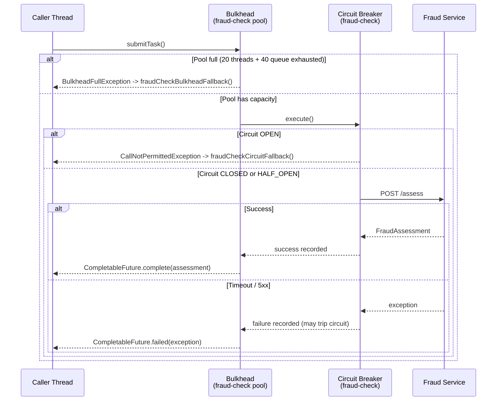

# نمط الحاجز (Bulkhead) — عزل الموارد لكل اعتمادية

## نظرة عامة

تستدعي خدمة دفع ثلاث اعتماديات لاحقة: واجهة تقييم الاحتيال، وخدمة البحث عن الحساب، وبوابة الإشعارات. وتتدهور واجهة الاحتيال تحت الحمل، فترد في 8 ثوانٍ بدل 200 مللي ثانية. وخلال دقيقتين يُحجب كل خيط في المجمع المشترك بانتظار ردود الاحتيال. وعمليات البحث عن الحساب — التي كانت سليمة — تصطف الآن إلى ما لا نهاية. والإشعارات لا تنطلق أبدًا. فينهار تدفق الدفع كله بسبب اعتمادية بطيئة واحدة.

**نمط الحاجز** يمنع ذلك. وسُمي على اسم الحجرات المانعة لتسرب الماء في هيكل السفينة — حيث لا يُغرق غمرُ حجرة واحدة السفينةَ — فالحاجز في البرمجيات يعزل مجمعات الموارد لكل اعتمادية. فإذا استهلكت واجهة الاحتيال كل الخيوط المخصصة لها، لا تستطيع لمس الخيوط المحجوزة للبحث عن الحسابات أو الإشعارات. ويواصل بقية النظام العمل.

## الأصل: من حجرات السفن إلى الخدمات المصغرة

```
  SHIP HULL (without bulkheads)        SHIP HULL (with bulkheads)
  +----------------------------+       +--------+-------+----------+
  |                            |       |  FWD   |  MID  |   AFT    |
  |   ONE BREACH = TOTAL LOSS  |       |        | /////  |          |
  |                            |       |  DRY   | FLOOD |   DRY    |
  +----------------------------+       +--------+-------+----------+
                                        One compartment floods; ship survives
```

قدّم Michael Nygard مصطلح "الحاجز" في كتاب *Release It!* ‏(2007) لوصف تقسيم مجمعات الخيوط حسب الاعتمادية اللاحقة. واعتمدته Netflix في Hystrix ‏(2012). ويوفر Resilience4j تنفيذًا حديثًا بشكلين: مجمع الخيوط والسيمافور.

يتطابق التشبيه بدقة مع الخدمات المصغرة:

| مكوّن السفينة | المكافئ في الخدمات المصغرة |
|---|---|
| حجرة الهيكل | مجمع خيوط أو قسم سيمافور |
| الماء | خيوط محجوبة / طلبات معلقة |
| الثغرة | اعتمادية بطيئة/فاشلة |
| الباب المانع للتسرب | عتبة رفض الحاجز |
| نجاة السفينة | تتدهور الخدمة جزئيًا، لا كليًا |

## حاجز مجمع الخيوط مقابل حاجز السيمافور

يوفر Resilience4j تنفيذين للحاجز باستراتيجيتي عزل مختلفتين جوهريًا.

### حاجز السيمافور

يستخدم حاجز السيمافور سيمافورًا عدّادًا لتحديد عدد الاستدعاءات المتزامنة. ويُنفذ على **خيط المستدعي** — فلا يوجد مجمع منفصل. ويُنقص السيمافور عند دخول الاستدعاء ويُزاد عند خروجه.

```
  Caller Thread --> acquire(semaphore) --> execute --> release(semaphore)
                         |
                    maxConcurrent = 5
                    (blocks or rejects when 5 slots taken)
```

استخدمه عندما يكون الاستدعاء اللاحق غير متزامن بطبيعته أو يستخدم إدخالًا/إخراجًا غير حاجب (WebClient، وR2DBC) — أو عندما يعمل المستدعون على خيوط افتراضية (Java 21+)، حيث يكون حجب خيط المستدعي رخيصًا والمهم هو تحديد *التزامن*. فأنت تريد كلفة منخفضة دون إنشاء خيوط إضافية.

### حاجز مجمع الخيوط

يستخدم حاجز مجمع الخيوط `ExecutorService` مخصصًا. وتُرسل الاستدعاءات إلى هذا المجمع وتُنفذ على **خيط منفصل**. وإذا امتلأ طابور المجمع، تُرفض الاستدعاءات فورًا.

```
  Caller Thread --> submit(task) --> ThreadPool[coreSize=10, queueSize=20]
                         |                     |
                    CompletableFuture    worker-1 --> HTTP call to fraud API
                    returned immediately worker-2 --> HTTP call to fraud API
                                         ...
                                         [QUEUE: up to 20 waiting]
                                         [REJECT when queue full]
```

استخدمه عندما يستخدم الاستدعاء اللاحق إدخالًا/إخراجًا حاجبًا (RestTemplate، وJDBC، وSDK متزامن). فأنت تريد عزل خيوط حقيقيًا فلا يُحجب خيط المستدعي أبدًا.

### جدول المقارنة

| البُعد | حاجز السيمافور | حاجز مجمع الخيوط |
|---|---|---|
| خيط التنفيذ | خيط المستدعي | خيط مجمع مخصص |
| الكلفة | منخفضة جدًا | متوسطة (تبديل سياق الخيوط) |
| عزل الإدخال/الإخراج الحاجب | جزئي — خيط المستدعي ما زال يُحجب | كامل — خيط المستدعي لا يُحجب أبدًا |
| دعم الطابور | لا — رفض فوري | نعم — طابور قابل للضبط |
| الأنسب لـ | غير الحاجب / التفاعلي | الإدخال/الإخراج الحاجب |
| صنف الإعداد | `BulkheadConfig` | `ThreadPoolBulkheadConfig` |
| نوع التعليق | `Bulkhead.Type.SEMAPHORE` | `Bulkhead.Type.THREADPOOL` |

## تحجيم الحواجز بقانون Little

قبل كتابة الإعداد، تحتاج إلى معرفة **حجم** كل قسم. فالأرقام العشوائية تؤدي إما إلى نقص الاستخدام (هدر) أو نقص التحجيم (رفض غير ضروري).

**قانون Little** (من نظرية الطوابير، 1961):

```
N = lambda x W
```

حيث:
- **N** = متوسط عدد الطلبات في النظام (الخيوط اللازمة)
- **lambda** = متوسط معدل الوصول (طلبات في الثانية)
- **W** = متوسط زمن الخدمة (ثوانٍ لكل طلب)

### مثال خدمة الدفع

| الاعتمادية | معدل الوصول | زمن الرد P99 | الخيوط اللازمة | مع هامش 30% |
|---|---|---|---|---|
| فحص الاحتيال | 50 طلبًا/ث | 300 مللي ثانية (0.3 ث) | 50 × 0.3 = 15 | 20 |
| البحث عن الحساب | 50 طلبًا/ث | 120 مللي ثانية (0.12 ث) | 50 × 0.12 = 6 | 8 (تُقرّب إلى 10) |
| الإشعار | 10 طلبات/ث | 400 مللي ثانية (0.4 ث) | 10 × 0.4 = 4 | 5 |

يمتص هامش الأمان البالغ 30% قفزات الحركة. واستخدام زمن الرد P99 (لا P50) مقصود — فأنت تحجّم لأسوأ حالة واقعية للزمن، لا للمسار السعيد.

```
Little's Law for Fraud Check:
  lambda = 50 req/s
  W      = 0.300 s (P99)
  N      = 50 x 0.300 = 15 threads

  With 30% buffer: ceil(15 x 1.3) = 20 threads
  Queue depth:     2x thread count = 40
```

عمق طابور بضعف عدد الخيوط يسمح بالاندفاع مع إبقاء أزمنة الانتظار قصيرة. أما طابور بـ 100 ضعف فسيجعل المستدعين ينتظرون طويلًا جدًا قبل رؤية الرفض.

## إعداد الحاجز في Resilience4j

### اعتماديات Maven

```xml
<dependency>
    <groupId>io.github.resilience4j</groupId>
    <artifactId>resilience4j-spring-boot3</artifactId>
    <version>2.2.0</version>
</dependency>
<dependency>
    <groupId>io.github.resilience4j</groupId>
    <artifactId>resilience4j-bulkhead</artifactId>
    <version>2.2.0</version>
</dependency>
<dependency>
    <groupId>org.springframework.boot</groupId>
    <artifactId>spring-boot-starter-aop</artifactId>
</dependency>
```

### application.yml — ثلاثة حواجز لخدمة الدفع

```yaml
resilience4j:
  thread-pool-bulkhead:
    instances:
      fraud-check:
        # Sized by Little's Law: 50 req/s x 300ms P99 = 15, +30% = 20
        core-thread-pool-size: 20
        max-thread-pool-size: 20        # Fixed pool — no elastic sizing surprises
        queue-capacity: 40              # 2x thread count
        keep-alive-duration: 20ms
        writable-stack-trace-enabled: true

      account-lookup:
        core-thread-pool-size: 10
        max-thread-pool-size: 10
        queue-capacity: 20
        keep-alive-duration: 20ms
        writable-stack-trace-enabled: true

      notification:
        core-thread-pool-size: 5
        max-thread-pool-size: 5
        queue-capacity: 10
        keep-alive-duration: 20ms
        writable-stack-trace-enabled: true

  bulkhead:
    # Semaphore bulkhead for reactive/non-blocking paths
    instances:
      fraud-check-reactive:
        max-concurrent-calls: 20
        max-wait-duration: 0ms          # Fail fast — never queue on semaphore

  circuitbreaker:                       # NOT "circuit-breaker": that key does not bind
    instances:
      fraud-check:
        register-health-indicator: true
        sliding-window-size: 10
        failure-rate-threshold: 50
        wait-duration-in-open-state: 10s
        permitted-number-of-calls-in-half-open-state: 3
        slow-call-duration-threshold: 1s
        slow-call-rate-threshold: 70
        # Our own pool being full is not a fraud-service failure (see "Order Matters")
        ignore-exceptions:
          - io.github.resilience4j.bulkhead.BulkheadFullException
      account-lookup:
        register-health-indicator: true
        sliding-window-size: 10
        failure-rate-threshold: 50
        wait-duration-in-open-state: 10s
        ignore-exceptions:
          - io.github.resilience4j.bulkhead.BulkheadFullException
```

## التنفيذ الكامل لخدمة الدفع

> [!IMPORTANT]
> مع `Bulkhead.Type.THREADPOOL` يشغّل Resilience4j بالفعل **جسم الدالة** على خيط من الحاجز ويعطي المستدعي `CompletableFuture`. فيجب أن يجري الجسم الاستدعاء مباشرة ويعيد `CompletableFuture.completedFuture(...)`. وتغليف الاستدعاء في `CompletableFuture.supplyAsync(...)` سينقله إلى مجمع ForkJoin المشترك — ولن يعزل الحاجز شيئًا. ويأتي حد الزمن من مهلتي الاتصال والقراءة في عميل HTTP، وهما الشيء الوحيد الذي يحرر خيطًا محجوبًا فعلًا.

### نموذج المجال

```java
package com.fintech.payment.domain;

public record PaymentRequest(
    String paymentId,
    String merchantId,
    String accountId,
    java.math.BigDecimal amount,
    String currency
) {}

public record PaymentResult(
    String paymentId,
    PaymentStatus status,
    String message,
    boolean fraudApproved,
    boolean accountVerified,
    boolean notificationSent
) {}

public enum PaymentStatus {
    APPROVED, DECLINED, PENDING, DEGRADED
}
```

### عميل فحص الاحتيال مع حاجز مجمع الخيوط

```java
package com.fintech.payment.client;

import io.github.resilience4j.bulkhead.annotation.Bulkhead;
import io.github.resilience4j.circuitbreaker.annotation.CircuitBreaker;
import org.springframework.stereotype.Component;
import org.springframework.web.client.RestTemplate;

import java.math.BigDecimal;
import java.util.concurrent.CompletableFuture;

@Component
public class FraudCheckClient {

    private final RestTemplate restTemplate;

    public FraudCheckClient(RestTemplate restTemplate) {
        this.restTemplate = restTemplate;
    }

    /**
     * Thread pool bulkhead isolates fraud-check threads: this method body
     * runs on a fraud-check pool thread. Returns CompletableFuture because
     * ThreadPoolBulkhead is async. The RestTemplate's 500ms read timeout
     * bounds how long the pool thread can be held.
     */
    @Bulkhead(name = "fraud-check", type = Bulkhead.Type.THREADPOOL,
              fallbackMethod = "fraudCheckBulkheadFallback")
    @CircuitBreaker(name = "fraud-check", fallbackMethod = "fraudCheckCircuitFallback")
    public CompletableFuture<FraudAssessment> assessFraud(
            String paymentId, String merchantId, BigDecimal amount) {

        String url = "http://fraud-service/api/v1/assess";
        FraudRequest request = new FraudRequest(paymentId, merchantId, amount);
        return CompletableFuture.completedFuture(
            restTemplate.postForObject(url, request, FraudAssessment.class));
    }

    /**
     * Fallback invoked when bulkhead is full (BulkheadFullException).
     * Degrade gracefully: allow low-risk transactions under 500.
     * This is a documented RISK decision (agreed with the fraud team),
     * and every degraded approval is flagged for later review.
     */
    public CompletableFuture<FraudAssessment> fraudCheckBulkheadFallback(
            String paymentId,
            String merchantId,
            BigDecimal amount,
            io.github.resilience4j.bulkhead.BulkheadFullException e) {
        boolean allowThrough = amount.compareTo(new BigDecimal("500")) < 0;
        return CompletableFuture.completedFuture(
            new FraudAssessment(paymentId, allowThrough, "BULKHEAD_DEGRADED", 0.0)
        );
    }

    /**
     * Fallback invoked when circuit breaker is OPEN.
     */
    public CompletableFuture<FraudAssessment> fraudCheckCircuitFallback(
            String paymentId,
            String merchantId,
            BigDecimal amount,
            Exception e) {
        boolean allowThrough = amount.compareTo(new BigDecimal("100")) < 0;
        return CompletableFuture.completedFuture(
            new FraudAssessment(paymentId, allowThrough, "CIRCUIT_OPEN", 0.0)
        );
    }

    public record FraudRequest(String paymentId, String merchantId,
                                BigDecimal amount) {}

    public record FraudAssessment(String paymentId, boolean approved,
                                   String source, double riskScore) {}
}
```

### عميل البحث عن الحساب

```java
package com.fintech.payment.client;

import io.github.resilience4j.bulkhead.annotation.Bulkhead;
import io.github.resilience4j.circuitbreaker.annotation.CircuitBreaker;
import org.springframework.stereotype.Component;
import org.springframework.web.client.RestTemplate;

import java.util.concurrent.CompletableFuture;

@Component
public class AccountLookupClient {

    private final RestTemplate restTemplate;

    public AccountLookupClient(RestTemplate restTemplate) {
        this.restTemplate = restTemplate;
    }

    @Bulkhead(name = "account-lookup", type = Bulkhead.Type.THREADPOOL,
              fallbackMethod = "accountLookupFallback")
    @CircuitBreaker(name = "account-lookup", fallbackMethod = "accountCircuitFallback")
    public CompletableFuture<AccountDetails> lookupAccount(String accountId) {
        // Runs on an account-lookup pool thread; bounded by the client's timeouts
        String url = "http://account-service/api/v1/accounts/" + accountId;
        return CompletableFuture.completedFuture(
            restTemplate.getForObject(url, AccountDetails.class));
    }

    // Account lookup is mandatory — bulkhead full means payment must pend
    public CompletableFuture<AccountDetails> accountLookupFallback(
            String accountId,
            io.github.resilience4j.bulkhead.BulkheadFullException e) {
        return CompletableFuture.failedFuture(
            new AccountLookupUnavailableException(
                "Account lookup bulkhead full for account: " + accountId)
        );
    }

    public CompletableFuture<AccountDetails> accountCircuitFallback(
            String accountId, Exception e) {
        return CompletableFuture.failedFuture(
            new AccountLookupUnavailableException(
                "Account lookup circuit open for account: " + accountId)
        );
    }

    public record AccountDetails(String accountId, String status,
                                  String currency, boolean verified) {}

    public static class AccountLookupUnavailableException extends RuntimeException {
        public AccountLookupUnavailableException(String message) { super(message); }
    }
}
```

### عميل الإشعارات

```java
package com.fintech.payment.client;

import io.github.resilience4j.bulkhead.annotation.Bulkhead;
import org.springframework.stereotype.Component;
import org.springframework.web.client.RestTemplate;

import java.util.concurrent.CompletableFuture;

@Component
public class NotificationClient {

    private final RestTemplate restTemplate;

    public NotificationClient(RestTemplate restTemplate) {
        this.restTemplate = restTemplate;
    }

    /**
     * Notifications are non-critical: bulkhead full means the notification is
     * dropped here (a real system would write it to an outbox for later delivery).
     * No circuit breaker — notification failure must NEVER affect payment outcomes.
     */
    @Bulkhead(name = "notification", type = Bulkhead.Type.THREADPOOL,
              fallbackMethod = "notificationFallback")
    public CompletableFuture<Void> sendNotification(
            String paymentId, String accountId, String status) {
        // Runs on a notification pool thread
        String url = "http://notification-service/api/v1/notify";
        restTemplate.postForObject(url,
            new NotificationRequest(paymentId, accountId, status), Void.class);
        return CompletableFuture.completedFuture(null);
    }

    // Best-effort: bulkhead full means silently drop the notification
    public CompletableFuture<Void> notificationFallback(
            String paymentId, String accountId, String status,
            io.github.resilience4j.bulkhead.BulkheadFullException e) {
        return CompletableFuture.completedFuture(null);
    }

    public record NotificationRequest(String paymentId,
                                       String accountId, String status) {}
}
```

### منسّق الدفع

```java
package com.fintech.payment.service;

import com.fintech.payment.client.AccountLookupClient;
import com.fintech.payment.client.FraudCheckClient;
import com.fintech.payment.client.NotificationClient;
import com.fintech.payment.domain.PaymentRequest;
import com.fintech.payment.domain.PaymentResult;
import com.fintech.payment.domain.PaymentStatus;
import org.springframework.stereotype.Service;

import java.util.concurrent.CompletableFuture;
import java.util.concurrent.ExecutionException;
import java.util.concurrent.TimeUnit;
import java.util.concurrent.TimeoutException;

@Service
public class PaymentOrchestrator {

    private final FraudCheckClient fraudCheckClient;
    private final AccountLookupClient accountLookupClient;
    private final NotificationClient notificationClient;

    public PaymentOrchestrator(FraudCheckClient fraudCheckClient,
                                AccountLookupClient accountLookupClient,
                                NotificationClient notificationClient) {
        this.fraudCheckClient = fraudCheckClient;
        this.accountLookupClient = accountLookupClient;
        this.notificationClient = notificationClient;
    }

    public PaymentResult processPayment(PaymentRequest request) {
        // Execute fraud check and account lookup in parallel.
        // Each runs in its OWN isolated thread pool — fraud slowdown
        // cannot consume account-lookup threads.
        CompletableFuture<FraudCheckClient.FraudAssessment> fraudFuture =
            fraudCheckClient.assessFraud(
                request.paymentId(), request.merchantId(), request.amount());

        CompletableFuture<AccountLookupClient.AccountDetails> accountFuture =
            accountLookupClient.lookupAccount(request.accountId());

        try {
            CompletableFuture.allOf(fraudFuture, accountFuture)
                .get(2, TimeUnit.SECONDS);

            var fraud = fraudFuture.join();
            var account = accountFuture.join();

            if (!fraud.approved()) {
                return new PaymentResult(request.paymentId(), PaymentStatus.DECLINED,
                    "Fraud check declined", false, account.verified(), false);
            }

            if (!account.verified()) {
                return new PaymentResult(request.paymentId(), PaymentStatus.DECLINED,
                    "Account not verified", fraud.approved(), false, false);
            }

            // Both checks passed — fire notification asynchronously
            notificationClient
                .sendNotification(request.paymentId(), request.accountId(), "APPROVED")
                .exceptionally(ex -> null); // notification failure never blocks payment

            // notificationSent = false: it has only been QUEUED at this point
            return new PaymentResult(request.paymentId(), PaymentStatus.APPROVED,
                "Payment approved", true, true, false);

        } catch (ExecutionException e) {
            // get() wraps failures from the futures: inspect the CAUSE
            if (e.getCause() instanceof AccountLookupClient.AccountLookupUnavailableException) {
                return new PaymentResult(request.paymentId(), PaymentStatus.PENDING,
                    "Account lookup unavailable, queued for retry", false, false, false);
            }
            return new PaymentResult(request.paymentId(), PaymentStatus.PENDING,
                "Dependency error, queued for retry", false, false, false);

        } catch (TimeoutException e) {
            // cancel() stops us waiting; it does not interrupt the pool threads,
            // which are bounded by the HTTP client timeouts
            fraudFuture.cancel(true);
            accountFuture.cancel(true);
            return new PaymentResult(request.paymentId(), PaymentStatus.PENDING,
                "Processing timeout, queued for retry", false, false, false);

        } catch (InterruptedException e) {
            Thread.currentThread().interrupt();
            return new PaymentResult(request.paymentId(), PaymentStatus.PENDING,
                "Interrupted, queued for retry", false, false, false);
        }
    }
}
```

## الجمع بين الحاجز وقاطع الدائرة — الترتيب مهم

أولًا، حقيقة تفاجئ فرقًا كثيرة: مع تعليقات Spring، ترتيب `@Bulkhead` و`@CircuitBreaker` **في الشيفرة المصدرية لا يهم**. فـ Resilience4j يطبق جوانبه بترتيب افتراضي ثابت — `Retry ( CircuitBreaker ( RateLimiter ( TimeLimiter ( Bulkhead ( call ) ) ) ) )` — فقاطع الدائرة افتراضيًا *خارج* الحاجز.

ولهذا الافتراضي فخ واحد: يصل `BulkheadFullException` (مجمعنا نحن ممتلئ) إلى قاطع الدائرة ويُحسب كفشل، فقد يفتح التشبع المحلي الدائرة ضد اعتمادية سليمة تمامًا. وهناك إصلاحان:

- أبقِ الترتيب الافتراضي وأضف `BulkheadFullException` إلى `ignore-exceptions` في قاطع الدائرة (كما في الإعداد أعلاه)، أو
- اجعل الحاجز الطبقة الخارجية — بالتزيين البرمجي (أدناه) أو بتغيير خصائص ترتيب الجوانب في Resilience4j.

الصورة الطبقية والحاجز في الخارج:

```
Request
  |
  v
[BULKHEAD]           <-- Reject if thread pool full (resource limit)
  |  Accept
  v
[CIRCUIT BREAKER]    <-- Reject if circuit OPEN (dependency health)
  |  Accept
  v
[ACTUAL CALL]        <-- Execute HTTP/DB call
```



**لماذا نضع الحاجز في الخارج؟**

مع الحاجز في الطبقة الخارجية، لا يرى قاطع الدائرة إلا النتائج الحقيقية لاستدعاءات الاعتمادية — لا حالات الرفض بسبب سعتنا نحن — فلا يفتح إلا عندما تكون *الاعتمادية* غير سليمة. والحاجز يحدّ الموارد في الترتيبين كليهما.

### التزيين البرمجي للتحكم الصريح

```java
package com.fintech.payment.config;

import io.github.resilience4j.bulkhead.ThreadPoolBulkhead;
import io.github.resilience4j.bulkhead.ThreadPoolBulkheadRegistry;
import io.github.resilience4j.circuitbreaker.CircuitBreaker;
import io.github.resilience4j.circuitbreaker.CircuitBreakerRegistry;
import org.springframework.context.annotation.Bean;
import org.springframework.context.annotation.Configuration;

import java.util.concurrent.CompletableFuture;
import java.util.function.Function;
import java.util.function.Supplier;

@Configuration
public class ResilienceConfig {

    /**
     * Programmatic decoration with explicit ordering:
     * Bulkhead (outer) wraps Circuit Breaker (inner).
     */
    @Bean
    public Function<String, CompletableFuture<String>> decoratedFraudCall(
            ThreadPoolBulkheadRegistry bulkheadRegistry,
            CircuitBreakerRegistry circuitBreakerRegistry) {

        ThreadPoolBulkhead bulkhead = bulkheadRegistry.bulkhead("fraud-check");
        CircuitBreaker circuitBreaker = circuitBreakerRegistry.circuitBreaker("fraud-check");

        return paymentId -> {
            // Inner: circuit breaker decorates the actual call
            Supplier<String> fraudCall = CircuitBreaker.decorateSupplier(
                circuitBreaker,
                () -> callFraudService(paymentId)
            );
            // Outer: bulkhead wraps the circuit-breaker-decorated supplier
            // (executeSupplier returns a CompletionStage)
            return bulkhead.executeSupplier(fraudCall).toCompletableFuture();
        };
    }

    private String callFraudService(String paymentId) {
        // RestTemplate / HTTP call
        return "APPROVED";
    }
}
```

## أحداث الحاجز

يصدر Resilience4j أحداثًا مُنمّطة عند تغير حالة الحاجز.

```java
package com.fintech.payment.monitoring;

import io.github.resilience4j.bulkhead.Bulkhead;
import io.github.resilience4j.bulkhead.BulkheadRegistry;
import io.github.resilience4j.bulkhead.ThreadPoolBulkhead;
import io.github.resilience4j.bulkhead.ThreadPoolBulkheadRegistry;
import io.micrometer.core.instrument.Counter;
import io.micrometer.core.instrument.MeterRegistry;
import jakarta.annotation.PostConstruct;
import org.slf4j.Logger;
import org.slf4j.LoggerFactory;
import org.springframework.stereotype.Component;

@Component
public class BulkheadEventListener {

    private static final Logger log = LoggerFactory.getLogger(BulkheadEventListener.class);

    private final ThreadPoolBulkheadRegistry threadPoolRegistry;
    private final BulkheadRegistry semaphoreRegistry;
    private final MeterRegistry meterRegistry;

    public BulkheadEventListener(ThreadPoolBulkheadRegistry threadPoolRegistry,
                                   BulkheadRegistry semaphoreRegistry,
                                   MeterRegistry meterRegistry) {
        this.threadPoolRegistry = threadPoolRegistry;
        this.semaphoreRegistry = semaphoreRegistry;
        this.meterRegistry = meterRegistry;
    }

    @PostConstruct
    public void registerListeners() {
        threadPoolRegistry.getAllBulkheads().forEach(this::attachThreadPoolListeners);
        semaphoreRegistry.getAllBulkheads().forEach(this::attachSemaphoreListeners);
        // Bulkheads created later (lazily, on first use) need listeners too
        threadPoolRegistry.getEventPublisher()
            .onEntryAdded(e -> attachThreadPoolListeners(e.getAddedEntry()));
        semaphoreRegistry.getEventPublisher()
            .onEntryAdded(e -> attachSemaphoreListeners(e.getAddedEntry()));
    }

    private void attachThreadPoolListeners(ThreadPoolBulkhead bulkhead) {
        String name = bulkhead.getName();

        Counter rejectedCounter = Counter.builder("bulkhead.rejected.calls")
            .tag("bulkhead", name)
            .tag("type", "thread-pool")
            .description("Calls rejected by thread pool bulkhead")
            .register(meterRegistry);

        bulkhead.getEventPublisher()
            // BulkheadOnCallPermittedEvent
            .onCallPermitted(event ->
                log.debug("[BULKHEAD] {} permit acquired — queue: {}",
                    name, bulkhead.getMetrics().getQueueDepth()))
            // BulkheadOnCallRejectedEvent
            .onCallRejected(event -> {
                rejectedCounter.increment();
                log.warn("[BULKHEAD] {} REJECTED — pool: {}, queue: {}",
                    name,
                    bulkhead.getMetrics().getThreadPoolSize(),
                    bulkhead.getMetrics().getQueueDepth());
            })
            // BulkheadOnCallFinishedEvent
            .onCallFinished(event ->
                log.debug("[BULKHEAD] {} call finished", name));
    }

    private void attachSemaphoreListeners(Bulkhead bulkhead) {
        String name = bulkhead.getName();

        Counter rejectedCounter = Counter.builder("bulkhead.rejected.calls")
            .tag("bulkhead", name)
            .tag("type", "semaphore")
            .register(meterRegistry);

        bulkhead.getEventPublisher()
            .onCallPermitted(event ->
                log.debug("[SEM BULKHEAD] {} permit acquired", name))
            .onCallRejected(event -> {
                rejectedCounter.increment();
                log.warn("[SEM BULKHEAD] {} REJECTED — available: {}",
                    name, bulkhead.getMetrics().getAvailableConcurrentCalls());
            })
            .onCallFinished(event ->
                log.debug("[SEM BULKHEAD] {} finished", name));
    }
}
```

## مقاييس Micrometer والتنبيهات

```yaml
# application.yml (Spring Boot 3 property names)
management:
  health:
    bulkheads:
      enabled: true
  endpoint:
    health:
      show-details: when-authorized   # never "always" on a payment service
  prometheus:
    metrics:
      export:
        enabled: true
```

```
# Key metrics exposed automatically (tag: name="<bulkhead>"):
# semaphore bulkhead
resilience4j.bulkhead.available.concurrent.calls{name="fraud-check-reactive"}
resilience4j.bulkhead.max.allowed.concurrent.calls{name="fraud-check-reactive"}
# thread-pool bulkhead
resilience4j.bulkhead.thread.pool.size{name="fraud-check"}
resilience4j.bulkhead.queue.depth{name="fraud-check"}
resilience4j.bulkhead.queue.capacity{name="fraud-check"}

# Custom rejection counter (registered above):
bulkhead.rejected.calls{bulkhead="fraud-check",type="thread-pool"}
```

قواعد تنبيه Prometheus:

```yaml
groups:
  - name: bulkhead_alerts
    rules:
      - alert: BulkheadHighRejectionRate
        expr: rate(bulkhead_rejected_calls_total[5m]) > 1
        for: 2m
        labels:
          severity: warning
        annotations:
          summary: "Bulkhead {{ $labels.bulkhead }} rejecting calls"
          description: >
            Rejecting > 1 call/second for 2 minutes. Review thread pool sizing
            using Little's Law with current P99 latency metrics.

      - alert: BulkheadPoolExhausted
        # thread-pool bulkhead: the queue is full
        expr: >
          resilience4j_bulkhead_queue_depth{name="fraud-check"}
            >= resilience4j_bulkhead_queue_capacity{name="fraud-check"}
        for: 30s
        labels:
          severity: critical
        annotations:
          summary: "Fraud check bulkhead fully exhausted"
```

## ملخص البنية

```
Payment Request
       |
       v
+------------------------------------------------------------------+
|                   Payment Orchestrator                           |
|                                                                  |
|  +----------------------+   +----------------------+            |
|  |   fraud-check pool   |   |  account-lookup pool  |           |
|  |   [20 threads]       |   |  [10 threads]         |           |
|  |   [40 queue]         |   |  [20 queue]           |           |
|  |   + circuit breaker  |   |  + circuit breaker    |           |
|  +----------+-----------+   +----------+------------+           |
|             | parallel                 | parallel               |
|             v                          v                        |
|      Fraud Service              Account Service                  |
|      (may degrade)              (healthy)                        |
|                                                                  |
|  +----------------------+                                        |
|  |  notification pool   |  <-- fire-and-forget after both above |
|  |  [5 threads]         |                                        |
|  |  [10 queue]          |                                        |
|  |  NO circuit breaker  |  <-- notification failure = silent    |
|  +----------------------+                                        |
+------------------------------------------------------------------+

Fraud pool full  --> fraudCheckBulkheadFallback (allow <$500 through)
Account pool full --> PENDING  (mandatory check, cannot skip)
Notification full --> dropped here; real systems use an outbox
```

## مزالق الإنتاج

### المزلق 1: كل مجمعات الخيوط بالحجم نفسه تُبطل الغرض

إعطاء كل حاجز عدد الخيوط نفسه خطأ شائع. فهو يلغي فائدة العزل ويهدر موارد JVM.

```java
// WRONG: uniform large pools eliminate isolation benefit
//
// application.yml (WRONG):
//   fraud-check:    max-thread-pool-size: 50
//   account-lookup: max-thread-pool-size: 50
//   notification:   max-thread-pool-size: 50
//
// 150 threads is not an OS problem — but each pool is now so large that it
// no longer limits the damage. When fraud degrades to 2000ms, the fraud pool
// lets 50 calls pile up on the failing service (making its recovery harder),
// holds 50 threads and 50 HTTP connections, and still does not protect the
// caller: at 50 req/s x 2s, Little's Law needs 100 threads, so callers queue
// anyway. Meanwhile the other pools hold idle threads.

// CORRECT: size each pool independently with Little's Law
//   fraud-check:    20  (lambda=50, W=300ms)
//   account-lookup: 10  (lambda=50, W=120ms)
//   notification:    5  (lambda=10, W=400ms)
//   Total:          35 threads, each pool limiting its own blast radius

// Diagnostic: log sizing on startup
@Component
public class BulkheadSizingValidator {

    private static final Logger log =
        LoggerFactory.getLogger(BulkheadSizingValidator.class);

    private final ThreadPoolBulkheadRegistry registry;

    public BulkheadSizingValidator(ThreadPoolBulkheadRegistry registry) {
        this.registry = registry;
    }

    @PostConstruct   // @PostConstruct methods take no parameters
    public void validate() {
        registry.getAllBulkheads().forEach(bh -> {
            int pool  = bh.getBulkheadConfig().getCoreThreadPoolSize();
            int queue = bh.getBulkheadConfig().getQueueCapacity();
            log.info("[SIZING] {} — pool={}, queue={}, total={}",
                bh.getName(), pool, queue, pool + queue);
        });
    }
}
```

### المزلق 2: عدم ضبط مهلة يسبب تسربًا صامتًا للخيوط

يحدّ حاجز مجمع الخيوط من **التزامن** لا من **المدة**. فالاستدعاء اللاحق الذي يتعلق إلى ما لا نهاية يمسك خيطه إلى الأبد. ويبدو المجمع ممتلئًا للمستدعين الجدد — لكنه ليس مشغولًا بالمعالجة، بل ينتظر اتصالًا ميتًا.

```java
// WRONG: no HTTP timeout; pool threads block forever on a hung dependency
@Bulkhead(name = "fraud-check", type = Bulkhead.Type.THREADPOOL)
public CompletableFuture<FraudAssessment> assessFraud(String paymentId) {
    // If fraud-service's TCP connection hangs:
    //   - this pool thread blocks indefinitely
    //   - all 20 pool threads fill up over 20 successive requests
    //   - bulkhead shows "full" but the dependency is dead, not busy
    return CompletableFuture.completedFuture(
        restTemplateWithoutTimeouts.postForObject("http://fraud-service/assess",
            new FraudRequest(paymentId), FraudAssessment.class));
}

// ALSO WRONG: orTimeout() stops the CALLER waiting, but the pool thread
// stays blocked on the socket — the bulkhead still fills up
//   CompletableFuture.supplyAsync(...).orTimeout(500, MILLISECONDS)

// CORRECT: connect + read timeouts on the HTTP client — the only thing
// that actually frees a blocked thread
@Bean
public RestTemplate restTemplate() {
    var factory = new org.springframework.http.client.SimpleClientHttpRequestFactory();
    factory.setConnectTimeout(1_000);  // 1s connection timeout
    factory.setReadTimeout(500);       // 500ms read timeout
    return new RestTemplate(factory);
}

@Bulkhead(name = "fraud-check", type = Bulkhead.Type.THREADPOOL,
          fallbackMethod = "fraudCheckBulkheadFallback")
public CompletableFuture<FraudAssessment> assessFraud(String paymentId) {
    // A read timeout throws after 500ms and frees the thread;
    // the circuit breaker records it as a failed call
    return CompletableFuture.completedFuture(
        restTemplate.postForObject("http://fraud-service/assess",
            new FraudRequest(paymentId), FraudAssessment.class));
}
// Optional: @TimeLimiter bounds how long the caller waits for the future,
// but it cannot release a thread that is blocked in I/O
```

### المزلق 3: حاجز دون قاطع دائرة يسمح بتدهور بطيء

يمنع الحاجز انتشار استنفاد الخيوط عبر المجمعات، لكن دون قاطع دائرة تظل الاستدعاءات داخل ذلك المجمع تُنفذ وتفشل واحدًا تلو الآخر. فتتدهور الخدمة ببطء بدل أن تفشل بسرعة.

```
Timeline: Fraud service starts returning 503s at T=0

WITHOUT circuit breaker (bulkhead only):
  T=0s:   20 threads in pool, 0 failures recorded
  T=10s:  20 threads x 500ms timeout = 40 failed calls, callers waited 500ms each
  T=20s:  80 total failed calls; bulkhead queue now filling
  T=30s:  120 failed calls; queue exhausted; bulkhead finally rejecting
  Result: Every caller waited 500ms per request during the entire degradation period

WITH circuit breaker (bulkhead + CB):
  T=0s:   20 threads in pool, circuit CLOSED
  T=5s:   10 failures hit 50% failure rate threshold
  T=5s:   Circuit OPENS immediately
  T=5s+:  All calls rejected in <1ms via CallNotPermittedException
  Result: Fast failure after only 5s; thread pool drains rapidly

// WRONG: bulkhead only
@Bulkhead(name = "fraud-check", type = Bulkhead.Type.THREADPOOL)
public CompletableFuture<FraudAssessment> assessFraud(String id) { ... }

// CORRECT: always pair thread pool bulkhead with circuit breaker
@Bulkhead(name = "fraud-check", type = Bulkhead.Type.THREADPOOL,
          fallbackMethod = "fraudCheckBulkheadFallback")
@CircuitBreaker(name = "fraud-check", fallbackMethod = "fraudCheckCircuitFallback")
public CompletableFuture<FraudAssessment> assessFraud(String id) { ... }
// Default aspect order: circuit breaker (outer) -> bulkhead (inner) -> HTTP call,
// whatever the annotation order — so ignore BulkheadFullException in the CB
```

## قائمة الفحص

- [ ] حجّمت كل حاجز مستقلًا باستخدام قانون Little ‏(N = lambda × W × 1.3 هامش أمان)
- [ ] استخدمت `ThreadPoolBulkhead` لكل استدعاءات الإدخال/الإخراج الحاجبة (RestTemplate، وJDBC)
- [ ] استخدمت `Bulkhead` بالسيمافور فقط للاستدعاءات غير الحاجبة / التفاعلية
- [ ] تحققت من ترتيب التزيين الحقيقي (الافتراضي: قاطع الدائرة خارج الحاجز) وجعلت قاطع الدائرة يتجاهل `BulkheadFullException` — أو وضعت الحاجز في الخارج صراحة
- [ ] ضبطت المهل على مستوى عميل HTTP (الاتصال + القراءة) — المهلة الوحيدة التي تحرر خيطًا محجوبًا
- [ ] نفّذت دالة رجوع ذات معنى لكل حاجز (لا مجرد إعادة الرمي)
- [ ] سجّلت مستمعي أحداث الحاجز مع عدادات رفض في Micrometer
- [ ] أضفت تنبيه Prometheus لمعدل رفض فوق العتبة
- [ ] اختبرت أن تدهور خدمة الاحتيال لا يؤثر في خيوط البحث عن الحساب
- [ ] ضبطت مؤشر صحة Actuator لإظهار حالة الحواجز
- [ ] وثّقت مبرر تحجيم مجمع الخيوط في تعليقات بقيم lambda وW الحالية
- [ ] تحققت من أن إجمالي الخيوط عبر كل المجمعات يتسع ضمن ميزانية خيوط JVM
- [ ] أعددت لوحات Grafana تُظهر عمق الطابور ومعدلات الرفض لكل حاجز

<!-- KNOWLEDGE-CHECK
{"questions":[{"text":"لديك خدمة فحص احتيال بمعدل وصول 100 طلب في الثانية وزمن رد P99 قدره 200 مللي ثانية. باستخدام قانون Little مع هامش أمان 30%، ما الحجم الصحيح لمجمع الخيوط؟","options":["أ) 10 خيوط","ب) 20 خيطًا","ج) 26 خيطًا","د) 40 خيطًا"],"correct":2,"explanation":"قانون Little: ‏N = lambda × W = 100 × 0.200 = 20 خيطًا. ومع هامش أمان 30%: ‏ceil(20 × 1.3) = 26 خيطًا. فالخيار ج صحيح."},{"text":"تعلّم دالة بـ @Bulkhead و@CircuitBreaker في Spring AOP مع Resilience4j، باستخدام ترتيب الجوانب الافتراضي. أي فحص يحدث أولًا لاستدعاء وارد؟","options":["أ) يفحص قاطع الدائرة أولًا هل الاستدعاءات مسموحة؛ فإن كانت كذلك، يفحص الحاجز بعدها توفر الخيوط/التصاريح","ب) يعمل الحاجز أولًا دائمًا لأن تعليقه مكتوب فوق @CircuitBreaker","ج) يحدث الفحصان في آن واحد على خيطين منفصلين","د) تتعارض التعليقات وترمي استثناء إعداد عند البدء"],"correct":0,"explanation":"يطبق Resilience4j جوانبه في Spring بترتيب افتراضي ثابت، بغض النظر عن طريقة كتابة التعليقات: ‏Retry ( CircuitBreaker ( RateLimiter ( TimeLimiter ( Bulkhead ( call ) ) ) ) ). فقاطع الدائرة هو الطبقة الخارجية ويفحص أولًا؛ والحاجز داخلي. ولأن BulkheadFullException يصل حينها إلى قاطع الدائرة، أضفه إلى ignoreExceptions في قاطع الدائرة — أو اجعل الحاجز خارجيًا بالتزيين البرمجي أو بخصائص ترتيب الجوانب."},{"text":"حاجز مجمع خيوط لخدمة حسابات مضبوط على 10 خيوط وسعة طابور 20. وتبدأ خدمة الحسابات بالتعلق (لا رد HTTP). ما نمط الفشل دون ضمانة إضافية؟","options":["أ) يفتح قاطع الدائرة فورًا وتُرفض كل الاستدعاءات في أقل من مللي ثانية","ب) تمتلئ الخيوط مع الوقت؛ ودون مهلة، يصطف المستدعون وينتظرون إلى ما لا نهاية خيوطًا لا تتحرر أبدًا","ج) يقلل الحاجز حجم مجمعه تلقائيًا لتحرير الخيوط","د) يعيد Spring Boot تشغيل خدمة الحسابات عبر تكامل فحص الصحة"],"correct":1,"explanation":"دون مهلة في عميل HTTP، لا تتحرر الخيوط التي تملأ المجمع لأن الخدمة اللاحقة متعلقة. فيصطف المستدعون الجدد في الطابور ذي الخانات العشرين، وحين تعلق الخيوط العشرة كلها ويمتلئ الطابور، تتلقى الاستدعاءات التالية BulkheadFullException. والإصلاح مهلتا الاتصال والقراءة في RestTemplate، اللتان تُفشلان الاستدعاء المحجوب وتحرران الخيط بعد انتظار محدود. أما orTimeout() على CompletableFuture وحده فيوقف انتظار المستدعي فقط — ويبقى خيط المجمع محجوبًا."}]}
-->

<!-- PRACTICAL-CHALLENGE
{"title":"تنفيذ عزل الحواجز لخدمة دفع متعددة الاعتماديات","difficulty":"advanced","estimatedMinutes":70,"tasks":[{"id":"1","description":"باستخدام قانون Little، احسب أحجام مجمعات الخيوط لثلاث خدمات: (أ) واجهة شبكة البطاقات: 200 طلب/ث، P99=150 مللي ثانية؛ (ب) واجهة تقييم المخاطر: 80 طلبًا/ث، P99=400 مللي ثانية؛ (ج) خدمة الدفتر: 200 طلب/ث، P99=50 مللي ثانية. وطبّق هامش أمان 25%. واكتب حساباتك كتعليقات في application.yml، ثم اضبط ThreadPoolBulkhead في Resilience4j لكل منها. ويجب أن يكون عمق الطابور ضعف عدد الخيوط المحسوب."},{"id":"2","description":"نفّذ PaymentProcessingService يستدعي الاعتماديات الثلاث بالتوازي باستخدام CompletableFuture. واستدعاءا شبكة البطاقات والدفتر إلزاميان (أعد PENDING إذا لم يتوفرا). واستدعاء تقييم المخاطر اختياري (وافق على المعاملات تحت 1000 وحدة عملة إذا لم تتوفر خدمة المخاطر). واكتب دالة رجوع لكل حاجز: ‏BulkheadFullException لشبكة البطاقات يعيد PENDING، ولتقييم المخاطر يتدهور برشاقة حسب عتبة المبلغ، وللدفتر يعيد PENDING."},{"id":"3","description":"أضف قواطع دائرة إلى شبكة البطاقات وخدمة الدفتر (لا تقييم المخاطر). واضبط: عتبة معدل فشل 40%، وعتبة استدعاء بطيء 500 مللي ثانية، ومعدل استدعاء بطيء 60%، وانتظار الحالة المفتوحة 15 ثانية، وBulkheadFullException في ignoreExceptions. واشرح ترتيب الجوانب الافتراضي في Resilience4j (قاطع الدائرة خارج الحاجز) وكيف ستضع الحاجز في الخارج إن أردت. واكتب اختبار تكامل باستخدام WireMock: ‏(أ) يجعل شبكة البطاقات تعيد 503 مرارًا، (ب) يتحقق من فتح الدائرة بعد عتبة الفشل، (ج) يتحقق من استمرار خدمة الدفتر في العمل بشكل طبيعي طوال الوقت."},{"id":"4","description":"نفّذ BulkheadMetricsCollector يستمع لكل أحداث الحواجز وينشر مقاييس إلى Micrometer: عداد رفض لكل اسم حاجز، ومقياس gauge لعمق الطابور الحالي، ومقياس gauge لاستخدام مجمع الخيوط (الخيوط المستخدمة مقسومة على الحد الأقصى). واكتب قاعدة تنبيه Prometheus تنطلق عندما يتجاوز معدل الرفض 2 في الثانية لأي حاجز منفرد على نافذة 3 دقائق. واعرض صحة الحواجز عبر Spring Boot Actuator وتحقق من أن نقطة الصحة تُظهر الحواجز الثلاثة."}]}
-->
