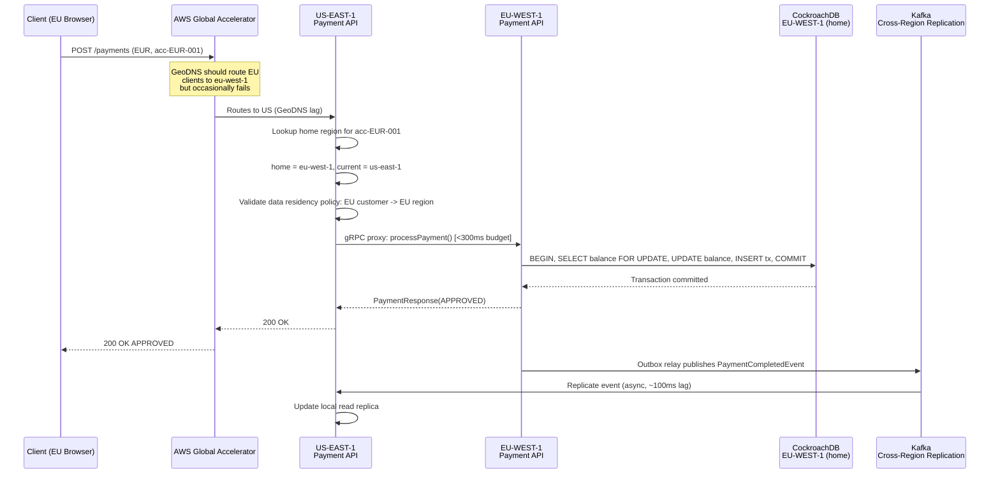

# البنية متعددة المناطق — النشط-النشط ومنع تعارض الكتابة

## نظرة عامة

توفر خدمة دفع في منطقة واحدة توفرًا بنسبة 99.9% — نحو 8.7 ساعات توقف سنويًا. ولمنصة دفع تعالج 10 ملايين معاملة يوميًا، يعني ذلك نحو 400,000 معاملة فاشلة لكل ساعة توقف. والانتقال إلى بنية نشط-نشط (active-active) متعددة المناطق يدفع التوفر نحو 99.999% بضمان ألا يوقف فشل منطقة واحدة الخدمة. لكن النشط-النشط صعب بشكل خادع: فعندما تستطيع كل منطقة قبول الكتابات، تواجه مشكلة تعارض الكتابة — أصعب تحدٍّ في الأنظمة الموزعة مطبّقًا على بيانات مالية لا تقبل الصحة فيها التفاوض.

## النشط-النشط مقابل النشط-الخامل

فهم المفاضلات يقود كل قرار معماري في هذا الدرس.

| البُعد | نشط-خامل | نشط-نشط |
|---|---|---|
| ‏RTO (هدف زمن التعافي) | دقائق (يتطلب تحولًا) | ثوانٍ لإعادة توجيه الحركة (انظر التحفظ بشأن المناطق الأم أدناه) |
| ‏RPO (هدف نقطة التعافي) | ثوانٍ إلى دقائق (تأخر النسخ غير المتزامن) | قريب من الصفر (نسخ متزامن أو غير متزامن منخفض التأخر) |
| تعارضات الكتابة | لا شيء (منطقة كتابة واحدة) | نعم — يجب حلها |
| زمن القراءة | عالٍ للمناطق غير الرئيسية | منخفض (يُخدم من المنطقة المحلية) |
| زمن الكتابة | منخفض للرئيسية، ومُمرّر للأخرى | متغير (يلزم التوجيه إلى المنطقة الأم) |
| الكلفة | أقل (المنطقة الخاملة احتياطية فقط) | أعلى (كل المناطق مجهزة بالكامل) |
| التعقيد | منخفض | عالٍ جدًا |
| مناسب لـ | الأدوات الداخلية، والدفعات، والأنظمة منخفضة الأهمية | المدفوعات المواجهة للعملاء، والتداول، والمصادقة |

**النشط-الخامل** (ويسمى أيضًا رئيسي-ثانوي أو قائد-تابع) له منطقة واحدة قابلة للكتابة. فكل الكتابات تذهب إلى الرئيسية. وتتلقى المنطقة الخاملة البيانات المنسوخة بشكل غير متزامن. وعند فشل الرئيسية، يرقّي إجراء تحول المنطقة الخاملة — فيستغرق دقائق وقد يفقد كتابات التُزم بها مؤخرًا (RPO غير صفري).

**النشط-النشط** (ويسمى أيضًا متعدد الرئيسيات) تقبل فيه كل منطقة القراءات والكتابات معًا. وتُخدم الحركة محليًا. ولا تلزم خطوة ترقية — فإذا فشلت EU-WEST-1، تتوجه الحركة إلى US-EAST-1 خلال ثوانٍ. لكن الكتابات على السجل نفسه من منطقتين في آن واحد تخلق تعارضات — وكما سنرى، فإن الإصلاح لذلك (المناطق الأم) يعيد طرح سؤال: ماذا يحدث لحسابات المنطقة الفاشلة.

## مشكلة تعارض الكتابة للأرصدة المالية

تأمل عميلًا برصيد 1000 دولار. وفي اللحظة نفسها:

```
EU region receives:    debit  $600  (payment to merchant A)
US region receives:    debit  $700  (payment to merchant B)

If both regions commit locally without coordination:
  EU commits: balance = $1000 - $600 = $400  (correct locally)
  US commits: balance = $1000 - $700 = $300  (correct locally)

After cross-region replication and merge:
  CONFLICT: which write wins?
  If EU wins: balance = $400, but the $700 US payment was already approved
  If US wins: balance = $300, but the $600 EU payment was already approved
  If last-write-wins: balance = $300 or $400 — either way, $1300 debited from $1000 account

Result: DOUBLE DEBIT — a regulatory compliance failure
```

لهذا السبب يكون النشط-النشط الساذج خطرًا على الأنظمة المالية. وهناك ثلاثة نهج صحيحة:

1. **التوجيه إلى المنطقة الأم** — وجّه كل الكتابات لحساب معين إلى منطقته "الأم". فلا تعارضات لأن منطقة واحدة تملك كتابات كل حساب.
2. **معاملات موزعة serializable** — استخدم قاعدة بيانات مثل CockroachDB أو Spanner توفر معاملات متسقة عالميًا بكلفة رحلات ذهاب وإياب عبر المناطق عند الكتابة.
3. **‏CRDTs** — استخدم بنى بيانات خالية من التعارض لحالات استخدام محددة (أعداد المعاملات، والمقاييس التجميعية) تتبادل عند الدمج.

لأرصدة الدفع، التوجيه إلى المنطقة الأم هو النهج العملي الوحيد. فلا تستطيع CRDTs نمذجة رصيد بدلالات الخصم/الإيداع بأمان (لا تستطيع التعبير عن "ارفض إذا كان الرصيد غير كافٍ"). والمعاملات الموزعة serializable بطيئة جدًا (رحلات 100–200 مللي ثانية عبر المناطق) لتفويض الدفع الآني.

## التوجيه إلى المنطقة الأم

يُسند لكل تاجر وحساب منطقة أم عند الانضمام. وتُوجّه كل الكتابات (تفويضات الدفع، وتحديثات الرصيد) لذلك الكيان إلى منطقته الأم. وتُخدم القراءات عبر المناطق محليًا من البيانات المنسوخة.

```
Account: acc-EUR-001  --> home region: EU-WEST-1
Account: acc-USD-001  --> home region: US-EAST-1
Account: acc-SGD-001  --> home region: AP-SOUTHEAST-1

Write request for acc-EUR-001 arrives at US-EAST-1:
  US-EAST-1 detects: this account's home is EU-WEST-1
  US-EAST-1 proxies the write to EU-WEST-1 via gRPC
  EU-WEST-1 commits and returns result
  US-EAST-1 returns result to caller

Read request for acc-EUR-001 arrives at US-EAST-1:
  US-EAST-1 serves from local replica (eventual consistency is acceptable for reads)
  Latency: ~5ms (local)
```

### RegionAwarePaymentRouter

```java
package com.fintech.multiregion.routing;

import io.grpc.ManagedChannel;
import io.grpc.ManagedChannelBuilder;
import io.github.resilience4j.circuitbreaker.CircuitBreaker;
import io.github.resilience4j.circuitbreaker.CircuitBreakerRegistry;
import org.springframework.stereotype.Component;

import java.util.Map;
import java.util.concurrent.ConcurrentHashMap;

/**
 * Routes payment writes to the account's home region.
 * Cross-region calls use gRPC with mTLS; protected by circuit breakers.
 */
@Component
public class RegionAwarePaymentRouter {

    private static final String CURRENT_REGION =
        System.getenv().getOrDefault("AWS_REGION", "eu-west-1");

    // Map of region -> gRPC endpoint for cross-region payment proxy
    private static final Map<String, String> REGION_ENDPOINTS = Map.of(
        "eu-west-1",       "payment-proxy.eu-west-1.internal:9090",
        "us-east-1",       "payment-proxy.us-east-1.internal:9090",
        "ap-southeast-1",  "payment-proxy.ap-southeast-1.internal:9090"
    );

    private final AccountRegionRepository accountRegionRepository;
    private final LocalPaymentService localPaymentService;
    private final CircuitBreakerRegistry circuitBreakerRegistry;
    private final Map<String, ManagedChannel> channelCache = new ConcurrentHashMap<>();

    public RegionAwarePaymentRouter(
            AccountRegionRepository accountRegionRepository,
            LocalPaymentService localPaymentService,
            CircuitBreakerRegistry circuitBreakerRegistry) {
        this.accountRegionRepository = accountRegionRepository;
        this.localPaymentService = localPaymentService;
        this.circuitBreakerRegistry = circuitBreakerRegistry;
    }

    /**
     * Note: a proxied payment can time out AFTER the home region committed it.
     * Treat DEADLINE_EXCEEDED / UNAVAILABLE as an unknown outcome: return
     * PENDING and resolve by status query (the paymentId is the idempotency key).
     *
     * Routes a payment to the correct region.
     * If the account's home region is local, process directly.
     * If remote, proxy via gRPC with circuit breaker protection.
     */
    public PaymentResponse routePayment(PaymentRequest request) {
        String homeRegion = accountRegionRepository
            .getHomeRegion(request.accountId());

        if (CURRENT_REGION.equals(homeRegion)) {
            // Local write — no network hop, no conflict possible
            return localPaymentService.processPayment(request);
        }

        // Cross-region write — proxy to home region
        return routeToRegion(request, homeRegion);
    }

    private PaymentResponse routeToRegion(PaymentRequest request, String targetRegion) {
        String cbName = "cross-region-" + targetRegion;
        CircuitBreaker circuitBreaker = circuitBreakerRegistry
            .circuitBreaker(cbName);

        return circuitBreaker.executeSupplier(() -> {
            PaymentServiceGrpc.PaymentServiceBlockingStub stub =
                getStub(targetRegion);

            com.fintech.proto.PaymentRequest grpcRequest =
                com.fintech.proto.PaymentRequest.newBuilder()
                    .setPaymentId(request.paymentId())
                    .setAccountId(request.accountId())
                    .setAmount(request.amount().toPlainString())
                    .setCurrency(request.currency())
                    .setSourceRegion(CURRENT_REGION)
                    .build();

            // Deadline: one cross-region round trip (~70-230ms depending on the
            // region pair) plus home-region processing — measure, don't guess
            com.fintech.proto.PaymentResponse grpcResponse =
                stub.withDeadlineAfter(500, java.util.concurrent.TimeUnit.MILLISECONDS)
                    .processPayment(grpcRequest);

            return new PaymentResponse(
                grpcResponse.getPaymentId(),
                PaymentStatus.valueOf(grpcResponse.getStatus()),
                grpcResponse.getMessage()
            );
        });
    }

    private PaymentServiceGrpc.PaymentServiceBlockingStub getStub(String region) {
        ManagedChannel channel = channelCache.computeIfAbsent(region, r -> {
            String endpoint = REGION_ENDPOINTS.get(r);
            if (endpoint == null) {
                throw new IllegalArgumentException("Unknown region: " + r);
            }
            // useTransportSecurity() = TLS. For mTLS, build the channel with a
            // client certificate (e.g. NettyChannelBuilder + SslContext).
            return ManagedChannelBuilder.forTarget(endpoint)
                .useTransportSecurity()
                .build();
        });
        return PaymentServiceGrpc.newBlockingStub(channel);
    }

    public record PaymentRequest(String paymentId, String accountId,
                                  java.math.BigDecimal amount, String currency) {}
    public record PaymentResponse(String paymentId, PaymentStatus status, String message) {}
    public enum PaymentStatus { APPROVED, DECLINED, PENDING }
}
```

### مستودع منطقة الحساب

```java
package com.fintech.multiregion.routing;

import org.springframework.data.redis.core.StringRedisTemplate;
import org.springframework.stereotype.Repository;

/**
 * Caches the account->home-region mapping in Redis; the source of truth is
 * the accounts database. Cross-region Redis replication needs a product that
 * offers it (e.g. Redis Enterprise Active-Active, or ElastiCache Global
 * Datastore with one writable primary) — open-source Redis replication is
 * single-primary. Writes happen once at account creation (and on re-homing).
 */
@Repository
public class AccountRegionRepository {

    private static final String KEY_PREFIX = "account:region:";

    private final StringRedisTemplate redis;

    public AccountRegionRepository(StringRedisTemplate redis) {
        this.redis = redis;
    }

    public String getHomeRegion(String accountId) {
        String region = redis.opsForValue().get(KEY_PREFIX + accountId);
        if (region == null) {
            throw new AccountNotFoundException("No home region for account: " + accountId);
        }
        return region;
    }

    public void setHomeRegion(String accountId, String region) {
        redis.opsForValue().set(KEY_PREFIX + accountId, region);
    }

    public static class AccountNotFoundException extends RuntimeException {
        public AccountNotFoundException(String message) { super(message); }
    }
}
```

## ‏G-Counter CRDT لأعداد المعاملات

للمقاييس التجميعية — إجمالي المعاملات لكل تاجر، وإجمالي حجم المدفوعات — تكون CRDTs الأداة الصحيحة. فهي تسمح لكل منطقة بالزيادة مستقلة والدمج دون تعارضات.

**‏G-Counter** (عدّاد ينمو فقط) أبسط CRDT. فكل منطقة تحافظ على عدّادها. والقيمة العالمية مجموع كل العدادات الإقليمية. والزيادات تبادلية وidempotent عند الدمج.

```
EU-WEST-1:      {eu: 150, us: 0,   ap: 0  }
US-EAST-1:      {eu: 0,   us: 200, ap: 0  }
AP-SOUTHEAST-1: {eu: 0,   us: 0,   ap: 75 }

After merge (take max of each slot, then sum):
  Merged: {eu: 150, us: 200, ap: 75}
  Total:  150 + 200 + 75 = 425 transactions
```

```java
package com.fintech.multiregion.crdt;

import java.util.Collections;
import java.util.HashMap;
import java.util.Map;
import java.util.concurrent.ConcurrentHashMap;
import java.util.concurrent.atomic.LongAdder;

/**
 * G-Counter CRDT for distributed transaction count tracking.
 *
 * Properties:
 *   - Commutativity: merge(a, b) == merge(b, a)
 *   - Associativity: merge(merge(a,b), c) == merge(a, merge(b,c))
 *   - Idempotency:   merge(a, a) == a
 *
 * These properties guarantee eventual consistency regardless of
 * message ordering or delivery.
 *
 * Durability matters: persist the local slot (or restore it from the merged
 * state at startup). A node that restarts at 0 would have its new increments
 * hidden by the old, larger value other regions still hold for its slot.
 */
public class GCounter {

    private final String localNodeId;
    // Per-node counters: nodeId -> count
    private final Map<String, Long> counters = new ConcurrentHashMap<>();

    public GCounter(String localNodeId) {
        this.localNodeId = java.util.Objects.requireNonNull(localNodeId, "localNodeId");
        this.counters.put(localNodeId, 0L);
    }

    /**
     * Increment the local node's counter.
     * Thread-safe via ConcurrentHashMap compute.
     */
    public void increment() {
        counters.compute(localNodeId,
            (key, current) -> current == null ? 1L : current + 1L);
    }

    public void incrementBy(long delta) {
        if (delta < 0) throw new IllegalArgumentException("G-Counter only grows");
        counters.compute(localNodeId,
            (key, current) -> current == null ? delta : current + delta);
    }

    /**
     * Global value: sum of all node counters.
     */
    public long value() {
        return counters.values().stream().mapToLong(Long::longValue).sum();
    }

    /**
     * Merge another G-Counter state into this one.
     * For each node, take the maximum value seen.
     * This is the "join" operation in lattice theory.
     */
    public void merge(GCounter other) {
        other.counters.forEach((nodeId, otherCount) ->
            counters.merge(nodeId, otherCount, Math::max)
        );
    }

    /**
     * Serialize for cross-region replication.
     */
    public Map<String, Long> snapshot() {
        return Collections.unmodifiableMap(new HashMap<>(counters));
    }

    /**
     * Apply a received snapshot from another region.
     * Idempotent: safe to apply the same snapshot multiple times.
     */
    public void applySnapshot(Map<String, Long> remoteSnapshot) {
        remoteSnapshot.forEach((nodeId, remoteCount) ->
            counters.merge(nodeId, remoteCount, Math::max)
        );
    }

    @Override
    public String toString() {
        return "GCounter{local=" + localNodeId +
               ", counters=" + counters +
               ", total=" + value() + "}";
    }
}
```

### استخدام G-Counter في خدمة الدفع

```java
package com.fintech.multiregion.crdt;

import org.springframework.stereotype.Service;

import java.util.Map;

@Service
public class MerchantTransactionCounter {

    private static final String REGION =
        java.util.Objects.requireNonNull(System.getenv("AWS_REGION"), "AWS_REGION not set");

    // merchantId -> GCounter
    private final java.util.concurrent.ConcurrentHashMap<String, GCounter>
        merchantCounters = new java.util.concurrent.ConcurrentHashMap<>();

    /**
     * Record a successful payment for a merchant.
     * Called after payment authorization succeeds locally.
     */
    public void recordPayment(String merchantId) {
        merchantCounters
            .computeIfAbsent(merchantId, id -> new GCounter(REGION))
            .increment();
    }

    /**
     * Get the globally merged transaction count for a merchant.
     * Reflects all regions that have replicated their state to this node.
     */
    public long getTransactionCount(String merchantId) {
        GCounter counter = merchantCounters.get(merchantId);
        return counter == null ? 0L : counter.value();
    }

    /**
     * Apply a replication event received from another region.
     * Called when a cross-region replication message arrives.
     */
    public void applyReplicationEvent(String merchantId,
                                       Map<String, Long> remoteSnapshot) {
        merchantCounters
            .computeIfAbsent(merchantId, id -> new GCounter(REGION))
            .applySnapshot(remoteSnapshot);
    }

    /**
     * Export local state for replication to other regions.
     */
    public Map<String, Map<String, Long>> exportForReplication() {
        java.util.HashMap<String, Map<String, Long>> result = new java.util.HashMap<>();
        merchantCounters.forEach((merchantId, counter) ->
            result.put(merchantId, counter.snapshot()));
        return result;
    }
}
```

## ‏REGIONAL BY ROW في CockroachDB

للحسابات والمعاملات التي تحتاج اتساقًا قويًا داخل منطقتها الأم، تسمح محلية `REGIONAL BY ROW` في CockroachDB بتثبيت الصفوف في منطقة محددة مع بقائها في جدول موزع عالميًا.

```sql
-- Create the accounts table with regional affinity
CREATE TABLE accounts (
    account_id      UUID          DEFAULT gen_random_uuid() PRIMARY KEY,
    merchant_id     UUID          NOT NULL,
    currency        VARCHAR(3)    NOT NULL,
    balance         DECIMAL(19,4) NOT NULL DEFAULT 0,
    status          VARCHAR(20)   NOT NULL DEFAULT 'ACTIVE',
    crdb_region     crdb_internal_region NOT NULL DEFAULT default_to_database_primary_region(gateway_region()),
    created_at      TIMESTAMPTZ   NOT NULL DEFAULT now(),
    updated_at      TIMESTAMPTZ   NOT NULL DEFAULT now()
) LOCALITY REGIONAL BY ROW AS crdb_region;

-- Rows where crdb_region = 'eu-west-1' are pinned to EU nodes
-- Writes to those rows are low-latency from EU
-- Reads from other regions go to the nearest replica

-- Create regional index for fast lookups within a region
CREATE INDEX accounts_merchant_region_idx
    ON accounts (merchant_id, crdb_region, status);

-- Transactions table with same regional affinity
CREATE TABLE payment_transactions (
    transaction_id  UUID          DEFAULT gen_random_uuid(),
    account_id      UUID          NOT NULL REFERENCES accounts(account_id),
    amount          DECIMAL(19,4) NOT NULL,
    direction       VARCHAR(6)    NOT NULL CHECK (direction IN ('DEBIT', 'CREDIT')),
    status          VARCHAR(20)   NOT NULL DEFAULT 'PENDING',
    crdb_region     crdb_internal_region NOT NULL DEFAULT default_to_database_primary_region(gateway_region()),
    created_at      TIMESTAMPTZ   NOT NULL DEFAULT now(),
    PRIMARY KEY (transaction_id, crdb_region)
) LOCALITY REGIONAL BY ROW AS crdb_region;

-- A debit with balance check — one serializable statement, executed in the
-- row's home region. The INSERT only happens if the conditional UPDATE
-- matched: 0 rows inserted = insufficient funds or inactive, nothing changed.
-- (A separate "UPDATE ... AND balance >= $2" followed by an unconditional
--  INSERT would record a COMPLETED debit even when the UPDATE matched nothing.)
WITH debited AS (
  UPDATE accounts
     SET balance = balance - $2, updated_at = now()
   WHERE account_id = $1
     AND balance >= $2
     AND status = 'ACTIVE'
  RETURNING account_id, crdb_region
)
INSERT INTO payment_transactions
  (transaction_id, account_id, amount, direction, status, crdb_region)
SELECT $3, account_id, $2, 'DEBIT', 'COMPLETED', crdb_region
  FROM debited;
```

```java
package com.fintech.multiregion.database;

import org.springframework.jdbc.core.JdbcTemplate;
import org.springframework.stereotype.Repository;
import org.springframework.transaction.annotation.Transactional;

import java.math.BigDecimal;
import java.util.UUID;

@Repository
public class AccountRepository {

    private final JdbcTemplate jdbc;

    public AccountRepository(JdbcTemplate jdbc) {
        this.jdbc = jdbc;
    }

    /**
     * Atomic debit with balance check.
     * Runs as a serializable transaction in CockroachDB. Including crdb_region
     * in the WHERE clause lets the optimizer go straight to the row's home
     * partition. CockroachDB may abort a serializable transaction with a
     * retryable error (SQLSTATE 40001): the caller must retry it in a new
     * transaction (the transactionId keeps the retry idempotent).
     */
    @Transactional
    public boolean debitAccount(UUID accountId, BigDecimal amount,
                                 UUID transactionId, String region) {
        // Lock the row in the home region
        int updated = jdbc.update("""
            UPDATE accounts
               SET balance    = balance - ?,
                   updated_at = now()
             WHERE account_id  = ?
               AND crdb_region = ?
               AND balance     >= ?
               AND status      = 'ACTIVE'
            """, amount, accountId, region, amount);

        if (updated == 0) {
            return false;  // Insufficient balance or account inactive
        }

        // Record the transaction in the same region
        jdbc.update("""
            INSERT INTO payment_transactions
                   (transaction_id, account_id, amount, direction, status, crdb_region)
            VALUES (?, ?, ?, 'DEBIT', 'COMPLETED', ?)
            """, transactionId, accountId, amount, region);

        return true;
    }
}
```

## التحقق من إقامة البيانات

لا يمنع GDPR ‏(الفصل الخامس، المواد 44–49) معالجة البيانات الشخصية للاتحاد الأوروبي خارجه — بل يتطلب آلية نقل مشروعة: قرار كفاية (مثل إطار خصوصية البيانات بين الاتحاد الأوروبي والولايات المتحدة للشركات الأمريكية المعتمدة)، أو البنود التعاقدية القياسية، أو قواعد الشركات الملزمة. ومع ذلك تعتمد بنوك كثيرة **سياسة إقامة بيانات** أشد — تُعالج بيانات عملاء الاتحاد الأوروبي في مناطق الاتحاد الأوروبي فقط — لأسباب رقابية أو تعاقدية أو تتعلق بالمخاطر. وفي بنية متعددة المناطق، ستكسر الكتابة الموجهة خطأً تلك السياسة. والمدقق أدناه يفرضها، بناءً على ولاية العميل القضائية من سجل KYC — لا على عملة الدفعة (فمقيم في الاتحاد الأوروبي قد يدفع بالدولار).

```java
package com.fintech.multiregion.compliance;

import org.springframework.stereotype.Component;

import java.util.Map;
import java.util.Set;

/**
 * Enforces the firm's data residency policy: payment data is processed only
 * in regions allowed for the customer's jurisdiction (from the KYC record).
 */
@Component
public class DataResidencyValidator {

    private static final Map<String, Set<String>> ALLOWED_REGIONS = Map.of(
        // EU member-state regions only (eu-west-2 is London — NOT in the EU)
        "EU",   Set.of("eu-west-1", "eu-west-3", "eu-central-1", "eu-north-1", "eu-south-1"),
        // UK policy here: London first, EU regions also allowed
        "UK",   Set.of("eu-west-2", "eu-west-1"),
        "US",   Set.of("us-east-1", "us-east-2", "us-west-2"),
        "APAC", Set.of("ap-southeast-1", "ap-northeast-1", "ap-south-1")
    );

    /**
     * @param customerJurisdiction  e.g. "EU", "UK" — from the customer's KYC record
     * @param targetRegion          the AWS region where processing will occur
     */
    public ValidationResult validate(String customerJurisdiction, String targetRegion) {
        Set<String> allowed = ALLOWED_REGIONS.get(customerJurisdiction);
        if (allowed == null) {
            // Unknown jurisdiction: fail CLOSED and send for review
            return ValidationResult.denied(
                "Unknown jurisdiction '" + customerJurisdiction + "' — manual review required");
        }
        if (!allowed.contains(targetRegion)) {
            return ValidationResult.denied(String.format(
                "Data residency policy: %s customer data cannot be processed in %s. Allowed: %s",
                customerJurisdiction, targetRegion, allowed));
        }
        return ValidationResult.allowed("Compliant: " + customerJurisdiction + " in " + targetRegion);
    }

    public record ValidationResult(boolean allowed, String reason) {
        public static ValidationResult allowed(String reason) {
            return new ValidationResult(true, reason);
        }
        public static ValidationResult denied(String reason) {
            return new ValidationResult(false, reason);
        }
    }
}
```

### التكامل مع الموجّه

```java
// In RegionAwarePaymentRouter.routePayment():

DataResidencyValidator.ValidationResult residency =
    dataResidencyValidator.validate(request.customerJurisdiction(), homeRegion);

if (!residency.allowed()) {
    throw new DataResidencyViolationException(residency.reason());
}

// Then proceed with routing to homeRegion
```

## ميزانية الزمن

فهم الزمن عبر المناطق أساسي لتصميم اتفاقيات الخدمة.

| الاتصال | البروتوكول | RTT النموذجي (تقريبي) | RTT عند P99 (تقريبي) |
|---|---|---|---|
| المنطقة نفسها (بين مناطق التوفر) | gRPC/HTTP2 | 1–3 مللي ثانية | 8 مللي ثانية |
| ‏EU-WEST-1 (أيرلندا) إلى EU-CENTRAL-1 (فرانكفورت) | gRPC | 20–25 مللي ثانية | 35 مللي ثانية |
| ‏EU-WEST-1 إلى US-EAST-1 (فرجينيا الشمالية) | gRPC | 65–75 مللي ثانية | 100 مللي ثانية |
| ‏US-EAST-1 إلى AP-SOUTHEAST-1 (سنغافورة) | gRPC | 210–230 مللي ثانية | 270 مللي ثانية |
| ‏EU-WEST-1 إلى AP-SOUTHEAST-1 | gRPC | 170–185 مللي ثانية | 230 مللي ثانية |

هذه أرقام عامة تقريبية — قِس أزواج المناطق لديك.

```
Payment authorization budget (target: <200ms end-to-end):

CASE 1: Request arrives at home region (best case)
  API gateway:        5ms
  Auth/JWT validate:  3ms
  Local DB write:    10ms   (CockroachDB home region)
  Response:           2ms
  Total:             20ms   <-- excellent

CASE 2: EU customer's request lands in US-EAST-1
  US API gateway:         5ms
  Auth/JWT validate:      3ms
  Proxy round trip:      70ms   (US <-> EU RTT — covers request AND response)
  EU DB write:           10ms
  US response:            2ms
  Total:                 90ms   <-- acceptable

CASE 3: Singapore customer's request lands in US-EAST-1
  US API gateway:         5ms
  Auth/JWT validate:      3ms
  Proxy round trip:     220ms   (US <-> AP RTT)
  AP DB write:           10ms
  US response:            2ms
  Total:                240ms   <-- exceeds 200ms SLA

MITIGATION: Use latency-based / geo DNS or Anycast to route customers to the
  nearest region (e.g. AWS Global Accelerator, Route 53 latency routing).
  Acceptable: a small share of cross-region requests when routing lags.
```

## قاطع الدائرة على gRPC عبر المناطق

```yaml
resilience4j:
  circuitbreaker:                         # NOT "circuit-breaker" — that key does not bind
    instances:
      cross-region-eu-west-1:
        register-health-indicator: true
        sliding-window-size: 20
        failure-rate-threshold: 30        # Sensitive: 30% failure trips circuit
        slow-call-duration-threshold: 300ms  # EU<->US RTT ~70ms; set per region pair
        slow-call-rate-threshold: 50
        wait-duration-in-open-state: 30s  # Give the remote region time to recover
        permitted-number-of-calls-in-half-open-state: 5
        writable-stack-trace-enabled: false  # Performance: skip stack traces

      cross-region-us-east-1:
        sliding-window-size: 20
        failure-rate-threshold: 30
        slow-call-duration-threshold: 300ms
        slow-call-rate-threshold: 50
        wait-duration-in-open-state: 30s
        permitted-number-of-calls-in-half-open-state: 5
```

عندما تفتح دائرة عبر المناطق، تتغير استراتيجية التوجيه:

```java
private PaymentResponse routeToRegion(PaymentRequest request, String targetRegion) {
    String cbName = "cross-region-" + targetRegion;
    CircuitBreaker circuitBreaker = circuitBreakerRegistry.circuitBreaker(cbName);

    try {
        return circuitBreaker.executeSupplier(() -> proxyToRegion(request, targetRegion));
    } catch (io.grpc.StatusRuntimeException e) {
        // DEADLINE_EXCEEDED / UNAVAILABLE: the home region may or may not have
        // committed — unknown outcome. PENDING + status query by paymentId.
        return new PaymentResponse(request.paymentId(), PaymentStatus.PENDING,
            "Outcome unknown (" + e.getStatus().getCode() + "), status will be confirmed");
    } catch (io.github.resilience4j.circuitbreaker.CallNotPermittedException e) {
        // Cross-region circuit is OPEN — remote region is degraded
        // Options:
        //   1. Return PENDING and queue for async retry (safest for payments)
        //   2. If the payment can be processed locally (e.g., balance check can be deferred),
        //      process locally and reconcile later
        //   For payment authorization: always PENDING — never approve without balance check
        return new PaymentResponse(
            request.paymentId(),
            PaymentStatus.PENDING,
            "Home region " + targetRegion + " unreachable, queued for retry"
        );
    }
}
```

## مخطط تسلسل الدفع عبر المناطق



## التعافي من الكوارث: ما الذي يعطيك إياه النشط-النشط فعلًا

للتوجيه إلى المنطقة الأم تبعة على التعافي من الكوارث: فبينما EU-WEST-1 معطلة، **لا يمكن الكتابة في الحسابات التي منطقتها الأم EU-WEST-1 في أي مكان** ما لم تكن بياناتها متاحة أيضًا في منطقة أخرى. وتبقى الخدمة ككل عاملة — فالحسابات ذات المناطق الأم الأخرى لا تتأثر — لكن مدفوعات الحسابات الأوروبية تنتظر. وعندما تفشل EU-WEST-1:

```
Normal state:
  EU-WEST-1: processing EUR payments (home region for EU accounts)
  US-EAST-1: processing USD payments (home region for US accounts)

EU-WEST-1 failure at T=0:
  AWS Global Accelerator: detects health check failure in <30 seconds
  GeoDNS: re-routes ALL traffic to US-EAST-1

US-EAST-1 receives EUR payment request:
  Looks up home region: eu-west-1
  Tries to proxy: cross-region circuit breaker OPEN (EU is down)
  Decision: payment = PENDING (queued in Kafka for retry)

When EU-WEST-1 recovers at T=N:
  AWS Global Accelerator: detects health restored
  GeoDNS: re-routes EU traffic back to EU-WEST-1
  Kafka retry consumer: processes queued PENDING payments
  Zero data loss: all transactions either committed in EU or queued safely
```

**‏RPO** يعتمد على طريقة نجاة قاعدة البيانات من الإخفاقات. فمع هدف النجاة الافتراضي *للمنطقة الفرعية* (zone) في CockroachDB، يُنسخ كل صف بشكل متزامن عبر مناطق التوفر في منطقته الأم: ففشل منطقة توفر لا يفقد شيئًا، لكن الفقدان الدائم للمنطقة **كلها** قد يفقد تلك الصفوف. ومع `SURVIVE REGION FAILURE` تُنسخ الكتابات بشكل متزامن إلى مناطق أخرى أيضًا: ‏RPO = 0 حتى عند فقدان منطقة، بكلفة زمن كتابة أعلى (رحلة ذهاب وإياب عبر المناطق لكل التزام). والمدفوعات المصفوفة كـ PENDING في Kafka بالمنطقة الناجية (المنسوخة داخل تلك المنطقة) لا تضيع في الحالتين.

**‏RTO** ثوانٍ لإعادة توجيه الحركة وللحسابات ذات المناطق الأم السليمة. أما لحسابات المنطقة الفاشلة فهو الوقت حتى تتعافى تلك المنطقة — ما لم تنجُ قاعدة البيانات من فشل المنطقة، وحينها يمكن خدمة صفوفها (وإعادة تحديد منطقتها الأم) من منطقة أخرى.

## دليل تشغيل التحول

```
RUNBOOK: EU-WEST-1 Region Failure Response

DETECTION:
  1. PagerDuty fires: "eu-west-1 health checks failing > 2 minutes"
  2. Grafana alert: "cross-region circuit breaker eu-west-1 OPEN"
  3. CloudWatch: EC2/ECS instances in eu-west-1 not responding

IMMEDIATE ACTIONS (first 5 minutes):
  1. Confirm failure scope: AWS Service Health Dashboard
  2. Verify Global Accelerator has removed eu-west-1 from routing
     - Check: AWS Console > Global Accelerator > Endpoint Groups
     - Expected: eu-west-1 health = UNHEALTHY, weight = 0
  3. Verify US/AP regions receiving increased traffic (expected +100% EU traffic)
  4. Confirm Kafka queuing: check PENDING payments queue depth
     - Alert if queue > 10,000 (indicates backup accumulating)

DURING OUTAGE:
  1. EUR payments: queued as PENDING in us-east-1 Kafka
  2. Communicate to merchants via status page: "EU payments delayed, not lost"
  3. Monitor queue depth every 5 minutes
  4. If outage > 30 minutes: consider emergency exception to process EUR
     payments from US with async reconciliation (requires risk approval)

RECOVERY:
  1. EU-WEST-1 health checks pass > 3 consecutive checks
  2. Global Accelerator automatically re-routes EU traffic
  3. Kafka retry consumer processes PENDING EUR payments
  4. Reconcile: query CockroachDB for any duplicate payment risks
  5. Post-incident review within 48 hours
```

## مزالق الإنتاج

### المزلق 1: افتراض أن زمن عبور المناطق مقبول لكل العمليات

تبني الفرق النشط-النشط ثم تكتشف أن استدعاءات gRPC المتزامنة عبر المناطق تضيف 100–200 مللي ثانية لكل طلب موجه خطأً. ودون توجيه جغرافي (GeoDNS) أو Anycast، يدفع كل عميل أوروبي يصل إلى عقدة طرفية أمريكية ثمن عبور المناطق.

```java
// WRONG: no routing affinity — every request may hit any region
// A European customer routed to US-EAST-1 pays 200ms round trip
// for every payment authorization
@RestController
public class PaymentController {
    @PostMapping("/payments")
    public PaymentResponse createPayment(@RequestBody PaymentRequest request) {
        // No region awareness — just process wherever the load balancer sent us
        return paymentService.process(request);
    }
}

// CORRECT: check if we are in the home region; proxy if not
// But more importantly: configure AWS Global Accelerator with endpoint
// affinity so EU clients reach EU endpoints in the first place

// In application.yml, expose the region for health checks:
// management.endpoint.health.probes.enabled: true
// Use this health endpoint in Global Accelerator target group health check

// Also: implement latency-based routing in Route53 or Global Accelerator
// to ensure <1% of requests need cross-region proxying under normal conditions

@RestController
public class PaymentController {
    private final RegionAwarePaymentRouter router;

    @PostMapping("/payments")
    public PaymentResponse createPayment(@RequestBody PaymentRequest request) {
        // Router checks home region and proxies if necessary
        // But this code path should be rare — Global Accelerator handles affinity
        return router.routePayment(request);
    }
}
```

### المزلق 2: استخدام "آخر كتابة تربح" للأرصدة المالية يسبب خصومات مزدوجة

الساعات المتجهية و"آخر كتابة تربح" مقبولة لعربات التسوق. لكنها كارثية للأرصدة المالية. وسيناريو الخصم المزدوج الموصوف في بداية هذا الدرس نمط حوادث إنتاج حقيقي.

```java
// WRONG: last-write-wins merge for balance updates
// This can produce negative balances or double debits

// In a Cassandra-style LWW setup (DO NOT DO THIS FOR BALANCES):
public void updateBalance(String accountId, BigDecimal newBalance) {
    // Cassandra: last write by timestamp wins
    // If EU writes balance=400 at T=100ms and US writes balance=300 at T=101ms,
    // US wins and balance=300. But the EU debit of $600 was already approved.
    // Customer effectively debited $700 + $600 = $1300 from $1000 balance.
    cassandraSession.execute(
        "UPDATE accounts SET balance = ? WHERE account_id = ?",
        newBalance, accountId
    );
}

// CORRECT: home-region routing ensures only ONE region owns writes for each account
// The home region performs a serializable balance check before every debit
// No cross-region balance merge ever happens
public boolean debitBalance(String accountId, BigDecimal amount) {
    // This runs in the home region only — no conflict possible
    // CockroachDB serializable transaction guarantees atomicity
    return accountRepository.debitAccount(
        UUID.fromString(accountId), amount,
        UUID.randomUUID(),
        currentRegion
    );
}
```

### المزلق 3: عدم اختبار التحول الفعلي تحت الحمل

تختبر الفرق التحول في بيئة التجهيز بلا حركة وتعلن النجاح. وتحول الإنتاج بـ 50,000 طلب في الدقيقة يبدو مختلفًا تمامًا.

```
Common failure modes during real failover:

1. DNS TTL not respected by client-side caches:
   - Some CDN/client caches ignore TTL
   - Traffic continues to failed region for minutes after removal
   FIX: Set DNS TTL to 60 seconds for payment endpoints (not 300s default)
       Implement client-side retry with region-override header

2. The PENDING queue is not available in the surviving region:
   - Consumers in EU that were processing the PENDING queue are dead
   - A consumer group lives inside ONE Kafka cluster; it does not span regions
   FIX: Replicate the topic to the surviving region (e.g. MirrorMaker 2,
       which can also translate committed offsets, or a stretched cluster)
       and run a consumer group there; monitor consumer lag per region

3. Cross-region circuit breakers not configured:
   - US-EAST-1 keeps retrying EU-WEST-1 for every EUR payment
   - EU-WEST-1 is overloaded with reconnection attempts on recovery
   FIX: Circuit breaker on every cross-region gRPC channel (shown above)
       Exponential backoff on HALF_OPEN probes

// Load test your failover — chaos engineering with actual traffic
// Use AWS Fault Injection Service to simulate region failure:
// (conceptual, not AWS SDK)
public class FailoverLoadTest {
    public void simulateRegionFailure() {
        // 1. Record current error rate baseline
        // 2. Inject network partition to eu-west-1
        // 3. Measure: how quickly does traffic shift?
        // 4. Measure: how many payments go to PENDING vs FAILED?
        // 5. Measure: queue depth accumulation rate
        // 6. Remove partition and measure recovery time
        // Target: <30s for traffic shift, 0 FAILED (only PENDING)
    }
}
```

## قائمة الفحص

- [ ] المنطقة الأم مخزنة لكل حساب عند الإنشاء
- [ ] التوجيه الجغرافي / Global Accelerator مضبوط لتوجيه العملاء إلى أقرب منطقة أم لهم
- [ ] استدعاءات gRPC عبر المناطق محمية بقاطع دائرة لكل منطقة هدف
- [ ] عتبة فشل قاطع الدائرة عبر المناطق أقل منها داخل المنطقة (30% مقابل 50%)
- [ ] خصومات أرصدة الدفع تستخدم معاملات serializable — لا "آخر كتابة تربح" أبدًا
- [ ] التحقق من سياسة إقامة البيانات (حسب ولاية العميل) يعمل قبل كل تمرير عبر المناطق
- [ ] ‏G-Counter CRDTs مستخدمة للمقاييس التجميعية (لا لحساب الأرصدة)
- [ ] ‏REGIONAL BY ROW في CockroachDB مضبوط للحسابات والمعاملات
- [ ] هدف نجاة قاعدة البيانات مختار عن قصد (فشل منطقة فرعية مقابل فشل منطقة) وRPO الخاص به موثق
- [ ] مدة صلاحية DNS مضبوطة على 60 ثانية لنقاط الدفع
- [ ] موضوع طابور PENDING منسوخ إلى كل منطقة قد تحتاج إلى تصريفه (مجموعة مستهلكين لكل منطقة)
- [ ] دليل تشغيل التحول موثق ومختبر فصليًا تحت الحمل
- [ ] فحوص صحة نقاط AWS Global Accelerator مضبوطة ومُتحقق منها
- [ ] إجراء المطابقة بعد التحول مختبر (إعادة محاولة مدفوعات PENDING المصفوفة)
- [ ] ميزانيات الزمن موثقة لكل زوج مناطق؛ واتفاقية الخدمة معدلة لسيناريوهات عبور المناطق

<!-- KNOWLEDGE-CHECK
{"questions":[{"text":"لعميل في فرنسا حساب باليورو برصيد 1000 يورو. وفي اللحظة نفسها تتلقى EU-WEST-1 خصمًا بـ 600 يورو وتتلقى US-EAST-1 خصمًا بـ 700 يورو. مع ضبط التوجيه إلى المنطقة الأم بشكل صحيح، ماذا يحدث؟","options":["أ) ينجح الخصمان لأن كل منطقة لا ترى إلا كتابتها","ب) يُعالج خصم EU-WEST-1؛ ويُمرّر طلب US-EAST-1 إلى EU-WEST-1 ويُسلسل، فلا ينجح إلا أحدهما بسبب قيد الرصيد","ج) آخر كتابة تربح: الخصم ذو الطابع الزمني الأحدث يربح والآخر يُسقط بصمت","د) يفشل الطلبان باستثناء تعارض ويجب إعادة محاولتهما"],"correct":1,"explanation":"مع التوجيه إلى المنطقة الأم، تكون المنطقة الأم لحساب اليورو هي EU-WEST-1. فتُعالج كتابة أوروبا محليًا. وتُمرّر كتابة أمريكا إلى EU-WEST-1 عبر gRPC. وتُسلسل الكتابتان في EU-WEST-1 كمعاملات serializable في CockroachDB. فينجح الخصم الأول (يبقى 1000-600=400). ويفشل الخصم الثاني (700 يورو) في فحص الرصيد (400 < 700) ويعيد DECLINED. فلا يمكن حدوث خصم مزدوج."},{"text":"تنفّذ G-Counter CRDT لأعداد المعاملات عبر ثلاث مناطق. لأوروبا {eu:150, us:0, ap:0}، ولأمريكا {eu:0, us:200, ap:0}. بعد الدمج، ما العدد العالمي للمعاملات؟","options":["أ) 150 (العدد المحلي لأوروبا فقط)","ب) 200 (العدد المحلي لأمريكا فقط)","ج) 350 (المجموع بعد أخذ الحد الأقصى لكل عقدة)","د) 350 فقط إذا حدث الدمج بترتيب محدد"],"correct":2,"explanation":"يأخذ دمج G-Counter القيمة القصوى لكل خانة عقدة: المدموج = {eu: max(150,0)=150, us: max(0,200)=200, ap: max(0,0)=0}. والقيمة العالمية = 150+200+0 = 350. ولأن الدمج تبادلي وتجميعي، فترتيب الدمج لا يهم. وهذه خاصية CRDT الأساسية: اتساق نهائي دون تنسيق."},{"text":"ما السبب الأساسي لتعافي البنية النشطة-النشطة متعددة المناطق خلال ثوانٍ بينما تستغرق النشطة-الخاملة عادة دقائق؟","options":["أ) تستخدم النشطة-النشطة تقنية نسخ قاعدة بيانات أسرع","ب) لا تتطلب النشطة-النشطة أي إجراء تحول لأن كل منطقة تخدم بالفعل حركة حية؛ بينما تتطلب النشطة-الخاملة خطوة ترقية","ج) تخزن النشطة-النشطة البيانات في الذاكرة بينما تستخدم النشطة-الخاملة القرص","د) تتطلب النشطة-الخاملة أنفاق VPN تضيف زمنًا أثناء التحول"],"correct":1,"explanation":"يقيس RTO مدة عدم توفر النظام بعد الفشل. ففي النشط-الخامل يجب ترقية المنطقة الخاملة إلى نشطة (تغييرات DNS، وإعادة تشغيل مجمعات الاتصالات، وفحوص الصحة)، وهذا يستغرق دقائق. وفي النشط-النشط تخدم كل المناطق الحركة بالفعل، فتستغرق إعادة التوجيه ثوانٍ ولا تلزم خطوة ترقية. وتحفظ واحد: مع التوجيه إلى المنطقة الأم، لا يمكن الكتابة مجددًا في الحسابات التي منطقتها الأم هي المنطقة الفاشلة إلا بعد تعافي تلك المنطقة — ما لم تُضبط قاعدة البيانات للنجاة من فشل المنطقة."}]}
-->

<!-- PRACTICAL-CHALLENGE
{"title":"بناء موجّه دفع نشط-نشط متعدد المناطق مع منع التعارض","difficulty":"principal","estimatedMinutes":90,"tasks":[{"id":"1","description":"نفّذ RegionAwarePaymentRouter يسند مناطق أم للحسابات عند الانضمام (عملاء الاتحاد الأوروبي -> eu-west-1، والولايات المتحدة -> us-east-1، وسنغافورة -> ap-southeast-1). واحفظ الربط في قاعدة بيانات الحسابات وخزّنه مؤقتًا في Redis بـ KEY_PREFIX. ولطلبات الدفع الواصلة إلى منطقة غير أم، مرّرها عبر gRPC إلى المنطقة الأم، معاملًا DEADLINE_EXCEEDED كنتيجة مجهولة (PENDING). وأضف DataResidencyValidator يمنع معالجة مدفوعات عملاء الاتحاد الأوروبي (حسب ولاية KYC لا العملة) خارج مناطق الاتحاد الأوروبي. واكتب اختبارات وحدة تغطي: (أ) تطابق المنطقة الأم يوجّه محليًا، (ب) المنطقة غير الأم تمرّر بشكل صحيح، (ج) انتهاك السياسة يرمي DataResidencyViolationException."},{"id":"2","description":"نفّذ GCounter CRDT بدلالات دمج كاملة. واكتب اختبارًا يثبت التبادلية (merge(A,B) يساوي merge(B,A))، والتجميعية (merge(merge(A,B),C) يساوي merge(A,merge(B,C)))، والـ idempotency ‏(merge(A,A) يساوي A). ثم نفّذ خدمة MerchantTransactionCounter تستخدم GCounter لكل تاجر، وتعرض recordPayment() وgetTransactionCount() وapplyReplicationEvent(). وحاكِ سيناريو نسخ عبر المناطق تسجل فيه أوروبا وأمريكا 100 دفعة لكل منهما للتاجر نفسه، وتتبادلان اللقطات، وتحقق من أن العدد المدموج 200."},{"id":"3","description":"اضبط CockroachDB (أو حاكه بـ H2 للاختبار) بمخطط حسابات متعدد المناطق. ونفّذ AccountRepository.debitAccount() كمعاملة serializable: ‏(أ) تفحص الرصيد بقفل FOR UPDATE، (ب) تحدّث الرصيد فقط إذا كان كافيًا، (ج) تدرج سجل معاملة. واكتب اختبارًا متزامنًا بعشرة خيوط تحاول كلها خصم 100 من حساب رصيده 500. وتحقق من نجاح 5 بالضبط ورفض 5 دون إمكانية رصيد سالب. وهذا يُظهر أن المعاملات serializable تمنع الخصم المزدوج."},{"id":"4","description":"أضف قواطع دائرة لاستدعاءات gRPC عبر المناطق باستخدام Resilience4j. واضبط: عتبة معدل فشل 30%، وعتبة استدعاء بطيء 300 مللي ثانية، وانتظار الحالة المفتوحة 30 ثانية. ونفّذ دالة رجوع تعيد PaymentStatus.PENDING عندما تكون الدائرة عبر المناطق مفتوحة. واكتب اختبارًا باستخدام WireMock يحاكي عدم توفر EU-WEST-1. وتحقق من: (أ) فتح الدائرة بعد معدل فشل 30%، (ب) أن مدفوعات اليورو اللاحقة من أمريكا تعيد PENDING (لا FAILED)، (ج) انتقال الدائرة إلى HALF_OPEN بعد 30 ثانية، (د) أن استكشافًا ناجحًا يغلق الدائرة ويستأنف توجيه المدفوعات بشكل صحيح."}]}
-->
