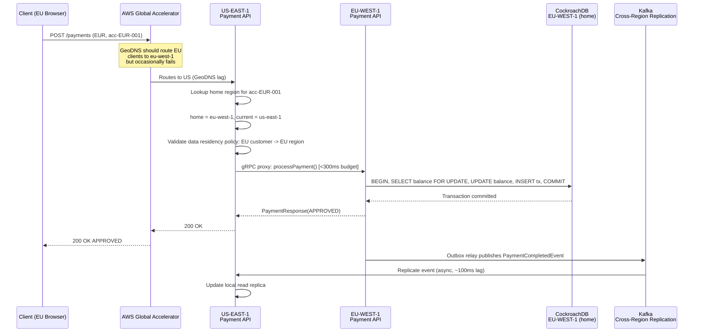

## Overview

A single-region payment service offers 99.9% availability — about 8.7 hours of downtime per year. For a payment platform processing 10 million transactions daily, that is roughly 400,000 failed transactions per hour of downtime. Moving to multi-region active-active architecture pushes availability toward 99.999% by ensuring that no single region failure takes the service offline. But active-active is deceptively difficult: when every region can accept writes, you face the write conflict problem — the hardest challenge in distributed systems applied to financial data where correctness is non-negotiable.

## Active-Active vs Active-Passive

Understanding the trade-offs drives every architectural decision in this lesson.

| Dimension | Active-Passive | Active-Active |
|---|---|---|
| RTO (Recovery Time Objective) | Minutes (requires failover) | Seconds for traffic re-routing (see the caveat on home regions below) |
| RPO (Recovery Point Objective) | Seconds to minutes (async replication lag) | Near-zero (synchronous or low-lag async) |
| Write conflicts | None (single write region) | Yes — must be resolved |
| Read latency | High for non-primary regions | Low (serve from local region) |
| Write latency | Low for primary, proxied for others | Varies (home-region routing needed) |
| Cost | Lower (passive region is standby only) | Higher (all regions fully provisioned) |
| Complexity | Low | Very high |
| Suitable for | Internal tools, batch, low-criticality | Customer-facing payments, trading, auth |

**Active-passive** (also called primary-secondary or leader-follower) has one writable region. All writes go to the primary. The passive region receives replicated data asynchronously. On primary failure, a failover procedure promotes the passive region — taking minutes and potentially losing recently-committed writes (non-zero RPO).

**Active-active** (also called multi-master) has every region accepting both reads and writes. Traffic is served locally. No promotion step is required — if EU-WEST-1 fails, traffic routes to US-EAST-1 within seconds. But writes to the same record from two regions simultaneously create conflicts — and, as we will see, the fix for that (home regions) brings back a question of what happens to the failed region's accounts.

## The Write Conflict Problem for Financial Balances

Consider a customer with a $1000 balance. At the same millisecond:

```
EU region receives:    debit  $600  (payment to merchant A)
US region receives:    debit  $700  (payment to merchant B)

If both regions commit locally without coordination:
  EU commits: balance = $1000 - $600 = $400  (correct locally)
  US commits: balance = $1000 - $700 = $300  (correct locally)

After cross-region replication and merge:
  CONFLICT: which write wins?
  If EU wins: balance = $400, but the $700 US payment was already approved
  If US wins: balance = $300, but the $600 EU payment was already approved
  If last-write-wins: balance = $300 or $400 — either way, $1300 debited from $1000 account

Result: DOUBLE DEBIT — a regulatory compliance failure
```

This is why naive active-active is dangerous for financial systems. There are three correct approaches:

1. **Home-region routing** — route all writes for a given account to its "home" region. No conflicts because a single region owns each account's writes.
2. **Serializable distributed transactions** — use a database like CockroachDB or Spanner that provides globally consistent transactions at the cost of cross-region round trips on writes.
3. **CRDTs** — use conflict-free data structures for specific use cases (transaction counts, aggregate metrics) that commute under merge.

For payment balances, home-region routing is the only practical approach. CRDTs cannot model a balance with debit/credit semantics safely (they cannot express "reject if balance insufficient"). Serializable distributed transactions are too slow (100-200ms cross-region round trips) for real-time payment authorization.

## Home-Region Routing

Every merchant and account is assigned a home region at onboarding. All writes (payment authorizations, balance updates) for that entity are routed to its home region. Cross-region reads are served locally from replicated data.

```
Account: acc-EUR-001  --> home region: EU-WEST-1
Account: acc-USD-001  --> home region: US-EAST-1
Account: acc-SGD-001  --> home region: AP-SOUTHEAST-1

Write request for acc-EUR-001 arrives at US-EAST-1:
  US-EAST-1 detects: this account's home is EU-WEST-1
  US-EAST-1 proxies the write to EU-WEST-1 via gRPC
  EU-WEST-1 commits and returns result
  US-EAST-1 returns result to caller

Read request for acc-EUR-001 arrives at US-EAST-1:
  US-EAST-1 serves from local replica (eventual consistency is acceptable for reads)
  Latency: ~5ms (local)
```

### RegionAwarePaymentRouter

```java
package com.fintech.multiregion.routing;

import io.grpc.ManagedChannel;
import io.grpc.ManagedChannelBuilder;
import io.github.resilience4j.circuitbreaker.CircuitBreaker;
import io.github.resilience4j.circuitbreaker.CircuitBreakerRegistry;
import org.springframework.stereotype.Component;

import java.util.Map;
import java.util.concurrent.ConcurrentHashMap;

/**
 * Routes payment writes to the account's home region.
 * Cross-region calls use gRPC with mTLS; protected by circuit breakers.
 */
@Component
public class RegionAwarePaymentRouter {

    private static final String CURRENT_REGION =
        System.getenv().getOrDefault("AWS_REGION", "eu-west-1");

    // Map of region -> gRPC endpoint for cross-region payment proxy
    private static final Map<String, String> REGION_ENDPOINTS = Map.of(
        "eu-west-1",       "payment-proxy.eu-west-1.internal:9090",
        "us-east-1",       "payment-proxy.us-east-1.internal:9090",
        "ap-southeast-1",  "payment-proxy.ap-southeast-1.internal:9090"
    );

    private final AccountRegionRepository accountRegionRepository;
    private final LocalPaymentService localPaymentService;
    private final CircuitBreakerRegistry circuitBreakerRegistry;
    private final Map<String, ManagedChannel> channelCache = new ConcurrentHashMap<>();

    public RegionAwarePaymentRouter(
            AccountRegionRepository accountRegionRepository,
            LocalPaymentService localPaymentService,
            CircuitBreakerRegistry circuitBreakerRegistry) {
        this.accountRegionRepository = accountRegionRepository;
        this.localPaymentService = localPaymentService;
        this.circuitBreakerRegistry = circuitBreakerRegistry;
    }

    /**
     * Note: a proxied payment can time out AFTER the home region committed it.
     * Treat DEADLINE_EXCEEDED / UNAVAILABLE as an unknown outcome: return
     * PENDING and resolve by status query (the paymentId is the idempotency key).
     *
     * Routes a payment to the correct region.
     * If the account's home region is local, process directly.
     * If remote, proxy via gRPC with circuit breaker protection.
     */
    public PaymentResponse routePayment(PaymentRequest request) {
        String homeRegion = accountRegionRepository
            .getHomeRegion(request.accountId());

        if (CURRENT_REGION.equals(homeRegion)) {
            // Local write — no network hop, no conflict possible
            return localPaymentService.processPayment(request);
        }

        // Cross-region write — proxy to home region
        return routeToRegion(request, homeRegion);
    }

    private PaymentResponse routeToRegion(PaymentRequest request, String targetRegion) {
        String cbName = "cross-region-" + targetRegion;
        CircuitBreaker circuitBreaker = circuitBreakerRegistry
            .circuitBreaker(cbName);

        return circuitBreaker.executeSupplier(() -> {
            PaymentServiceGrpc.PaymentServiceBlockingStub stub =
                getStub(targetRegion);

            com.fintech.proto.PaymentRequest grpcRequest =
                com.fintech.proto.PaymentRequest.newBuilder()
                    .setPaymentId(request.paymentId())
                    .setAccountId(request.accountId())
                    .setAmount(request.amount().toPlainString())
                    .setCurrency(request.currency())
                    .setSourceRegion(CURRENT_REGION)
                    .build();

            // Deadline: one cross-region round trip (~70-230ms depending on the
            // region pair) plus home-region processing — measure, don't guess
            com.fintech.proto.PaymentResponse grpcResponse =
                stub.withDeadlineAfter(500, java.util.concurrent.TimeUnit.MILLISECONDS)
                    .processPayment(grpcRequest);

            return new PaymentResponse(
                grpcResponse.getPaymentId(),
                PaymentStatus.valueOf(grpcResponse.getStatus()),
                grpcResponse.getMessage()
            );
        });
    }

    private PaymentServiceGrpc.PaymentServiceBlockingStub getStub(String region) {
        ManagedChannel channel = channelCache.computeIfAbsent(region, r -> {
            String endpoint = REGION_ENDPOINTS.get(r);
            if (endpoint == null) {
                throw new IllegalArgumentException("Unknown region: " + r);
            }
            // useTransportSecurity() = TLS. For mTLS, build the channel with a
            // client certificate (e.g. NettyChannelBuilder + SslContext).
            return ManagedChannelBuilder.forTarget(endpoint)
                .useTransportSecurity()
                .build();
        });
        return PaymentServiceGrpc.newBlockingStub(channel);
    }

    public record PaymentRequest(String paymentId, String accountId,
                                  java.math.BigDecimal amount, String currency) {}
    public record PaymentResponse(String paymentId, PaymentStatus status, String message) {}
    public enum PaymentStatus { APPROVED, DECLINED, PENDING }
}
```

### Account Region Repository

```java
package com.fintech.multiregion.routing;

import org.springframework.data.redis.core.StringRedisTemplate;
import org.springframework.stereotype.Repository;

/**
 * Caches the account->home-region mapping in Redis; the source of truth is
 * the accounts database. Cross-region Redis replication needs a product that
 * offers it (e.g. Redis Enterprise Active-Active, or ElastiCache Global
 * Datastore with one writable primary) — open-source Redis replication is
 * single-primary. Writes happen once at account creation (and on re-homing).
 */
@Repository
public class AccountRegionRepository {

    private static final String KEY_PREFIX = "account:region:";

    private final StringRedisTemplate redis;

    public AccountRegionRepository(StringRedisTemplate redis) {
        this.redis = redis;
    }

    public String getHomeRegion(String accountId) {
        String region = redis.opsForValue().get(KEY_PREFIX + accountId);
        if (region == null) {
            throw new AccountNotFoundException("No home region for account: " + accountId);
        }
        return region;
    }

    public void setHomeRegion(String accountId, String region) {
        redis.opsForValue().set(KEY_PREFIX + accountId, region);
    }

    public static class AccountNotFoundException extends RuntimeException {
        public AccountNotFoundException(String message) { super(message); }
    }
}
```

## G-Counter CRDT for Transaction Counts

For aggregate metrics — total transactions per merchant, total payment volume — CRDTs are the right tool. They allow every region to increment independently and merge without conflicts.

A **G-Counter** (grow-only counter) is the simplest CRDT. Each region maintains its own counter. The global value is the sum of all regional counters. Increments are commutative and idempotent under merge.

```
EU-WEST-1:      {eu: 150, us: 0,   ap: 0  }
US-EAST-1:      {eu: 0,   us: 200, ap: 0  }
AP-SOUTHEAST-1: {eu: 0,   us: 0,   ap: 75 }

After merge (take max of each slot, then sum):
  Merged: {eu: 150, us: 200, ap: 75}
  Total:  150 + 200 + 75 = 425 transactions
```

```java
package com.fintech.multiregion.crdt;

import java.util.Collections;
import java.util.HashMap;
import java.util.Map;
import java.util.concurrent.ConcurrentHashMap;
import java.util.concurrent.atomic.LongAdder;

/**
 * G-Counter CRDT for distributed transaction count tracking.
 *
 * Properties:
 *   - Commutativity: merge(a, b) == merge(b, a)
 *   - Associativity: merge(merge(a,b), c) == merge(a, merge(b,c))
 *   - Idempotency:   merge(a, a) == a
 *
 * These properties guarantee eventual consistency regardless of
 * message ordering or delivery.
 *
 * Durability matters: persist the local slot (or restore it from the merged
 * state at startup). A node that restarts at 0 would have its new increments
 * hidden by the old, larger value other regions still hold for its slot.
 */
public class GCounter {

    private final String localNodeId;
    // Per-node counters: nodeId -> count
    private final Map<String, Long> counters = new ConcurrentHashMap<>();

    public GCounter(String localNodeId) {
        this.localNodeId = java.util.Objects.requireNonNull(localNodeId, "localNodeId");
        this.counters.put(localNodeId, 0L);
    }

    /**
     * Increment the local node's counter.
     * Thread-safe via ConcurrentHashMap compute.
     */
    public void increment() {
        counters.compute(localNodeId,
            (key, current) -> current == null ? 1L : current + 1L);
    }

    public void incrementBy(long delta) {
        if (delta < 0) throw new IllegalArgumentException("G-Counter only grows");
        counters.compute(localNodeId,
            (key, current) -> current == null ? delta : current + delta);
    }

    /**
     * Global value: sum of all node counters.
     */
    public long value() {
        return counters.values().stream().mapToLong(Long::longValue).sum();
    }

    /**
     * Merge another G-Counter state into this one.
     * For each node, take the maximum value seen.
     * This is the "join" operation in lattice theory.
     */
    public void merge(GCounter other) {
        other.counters.forEach((nodeId, otherCount) ->
            counters.merge(nodeId, otherCount, Math::max)
        );
    }

    /**
     * Serialize for cross-region replication.
     */
    public Map<String, Long> snapshot() {
        return Collections.unmodifiableMap(new HashMap<>(counters));
    }

    /**
     * Apply a received snapshot from another region.
     * Idempotent: safe to apply the same snapshot multiple times.
     */
    public void applySnapshot(Map<String, Long> remoteSnapshot) {
        remoteSnapshot.forEach((nodeId, remoteCount) ->
            counters.merge(nodeId, remoteCount, Math::max)
        );
    }

    @Override
    public String toString() {
        return "GCounter{local=" + localNodeId +
               ", counters=" + counters +
               ", total=" + value() + "}";
    }
}
```

### G-Counter Usage in Payment Service

```java
package com.fintech.multiregion.crdt;

import org.springframework.stereotype.Service;

import java.util.Map;

@Service
public class MerchantTransactionCounter {

    private static final String REGION =
        java.util.Objects.requireNonNull(System.getenv("AWS_REGION"), "AWS_REGION not set");

    // merchantId -> GCounter
    private final java.util.concurrent.ConcurrentHashMap<String, GCounter>
        merchantCounters = new java.util.concurrent.ConcurrentHashMap<>();

    /**
     * Record a successful payment for a merchant.
     * Called after payment authorization succeeds locally.
     */
    public void recordPayment(String merchantId) {
        merchantCounters
            .computeIfAbsent(merchantId, id -> new GCounter(REGION))
            .increment();
    }

    /**
     * Get the globally merged transaction count for a merchant.
     * Reflects all regions that have replicated their state to this node.
     */
    public long getTransactionCount(String merchantId) {
        GCounter counter = merchantCounters.get(merchantId);
        return counter == null ? 0L : counter.value();
    }

    /**
     * Apply a replication event received from another region.
     * Called when a cross-region replication message arrives.
     */
    public void applyReplicationEvent(String merchantId,
                                       Map<String, Long> remoteSnapshot) {
        merchantCounters
            .computeIfAbsent(merchantId, id -> new GCounter(REGION))
            .applySnapshot(remoteSnapshot);
    }

    /**
     * Export local state for replication to other regions.
     */
    public Map<String, Map<String, Long>> exportForReplication() {
        java.util.HashMap<String, Map<String, Long>> result = new java.util.HashMap<>();
        merchantCounters.forEach((merchantId, counter) ->
            result.put(merchantId, counter.snapshot()));
        return result;
    }
}
```

## CockroachDB REGIONAL BY ROW

For accounts and transactions that need strong consistency within their home region, CockroachDB's `REGIONAL BY ROW` locality allows rows to be pinned to a specific region while remaining in a globally distributed table.

```sql
-- Create the accounts table with regional affinity
CREATE TABLE accounts (
    account_id      UUID          DEFAULT gen_random_uuid() PRIMARY KEY,
    merchant_id     UUID          NOT NULL,
    currency        VARCHAR(3)    NOT NULL,
    balance         DECIMAL(19,4) NOT NULL DEFAULT 0,
    status          VARCHAR(20)   NOT NULL DEFAULT 'ACTIVE',
    crdb_region     crdb_internal_region NOT NULL DEFAULT default_to_database_primary_region(gateway_region()),
    created_at      TIMESTAMPTZ   NOT NULL DEFAULT now(),
    updated_at      TIMESTAMPTZ   NOT NULL DEFAULT now()
) LOCALITY REGIONAL BY ROW AS crdb_region;

-- Rows where crdb_region = 'eu-west-1' are pinned to EU nodes
-- Writes to those rows are low-latency from EU
-- Reads from other regions go to the nearest replica

-- Create regional index for fast lookups within a region
CREATE INDEX accounts_merchant_region_idx
    ON accounts (merchant_id, crdb_region, status);

-- Transactions table with same regional affinity
CREATE TABLE payment_transactions (
    transaction_id  UUID          DEFAULT gen_random_uuid(),
    account_id      UUID          NOT NULL REFERENCES accounts(account_id),
    amount          DECIMAL(19,4) NOT NULL,
    direction       VARCHAR(6)    NOT NULL CHECK (direction IN ('DEBIT', 'CREDIT')),
    status          VARCHAR(20)   NOT NULL DEFAULT 'PENDING',
    crdb_region     crdb_internal_region NOT NULL DEFAULT default_to_database_primary_region(gateway_region()),
    created_at      TIMESTAMPTZ   NOT NULL DEFAULT now(),
    PRIMARY KEY (transaction_id, crdb_region)
) LOCALITY REGIONAL BY ROW AS crdb_region;

-- A debit with balance check — one serializable statement, executed in the
-- row's home region. The INSERT only happens if the conditional UPDATE
-- matched: 0 rows inserted = insufficient funds or inactive, nothing changed.
-- (A separate "UPDATE ... AND balance >= $2" followed by an unconditional
--  INSERT would record a COMPLETED debit even when the UPDATE matched nothing.)
WITH debited AS (
  UPDATE accounts
     SET balance = balance - $2, updated_at = now()
   WHERE account_id = $1
     AND balance >= $2
     AND status = 'ACTIVE'
  RETURNING account_id, crdb_region
)
INSERT INTO payment_transactions
  (transaction_id, account_id, amount, direction, status, crdb_region)
SELECT $3, account_id, $2, 'DEBIT', 'COMPLETED', crdb_region
  FROM debited;
```

```java
package com.fintech.multiregion.database;

import org.springframework.jdbc.core.JdbcTemplate;
import org.springframework.stereotype.Repository;
import org.springframework.transaction.annotation.Transactional;

import java.math.BigDecimal;
import java.util.UUID;

@Repository
public class AccountRepository {

    private final JdbcTemplate jdbc;

    public AccountRepository(JdbcTemplate jdbc) {
        this.jdbc = jdbc;
    }

    /**
     * Atomic debit with balance check.
     * Runs as a serializable transaction in CockroachDB. Including crdb_region
     * in the WHERE clause lets the optimizer go straight to the row's home
     * partition. CockroachDB may abort a serializable transaction with a
     * retryable error (SQLSTATE 40001): the caller must retry it in a new
     * transaction (the transactionId keeps the retry idempotent).
     */
    @Transactional
    public boolean debitAccount(UUID accountId, BigDecimal amount,
                                 UUID transactionId, String region) {
        // Lock the row in the home region
        int updated = jdbc.update("""
            UPDATE accounts
               SET balance    = balance - ?,
                   updated_at = now()
             WHERE account_id  = ?
               AND crdb_region = ?
               AND balance     >= ?
               AND status      = 'ACTIVE'
            """, amount, accountId, region, amount);

        if (updated == 0) {
            return false;  // Insufficient balance or account inactive
        }

        // Record the transaction in the same region
        jdbc.update("""
            INSERT INTO payment_transactions
                   (transaction_id, account_id, amount, direction, status, crdb_region)
            VALUES (?, ?, ?, 'DEBIT', 'COMPLETED', ?)
            """, transactionId, accountId, amount, region);

        return true;
    }
}
```

## Data Residency Validation

GDPR (Chapter V, Articles 44–49) does not forbid processing EU personal data outside the EU — it requires a lawful transfer mechanism: an adequacy decision (such as the EU–US Data Privacy Framework for certified US companies), Standard Contractual Clauses, or Binding Corporate Rules. Many banks nevertheless adopt a stricter **data residency policy** — EU customers' data is processed only in EU regions — for regulatory, contractual or risk reasons. In a multi-region architecture, a mis-routed write would break that policy. The validator below enforces it, based on the customer's jurisdiction from the KYC record — not on the payment currency (an EU resident can pay in USD).

```java
package com.fintech.multiregion.compliance;

import org.springframework.stereotype.Component;

import java.util.Map;
import java.util.Set;

/**
 * Enforces the firm's data residency policy: payment data is processed only
 * in regions allowed for the customer's jurisdiction (from the KYC record).
 */
@Component
public class DataResidencyValidator {

    private static final Map<String, Set<String>> ALLOWED_REGIONS = Map.of(
        // EU member-state regions only (eu-west-2 is London — NOT in the EU)
        "EU",   Set.of("eu-west-1", "eu-west-3", "eu-central-1", "eu-north-1", "eu-south-1"),
        // UK policy here: London first, EU regions also allowed
        "UK",   Set.of("eu-west-2", "eu-west-1"),
        "US",   Set.of("us-east-1", "us-east-2", "us-west-2"),
        "APAC", Set.of("ap-southeast-1", "ap-northeast-1", "ap-south-1")
    );

    /**
     * @param customerJurisdiction  e.g. "EU", "UK" — from the customer's KYC record
     * @param targetRegion          the AWS region where processing will occur
     */
    public ValidationResult validate(String customerJurisdiction, String targetRegion) {
        Set<String> allowed = ALLOWED_REGIONS.get(customerJurisdiction);
        if (allowed == null) {
            // Unknown jurisdiction: fail CLOSED and send for review
            return ValidationResult.denied(
                "Unknown jurisdiction '" + customerJurisdiction + "' — manual review required");
        }
        if (!allowed.contains(targetRegion)) {
            return ValidationResult.denied(String.format(
                "Data residency policy: %s customer data cannot be processed in %s. Allowed: %s",
                customerJurisdiction, targetRegion, allowed));
        }
        return ValidationResult.allowed("Compliant: " + customerJurisdiction + " in " + targetRegion);
    }

    public record ValidationResult(boolean allowed, String reason) {
        public static ValidationResult allowed(String reason) {
            return new ValidationResult(true, reason);
        }
        public static ValidationResult denied(String reason) {
            return new ValidationResult(false, reason);
        }
    }
}
```

### Integration with Router

```java
// In RegionAwarePaymentRouter.routePayment():

DataResidencyValidator.ValidationResult residency =
    dataResidencyValidator.validate(request.customerJurisdiction(), homeRegion);

if (!residency.allowed()) {
    throw new DataResidencyViolationException(residency.reason());
}

// Then proceed with routing to homeRegion
```

## Latency Budget

Understanding latency across regions is essential for SLA design.

| Connection | Protocol | Typical RTT (approx.) | P99 RTT (approx.) |
|---|---|---|---|
| Same region (AZ-to-AZ) | gRPC/HTTP2 | 1-3ms | 8ms |
| EU-WEST-1 (Ireland) to EU-CENTRAL-1 (Frankfurt) | gRPC | 20-25ms | 35ms |
| EU-WEST-1 to US-EAST-1 (N. Virginia) | gRPC | 65-75ms | 100ms |
| US-EAST-1 to AP-SOUTHEAST-1 (Singapore) | gRPC | 210-230ms | 270ms |
| EU-WEST-1 to AP-SOUTHEAST-1 | gRPC | 170-185ms | 230ms |

These are rough public figures — measure your own region pairs.

```
Payment authorization budget (target: <200ms end-to-end):

CASE 1: Request arrives at home region (best case)
  API gateway:        5ms
  Auth/JWT validate:  3ms
  Local DB write:    10ms   (CockroachDB home region)
  Response:           2ms
  Total:             20ms   <-- excellent

CASE 2: EU customer's request lands in US-EAST-1
  US API gateway:         5ms
  Auth/JWT validate:      3ms
  Proxy round trip:      70ms   (US <-> EU RTT — covers request AND response)
  EU DB write:           10ms
  US response:            2ms
  Total:                 90ms   <-- acceptable

CASE 3: Singapore customer's request lands in US-EAST-1
  US API gateway:         5ms
  Auth/JWT validate:      3ms
  Proxy round trip:     220ms   (US <-> AP RTT)
  AP DB write:           10ms
  US response:            2ms
  Total:                240ms   <-- exceeds 200ms SLA

MITIGATION: Use latency-based / geo DNS or Anycast to route customers to the
  nearest region (e.g. AWS Global Accelerator, Route 53 latency routing).
  Acceptable: a small share of cross-region requests when routing lags.
```

## Circuit Breaker on Cross-Region gRPC

```yaml
resilience4j:
  circuitbreaker:                         # NOT "circuit-breaker" — that key does not bind
    instances:
      cross-region-eu-west-1:
        register-health-indicator: true
        sliding-window-size: 20
        failure-rate-threshold: 30        # Sensitive: 30% failure trips circuit
        slow-call-duration-threshold: 300ms  # EU<->US RTT ~70ms; set per region pair
        slow-call-rate-threshold: 50
        wait-duration-in-open-state: 30s  # Give the remote region time to recover
        permitted-number-of-calls-in-half-open-state: 5
        writable-stack-trace-enabled: false  # Performance: skip stack traces

      cross-region-us-east-1:
        sliding-window-size: 20
        failure-rate-threshold: 30
        slow-call-duration-threshold: 300ms
        slow-call-rate-threshold: 50
        wait-duration-in-open-state: 30s
        permitted-number-of-calls-in-half-open-state: 5
```

When a cross-region circuit opens, the routing strategy changes:

```java
private PaymentResponse routeToRegion(PaymentRequest request, String targetRegion) {
    String cbName = "cross-region-" + targetRegion;
    CircuitBreaker circuitBreaker = circuitBreakerRegistry.circuitBreaker(cbName);

    try {
        return circuitBreaker.executeSupplier(() -> proxyToRegion(request, targetRegion));
    } catch (io.grpc.StatusRuntimeException e) {
        // DEADLINE_EXCEEDED / UNAVAILABLE: the home region may or may not have
        // committed — unknown outcome. PENDING + status query by paymentId.
        return new PaymentResponse(request.paymentId(), PaymentStatus.PENDING,
            "Outcome unknown (" + e.getStatus().getCode() + "), status will be confirmed");
    } catch (io.github.resilience4j.circuitbreaker.CallNotPermittedException e) {
        // Cross-region circuit is OPEN — remote region is degraded
        // Options:
        //   1. Return PENDING and queue for async retry (safest for payments)
        //   2. If the payment can be processed locally (e.g., balance check can be deferred),
        //      process locally and reconcile later
        //   For payment authorization: always PENDING — never approve without balance check
        return new PaymentResponse(
            request.paymentId(),
            PaymentStatus.PENDING,
            "Home region " + targetRegion + " unreachable, queued for retry"
        );
    }
}
```

## Cross-Region Payment Sequence Diagram



## Disaster Recovery: What Active-Active Really Gives You

Home-region routing has a consequence for disaster recovery: while EU-WEST-1 is down, **the accounts whose home is EU-WEST-1 cannot be written anywhere** unless their data is also available in another region. The service as a whole stays up — accounts homed elsewhere are unaffected — but EU-homed payments wait. When EU-WEST-1 fails:

```
Normal state:
  EU-WEST-1: processing EUR payments (home region for EU accounts)
  US-EAST-1: processing USD payments (home region for US accounts)

EU-WEST-1 failure at T=0:
  AWS Global Accelerator: detects health check failure in <30 seconds
  GeoDNS: re-routes ALL traffic to US-EAST-1

US-EAST-1 receives EUR payment request:
  Looks up home region: eu-west-1
  Tries to proxy: cross-region circuit breaker OPEN (EU is down)
  Decision: payment = PENDING (queued in Kafka for retry)

When EU-WEST-1 recovers at T=N:
  AWS Global Accelerator: detects health restored
  GeoDNS: re-routes EU traffic back to EU-WEST-1
  Kafka retry consumer: processes queued PENDING payments
  Zero data loss: all transactions either committed in EU or queued safely
```

**RPO** depends on how the database survives failures. With CockroachDB's default *zone* survival goal, each row is replicated synchronously across availability zones of its home region: an AZ failure loses nothing, but a lasting loss of the **whole** region could lose those rows. With `SURVIVE REGION FAILURE`, writes are replicated synchronously to other regions too: RPO = 0 even for a region loss, at the cost of higher write latency (a cross-region round trip per commit). Payments that were queued as PENDING in the surviving region's Kafka (replicated within that region) are not lost either way.

**RTO** is seconds for traffic re-routing and for accounts homed in healthy regions. For the failed region's accounts it is the time until that region recovers — unless the database survives region failure, in which case their rows can be served (and re-homed) from another region.

## Failover Runbook

```
RUNBOOK: EU-WEST-1 Region Failure Response

DETECTION:
  1. PagerDuty fires: "eu-west-1 health checks failing > 2 minutes"
  2. Grafana alert: "cross-region circuit breaker eu-west-1 OPEN"
  3. CloudWatch: EC2/ECS instances in eu-west-1 not responding

IMMEDIATE ACTIONS (first 5 minutes):
  1. Confirm failure scope: AWS Service Health Dashboard
  2. Verify Global Accelerator has removed eu-west-1 from routing
     - Check: AWS Console > Global Accelerator > Endpoint Groups
     - Expected: eu-west-1 health = UNHEALTHY, weight = 0
  3. Verify US/AP regions receiving increased traffic (expected +100% EU traffic)
  4. Confirm Kafka queuing: check PENDING payments queue depth
     - Alert if queue > 10,000 (indicates backup accumulating)

DURING OUTAGE:
  1. EUR payments: queued as PENDING in us-east-1 Kafka
  2. Communicate to merchants via status page: "EU payments delayed, not lost"
  3. Monitor queue depth every 5 minutes
  4. If outage > 30 minutes: consider emergency exception to process EUR
     payments from US with async reconciliation (requires risk approval)

RECOVERY:
  1. EU-WEST-1 health checks pass > 3 consecutive checks
  2. Global Accelerator automatically re-routes EU traffic
  3. Kafka retry consumer processes PENDING EUR payments
  4. Reconcile: query CockroachDB for any duplicate payment risks
  5. Post-incident review within 48 hours
```

## Production Pitfalls

### Pitfall 1: Assuming Cross-Region Latency Is Acceptable for All Operations

Teams build active-active and then discover that synchronous cross-region gRPC calls add 100-200ms to every mis-routed request. Without GeoDNS or Anycast routing, every EU customer hitting a US edge node pays the cross-region penalty.

```java
// WRONG: no routing affinity — every request may hit any region
// A European customer routed to US-EAST-1 pays 200ms round trip
// for every payment authorization
@RestController
public class PaymentController {
    @PostMapping("/payments")
    public PaymentResponse createPayment(@RequestBody PaymentRequest request) {
        // No region awareness — just process wherever the load balancer sent us
        return paymentService.process(request);
    }
}

// CORRECT: check if we are in the home region; proxy if not
// But more importantly: configure AWS Global Accelerator with endpoint
// affinity so EU clients reach EU endpoints in the first place

// In application.yml, expose the region for health checks:
// management.endpoint.health.probes.enabled: true
// Use this health endpoint in Global Accelerator target group health check

// Also: implement latency-based routing in Route53 or Global Accelerator
// to ensure <1% of requests need cross-region proxying under normal conditions

@RestController
public class PaymentController {
    private final RegionAwarePaymentRouter router;

    @PostMapping("/payments")
    public PaymentResponse createPayment(@RequestBody PaymentRequest request) {
        // Router checks home region and proxies if necessary
        // But this code path should be rare — Global Accelerator handles affinity
        return router.routePayment(request);
    }
}
```

### Pitfall 2: Using Last-Write-Wins for Financial Balances Causes Double Debits

Vector clocks and "last write wins" are acceptable for shopping carts. They are catastrophic for financial balances. The double-debit scenario described at the start of this lesson is a real production incident pattern.

```java
// WRONG: last-write-wins merge for balance updates
// This can produce negative balances or double debits

// In a Cassandra-style LWW setup (DO NOT DO THIS FOR BALANCES):
public void updateBalance(String accountId, BigDecimal newBalance) {
    // Cassandra: last write by timestamp wins
    // If EU writes balance=400 at T=100ms and US writes balance=300 at T=101ms,
    // US wins and balance=300. But the EU debit of $600 was already approved.
    // Customer effectively debited $700 + $600 = $1300 from $1000 balance.
    cassandraSession.execute(
        "UPDATE accounts SET balance = ? WHERE account_id = ?",
        newBalance, accountId
    );
}

// CORRECT: home-region routing ensures only ONE region owns writes for each account
// The home region performs a serializable balance check before every debit
// No cross-region balance merge ever happens
public boolean debitBalance(String accountId, BigDecimal amount) {
    // This runs in the home region only — no conflict possible
    // CockroachDB serializable transaction guarantees atomicity
    return accountRepository.debitAccount(
        UUID.fromString(accountId), amount,
        UUID.randomUUID(),
        currentRegion
    );
}
```

### Pitfall 3: Not Testing Actual Failover Under Load

Teams test failover in staging with zero traffic and declare success. Production failover with 50,000 req/min looks completely different.

```
Common failure modes during real failover:

1. DNS TTL not respected by client-side caches:
   - Some CDN/client caches ignore TTL
   - Traffic continues to failed region for minutes after removal
   FIX: Set DNS TTL to 60 seconds for payment endpoints (not 300s default)
       Implement client-side retry with region-override header

2. The PENDING queue is not available in the surviving region:
   - Consumers in EU that were processing the PENDING queue are dead
   - A consumer group lives inside ONE Kafka cluster; it does not span regions
   FIX: Replicate the topic to the surviving region (e.g. MirrorMaker 2,
       which can also translate committed offsets, or a stretched cluster)
       and run a consumer group there; monitor consumer lag per region

3. Cross-region circuit breakers not configured:
   - US-EAST-1 keeps retrying EU-WEST-1 for every EUR payment
   - EU-WEST-1 is overloaded with reconnection attempts on recovery
   FIX: Circuit breaker on every cross-region gRPC channel (shown above)
       Exponential backoff on HALF_OPEN probes

// Load test your failover — chaos engineering with actual traffic
// Use AWS Fault Injection Service to simulate region failure:
// (conceptual, not AWS SDK)
public class FailoverLoadTest {
    public void simulateRegionFailure() {
        // 1. Record current error rate baseline
        // 2. Inject network partition to eu-west-1
        // 3. Measure: how quickly does traffic shift?
        // 4. Measure: how many payments go to PENDING vs FAILED?
        // 5. Measure: queue depth accumulation rate
        // 6. Remove partition and measure recovery time
        // Target: <30s for traffic shift, 0 FAILED (only PENDING)
    }
}
```

## Checklist

- [ ] Home-region assignment stored for every account at creation time
- [ ] GeoDNS / Global Accelerator configured to route clients to their nearest home region
- [ ] Cross-region gRPC calls protected by circuit breaker per target region
- [ ] Cross-region circuit breaker failure threshold set lower than intra-region (30% vs 50%)
- [ ] Payment balance debits use serializable transactions — never last-write-wins
- [ ] Data residency policy validation (by customer jurisdiction) runs before every cross-region proxy
- [ ] G-Counter CRDTs used for aggregate metrics (not for balance arithmetic)
- [ ] CockroachDB REGIONAL BY ROW configured for accounts and transactions
- [ ] Database survival goal chosen deliberately (zone vs region failure) and its RPO documented
- [ ] DNS TTL set to 60 seconds for payment endpoints
- [ ] PENDING queue topic replicated to every region that may need to drain it (consumer group per region)
- [ ] Failover runbook documented and tested quarterly under load
- [ ] AWS Global Accelerator endpoint health checks configured and verified
- [ ] Post-failover reconciliation procedure tested (queued PENDING payments retry)
- [ ] Latency budgets documented per region pair; SLA adjusted for cross-region scenarios

<!-- KNOWLEDGE-CHECK
{"questions": [{"text": "A customer in France has a EUR account with 1000 EUR balance. At the same millisecond, EU-WEST-1 receives a 600 EUR debit and US-EAST-1 receives a 700 EUR debit. With home-region routing correctly configured, what happens?", "options": ["a) Both debits succeed because each region only sees its own write", "b) The EU-WEST-1 debit is processed; the US-EAST-1 request is proxied to EU-WEST-1 and serialized, so only one can succeed given the balance constraint", "c) Last-write-wins: the debit with the later timestamp wins and the other is silently dropped", "d) Both requests fail with a conflict exception and must be retried"], "correct": 1, "explanation": "With home-region routing, the EUR account's home region is EU-WEST-1. The EU write processes locally. The US write is proxied to EU-WEST-1 via gRPC. Both writes are serialized in EU-WEST-1 as CockroachDB serializable transactions. The first debit succeeds (1000-600=400 remaining). The second debit (700 EUR) fails the balance check (400 < 700) and returns DECLINED. No double debit is possible."}, {"text": "You implement a G-Counter CRDT for transaction counts across three regions. EU has {eu:150, us:0, ap:0}, US has {eu:0, us:200, ap:0}. After merging, what is the global transaction count?", "options": ["a) 150 (EU's local count only)", "b) 200 (US's local count only)", "c) 350 (sum after taking max per node)", "d) 350 only if the merge happened in a specific order"], "correct": 2, "explanation": "G-Counter merge takes the max value per node slot: merged = {eu: max(150,0)=150, us: max(0,200)=200, ap: max(0,0)=0}. Global value = 150+200+0 = 350. Because merge is commutative and associative, the order of merging does not matter. This is the key CRDT property: eventual consistency without coordination."}, {"text": "What is the primary reason active-active multi-region recovers in seconds while active-passive typically takes minutes?", "options": ["a) Active-active uses faster database replication technology", "b) Active-active requires no failover action because every region is already serving live traffic; active-passive requires a promotion step", "c) Active-active stores data in memory while active-passive uses disk", "d) Active-passive requires VPN tunnels that add latency during failover"], "correct": 1, "explanation": "RTO measures how long the system is unavailable after a failure. In active-passive, the passive region must be promoted to active (DNS changes, connection pool restarts, health checks), which takes minutes. In active-active, all regions are already serving traffic, so re-routing takes seconds and no promotion step is needed. One caveat: with home-region routing, accounts homed in the failed region can only be written again once that region recovers — unless the database is configured to survive region failure."}]}
-->

<!-- PRACTICAL-CHALLENGE
{"title": "Build a Multi-Region Active-Active Payment Router with Conflict Prevention", "difficulty": "principal", "estimatedMinutes": 90, "tasks": [{"id": "1", "description": "Implement a RegionAwarePaymentRouter that assigns home regions to accounts at onboarding (EU customers -> eu-west-1, US -> us-east-1, Singapore -> ap-southeast-1). Keep the mapping in the accounts database and cache it in Redis with a KEY_PREFIX. For payment requests arriving at a non-home region, proxy via gRPC to the home region, treating DEADLINE_EXCEEDED as an unknown outcome (PENDING). Add a DataResidencyValidator that blocks EU customers' payments (by KYC jurisdiction, not currency) from being processed outside EU regions. Write unit tests covering: (a) home region match routes locally, (b) non-home region proxies correctly, (c) a policy violation throws DataResidencyViolationException."}, {"id": "2", "description": "Implement a GCounter CRDT with full merge semantics. Write a test that proves commutativity (merge(A,B) equals merge(B,A)), associativity (merge(merge(A,B),C) equals merge(A,merge(B,C))), and idempotency (merge(A,A) equals A). Then implement a MerchantTransactionCounter service that uses GCounter per merchant, exposes recordPayment(), getTransactionCount(), and applyReplicationEvent(). Simulate a cross-region replication scenario where EU and US each record 100 payments for the same merchant, exchange snapshots, and verify the merged count is 200."}, {"id": "3", "description": "Configure CockroachDB (or simulate with H2 for testing) with a multi-region account schema. Implement AccountRepository.debitAccount() as a serializable transaction that (a) checks balance with FOR UPDATE lock, (b) updates balance only if sufficient, (c) inserts a transaction record. Write a concurrent test using 10 threads that all attempt to debit 100 from an account with 500 balance. Verify exactly 5 succeed and 5 are declined with no negative balance possible. This demonstrates that serializable transactions prevent double-debit."}, {"id": "4", "description": "Add circuit breakers for cross-region gRPC calls using Resilience4j. Configure: failure rate threshold 30%, slow call threshold 300ms, open state wait 30s. Implement a fallback that returns PaymentStatus.PENDING when the cross-region circuit is open. Write a test using WireMock that simulates EU-WEST-1 becoming unavailable. Verify: (a) circuit opens after 30% failure rate, (b) subsequent EUR payments from US return PENDING (not FAILED), (c) circuit transitions to HALF_OPEN after 30 seconds, (d) a successful probe closes the circuit and payments resume routing correctly."}]}
-->
