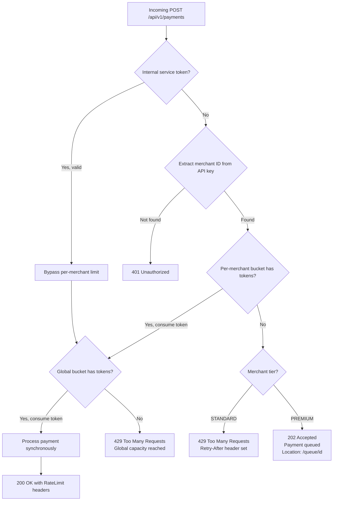

# تحديد المعدل كأداة موثوقية

## نظرة عامة

تنفّذ فرق الأمن تحديد المعدل لمنع حشو بيانات الاعتماد وإساءة استخدام الواجهات. أما مهندسو الموثوقية فينفذونه لسبب مختلف: حماية الخدمات اللاحقة من الإغراق بحركة مشروعة. فخدمة معالجة دفع ترسل 10,000 استعلام معاملات في الثانية إلى واجهة تقييم احتيال لا تهاجمها — لكن الأثر لا يمكن تمييزه. وتحديد المعدل كأداة موثوقية يعني تعريف الحمل المستدام، وفرضه عند الحدود، والتدهور برشاقة عند بلوغ الحدود.

يركز هذا الدرس حصرًا على تحديد المعدل كآلية موثوقية. فنغطي ثلاث خوارزميات، والفرض الموزع بـ Redis، والحدود حسب الفئة لواجهة دفع، والاهتمام التشغيلي بمراقبة بلوغ الحدود قبل أن تصبح حوادث.

## تحديد المعدل للموثوقية — لا للأمن فقط

التبرير الكلاسيكي لتحديد المعدل أمني: منع عميل واحد من احتكار مورد مشترك. وتبرير الموثوقية مختلف ومهم بالقدر نفسه:

**حماية الخدمات اللاحقة:** تستدعي خدمة الدفع لديك واجهة احتيال لطرف ثالث. واتفاقية خدمة واجهة الاحتيال 500 طلب/ث. فإذا أرسلت خدمتك 2000 طلب/ث أثناء حملة تسويقية، تتدهور واجهة الاحتيال — ردود بطيئة، وقواطع دائرة تُفتح، وفشل متتالٍ. وتحديد معدل استدعاءاتك الصادرة يحمي الاعتمادية التي تعتمد عليها.

**تخفيف الحمل تحت قفزات الحركة:** عندما تتضاعف الحركة فجأة، يتيح لك تحديد المعدل تقرير أي الطلبات تقبل وأيها تؤجل، بدل ترك كل الطلبات تمر حتى تذوب قاعدة البيانات.

**العدالة بين المستأجرين:** في منصة دفع متعددة التجار، يجب ألا يُدهور تاجر يجري تخفيضات خاطفة أزمنة الرد لكل التجار الآخرين المشتركين في البنية نفسها.

```
Without rate limiting:
  Normal: 1,000 req/min -> Fraud API (capacity: 1,000/min)
  Flash sale: 8,000 req/min -> Fraud API
  Fraud API: 429s, timeouts, circuit breaker trips
  All merchants: degraded fraud checks (approve-all fallback)
  Risk: fraud losses during peak traffic

With rate limiting:
  Normal: 1,000 req/min -> passes through
  Flash sale: 8,000 req/min arrives
  Rate limiter: 1,000/min passes through, 7,000/min -> 429 or queue
  Fraud API: healthy (never exceeds capacity)
  Merchant A (flash sale): some payments deferred
  Other merchants: unaffected
```

## مقارنة الخوارزميات

### النافذة الثابتة (Fixed Window)

تعد الطلبات في نوافذ زمنية ثابتة (مثلًا كل دقيقة، تبدأ عند حد الدقيقة).

```
Window 1: 00:00 - 01:00  [limit: 100]
Window 2: 01:00 - 02:00  [limit: 100]

Problem — burst at window boundary:
  00:59: 100 requests arrive (window 1 fills up)
  01:00: 100 requests arrive (window 2 fills up)
  In 2 seconds: 200 requests processed -> 2x the intended rate

ASCII timeline:
  |    Window 1    |    Window 2    |
  |                |                |
  |             [100 req]  [100 req]|
  |                |                |
  00:00          01:00            02:00
                  ^-- 200 req in 2 sec
```

**حالة الاستخدام:** حدود بسيطة منخفضة الدقة. مقبولة عندما تكون الاندفاعات عند حدود النوافذ محتملة (مثلًا المهام الدفعية الداخلية).

### دلو الرموز (Token Bucket)

يحمل الدلو رموزًا. وتُضاف الرموز بمعدل ثابت (معدل إعادة التعبئة). ويستهلك كل طلب رمزًا واحدًا. فإذا فرغ الدلو، يُرفض الطلب (أو يُصف).

```
Bucket capacity: 10 tokens
Refill rate: 2 tokens/second

T=0:   bucket=[10 tokens]
T=0:   5 requests arrive -> bucket=[5 tokens]
T=0:   8 more requests arrive -> 5 accepted, 3 rejected (bucket empty)
T=1s:  refill 2 tokens -> bucket=[2 tokens]
T=1s:  2 requests arrive -> bucket=[0 tokens]

Properties:
  - Allows short bursts up to bucket capacity
  - Sustained rate is capped at refill rate
  - Simple to implement, works well for bursty workloads

ASCII:
  Tokens:
  ||||||||||| (10)   <-- full bucket, burst allowed
  ||||||          (5)   <-- after burst
  ||||            (2)   <-- after 1s refill
```

**حالة الاستخدام:** نقاط واجهة الدفع حيث قد يندفع التجار لفترة قصيرة (قفزات الدفع عند الخروج) لكن يجب ألا يستمروا بمعدلات مفرطة. ومحدد المعدل في Stripe قائم على دلو الرموز.

### النافذة المنزلقة (القائمة على السجل)

تسجل الطابع الزمني لكل طلب. وعند وصول طلب جديد، تعد الطلبات في آخر N ثانية. فإذا كان العدد >= الحد، ترفض.

```
Limit: 5 requests per 10 seconds (window = the last 10 seconds)
Only ACCEPTED requests are logged.

T=0s:  log [0]                 count=1 -> ACCEPT
T=2s:  log [0,2]               count=2 -> ACCEPT
T=4s:  log [0,2,4]             count=3 -> ACCEPT
T=6s:  log [0,2,4,6]           count=4 -> ACCEPT
T=8s:  log [0,2,4,6,8]         count=5 -> ACCEPT
T=9s:  window (-1,9]: 5 logged -> REJECT (limit reached; not logged)
T=11s: T=0 has left the window (1,11]: [2,4,6,8] = 4
                               -> ACCEPT, log [2,4,6,8,11]
T=12s: T=2 leaves: [4,6,8,11] = 4
                               -> ACCEPT, log [4,6,8,11,12]
T=13s: [4,6,8,11,12] = 5       -> REJECT

Properties:
  - No boundary burst problem (window slides continuously)
  - More memory: must store timestamps of all recent requests
  - Most accurate rate limiting algorithm
```

**حالة الاستخدام:** عندما يكون الفرض الدقيق للمعدل حرجًا والذاكرة متاحة. جيدة لحدود كل تاجر حيث تهم الدقة.

### النافذة المنزلقة (القائمة على العداد)

تقريب يستخدم دلوين (الدقيقة الحالية، والدقيقة السابقة) ويستكمل بينهما. ويستخدم ذاكرة O(1) لكل مفتاح.

```
limit = 100/min
previous_minute_count = 80
current_minute_count  = 20
time_elapsed_in_current_minute = 30s (50%)

Weighted estimate = (80 * 0.5) + 20 = 60

60 < 100 -> ACCEPT (increment current_minute_count)

Cloudflare, which popularised this method, measured only about 0.003% of
requests wrongly allowed or limited — acceptable for most rate limiting.
```

لا يملك Redis محدد معدل مدمجًا: فمع Redis تنفذ هذا (أو دلو رموز) بنفسك، عادة كسكربت Lua صغير لتكون القراءة والتحديث ذريين. وBucket4j، المستخدم أدناه، ينفّذ دلو الرموز.

### جدول مقارنة الخوارزميات

| الخوارزمية | التعامل مع الاندفاع | الذاكرة | الدقة | التعقيد | الأنسب لـ |
|---|---|---|---|---|---|
| النافذة الثابتة | ضعيف (اندفاع الحدود) | O(1) | منخفضة | منخفض جدًا | الدفعات الداخلية |
| دلو الرموز | ممتاز | O(1) لكل مفتاح | عالية | منخفض | الواجهات العامة، والمدفوعات |
| النافذة المنزلقة بالسجل | لا شيء (دقيق) | O(الطلبات) | دقيقة | متوسط | الحدود عالية الدقة |
| النافذة المنزلقة بالعداد | جيد | O(1) لكل مفتاح | عالية جدًا (تقريب) | منخفض | معظم حالات الإنتاج |

## ‏Bucket4j مع Redis — تحديد معدل موزع

لواجهة دفع تعمل بعدة نسخ، تحدد محددات المعدل في الذاكرة (مثل RateLimiter في Resilience4j) لكل نسخة. فتاجر يرسل 1000 طلب عبر 10 نسخ قد يحصل على 100 لكل نسخة — 10 أضعاف الحد المقصود. وتحديد المعدل الموزع بـ Redis يفرض الحدود عالميًا.

### اعتماديات Maven

```xml
<!-- Maven groupId is com.bucket4j, but the Java PACKAGE is io.github.bucket4j.
     Later releases split the Redis module per client (e.g. bucket4j_jdk17-lettuce):
     check the artifact name for the version you use. -->
<dependency>
    <groupId>com.bucket4j</groupId>
    <artifactId>bucket4j-redis</artifactId>
    <version>8.10.1</version>
</dependency>
<dependency>
    <groupId>io.lettuce</groupId>
    <artifactId>lettuce-core</artifactId>
</dependency>
<dependency>
    <groupId>org.springframework.boot</groupId>
    <artifactId>spring-boot-starter-data-redis</artifactId>
</dependency>
```

### إعداد محدد المعدل الموزع

```java
package com.fintech.ratelimit.config;

import io.github.bucket4j.distributed.ExpirationAfterWriteStrategy;
import io.github.bucket4j.redis.lettuce.cas.LettuceBasedProxyManager;
import io.lettuce.core.RedisClient;
import io.lettuce.core.api.StatefulRedisConnection;
import io.lettuce.core.codec.ByteArrayCodec;
import org.springframework.beans.factory.annotation.Value;
import org.springframework.context.annotation.Bean;
import org.springframework.context.annotation.Configuration;

import java.time.Duration;

@Configuration
public class RateLimitConfig {

    @Value("${redis.url:redis://localhost:6379}")
    private String redisUrl;

    @Bean
    public RedisClient redisClient() {
        return RedisClient.create(redisUrl);
    }

    @Bean
    public StatefulRedisConnection<byte[], byte[]> redisConnection(RedisClient client) {
        return client.connect(ByteArrayCodec.INSTANCE);
    }

    /**
     * Bucket4j proxy manager backed by Redis.
     * Uses CAS (Compare-And-Set) operations for atomic bucket updates.
     * Keys expire after 2 hours of inactivity to prevent memory leak.
     */
    @Bean
    public LettuceBasedProxyManager<byte[]> proxyManager(
            StatefulRedisConnection<byte[], byte[]> connection) {
        return LettuceBasedProxyManager.builderFor(connection)
            .withExpirationStrategy(
                ExpirationAfterWriteStrategy.basedOnTimeForRefillingBucketUpToMax(
                    Duration.ofHours(2)))
            .build();
    }
}
```

### تعريفات حدود المعدل

```java
package com.fintech.ratelimit.config;

import io.github.bucket4j.Bandwidth;
import io.github.bucket4j.BucketConfiguration;

import java.time.Duration;

/**
 * Rate limit tiers for the payment API.
 *
 * Hierarchy (enforced independently and cumulatively):
 *   Per-merchant limit: protects other merchants from noisy neighbours
 *   Global limit:       protects downstream dependencies (fraud API, core banking)
 *   Internal bypass:    trusted internal services skip per-merchant limits
 */
public class PaymentRateLimitConfig {

    /**
     * Standard merchant: 100 payments/minute with burst to 20 immediately.
     * Token bucket: capacity 20, refill 100/60s = ~1.67/second.
     */
    public static BucketConfiguration merchantLimit() {
        return BucketConfiguration.builder()
            .addLimit(Bandwidth.builder()
                .capacity(20)
                .refillGreedy(100, Duration.ofMinutes(1))
                .build())
            .build();
    }

    /**
     * Premium merchant (enterprise tier): 1000 payments/minute, burst 100.
     */
    public static BucketConfiguration premiumMerchantLimit() {
        return BucketConfiguration.builder()
            .addLimit(Bandwidth.builder()
                .capacity(100)
                .refillGreedy(1000, Duration.ofMinutes(1))
                .build())
            .build();
    }

    /**
     * Global limit: 10,000 payments/minute across ALL merchants combined.
     * This protects fraud API (SLA: 10,000 req/min) and core banking connector.
     * Two token buckets on one key: a per-minute budget with a 500 burst, and
     * a per-second smoothing limit.
     * Note: every payment hits this ONE Redis key, and Bucket4j's CAS updates
     * retry under contention. At high volume, measure it — or split the global
     * budget into N sub-buckets and pick one per request.
     */
    public static BucketConfiguration globalLimit() {
        return BucketConfiguration.builder()
            // Primary: 10,000 per minute
            .addLimit(Bandwidth.builder()
                .capacity(500)                           // burst capacity
                .refillGreedy(10_000, Duration.ofMinutes(1))
                .build())
            // Secondary: 200/second (smoothing — prevents 10,000 in first second)
            .addLimit(Bandwidth.builder()
                .capacity(200)
                .refillGreedy(200, Duration.ofSeconds(1))
                .build())
            .build();
    }

    /**
     * Per-IP limit for unauthenticated endpoints (login, token refresh).
     * More restrictive: 10 req/min to prevent credential stuffing.
     */
    public static BucketConfiguration unauthenticatedIpLimit() {
        return BucketConfiguration.builder()
            .addLimit(Bandwidth.builder()
                .capacity(5)
                .refillGreedy(10, Duration.ofMinutes(1))
                .build())
            .build();
    }
}
```

### خدمة تحديد المعدل

```java
package com.fintech.ratelimit.service;

import io.github.bucket4j.Bucket;
import io.github.bucket4j.BucketConfiguration;
import io.github.bucket4j.ConsumptionProbe;
import io.github.bucket4j.distributed.proxy.ProxyManager;
import com.fintech.ratelimit.config.PaymentRateLimitConfig;
import org.springframework.stereotype.Service;

import java.nio.charset.StandardCharsets;
import java.time.Duration;
import java.time.Instant;
import java.util.function.Supplier;

@Service
public class DistributedRateLimitService {

    private static final String GLOBAL_BUCKET_KEY = "global:payment:limit";

    private final ProxyManager<byte[]> proxyManager;
    private final MerchantTierRepository merchantTierRepository;

    public DistributedRateLimitService(ProxyManager<byte[]> proxyManager,
                                        MerchantTierRepository merchantTierRepository) {
        this.proxyManager = proxyManager;
        this.merchantTierRepository = merchantTierRepository;
    }

    /**
     * Checks rate limits for a payment request.
     * Both per-merchant and global limits must pass.
     *
     * @return RateLimitResult with headers and allowed flag
     */
    public RateLimitResult checkPaymentLimit(String merchantId) {
        // Check per-merchant limit first
        RateLimitResult merchantResult = checkMerchantLimit(merchantId);
        if (!merchantResult.allowed()) {
            return merchantResult;
        }

        // Check global limit (protects downstream services).
        // (If the global check rejects, the merchant token is already spent —
        //  acceptable here; refund it with addTokens(1) if that matters to you.)
        return checkGlobalLimit();
    }

    private RateLimitResult checkMerchantLimit(String merchantId) {
        MerchantTier tier = merchantTierRepository.getTier(merchantId);
        BucketConfiguration config = tier == MerchantTier.PREMIUM
            ? PaymentRateLimitConfig.premiumMerchantLimit()
            : PaymentRateLimitConfig.merchantLimit();

        byte[] bucketKey = ("merchant:" + merchantId + ":payment").getBytes(StandardCharsets.UTF_8);

        Supplier<BucketConfiguration> configSupplier = () -> config;
        Bucket bucket = proxyManager.builder().build(bucketKey, configSupplier);

        ConsumptionProbe probe = bucket.tryConsumeAndReturnRemaining(1);

        if (probe.isConsumed()) {
            return RateLimitResult.allowed(
                getLimitForTier(tier),
                (int) probe.getRemainingTokens(),
                Instant.now().plusSeconds(60).getEpochSecond()
            );
        }

        // Not consumed: retry-after in WHOLE seconds, rounded UP (integer
        // division would turn 0.4s into "Retry-After: 0")
        long retryAfterSeconds = ceilSeconds(probe.getNanosToWaitForRefill());
        return RateLimitResult.denied(
            getLimitForTier(tier),
            0,
            Instant.now().plusSeconds(60).getEpochSecond(),
            retryAfterSeconds
        );
    }

    // public: internal callers skip the merchant limit but NOT this one
    public RateLimitResult checkGlobalLimit() {
        byte[] bucketKey = GLOBAL_BUCKET_KEY.getBytes(StandardCharsets.UTF_8);
        Bucket bucket = proxyManager.builder().build(
            bucketKey, PaymentRateLimitConfig::globalLimit);

        ConsumptionProbe probe = bucket.tryConsumeAndReturnRemaining(1);

        if (probe.isConsumed()) {
            return RateLimitResult.allowed(10_000, (int) probe.getRemainingTokens(),
                Instant.now().plusSeconds(60).getEpochSecond());
        }

        long retryAfterSeconds = ceilSeconds(probe.getNanosToWaitForRefill());
        return RateLimitResult.denied(10_000, 0,
            Instant.now().plusSeconds(60).getEpochSecond(), retryAfterSeconds);
    }

    private static long ceilSeconds(long nanos) {
        return Math.max(1, (nanos + 999_999_999L) / 1_000_000_000L);
    }

    private int getLimitForTier(MerchantTier tier) {
        return tier == MerchantTier.PREMIUM ? 1_000 : 100;
    }

    public enum MerchantTier { STANDARD, PREMIUM }

    public record RateLimitResult(
        boolean allowed,
        int limit,
        int remaining,
        long resetEpochSeconds,
        long retryAfterSeconds   // only relevant when allowed=false
    ) {
        public static RateLimitResult allowed(int limit, int remaining, long reset) {
            return new RateLimitResult(true, limit, remaining, reset, 0);
        }
        public static RateLimitResult denied(int limit, int remaining,
                                              long reset, long retryAfter) {
            return new RateLimitResult(false, limit, remaining, reset, retryAfter);
        }
    }
}
```

## ترويسات رد تحديد المعدل

قدّم RFC 6585 حالة HTTP ‏429 (Too Many Requests). وترويسات `X-RateLimit-*` أدناه اصطلاح واسع الاستخدام (GitHub مثلًا)، لا معيار؛ ويعمل IETF على توحيد حقول ترويسة `RateLimit` / `RateLimit-Policy` كبديل. أما `Retry-After` نفسها فـ HTTP قياسي (RFC 9110):

```
X-RateLimit-Limit: 100
X-RateLimit-Remaining: 73
X-RateLimit-Reset: 1731196800      (Unix timestamp when limit resets)
Retry-After: 47                    (seconds until retry is allowed; only on 429)
```

العملاء الذين يحترمون `Retry-After` سيتراجعون تلقائيًا. والذين لا يحترمونها سيستمرون في تلقي 429 ويهدرون عرض النطاق. فوثّق `Retry-After` بوضوح في توثيق واجهتك.

## مرشّح Spring لتحديد معدل واجهة الدفع

```java
package com.fintech.ratelimit.filter;

import com.fintech.ratelimit.service.DistributedRateLimitService;
import com.fintech.ratelimit.service.DistributedRateLimitService.RateLimitResult;
import io.micrometer.core.instrument.Counter;
import io.micrometer.core.instrument.MeterRegistry;
import jakarta.servlet.FilterChain;
import jakarta.servlet.ServletException;
import jakarta.servlet.http.HttpServletRequest;
import jakarta.servlet.http.HttpServletResponse;
import org.slf4j.Logger;
import org.slf4j.LoggerFactory;
import org.springframework.http.HttpStatus;
import org.springframework.stereotype.Component;
import org.springframework.web.filter.OncePerRequestFilter;

import java.io.IOException;
import java.nio.charset.StandardCharsets;

@Component
public class PaymentRateLimitFilter extends OncePerRequestFilter {

    private static final Logger log = LoggerFactory.getLogger(PaymentRateLimitFilter.class);

    // Header name for internal service bypass
    private static final String INTERNAL_SERVICE_HEADER = "X-Internal-Service-Token";

    private final DistributedRateLimitService rateLimitService;
    private final InternalServiceTokenValidator tokenValidator;
    private final MeterRegistry meterRegistry;

    public PaymentRateLimitFilter(DistributedRateLimitService rateLimitService,
                                   InternalServiceTokenValidator tokenValidator,
                                   MeterRegistry meterRegistry) {
        this.rateLimitService = rateLimitService;
        this.tokenValidator = tokenValidator;
        this.meterRegistry = meterRegistry;
    }

    @Override
    protected void doFilterInternal(HttpServletRequest request,
                                     HttpServletResponse response,
                                     FilterChain filterChain)
            throws ServletException, IOException {

        // Only rate-limit the payment creation endpoint
        if (!request.getRequestURI().startsWith("/api/v1/payments")) {
            filterChain.doFilter(request, response);
            return;
        }

        // Internal services (fraud engine calling back, reconciliation jobs)
        // bypass per-merchant rate limits but NOT the global limit
        if (isInternalService(request)) {
            RateLimitResult global = rateLimitService.checkGlobalLimit();
            if (global.allowed()) {
                filterChain.doFilter(request, response);
            } else {
                setRateLimitHeaders(response, global);
                response.setStatus(HttpStatus.TOO_MANY_REQUESTS.value());
            }
            return;
        }

        String merchantId = extractMerchantId(request);
        if (merchantId == null) {
            response.setStatus(HttpStatus.UNAUTHORIZED.value());
            return;
        }

        RateLimitResult result = rateLimitService.checkPaymentLimit(merchantId);

        // Always set rate limit headers on payment endpoint responses
        setRateLimitHeaders(response, result);

        if (result.allowed()) {
            filterChain.doFilter(request, response);
        } else {
            handleRateLimitExceeded(request, response, merchantId, result);
        }
    }

    private boolean isInternalService(HttpServletRequest request) {
        String token = request.getHeader(INTERNAL_SERVICE_HEADER);
        return token != null && tokenValidator.isValid(token);
    }

    private String extractMerchantId(HttpServletRequest request) {
        // Extract from JWT subject claim or API key lookup
        String apiKey = request.getHeader("X-Api-Key");
        if (apiKey == null) return null;
        return apiKeyToMerchantId(apiKey);
    }

    private void setRateLimitHeaders(HttpServletResponse response, RateLimitResult result) {
        response.setHeader("X-RateLimit-Limit",     String.valueOf(result.limit()));
        response.setHeader("X-RateLimit-Remaining", String.valueOf(result.remaining()));
        response.setHeader("X-RateLimit-Reset",     String.valueOf(result.resetEpochSeconds()));
        if (!result.allowed()) {
            response.setHeader("Retry-After", String.valueOf(result.retryAfterSeconds()));
        }
    }

    private void handleRateLimitExceeded(HttpServletRequest request,
                                          HttpServletResponse response,
                                          String merchantId,
                                          RateLimitResult result) throws IOException {
        // Increment monitoring counter for alerting
        Counter.builder("payment.rate_limit.exceeded")
            .tag("merchant_id", merchantId)
            .register(meterRegistry)
            .increment();

        log.warn("[RATE LIMIT] Merchant {} exceeded limit — remaining: {}, retry after: {}s",
            merchantId, result.remaining(), result.retryAfterSeconds());

        response.setStatus(HttpStatus.TOO_MANY_REQUESTS.value());
        response.setContentType("application/json");
        response.setCharacterEncoding(StandardCharsets.UTF_8.name());

        String body = String.format(
            "{\"error\":\"RATE_LIMIT_EXCEEDED\"," +
            "\"message\":\"Payment rate limit exceeded. Retry after %d seconds.\"," +
            "\"retryAfterSeconds\":%d}",
            result.retryAfterSeconds(),
            result.retryAfterSeconds());

        response.getWriter().write(body);
    }

    private String apiKeyToMerchantId(String apiKey) {
        // In production: look the key up (hashed) in the API-key store and use
        // the merchant it belongs to. NEVER trust a merchant ID parsed from the
        // key itself — anyone could send "mk_<someone-else>_x" and spend (or
        // escape) another merchant's limit. The parsing below is a sketch only.
        // For brevity, extract prefix from key format "mk_{merchantId}_{hash}"
        if (apiKey.startsWith("mk_")) {
            String[] parts = apiKey.split("_");
            return parts.length >= 2 ? parts[1] : null;
        }
        return null;
    }
}
```

## ‏RateLimiter في Resilience4j — للاستدعاءات الصادرة

بينما يكون Bucket4j+Redis الأفضل لتحديد معدل الواجهات الواردة، صُمم `RateLimiter` في Resilience4j **للاستدعاءات الصادرة** — تحديد سرعة استدعائك لخدمة لاحقة. وهذه حالة استخدام الموثوقية: حماية واجهة الاحتيال من الإغراق من خدمتك.

```yaml
resilience4j:
  ratelimiter:                    # NOT "rate-limiter" — that key does not bind
    instances:
      fraud-api-outbound:
        # Limit outbound calls to fraud API to 500/second
        # (their SLA: 600/sec; we limit to 500 to leave headroom)
        limit-for-period: 500
        limit-refresh-period: 1s
        timeout-duration: 100ms   # Wait up to 100ms for a permit; then fail fast
        register-health-indicator: true

      core-banking-outbound:
        # Core banking connector: 200/second max
        limit-for-period: 200
        limit-refresh-period: 1s
        timeout-duration: 50ms
        register-health-indicator: true
```

```java
package com.fintech.ratelimit.client;

import io.github.resilience4j.ratelimiter.annotation.RateLimiter;
import org.springframework.stereotype.Component;
import org.springframework.web.client.RestTemplate;

import java.math.BigDecimal;

@Component
public class FraudApiClient {

    private final RestTemplate restTemplate;

    public FraudApiClient(RestTemplate restTemplate) {
        this.restTemplate = restTemplate;
    }

    /**
     * Rate limited outbound call to fraud API.
     * If we have already sent 500 requests this second,
     * this call waits up to 100ms for a permit.
     * If no permit available within 100ms: RequestNotPermitted exception.
     */
    @RateLimiter(name = "fraud-api-outbound", fallbackMethod = "fraudApiFallback")
    public FraudResult checkFraud(String paymentId, BigDecimal amount) {
        return restTemplate.postForObject(
            "http://fraud-api.internal/check",
            new FraudRequest(paymentId, amount),
            FraudResult.class
        );
    }

    /**
     * Fallback when rate limit exceeded.
     * For amounts above $500: decline (conservative approach).
     * For amounts below $500: allow through (acceptable risk during degradation).
     */
    public FraudResult fraudApiFallback(String paymentId, BigDecimal amount,
            io.github.resilience4j.ratelimiter.RequestNotPermitted e) {
        boolean approve = amount.compareTo(new BigDecimal("500")) < 0;
        return new FraudResult(paymentId, approve, "RATE_LIMITED_DEGRADED");
    }

    public record FraudRequest(String paymentId, BigDecimal amount) {}
    public record FraudResult(String paymentId, boolean approved, String source) {}
}
```

## التدهور الرشيق مقابل رفض 429 الصارم

عندما يُحدد معدل طلب، للنظام خياران:

**‏429 صارم:** ارفض فورًا برد 429 Too Many Requests. ويجب أن يعيد نظام التاجر المحاولة (بعد `Retry-After` ثانية). بسيط وقابل للتنبؤ، لكنه ينقل عبء إعادة المحاولة إلى العميل.

**التدهور الرشيق:** اقبل الطلب، وصفّه داخليًا، وعالجه حين تتوفر السعة. ويعيد 202 Accepted مع عنوان استطلاع. أعقد لكنه يوفر تجربة أفضل للتاجر.

```java
package com.fintech.ratelimit.service;

import org.springframework.http.HttpStatus;
import org.springframework.http.ResponseEntity;
import org.springframework.stereotype.Service;

import java.util.UUID;

@Service
public class PaymentSubmissionService {

    private final DistributedRateLimitService rateLimitService;
    private final PaymentQueueService paymentQueue;

    public PaymentSubmissionService(DistributedRateLimitService rateLimitService,
                                     PaymentQueueService paymentQueue) {
        this.rateLimitService = rateLimitService;
        this.paymentQueue = paymentQueue;
    }

    /**
     * Chooses between hard 429 and graceful queuing based on merchant tier.
     *
     * Standard merchants: hard 429 (simple, low infrastructure cost)
     * Premium merchants: graceful queue (they expect near-100% acceptance)
     */
    public ResponseEntity<?> submitPayment(String merchantId, PaymentRequest request) {
        DistributedRateLimitService.RateLimitResult result =
            rateLimitService.checkPaymentLimit(merchantId);

        if (result.allowed()) {
            // Process synchronously
            return ResponseEntity.ok(processPayment(request));
        }

        // Rate limited — decision based on merchant tier
        MerchantTier tier = getTier(merchantId);

        if (tier == MerchantTier.PREMIUM) {
            // Queue for async processing — 202 Accepted with polling URL.
            // The queue (durable!) only SMOOTHS load: its consumer must still
            // drain it at a rate the global limit and the downstreams allow.
            String queueId = paymentQueue.enqueue(merchantId, request);
            return ResponseEntity
                .status(HttpStatus.ACCEPTED)
                .header("Location", "/api/v1/payments/queue/" + queueId)
                .body(new QueuedPaymentResponse(queueId,
                    "Payment queued for processing",
                    result.retryAfterSeconds()));
        }

        // Standard merchant: hard 429
        return ResponseEntity
            .status(HttpStatus.TOO_MANY_REQUESTS)
            .header("Retry-After", String.valueOf(result.retryAfterSeconds()))
            .body(new ErrorResponse("RATE_LIMIT_EXCEEDED",
                "Retry after " + result.retryAfterSeconds() + " seconds"));
    }

    private Object processPayment(PaymentRequest request) { return new Object(); }
    private MerchantTier getTier(String merchantId) { return MerchantTier.STANDARD; }

    public enum MerchantTier { STANDARD, PREMIUM }
    public record PaymentRequest(String paymentId, String merchantId,
                                  java.math.BigDecimal amount) {}
    public record QueuedPaymentResponse(String queueId, String message, long waitSeconds) {}
    public record ErrorResponse(String code, String message) {}
}
```

## تجاوز حد المعدل للخدمات الداخلية والموثوقة

يجب ألا تُحجب الخدمات الداخلية (مهام المطابقة، ونداءات مراجعة الاحتيال، وتقارير الامتثال) بحدود معدل مخصصة للتجار الخارجيين. وترويسة رمز بين الخدمات توفر التجاوز.

```java
package com.fintech.ratelimit.security;

import org.springframework.beans.factory.annotation.Value;
import org.springframework.stereotype.Component;

import javax.crypto.Mac;
import javax.crypto.spec.SecretKeySpec;
import java.nio.charset.StandardCharsets;
import java.security.MessageDigest;
import java.time.Instant;
import java.util.Base64;
import java.util.Set;

/**
 * Validates HMAC-signed internal service tokens.
 * Token format: base64(serviceName + ":" + timestamp + ":" + hmac(secret, serviceName + ":" + timestamp))
 * Tokens are time-bounded: valid for 5 minutes, which LIMITS replay (a token
 * can still be replayed inside that window).
 *
 * This is NOT a substitute for mTLS between services.
 * Use mTLS as the primary auth mechanism; this token is an additional rate-limit bypass signal.
 */
@Component
public class InternalServiceTokenValidator {

    private static final long MAX_AGE_SECONDS = 300;  // 5 minutes

    private static final Set<String> ALLOWED_SERVICES = Set.of(
        "reconciliation-service",
        "fraud-review-service",
        "compliance-reporting",
        "payment-retry-consumer"
    );

    @Value("${internal.service.hmac.secret}")
    private String hmacSecret;

    public boolean isValid(String token) {
        try {
            byte[] decoded = Base64.getDecoder().decode(token);
            String[] parts = new String(decoded, StandardCharsets.UTF_8).split(":");
            if (parts.length != 3) return false;

            String serviceName = parts[0];
            long timestamp     = Long.parseLong(parts[1]);
            String receivedMac = parts[2];

            // Check token age
            long age = Instant.now().getEpochSecond() - timestamp;
            if (age > MAX_AGE_SECONDS || age < 0) return false;

            // Check service allowlist
            if (!ALLOWED_SERVICES.contains(serviceName)) return false;

            // Verify HMAC — with a delimiter in the signed data, and a
            // CONSTANT-TIME comparison (String.equals leaks timing information)
            String expectedMac = computeHmac(serviceName + ":" + timestamp);
            return MessageDigest.isEqual(
                expectedMac.getBytes(StandardCharsets.UTF_8),
                receivedMac.getBytes(StandardCharsets.UTF_8));

        } catch (Exception e) {
            return false;
        }
    }

    private String computeHmac(String data) throws Exception {
        Mac mac = Mac.getInstance("HmacSHA256");
        mac.init(new SecretKeySpec(hmacSecret.getBytes(StandardCharsets.UTF_8), "HmacSHA256"));
        return Base64.getEncoder()
            .encodeToString(mac.doFinal(data.getBytes(StandardCharsets.UTF_8)));
    }
}
```

## مراقبة بلوغ حدود المعدل

بلوغ حدود المعدل مؤشر مبكر على مشكلات السعة. فالزيادة المفاجئة في ردود 429 من تاجر واحد تعني أن نمط حركته تغير. والزيادة المفاجئة عبر كل التجار تعني أن افتراضك عن سعة الخدمات اللاحقة خاطئ.

```java
package com.fintech.ratelimit.monitoring;

import io.micrometer.core.instrument.Counter;
import io.micrometer.core.instrument.Gauge;
import io.micrometer.core.instrument.MeterRegistry;
import jakarta.annotation.PostConstruct;
import org.springframework.stereotype.Component;

import java.util.concurrent.ConcurrentHashMap;
import java.util.concurrent.atomic.AtomicLong;

@Component
public class RateLimitMetrics {

    private final MeterRegistry meterRegistry;
    private final ConcurrentHashMap<String, AtomicLong> merchantRejections =
        new ConcurrentHashMap<>();

    public RateLimitMetrics(MeterRegistry meterRegistry) {
        this.meterRegistry = meterRegistry;
    }

    @PostConstruct
    public void registerGlobalMetrics() {
        Gauge.builder("rate_limit.global.remaining_tokens",
                this, RateLimitMetrics::getGlobalRemainingTokens)
            .description("Remaining tokens in global payment rate limiter")
            .register(meterRegistry);
    }

    public void recordMerchantRejection(String merchantId) {
        // Per-merchant rejection counter
        Counter.builder("rate_limit.merchant.rejections")
            .tag("merchant_id", sanitizeMerchantId(merchantId))
            .description("Payment requests rejected by merchant rate limit")
            .register(meterRegistry)
            .increment();

        // Also track rolling count for alerting
        merchantRejections
            .computeIfAbsent(merchantId, id -> new AtomicLong(0))
            .incrementAndGet();
    }

    public void recordGlobalRejection() {
        Counter.builder("rate_limit.global.rejections")
            .description("Payment requests rejected by global rate limit")
            .register(meterRegistry)
            .increment();
    }

    private double getGlobalRemainingTokens() {
        // Inject and query the global bucket in production
        // (bucket.getAvailableTokens()). Until then this placeholder returns 0,
        // which would make the "near capacity" alert fire permanently.
        return 0.0;
    }

    private String sanitizeMerchantId(String merchantId) {
        // Avoid high-cardinality labels; truncate to prefix only
        return merchantId.length() > 8 ? merchantId.substring(0, 8) : merchantId;
    }
}
```

### قواعد تنبيه Prometheus

```yaml
groups:
  - name: rate_limit_alerts
    rules:
      - alert: MerchantHighRejectionRate
        expr: |
          rate(rate_limit_merchant_rejections_total[5m]) > 10
        for: 3m
        labels:
          severity: warning
          team: payments
        annotations:
          summary: "Merchant {{ $labels.merchant_id }} being heavily rate limited"
          description: >
            Merchant is hitting rate limits at >10 req/sec for 3 minutes.
            This may indicate a runaway integration or unexpected traffic spike.
            Review merchant's integration or consider a temporary limit increase.

      - alert: GlobalRateLimitNearCapacity
        # The global bucket holds at most 500 tokens (its burst capacity):
        # alert when less than 10% is left
        expr: |
          rate_limit_global_remaining_tokens < 50
        for: 1m
        labels:
          severity: critical
          team: payments
        annotations:
          summary: "Global payment rate limit near capacity"
          description: >
            Global remaining tokens below 50 (10% of the burst capacity). Downstream services (fraud API,
            core banking) may be approaching their capacity. Investigate traffic
            sources and consider emergency capacity increase.

      - alert: RateLimitSuddenSpike
        expr: |
          rate(rate_limit_global_rejections_total[1m]) > 50
        for: 1m
        labels:
          severity: warning
        annotations:
          summary: "Global rate limit rejecting requests at high rate"
          description: >
            More than 50 payments rejected per second by global rate limit.
            This may indicate a DDoS or a misconfigured merchant integration.
```

## مخطط تدفق تحديد المعدل



## مزالق الإنتاج

### المزلق 1: محدد معدل في الذاكرة في نشر متعدد النسخ

يخزن `RateLimiter` الافتراضي في Resilience4j الحالة في ذاكرة JVM. فمع 10 نسخ وحد 100 طلب/دقيقة لكل تاجر، تسمح كل نسخة بـ 100/دقيقة — فيكون الحد الفعلي 1000/دقيقة عالميًا. وهذا يجعل حد المعدل بلا معنى.

```java
// WRONG: in-memory RateLimiter with multiple instances
// application.yml:
//   resilience4j.ratelimiter.instances.payment-inbound.limit-for-period: 100
//   resilience4j.ratelimiter.instances.payment-inbound.limit-refresh-period: 1m
//
// With 10 pods: effective limit = 100 x 10 = 1000/min per merchant
// A merchant sending 500 req/min appears limited per-pod but is not globally limited.

@RateLimiter(name = "payment-inbound")  // WRONG for inbound multi-instance
public PaymentResult processPayment(PaymentRequest request) { ... }

// CORRECT: use Bucket4j + Redis for inbound rate limiting
// Bucket4j uses atomic Redis CAS operations — single global counter per key

@PostMapping("/payments")
public ResponseEntity<?> createPayment(@RequestBody PaymentRequest request,
                                        HttpServletRequest httpRequest) {
    // PaymentRateLimitFilter (shown above) handles rate limiting before this
    // The filter uses DistributedRateLimitService (Bucket4j + Redis)
    return ResponseEntity.ok(paymentService.process(request));
}

// Keep Resilience4j RateLimiter for OUTBOUND calls only:
// @RateLimiter(name = "fraud-api-outbound")  <-- correct use
// Here, each pod independently limits its own outbound calls.
// If fraud API allows 500/sec total and you have 10 pods,
// configure: limit-for-period: 50, limit-refresh-period: 1s
```

### المزلق 2: عدم ضبط Retry-After يسبب قطيعًا هائجًا

عندما يُحدد معدل 1,000 عميل في آن واحد ويتلقون 429 دون ترويسة `Retry-After`، يعيد كل منهم المحاولة بفاصله الخاص. ويعيد كثير منهم المحاولة بعد ثانية. فتتلقى الخدمة 1,000 طلب بعد ثانية — قطيع هائج يولّد جولة أخرى من ردود 429.

```java
// WRONG: 429 without Retry-After
response.setStatus(429);
response.getWriter().write("{\"error\":\"rate limit exceeded\"}");
// All 1000 clients retry after 1 second (default retry logic) -> thundering herd

// CORRECT: set Retry-After with jitter to spread retries
long baseRetry = probe.getNanosToWaitForRefill() / 1_000_000_000L;
long jitterMs  = (long)(Math.random() * 2000);  // 0-2 second jitter
long retryAfter = baseRetry + (jitterMs / 1000) + 1;  // at least 1 second

response.setStatus(429);
response.setHeader("Retry-After", String.valueOf(retryAfter));
response.getWriter().write(String.format(
    "{\"error\":\"RATE_LIMIT_EXCEEDED\",\"retryAfterSeconds\":%d}", retryAfter));

// Also: document the Retry-After header in your API docs and SDK
// SDKs should read Retry-After and implement exponential backoff
// Never retry on 429 without reading Retry-After first
```

### المزلق 3: تطبيق حد المعدل نفسه على كل النقاط يحجب العمليات الحرجة

حد معدل شامل يغطي كل عمليات الدفع سيحجب الاستردادات والاسترجاعات والردود على النزاعات عندما يستنفد التاجر حده. وهذه العمليات حساسة للوقت (مواعيد الاسترجاع حقيقية).

```java
// WRONG: single rate limit applies to all payment operations including chargebacks
@RateLimiter(name = "payment-inbound")
public PaymentResult createPayment(...) { ... }

@RateLimiter(name = "payment-inbound")  // WRONG: blocks critical operations
public RefundResult processRefund(...) { ... }

@RateLimiter(name = "payment-inbound")  // WRONG: chargeback deadlines are real
public DisputeResult respondToDispute(...) { ... }

// CORRECT: separate rate limit buckets per operation criticality

// application.yml:
//   bucket4j:
//     filters:
//       - cache-name: payment-creation-limiter
//         url: /api/v1/payments
//         rate-limits: [ {bandwidths: [{capacity:100, time:1, unit:MINUTES}]} ]
//
//       - cache-name: refund-limiter
//         url: /api/v1/refunds
//         rate-limits: [ {bandwidths: [{capacity:500, time:1, unit:MINUTES}]} ]
//         # Refunds get 5x the limit: regulatory deadlines matter
//
//       - cache-name: dispute-limiter
//         url: /api/v1/disputes
//         rate-limits: [ {bandwidths: [{capacity:1000, time:1, unit:MINUTES}]} ]
//         # Disputes: very high limit — Visa/MC have response time SLAs

// Alternatively, in filter:
private BucketConfiguration getConfigForEndpoint(String path) {
    if (path.startsWith("/api/v1/disputes")) {
        return PaymentRateLimitConfig.disputeLimit();  // 1000/min
    }
    if (path.startsWith("/api/v1/refunds")) {
        return PaymentRateLimitConfig.refundLimit();   // 500/min
    }
    return PaymentRateLimitConfig.merchantLimit();     // 100/min (standard)
}
```

## قائمة الفحص

- [ ] محدد المعدل يستخدم تخزينًا موزعًا (Redis عبر Bucket4j) للنشر متعدد النسخ
- [ ] حدود كل تاجر محجّمة مستقلة (الفئة القياسية مقابل المميزة)
- [ ] الحد العالمي مضبوط تحت سعة اتفاقية الخدمة اللاحقة مع هامش 20%
- [ ] ترويسات حد المعدل مضبوطة على كل رد من النقاط المحددة (لا ردود 429 فقط)
- [ ] ترويسة Retry-After مضمّنة في كل ردود 429 مع تشويش لمنع القطيع الهائج
- [ ] الخدمات الداخلية والموثوقة تتجاوز حدود كل تاجر عبر رمز موقّع بـ HMAC
- [ ] التجاوز الداخلي لا يتخطى الحدود العالمية (الحد العالمي يحمي البنية التحتية)
- [ ] العمليات الحرجة (الاستردادات، والنزاعات) لها دلاء حد معدل منفصلة أعلى
- [ ] الاستدعاءات الصادرة إلى الخدمات اللاحقة تستخدم RateLimiter في Resilience4j، محجّمًا لكل نسخة
- [ ] تنبيهات Prometheus مضبوطة لمعدل رفض التاجر والسعة العالمية
- [ ] لوحة التاجر تُظهر استخدام حد المعدل الحالي (الشفافية تقلل تذاكر الدعم)
- [ ] إعداد حد المعدل لكل بيئة (التجهيز: مرن، والإنتاج: صارم)
- [ ] اختبار الحمل يتحقق من صمود حدود المعدل تحت 10 أضعاف الذروة المتوقعة
- [ ] جسم رد 429 يتضمن معلومات قابلة للتنفيذ (حقل retryAfterSeconds في JSON)
- [ ] توثيق الواجهة يشرح حدود المعدل، والفئات، وكيفية طلب زيادات

<!-- KNOWLEDGE-CHECK
{"questions":[{"text":"تشغّل واجهة دفع على 20 نسخة. وتستخدم كل نسخة RateLimiter في الذاكرة من Resilience4j مضبوطًا على 100 طلب/دقيقة لكل تاجر. ما الحد العالمي الفعلي لكل تاجر؟","options":["أ) 100 طلب/دقيقة (الحد المضبوط)","ب) 100 طلب/دقيقة مقسومة على 20 نسخة = 5 طلبات/دقيقة فعليًا","ج) 100 طلب/دقيقة لكل نسخة × 20 نسخة = 2000 طلب/دقيقة فعليًا","د) حد المعدل غير محدد لأنه يعتمد على توزيع موازن الحمل"],"correct":2,"explanation":"‏RateLimiter الافتراضي في Resilience4j في الذاكرة، لكل JVM. فمع 20 نسخة تسمح كل منها بـ 100 طلب/دقيقة، يكون الحد العالمي الفعلي 20×100=2000 طلب/دقيقة. وتاجر يرسل 1500 طلب/دقيقة لن يُحدد معدله أبدًا لأن كل نسخة لا ترى إلا نحو 75 طلبًا/دقيقة. والإصلاح استخدام Bucket4j مع Redis لعداد موزع مشترك بين كل النسخ."},{"text":"يُحدد معدل تاجر ويتلقى رد 429. ولا تتضمن الخدمة ترويسة Retry-After. ويعيد SDK التاجر المحاولة بعد ثانية ثابتة. و1000 تاجر آخر محدد معدلهم في الوقت نفسه. ما مشكلة الموثوقية التي تحدث؟","options":["أ) يستسلم التجار بعد 3 محاولات وتنخفض الحركة","ب) يعيد التجار الألف كلهم المحاولة في الوقت نفسه تقريبًا فينشأ قطيع هائج يولّد موجة أخرى من ردود 429","ج) يُعاد ضبط عداد حد المعدل في Redis بعد ثانية فتنجح كل المحاولات","د) يوزع موازن الحمل المحاولات بالتساوي فلا اندفاع"],"correct":1,"explanation":"دون Retry-After يعيد العملاء المحاولة بفاصلهم الافتراضي (غالبًا ثانية). فيعيد 1000 عميل محدد معدلهم المحاولة في آن واحد بعد ثانية، فتنشأ قفزة طلبات تساوي الاندفاع الأصلي. وهذا يولّد موجة أخرى من ردود 429، فتنشأ قطعان هائجة دورية. والإصلاح: تضمين Retry-After مع تشويش (انتظار أساسي + 0–2 ثانية عشوائية) لتوزيع المحاولات عبر الزمن."},{"text":"لواجهة الدفع لديك دلو حد معدل واحد مشترك بين إنشاء الدفعات ومعالجة الاستردادات والرد على الاسترجاعات. ويشغّل تاجر مهمة دفعية كبيرة تستنفد حده. ما الخطر التشغيلي؟","options":["أ) تُحجب المهمة الدفعية لكن كل العمليات الأخرى تستمر طبيعيًا","ب) تُحجب طلبات الاسترداد والردود على الاسترجاعات أيضًا؛ وللاسترجاعات مواعيد رد قد تُفوَّت","ج) يكتشف محدد المعدل نمط المهمة الدفعية وينشئ دلوًا منفصلًا تلقائيًا","د) يتفعّل قاطع الدائرة في Spring Boot ويوجّه حركة الاسترجاع إلى نقطة ثانوية"],"correct":1,"explanation":"دلو حد معدل مشترك واحد يعني أن إنشاء الدفعات والاستردادات والاسترجاعات كلها تسحب من المجمع نفسه. فحين تستنفد مهمة دفعية الحد، تُحجب أيضًا العمليات الحساسة للوقت مثل الرد على الاسترجاعات. وتفرض Visa وMastercard مواعيد للرد على الاسترجاعات؛ وتفويتها يعني خسارة النزاع تلقائيًا. والإصلاح: دلاء حد معدل منفصلة حسب أهمية العملية، مع حدود أعلى أو بلا حدود للاسترجاعات والاستردادات."}]}
-->

<!-- PRACTICAL-CHALLENGE
{"title":"بناء نظام تحديد معدل موزع لواجهة دفع متعددة التجار","difficulty":"advanced","estimatedMinutes":70,"tasks":[{"id":"1","description":"نفّذ خدمة تحديد معدل موزعة باستخدام Bucket4j وRedis (أو Jedis). واضبط ثلاث فئات: (أ) التجار القياسيون: 100 دفعة/دقيقة مع اندفاع 20، (ب) التجار المميزون: 1000 دفعة/دقيقة مع اندفاع 100، (ج) الحد العالمي: 10000 دفعة/دقيقة مع حد تنعيم ثانوي 200/ثانية لمنع الاندفاعات. واكتب MerchantTierRepository يعيد فئة معرّف التاجر. واختبر أن معرّفي تاجرين على نسخة Redis نفسها يُحدد معدلهما مستقلين."},{"id":"2","description":"نفّذ PaymentRateLimitFilter كـ OncePerRequestFilter في Spring. ويجب أن: (أ) يتخطى تحديد المعدل لمسارات /actuator/*، (ب) يتحقق من رموز الخدمات الداخلية باستخدام HMAC-SHA256 ويتجاوز حدود كل تاجر للرموز الصالحة (مع إبقاء الحد العالمي)، (ج) يستخرج معرّف التاجر من ترويسة X-Api-Key بالبحث في مخزن المفاتيح، (د) يضبط ترويسات X-RateLimit-Limit وX-RateLimit-Remaining وX-RateLimit-Reset على كل رد من /api/v1/payments، (هـ) يعيد 429 مع Retry-After وجسم خطأ JSON عند تحديد المعدل. واكتب اختبار تكامل يتحقق من ظهور الترويسات في ردود 200 و429 كلتيهما."},{"id":"3","description":"أضف RateLimiter من Resilience4j للاستدعاءات الصادرة إلى واجهة احتيال. واضبط: 500 تصريح/ثانية، ومهلة 100 مللي ثانية. ويجب أن يكون حد واجهة الاحتيال لكل نسخة (لا عالميًا) لأن كل نسخة تخنق حركتها الصادرة مستقلة. ونفّذ دالة رجوع توافق على المدفوعات تحت 200 وحدة عملة عند تجاوز حد المعدل الصادر وترفض المدفوعات فوق 500 وحدة عملة. واكتب اختبارًا باستخدام WireMock: ‏(أ) يجعل واجهة الاحتيال ترد طبيعيًا، (ب) يطلق 600 طلب/ثانية ويتحقق من أن الطلبات فوق 500/ثانية تطلق دالة الرجوع، (ج) يتحقق من أن دالة الرجوع تطبق منطق العتبة الصحيح."},{"id":"4","description":"نفّذ المراقبة لنظام تحديد المعدل. وأنشئ مكوّن RateLimitMetrics ينشر: (أ) عدادًا لكل تاجر للرفض بوسم merchant_id (استخدم أول 8 أحرف فقط للتحكم في التعدد)، (ب) مقياس gauge للرموز العالمية المتبقية، (ج) عدادًا للرفض العالمي. واكتب قاعدة تنبيه Prometheus تنطلق عندما يتجاوز معدل رفض أي تاجر منفرد 5 في الثانية لمدة دقيقتين. وأثبت انطلاق التنبيه في اختبار بمحاكاة تاجر يتجاوز حده باستمرار وتحقق من زيادة العداد بشكل صحيح."}]}
-->
