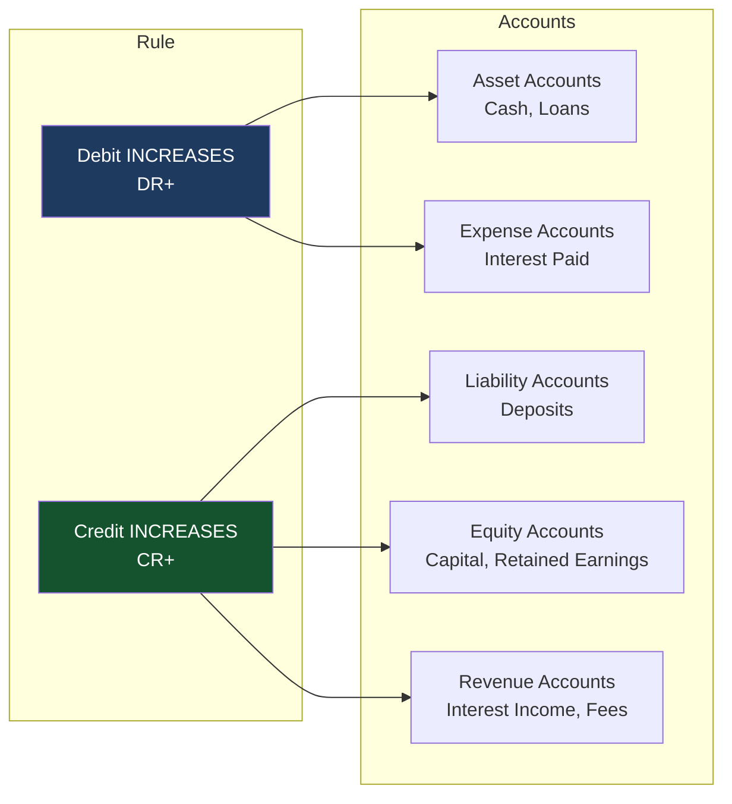
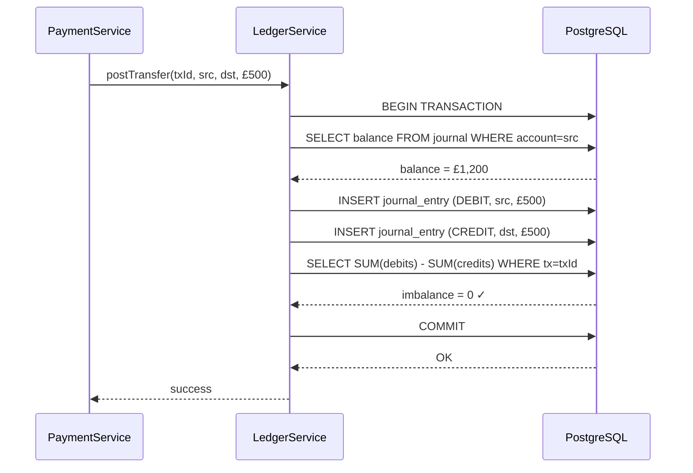

## Overview

Every financial system — from a startup's payment API to a central bank's real-time gross settlement system — is built on a 700-year-old idea: **double-entry bookkeeping**. Every transaction touches at least two accounts, with debits always equalling credits. The sum never lies.

This lesson establishes the theoretical and technical foundation of ledger design. It covers the accounting equation, T-accounts, journal entry semantics, database schema design, and the architectural constraints that keep a ledger correct under concurrent load. Everything in this track — race conditions, idempotency, outbox patterns, saga compensation — exists to protect the invariants introduced here.

## Learning Objectives

By the end of this lesson you will be able to:

- State the accounting equation and explain its significance as a system invariant
- Describe debit and credit semantics for each account type
- Read and write journal entries in both accounting notation and SQL
- Design a minimal double-entry ledger database schema
- Implement balance calculation as a SQL aggregate over the journal
- Explain why append-only design is preferred for financial ledgers
- Identify the invariants that must hold on every transaction post

## Business Context

A digital bank processes 400,000 payments per day. The core banking system (CBS) uses a relational ledger as its system of record. The engineering team is onboarding new engineers who have come from non-financial backgrounds and have never encountered double-entry accounting.

The team's Principal Engineer has observed three recurring categories of bug:

1. Engineers updating a `balance` column directly instead of posting journal entries — causing the ledger to diverge from the actual transaction history
2. Engineers posting a debit without a corresponding credit — breaking the fundamental invariant and causing the general ledger to be out of balance
3. Engineers not understanding which side of an entry is positive for which account type — posting backwards entries that inflate rather than reduce balances

This lesson eliminates all three categories of bug by building a correct mental model from the ground up.

## The Accounting Equation

The foundation of all financial accounting is a single equation:

> **Assets = Liabilities + Equity**

This equation always balances. It is not a guideline — it is an invariant. Any transaction that violates it is an error.

| Term | Definition | Examples |
|---|---|---|
| **Assets** | What the bank owns or is owed | Cash, loans to customers, investments |
| **Liabilities** | What the bank owes to others | Customer deposits, bonds issued, borrowings |
| **Equity** | Owners' residual claim | Share capital, retained earnings |

**Customer deposits are liabilities** — when a customer deposits £1,000, the bank owes them £1,000. The bank holds the cash (asset), but the deposit is the bank's obligation to repay.

This is the most important conceptual shift for engineers: from a customer's perspective, their account balance is an asset they own. From the bank's perspective, that same balance is a liability the bank owes.

## T-Accounts and Debit/Credit Rules

Every account in the ledger is a **T-account** — visualised as a T shape with debits on the left and credits on the right. The rule for which side **increases** the account depends on the account type:



| Account Type | Debit (DR) | Credit (CR) | Normal Balance |
|---|---|---|---|
| Asset | ↑ Increase | ↓ Decrease | Debit |
| Liability | ↓ Decrease | ↑ Increase | Credit |
| Equity | ↓ Decrease | ↑ Increase | Credit |
| Revenue | ↓ Decrease | ↑ Increase | Credit |
| Expense | ↑ Increase | ↓ Decrease | Debit |

> [!NOTE]
> The **normal balance** is the side you expect the account to have its balance on. An asset account with a credit balance is usually an error (or a negative asset like accumulated depreciation). A liability account with a debit balance is unusual and warrants investigation.

## Journal Entries — The Mechanism

A **journal entry** records a financial transaction. Every journal entry must satisfy:

1. **At least two lines** (one debit, one credit)
2. **Total debits = total credits** (the entry balances)
3. **Atomicity** — either all lines post or none do

### Example: Customer Deposits £1,000

```
DR  Cash (Asset)              £1,000
    CR  Customer Deposits (Liability)   £1,000
```

The bank's cash increases by £1,000 (asset debit). The bank now owes the customer £1,000 (liability credit). The equation remains balanced: Assets (+1,000) = Liabilities (+1,000).

### Example: Customer Withdraws £200

```
DR  Customer Deposits (Liability)   £200
    CR  Cash (Asset)                       £200
```

The bank's obligation reduces (liability debit reduces it). The bank pays out cash (asset credit reduces it).

### Example: Customer Sends £500 to Another Customer (Same Bank)

```
DR  Customer Deposits — Sender Account     £500
    CR  Customer Deposits — Receiver Account   £500
```

Both are liability accounts. The obligation to Sender decreases; the obligation to Receiver increases. The total liabilities remain unchanged.

### Example: Bank Charges £15 Fee

```
DR  Customer Deposits — Account     £15
    CR  Fee Income (Revenue)              £15
```

The customer's balance decreases (liability reduces via debit). The bank records revenue (credit).

## Ledger Database Schema

A minimal but correct double-entry ledger requires two tables:

```java17
/*
 * accounts — chart of accounts
 * Each row represents one account in the general ledger.
 * Balance is NEVER stored here — always computed from journal_entries.
 */
CREATE TABLE accounts (
    id            UUID        PRIMARY KEY DEFAULT gen_random_uuid(),
    code          VARCHAR(20) UNIQUE NOT NULL,  -- e.g. '1001', 'CASH-GBP'
    name          VARCHAR(100) NOT NULL,
    type          VARCHAR(20) NOT NULL           -- ASSET, LIABILITY, EQUITY, REVENUE, EXPENSE
                  CHECK (type IN ('ASSET','LIABILITY','EQUITY','REVENUE','EXPENSE')),
    currency      CHAR(3) NOT NULL,              -- ISO 4217 e.g. 'GBP'
    is_active     BOOLEAN NOT NULL DEFAULT TRUE,
    created_at    TIMESTAMPTZ NOT NULL DEFAULT NOW()
);

/*
 * journal_entries — append-only transaction log
 * Every financial event is a row here. Rows are NEVER updated or deleted.
 * Balance for any account = SUM of amounts where account_id matches,
 *   with debits positive and credits negative (or vice versa, pick a convention).
 */
CREATE TABLE journal_entries (
    id              UUID        PRIMARY KEY DEFAULT gen_random_uuid(),
    transaction_id  UUID        NOT NULL,  -- groups lines of the same journal entry
    account_id      UUID        NOT NULL REFERENCES accounts(id),
    entry_type      VARCHAR(6)  NOT NULL CHECK (entry_type IN ('DEBIT','CREDIT')),
    amount          BIGINT      NOT NULL CHECK (amount > 0),  -- minor units (pence, cents)
    currency        CHAR(3)     NOT NULL,
    description     VARCHAR(255),
    reference       VARCHAR(100),          -- idempotency key / external ref
    posted_at       TIMESTAMPTZ NOT NULL DEFAULT NOW(),
    created_by      VARCHAR(50) NOT NULL   -- service or user that posted
);

CREATE INDEX idx_journal_account ON journal_entries(account_id, posted_at);
CREATE INDEX idx_journal_transaction ON journal_entries(transaction_id);
CREATE INDEX idx_journal_reference ON journal_entries(reference);
```

> [!WARNING]
> Never add a `balance` column to the `accounts` table that is updated transactionally. This creates a dual-write problem: you must keep the running balance in sync with the journal entries. Any discrepancy makes the ledger untrustworthy. Balance is a derived value — always compute it from the journal.

### Balance Calculation SQL

```java17
-- Balance of a single account
-- Convention: DEBIT entries are positive, CREDIT entries are negative for ASSET accounts
-- For LIABILITY/EQUITY accounts, the normal balance is credit — so invert the sign
SELECT
    a.id,
    a.name,
    a.type,
    SUM(
        CASE
            WHEN je.entry_type = 'DEBIT'  THEN  je.amount
            WHEN je.entry_type = 'CREDIT' THEN -je.amount
        END
    ) AS balance_minor_units
FROM accounts a
LEFT JOIN journal_entries je ON je.account_id = a.id
WHERE a.id = :accountId
GROUP BY a.id, a.name, a.type;

-- Balance as of a specific point in time (for historical reporting)
SELECT SUM(
    CASE
        WHEN entry_type = 'DEBIT'  THEN  amount
        WHEN entry_type = 'CREDIT' THEN -amount
    END
) AS balance_minor_units
FROM journal_entries
WHERE account_id = :accountId
  AND posted_at <= :asOf;

-- Trial balance — verify debits = credits across ALL accounts
SELECT
    SUM(CASE WHEN entry_type = 'DEBIT'  THEN amount ELSE 0 END) AS total_debits,
    SUM(CASE WHEN entry_type = 'CREDIT' THEN amount ELSE 0 END) AS total_credits,
    SUM(CASE WHEN entry_type = 'DEBIT'  THEN amount ELSE 0 END) -
    SUM(CASE WHEN entry_type = 'CREDIT' THEN amount ELSE 0 END) AS imbalance
FROM journal_entries;
-- imbalance MUST always be 0 — if not, a journal entry was posted incorrectly
```

## Java Implementation — LedgerService

```java17
// Java 17 — LedgerService posting a double-entry transfer
@Service
@Transactional
public class LedgerService {

    private final JournalEntryRepository journalRepo;
    private final AccountRepository      accountRepo;

    // Post a transfer: debit source, credit destination
    // All within ONE database transaction — atomicity guaranteed
    public void postTransfer(UUID transactionId,
                              UUID sourceAccountId,
                              UUID destinationAccountId,
                              long amountMinorUnits,
                              String currency,
                              String description,
                              String reference) {

        validateAccounts(sourceAccountId, destinationAccountId, currency);
        validateBalance(sourceAccountId, amountMinorUnits, currency);

        // Debit source account (reduces its balance)
        JournalEntry debitEntry = JournalEntry.builder()
            .transactionId(transactionId)
            .accountId(sourceAccountId)
            .entryType(EntryType.DEBIT)
            .amount(amountMinorUnits)
            .currency(currency)
            .description(description)
            .reference(reference)
            .postedAt(Instant.now())
            .createdBy("payment-service")
            .build();

        // Credit destination account (increases its balance)
        JournalEntry creditEntry = JournalEntry.builder()
            .transactionId(transactionId)
            .accountId(destinationAccountId)
            .entryType(EntryType.CREDIT)
            .amount(amountMinorUnits)
            .currency(currency)
            .description(description)
            .reference(reference)
            .postedAt(Instant.now())
            .createdBy("payment-service")
            .build();

        // Both saved in the same transaction — atomically
        journalRepo.save(debitEntry);
        journalRepo.save(creditEntry);

        // Invariant check: journal must balance after every post
        // Run in dev/staging; consider async in production
        assertJournalBalances(transactionId);
    }

    public long getBalance(UUID accountId, String currency) {
        return journalRepo.calculateBalance(accountId, currency);
    }

    private void assertJournalBalances(UUID transactionId) {
        long imbalance = journalRepo.calculateImbalance(transactionId);
        if (imbalance != 0) {
            throw new LedgerImbalanceException(
                "Journal entry imbalance detected for transaction " + transactionId +
                ": " + imbalance + " minor units");
        }
    }

    private void validateBalance(UUID accountId, long amount, String currency) {
        long balance = getBalance(accountId, currency);
        if (balance < amount) {
            throw new InsufficientFundsException(accountId, balance, amount);
        }
    }
}
```

```java21
// Java 21 — LedgerService with records and sealed hierarchy
@Service
@Transactional
public class LedgerService {

    // Sealed posting command hierarchy
    public sealed interface PostingCommand
        permits PostingCommand.Transfer,
                PostingCommand.Fee,
                PostingCommand.Reversal {}

    public record Transfer(
        UUID transactionId,
        UUID sourceAccountId,
        UUID destinationAccountId,
        long amountMinorUnits,
        String currency,
        String description,
        String reference
    ) implements PostingCommand {}

    public record Fee(
        UUID transactionId,
        UUID customerAccountId,
        UUID revenueAccountId,
        long feeMinorUnits,
        String currency,
        String reference
    ) implements PostingCommand {}

    private final JournalEntryRepository journalRepo;

    public void post(PostingCommand command) {
        switch (command) {
            case Transfer t  -> executeTransfer(t);
            case Fee f       -> executeFee(f);
            case Reversal r  -> executeReversal(r);
        }
    }

    private void executeTransfer(Transfer t) {
        validateBalance(t.sourceAccountId(), t.amountMinorUnits(), t.currency());

        var entries = List.of(
            buildEntry(t.transactionId(), t.sourceAccountId(),
                       EntryType.DEBIT,  t.amountMinorUnits(), t.currency(), t.reference()),
            buildEntry(t.transactionId(), t.destinationAccountId(),
                       EntryType.CREDIT, t.amountMinorUnits(), t.currency(), t.reference())
        );

        journalRepo.saveAll(entries);
        assertBalances(t.transactionId());
    }

    private JournalEntry buildEntry(UUID txId, UUID accountId, EntryType type,
                                     long amount, String currency, String ref) {
        return new JournalEntry(
            UUID.randomUUID(), txId, accountId, type,
            amount, currency, ref, Instant.now(), "payment-service"
        );
    }
}
```

## Transfer Sequence



## Append-Only Design and Why It Matters

A correctly designed financial ledger **never deletes or updates journal entries**. Every financial event is a new row. This design provides:

| Property | Benefit |
|---|---|
| **Full audit trail** | Every balance change is traceable to a specific journal entry |
| **Point-in-time queries** | Balance on any date can be computed by filtering `posted_at` |
| **Tamper evidence** | No `UPDATE`/`DELETE` means alterations are detectable |
| **Compensation via reversal** | Mistakes are corrected by posting a reversing entry, not editing the original |
| **Regulatory compliance** | Auditors can trace every transaction; no "black holes" in history |

> [!IMPORTANT]
> To reverse an erroneous transaction, **post a compensating entry** — a new journal entry with debits and credits swapped. Never update or delete the original entry. The error and its correction both appear in the audit trail, which is exactly what regulators expect to see.

```java17
// Reversal — not update/delete
public void reversePosting(UUID originalTransactionId, String reason) {
    List<JournalEntry> originals = journalRepo.findByTransactionId(originalTransactionId);

    UUID reversalTxId = UUID.randomUUID();

    List<JournalEntry> reversals = originals.stream()
        .map(original -> JournalEntry.builder()
            .transactionId(reversalTxId)
            .accountId(original.getAccountId())
            // Swap debit/credit
            .entryType(original.getEntryType() == EntryType.DEBIT
                       ? EntryType.CREDIT : EntryType.DEBIT)
            .amount(original.getAmount())
            .currency(original.getCurrency())
            .description("REVERSAL: " + reason)
            .reference("REV-" + originalTransactionId)
            .postedAt(Instant.now())
            .createdBy("reconciliation-service")
            .build())
        .toList();

    journalRepo.saveAll(reversals);
}
```

## Ledger Invariants — The Checklist

A production-grade ledger must enforce these invariants on every transaction:

| Invariant | Enforcement Method |
|---|---|
| Total debits = total credits per transaction | Assertion after every `postTransfer` |
| Amount > 0 (no zero or negative entries) | DB `CHECK (amount > 0)` |
| Account exists and is active | Validation before posting |
| Currency matches account currency | Validation before posting |
| Source account has sufficient balance | Balance check before posting |
| All entries share the same `transaction_id` | Application-level grouping |
| No entry is updated or deleted | No `UPDATE`/`DELETE` grants on table |

---

<!-- KNOWLEDGE-CHECK [
  {
    "id": "kc-del-01",
    "question": "A customer has a current account with a balance of £500. In the bank's ledger, this is recorded as:",
    "options": [
      "A debit of £500 on a liability account",
      "A credit of £500 on an asset account",
      "A credit of £500 on a liability account",
      "A debit of £500 on an equity account"
    ],
    "correct": 2,
    "explanation": "Customer deposits are liabilities — the bank owes the customer £500. Liability accounts have a normal credit balance. The credit of £500 represents the bank's obligation. When the customer withdraws, the bank posts a debit to this liability account, reducing the obligation."
  },
  {
    "id": "kc-del-02",
    "question": "A payment service posts a DEBIT of £300 to Account A but the corresponding CREDIT to Account B fails (exception before the second INSERT). What prevents the ledger from becoming unbalanced?",
    "options": [
      "The balance invariant check at the end of postTransfer",
      "The database transaction — both entries are either committed together or rolled back together",
      "The account validation step at the start of postTransfer",
      "The idempotency reference column"
    ],
    "correct": 1,
    "explanation": "Database ACID transactions are the primary defense. If the CREDIT INSERT fails, the entire transaction is rolled back, including the DEBIT INSERT. The invariant check at the end is a safety net — it verifies correctness when both entries commit, but it cannot prevent partial commitment. Only the transaction boundary guarantees atomicity."
  },
  {
    "id": "kc-del-03",
    "question": "Why should the balance of an account NEVER be stored as a column that is updated with each transaction?",
    "options": [
      "Databases cannot perform UPDATE and INSERT in the same transaction",
      "It creates a dual-write problem: the stored balance may diverge from the journal history, destroying audit integrity",
      "BIGINT columns are too small to hold financial balances",
      "Running totals are only accurate with SERIALIZABLE isolation"
    ],
    "correct": 1,
    "explanation": "If you store a running balance AND append journal entries, you have two sources of truth. Any bug, crash between writes, or concurrent update can cause them to diverge. The balance column would say £800 while the journal entries sum to £750. Which is correct? You cannot know. Balance must be a derived value computed on demand from the immutable journal."
  },
  {
    "id": "kc-del-04",
    "question": "An engineer discovers that a journal entry was posted with the wrong amount (£150 instead of £250). The correct action is:",
    "options": [
      "UPDATE journal_entries SET amount = 250 WHERE id = :wrongEntryId",
      "DELETE the wrong entry and INSERT a correct one",
      "Post a reversal entry for £150, then post a new entry for the correct £250",
      "Post a correcting entry for the difference of £100"
    ],
    "correct": 2,
    "explanation": "Financial ledgers are append-only. The wrong entry is part of the audit trail — it proves the error occurred. The correct remediation is: post a full reversal (swap DR/CR on the original entry for £150), then post the correct entry for £250. Both the error and its correction are visible in the trail. Regulators and auditors expect this. Never UPDATE or DELETE journal entries."
  }
] -->

---

<!-- PRACTICAL-CHALLENGE {
  "id": "pc-double-entry-ledger",
  "title": "Ledger Implementation: Post a Payment with Fees",
  "description": "Implement double-entry journal entries for a complete payment flow including principal transfer and fee collection.",
  "tasks": [
    {
      "id": "pc-del-01",
      "description": "Write the journal entries (account type, DR/CR, amount) for: Customer A sends £750 to Customer B. The bank charges Customer A a £5 fee. Show all three accounts involved."
    },
    {
      "id": "pc-del-02",
      "description": "Write the SQL to compute the current GBP balance of account ID 'acc-123' using the journal_entries table, with DEBIT as positive and CREDIT as negative."
    },
    {
      "id": "pc-del-03",
      "description": "Implement a Java method `assertLedgerBalances(UUID transactionId)` that queries the total debits and credits for a transaction and throws `LedgerImbalanceException` if they differ."
    },
    {
      "id": "pc-del-04",
      "description": "Add a database constraint to the journal_entries table that prevents any UPDATE or DELETE (hint: use a PostgreSQL trigger or row-level security policy)."
    },
    {
      "id": "pc-del-05",
      "description": "Write the reversal journal entries for the transaction in task 1 (£750 transfer + £5 fee), as if the payment was sent to the wrong account and must be fully reversed."
    }
  ]
} -->
