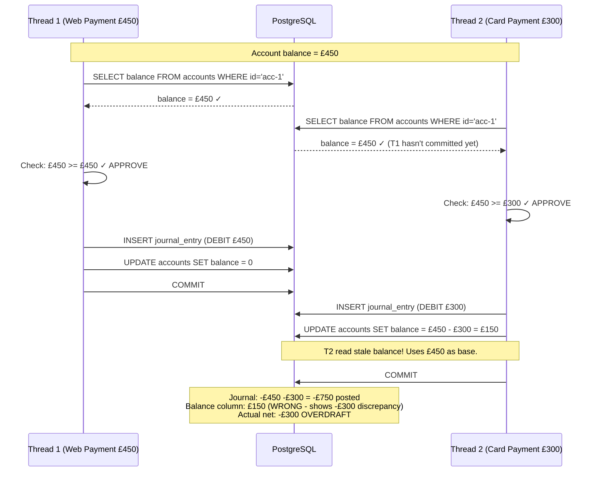
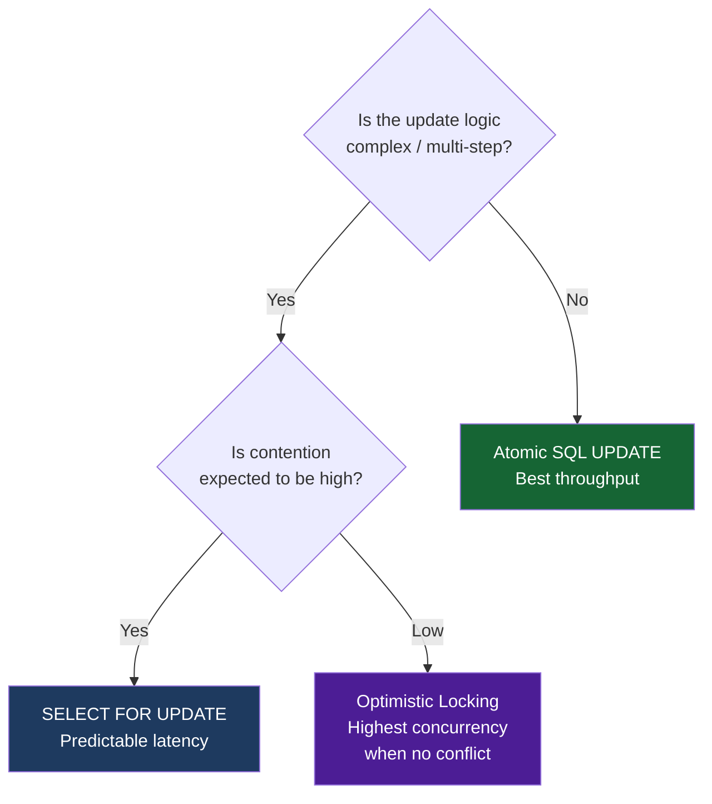

## Overview

The **lost update problem** is the most financially damaging class of concurrency bug. Two concurrent transactions both read the same account balance, both decide the balance is sufficient, and both proceed with a withdrawal. The result: the account is overdrawn by the full amount of one withdrawal. Neither transaction detected an error. No exception was thrown. The system behaved as coded — incorrectly.

This scenario traces the problem from first principles, shows the broken implementation, explains why it breaks, and walks through three correct solutions with different trade-off profiles. By the end, you will have the technical vocabulary, implementation knowledge, and decision criteria to prevent overdrafts in any concurrent financial system.

## Learning Objectives

By the end of this lesson you will be able to:

- Identify and explain the lost update pattern in a database read-modify-write cycle
- Explain why MVCC (Multi-Version Concurrency Control) does not prevent lost updates at READ COMMITTED
- Implement pessimistic locking using `SELECT FOR UPDATE` in SQL and JPA
- Implement optimistic locking using a version column and `@Version` in JPA
- Implement atomic conditional SQL UPDATE as a lock-free alternative
- Choose the correct strategy based on contention, latency, and consistency requirements
- Write a jcstress test to detect a concurrent withdrawal race condition

## Business Context

A challenger bank's current account service receives a critical incident report: a customer's account shows a balance of −£150. The account never had an overdraft facility. Post-mortem investigation reveals:

- The account had a balance of £450
- At 14:23:07.142, a web payment for £450 was initiated (browser)
- At 14:23:07.149, a card payment for £300 was initiated (POS terminal)
- Both transactions passed the balance check
- Both transactions posted their debit
- Final balance: £450 − £450 − £300 = −£300. But the balance column stored −£150

The 7-millisecond gap between requests was enough for the race to occur. The root cause: a **read-modify-write** cycle implemented without any concurrency control.

## The Broken Implementation

This is the code that caused the overdraft. Read it carefully — it is representative of real production bugs.

```java17
// BROKEN — Race condition in balance check and debit
@Service
@Transactional(isolation = Isolation.READ_COMMITTED)
public class WithdrawalService {

    private final AccountRepository accountRepo;
    private final LedgerService     ledgerService;

    public WithdrawalResult withdraw(String accountId, long amountMinorUnits) {

        // Step 1: Read current balance
        // At READ_COMMITTED, this reads the last committed value
        Account account = accountRepo.findById(accountId)
            .orElseThrow(() -> new AccountNotFoundException(accountId));

        long balance = account.getBalance(); // e.g., £450 = 45000 minor units

        // Step 2: Check if balance is sufficient
        // RACE WINDOW OPENS HERE — another transaction can read the same balance
        if (balance < amountMinorUnits) {
            return WithdrawalResult.declined("INSUFFICIENT_FUNDS");
        }

        // Step 3: Post the debit
        // Both transactions reach here with the same stale balance
        ledgerService.postDebit(accountId, amountMinorUnits);

        // Step 4: Update the balance cache (additional write that may also race)
        account.setBalance(balance - amountMinorUnits);
        accountRepo.save(account);

        return WithdrawalResult.success();
    }
}
```

## Why This Breaks — The Race Condition



**Why MVCC doesn't save you:** PostgreSQL's default `READ COMMITTED` isolation uses MVCC to give each statement a consistent snapshot. But it gives each **statement** a snapshot — not each transaction. By the time Thread 2's UPDATE runs, Thread 1 has committed. Thread 2's UPDATE sees the latest committed state of the balance column, but it was calculated from a stale read. The balance column is set to £150, while the journal shows £750 debited from a £450 account.

> [!DANGER]
> This is a **lost update**. Thread 1's write (setting balance to £0) is overwritten by Thread 2's write (setting balance to £150). Thread 1's debit effectively disappears from the balance column, even though it exists in the journal. The two sources of truth are now inconsistent. This is why the balance should always be computed from the journal — but even then, the concurrent debit posts without the check still cause the overdraft.

## Solution 1: Pessimistic Locking — SELECT FOR UPDATE

The most reliable solution. The database acquires an exclusive row lock at read time. Any other transaction attempting to read or modify the same row must wait until the first transaction commits or rolls back.

```java17
// Java 17 — Pessimistic locking via JPA @Lock
@Repository
public interface AccountRepository extends JpaRepository<Account, String> {

    // PESSIMISTIC_WRITE acquires an exclusive lock (SELECT ... FOR UPDATE)
    // Other transactions block on this row until this transaction completes
    @Lock(LockModeType.PESSIMISTIC_WRITE)
    @Query("SELECT a FROM Account a WHERE a.id = :id")
    Optional<Account> findByIdWithLock(@Param("id") String id);
}

@Service
@Transactional(isolation = Isolation.READ_COMMITTED)
public class WithdrawalService {

    public WithdrawalResult withdraw(String accountId, long amountMinorUnits) {

        // Lock acquired here — Thread 2 blocks until Thread 1 commits
        Account account = accountRepo.findByIdWithLock(accountId)
            .orElseThrow(() -> new AccountNotFoundException(accountId));

        long balance = account.getBalance();

        if (balance < amountMinorUnits) {
            // Lock released on transaction end (even on DECLINE)
            return WithdrawalResult.declined("INSUFFICIENT_FUNDS");
        }

        // Safe to post — we hold the exclusive lock on this account row
        ledgerService.postDebit(accountId, amountMinorUnits);
        account.setBalance(balance - amountMinorUnits);
        accountRepo.save(account);

        return WithdrawalResult.success();
        // Lock released here on COMMIT
    }
}
```

**What the SQL looks like:**

```java17
-- JPA generates this under the hood
SELECT id, balance, version FROM accounts WHERE id = 'acc-1' FOR UPDATE;

-- Thread 2 issues the same query milliseconds later
-- and BLOCKS here until Thread 1's transaction commits
SELECT id, balance, version FROM accounts WHERE id = 'acc-1' FOR UPDATE;
-- After Thread 1 commits, Thread 2 unblocks and reads balance = 0
-- Thread 2 then correctly declines: balance 0 < amount £300
```

> [!NOTE]
> `SELECT FOR UPDATE` works correctly at `READ COMMITTED` and above. The lock is held until the transaction commits or rolls back — not just until the SELECT completes. This serialises all concurrent access to the same account row, eliminating the race.

**Deadlock risk:** If two services both need to lock accounts A and B, one must do it in a consistent order. If Service 1 locks A then B, and Service 2 locks B then A, they can deadlock. Always acquire account locks in a **consistent canonical order** (e.g., sorted by account ID).

```java17
// Deadlock-safe multi-account lock acquisition
// Always sort accounts before locking to enforce consistent ordering
public void transferWithLocking(String fromId, String toId, long amount) {
    // Sort IDs to ensure consistent lock order across all callers
    List<String> lockOrder = Stream.of(fromId, toId).sorted().toList();

    Account first  = accountRepo.findByIdWithLock(lockOrder.get(0)).orElseThrow(...);
    Account second = accountRepo.findByIdWithLock(lockOrder.get(1)).orElseThrow(...);

    Account from = first.getId().equals(fromId) ? first : second;
    Account to   = first.getId().equals(toId)   ? first : second;

    // ... rest of transfer logic
}
```

## Solution 2: Optimistic Locking — Version Column

Pessimistic locking serialises all access to an account. Under high contention (thousands of transactions per second on popular accounts), this creates a queue and increases latency. Optimistic locking takes a different approach: allow concurrent reads, but detect conflicts at write time and retry.

```java17
// Java 17 — Optimistic locking via JPA @Version
@Entity
@Table(name = "accounts")
public class Account {

    @Id
    private String id;

    private long balance;

    @Version
    private long version; // Auto-managed by JPA — incremented on every update

    // getters, setters...
}
```

```java17
// Optimistic withdrawal with retry on conflict
@Service
public class WithdrawalService {

    @Retryable(
        value = OptimisticLockingFailureException.class,
        maxAttempts = 3,
        backoff = @Backoff(delay = 50, multiplier = 1.5)
    )
    @Transactional
    public WithdrawalResult withdraw(String accountId, long amountMinorUnits) {

        // No lock acquired — just a regular read
        Account account = accountRepo.findById(accountId)
            .orElseThrow(() -> new AccountNotFoundException(accountId));

        if (account.getBalance() < amountMinorUnits) {
            return WithdrawalResult.declined("INSUFFICIENT_FUNDS");
        }

        // Deduct balance
        account.setBalance(account.getBalance() - amountMinorUnits);

        // JPA generates: UPDATE accounts SET balance=?, version=version+1
        //                WHERE id=? AND version=<version-we-read>
        // If another transaction committed in the meantime, version has changed
        // JPA detects 0 rows updated → throws OptimisticLockException → @Retryable retries
        accountRepo.save(account);

        ledgerService.postDebit(accountId, amountMinorUnits);
        return WithdrawalResult.success();
    }
}
```

**How the version check works:**

```java17
-- Thread 1 reads: version = 5
-- Thread 2 reads: version = 5

-- Thread 1 updates:
UPDATE accounts
SET balance = 0, version = 6
WHERE id = 'acc-1' AND version = 5;  -- matches → 1 row updated, success

-- Thread 2 tries to update (version 5 → 6, but version is now 6):
UPDATE accounts
SET balance = 150, version = 6
WHERE id = 'acc-1' AND version = 5;  -- 0 rows updated → JPA throws OptimisticLockException
-- @Retryable re-reads account (balance=0), re-checks: 0 < 300 → DECLINE
```

> [!WARNING]
> Optimistic locking works well when **conflicts are rare**. If the account is a hot account (e.g., a corporate settlement account receiving thousands of transactions per second), you will see constant `OptimisticLockException` and retry storms. Under high contention, pessimistic locking or atomic SQL performs better.

## Solution 3: Atomic SQL UPDATE (Lock-Free)

The most performant solution for simple balance checks: push the entire read-check-write into a single atomic SQL statement. The database engine serialises the check and update in one operation, with no application-level read required.

```java17
// Atomic conditional UPDATE — the most efficient approach for simple withdrawals
@Repository
public interface AccountRepository extends JpaRepository<Account, String> {

    // Returns 1 if the update succeeded, 0 if balance was insufficient
    @Modifying
    @Query("""
        UPDATE accounts
        SET balance = balance - :amount
        WHERE id = :accountId
          AND balance >= :amount
        """)
    int deductBalanceIfSufficient(@Param("accountId") String accountId,
                                   @Param("amount") long amount);
}

@Service
@Transactional
public class WithdrawalService {

    public WithdrawalResult withdraw(String accountId, long amountMinorUnits) {

        // Single atomic operation — no race window
        int rowsUpdated = accountRepo.deductBalanceIfSufficient(accountId, amountMinorUnits);

        if (rowsUpdated == 0) {
            // Either account not found OR balance insufficient
            // Check which case it is for a meaningful error message
            Account account = accountRepo.findById(accountId)
                .orElseThrow(() -> new AccountNotFoundException(accountId));
            return WithdrawalResult.declined("INSUFFICIENT_FUNDS");
        }

        // Balance has been deducted atomically — now post the journal entry
        ledgerService.postDebit(accountId, amountMinorUnits);
        return WithdrawalResult.success();
    }
}
```

**How it works:**

The SQL `UPDATE accounts SET balance = balance - :amount WHERE id = :id AND balance >= :amount` is atomic at the row level. The database acquires an implicit row lock, reads and decrements the balance, and releases the lock — all in one operation. No application code can interfere between the read and the write.

```java17
-- Thread 1: balance=45000, amount=45000
UPDATE accounts SET balance = 45000 - 45000 WHERE id='acc-1' AND 45000 >= 45000;
-- → 1 row updated, balance = 0

-- Thread 2: balance=0 (after T1 committed), amount=30000
UPDATE accounts SET balance = 0 - 30000 WHERE id='acc-1' AND 0 >= 30000;
-- → 0 rows updated (condition 0 >= 30000 is FALSE)
-- Thread 2 declines correctly ✓
```

## Strategy Comparison

| Strategy | How It Works | Best For | Weakness |
|---|---|---|---|
| **SELECT FOR UPDATE** | DB row lock at read time | High-value accounts, complex multi-step logic | Serialises all access; deadlock risk on multi-row |
| **Optimistic (@Version)** | Conflict detection at commit | Low-contention accounts, retry-friendly flows | Retry storms under high contention |
| **Atomic SQL UPDATE** | Single atomic statement | Simple balance checks, highest throughput | Cannot express complex multi-step business logic |



## Testing: Detecting the Race with jcstress

```java17
// jcstress concurrency stress test — detects the lost update race
// Run with: java -jar jcstress.jar -t WithdrawalRaceTest
@JCStressTest
@Outcome(id = "BOTH_SUCCEED", expect = Expect.FORBIDDEN,
         desc = "Both withdrawals succeeded — overdraft!")
@Outcome(id = "ONE_SUCCEEDS", expect = Expect.ACCEPTABLE,
         desc = "Exactly one withdrawal succeeded — correct")
@State
public class WithdrawalRaceTest {

    private Account account;

    @Actor
    public void thread1(StringResult r) {
        WithdrawalResult result = withdrawalService.withdraw(account.getId(), 450_00L);
        r.r1 = result.isSuccess() ? "T1_OK" : "T1_DECLINED";
    }

    @Actor
    public void thread2(StringResult r) {
        WithdrawalResult result = withdrawalService.withdraw(account.getId(), 300_00L);
        r.r2 = result.isSuccess() ? "T2_OK" : "T2_DECLINED";
    }

    @Arbiter
    public void arbiter(StringResult r) {
        long finalBalance = accountRepo.findById(account.getId()).get().getBalance();
        // If both succeeded, balance should be negative — a forbidden state
        if (finalBalance < 0) {
            r.r1 = "BOTH_SUCCEED"; // Will trigger FORBIDDEN → test failure
        }
    }
}
```

## Monitoring in Production

```java17
// Micrometer metrics for withdrawal contention monitoring
@Service
public class InstrumentedWithdrawalService {

    private final Counter withdrawalSuccessCounter;
    private final Counter withdrawalDeclineCounter;
    private final Counter optimisticRetryCounter;
    private final Timer   withdrawalLatencyTimer;

    public WithdrawalResult withdraw(String accountId, long amount) {
        return withdrawalLatencyTimer.record(() -> {
            try {
                WithdrawalResult result = doWithdraw(accountId, amount);
                if (result.isSuccess()) withdrawalSuccessCounter.increment();
                else                    withdrawalDeclineCounter.increment();
                return result;
            } catch (OptimisticLockingFailureException e) {
                optimisticRetryCounter.increment();
                throw e; // @Retryable will catch and retry
            }
        });
    }
}
```

**Key metrics to alert on:**

| Metric | Alert Threshold | Interpretation |
|---|---|---|
| `withdrawal.optimistic.retries` | > 5% of requests | Hot account contention — consider pessimistic locking |
| `withdrawal.latency.p99` | > 500ms | Lock wait time excessive — investigate blocking transactions |
| `withdrawal.declined.rate` | Sudden spike | May indicate a race causing false insufficient-funds |
| `account.balance.negative` | > 0 | Critical — overdraft created; investigate immediately |

---

<!-- KNOWLEDGE-CHECK [
  {
    "id": "kc-sca-01",
    "question": "Two concurrent transactions both read an account balance of £500 at READ COMMITTED isolation. Transaction 1 debits £500, Transaction 2 debits £400. After both commit, the balance is -£400. What class of problem is this?",
    "options": [
      "Dirty read — Transaction 2 read uncommitted data",
      "Phantom read — a row was inserted between the two reads",
      "Lost update — Transaction 1's write was overwritten by Transaction 2 using a stale base value",
      "Deadlock — the two transactions are waiting for each other"
    ],
    "correct": 2,
    "explanation": "This is a classic lost update. Both transactions read £500, both decide it's sufficient. Transaction 1 commits: balance = 100. Transaction 2 also read 500 as its base, so it commits: balance = 500 - 400 = 100 (overwriting T1's result). The net debit was £900 from a £500 account, but no error was detected. Transaction 1's update was 'lost'."
  },
  {
    "id": "kc-sca-02",
    "question": "SELECT FOR UPDATE is added to the balance read in a withdrawal service. Thread 1 acquires the lock. Thread 2 issues the same SELECT FOR UPDATE 5ms later. What happens to Thread 2?",
    "options": [
      "Thread 2 reads a snapshot of the balance at the time it issued the query",
      "Thread 2 immediately gets a LockTimeoutException",
      "Thread 2 blocks and waits until Thread 1 commits or rolls back",
      "Thread 2 reads the balance and proceeds; the lock is advisory only"
    ],
    "correct": 2,
    "explanation": "SELECT FOR UPDATE acquires an exclusive row lock. Any subsequent SELECT FOR UPDATE on the same row blocks until the first transaction completes. Thread 2 waits. When Thread 1 commits (balance now 0), Thread 2 unblocks, reads balance = 0, and correctly declines the withdrawal."
  },
  {
    "id": "kc-sca-03",
    "question": "Optimistic locking with @Version sets version=5 on first read. The UPDATE statement is `UPDATE accounts SET balance=?, version=6 WHERE id=? AND version=5`. Thread 2 also read version=5 but commits first. What happens when Thread 1 tries its UPDATE?",
    "options": [
      "Thread 1's UPDATE succeeds because it has a valid version number",
      "Thread 1's UPDATE fails with 0 rows updated because version is now 6, not 5",
      "Thread 1 retries automatically without any exception being thrown",
      "Thread 1 reads the new version and merges the changes"
    ],
    "correct": 1,
    "explanation": "Thread 2 committed first, changing version from 5 to 6. Thread 1's WHERE clause includes AND version=5. Version is now 6, so the condition is false. 0 rows are updated. JPA detects this (expected 1 row) and throws OptimisticLockException. The @Retryable annotation then re-reads the account (version=6, balance=0) and re-evaluates — correctly declining if balance < amount."
  },
  {
    "id": "kc-sca-04",
    "question": "An account with £450 receives two concurrent withdrawals of £450 and £300. The service uses: `UPDATE accounts SET balance = balance - ? WHERE id = ? AND balance >= ?`. What are the possible outcomes?",
    "options": [
      "Both withdrawals succeed — the atomic update does not prevent overdraft",
      "One withdrawal succeeds (£450), the other gets 0 rows updated and declines (£300)",
      "Both withdrawals fail because the database cannot process them simultaneously",
      "The first to commit wins; the second is rolled back automatically"
    ],
    "correct": 1,
    "explanation": "The atomic conditional UPDATE serialises at the row level. Exactly one of the two UPDATEs will execute first. Say the £450 withdrawal goes first: balance becomes 0. When the £300 withdrawal's UPDATE runs, it evaluates `0 >= 300` which is false → 0 rows updated → the service detects the decline. The result is always: one succeeds, one declines. No overdraft is possible."
  }
] -->

---

<!-- PRACTICAL-CHALLENGE {
  "id": "pc-scenario-a",
  "title": "Scenario A Implementation: Race-Free Withdrawal Service",
  "description": "Implement and verify a concurrent withdrawal service that cannot create overdrafts.",
  "tasks": [
    {
      "id": "pc-sca-01",
      "description": "Identify all three places in the broken WithdrawalService where the race window exists (between which lines of code can another thread interleave to cause an overdraft)."
    },
    {
      "id": "pc-sca-02",
      "description": "Implement the pessimistic locking solution: add @Lock(PESSIMISTIC_WRITE) to the repository query and explain what SQL is generated and when the lock is released."
    },
    {
      "id": "pc-sca-03",
      "description": "Implement the atomic SQL UPDATE solution. Write the JPQL @Query annotation and the calling service code that correctly interprets a 0-row-update result as INSUFFICIENT_FUNDS."
    },
    {
      "id": "pc-sca-04",
      "description": "Explain the deadlock scenario that can occur when two transfers each lock two accounts in different orders, and show the fix using sorted lock acquisition."
    },
    {
      "id": "pc-sca-05",
      "description": "Design a Micrometer alert that fires when more than 1% of withdrawal requests result in OptimisticLockingFailureException retries, indicating a hot-account contention problem."
    }
  ]
} -->
