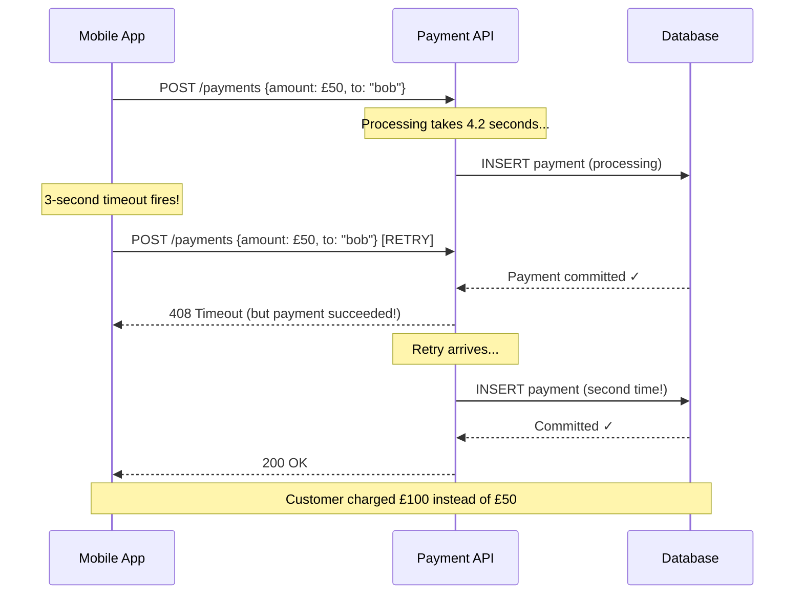
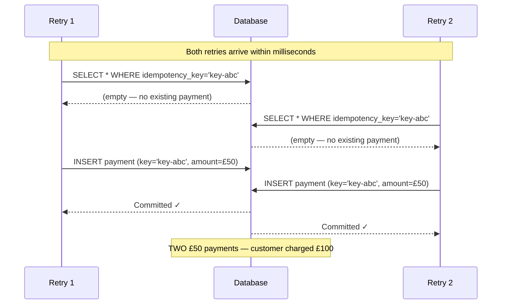

## Overview

**Idempotency** means that performing the same operation multiple times produces the same result as performing it once. In financial systems, this is not an optional enhancement — it is a correctness requirement. Networks are unreliable. Clients time out and retry. Message queues deliver at-least-once. Without idempotency, a timeout followed by a retry doubles the charge.

This scenario covers the full problem space: why duplicate payments occur, how idempotency keys work, the check-then-act race condition in naive implementations, and how database constraints provide the only reliable deduplication guarantee. By the end, your payment services will be safe to retry from any client, in any network condition.

## Learning Objectives

By the end of this lesson you will be able to:

- Explain why idempotency is a correctness requirement in distributed payment systems
- Design an idempotency key scheme for HTTP APIs and message consumers
- Implement idempotent payment posting using a database UNIQUE constraint
- Explain and prevent the check-then-act race condition in concurrent duplicate requests
- Handle the UNIQUE constraint violation correctly to return a consistent response
- Implement idempotent Kafka consumers using offset-based and key-based deduplication
- Choose between client-generated and server-generated idempotency keys

## Business Context

A payment API serves both a mobile app and a web frontend. Under load, the mobile app's HTTP client has an aggressive retry policy: if it receives no response within 3 seconds, it retries the request automatically, up to 3 times.

At peak load, the payment service occasionally takes 4–5 seconds to respond (database lock contention under the surge). The mobile client retries. By the time the retry arrives, the first request has often already committed. The result: the customer is charged twice. The duplicate transactions are discovered during the monthly statement — dozens of customers have been double-charged.

The fix requires idempotency at the API level. But the first naive implementation also has a bug: it uses a check-before-insert pattern that creates a new race condition under concurrent retries.

## Why Duplicates Happen — The Retry Problem



The fundamental issue: **the client does not know if the first request succeeded**. From the client's perspective, a timeout and a failure look identical. The only safe response is to retry. But retrying a non-idempotent endpoint creates a duplicate.

> [!NOTE]
> This problem exists at every layer of a distributed system. HTTP clients retry on timeout. Message queues deliver at-least-once. Saga orchestrators retry failed steps. Kubernetes Jobs may restart. Any component that retries requires idempotent handlers downstream.

## The Idempotency Key Pattern

The solution is a **client-generated idempotency key**: a stable, unique identifier that the client generates once per logical operation and includes in every retry of that operation. The server uses this key to detect and deduplicate retries.

### Key Design Principles

1. **Client-generated** — the client generates the key before the first attempt. All retries use the same key.
2. **Globally unique** — typically a UUID v4, generated per payment intent
3. **Scoped to the operation** — a key for "charge customer £50" cannot be reused for "charge customer £100"
4. **Idempotent window** — typically 24 hours; after that, keys may be expired and a re-use creates a new payment

```java17
// Client-side idempotency key generation
// Generated ONCE, before the first request, stored in the client's retry context
public class PaymentClient {

    public PaymentResponse initiatePayment(PaymentRequest request) {
        // Key generated here — same key used for all retries of this payment
        String idempotencyKey = UUID.randomUUID().toString();

        return retryTemplate.execute(context -> {
            HttpHeaders headers = new HttpHeaders();
            headers.set("Idempotency-Key", idempotencyKey);

            ResponseEntity<PaymentResponse> response = restTemplate.exchange(
                "/api/payments",
                HttpMethod.POST,
                new HttpEntity<>(request, headers),
                PaymentResponse.class
            );
            return response.getBody();
        });
    }
}
```

## Naive Implementation — The Check-Then-Act Bug

The first implementation a developer reaches for is a **check-then-insert** pattern:

```java17
// BROKEN — check-then-act race condition
@Service
@Transactional
public class PaymentService {

    public PaymentResponse processPayment(PaymentRequest request, String idempotencyKey) {

        // Step 1: Check if we've seen this key before
        Optional<Payment> existing = paymentRepo.findByIdempotencyKey(idempotencyKey);

        if (existing.isPresent()) {
            // Key seen before — return the previous result
            return toResponse(existing.get());
        }

        // RACE WINDOW: Two concurrent retries both reach here simultaneously
        // Both found no existing payment above
        // Both now proceed to insert

        // Step 2: Process and save
        Payment payment = processNewPayment(request);
        payment.setIdempotencyKey(idempotencyKey);
        paymentRepo.save(payment); // Both threads save here → TWO payments!

        return toResponse(payment);
    }
}
```



The check and the insert are not atomic. Between the check and the insert, another thread can pass the check. This is the **check-then-act anti-pattern** — it looks correct in a single-threaded world but fails under concurrency.

## Correct Implementation — UNIQUE Constraint Deduplication

The only reliable fix: delegate deduplication to the database via a **UNIQUE constraint** on the idempotency key column. The constraint is enforced atomically by the database — it is impossible for two rows with the same key to be inserted, regardless of how many threads try simultaneously.

```java17
-- Database schema: UNIQUE constraint on idempotency_key
CREATE TABLE payments (
    id               UUID        PRIMARY KEY DEFAULT gen_random_uuid(),
    idempotency_key  VARCHAR(64) UNIQUE NOT NULL,  -- ← UNIQUE constraint
    amount           BIGINT      NOT NULL,
    currency         CHAR(3)     NOT NULL,
    source_account   UUID        NOT NULL,
    dest_account     UUID        NOT NULL,
    status           VARCHAR(20) NOT NULL,
    result_payload   JSONB,       -- store the response for idempotent replay
    created_at       TIMESTAMPTZ NOT NULL DEFAULT NOW()
);

CREATE UNIQUE INDEX idx_payments_idempotency ON payments(idempotency_key);
```

```java17
// Java 17 — Correct idempotency using UNIQUE constraint
@Service
@Transactional
public class PaymentService {

    public PaymentResponse processPayment(PaymentRequest request,
                                           String idempotencyKey) {
        try {
            // Attempt to insert — the UNIQUE constraint is the deduplication mechanism
            Payment payment = new Payment();
            payment.setIdempotencyKey(idempotencyKey);
            payment.setAmount(request.getAmount());
            payment.setCurrency(request.getCurrency());
            payment.setStatus(PaymentStatus.PROCESSING);

            Payment saved = paymentRepo.save(payment); // throws on duplicate
            flushAndProcess(saved, request);            // ledger post, etc.

            return toResponse(saved);

        } catch (DataIntegrityViolationException e) {
            // Duplicate key — return the existing result
            if (isDuplicateKeyViolation(e)) {
                return paymentRepo.findByIdempotencyKey(idempotencyKey)
                    .map(this::toResponse)
                    .orElseThrow(() -> new IllegalStateException(
                        "Payment not found after duplicate key — race in cleanup?"));
            }
            throw e; // Different constraint violation — re-throw
        }
    }

    private boolean isDuplicateKeyViolation(DataIntegrityViolationException e) {
        // PostgreSQL error code 23505 = unique_violation
        Throwable cause = e.getCause();
        if (cause instanceof PSQLException psql) {
            return "23505".equals(psql.getSQLState());
        }
        return e.getMessage() != null &&
               e.getMessage().contains("idx_payments_idempotency");
    }
}
```

```java21
// Java 21 — Idempotent service with sealed result type
@Service
@Transactional
public class PaymentService {

    public sealed interface ProcessingResult
        permits ProcessingResult.NewPayment,
                ProcessingResult.DuplicatePayment {}

    public record NewPayment(Payment payment)       implements ProcessingResult {}
    public record DuplicatePayment(Payment original) implements ProcessingResult {}

    public PaymentResponse processPayment(PaymentRequest request, String idempotencyKey) {
        ProcessingResult result = attemptInsert(request, idempotencyKey);

        return switch (result) {
            case NewPayment(var p)      -> {
                postToLedger(p, request);
                yield toResponse(p);
            }
            case DuplicatePayment(var p) -> {
                // Return the original result — same response as the first attempt
                log.info("Idempotent replay for key={}", idempotencyKey);
                yield toResponse(p);
            }
        };
    }

    private ProcessingResult attemptInsert(PaymentRequest request, String key) {
        try {
            Payment payment = buildPayment(request, key);
            return new NewPayment(paymentRepo.save(payment));
        } catch (DataIntegrityViolationException e) {
            if (isDuplicateKeyViolation(e)) {
                Payment original = paymentRepo.findByIdempotencyKey(key).orElseThrow();
                return new DuplicatePayment(original);
            }
            throw e;
        }
    }
}
```

## Storing the Response for Replay

A subtle correctness requirement: the idempotent replay must return the **same response** as the original request. If the original request failed (e.g., DECLINED), the replay should also return DECLINED — not attempt a fresh payment.

```java17
// Store the serialised response payload for replay
@Entity
public class Payment {
    // ... other fields ...

    @Column(columnDefinition = "JSONB")
    private String resultPayload; // Serialised PaymentResponse — stored after first attempt

    @Enumerated(EnumType.STRING)
    private PaymentStatus status;  // PROCESSING, SETTLED, DECLINED, FAILED
}

// When returning an idempotent response:
public PaymentResponse getIdempotentResponse(String idempotencyKey) {
    Payment payment = paymentRepo.findByIdempotencyKey(idempotencyKey)
        .orElseThrow(() -> new PaymentNotFoundException(idempotencyKey));

    if (payment.getStatus() == PaymentStatus.PROCESSING) {
        // The original request is still in-flight
        // Return 202 Accepted — client should poll for the result
        return PaymentResponse.inProgress(payment.getId());
    }

    // Deserialise and return the stored result
    if (payment.getResultPayload() != null) {
        return objectMapper.readValue(payment.getResultPayload(), PaymentResponse.class);
    }

    return toResponse(payment); // Fall back to building from current state
}
```

> [!IMPORTANT]
> If the original request is still processing (status = PROCESSING), the idempotent response should indicate that — not block waiting for it. Return `HTTP 202 Accepted` with a polling URL. The client can poll until the final status is known.

## Idempotent Kafka Consumers

Kafka delivers messages at-least-once by default (even with `enable.auto.commit=false`). A consumer that processes a payment event must be idempotent: processing the same event twice must produce the same result.

```java17
// Idempotent Kafka consumer using idempotency key in the message
@KafkaListener(topics = "payment-commands", groupId = "payment-processor")
@Transactional
public void handlePaymentCommand(PaymentCommandEvent event) {

    // The event carries a stable idempotency key — set by the producer
    String idempotencyKey = event.getIdempotencyKey();

    try {
        paymentService.processPayment(
            event.toRequest(),
            idempotencyKey
        );
        // If duplicate: DataIntegrityViolation caught inside processPayment
        // Consumer commits offset normally — the duplicate was handled gracefully
        log.debug("Processed payment event key={}", idempotencyKey);

    } catch (Exception e) {
        // Don't commit offset — message will be redelivered
        log.error("Failed to process payment event key={}: {}", idempotencyKey, e.getMessage());
        throw e; // Spring Kafka will seek back to this offset
    }
}
```

**Offset-based deduplication** (for consumers that cannot rely on idempotency keys):

```java17
// Store the last processed offset per partition
// Prevents reprocessing on consumer restart or rebalance
@Service
public class IdempotentOffsetConsumer {

    private final ProcessedOffsetRepository offsetRepo;

    @Transactional
    public void process(ConsumerRecord<String, PaymentEvent> record) {
        TopicPartitionOffset tpo = new TopicPartitionOffset(
            record.topic(), record.partition(), record.offset()
        );

        if (offsetRepo.existsByTopicAndPartitionAndOffset(tpo)) {
            log.debug("Skipping already-processed offset: {}", tpo);
            return; // Idempotent skip
        }

        // Process the payment
        paymentService.processPayment(record.value().toRequest(),
                                       record.value().getIdempotencyKey());

        // Record that we processed this offset
        offsetRepo.save(tpo);
        // Both operations are in the same @Transactional boundary
        // Either both succeed or both are rolled back — no partial state
    }
}
```

## HTTP Response Codes for Idempotent APIs

| Scenario | HTTP Status | Meaning |
|---|---|---|
| First request, success | `201 Created` | New payment created |
| Retry, original succeeded | `200 OK` | Idempotent replay — same result |
| Retry, original in progress | `202 Accepted` | Still processing — poll later |
| Retry, original failed | `200 OK` | Returns the original DECLINED result |
| Same key, different request body | `422 Unprocessable Entity` | Key reuse with different payload — reject |
| Expired key reuse | `400 Bad Request` | Key is outside idempotency window |

> [!WARNING]
> Never return `409 Conflict` for a duplicate that was successfully deduplicated. `409` implies the client must do something to resolve the conflict. A properly handled duplicate is not a conflict — it is a success. Return the same response as the original request.

---

<!-- KNOWLEDGE-CHECK [
  {
    "id": "kc-scb-01",
    "question": "A mobile client sends a payment request. The server processes it successfully but the response is lost due to a network failure. The client retries. What must the server do to avoid charging the customer twice?",
    "options": [
      "Reject the retry with HTTP 409 — the payment already exists",
      "Return the result of the original payment using the idempotency key — same response, no second charge",
      "Process the payment again but cancel the first one automatically",
      "Return HTTP 500 so the client knows to try a different server"
    ],
    "correct": 1,
    "explanation": "The correct behavior is idempotent replay: return the result of the original successful payment. The customer is not charged again. The response body is identical to what the client would have received if the network hadn't failed. HTTP 409 would be incorrect — the duplicate was handled; it's not an error from the client's perspective."
  },
  {
    "id": "kc-scb-02",
    "question": "Why is the check-then-insert pattern for idempotency keys unsafe under concurrency?",
    "options": [
      "Because SELECT statements do not read committed data at READ COMMITTED",
      "Because two concurrent retries can both pass the SELECT check before either inserts the row",
      "Because database transactions are not thread-safe",
      "Because idempotency keys must be generated by the server, not the client"
    ],
    "correct": 1,
    "explanation": "The SELECT and the INSERT are two separate operations. Between them, another concurrent thread can also execute the SELECT (and find nothing) before either thread has committed the INSERT. Both threads then proceed to insert, creating a duplicate. The UNIQUE constraint makes the INSERT itself atomic and exclusive — only one can succeed."
  },
  {
    "id": "kc-scb-03",
    "question": "A UNIQUE constraint violation (DataIntegrityViolationException) is caught when inserting a payment with an idempotency key. What should the service do?",
    "options": [
      "Re-throw the exception — it indicates a programming error",
      "Return HTTP 500 — the payment could not be created",
      "Look up the existing payment by idempotency key and return its result",
      "Delete the conflicting row and retry the insert"
    ],
    "correct": 2,
    "explanation": "A UNIQUE constraint violation on the idempotency key column means this exact payment was already successfully inserted by a concurrent duplicate request. The correct response is to look up the existing payment and return its result — this is the idempotent replay. It is not an error; it is exactly the deduplication mechanism working as designed."
  },
  {
    "id": "kc-scb-04",
    "question": "A Kafka consumer processes payment events. The consumer crashes after processing an event but before committing the Kafka offset. The event is redelivered. What prevents the payment from being processed twice?",
    "options": [
      "Kafka exactly-once semantics automatically deduplicate the event",
      "The consumer checks whether the event has already been processed using the idempotency key stored in the payment record",
      "The consumer's group coordinator prevents redelivery to the same instance",
      "Spring Kafka's @KafkaListener annotation handles deduplication automatically"
    ],
    "correct": 1,
    "explanation": "Kafka's default delivery guarantee is at-least-once. Exactly-once is available but requires specific configuration and has overhead. The most reliable and portable approach is application-level idempotency: the payment event carries an idempotency key, and the payment service's UNIQUE constraint prevents double-processing. The UNIQUE constraint violation on redelivery is caught and handled gracefully."
  }
] -->

---

<!-- PRACTICAL-CHALLENGE {
  "id": "pc-scenario-b",
  "title": "Scenario B Implementation: Idempotent Payment API",
  "description": "Implement idempotency for a payment endpoint that must safely handle retries from mobile clients.",
  "tasks": [
    {
      "id": "pc-scb-01",
      "description": "Design the database schema for an `idempotency_keys` table that stores the key, the response payload, the status, and an expiry time. Write the CREATE TABLE statement with appropriate indexes."
    },
    {
      "id": "pc-scb-02",
      "description": "Implement the Spring service method `processPayment(PaymentRequest, String idempotencyKey)` using the UNIQUE constraint approach. Handle DataIntegrityViolationException and return the original result on duplicate."
    },
    {
      "id": "pc-scb-03",
      "description": "A client sends the same idempotency key but with a different request body (different amount). What HTTP status code should the server return and why? Implement the validation check."
    },
    {
      "id": "pc-scb-04",
      "description": "Implement an idempotent Kafka consumer for a `PaymentCommandEvent`. The consumer must handle redelivery gracefully — processing a redelivered event must produce the same outcome as processing it once."
    },
    {
      "id": "pc-scb-05",
      "description": "The original payment request is still in PROCESSING status when a retry arrives. What response should be returned? Implement the in-progress idempotent response with a polling URL."
    }
  ]
} -->
