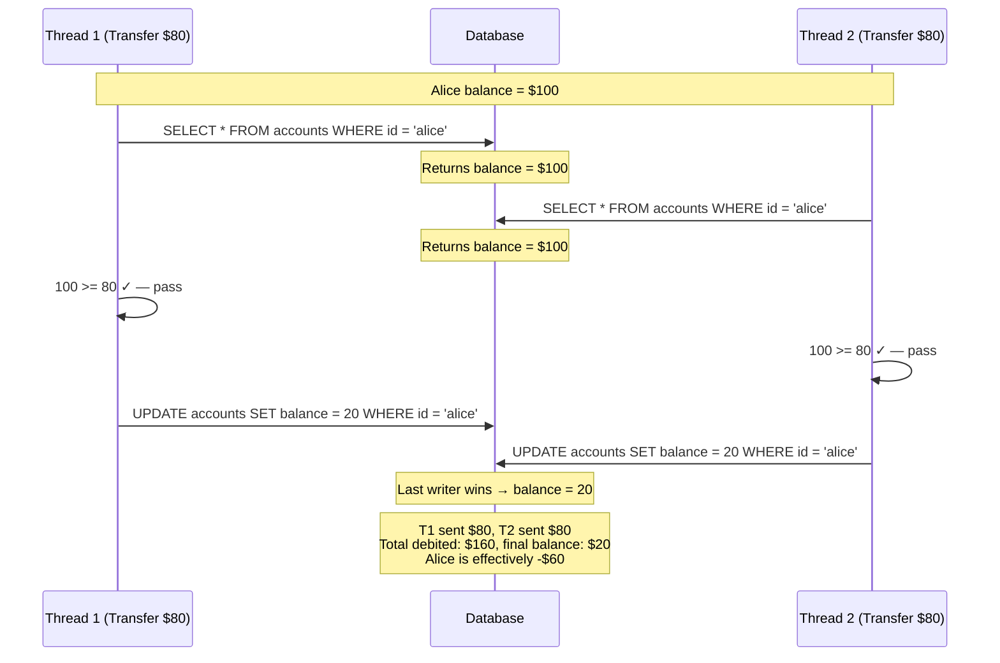
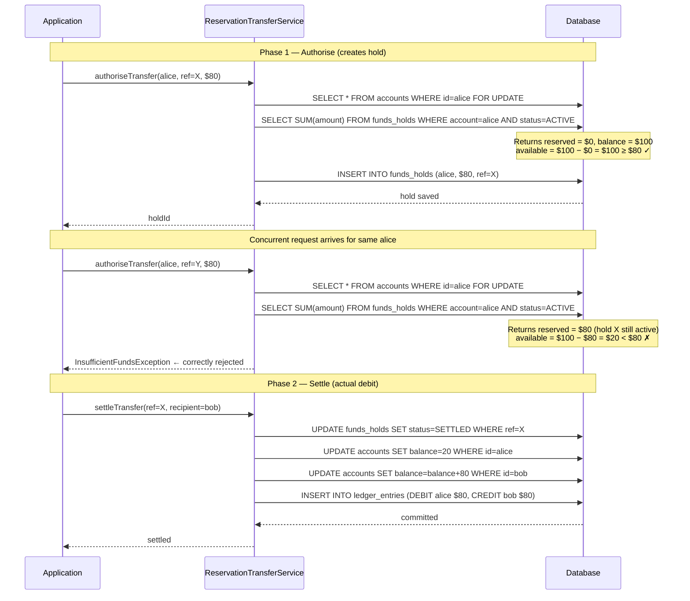

A digital wallet processes peer-to-peer transfers in milliseconds. That speed is a feature — until two requests for the same account arrive within the same window and the balance check races itself into negative territory. This lesson dissects the exact sequence that causes a double-spend, then builds three layers of defence: a pessimistic database lock, a funds-reservation model that separates "authorise" from "settle", and a CAS-based in-memory guard for wallets that cache balances. By the end you will be able to choose the right mechanism for a given throughput/consistency trade-off and test it with a 50-thread concurrent harness that proves correctness under load.

## Learning Objectives

- Identify the check-then-act race condition that enables double-spending in a concurrent transfer service.
- Implement `SELECT FOR UPDATE` through JPA's `@Lock(PESSIMISTIC_WRITE)` and explain what happens at the database level to the second concurrent request.
- Design a funds-reservation ("hold") model that keeps an available-balance invariant under optimistic locking.
- Write a `CompareAndSet` loop on `AtomicLong` to enforce a non-negative balance constraint in an in-memory balance cache.
- Author a multi-threaded JUnit 5 test that launches 50 concurrent debit requests and asserts no double-spend occurred.

## Business Context

Moneta Pay, a European e-money institution with 4.2 million active wallets, operates a P2P transfer feature with a 99.95 % availability SLA. During a Black Friday cashback campaign, marketing sent a push notification to all users simultaneously. The campaign triggered a spike of 38 000 transfer requests per second. Within 90 seconds, the fraud operations team received automated alerts: 1 247 wallet balances had gone negative, with the aggregate overdraft reaching €83 400. The root cause was not a code path that allowed overdrafts by design — Moneta Pay had a balance check. The root cause was that the balance check and the debit were two separate, non-atomic operations, and at 38 000 RPS the gap between them was wide enough for a second request to slip through.

The incident cost €83 400 in direct liability, €12 000 in manual remediation labour, and triggered a supervisory inquiry from the national competent authority under PSD2 Article 83. Fixing the race condition took four hours. The reputational review took four months.

## The Bug: Check-Then-Act Race Condition

The transfer code that went to production looked like this:

```java
@Service
@RequiredArgsConstructor
public class TransferService {

    private final AccountRepository accountRepository;
    private final LedgerEntryRepository ledgerEntryRepository;

    @Transactional
    public void transfer(UUID senderId, UUID recipientId, BigDecimal amount) {
        Account sender = accountRepository.findById(senderId)
                .orElseThrow(() -> new AccountNotFoundException(senderId));

        // BUG: balance read and debit are NOT atomic
        if (sender.getBalance().compareTo(amount) < 0) {
            throw new InsufficientFundsException(senderId, sender.getBalance(), amount);
        }

        sender.setBalance(sender.getBalance().subtract(amount));
        accountRepository.save(sender);

        Account recipient = accountRepository.findById(recipientId)
                .orElseThrow(() -> new AccountNotFoundException(recipientId));
        recipient.setBalance(recipient.getBalance().add(amount));
        accountRepository.save(recipient);

        ledgerEntryRepository.saveAll(List.of(
                LedgerEntry.debit(senderId, amount),
                LedgerEntry.credit(recipientId, amount)
        ));
    }
}
```

The problem is not visible from reading this method in isolation. It surfaces only when two threads execute it concurrently for the same `senderId`.

### The Exact Timeline



> [!WARNING]
> The default Spring `@Transactional` isolation level is READ COMMITTED on most databases. Under READ COMMITTED, the `findById` in T2 sees the row *before* T1's `UPDATE` is committed — because T1 has not committed yet. Both transactions proceed, both write, and the last writer's value wins. The first writer's debit is silently overwritten.

The underlying pattern is the classic **check-then-act** anti-pattern:

1. Read shared state (the balance).
2. Make a decision based on that state (is it sufficient?).
3. Act on the assumption the state is still valid (debit).

Steps 1 and 3 are not atomic. Any number of other transactions can modify the shared state between steps 1 and 3.

## Solution 1 — Pessimistic Locking with SELECT FOR UPDATE

The most direct fix is to acquire an exclusive row lock on the account row before reading the balance. No other transaction can read that row (with `FOR UPDATE`) or write it until the lock is released at commit.

### Repository

```java
public interface AccountRepository extends JpaRepository<Account, UUID> {

    @Lock(LockModeType.PESSIMISTIC_WRITE)
    @Query("SELECT a FROM Account a WHERE a.id = :id")
    Optional<Account> findByIdForUpdate(@Param("id") UUID id);
}
```

JPA translates `PESSIMISTIC_WRITE` to `SELECT ... FOR UPDATE` on PostgreSQL. The exact SQL emitted is:

```sql
SELECT a.id, a.balance, a.version, a.owner_id
FROM   accounts a
WHERE  a.id = $1
FOR UPDATE;
```

> [!NOTE]
> `FOR UPDATE` on PostgreSQL acquires a row-level `RowExclusiveLock`. It does not lock the entire table. Two concurrent transactions updating *different* accounts proceed in parallel without blocking each other. Lock contention is proportional to how often the same account appears in concurrent requests — which is exactly the case we need to handle.

### Service

```java
@Service
@RequiredArgsConstructor
public class TransferService {

    private final AccountRepository accountRepository;
    private final LedgerEntryRepository ledgerEntryRepository;

    @Transactional(isolation = Isolation.READ_COMMITTED)
    public TransferResult transfer(UUID senderId, UUID recipientId, BigDecimal amount) {
        // Acquire exclusive lock before reading balance — no gap possible
        Account sender = accountRepository.findByIdForUpdate(senderId)
                .orElseThrow(() -> new AccountNotFoundException(senderId));

        if (sender.getBalance().compareTo(amount) < 0) {
            throw new InsufficientFundsException(senderId, sender.getBalance(), amount);
        }

        // Safe: no other transaction can modify sender.balance until this commit
        sender.setBalance(sender.getBalance().subtract(amount));

        // Lock recipient too — prevents concurrent credits from racing
        Account recipient = accountRepository.findByIdForUpdate(recipientId)
                .orElseThrow(() -> new AccountNotFoundException(recipientId));
        recipient.setBalance(recipient.getBalance().add(amount));

        accountRepository.saveAll(List.of(sender, recipient));

        List<LedgerEntry> entries = List.of(
                LedgerEntry.debit(senderId, amount),
                LedgerEntry.credit(recipientId, amount)
        );
        ledgerEntryRepository.saveAll(entries);

        return TransferResult.success(senderId, recipientId, amount);
    }
}
```

> [!IMPORTANT]
> Always lock accounts in a **consistent order** (e.g., by UUID natural ordering) when a single transaction must lock multiple rows. If Thread 1 locks account A then B, while Thread 2 locks account B then A, both threads will deadlock waiting for each other. Order the locks and the deadlock cycle is impossible.

```java
// Deadlock-safe multi-account lock acquisition
private List<Account> lockAccountsOrdered(UUID id1, UUID id2) {
    // Sort so both threads always acquire locks in the same order
    List<UUID> ordered = Stream.of(id1, id2)
            .sorted()
            .toList();
    return ordered.stream()
            .map(id -> accountRepository.findByIdForUpdate(id)
                    .orElseThrow(() -> new AccountNotFoundException(id)))
            .toList();
}
```

### What Happens to the Second Concurrent Request

When T1 acquires `FOR UPDATE` on Alice's row:

1. T2 issues the same `SELECT ... FOR UPDATE` for Alice's row.
2. The database places T2 in a wait queue — it does not return until T1 commits or rolls back.
3. T1 commits: balance is now $20, lock is released.
4. T2 wakes up and reads the *post-commit* balance of $20.
5. T2's balance check: $20 < $80 → `InsufficientFundsException`. Transfer correctly rejected.

The second request does not fail silently — it blocks, then fails fast with a business exception the caller can present to the user as "insufficient funds". No overdraft occurs.

> [!WARNING]
> `SELECT FOR UPDATE` with the default PostgreSQL lock timeout of *infinite* means T2 blocks indefinitely if T1 is slow. In production, always set `spring.datasource.hikari.connection-timeout` and pair it with a PostgreSQL `lock_timeout` session setting, or add `@QueryHints(@QueryHint(name = "javax.persistence.lock.timeout", value = "2000"))` (milliseconds) to the repository method. A timed-out lock acquisition throws `LockTimeoutException` which is a recoverable error — surface it as HTTP 409 Conflict and let the client retry.

## Solution 2 — Funds Reservation Model

Pessimistic locking serialises all transfers through a single account. For high-throughput wallets (think a merchant account receiving thousands of small payments per second), this creates a bottleneck. The funds-reservation model achieves correctness without long-held row locks.

The insight: separate the moment of *authorisation* (reserve the funds) from the moment of *settlement* (commit the debit). A hold is a lightweight record that says "this amount is spoken for". The available balance is computed as `totalBalance − sumOfActiveHolds`. Two concurrent transfers each create their own hold atomically. Even if both holds succeed, the available balance check is part of hold creation — and that check is atomic.

### Database Schema

```sql
CREATE TABLE accounts (
    id            UUID        PRIMARY KEY DEFAULT gen_random_uuid(),
    owner_id      UUID        NOT NULL REFERENCES users(id),
    balance       NUMERIC(19,4) NOT NULL DEFAULT 0,
    currency      CHAR(3)     NOT NULL,
    version       BIGINT      NOT NULL DEFAULT 0,
    created_at    TIMESTAMPTZ NOT NULL DEFAULT now(),
    updated_at    TIMESTAMPTZ NOT NULL DEFAULT now(),
    CONSTRAINT chk_balance_non_negative CHECK (balance >= 0)
);

CREATE TABLE funds_holds (
    id            UUID        PRIMARY KEY DEFAULT gen_random_uuid(),
    account_id    UUID        NOT NULL REFERENCES accounts(id),
    amount        NUMERIC(19,4) NOT NULL,
    reason        VARCHAR(100) NOT NULL,
    transfer_ref  UUID        NOT NULL,
    status        VARCHAR(20) NOT NULL DEFAULT 'ACTIVE',  -- ACTIVE | SETTLED | RELEASED
    expires_at    TIMESTAMPTZ NOT NULL,
    created_at    TIMESTAMPTZ NOT NULL DEFAULT now(),
    CONSTRAINT chk_hold_amount_positive CHECK (amount > 0),
    CONSTRAINT uq_hold_transfer_ref UNIQUE (transfer_ref)
);

CREATE INDEX idx_funds_holds_account_active
    ON funds_holds(account_id)
    WHERE status = 'ACTIVE';
```

> [!NOTE]
> The `CHECK (balance >= 0)` constraint on `accounts` is a last-resort database-level guard. It should never fire in a correctly implemented application — if it does, it means the reservation logic has a bug. Treat a `CheckViolationException` as a critical alert, not a recoverable error.

### JPA Entities

```java
@Entity
@Table(name = "accounts")
@OptimisticLocking(type = OptimisticLockType.VERSION)
public class Account {

    @Id
    private UUID id;

    @Column(nullable = false, precision = 19, scale = 4)
    private BigDecimal balance;

    @Column(nullable = false, length = 3)
    private String currency;

    @Version
    private Long version;

    // Transient — computed from active holds; not persisted
    @Transient
    private BigDecimal reservedAmount = BigDecimal.ZERO;

    public BigDecimal availableBalance() {
        return balance.subtract(reservedAmount);
    }

    public void loadReservedAmount(BigDecimal reserved) {
        this.reservedAmount = reserved != null ? reserved : BigDecimal.ZERO;
    }

    // Package-private — only the service layer should call this
    void deductBalance(BigDecimal amount) {
        BigDecimal next = this.balance.subtract(amount);
        if (next.compareTo(BigDecimal.ZERO) < 0) {
            throw new IllegalStateException(
                    "Deduct would make balance negative: balance=%s, amount=%s"
                    .formatted(this.balance, amount));
        }
        this.balance = next;
    }

    void addBalance(BigDecimal amount) {
        this.balance = this.balance.add(amount);
    }
}

@Entity
@Table(name = "funds_holds")
public class FundsHold {

    public enum Status { ACTIVE, SETTLED, RELEASED }

    @Id
    private UUID id;

    @Column(name = "account_id", nullable = false)
    private UUID accountId;

    @Column(nullable = false, precision = 19, scale = 4)
    private BigDecimal amount;

    @Column(nullable = false, length = 100)
    private String reason;

    @Column(name = "transfer_ref", nullable = false)
    private UUID transferRef;

    @Enumerated(EnumType.STRING)
    @Column(nullable = false, length = 20)
    private Status status = Status.ACTIVE;

    @Column(name = "expires_at", nullable = false)
    private Instant expiresAt;

    public static FundsHold create(UUID accountId, BigDecimal amount,
                                    String reason, UUID transferRef,
                                    Duration ttl) {
        FundsHold hold = new FundsHold();
        hold.id = UUID.randomUUID();
        hold.accountId = accountId;
        hold.amount = amount;
        hold.reason = reason;
        hold.transferRef = transferRef;
        hold.expiresAt = Instant.now().plus(ttl);
        return hold;
    }

    public void settle() {
        if (this.status != Status.ACTIVE) {
            throw new IllegalStateException("Cannot settle hold in status: " + this.status);
        }
        this.status = Status.SETTLED;
    }

    public void release() {
        if (this.status != Status.ACTIVE) {
            throw new IllegalStateException("Cannot release hold in status: " + this.status);
        }
        this.status = Status.RELEASED;
    }
}
```

### Repository

```java
public interface AccountRepository extends JpaRepository<Account, UUID> {

    @Lock(LockModeType.PESSIMISTIC_WRITE)
    @Query("SELECT a FROM Account a WHERE a.id = :id")
    Optional<Account> findByIdForUpdate(@Param("id") UUID id);
}

public interface FundsHoldRepository extends JpaRepository<FundsHold, UUID> {

    @Query("SELECT COALESCE(SUM(h.amount), 0) FROM FundsHold h " +
           "WHERE h.accountId = :accountId AND h.status = 'ACTIVE' " +
           "AND h.expiresAt > :now")
    BigDecimal sumActiveHolds(@Param("accountId") UUID accountId,
                              @Param("now") Instant now);

    Optional<FundsHold> findByTransferRef(UUID transferRef);
}
```

### Service

```java
@Service
@RequiredArgsConstructor
@Slf4j
public class ReservationTransferService {

    private static final Duration HOLD_TTL = Duration.ofMinutes(5);

    private final AccountRepository accountRepository;
    private final FundsHoldRepository fundsHoldRepository;
    private final LedgerEntryRepository ledgerEntryRepository;

    /**
     * Phase 1 — Authorise: reserve the funds.
     * Returns the hold ID. Fast path, short transaction.
     */
    @Transactional
    public UUID authoriseTransfer(UUID senderId, UUID transferRef,
                                   BigDecimal amount) {
        // Acquire short-lived lock only to compute available balance + insert hold
        Account sender = accountRepository.findByIdForUpdate(senderId)
                .orElseThrow(() -> new AccountNotFoundException(senderId));

        BigDecimal reserved = fundsHoldRepository
                .sumActiveHolds(senderId, Instant.now());
        sender.loadReservedAmount(reserved);

        if (sender.availableBalance().compareTo(amount) < 0) {
            throw new InsufficientFundsException(
                    senderId, sender.availableBalance(), amount);
        }

        FundsHold hold = FundsHold.create(senderId, amount,
                "P2P transfer", transferRef, HOLD_TTL);
        fundsHoldRepository.save(hold);

        log.info("Hold created: account={} amount={} ref={} holdId={}",
                senderId, amount, transferRef, hold.getId());
        return hold.getId();
    }

    /**
     * Phase 2 — Settle: convert hold into actual debit + credit.
     * Idempotent on transferRef.
     */
    @Transactional
    public void settleTransfer(UUID transferRef, UUID recipientId) {
        FundsHold hold = fundsHoldRepository.findByTransferRef(transferRef)
                .orElseThrow(() -> new HoldNotFoundException(transferRef));

        if (hold.getStatus() == FundsHold.Status.SETTLED) {
            log.info("Transfer {} already settled — idempotent return", transferRef);
            return;
        }

        hold.settle();

        // Deduct from sender's actual balance
        Account sender = accountRepository.findByIdForUpdate(hold.getAccountId())
                .orElseThrow(() -> new AccountNotFoundException(hold.getAccountId()));
        sender.deductBalance(hold.getAmount());

        // Credit recipient
        Account recipient = accountRepository.findByIdForUpdate(recipientId)
                .orElseThrow(() -> new AccountNotFoundException(recipientId));
        recipient.addBalance(hold.getAmount());

        accountRepository.saveAll(List.of(sender, recipient));
        fundsHoldRepository.save(hold);

        ledgerEntryRepository.saveAll(List.of(
                LedgerEntry.debit(hold.getAccountId(), hold.getAmount()),
                LedgerEntry.credit(recipientId, hold.getAmount())
        ));
    }
}
```

### Reservation Model Flow



## Solution 3 — CAS-Based In-Memory Guard

For high-frequency, low-latency wallets that maintain an in-memory balance cache (e.g., backed by Redis or a local `ConcurrentHashMap`), you can enforce the non-negative constraint without a database round-trip using a Compare-And-Set loop on `AtomicLong`.

> [!NOTE]
> This solution is a **defence-in-depth layer**, not a replacement for database-level correctness. Use it when the database is authoritative but you want to short-circuit requests that are obviously going to fail (saving a database round-trip), or when the in-memory cache is the single source of truth for a hot wallet that is reconciled asynchronously.

```java
/**
 * In-memory balance cache using fixed-point arithmetic.
 * Balances stored as long (cents / minor currency units) to avoid
 * floating-point races on AtomicLong.
 */
@Component
public class InMemoryBalanceCache {

    // accountId -> balance in minor units (e.g. cents)
    private final ConcurrentHashMap<UUID, AtomicLong> balances =
            new ConcurrentHashMap<>();

    public void initialise(UUID accountId, long balanceInMinorUnits) {
        balances.put(accountId, new AtomicLong(balanceInMinorUnits));
    }

    /**
     * Atomically debit the account.
     *
     * @return true if the debit succeeded; false if insufficient balance.
     */
    public boolean tryDebit(UUID accountId, long amountInMinorUnits) {
        AtomicLong balance = balances.computeIfAbsent(
                accountId, id -> new AtomicLong(0));

        long current;
        long next;
        do {
            current = balance.get();
            next = current - amountInMinorUnits;
            if (next < 0) {
                // Balance would go negative — reject without modifying state
                return false;
            }
            // CAS: only set if balance hasn't changed since we read it
            // If another thread modified balance between get() and compareAndSet(),
            // compareAndSet returns false and we retry the loop
        } while (!balance.compareAndSet(current, next));

        return true;
    }

    public void credit(UUID accountId, long amountInMinorUnits) {
        balances.computeIfAbsent(accountId, id -> new AtomicLong(0))
                .addAndGet(amountInMinorUnits);
    }

    public long getBalance(UUID accountId) {
        AtomicLong bal = balances.get(accountId);
        return bal == null ? 0L : bal.get();
    }
}
```

The CAS loop guarantees atomicity because `compareAndSet` is a single hardware instruction (`CMPXCHG` on x86). If two threads read `current = 10000` and both attempt `compareAndSet(10000, 2000)`, only one will succeed. The losing thread re-reads the new value (`2000`), computes `next = 2000 − 8000 = −6000 < 0`, and returns `false`.

<!-- KNOWLEDGE-CHECK
{
  "questions": [
    {
      "text": "An account has a balance of $100. Two concurrent transfer requests arrive simultaneously: Transfer A for $80 and Transfer B for $80. Both use SELECT FOR UPDATE on the account row. What is the guaranteed outcome?",
      "options": [
        "Both transfers succeed, leaving a balance of -$60",
        "Both transfers fail with a lock timeout",
        "One transfer succeeds ($100 - $80 = $20), the other reads the updated $20 balance and is correctly declined for insufficient funds",
        "The first transfer to commit wins; the second is automatically rolled back by the database"
      ],
      "correct": 2,
      "explanation": "SELECT FOR UPDATE serialises access. The first transaction acquires the lock, deducts $80, and commits — balance is now $20. The second transaction unblocks, reads the post-commit balance of $20, checks $20 >= $80 which is false, and correctly declines. No overdraft occurs."
    },
    {
      "text": "What is the key advantage of the funds reservation model over SELECT FOR UPDATE for high-throughput wallets?",
      "options": [
        "It eliminates the need for database transactions entirely",
        "It separates the moment of authorisation (reserve funds) from settlement, allowing concurrent authorisations without long-held row locks",
        "It allows balances to go negative temporarily as long as they recover before end-of-day",
        "It uses Redis instead of PostgreSQL, which is faster for financial data"
      ],
      "correct": 1,
      "explanation": "The funds reservation model creates a lightweight hold record atomically, checking available balance as (total balance - sum of active holds). Two concurrent transfers each create their own hold atomically. This avoids a centralised lock held for the full transaction duration, enabling higher throughput while maintaining correctness."
    },
    {
      "text": "An in-memory AtomicLong balance cache is used to short-circuit payment requests. The JVM crashes after the database commits a debit but before the cache is updated. What is the consequence and how is it mitigated?",
      "options": [
        "The debit is lost because the cache is the source of truth",
        "The cache shows a stale higher balance than the database; a reconciliation job must periodically reset the cache from the authoritative database balance",
        "The database automatically rolls back the debit when the JVM crashes",
        "The next payment request will detect the inconsistency and refuse to process"
      ],
      "correct": 1,
      "explanation": "The in-memory cache and the database can diverge if the JVM crashes after the database commits but before the cache is updated. The cache is not the source of truth — it is an optimisation layer. A periodic reconciliation job must read true balances from the database and reset the cache. Never surface cached balances to end users without a staleness disclaimer."
    }
  ]
}
-->

<!-- PRACTICAL-CHALLENGE
{
  "title": "Implement Double-Spending Prevention",
  "difficulty": "advanced",
  "estimatedMinutes": 50,
  "tasks": [
    {"id": "1", "description": "Implement the pessimistic locking solution with SELECT FOR UPDATE and canonical lock ordering for two-account transfers. Write a deadlock-safe lockAccountsOrdered method that sorts account IDs before acquiring locks."},
    {"id": "2", "description": "Implement the funds reservation model with an authoriseTransfer method that atomically checks available balance (total balance minus active holds) and creates a hold record, and a settleTransfer method that converts the hold into a ledger debit/credit pair."},
    {"id": "3", "description": "Implement the InMemoryBalanceCache using ConcurrentHashMap<UUID, AtomicLong> with a CAS-based tryDebit method. Wrap it in a CachedTransferService that fast-rejects requests against the cache before hitting the database, with cache rollback if the database write fails."},
    {"id": "4", "description": "Write a concurrent integration test using 50 threads all attempting to debit $80 from an account with $100 balance. Assert that exactly one debit succeeds, all others are rejected, and the final database balance is exactly $20 with no overdraft."}
  ]
}
-->

```java
// Usage in a transfer service layer
@Service
@RequiredArgsConstructor
public class CachedTransferService {

    private final InMemoryBalanceCache cache;
    private final TransferService persistenceTransferService;

    public TransferResult transfer(UUID senderId, UUID recipientId,
                                    BigDecimal amount) {
        long amountMinor = amount.movePointRight(2).longValueExact();

        // Fast rejection without hitting the database
        if (!cache.tryDebit(senderId, amountMinor)) {
            throw new InsufficientFundsException(senderId);
        }

        try {
            // Persist to the database (also has its own locking)
            TransferResult result =
                    persistenceTransferService.transfer(senderId, recipientId, amount);
            cache.credit(recipientId, amountMinor);
            return result;
        } catch (Exception e) {
            // Roll back the in-memory debit if persistence fails
            cache.credit(senderId, amountMinor);
            throw e;
        }
    }
}
```

> [!WARNING]
> The in-memory cache and the database can diverge if the JVM crashes after the database commits but before the cache is updated, or vice versa. Always implement a **reconciliation job** that periodically reads true balances from the database and resets the cache. Never surface the cached balance to end users without a staleness disclaimer — use it only for internal rate-limiting / fast rejection.

## Knowledge Check

**Q1: Under READ COMMITTED isolation, two concurrent transactions both read Alice's balance as $100 and both pass a `>= $80` check. Transaction T1 commits first, writing $20. What does T2 write, and what is the final balance?**

A: T2 also writes $20. It computed `100 − 80 = 20` before T1 committed. When T2's `UPDATE` executes, it unconditionally sets the balance to 20 regardless of what T1 wrote. The final balance is $20, not −$60 as Alice experienced — wait. Actually T2 writes $20 which *looks* correct, but T1 already sent $80 and T2 is about to send $80: a total outflow of $160 against a starting balance of $100. The database balance of $20 is wrong because it only reflects one of the two debits. The last-writer-wins update silently drops T1's debit. Alice effectively sent $160 but her balance only decreased by $80. The correct final balance should be −$60. The database shows $20. The discrepancy is exactly $80 — the amount of the overwritten debit.

**Q2: Why does the funds-reservation model still use `SELECT FOR UPDATE` during the hold-creation phase, if its main advantage is avoiding long-held locks?**

A: The `SELECT FOR UPDATE` during hold creation is a very *short* lock — it lasts only for the duration of the "compute available balance + insert hold" transaction, which completes in milliseconds. Without it, two concurrent requests could both read the same active-hold sum, both compute the same available balance, both pass the funds-sufficiency check, and both insert their holds. The sum of the two holds could then exceed the actual balance. The key difference from the original bug is that the pessimistic lock is now held for a tiny, bounded duration (no downstream HTTP calls, no slow I/O inside the lock). The settlement phase runs without any lock on the sender's account — it simply settles a hold that already exists.

## Practical Challenge

**Scenario:** Moneta Pay has asked you to implement and validate the pessimistic-locking solution.

**Task 1 — Concurrent Test Harness**

Write a JUnit 5 integration test that:
1. Creates a wallet with an initial balance of $500.
2. Spins up 50 threads, each attempting to transfer $20 from that wallet to a "sink" account.
3. After all threads complete, asserts that:
   - The wallet balance is `>= 0` (no overdraft).
   - The wallet balance is `>= 500 − (successCount * 20)` (no silent double-debits).
   - The number of successful transfers is `<= 25` (a $500 wallet can fund at most 25 × $20 transfers).

```java
@SpringBootTest
@Transactional(propagation = Propagation.NOT_SUPPORTED) // each thread manages its own TX
class DoubleSpendConcurrentTest {

    @Autowired TransferService transferService;
    @Autowired AccountRepository accountRepository;

    @Test
    void fiftyThreadsConcurrentDebit_noOverdraft() throws InterruptedException {
        UUID walletId = createWallet(new BigDecimal("500.00"));
        UUID sinkId   = createWallet(new BigDecimal("0.00"));

        int threadCount = 50;
        BigDecimal transferAmount = new BigDecimal("20.00");

        ExecutorService executor = Executors.newFixedThreadPool(threadCount);
        CountDownLatch startGate = new CountDownLatch(1);
        CountDownLatch endGate   = new CountDownLatch(threadCount);
        AtomicInteger successCount = new AtomicInteger(0);
        AtomicInteger failCount    = new AtomicInteger(0);

        for (int i = 0; i < threadCount; i++) {
            executor.submit(() -> {
                try {
                    startGate.await(); // All threads start simultaneously
                    transferService.transfer(walletId, sinkId, transferAmount);
                    successCount.incrementAndGet();
                } catch (InsufficientFundsException e) {
                    failCount.incrementAndGet();
                } catch (Exception e) {
                    failCount.incrementAndGet(); // LockTimeoutException etc.
                } finally {
                    endGate.countDown();
                }
            });
        }

        startGate.countDown(); // Release all threads at once
        endGate.await(30, TimeUnit.SECONDS);
        executor.shutdown();

        Account wallet = accountRepository.findById(walletId).orElseThrow();
        BigDecimal expectedMinBalance = new BigDecimal("500.00")
                .subtract(transferAmount.multiply(BigDecimal.valueOf(successCount.get())));

        assertThat(successCount.get()).isLessThanOrEqualTo(25);
        assertThat(wallet.getBalance()).isGreaterThanOrEqualTo(BigDecimal.ZERO);
        assertThat(wallet.getBalance()).isEqualByComparingTo(expectedMinBalance);
        assertThat(successCount.get() + failCount.get()).isEqualTo(threadCount);

        System.out.printf("Successes: %d | Failures: %d | Final balance: %s%n",
                successCount.get(), failCount.get(), wallet.getBalance());
    }

    private UUID createWallet(BigDecimal initialBalance) {
        Account account = new Account();
        account.setId(UUID.randomUUID());
        account.setBalance(initialBalance);
        account.setCurrency("USD");
        return accountRepository.save(account).getId();
    }
}
```

**Task 2 — Expired Holds**

The funds-reservation model has a time-to-live on holds. Implement a scheduled job that:
1. Finds all `funds_holds` with `status = 'ACTIVE'` and `expires_at < now()`.
2. Marks them as `RELEASED`.
3. Logs the account ID and amount for each released hold so the operations team can investigate why settlement never arrived.

Consider: should the job run inside a single large transaction or per-hold? What happens if the job crashes halfway through? Design the job to be safe on restart.

**Task 3 — Metric Instrumentation**

Using Micrometer, add the following metrics to `ReservationTransferService`:

| Metric name | Type | Purpose |
|---|---|---|
| `wallet.hold.created` | Counter | Tagged with `currency` |
| `wallet.hold.settled` | Counter | Tagged with `currency` |
| `wallet.hold.rejected` | Counter | Tagged with `reason=insufficient_funds` |
| `wallet.hold.duration` | Timer | Time from hold creation to settlement |

Wire these into a Grafana dashboard alert that fires when `wallet.hold.rejected` exceeds 5 % of `wallet.hold.created` over a 5-minute window — the threshold Moneta Pay uses as an early-warning signal for potential fraud (users attempting transfers they know will fail, probing for balance information).
