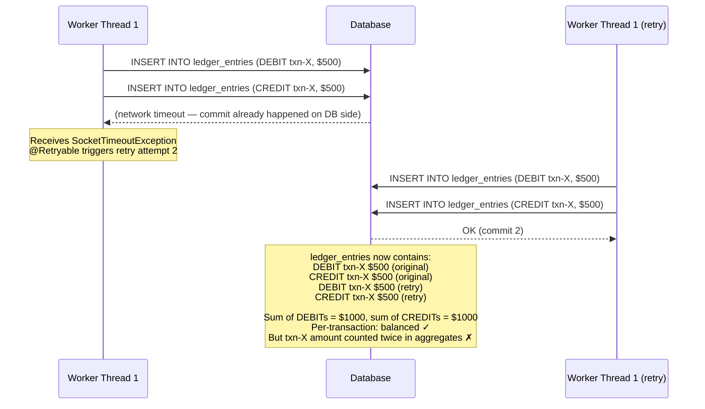
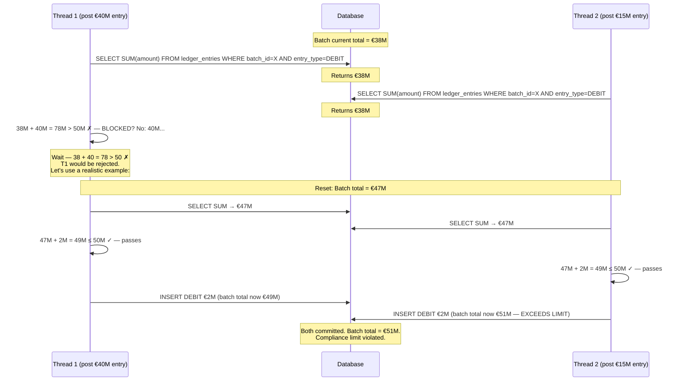

Settlement systems are unforgiving environments. A ledger entry that posts twice, a debit without a matching credit, or a batch total that disagrees with its constituent rows are not edge cases to be handled gracefully — they are regulatory violations, audit failures, and in some jurisdictions, reportable incidents. This lesson follows a settlement engine that broke the double-entry invariant under concurrent load, dissects why higher isolation levels alone could not save it, and builds the idempotency, write-skew protection, and partitioning strategy that together make the system correct at scale. By the end you will understand not just what went wrong, but why each fix is necessary and what class of bugs each one prevents.

## Learning Objectives

- Explain why a retry storm combined with non-idempotent inserts breaks the double-entry invariant even when each individual posting is internally balanced.
- Demonstrate that `SERIALIZABLE` isolation does not prevent duplicate-row insertion and articulate why idempotency at the application/schema level is the correct fix.
- Implement idempotent ledger entry insertion using a `UNIQUE` constraint and handle `DataIntegrityViolationException` with correct semantics (success, not error).
- Identify write skew in a batch-limit scenario and apply a pessimistic lock on the batch header row to eliminate it.
- Design a PostgreSQL range-partitioned ledger table that reduces lock contention without sacrificing query correctness.
- Enforce per-account posting order through a `UNIQUE(account_id, sequence_number)` constraint and a gap-free sequence generation strategy.

## Business Context

ClearPath Securities, a mid-size clearing house processing equity and bond trades for 47 member firms, runs an end-of-day settlement batch that posts between 800 000 and 1.4 million ledger entries per night. The batch is parallelised across 16 worker threads to meet a 90-minute settlement window mandated by the exchange's rules.

During a quarter-end settlement with elevated volume (1.38 million entries), the reconciliation job that runs immediately after the batch reported a discrepancy: total DEBIT entries summed to €2 184 300 more than total CREDIT entries. The batch showed all 1.38 million postings as successful. The discrepancy corresponded exactly to 2 184 individual transactions being posted twice — once by the original thread, once by the retry triggered by a downstream timeout that the original had already recovered from silently.

The exchange's risk team placed ClearPath on a 30-day enhanced monitoring regime. The firm's CTO committed to a root-cause report and remediation plan within five business days. The engineering team had 72 hours to implement, test, and deploy the fix without taking the system offline.

## The Bug: Duplicate Posting from a Retry Storm

The settlement batch processes each transaction by calling `LedgerPostingService.post()`. The calling code had a retry policy:

```java
// In the batch orchestrator
@Retryable(
    value = {TransientDataAccessException.class, CannotAcquireLockException.class},
    maxAttempts = 3,
    backoff = @Backoff(delay = 500, multiplier = 2)
)
public void processTransaction(SettlementTransaction tx) {
    ledgerPostingService.post(tx);
}
```

The posting service itself:

```java
@Service
@RequiredArgsConstructor
public class LedgerPostingService {

    private final LedgerEntryRepository ledgerEntryRepository;

    @Transactional
    public void post(SettlementTransaction tx) {
        // BUG: no idempotency check — posts unconditionally every time it is called
        LedgerEntry debit = LedgerEntry.builder()
                .transactionId(tx.getId())
                .accountId(tx.getDebitAccountId())
                .entryType(EntryType.DEBIT)
                .amount(tx.getAmount())
                .currency(tx.getCurrency())
                .postedAt(Instant.now())
                .build();

        LedgerEntry credit = LedgerEntry.builder()
                .transactionId(tx.getId())
                .accountId(tx.getCreditAccountId())
                .entryType(EntryType.CREDIT)
                .amount(tx.getAmount())
                .currency(tx.getCurrency())
                .postedAt(Instant.now())
                .build();

        ledgerEntryRepository.saveAll(List.of(debit, credit));
    }
}
```

The timeline of a double-post:



> [!IMPORTANT]
> Notice that the double-post does *not* violate the per-transaction double-entry invariant. The sum of DEBITs still equals the sum of CREDITs for transaction X. The violation shows up in aggregates: when reconciliation sums all DEBIT entries for a batch, transaction X contributes $1000 instead of $500. This is why per-transaction balance checks passed and the error only surfaced in the reconciliation step.

## Why SERIALIZABLE Isolation Does Not Fix This

It is tempting to reach for `SERIALIZABLE` isolation as a universal remedy for concurrency bugs. For this bug, it does not help.

`SERIALIZABLE` prevents three anomalies that `READ COMMITTED` and `REPEATABLE READ` do not:

| Anomaly | Description | Prevented by SERIALIZABLE? |
|---|---|---|
| Dirty read | Read uncommitted data from another tx | Yes (also READ COMMITTED) |
| Non-repeatable read | Same row reads differently within one tx | Yes (also REPEATABLE READ) |
| Phantom read | A query returns different rows on re-execution | Yes |
| Write skew | Two txns read the same set, each modifies a *different* row based on that read | Yes |
| Duplicate INSERT of a *new* row | Two txns each insert a row that did not previously exist | **No** |

The retry inserts a *new* row with a *new* primary key. There is no existing row for `SERIALIZABLE` to detect a conflict on. Both transactions touch entirely disjoint sets of rows. The database has no basis to detect that they are logically equivalent.

```java
// This is what SERIALIZABLE sees:
// TX1: INSERT row with pk=uuid-A (DEBIT txn-X)  → no conflict
// TX1: INSERT row with pk=uuid-B (CREDIT txn-X) → no conflict
// TX2: INSERT row with pk=uuid-C (DEBIT txn-X)  → no conflict with A or B
// TX2: INSERT row with pk=uuid-D (CREDIT txn-X) → no conflict with A, B, or C
// SERIALIZABLE verdict: both transactions can commit. ✓ (but logically wrong)
```

> [!NOTE]
> `SERIALIZABLE` *would* help if the fix involved reading a flag row and conditionally inserting. For example, if the application first read `SELECT 1 FROM ledger_entries WHERE transaction_id = X` and then inserted only if no row was found, `SERIALIZABLE` would detect the phantom and abort one of the concurrent transactions. But this is a two-step read-then-write that is fragile and slower than a single `INSERT` with a unique constraint.

The correct fix is to make the INSERT itself idempotent at the schema level.

## Correct Fix: Idempotent Ledger Entry Insertion

### Schema Change

Add a composite unique constraint that embodies "one DEBIT and one CREDIT per transaction per account":

```sql
ALTER TABLE ledger_entries
    ADD CONSTRAINT uq_ledger_txn_account_type
    UNIQUE (transaction_id, account_id, entry_type);
```

For settlement systems where a single transaction may legitimately post multiple entries to the same account (e.g. partial fills in an equity trade), use a more specific idempotency key:

```sql
ALTER TABLE ledger_entries
    ADD COLUMN idempotency_key UUID NOT NULL,
    ADD CONSTRAINT uq_ledger_idempotency_key UNIQUE (idempotency_key);
```

The idempotency key is generated by the caller once and carried through all retry attempts. The database guarantees that only one row with that key can ever exist.

### Full Schema

```sql
CREATE TABLE ledger_entries (
    id               UUID         PRIMARY KEY DEFAULT gen_random_uuid(),
    transaction_id   UUID         NOT NULL,
    idempotency_key  UUID         NOT NULL,
    account_id       UUID         NOT NULL REFERENCES accounts(id),
    entry_type       VARCHAR(10)  NOT NULL CHECK (entry_type IN ('DEBIT', 'CREDIT')),
    amount           NUMERIC(19,4) NOT NULL CHECK (amount > 0),
    currency         CHAR(3)      NOT NULL,
    batch_id         UUID,
    sequence_number  BIGINT,
    posted_at        TIMESTAMPTZ  NOT NULL DEFAULT now(),
    created_at       TIMESTAMPTZ  NOT NULL DEFAULT now(),
    CONSTRAINT uq_ledger_idempotency_key UNIQUE (idempotency_key),
    CONSTRAINT uq_ledger_account_sequence UNIQUE (account_id, sequence_number)
);

CREATE INDEX idx_ledger_entries_transaction_id ON ledger_entries(transaction_id);
CREATE INDEX idx_ledger_entries_account_posted  ON ledger_entries(account_id, posted_at DESC);
CREATE INDEX idx_ledger_entries_batch_id        ON ledger_entries(batch_id) WHERE batch_id IS NOT NULL;
```

### Idempotency Key Generation

The idempotency key must be:
1. Deterministic — the same logical operation always produces the same key.
2. Unique across different operations.
3. Generated before the first attempt and preserved across retries.

```java
public record LedgerPostingRequest(
        UUID transactionId,
        UUID debitAccountId,
        UUID creditAccountId,
        BigDecimal amount,
        String currency,
        UUID batchId
) {
    /**
     * Deterministic idempotency keys derived from the transaction ID.
     * The same transaction always produces the same keys.
     * Different entry types (DEBIT vs CREDIT) produce different keys.
     */
    public UUID debitIdempotencyKey() {
        return UUID.nameUUIDFromBytes(
                (transactionId.toString() + ":DEBIT:" + debitAccountId).getBytes(
                        StandardCharsets.UTF_8));
    }

    public UUID creditIdempotencyKey() {
        return UUID.nameUUIDFromBytes(
                (transactionId.toString() + ":CREDIT:" + creditAccountId).getBytes(
                        StandardCharsets.UTF_8));
    }
}
```

> [!WARNING]
> Do NOT use `UUID.randomUUID()` to generate idempotency keys inside the method that will be retried. A new random UUID on each retry defeats idempotency entirely — each retry will produce a unique key and the unique constraint will not fire. The key must be computed from the logical identity of the operation, not from randomness.

### Idempotent Service

```java
@Service
@RequiredArgsConstructor
@Slf4j
public class IdempotentLedgerPostingService {

    private final LedgerEntryRepository ledgerEntryRepository;
    private final LedgerEntryMapper mapper;

    @Transactional
    public PostingResult post(LedgerPostingRequest request) {
        LedgerEntry debit = mapper.toDebitEntry(request);
        LedgerEntry credit = mapper.toCreditEntry(request);

        try {
            ledgerEntryRepository.saveAll(List.of(debit, credit));
            log.debug("Posted transaction {}: DEBIT {} CREDIT {}",
                    request.transactionId(),
                    request.debitAccountId(),
                    request.creditAccountId());
            return PostingResult.posted(request.transactionId());

        } catch (DataIntegrityViolationException e) {
            if (isDuplicateKeyViolation(e)) {
                // The unique constraint fired — this is a retry of an already-posted transaction.
                // Return success: the caller's intent (post this transaction) is already fulfilled.
                log.info("Idempotent: transaction {} already posted, returning success",
                        request.transactionId());
                return PostingResult.alreadyPosted(request.transactionId());
            }
            // A different integrity violation (e.g. foreign key) — rethrow
            throw e;
        }
    }

    private boolean isDuplicateKeyViolation(DataIntegrityViolationException e) {
        Throwable cause = e.getCause();
        if (cause instanceof org.hibernate.exception.ConstraintViolationException cve) {
            String constraintName = cve.getConstraintName();
            return constraintName != null &&
                   constraintName.contains("uq_ledger_idempotency_key");
        }
        return false;
    }
}
```

```java
public sealed interface PostingResult {

    record Posted(UUID transactionId, Instant postedAt) implements PostingResult {}
    record AlreadyPosted(UUID transactionId) implements PostingResult {}

    static PostingResult posted(UUID transactionId) {
        return new Posted(transactionId, Instant.now());
    }

    static PostingResult alreadyPosted(UUID transactionId) {
        return new AlreadyPosted(transactionId);
    }

    default boolean isSuccess() {
        return true; // Both variants represent a successfully-posted transaction
    }
}
```

> [!IMPORTANT]
> `DataIntegrityViolationException` on a duplicate key means the transaction was already posted. The correct response is **success** — not an error. The caller asked for transaction X to be posted; transaction X is posted. Returning an error here would cause the batch orchestrator to mark the transaction as failed and potentially trigger a manual remediation workflow for a transaction that is actually fine.

### Mapper

```java
@Component
public class LedgerEntryMapper {

    public LedgerEntry toDebitEntry(LedgerPostingRequest req) {
        return LedgerEntry.builder()
                .id(UUID.randomUUID())
                .transactionId(req.transactionId())
                .idempotencyKey(req.debitIdempotencyKey())
                .accountId(req.debitAccountId())
                .entryType(EntryType.DEBIT)
                .amount(req.amount())
                .currency(req.currency())
                .batchId(req.batchId())
                .postedAt(Instant.now())
                .build();
    }

    public LedgerEntry toCreditEntry(LedgerPostingRequest req) {
        return LedgerEntry.builder()
                .id(UUID.randomUUID())
                .transactionId(req.transactionId())
                .idempotencyKey(req.creditIdempotencyKey())
                .accountId(req.creditAccountId())
                .entryType(EntryType.CREDIT)
                .amount(req.amount())
                .currency(req.currency())
                .batchId(req.batchId())
                .postedAt(Instant.now())
                .build();
    }
}
```

## Write Skew in Ledger Posting: Batch Limit Enforcement

Idempotency fixes the duplicate-posting bug. A separate but related concurrency bug exists in batch-limit enforcement — a classic write skew.

ClearPath's compliance rules require that no single settlement batch may exceed €50 000 000 in total debit value. The enforcement code:

```java
// BROKEN: write skew under READ COMMITTED
@Transactional
public void postWithBatchLimitCheck(LedgerPostingRequest request, UUID batchId) {
    // 1. Read current batch total
    BigDecimal currentTotal = ledgerEntryRepository
            .sumDebitsByBatch(batchId);

    // 2. Check limit
    BigDecimal limit = new BigDecimal("50000000.00");
    if (currentTotal.add(request.amount()).compareTo(limit) > 0) {
        throw new BatchLimitExceededException(batchId, currentTotal, request.amount());
    }

    // 3. Post (write)
    post(request);
}
```

The write skew scenario:



Both threads read the same batch total (€47M), both independently determine that their €2M entry fits within the €50M limit, and both commit. The final batch total is €51M — a compliance violation.

This is write skew: neither transaction modifies the rows the other reads. Each reads the current set of entries and writes a *new* row based on that read. Under READ COMMITTED and even REPEATABLE READ, neither transaction sees the other's write before committing.

### Fix: Pessimistic Lock on the Batch Header Row

The correct fix is to introduce a batch header row that acts as a serialisation point. Any transaction that wants to add entries to a batch must first lock the header:

```sql
CREATE TABLE settlement_batches (
    id              UUID         PRIMARY KEY DEFAULT gen_random_uuid(),
    batch_date      DATE         NOT NULL,
    status          VARCHAR(20)  NOT NULL DEFAULT 'OPEN',
    total_debit     NUMERIC(19,4) NOT NULL DEFAULT 0,
    total_credit    NUMERIC(19,4) NOT NULL DEFAULT 0,
    debit_limit     NUMERIC(19,4),
    created_at      TIMESTAMPTZ  NOT NULL DEFAULT now(),
    updated_at      TIMESTAMPTZ  NOT NULL DEFAULT now(),
    CONSTRAINT uq_batch_date UNIQUE (batch_date)
);
```

```java
public interface SettlementBatchRepository extends JpaRepository<SettlementBatch, UUID> {

    @Lock(LockModeType.PESSIMISTIC_WRITE)
    @Query("SELECT b FROM SettlementBatch b WHERE b.id = :id")
    Optional<SettlementBatch> findByIdForUpdate(@Param("id") UUID id);
}

@Service
@RequiredArgsConstructor
public class BatchLedgerPostingService {

    private final SettlementBatchRepository batchRepository;
    private final IdempotentLedgerPostingService ledgerPostingService;

    @Transactional
    public PostingResult postWithBatchLimit(LedgerPostingRequest request) {
        // Lock the batch header row — serialises all concurrent postings for this batch
        SettlementBatch batch = batchRepository
                .findByIdForUpdate(request.batchId())
                .orElseThrow(() -> new BatchNotFoundException(request.batchId()));

        // Now that we hold the lock, the total we read is authoritative
        if (batch.getDebitLimit() != null) {
            BigDecimal projectedTotal = batch.getTotalDebit().add(request.amount());
            if (projectedTotal.compareTo(batch.getDebitLimit()) > 0) {
                throw new BatchLimitExceededException(
                        request.batchId(), batch.getTotalDebit(), request.amount());
            }
        }

        PostingResult result = ledgerPostingService.post(request);

        // Update the running total on the batch header
        if (result instanceof PostingResult.Posted) {
            batch.addDebit(request.amount());
            batchRepository.save(batch);
        }

        return result;
    }
}
```

> [!NOTE]
> Locking the batch header row serialises all concurrent postings for that batch. This is intentional — it is the price of enforcing the aggregate limit. If throughput is critical, consider splitting a batch into sub-batches with their own limits, each with their own header row. This parallelises lock acquisition while still enforcing limits per sub-batch.

## Partitioning for Throughput

At 1.4 million entries per night and years of retention, the `ledger_entries` table grows to hundreds of millions of rows. A single table becomes a bottleneck in two ways:

1. **Lock contention**: even row-level locks on a heavily-written table compete for page-level shared locks and index-maintenance locks.
2. **Query performance**: reconciliation queries that scan entries for a given date must traverse an ever-growing index.

PostgreSQL declarative partitioning by `posted_date` addresses both:

```sql
-- Parent (partitioned) table
CREATE TABLE ledger_entries (
    id               UUID         NOT NULL,
    transaction_id   UUID         NOT NULL,
    idempotency_key  UUID         NOT NULL,
    account_id       UUID         NOT NULL,
    entry_type       VARCHAR(10)  NOT NULL CHECK (entry_type IN ('DEBIT', 'CREDIT')),
    amount           NUMERIC(19,4) NOT NULL CHECK (amount > 0),
    currency         CHAR(3)      NOT NULL,
    batch_id         UUID,
    sequence_number  BIGINT,
    posted_at        TIMESTAMPTZ  NOT NULL,
    created_at       TIMESTAMPTZ  NOT NULL DEFAULT now()
) PARTITION BY RANGE (posted_at);

-- Daily partitions — created by a maintenance job before each settlement window
CREATE TABLE ledger_entries_2024_01_15
    PARTITION OF ledger_entries
    FOR VALUES FROM ('2024-01-15 00:00:00+00') TO ('2024-01-16 00:00:00+00');

CREATE TABLE ledger_entries_2024_01_16
    PARTITION OF ledger_entries
    FOR VALUES FROM ('2024-01-16 00:00:00+00') TO ('2024-01-17 00:00:00+00');

-- Indexes are defined per-partition (or on the parent and inherited)
CREATE UNIQUE INDEX uq_ledger_idempotency_key_20240115
    ON ledger_entries_2024_01_15 (idempotency_key);

CREATE UNIQUE INDEX uq_ledger_account_sequence_20240115
    ON ledger_entries_2024_01_15 (account_id, sequence_number);
```

> [!WARNING]
> The unique constraint `uq_ledger_idempotency_key` must be defined *on each partition*, not on the parent table. PostgreSQL does not enforce unique constraints across partition boundaries for range-partitioned tables. If the idempotency key uniqueness must be global (spanning multiple days), you need a separate lookup table or a range-partitioned unique index via an extension like `pg_partman` combined with explicit cross-partition checks. For settlement systems where each transaction belongs to exactly one settlement date, per-partition uniqueness is sufficient and correct.

### Partition Management in Java

```java
@Component
@RequiredArgsConstructor
@Slf4j
public class PartitionMaintenanceJob {

    private final JdbcTemplate jdbc;

    /**
     * Creates partitions for the next N days if they do not already exist.
     * Run daily at midnight via @Scheduled.
     */
    @Scheduled(cron = "0 0 0 * * *")
    @Transactional
    public void ensurePartitionsExist() {
        LocalDate today = LocalDate.now(ZoneOffset.UTC);
        int daysAhead = 7; // Create partitions 7 days in advance

        for (int i = 0; i <= daysAhead; i++) {
            LocalDate date = today.plusDays(i);
            createPartitionIfAbsent(date);
        }
    }

    private void createPartitionIfAbsent(LocalDate date) {
        String partitionName = "ledger_entries_" +
                date.format(DateTimeFormatter.ofPattern("yyyy_MM_dd"));
        String fromDate = date.atStartOfDay(ZoneOffset.UTC).toString();
        String toDate   = date.plusDays(1).atStartOfDay(ZoneOffset.UTC).toString();

        String ddl = """
                CREATE TABLE IF NOT EXISTS %s
                    PARTITION OF ledger_entries
                    FOR VALUES FROM ('%s') TO ('%s')
                """.formatted(partitionName, fromDate, toDate);

        try {
            jdbc.execute(ddl);
            log.info("Ensured partition exists: {}", partitionName);
        } catch (Exception e) {
            log.error("Failed to create partition {}: {}", partitionName, e.getMessage());
            throw e;
        }
    }
}
```

### Throughput Impact

By partitioning on `posted_at`:

- Concurrent postings for the same settlement date all go to the same partition, but the partition is smaller and has fewer index pages to lock.
- Reconciliation queries for a specific date use partition pruning — PostgreSQL queries only the relevant partition, ignoring all others.
- Old partitions can be detached and archived to cold storage without affecting the live partition.
- Autovacuum runs per-partition, spreading the I/O cost.

## Ordering Guarantees: Per-Account Sequence Numbers

Ledger entries must be applied in order per account for accurate running-balance computation and audit-trail queries. A `sequence_number` column with a `UNIQUE(account_id, sequence_number)` constraint enforces this:

```sql
-- The constraint is already in the schema above.
-- Here is how to generate gap-free sequence numbers safely.

-- Option 1: PostgreSQL sequence per account (expensive at scale)
-- Option 2: Advisory lock + MAX(sequence_number) + 1

-- Option 3 (recommended): Application-managed sequence with optimistic retry
```

```java
@Service
@RequiredArgsConstructor
public class SequenceNumberService {

    private final LedgerEntryRepository ledgerEntryRepository;

    /**
     * Allocates the next sequence number for an account.
     * Uses an optimistic loop — retries on unique constraint violation.
     * In practice, contention on a single account's sequence is low because
     * settlement entries for one account are typically processed by one thread.
     */
    public long nextSequenceNumber(UUID accountId) {
        int maxAttempts = 5;
        for (int attempt = 0; attempt < maxAttempts; attempt++) {
            Long maxSeq = ledgerEntryRepository
                    .findMaxSequenceNumber(accountId);
            long nextSeq = (maxSeq == null ? 0L : maxSeq) + 1;
            // Optimistically return the candidate; the UNIQUE constraint
            // at the database will reject it if another thread used it first.
            // The caller's transaction will catch the ConstraintViolationException
            // and retry here.
            return nextSeq;
        }
        throw new SequenceAllocationException(accountId, maxAttempts);
    }
}
```

```java
// Repository addition
public interface LedgerEntryRepository extends JpaRepository<LedgerEntry, UUID> {

    @Query("SELECT MAX(e.sequenceNumber) FROM LedgerEntry e WHERE e.accountId = :accountId")
    Long findMaxSequenceNumber(@Param("accountId") UUID accountId);

    @Query("""
            SELECT SUM(CASE WHEN e.entryType = 'DEBIT'  THEN -e.amount
                            WHEN e.entryType = 'CREDIT' THEN  e.amount
                       END)
            FROM LedgerEntry e
            WHERE e.accountId = :accountId
              AND e.sequenceNumber <= :upToSequence
            """)
    BigDecimal computeRunningBalance(@Param("accountId") UUID accountId,
                                     @Param("upToSequence") long upToSequence);

    @Query("""
            SELECT COALESCE(SUM(e.amount), 0)
            FROM LedgerEntry e
            WHERE e.batchId = :batchId
              AND e.entryType = 'DEBIT'
            """)
    BigDecimal sumDebitsByBatch(@Param("batchId") UUID batchId);
}
```

> [!NOTE]
> For accounts with very high posting rates (e.g. a central counterparty account that receives one entry per member firm per batch), the `MAX(sequence_number) + 1` approach creates contention. In these cases, pre-allocate a block of sequence numbers from a dedicated `account_sequences` table using `SELECT ... FOR UPDATE SKIP LOCKED` and distribute them to posting threads before the batch starts.

### Verifying Sequence Continuity

A reconciliation check that detects gaps in the per-account sequence:

```sql
-- Finds accounts with gaps in their sequence numbers
-- A gap means an entry was deleted or never inserted (possible data corruption)
WITH ordered AS (
    SELECT
        account_id,
        sequence_number,
        LAG(sequence_number) OVER (PARTITION BY account_id ORDER BY sequence_number) AS prev_seq
    FROM ledger_entries
    WHERE posted_at >= CURRENT_DATE - INTERVAL '1 day'
)
SELECT
    account_id,
    prev_seq,
    sequence_number,
    sequence_number - prev_seq - 1 AS gap_size
FROM ordered
WHERE sequence_number - prev_seq > 1
ORDER BY account_id, sequence_number;
```

```java
// In the reconciliation service
@Service
@RequiredArgsConstructor
@Slf4j
public class LedgerReconciliationService {

    private final JdbcTemplate jdbc;
    private final AlertingService alertingService;

    @Scheduled(cron = "0 30 6 * * *") // 06:30 UTC, after overnight settlement
    public void reconcileLastSettlement() {
        checkDoubleEntryBalance();
        checkSequenceContinuity();
        checkIdempotencyKeyUniqueness();
    }

    private void checkDoubleEntryBalance() {
        String sql = """
                SELECT
                    batch_id,
                    SUM(CASE WHEN entry_type = 'DEBIT'  THEN amount ELSE 0 END) AS total_debit,
                    SUM(CASE WHEN entry_type = 'CREDIT' THEN amount ELSE 0 END) AS total_credit
                FROM ledger_entries
                WHERE posted_at >= CURRENT_DATE - INTERVAL '1 day'
                  AND posted_at <  CURRENT_DATE
                GROUP BY batch_id
                HAVING ABS(
                    SUM(CASE WHEN entry_type = 'DEBIT'  THEN amount ELSE 0 END) -
                    SUM(CASE WHEN entry_type = 'CREDIT' THEN amount ELSE 0 END)
                ) > 0.001
                """;

        List<Map<String, Object>> imbalances = jdbc.queryForList(sql);
        if (!imbalances.isEmpty()) {
            log.error("RECONCILIATION FAILURE: {} batch(es) have debit ≠ credit",
                    imbalances.size());
            alertingService.criticalAlert("Ledger imbalance detected", imbalances);
        } else {
            log.info("Reconciliation passed: all batches balanced");
        }
    }

    private void checkSequenceContinuity() {
        String sql = """
                WITH ordered AS (
                    SELECT account_id, sequence_number,
                           LAG(sequence_number) OVER (
                               PARTITION BY account_id ORDER BY sequence_number
                           ) AS prev_seq
                    FROM ledger_entries
                    WHERE posted_at >= CURRENT_DATE - INTERVAL '1 day'
                )
                SELECT COUNT(*) AS gap_count
                FROM ordered
                WHERE sequence_number - prev_seq > 1
                """;

        Long gapCount = jdbc.queryForObject(sql, Long.class);
        if (gapCount != null && gapCount > 0) {
            log.warn("Sequence gaps detected: {} instance(s)", gapCount);
            alertingService.warning("Ledger sequence gaps", Map.of("gapCount", gapCount));
        }
    }

    private void checkIdempotencyKeyUniqueness() {
        String sql = """
                SELECT idempotency_key, COUNT(*) AS cnt
                FROM ledger_entries
                WHERE posted_at >= CURRENT_DATE - INTERVAL '1 day'
                GROUP BY idempotency_key
                HAVING COUNT(*) > 1
                """;

        List<Map<String, Object>> duplicates = jdbc.queryForList(sql);
        if (!duplicates.isEmpty()) {
            // This should be impossible if the UNIQUE constraint is in place —
            // if we see duplicates it means the constraint was disabled or dropped
            log.error("CRITICAL: idempotency key duplicates found: {}", duplicates.size());
            alertingService.criticalAlert("Idempotency key collision — schema constraint possibly missing",
                    duplicates);
        }
    }
}
```

## Knowledge Check

**Q1: The settlement batch is retried on `TransientDataAccessException`. After the fix (unique constraint on `idempotency_key`), the second attempt hits the constraint and throws `DataIntegrityViolationException`. The exception propagates up to the `@Retryable` annotation. Should `DataIntegrityViolationException` be in the retryable exception list? Why or why not?**

A: No. `DataIntegrityViolationException` on the idempotency key means the transaction is already posted — it is a *permanent* condition, not a transient one. Retrying would hit the constraint again and again until `maxAttempts` is exhausted, then propagate the exception as a failure. The correct behaviour is to catch `DataIntegrityViolationException` inside the posting service, determine whether it is a duplicate-key violation on the idempotency key, and if so return `PostingResult.alreadyPosted()` — a success. The `@Retryable` annotation never sees the exception at all. `DataIntegrityViolationException` for *other* constraints (e.g. a foreign key to an account that does not exist) is also not retryable — it represents a data error that retrying will not fix. As a rule, only retry on exceptions that represent resource unavailability (network timeouts, lock acquisition failures, deadlocks), not on exceptions that represent logical errors.

**Q2: Why does the batch-limit write skew fix require locking the batch header row rather than simply upgrading to `SERIALIZABLE` isolation?**

A: `SERIALIZABLE` would work for this specific case — it detects the write skew and aborts one of the two concurrent transactions. However, there are three reasons to prefer the explicit pessimistic lock. First, `SERIALIZABLE` on a high-throughput settlement batch causes frequent serialisation failures that must be retried — the abort rate under load can be 10–30 %, significantly increasing total work. Second, the explicit lock on the batch header makes the serialisation point visible in the code — a reviewer can see exactly where concurrent access is controlled, rather than relying on the database to silently abort one transaction. Third, the batch header lock also ensures that the `total_debit` running total on the header row is accurate, which the reconciliation service can read without re-summing all entries — a significant performance benefit for large batches. `SERIALIZABLE` isolation provides no such denormalised summary.

## Practical Challenge

**Scenario:** ClearPath Securities has asked you to build a test suite that proves the idempotency fix is correct and to implement the partitioned ledger schema migration.

**Task 1 — Idempotency Integration Test**

Write a JUnit 5 integration test that:
1. Creates a settlement transaction with a fixed UUID.
2. Calls `IdempotentLedgerPostingService.post()` **twice** with the same `LedgerPostingRequest` (same idempotency keys).
3. Asserts that:
   - Both calls return a success result (the second returns `AlreadyPosted`).
   - Exactly **two** rows exist in `ledger_entries` (one DEBIT, one CREDIT — not four).
   - The sum of DEBIT entries equals the sum of CREDIT entries.

```java
@SpringBootTest
@Transactional
class IdempotentLedgerPostingTest {

    @Autowired IdempotentLedgerPostingService postingService;
    @Autowired LedgerEntryRepository entryRepository;

    @Test
    void duplicatePost_isIdempotent() {
        UUID txId       = UUID.fromString("00000000-0000-0000-0000-000000000001");
        UUID debitAcct  = UUID.fromString("00000000-0000-0000-0000-000000000002");
        UUID creditAcct = UUID.fromString("00000000-0000-0000-0000-000000000003");
        BigDecimal amount = new BigDecimal("1000.00");

        LedgerPostingRequest request = new LedgerPostingRequest(
                txId, debitAcct, creditAcct, amount, "EUR", null);

        PostingResult first  = postingService.post(request);
        PostingResult second = postingService.post(request); // simulated retry

        assertThat(first).isInstanceOf(PostingResult.Posted.class);
        assertThat(second).isInstanceOf(PostingResult.AlreadyPosted.class);
        assertThat(first.isSuccess()).isTrue();
        assertThat(second.isSuccess()).isTrue();

        List<LedgerEntry> entries = entryRepository
                .findAllByTransactionId(txId); // add this query to the repo
        assertThat(entries).hasSize(2);

        BigDecimal totalDebits  = entries.stream()
                .filter(e -> e.getEntryType() == EntryType.DEBIT)
                .map(LedgerEntry::getAmount)
                .reduce(BigDecimal.ZERO, BigDecimal::add);
        BigDecimal totalCredits = entries.stream()
                .filter(e -> e.getEntryType() == EntryType.CREDIT)
                .map(LedgerEntry::getAmount)
                .reduce(BigDecimal.ZERO, BigDecimal::add);

        assertThat(totalDebits).isEqualByComparingTo(totalCredits);
        assertThat(totalDebits).isEqualByComparingTo(amount);
    }
}
```

**Task 2 — Flyway Migration for Partitioned Schema**

Write a Flyway migration script (`V7__partition_ledger_entries.sql`) that:
1. Renames the existing `ledger_entries` table to `ledger_entries_legacy`.
2. Creates the new partitioned `ledger_entries` table with the full schema shown in this lesson.
3. Creates the first three daily partitions (yesterday, today, tomorrow).
4. Migrates data from `ledger_entries_legacy` into the new table using `INSERT INTO ledger_entries SELECT * FROM ledger_entries_legacy`.
5. Creates all required indexes on the new table.

Consider: the migration must run without downtime. How do you handle rows in `ledger_entries_legacy` that have a `posted_at` value that falls outside the existing partitions? Add a default partition (`CREATE TABLE ledger_entries_default PARTITION OF ledger_entries DEFAULT`) to catch them.

**Task 3 — Reconciliation Alert Threshold**

The reconciliation service fires a critical alert when any imbalance is detected. Extend it to:
1. Tolerate a rounding tolerance of €0.001 (already in the SQL — confirm you understand why).
2. Add a **severity level** to the alert: imbalances under €100 are WARNING, over €100 are CRITICAL.
3. Publish the alert as a CloudEvents 1.0 JSON envelope to a Kafka topic `ledger.reconciliation.alerts`, with:
   - `type`: `com.clearpath.ledger.reconciliation.imbalance`
   - `source`: `/settlement/reconciliation`
   - `datacontenttype`: `application/json`
   - `data`: `{ "batchId": "...", "totalDebit": ..., "totalCredit": ..., "delta": ..., "severity": "WARNING|CRITICAL" }`

<!-- KNOWLEDGE-CHECK
{
  "questions": [
    {
      "text": "A settlement batch is retried on TransientDataAccessException. After adding a UNIQUE constraint on idempotency_key, the second attempt throws DataIntegrityViolationException. Should this exception be in the @Retryable list?",
      "options": [
        "Yes — the retry will eventually succeed once the constraint is satisfied",
        "No — it means the transaction is already posted; the service should catch it, detect the duplicate key violation, and return AlreadyPosted as a success",
        "Yes — DataIntegrityViolationException is always transient in distributed systems",
        "No — the entire batch should be cancelled and an alert raised"
      ],
      "correct": 1,
      "explanation": "DataIntegrityViolationException on the idempotency key is a permanent condition, not a transient one. The transaction is already posted. The service should catch it, verify it is a duplicate-key violation on the idempotency key column, and return PostingResult.alreadyPosted() — a success. Only retry on exceptions representing resource unavailability, not logical errors."
    },
    {
      "text": "Why does the batch-limit write skew fix require locking the batch header row rather than simply upgrading to SERIALIZABLE isolation?",
      "options": [
        "SERIALIZABLE isolation is not supported by PostgreSQL for insert-heavy workloads",
        "Locking the batch header makes the serialisation point visible in code, avoids high serialisation failure rates under load, and also denormalises the running total for fast reconciliation reads",
        "SERIALIZABLE isolation cannot prevent write skew in partitioned tables",
        "Locking the batch header row is required by ISO 20022 settlement standards"
      ],
      "correct": 1,
      "explanation": "SERIALIZABLE would work but causes frequent serialisation failures (10-30% abort rate) under high load. The explicit pessimistic lock on the batch header makes the serialisation point visible to reviewers, reduces retry overhead, and also maintains a denormalised total_debit running total on the header row that the reconciliation service can read efficiently."
    },
    {
      "text": "The per-account sequence_number has a UNIQUE(account_id, sequence_number) constraint. A reconciliation query finds a gap: account ACC-1 has entries with sequence 1, 2, 4, 5 — sequence 3 is missing. What does this indicate?",
      "options": [
        "The sequence_number allocation uses MAX+1 which skips numbers under concurrent load",
        "A ledger entry was deleted or never inserted, which is a potential data integrity violation since ledgers are append-only",
        "The partition for that posting date was detached before the entry was committed",
        "Sequence 3 was reserved by the idempotency key table but is still in PROCESSING state"
      ],
      "correct": 1,
      "explanation": "Per-account sequence numbers must be contiguous for a correct audit trail. A gap means an entry was either deleted (violating the append-only constraint) or never successfully inserted (a posting failure that left the sequence counter inconsistent). Both are data integrity anomalies that must be investigated. The reconciliation service should alert on any detected gaps."
    }
  ]
}
-->

<!-- PRACTICAL-CHALLENGE
{
  "title": "Idempotent Settlement Batch and Partitioned Ledger",
  "difficulty": "advanced",
  "estimatedMinutes": 60,
  "tasks": [
    {"id": "1", "description": "Write a JUnit 5 integration test that calls IdempotentLedgerPostingService.post() twice with the same LedgerPostingRequest. Assert both calls return success, exactly two rows exist in ledger_entries (one DEBIT, one CREDIT), and total debits equal total credits."},
    {"id": "2", "description": "Write a Flyway migration V7__partition_ledger_entries.sql that renames the existing table, creates the partitioned replacement, creates three daily partitions (yesterday/today/tomorrow), adds a default partition, migrates data, and creates all indexes."},
    {"id": "3", "description": "Extend LedgerReconciliationService to classify imbalance alerts as WARNING (< €100) or CRITICAL (>= €100), and publish them as CloudEvents 1.0 JSON envelopes to a Kafka topic ledger.reconciliation.alerts."},
    {"id": "4", "description": "Implement the batch-limit enforcement using SELECT FOR UPDATE on the batch header row. Write a concurrent test with 10 threads each posting entries to the same batch that has a debit limit set below the aggregate total. Assert that the limit is never exceeded and exactly the right number of entries are accepted."}
  ]
}
-->
