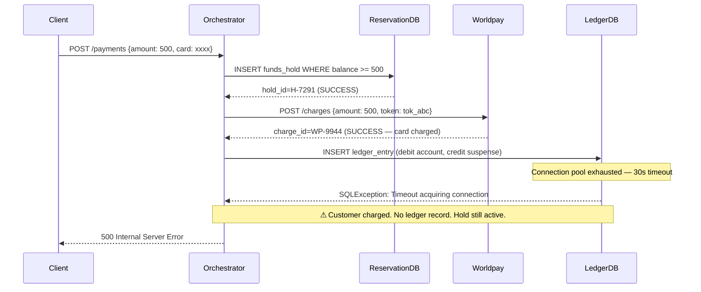
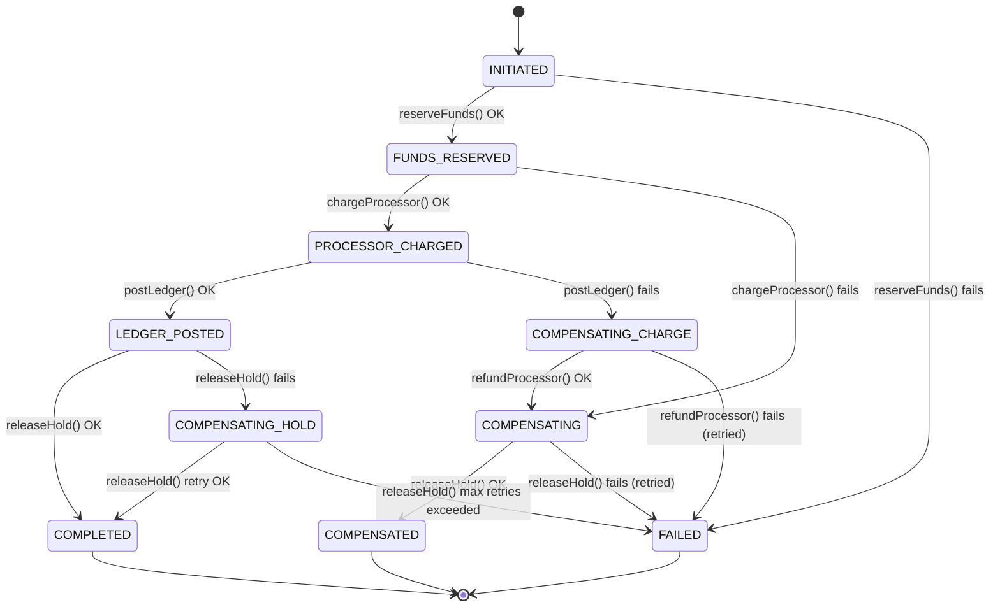

A payment that is half-committed is worse than a payment that never happened. When a customer's card is charged by an external processor but the internal ledger never records the debit, the company has collected money it cannot account for — and the customer's balance is wrong. This scenario dissects exactly that failure mode, examines why standard database transactions cannot prevent it, and teaches you to build a compensation-based saga that recovers reliably even when the recovery itself fails.

## Learning Objectives

By the end of this lesson you will be able to:

- Describe the exact sequence of events that creates an inconsistent partial-payment state
- Explain why ACID database transactions and XA/2PC cannot span external HTTP calls
- Design a saga state machine for multi-step payment orchestration
- Implement idempotent compensation calls to an external processor's reversal API
- Persist compensation work to a durable store so it survives application restarts
- Build a background scheduler that retries failed compensations with bounded backoff
- Write integration tests that assert compensation behaviour when a specific step fails

## Business Context

Apex Payments operates an orchestrated payment flow for 2.3 million monthly active customers across six European markets. Each payment crosses four system boundaries: the internal funds reservation service, the external card processor (Worldpay or Adyen depending on the merchant's acquirer), the internal double-entry ledger, and the funds release service.

In a six-week period, the team observes 47 incidents where the card processor reports a successful charge but the internal ledger shows no corresponding debit. The incidents cluster around database connection pool exhaustion events — the ledger database is saturated during peak hours (08:00–09:30 CET), and the JDBC connection acquisition times out after 30 seconds. By that point Worldpay has already captured the funds.

The financial impact: €184,000 in charges that cannot be matched to ledger entries, triggering manual reconciliation, delayed settlements, and three regulatory breach notifications under PSD2 Article 83 (transaction record-keeping obligations). The engineering team must produce a durable, automated fix within two sprints.

## The Anatomy of Partial Failure

The payment orchestration service executes four steps in sequence. Each step is a distinct I/O operation crossing a system boundary. There is no shared transaction wrapping all four — that is the fundamental architectural reality you must work within.

```
Step 1: Reserve Funds    → Internal DB (holds $500 against account balance)
Step 2: Charge Processor → External HTTP (Worldpay captures $500)
Step 3: Post Ledger      → Internal DB (records debit/credit pair)
Step 4: Release Hold     → Internal DB (removes the funds reservation)
```

When Step 3 fails after Step 2 succeeds, the system is in an inconsistent state:



The state after this failure:

| System | State |
|--------|-------|
| Worldpay | Charge WP-9944 captured: $500 debited from card |
| Funds Reservation | Hold H-7291 still active: $500 locked in account |
| Ledger | No entry — as if the payment never happened |
| Customer balance | Unchanged (no debit posted) |

The company has collected money it has no record of. The customer's account shows $500 available that is actually gone. This is not a recoverable inconsistency — it requires active compensation.

## Why Database Transactions Cannot Help

The instinct of every ACID-trained engineer is to wrap the whole thing in a transaction. That instinct is correct within a single database. It breaks completely the moment Step 2 enters the picture.

A database `BEGIN / COMMIT` block can atomically protect Steps 1, 3, and 4 within the same RDBMS. But Step 2 — the HTTP call to Worldpay — cannot participate in a database transaction. HTTP has no concept of a prepare phase, a commit phase, or a rollback. The moment `POST /charges` returns `200 OK`, real money has moved. There is no `ROLLBACK` for a card capture.

> [!NOTE]
> XA (eXtended Architecture) and two-phase commit (2PC) exist precisely to coordinate transactions across multiple resource managers — typically two databases or a database and a JMS broker. But XA requires both participants to implement the XA interface: a `prepare()` call that tentatively reserves the work, followed by a coordinated `commit()` or `rollback()`. Worldpay's REST API does not implement XA. No external payment processor does. XA cannot span arbitrary HTTP calls.

Even within systems that do support XA, it is falling out of favour for distributed systems because a coordinator crash during the prepared-but-not-committed window leaves all participants blocked indefinitely. Modern distributed systems use saga patterns instead precisely because they work without shared transaction coordinators.

```java
// THIS DOES NOT WORK — the external call is outside the transaction boundary
@Transactional  // only protects the DB operations in the same DataSource
public PaymentResult processPayment(PaymentRequest request) {
    // Step 1: protected by @Transactional
    fundsReservationRepository.save(new FundsHold(request));

    // Step 2: NOT protected — this HTTP call commits real money immediately
    // If anything after this throws, @Transactional rolls back the DB,
    // but the Worldpay charge CANNOT be rolled back automatically.
    ProcessorResponse charge = worldpayClient.charge(request);

    // Step 3: protected by @Transactional — but Step 2 is already final
    ledgerRepository.save(new LedgerEntry(charge));

    // Step 4: protected by @Transactional
    fundsReservationRepository.releaseHold(request.getAccountId());

    return PaymentResult.success(charge.getChargeId());
}
// If Step 3 throws: @Transactional rolls back Steps 1 and 4 (DB operations)
// But Step 2 (Worldpay charge) is ALREADY committed. Money is gone.
```

> [!WARNING]
> Annotating a method `@Transactional` and placing an external HTTP call inside it creates a silent correctness hazard. The `@Transactional` annotation gives a false sense of atomicity. Steps before and after the HTTP call will roll back on exception. The HTTP call will not. This is the most common source of partial-failure bugs in payment services.

The correct architecture acknowledges that you are composing operations across systems that have independent failure modes. The pattern for this is the **saga**.

## The Saga Pattern and Compensation

A saga decomposes a long-running business transaction into a sequence of local transactions, each with a corresponding **compensating transaction** that undoes its effect if a later step fails.

For payment orchestration:

| Step | Forward Action | Compensating Action |
|------|---------------|---------------------|
| 1 | Reserve funds (create hold) | Release hold |
| 2 | Charge external processor | Refund/reverse charge |
| 3 | Post ledger entry | Reverse ledger entry |
| 4 | Release hold | (terminal — no compensation needed) |

The key insight: when Step 3 fails, the saga does not roll forward. It **compensates backwards**, executing the compensating actions for Steps 2 and 1 in reverse order.



## The Saga State Table

Every saga execution is persisted to the database. This record is the source of truth for what has been done, what needs to be compensated, and what compensations are outstanding.

```sql
CREATE TABLE payment_sagas (
    saga_id             UUID            PRIMARY KEY DEFAULT gen_random_uuid(),
    payment_id          UUID            NOT NULL,
    account_id          UUID            NOT NULL,
    amount_cents        BIGINT          NOT NULL,
    currency            CHAR(3)         NOT NULL,

    state               VARCHAR(30)     NOT NULL DEFAULT 'INITIATED',
    -- Allowed values:
    -- INITIATED, FUNDS_RESERVED, PROCESSOR_CHARGED, LEDGER_POSTED,
    -- COMPLETED, COMPENSATING_CHARGE, COMPENSATING, COMPENSATED, FAILED

    -- References to work already done (needed for compensation)
    hold_id             VARCHAR(100),   -- internal funds reservation ID
    processor_charge_id VARCHAR(100),   -- Worldpay/Adyen charge ID
    ledger_entry_id     UUID,           -- internal ledger entry ID

    -- Outstanding compensation work (JSON array of pending actions)
    compensation_actions JSONB          NOT NULL DEFAULT '[]',
    -- Example:
    -- [
    --   {"action": "REFUND_PROCESSOR", "chargeId": "WP-9944", "attempts": 2},
    --   {"action": "RELEASE_HOLD",     "holdId":   "H-7291",  "attempts": 0}
    -- ]

    compensation_attempts INT           NOT NULL DEFAULT 0,
    last_compensation_at  TIMESTAMPTZ,
    failure_reason        TEXT,

    created_at          TIMESTAMPTZ     NOT NULL DEFAULT NOW(),
    updated_at          TIMESTAMPTZ     NOT NULL DEFAULT NOW()
);

-- Index for the background compensation scheduler
CREATE INDEX idx_payment_sagas_compensation
    ON payment_sagas (state, updated_at)
    WHERE state IN ('COMPENSATING_CHARGE', 'COMPENSATING', 'COMPENSATING_HOLD');

-- Index for idempotent lookups by payment_id
CREATE UNIQUE INDEX idx_payment_sagas_payment_id
    ON payment_sagas (payment_id);
```

> [!NOTE]
> The `compensation_actions` JSONB column stores the work that must be done to compensate the saga. When the compensating background process picks up a saga, it reads this column to know exactly what to call and with what parameters. This decouples the compensation logic from the state transition logic.

## Java Implementation: PaymentSagaOrchestrator

The orchestrator is the class that drives the saga forward. It owns the state transitions and persists every transition to the database before making the corresponding external call.

```java
@Service
@RequiredArgsConstructor
@Slf4j
public class PaymentSagaOrchestrator {

    private final PaymentSagaRepository sagaRepository;
    private final FundsReservationService reservationService;
    private final ProcessorClient processorClient;
    private final LedgerService ledgerService;
    private final CompensationScheduler compensationScheduler;

    /**
     * Entry point. Creates the saga record and drives it forward.
     * Returns when the saga reaches COMPLETED or hands off to compensation.
     */
    @Transactional  // protects only the initial saga row creation
    public SagaResult initiatePayment(PaymentRequest request) {
        // Create the saga record — this is the first durable write
        PaymentSaga saga = PaymentSaga.builder()
                .paymentId(request.getPaymentId())
                .accountId(request.getAccountId())
                .amountCents(request.getAmountCents())
                .currency(request.getCurrency())
                .state(SagaState.INITIATED)
                .compensationActions(List.of())
                .build();
        sagaRepository.save(saga);

        // Drive the saga steps outside the transaction boundary
        // Each step persists its own state transition
        return executeSaga(saga, request);
    }

    private SagaResult executeSaga(PaymentSaga saga, PaymentRequest request) {
        try {
            // Step 1: Reserve funds
            String holdId = reservationService.reserveFunds(
                    saga.getAccountId(), saga.getAmountCents(), saga.getCurrency());
            transitionTo(saga, SagaState.FUNDS_RESERVED,
                    s -> s.setHoldId(holdId));

            // Step 2: Charge the external processor
            ProcessorCharge charge = processorClient.charge(
                    request.getCardToken(), saga.getAmountCents(), saga.getCurrency(),
                    saga.getSagaId().toString());  // sagaId as idempotency key
            transitionTo(saga, SagaState.PROCESSOR_CHARGED,
                    s -> {
                        s.setProcessorChargeId(charge.getChargeId());
                        // Record compensation action — if ledger post fails, we must refund
                        s.addCompensationAction(CompensationAction.refundProcessor(charge.getChargeId()));
                        s.addCompensationAction(CompensationAction.releaseHold(holdId));
                    });

            // Step 3: Post to internal ledger
            UUID ledgerEntryId = ledgerService.postPaymentDebit(
                    saga.getAccountId(), saga.getAmountCents(), saga.getCurrency(),
                    charge.getChargeId());
            transitionTo(saga, SagaState.LEDGER_POSTED,
                    s -> {
                        s.setLedgerEntryId(ledgerEntryId);
                        // Ledger posted successfully — refund is no longer needed
                        // Only the hold release remains
                        s.clearCompensationActions();
                    });

            // Step 4: Release the funds hold
            reservationService.releaseHold(holdId);
            transitionTo(saga, SagaState.COMPLETED, s -> {
                s.setCompensationActions(List.of());
            });

            return SagaResult.success(saga.getSagaId(), charge.getChargeId());

        } catch (InsufficientFundsException e) {
            transitionTo(saga, SagaState.FAILED,
                    s -> s.setFailureReason("Insufficient funds: " + e.getMessage()));
            return SagaResult.declined(saga.getSagaId(), "INSUFFICIENT_FUNDS");

        } catch (Exception e) {
            // Any other failure after Step 2 means we have a compensation obligation
            log.error("Saga {} failed at state {}. Scheduling compensation.",
                    saga.getSagaId(), saga.getState(), e);
            scheduleCompensation(saga, e);
            return SagaResult.pending(saga.getSagaId(),
                    "Payment is being reversed. Reference: " + saga.getSagaId());
        }
    }

    /**
     * Transitions the saga to a new state, applying the given mutation,
     * and persists the transition. Each call is a separate DB write.
     */
    private void transitionTo(PaymentSaga saga, SagaState newState,
                               Consumer<PaymentSaga> mutation) {
        saga.setState(newState);
        mutation.accept(saga);
        saga.setUpdatedAt(Instant.now());
        sagaRepository.save(saga);
        log.info("Saga {} transitioned to {}", saga.getSagaId(), newState);
    }

    private void scheduleCompensation(PaymentSaga saga, Exception cause) {
        SagaState compensatingState = switch (saga.getState()) {
            case PROCESSOR_CHARGED -> SagaState.COMPENSATING_CHARGE;
            case FUNDS_RESERVED    -> SagaState.COMPENSATING;
            default                -> SagaState.FAILED;
        };
        transitionTo(saga, compensatingState,
                s -> s.setFailureReason(cause.getMessage()));
    }
}
```

```java
// SagaState enum
public enum SagaState {
    INITIATED,
    FUNDS_RESERVED,
    PROCESSOR_CHARGED,
    LEDGER_POSTED,
    COMPLETED,
    COMPENSATING_CHARGE,   // must refund processor AND release hold
    COMPENSATING,          // must only release hold
    COMPENSATING_HOLD,     // ledger post succeeded, only hold release failed
    COMPENSATED,           // all compensations done
    FAILED                 // terminal failure — manual intervention required
}
```

## Idempotent Compensation

The compensation step calls the processor's refund API. This call **must be idempotent**. The background scheduler will retry it if it fails. Without idempotency, a network timeout followed by a retry could issue two refunds — giving the customer double their money back.

The idempotency mechanism: pass the `saga_id` as the idempotency key on the refund request. The external processor deduplicates on this key — a second `POST /refunds` with the same idempotency key returns the same refund response without creating a new refund.

```java
@Service
@RequiredArgsConstructor
@Slf4j
public class ProcessorRefundClient {

    private final RestTemplate restTemplate;
    private final ProcessorProperties props;

    /**
     * Issues a refund for the given charge. Idempotent: calling this multiple
     * times with the same sagaId will not create duplicate refunds.
     *
     * @param chargeId  The processor's charge reference (e.g., WP-9944)
     * @param sagaId    Used as the idempotency key — stable across retries
     */
    public RefundResponse refund(String chargeId, String sagaId,
                                 long amountCents, String currency) {
        RefundRequest body = RefundRequest.builder()
                .chargeId(chargeId)
                .amountCents(amountCents)
                .currency(currency)
                .build();

        HttpHeaders headers = new HttpHeaders();
        headers.set("Idempotency-Key", "refund-" + sagaId);
        headers.setContentType(MediaType.APPLICATION_JSON);

        try {
            ResponseEntity<RefundResponse> response = restTemplate.exchange(
                    props.getBaseUrl() + "/refunds",
                    HttpMethod.POST,
                    new HttpEntity<>(body, headers),
                    RefundResponse.class);

            log.info("Refund issued for charge {} (saga {}): refund_id={}",
                    chargeId, sagaId, response.getBody().getRefundId());
            return response.getBody();

        } catch (HttpClientErrorException.UnprocessableEntity e) {
            // 422: charge already fully refunded — idempotent success
            log.info("Charge {} already refunded (saga {}). Treating as success.", chargeId, sagaId);
            return RefundResponse.alreadyRefunded(chargeId);
        }
        // Any other exception propagates — the scheduler will retry
    }
}
```

> [!IMPORTANT]
> The idempotency key must be **stable and unique per logical refund attempt**, not per HTTP call. Using `UUID.randomUUID()` as the idempotency key on each retry would create a new refund on each attempt. Use the `saga_id` — it is stable for the lifetime of the saga and uniquely identifies this specific compensation obligation.

## Compensation Failure Handling: The Persistent Compensation Queue

What happens when the refund call itself fails? The processor could be down. The network could be congested. The service could restart mid-retry.

The answer: the saga record in the database **is** the compensation queue. As long as the saga row exists in state `COMPENSATING_CHARGE` or `COMPENSATING`, the background scheduler will keep retrying. Even if the entire application restarts, the scheduler queries the database on startup and resumes all in-flight compensations.

This is the outbox pattern applied to compensations: the durable store (Postgres) guarantees that compensation work is never lost, regardless of application-level failures.

```java
@Component
@RequiredArgsConstructor
@Slf4j
public class CompensationScheduler {

    private final PaymentSagaRepository sagaRepository;
    private final ProcessorRefundClient refundClient;
    private final FundsReservationService reservationService;
    private final LedgerService ledgerService;

    private static final int MAX_ATTEMPTS = 10;
    private static final Duration BASE_BACKOFF = Duration.ofSeconds(10);

    /**
     * Runs every 30 seconds. Picks up all sagas in a compensating state
     * and retries their compensation actions.
     */
    @Scheduled(fixedDelay = 30_000)
    @Transactional
    public void processOutstandingCompensations() {
        List<PaymentSaga> pending = sagaRepository
                .findAllByStateInAndCompensationAttemptsLessThan(
                        List.of(SagaState.COMPENSATING_CHARGE,
                                SagaState.COMPENSATING,
                                SagaState.COMPENSATING_HOLD),
                        MAX_ATTEMPTS);

        log.info("Compensation scheduler: {} saga(s) require attention", pending.size());

        for (PaymentSaga saga : pending) {
            try {
                compensate(saga);
            } catch (Exception e) {
                log.warn("Compensation attempt {} failed for saga {}: {}",
                        saga.getCompensationAttempts() + 1, saga.getSagaId(), e.getMessage());
                incrementAttempts(saga, e);
            }
        }
    }

    private void compensate(PaymentSaga saga) {
        switch (saga.getState()) {
            case COMPENSATING_CHARGE -> {
                // Must refund processor, then release hold
                refundClient.refund(
                        saga.getProcessorChargeId(),
                        saga.getSagaId().toString(),
                        saga.getAmountCents(),
                        saga.getCurrency());
                saga.setState(SagaState.COMPENSATING);
                // Fall through to release hold
                releaseHold(saga);
                saga.setState(SagaState.COMPENSATED);
            }
            case COMPENSATING -> {
                // Processor refunded (or was never charged). Just release hold.
                releaseHold(saga);
                saga.setState(SagaState.COMPENSATED);
            }
            case COMPENSATING_HOLD -> {
                // Ledger posted, processor not charged. Just release hold.
                releaseHold(saga);
                saga.setState(SagaState.COMPLETED);
            }
        }
        saga.setLastCompensationAt(Instant.now());
        sagaRepository.save(saga);
        log.info("Saga {} compensation completed. Final state: {}", saga.getSagaId(), saga.getState());
    }

    private void releaseHold(PaymentSaga saga) {
        if (saga.getHoldId() != null) {
            reservationService.releaseHold(saga.getHoldId());
        }
    }

    private void incrementAttempts(PaymentSaga saga, Exception e) {
        saga.setCompensationAttempts(saga.getCompensationAttempts() + 1);
        saga.setLastCompensationAt(Instant.now());
        if (saga.getCompensationAttempts() >= MAX_ATTEMPTS) {
            saga.setState(SagaState.FAILED);
            saga.setFailureReason("Max compensation attempts exceeded: " + e.getMessage());
            log.error("Saga {} exceeded max compensation attempts. Manual intervention required.",
                    saga.getSagaId());
            // Alert: publish to PagerDuty / internal alerting
        }
        sagaRepository.save(saga);
    }
}
```

> [!WARNING]
> When `MAX_ATTEMPTS` is reached and the saga is marked `FAILED`, it must trigger an operational alert. A saga stuck in `FAILED` after exhausting retries means a customer was charged and no refund was successfully issued. This is a P1 incident requiring manual remediation and potentially a regulatory notification under PSD2. Silence is not acceptable — `FAILED` sagas must page someone.

## The JPA Entity

```java
@Entity
@Table(name = "payment_sagas")
@Data
@Builder
@NoArgsConstructor
@AllArgsConstructor
public class PaymentSaga {

    @Id
    @GeneratedValue(strategy = GenerationType.UUID)
    private UUID sagaId;

    @Column(nullable = false, unique = true)
    private UUID paymentId;

    @Column(nullable = false)
    private UUID accountId;

    @Column(nullable = false)
    private Long amountCents;

    @Column(nullable = false, length = 3)
    private String currency;

    @Enumerated(EnumType.STRING)
    @Column(nullable = false, length = 30)
    private SagaState state;

    private String holdId;
    private String processorChargeId;
    private UUID ledgerEntryId;

    @Type(JsonType.class)  // Hibernate Types for JSONB
    @Column(columnDefinition = "jsonb")
    private List<CompensationAction> compensationActions;

    @Column(nullable = false)
    @Builder.Default
    private int compensationAttempts = 0;

    private Instant lastCompensationAt;
    private String failureReason;

    @Column(nullable = false)
    private Instant createdAt;

    @Column(nullable = false)
    private Instant updatedAt;

    @PrePersist
    void onCreate() {
        createdAt = Instant.now();
        updatedAt = Instant.now();
        if (compensationActions == null) compensationActions = new ArrayList<>();
    }

    @PreUpdate
    void onUpdate() {
        updatedAt = Instant.now();
    }

    public void addCompensationAction(CompensationAction action) {
        if (this.compensationActions == null) this.compensationActions = new ArrayList<>();
        this.compensationActions.add(action);
    }

    public void clearCompensationActions() {
        this.compensationActions = new ArrayList<>();
    }
}
```

```java
@Value
@Builder
@JsonDeserialize(builder = CompensationAction.CompensationActionBuilder.class)
public class CompensationAction {

    public enum ActionType { REFUND_PROCESSOR, RELEASE_HOLD, REVERSE_LEDGER }

    ActionType action;
    String chargeId;
    String holdId;
    UUID ledgerEntryId;
    int attempts;

    public static CompensationAction refundProcessor(String chargeId) {
        return CompensationAction.builder()
                .action(ActionType.REFUND_PROCESSOR)
                .chargeId(chargeId)
                .attempts(0)
                .build();
    }

    public static CompensationAction releaseHold(String holdId) {
        return CompensationAction.builder()
                .action(ActionType.RELEASE_HOLD)
                .holdId(holdId)
                .attempts(0)
                .build();
    }
}
```

## Testing Partial Failures

The integration test simulates Step 3 (ledger post) failing after Step 2 (processor charge) has succeeded. The assertion verifies that the compensation was persisted to the database with the correct state and that the background scheduler eventually executes it.

```java
@SpringBootTest
@Transactional
class PaymentSagaCompensationIntegrationTest {

    @Autowired
    private PaymentSagaOrchestrator orchestrator;

    @Autowired
    private PaymentSagaRepository sagaRepository;

    @MockBean
    private LedgerService ledgerService;

    @MockBean
    private ProcessorRefundClient refundClient;

    @MockBean
    private FundsReservationService reservationService;

    @Autowired
    private CompensationScheduler compensationScheduler;

    @Test
    @DisplayName("When ledger post fails after processor charge, saga enters COMPENSATING_CHARGE and compensation is persisted")
    void whenLedgerPostFails_thenCompensationIsPersisted() {
        // Arrange
        UUID paymentId = UUID.randomUUID();
        PaymentRequest request = PaymentRequest.builder()
                .paymentId(paymentId)
                .accountId(UUID.randomUUID())
                .amountCents(50000L)  // $500.00
                .currency("USD")
                .cardToken("tok_test_visa")
                .build();

        // Step 1 (reserve funds): succeeds
        given(reservationService.reserveFunds(any(), anyLong(), anyString()))
                .willReturn("H-7291");

        // Step 2 (charge processor): succeeds — money is captured
        given(processorClient.charge(any(), anyLong(), anyString(), anyString()))
                .willReturn(ProcessorCharge.builder().chargeId("WP-9944").build());

        // Step 3 (post ledger): FAILS — simulates connection pool exhaustion
        given(ledgerService.postPaymentDebit(any(), anyLong(), anyString(), anyString()))
                .willThrow(new DataAccessResourceFailureException(
                        "Timeout acquiring JDBC connection after 30000ms"));

        // Act
        SagaResult result = orchestrator.initiatePayment(request);

        // Assert: result indicates pending compensation
        assertThat(result.getStatus()).isEqualTo(SagaResult.Status.PENDING_COMPENSATION);

        // Assert: saga was persisted in COMPENSATING_CHARGE state
        PaymentSaga saga = sagaRepository.findByPaymentId(paymentId).orElseThrow();
        assertThat(saga.getState()).isEqualTo(SagaState.COMPENSATING_CHARGE);
        assertThat(saga.getProcessorChargeId()).isEqualTo("WP-9944");
        assertThat(saga.getHoldId()).isEqualTo("H-7291");
        assertThat(saga.getCompensationActions()).hasSize(2);
        assertThat(saga.getCompensationActions())
                .extracting(a -> a.getAction().name())
                .containsExactly("REFUND_PROCESSOR", "RELEASE_HOLD");
    }

    @Test
    @DisplayName("Background scheduler executes compensation and transitions saga to COMPENSATED")
    void compensationScheduler_whenRun_executesCompensationAndMarksDone() {
        // Arrange: pre-seed a saga in COMPENSATING_CHARGE state
        PaymentSaga saga = buildSagaInCompensatingChargeState();
        sagaRepository.save(saga);

        given(refundClient.refund(eq("WP-9944"), eq(saga.getSagaId().toString()),
                eq(50000L), eq("USD")))
                .willReturn(RefundResponse.builder().refundId("RF-1234").build());
        given(reservationService.releaseHold(eq("H-7291")))
                .willReturn(true);  // idempotent — does not throw if hold already released

        // Act: run the scheduler manually
        compensationScheduler.processOutstandingCompensations();

        // Assert: saga is now COMPENSATED
        PaymentSaga updated = sagaRepository.findById(saga.getSagaId()).orElseThrow();
        assertThat(updated.getState()).isEqualTo(SagaState.COMPENSATED);
        assertThat(updated.getLastCompensationAt()).isNotNull();

        // Assert: refund was called exactly once
        then(refundClient).should(times(1))
                .refund(eq("WP-9944"), anyString(), anyLong(), anyString());
    }

    @Test
    @DisplayName("When compensation refund call fails, attempt count increments and saga stays in COMPENSATING_CHARGE")
    void whenRefundFails_attemptCountIncrementsAndSagaRemainsCompensating() {
        PaymentSaga saga = buildSagaInCompensatingChargeState();
        sagaRepository.save(saga);

        given(refundClient.refund(any(), any(), anyLong(), any()))
                .willThrow(new ProcessorUnavailableException("Worldpay gateway timeout"));

        compensationScheduler.processOutstandingCompensations();

        PaymentSaga updated = sagaRepository.findById(saga.getSagaId()).orElseThrow();
        assertThat(updated.getState()).isEqualTo(SagaState.COMPENSATING_CHARGE);
        assertThat(updated.getCompensationAttempts()).isEqualTo(1);
    }

    private PaymentSaga buildSagaInCompensatingChargeState() {
        return PaymentSaga.builder()
                .paymentId(UUID.randomUUID())
                .accountId(UUID.randomUUID())
                .amountCents(50000L)
                .currency("USD")
                .state(SagaState.COMPENSATING_CHARGE)
                .holdId("H-7291")
                .processorChargeId("WP-9944")
                .compensationActions(List.of(
                        CompensationAction.refundProcessor("WP-9944"),
                        CompensationAction.releaseHold("H-7291")))
                .compensationAttempts(0)
                .build();
    }
}
```

> [!NOTE]
> Notice that `CompensationScheduler` is not annotated `@MockBean` in the second and third tests — it is the **system under test**. The `LedgerService`, `ProcessorRefundClient`, and `FundsReservationService` are mocked because they cross external boundaries. The saga repository and the in-memory H2 database (or Testcontainers Postgres) are real. This gives you confidence that the state transitions, SQL queries, and retry logic all work correctly as an integrated unit.

## Operational Observability

A saga state machine without observability is a black box. Add these metrics and log events at every state transition:

```java
// In transitionTo():
meterRegistry.counter("payment_saga.transition",
        "from", previousState.name(),
        "to", newState.name()).increment();

// On compensation start:
meterRegistry.counter("payment_saga.compensation_started",
        "trigger_state", saga.getState().name()).increment();

// On compensation success:
meterRegistry.counter("payment_saga.compensation_completed").increment();

// On FAILED terminal state:
meterRegistry.counter("payment_saga.terminal_failure").increment();
// Also alert:
alertingService.page("SAGA_TERMINAL_FAILURE",
        Map.of("saga_id", saga.getSagaId().toString(),
               "payment_id", saga.getPaymentId().toString()));
```

Dashboards to build: (1) saga success rate by state; (2) sagas currently in a compensating state (should be near-zero in steady state); (3) sagas in `FAILED` state (must be zero — alert immediately if non-zero); (4) P95 compensation latency from failure to `COMPENSATED`.

## Knowledge Check

**Q1: A developer proposes wrapping all four payment steps in a single `@Transactional` method to ensure atomicity. Under what exact condition does this fail, and what is the resulting system state?**

The `@Transactional` boundary protects only operations on the same JDBC `DataSource`. When Step 2 — the HTTP call to the external payment processor — returns successfully, the processor has captured the funds. This is irreversible from the database's perspective. If Step 3 (ledger post) subsequently throws any exception, Spring's transaction manager rolls back the JDBC operations (Steps 1, 3, 4), but cannot reverse the HTTP call that already returned 200. The resulting state: the funds reservation is released (rolled back), the ledger has no entry, but the customer's card has been charged. The company has collected real money with no internal record. This is a P1 incident.

**Q2: The compensation background scheduler retries refund calls up to 10 times. What two properties must the external processor's refund API exhibit to make this safe, and how do you enforce them from the caller's side?**

The refund API must be (1) **idempotent** — calling `POST /refunds` multiple times with the same parameters must produce one refund, not multiple refunds — and (2) **deterministic on conflict** — if the refund has already been issued, it must return a success response (or a stable `already_refunded` indicator), never an error that could cause the caller to give up prematurely. From the caller's side, you enforce idempotency by passing a stable `Idempotency-Key` header on every call, using the `saga_id` as the key value. The key must not change between retry attempts. You enforce determinism by explicitly handling the `already_refunded` response code as a success case in your client code, so the scheduler marks the compensation done rather than retrying indefinitely.

## Practical Challenge

**Scenario:** Apex Payments is adding a fourth downstream step: after the ledger post, the payment orchestrator must call an internal **Fraud Scoring Service** (Step 3.5) that updates the customer's real-time fraud model. This call is optional — if it fails, the payment should still complete (the ledger post already happened). However, if the fraud scoring service is unavailable for more than 15 minutes, the risk team wants a backlog of missed scoring events persisted to a table so they can be replayed later.

**Your tasks:**

1. Add a `FRAUD_SCORING_PENDING` state to the `SagaState` enum. Decide whether this state needs a compensating state. Justify your answer.

2. Modify `PaymentSagaOrchestrator.executeSaga()` to call the fraud scoring service after `LEDGER_POSTED` but before `COMPLETED`. Catch `FraudScoringUnavailableException` specifically and transition to `FRAUD_SCORING_PENDING` without triggering payment compensation (the customer's payment was successful).

3. Create a `missed_fraud_scores` table schema with columns for the saga reference, account, amount, timestamp, and retry count.

4. Modify `CompensationScheduler` to also process `FRAUD_SCORING_PENDING` sagas: retry the fraud scoring call, and on success transition the saga to `COMPLETED`. On exhaustion of retries, mark the saga `COMPLETED` anyway (payment was successful) but write a record to `missed_fraud_scores` for the risk team.

5. Write one integration test: simulate the fraud scoring service being unavailable, assert the payment result is `SUCCESS` (not `PENDING_COMPENSATION`), and assert that after the scheduler runs, the saga reaches `COMPLETED` and a `missed_fraud_scores` record exists.

**Stretch goal:** The fraud scoring service eventually comes back online after 20 minutes. Implement a reconciliation endpoint `POST /admin/replay-fraud-scores` that reads all `missed_fraud_scores` records and replays them to the fraud service, with appropriate idempotency protection.

<!-- KNOWLEDGE-CHECK
{
  "questions": [
    {
      "text": "A developer wraps all four payment saga steps in a single @Transactional method. The external card processor succeeds in Step 2 but the ledger post in Step 3 throws an exception. What is the resulting system state?",
      "options": [
        "All four steps are rolled back atomically, including the processor charge",
        "The processor charge is irreversible; funds reservation and ledger are rolled back, leaving the customer charged with no internal record",
        "The @Transactional annotation retries the failed step automatically",
        "The database rolls back all steps but queues the processor charge for a compensating refund"
      ],
      "correct": 1,
      "explanation": "The @Transactional boundary only protects JDBC operations. The HTTP call to the external processor already returned 200 — the processor has captured the funds, which cannot be undone by a database rollback. The resulting state is: funds reservation released, ledger empty, but the customer's card charged. This is a P1 incident."
    },
    {
      "text": "The compensation scheduler retries the external processor's refund API up to 10 times. What two properties must the refund API exhibit for this to be safe?",
      "options": [
        "High availability and low latency",
        "Idempotency (calling with the same parameters produces one refund, not multiple) and deterministic success response on conflict (already-refunded returns success, not error)",
        "REST compliance and OAuth 2.0 authentication",
        "Synchronous processing and sub-100ms response times"
      ],
      "correct": 1,
      "explanation": "The refund API must be idempotent (multiple calls with the same saga_id as Idempotency-Key produce exactly one refund) and must return a stable success indicator if the refund already exists rather than an error. Without idempotency, 10 retries could produce 10 refunds. Without deterministic success on conflict, the scheduler would treat already-issued refunds as failures and exhaust its retry budget."
    },
    {
      "text": "A saga reaches FAILED state after exhausting all compensation retries. The compensation was for a processor refund that could not be issued. What is the required operational response?",
      "options": [
        "The FAILED state can be ignored — the saga framework will eventually recover",
        "A P1 incident must be raised immediately: a customer was charged and no refund was successfully issued, requiring manual remediation and potentially regulatory notification",
        "The finance team should simply write off the amount as an operational loss",
        "The failed saga can be retried by restarting the application"
      ],
      "correct": 1,
      "explanation": "A FAILED saga after exhausted compensation retries means a customer was charged and the automated refund mechanism failed completely. This is a P1 incident requiring immediate manual intervention: manual refund processing through the processor portal, root cause analysis, and potentially regulatory notification under PSD2 Article 71 (payment execution liability). Silence is not acceptable."
    }
  ]
}
-->

<!-- PRACTICAL-CHALLENGE
{
  "title": "Extend the Payment Saga with Optional Fraud Scoring",
  "difficulty": "advanced",
  "estimatedMinutes": 60,
  "tasks": [
    {"id": "1", "description": "Add a FRAUD_SCORING_PENDING state to SagaState. Decide whether it needs a compensating state and justify your reasoning based on whether the payment is already successful at this point."},
    {"id": "2", "description": "Modify PaymentSagaOrchestrator.executeSaga() to call the fraud scoring service after LEDGER_POSTED. Catch FraudScoringUnavailableException specifically and transition to FRAUD_SCORING_PENDING without triggering payment compensation."},
    {"id": "3", "description": "Create a missed_fraud_scores table schema with columns for saga reference, account, amount, timestamp, and retry count. Write the Flyway migration script."},
    {"id": "4", "description": "Write an integration test that simulates the fraud scoring service unavailable, asserts the payment result is SUCCESS (not PENDING_COMPENSATION), and after the scheduler runs asserts the saga reaches COMPLETED and a missed_fraud_scores record exists."}
  ]
}
-->
