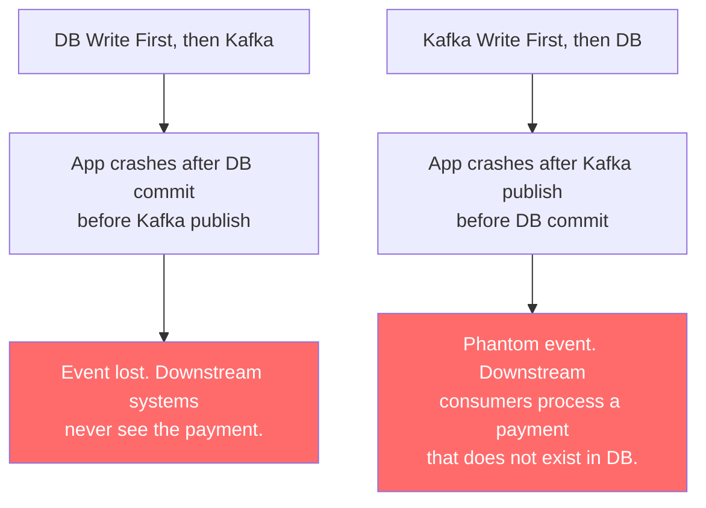
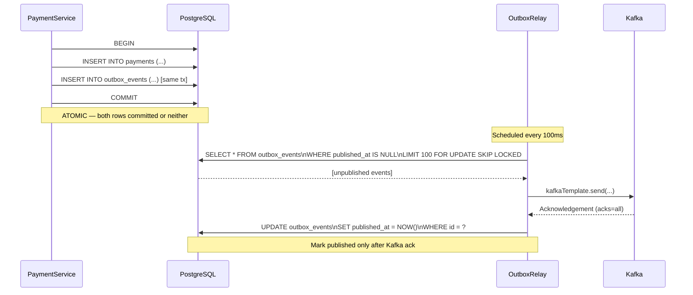
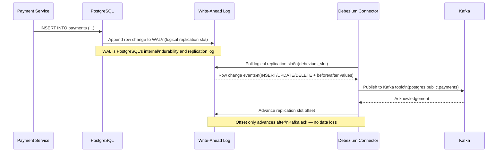

There is no distributed transaction that spans a relational database and Apache Kafka. This is not a limitation that will be fixed in the next version of either system. It is a fundamental property of how they are architected. Any code that writes to a database and then publishes to Kafka in two separate operations has a failure window — a moment in time where the application can crash and leave the two systems inconsistent. In financial systems, that inconsistency means downstream services — ledger, notifications, fraud replay, audit — never see events they need. This lesson teaches two production-grade patterns that eliminate the failure window entirely.

## Learning Objectives

By the end of this lesson you will be able to:

- Explain the dual-write problem and why neither write-ordering eliminates it
- Implement the transactional outbox pattern in a Spring Boot payment service
- Design the outbox table schema and write the relay service that publishes to Kafka
- Configure Kafka producer settings for maximum durability in a financial context
- Explain the CDC approach using Debezium and PostgreSQL WAL
- Choose between the outbox pattern and CDC based on operational constraints
- Implement idempotent Kafka consumers that handle at-least-once delivery safely

## Business Context

Apex Clearing operates a payment processing backend that serves 14 downstream consumer services: a double-entry ledger, a real-time fraud scoring engine, a notifications service (SMS/email), a regulatory reporting pipeline, an audit trail aggregator, a customer-facing mobile API, and eight additional internal consumers. All of these services receive payment events via Kafka topics.

After a production incident caused by a datacenter network partition, the engineering team reviews their payment completion flow. The service writes the payment record to Postgres and then publishes a `PaymentCompleted` event to Kafka. During the partition, Kafka was unreachable for 4 minutes. In that window, 2,841 payments were committed to the database but no Kafka events were published. All 14 downstream services missed these payments.

The impact: the ledger is missing 2,841 entries totalling £4.2M. The fraud engine missed the transactions entirely. The regulatory reporting pipeline has a 4-minute gap. The engineering team must reconstruct the missing events from the database (they can, because the data is there), but the incident should never have happened — and manual reconstruction is not an acceptable steady-state recovery procedure.

The fix must guarantee that every committed payment eventually reaches Kafka, even if Kafka is temporarily unavailable, even if the application crashes at any point in the process.

## The Dual-Write Problem

A "dual write" occurs whenever application code writes to two independent systems sequentially, treating the combination as if it were atomic. It is not. Here is the payment completion code that every team eventually writes first:

```java
// THE NAIVE APPROACH — has a critical failure window
@Service
@RequiredArgsConstructor
public class PaymentCompletionService {

    private final PaymentRepository paymentRepository;
    private final KafkaTemplate<String, PaymentCompletedEvent> kafkaTemplate;

    @Transactional  // protects only the DB write
    public void completePayment(Payment payment) {
        // Write 1: persist to database
        paymentRepository.save(payment);  // DB commit happens here

        // ---- APPLICATION CAN CRASH HERE ----
        // DB committed. Kafka publish has not happened.
        // Downstream services will never see this payment.

        // Write 2: publish to Kafka
        kafkaTemplate.send("payments.completed",
                payment.getPaymentId().toString(),
                new PaymentCompletedEvent(payment));
    }
}
```

The `@Transactional` annotation commits the database write when `completePayment` returns. The Kafka publish happens after that commit. If the JVM crashes, the network drops, or Kafka is temporarily unavailable between those two lines, the payment exists in the database but no event is published.

The failure modes for each write ordering:



> [!WARNING]
> The phantom event scenario (Kafka first, then DB) is arguably worse than a lost event. A consumer may debit a customer's account based on a Kafka message that corresponds to a payment that was never committed to the source-of-truth database. When the customer queries their statement, the debit is there but the originating payment record is not. This is an irreconcilable inconsistency that cannot be detected without a full cross-system audit.

Neither ordering is safe. The only safe solution is to make both writes atomic with respect to each other — which requires involving them in the same transaction boundary.

## The Transactional Outbox Pattern

The core insight: a database can atomically write to two tables in a single transaction. Use this property to your advantage. Instead of writing to Kafka directly, write an **outbox record** to a database table in the same transaction as the payment record. A separate relay process then reads the outbox and publishes to Kafka.

The atomicity guarantee: either both the payment row and the outbox row are committed, or neither is. The relay then has a durable record of every event that must be published, with no failure window.



## Outbox Table Schema

```sql
CREATE TABLE outbox_events (
    id              UUID            PRIMARY KEY DEFAULT gen_random_uuid(),
    aggregate_type  VARCHAR(100)    NOT NULL,
    -- e.g. 'Payment', 'Account', 'Transfer'
    aggregate_id    VARCHAR(100)    NOT NULL,
    -- The business entity ID (payment_id, account_id, etc.)
    event_type      VARCHAR(100)    NOT NULL,
    -- e.g. 'PaymentCompleted', 'AccountCredited', 'TransferInitiated'
    payload         JSONB           NOT NULL,
    -- Full event payload. Include all fields needed by consumers.
    created_at      TIMESTAMPTZ     NOT NULL DEFAULT NOW(),
    published_at    TIMESTAMPTZ     -- NULL = not yet published
);

-- Index for the relay: efficiently find unpublished events in creation order
CREATE INDEX idx_outbox_events_unpublished
    ON outbox_events (created_at ASC)
    WHERE published_at IS NULL;

-- Partitioning strategy for high-volume deployments:
-- Partition by created_at (monthly). Old published partitions can be archived.
-- Unpublished events are always in the current partition (small, fast scan).
```

> [!NOTE]
> The `FOR UPDATE SKIP LOCKED` clause in the relay's SELECT query is essential when running multiple relay instances. It prevents two relay processes from picking up the same outbox record simultaneously. The `SKIP LOCKED` qualifier (available in PostgreSQL 9.5+) makes rows locked by one relay invisible to others, rather than causing them to block and wait.

## Payment Service Implementation

The payment service writes both the payment record and the outbox event in a single `@Transactional` method. This is the only change to the application layer needed to implement the outbox pattern.

```java
@Entity
@Table(name = "outbox_events")
@Data
@Builder
@NoArgsConstructor
@AllArgsConstructor
public class OutboxEvent {

    @Id
    @GeneratedValue(strategy = GenerationType.UUID)
    private UUID id;

    @Column(nullable = false, length = 100)
    private String aggregateType;

    @Column(nullable = false, length = 100)
    private String aggregateId;

    @Column(nullable = false, length = 100)
    private String eventType;

    @Type(JsonType.class)
    @Column(nullable = false, columnDefinition = "jsonb")
    private Map<String, Object> payload;

    @Column(nullable = false)
    private Instant createdAt;

    private Instant publishedAt;

    @PrePersist
    void onCreate() { createdAt = Instant.now(); }

    /**
     * Factory method: creates an outbox event from a Payment domain object.
     * All fields that downstream consumers will ever need should be included
     * in the payload at write time — consumers should not need to query back.
     */
    public static OutboxEvent fromPayment(Payment payment) {
        return OutboxEvent.builder()
                .aggregateType("Payment")
                .aggregateId(payment.getPaymentId().toString())
                .eventType("PaymentCompleted")
                .payload(Map.of(
                        "paymentId",      payment.getPaymentId().toString(),
                        "accountId",      payment.getAccountId().toString(),
                        "amountCents",    payment.getAmountCents(),
                        "currency",       payment.getCurrency(),
                        "processorRef",   payment.getProcessorReference(),
                        "completedAt",    payment.getCompletedAt().toString(),
                        "merchantId",     payment.getMerchantId().toString()
                ))
                .build();
    }
}
```

```java
@Service
@RequiredArgsConstructor
@Slf4j
public class PaymentCompletionService {

    private final PaymentRepository paymentRepository;
    private final OutboxEventRepository outboxEventRepository;

    /**
     * Completes a payment atomically. The payment record and the outbox event
     * are written in the same database transaction. If Kafka is down, the
     * outbox relay will publish the event when Kafka recovers.
     */
    @Transactional
    public Payment completePayment(CompletePaymentCommand command) {
        Payment payment = Payment.builder()
                .paymentId(command.getPaymentId())
                .accountId(command.getAccountId())
                .amountCents(command.getAmountCents())
                .currency(command.getCurrency())
                .processorReference(command.getProcessorReference())
                .merchantId(command.getMerchantId())
                .completedAt(Instant.now())
                .status(PaymentStatus.COMPLETED)
                .build();

        // Write 1: persist payment
        paymentRepository.save(payment);

        // Write 2: persist outbox event — SAME transaction, ATOMIC
        OutboxEvent outboxEvent = OutboxEvent.fromPayment(payment);
        outboxEventRepository.save(outboxEvent);

        log.info("Payment {} completed and queued for event publication (outbox_id={})",
                payment.getPaymentId(), outboxEvent.getId());

        return payment;
        // On @Transactional method exit: DB commits BOTH rows atomically.
        // Kafka is not involved at this point. No failure window.
    }
}
```

## Outbox Relay Implementation

The relay is a scheduled component that runs continuously, polling the outbox table for unpublished events and forwarding them to Kafka.

```java
@Component
@RequiredArgsConstructor
@Slf4j
public class OutboxRelay {

    private final OutboxEventRepository outboxEventRepository;
    private final KafkaTemplate<String, String> kafkaTemplate;
    private final ObjectMapper objectMapper;
    private final MeterRegistry meterRegistry;

    private static final int BATCH_SIZE = 100;
    private static final String TOPIC_PREFIX = "payments.";

    /**
     * Runs every 100ms. Publishes up to BATCH_SIZE unpublished outbox events
     * to Kafka. Marks each event published only after Kafka acknowledges it.
     */
    @Scheduled(fixedDelay = 100)
    public void relay() {
        List<OutboxEvent> unpublished = outboxEventRepository
                .findUnpublishedBatch(BATCH_SIZE);

        if (unpublished.isEmpty()) return;

        log.debug("OutboxRelay: processing {} events", unpublished.size());

        for (OutboxEvent event : unpublished) {
            publishAndMark(event);
        }
    }

    private void publishAndMark(OutboxEvent event) {
        try {
            String topic = TOPIC_PREFIX + event.getEventType().toLowerCase()
                    .replace("payment", "").concat("s");
            // e.g. PaymentCompleted -> payments.completeds  (adjust per naming convention)
            // In practice: define topic mapping explicitly
            String kafkaTopic = resolveKafkaTopic(event);

            String payload = objectMapper.writeValueAsString(event.getPayload());

            ProducerRecord<String, String> record = new ProducerRecord<>(
                    kafkaTopic,
                    null,                           // partition: let Kafka decide
                    event.getCreatedAt().toEpochMilli(),
                    event.getAggregateId(),         // key: partition by entity ID
                    payload);

            // Add headers for consumer use
            record.headers()
                    .add("event_id",        event.getId().toString().getBytes())
                    .add("event_type",      event.getEventType().getBytes())
                    .add("aggregate_type",  event.getAggregateType().getBytes())
                    .add("aggregate_id",    event.getAggregateId().getBytes());

            // Synchronous send: block until Kafka acknowledges (acks=all configured)
            // This ensures we only mark published after durable Kafka write
            kafkaTemplate.send(record).get(10, TimeUnit.SECONDS);

            // Mark published — only after confirmed Kafka ack
            outboxEventRepository.markPublished(event.getId(), Instant.now());

            meterRegistry.counter("outbox.relay.published",
                    "event_type", event.getEventType()).increment();

        } catch (TimeoutException | ExecutionException | InterruptedException e) {
            // Kafka unavailable or slow. Log and continue — event stays unpublished.
            // Scheduler will retry on next run.
            log.warn("OutboxRelay: failed to publish event {} ({}): {}",
                    event.getId(), event.getEventType(), e.getMessage());
            meterRegistry.counter("outbox.relay.failed",
                    "event_type", event.getEventType()).increment();
        } catch (JsonProcessingException e) {
            // Payload serialization failure — this is a programming error, not transient
            log.error("OutboxRelay: serialization failure for event {}. Skipping.", event.getId(), e);
            outboxEventRepository.markFailed(event.getId(), e.getMessage());
        }
    }

    private String resolveKafkaTopic(OutboxEvent event) {
        return switch (event.getEventType()) {
            case "PaymentCompleted"   -> "payments.completed";
            case "PaymentFailed"      -> "payments.failed";
            case "PaymentReversed"    -> "payments.reversed";
            case "AccountCredited"    -> "accounts.credited";
            default -> throw new IllegalArgumentException(
                    "No Kafka topic mapped for event type: " + event.getEventType());
        };
    }
}
```

```java
// Repository method using SKIP LOCKED for concurrent relay safety
@Repository
public interface OutboxEventRepository extends JpaRepository<OutboxEvent, UUID> {

    @Query(value = """
            SELECT * FROM outbox_events
            WHERE published_at IS NULL
              AND failed_at IS NULL
            ORDER BY created_at ASC
            LIMIT :limit
            FOR UPDATE SKIP LOCKED
            """, nativeQuery = true)
    List<OutboxEvent> findUnpublishedBatch(@Param("limit") int limit);

    @Modifying
    @Query("UPDATE OutboxEvent e SET e.publishedAt = :publishedAt WHERE e.id = :id")
    void markPublished(@Param("id") UUID id, @Param("publishedAt") Instant publishedAt);

    @Modifying
    @Query("UPDATE OutboxEvent e SET e.failedAt = NOW(), e.failureReason = :reason WHERE e.id = :id")
    void markFailed(@Param("id") UUID id, @Param("reason") String reason);
}
```

## Kafka Producer Configuration for Durability

The relay's Kafka producer must be configured for durability. Default Kafka producer settings optimise for throughput and low latency. Payment events require durability above all else.

```java
@Configuration
public class KafkaProducerConfig {

    @Bean
    public ProducerFactory<String, String> outboxProducerFactory(KafkaProperties kafkaProperties) {
        Map<String, Object> config = new HashMap<>(kafkaProperties.buildProducerProperties(null));

        // DURABILITY: Leader and all in-sync replicas must acknowledge before success.
        // acks=1 risks data loss if the leader crashes after ack but before replication.
        config.put(ProducerConfig.ACKS_CONFIG, "all");

        // IDEMPOTENCE: Producer assigns sequence numbers so the broker deduplicates
        // retries. Without this, a network timeout followed by a retry can produce
        // duplicate messages at the broker level.
        config.put(ProducerConfig.ENABLE_IDEMPOTENCE_CONFIG, true);

        // Required by idempotent producer: limits in-flight requests per connection.
        // With enable.idempotence=true, Kafka enforces this is <= 5 automatically.
        config.put(ProducerConfig.MAX_IN_FLIGHT_REQUESTS_PER_CONNECTION, 5);

        // RETRIES: Retry indefinitely on transient failures (network blips, leader
        // elections). The scheduler's 10-second timeout provides the actual outer bound.
        // Integer.MAX_VALUE combined with a delivery.timeout.ms is the recommended approach.
        config.put(ProducerConfig.RETRIES_CONFIG, Integer.MAX_VALUE);
        config.put(ProducerConfig.DELIVERY_TIMEOUT_MS_CONFIG, 9_000);  // < relay's 10s timeout

        // Retry backoff: wait 100ms between retries to avoid thundering-herd on broker recovery
        config.put(ProducerConfig.RETRY_BACKOFF_MS_CONFIG, 100);

        // Compression: lz4 for good ratio/speed trade-off on JSON payloads
        config.put(ProducerConfig.COMPRESSION_TYPE_CONFIG, "lz4");

        // Serializers
        config.put(ProducerConfig.KEY_SERIALIZER_CLASS_CONFIG,
                StringSerializer.class);
        config.put(ProducerConfig.VALUE_SERIALIZER_CLASS_CONFIG,
                StringSerializer.class);

        return new DefaultKafkaProducerFactory<>(config);
    }

    @Bean
    public KafkaTemplate<String, String> outboxKafkaTemplate(
            ProducerFactory<String, String> outboxProducerFactory) {
        return new KafkaTemplate<>(outboxProducerFactory);
    }
}
```

Corresponding `application.yml` for environment-based override:

```yaml
spring:
  kafka:
    bootstrap-servers: ${KAFKA_BOOTSTRAP_SERVERS:localhost:9092}
    producer:
      acks: all
      enable-idempotence: true
      retries: 2147483647        # Integer.MAX_VALUE
      compression-type: lz4
      properties:
        max.in.flight.requests.per.connection: 5
        delivery.timeout.ms: 9000
        retry.backoff.ms: 100
      key-serializer: org.apache.kafka.common.serialization.StringSerializer
      value-serializer: org.apache.kafka.common.serialization.StringSerializer
```

> [!IMPORTANT]
> `acks=all` requires that your Kafka topic has a **replication factor of at least 3** and that the **minimum in-sync replicas (min.insync.replicas) is at least 2**. With `acks=all` and a replication factor of 1, Kafka will still acknowledge after only the leader writes — giving no durability benefit. Configure your topic: `min.insync.replicas=2`, `replication.factor=3`. Without this, `acks=all` is not meaningful.

## Change Data Capture: The Debezium Alternative

The outbox pattern requires you to change application code — every service that must publish events must be modified to also write to the outbox table. In organisations with many services, this creates coordination overhead.

Change Data Capture (CDC) provides an alternative: instead of application code writing to an outbox table, a dedicated process watches the database's **write-ahead log (WAL)** and publishes every row change to Kafka automatically — without any changes to application code.

**How PostgreSQL CDC works with Debezium:**



**Debezium connector configuration for PostgreSQL:**

```json
{
    "name": "payments-postgres-connector",
    "config": {
        "connector.class": "io.debezium.connector.postgresql.PostgresConnector",
        "database.hostname": "postgres.internal",
        "database.port": "5432",
        "database.user": "debezium_user",
        "database.password": "${file:/secrets/db-creds.properties:password}",
        "database.dbname": "payments_db",
        "database.server.name": "payments",
        "plugin.name": "pgoutput",
        "slot.name": "debezium_slot",
        "publication.name": "debezium_publication",

        "table.include.list": "public.payments,public.outbox_events",

        "transforms": "outbox",
        "transforms.outbox.type":
            "io.debezium.transforms.outbox.EventRouter",
        "transforms.outbox.table.field.event.id": "id",
        "transforms.outbox.table.field.event.key": "aggregate_id",
        "transforms.outbox.table.field.event.type": "event_type",
        "transforms.outbox.table.field.event.payload": "payload",
        "transforms.outbox.route.by.field": "aggregate_type",
        "transforms.outbox.route.topic.replacement": "payments.${routedByValue}.events",

        "heartbeat.interval.ms": "1000",
        "snapshot.mode": "never",

        "key.converter": "org.apache.kafka.connect.storage.StringConverter",
        "value.converter": "io.confluent.kafka.serializers.KafkaJsonSchemaSerializer",
        "value.converter.schema.registry.url": "http://schema-registry:8081"
    }
}
```

> [!NOTE]
> Debezium uses PostgreSQL's **logical decoding** feature via a replication slot. The replication slot buffers WAL entries that Debezium has not yet consumed. If Debezium is stopped for a prolonged period, the slot causes WAL to be retained on disk — which can consume significant disk space on the primary. Monitor the `pg_replication_slots` view and set `max_slot_wal_keep_size` to prevent unbounded WAL growth: `ALTER SYSTEM SET max_slot_wal_keep_size = '10GB';`

**Outbox pattern versus CDC — when to choose each:**

| Dimension | Transactional Outbox | CDC (Debezium) |
|-----------|---------------------|----------------|
| Application changes required | Yes — services write to outbox table | No — zero application code changes |
| Operational complexity | Low — just a scheduled Spring component | Medium–High — Kafka Connect cluster, connector management |
| Event schema control | Explicit — developer defines the outbox payload | Implicit — WAL row format becomes the event schema |
| Publishing latency | 100ms–500ms (poll interval) | Near-real-time (ms, WAL-based) |
| Postgres version requirement | Any version | 9.6+ (logical replication) |
| Multi-database support | Yes — works with any JDBC datasource | Per-connector — Debezium has connectors for most databases |
| Table bloat risk | Yes — outbox table grows until cleanup runs | No — no outbox table needed |
| Suitable for greenfield services | Yes | Yes |
| Suitable for legacy services without code changes | No | Yes |

For Apex Clearing's case, the transactional outbox pattern is the right choice: the team has full control over the payment service codebase, wants explicit control over event schemas, and does not want to introduce Kafka Connect operational overhead at this stage. CDC becomes attractive later when they need to capture changes from a legacy core banking system where modifying application code is expensive or risky.

## At-Least-Once Delivery and Consumer Idempotency

The outbox relay provides **at-least-once delivery** — not exactly-once. Consider this crash scenario:

1. Relay publishes event to Kafka. Kafka leader writes and replicates it. Kafka sends ack.
2. **Relay crashes before executing** `markPublished()`.
3. Relay restarts. Finds the event still has `published_at = NULL`.
4. Relay publishes the same event again.

The downstream consumer receives the same `PaymentCompleted` event twice. If the consumer credits a customer account on each receipt, the account is credited twice. This is the core reason consumers must be idempotent.

**Consumer idempotency using Redis:**

```java
@Component
@RequiredArgsConstructor
@Slf4j
public class LedgerUpdateConsumer {

    private final LedgerService ledgerService;
    private final StringRedisTemplate redis;
    private static final Duration DEDUP_TTL = Duration.ofDays(7);

    @KafkaListener(
            topics = "payments.completed",
            groupId = "ledger-service",
            containerFactory = "paymentCompletedListenerFactory")
    public void onPaymentCompleted(ConsumerRecord<String, String> record,
                                   Acknowledgment ack) {
        String eventId = getHeader(record, "event_id");

        if (eventId == null) {
            log.error("PaymentCompleted event missing event_id header. Offset {}/{}. Skipping.",
                    record.partition(), record.offset());
            ack.acknowledge();
            return;
        }

        String dedupKey = "ledger:processed:" + eventId;

        // Check-and-set: SET NX (set if not exists) with TTL
        // Returns true if the key was newly set (first processing)
        // Returns false if the key already exists (duplicate — already processed)
        Boolean isNew = redis.opsForValue()
                .setIfAbsent(dedupKey, "1", DEDUP_TTL);

        if (Boolean.FALSE.equals(isNew)) {
            log.info("Duplicate event {} detected. Skipping ledger update.", eventId);
            ack.acknowledge();
            return;
        }

        try {
            PaymentCompletedEvent event = deserialize(record.value());
            ledgerService.postDebitEntry(
                    event.getPaymentId(),
                    event.getAccountId(),
                    event.getAmountCents(),
                    event.getCurrency(),
                    event.getProcessorRef());

            ack.acknowledge();
            log.info("Ledger updated for payment {} (event {})",
                    event.getPaymentId(), eventId);

        } catch (Exception e) {
            // Processing failed — delete the Redis key so a retry can reprocess
            redis.delete(dedupKey);
            log.error("Ledger update failed for event {}. Redis key released for retry.", eventId, e);
            // Do NOT ack — let Kafka retry according to consumer error handler config
            throw e;
        }
    }

    private String getHeader(ConsumerRecord<String, String> record, String key) {
        Header header = record.headers().lastHeader(key);
        return header != null ? new String(header.value()) : null;
    }
}
```

> [!WARNING]
> The Redis deduplication approach has a subtle race condition under concurrent consumer threads: two threads may simultaneously find `isNew = true` for the same event if the first thread's Redis SET completes but the ledger update has not yet committed when the second thread checks. For financial systems, use a **database-level unique constraint on `event_id`** as the primary deduplication mechanism, with Redis as an optional performance optimization that short-circuits the DB check for the common case.

**Database-level idempotency (more robust):**

```sql
CREATE TABLE processed_payment_events (
    event_id    UUID        PRIMARY KEY,
    processed_at TIMESTAMPTZ NOT NULL DEFAULT NOW()
);
```

```java
@Transactional
public void processIdempotently(String eventId, Runnable processingLogic) {
    try {
        processedEventsRepository.recordProcessed(eventId);  // INSERT — throws on duplicate key
        processingLogic.run();
    } catch (DataIntegrityViolationException e) {
        // UNIQUE constraint violation: this event was already processed
        log.info("Event {} already processed. Skipping.", eventId);
        // Return normally — idempotent success
    }
}
```

## End-to-End Integration Test

```java
@SpringBootTest
@EmbeddedKafka(
        partitions = 1,
        topics = {"payments.completed"},
        brokerProperties = {
                "listeners=PLAINTEXT://localhost:9092",
                "port=9092"
        })
class OutboxPatternIntegrationTest {

    @Autowired
    private PaymentCompletionService paymentCompletionService;

    @Autowired
    private OutboxEventRepository outboxEventRepository;

    @Autowired
    private OutboxRelay outboxRelay;

    @Autowired
    private PaymentRepository paymentRepository;

    @Value("${spring.embedded.kafka.brokers}")
    private String kafkaBrokers;

    private Consumer<String, String> testConsumer;

    @BeforeEach
    void setUpConsumer() {
        Map<String, Object> consumerProps = new HashMap<>();
        consumerProps.put(ConsumerConfig.BOOTSTRAP_SERVERS_CONFIG, kafkaBrokers);
        consumerProps.put(ConsumerConfig.GROUP_ID_CONFIG, "test-consumer");
        consumerProps.put(ConsumerConfig.AUTO_OFFSET_RESET_CONFIG, "earliest");
        consumerProps.put(ConsumerConfig.KEY_DESERIALIZER_CLASS_CONFIG, StringDeserializer.class);
        consumerProps.put(ConsumerConfig.VALUE_DESERIALIZER_CLASS_CONFIG, StringDeserializer.class);
        testConsumer = new KafkaConsumer<>(consumerProps);
        testConsumer.subscribe(List.of("payments.completed"));
    }

    @Test
    @DisplayName("Payment completion atomically writes DB record and outbox event")
    void completePayment_atomicallyWritesPaymentAndOutboxEvent() {
        CompletePaymentCommand command = buildTestCommand();

        paymentCompletionService.completePayment(command);

        // Both records must exist in the DB in the same transaction
        assertThat(paymentRepository.findById(command.getPaymentId())).isPresent();

        List<OutboxEvent> outboxEvents = outboxEventRepository
                .findByAggregateId(command.getPaymentId().toString());
        assertThat(outboxEvents).hasSize(1);
        assertThat(outboxEvents.get(0).getPublishedAt()).isNull();  // not yet relayed
    }

    @Test
    @DisplayName("OutboxRelay publishes event to Kafka and marks it published")
    void outboxRelay_publishesEventAndMarksPublished() throws Exception {
        // Arrange: create a payment with an unpublished outbox event
        CompletePaymentCommand command = buildTestCommand();
        paymentCompletionService.completePayment(command);

        // Act: run the relay
        outboxRelay.relay();

        // Assert: Kafka received the event
        ConsumerRecords<String, String> records =
                testConsumer.poll(Duration.ofSeconds(5));
        assertThat(records.count()).isEqualTo(1);

        ConsumerRecord<String, String> kafkaRecord = records.iterator().next();
        assertThat(kafkaRecord.key()).isEqualTo(command.getPaymentId().toString());

        // Assert: event_id header present (for consumer idempotency)
        assertThat(kafkaRecord.headers().lastHeader("event_id")).isNotNull();

        // Assert: outbox event marked published in DB
        await().atMost(Duration.ofSeconds(2)).untilAsserted(() -> {
            OutboxEvent event = outboxEventRepository
                    .findByAggregateId(command.getPaymentId().toString())
                    .get(0);
            assertThat(event.getPublishedAt()).isNotNull();
        });
    }

    @Test
    @DisplayName("If Kafka is unavailable, outbox event stays unpublished and is retried")
    void whenKafkaUnavailable_outboxEventRemainsUnpublishedForRetry(
            @Autowired OutboxRelay relayWithBadKafka) {
        // This test uses a relay configured with an unreachable Kafka broker
        // The event should remain with published_at = NULL after the relay run
        CompletePaymentCommand command = buildTestCommand();
        paymentCompletionService.completePayment(command);

        // Act: relay with Kafka unavailable (broker address overridden in test config)
        relayWithBadKafka.relay();  // should not throw

        // Assert: event still unpublished
        OutboxEvent event = outboxEventRepository
                .findByAggregateId(command.getPaymentId().toString())
                .get(0);
        assertThat(event.getPublishedAt()).isNull();
    }

    private CompletePaymentCommand buildTestCommand() {
        return CompletePaymentCommand.builder()
                .paymentId(UUID.randomUUID())
                .accountId(UUID.randomUUID())
                .amountCents(42000L)
                .currency("GBP")
                .processorReference("WP-TEST-" + System.nanoTime())
                .merchantId(UUID.randomUUID())
                .build();
    }
}
```

## Outbox Table Maintenance

The outbox table grows continuously. Published events are no longer needed by the relay, but they are valuable for debugging and audit replay. Implement a maintenance job:

```java
@Component
@RequiredArgsConstructor
@Slf4j
public class OutboxMaintenanceJob {

    private final OutboxEventRepository outboxEventRepository;

    /**
     * Runs nightly at 02:00. Archives published events older than 30 days
     * to an outbox_events_archive table, then deletes them from outbox_events.
     * Keeps the hot outbox table small for relay query performance.
     */
    @Scheduled(cron = "0 0 2 * * *")  // 02:00 daily
    @Transactional
    public void archivePublishedEvents() {
        Instant cutoff = Instant.now().minus(Duration.ofDays(30));

        int archived = outboxEventRepository.archivePublishedBefore(cutoff);
        log.info("OutboxMaintenance: archived {} events published before {}", archived, cutoff);
    }
}
```

```sql
-- Archive table (identical structure, different retention policy)
CREATE TABLE outbox_events_archive (LIKE outbox_events INCLUDING ALL);

-- Archive + delete in one statement (PostgreSQL CTE)
WITH archived AS (
    DELETE FROM outbox_events
    WHERE published_at IS NOT NULL
      AND published_at < $1  -- cutoff timestamp
    RETURNING *
)
INSERT INTO outbox_events_archive SELECT * FROM archived;
```

## Knowledge Check

**Q1: A developer says: "Instead of an outbox table, I'll just wrap the DB write and the Kafka send in a try/catch. If Kafka throws, I'll roll back the DB transaction." Why does this not solve the dual-write problem?**

There are two distinct failure scenarios this approach does not cover. First, the application can crash (JVM kill, out-of-memory, power loss) after the DB commit returns but before the Kafka send is even attempted — the try/catch never executes in that case. Second, the Kafka send can succeed at the broker level but the client-side acknowledgement callback can be lost due to a network interruption after the broker commits the message. In that case, `kafkaTemplate.send()` throws a timeout exception, the developer's catch block rolls back the database, but the Kafka message is already durable — consumers will process an event whose corresponding database record has been rolled back (phantom event). The fundamental problem is that "rollback DB if Kafka fails" assumes the operations are reversible and the failure is detectable, neither of which is guaranteed.

**Q2: Your outbox relay is running with two instances for high availability. Without `FOR UPDATE SKIP LOCKED`, what failure mode occurs, and how exactly does `SKIP LOCKED` fix it?**

Without `FOR UPDATE SKIP LOCKED`, both relay instances execute `SELECT * FROM outbox_events WHERE published_at IS NULL`. They both see the same set of unpublished rows. Both attempt to publish the same events to Kafka. At best, the event is published twice (at-least-once becomes at-least-twice). At worst, one relay instance's DB update races with the other's, and both mark the row published — which looks correct but means consumers received duplicates that the outbox record does not reflect (no retry if a consumer failed). `FOR UPDATE` causes rows to be locked when first read. `SKIP LOCKED` modifies the behaviour so that rows already locked by one transaction are silently skipped by the other — rather than the second transaction blocking and waiting. The result: each row is processed by exactly one relay instance at a time, eliminating duplicates at the relay level. Consumer idempotency remains necessary for the crash-after-ack-before-markPublished scenario, but `SKIP LOCKED` eliminates concurrent relay duplication.

## Practical Challenge

**Scenario:** Apex Clearing needs to extend the outbox pattern to support **ordered event delivery per account**. Currently, two payments for the same account can be published to different Kafka partitions (hash of `payment_id` as key). The fraud engine requires that all events for the same `account_id` arrive on the same Kafka partition and in the order they were created, so it can maintain a correct per-account event sequence.

**Your tasks:**

1. Modify `OutboxEvent.fromPayment()` to use `account_id` as the Kafka message key instead of `payment_id`. Explain the trade-off: partition count directly limits per-account parallelism. With 50 partitions and 2.3M accounts, calculate the average accounts per partition.

2. The outbox relay currently publishes records `ORDER BY created_at ASC`. Demonstrate with a SQL example why this ordering is not sufficient to guarantee per-account ordering when two payments for the same account are inserted in quick succession with the same millisecond `created_at` timestamp. Propose a fix using a monotonically increasing sequence column.

3. Add an `outbox_sequence BIGSERIAL` column to the outbox table. Modify the relay's SELECT query to use `ORDER BY outbox_sequence ASC` instead of `created_at`. Explain why a `BIGSERIAL` sequence guarantees total ordering across concurrent inserts in a way that `TIMESTAMPTZ` does not.

4. Implement a **per-partition relay lock** using PostgreSQL advisory locks (`pg_try_advisory_lock(partition_number)`) so that two relay instances never publish to the same Kafka partition concurrently. Show the lock acquisition and release code, and explain what happens if the relay process crashes while holding the advisory lock.

5. Write a test that inserts 10 payments for the same account in rapid succession, runs the relay, consumes the Kafka messages, and asserts that they arrive in the correct `outbox_sequence` order.

**Stretch goal:** Implement a **lag monitor** that queries `SELECT COUNT(*) FROM outbox_events WHERE published_at IS NULL` every 60 seconds and publishes the result as a Micrometer gauge (`outbox.relay.lag`). Alert (via Prometheus AlertManager) when the lag exceeds 500 events for more than 2 consecutive minutes. Explain the threshold choice given a 100ms relay interval and typical production throughput.

<!-- KNOWLEDGE-CHECK
{
  "questions": [
    {
      "text": "A developer wraps a DB write and Kafka send in a try/catch, rolling back the DB if Kafka throws. Why does this not solve the dual-write problem?",
      "options": [
        "Kafka does not support transactional semantics with PostgreSQL",
        "The JVM can crash after the DB commits but before the Kafka send is attempted, and Kafka can receive the message but time out before the client gets the ack — leaving the message durable but the DB rolled back",
        "Spring's @Transactional annotation cannot span multiple resource managers",
        "Kafka producers are not thread-safe and cannot be used inside a transaction"
      ],
      "correct": 1,
      "explanation": "Two scenarios are not covered: (1) JVM crash after DB commit but before Kafka send — the try/catch never runs; (2) Kafka receives the message and makes it durable, but the network drops the acknowledgment — the client throws a timeout exception, DB is rolled back, but consumers will see the event with no corresponding DB record (phantom event). The outbox pattern solves this by making the outbox write part of the same DB transaction."
    },
    {
      "text": "An outbox relay runs with two instances. Without FOR UPDATE SKIP LOCKED, what failure mode occurs?",
      "options": [
        "Both instances lock the same rows and cause a deadlock",
        "Both instances read the same unpublished rows and both publish them, causing duplicate Kafka events",
        "One instance wins a database lock and the other is starved and processes no events",
        "The outbox table grows unbounded because neither instance can delete processed rows"
      ],
      "correct": 1,
      "explanation": "Without locking, both relay instances SELECT the same unpublished rows and both publish them to Kafka. FOR UPDATE SKIP LOCKED causes each relay instance to lock rows it reads and skip rows already locked by the other instance, so each row is processed by exactly one instance at a time. Consumer idempotency remains necessary for the crash-before-markPublished scenario."
    },
    {
      "text": "Why should ORDER BY created_at ASC be insufficient to guarantee per-account event ordering in the outbox relay?",
      "options": [
        "TIMESTAMPTZ has insufficient precision for financial transactions",
        "Two payments for the same account inserted concurrently can have the same millisecond timestamp, making their relative order undefined",
        "created_at is a client-generated timestamp that can be manipulated by attackers",
        "PostgreSQL does not preserve insertion order for rows with identical timestamp values"
      ],
      "correct": 1,
      "explanation": "Two concurrent inserts can receive the same millisecond TIMESTAMPTZ value. Within that millisecond, the relative ordering is undefined. A BIGSERIAL sequence column guarantees strict total ordering because the sequence is allocated atomically by PostgreSQL before each insert, ensuring no two rows share a sequence value."
    }
  ]
}
-->

<!-- PRACTICAL-CHALLENGE
{
  "title": "Extend the Outbox Pattern for Ordered Per-Account Delivery",
  "difficulty": "advanced",
  "estimatedMinutes": 60,
  "tasks": [
    {"id": "1", "description": "Modify OutboxEvent.fromPayment() to use account_id as the Kafka message key instead of payment_id. Explain the partition-per-account trade-off and calculate average accounts per partition with 50 partitions and 2.3M accounts."},
    {"id": "2", "description": "Add an outbox_sequence BIGSERIAL column to the outbox table. Modify the relay SELECT query to ORDER BY outbox_sequence ASC. Explain why BIGSERIAL guarantees total ordering across concurrent inserts in a way that TIMESTAMPTZ does not."},
    {"id": "3", "description": "Implement per-partition relay locks using PostgreSQL advisory locks (pg_try_advisory_lock) so two relay instances never publish to the same Kafka partition concurrently. Show lock acquisition and release code and explain the lock lifecycle on process crash."},
    {"id": "4", "description": "Write a test that inserts 10 payments for the same account rapidly, runs the relay, consumes the Kafka messages, and asserts they arrive in correct outbox_sequence order."}
  ]
}
-->
