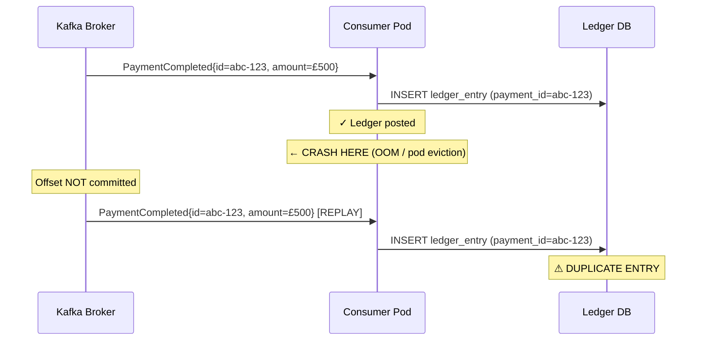

A Kafka consumer that processes a `PaymentCompleted` event, posts to the ledger, then crashes before committing its offset will replay that event on restart — and the ledger will silently accept both copies. This is not a theoretical edge case; it is the default behaviour of every at-least-once Kafka consumer that does not defend itself. This lesson exposes exactly how the failure window opens, then closes it with three complementary techniques: a database-level idempotency table, Kafka's own transactional exactly-once semantics, and a Redis deduplication window for high-throughput paths. You will leave with the production configuration and the Spring Kafka code to implement all three.

## Learning Objectives

- Explain the three Kafka delivery guarantees (at-most-once, at-least-once, effectively-exactly-once) and why at-least-once is the operational default for financial systems.
- Identify the precise failure window between processing and offset commit that causes duplicate ledger entries.
- Implement an idempotent consumer using an `INSERT … ON CONFLICT DO NOTHING RETURNING` pattern in PostgreSQL within a Spring `@KafkaListener`.
- Configure Kafka transactional producers and `read_committed` consumers to achieve effectively-exactly-once semantics and articulate the overhead trade-off.
- Design a Redis `SETNX`-based deduplication window as a low-latency guard before database writes.
- Configure `enable.auto.commit=false`, manual `acknowledge()`, and a dead-letter topic with `@DltHandler` for poison-message handling.

## Business Context

Nexus Payments, a UK-licensed payment institution processing 2.1 million transactions per day, operates a Kafka-based event pipeline between its payment gateway and its double-entry ledger. At 02:17 on a Tuesday, a routine rolling restart of the ledger consumer pods caused fifteen pods to crash between processing and offset commit due to a JVM OOM error triggered by an unexpected spike in event payload size. On restart, those fifteen pods replayed between 1 and 23 events each. In total, 94 `PaymentCompleted` events were processed twice. Each replay caused `ledgerService.post()` to execute a second time, creating 94 duplicate credit entries totalling £127,340.

The duplicate entries were not detected until the morning reconciliation job ran at 06:00. By that point, 11 customers had already seen the inflated balances and 3 had initiated secondary transfers against the phantom funds. The remediation required manual ledger adjustments, 11 customer communications, and a Suspicious Activity Report filing under the Proceeds of Crime Act 2002. The root cause was a single missing property: `enable.auto.commit=false` combined with no idempotency check.

## Kafka Delivery Semantics

Kafka offers three delivery modes, and the distinction matters enormously in financial systems.

**At-most-once**: Offset is committed before the message is processed. If the consumer crashes during processing, the message is lost. Acceptable for telemetry; never acceptable for payment events.

**At-least-once**: Offset is committed after the message is processed successfully. If the consumer crashes after processing but before committing the offset, the message will be redelivered. This is the standard mode and means your consumer logic **must be idempotent**.

**Effectively-exactly-once**: Kafka Transactions cause the offset commit and any produced messages to be written atomically. The consumer still re-reads the message on failure, but downstream systems only see the effect once. This requires both producer transactions and `isolation.level=read_committed` on consumers.

> [!IMPORTANT]
> "Exactly-once" in Kafka is a property of the read-process-write loop within the Kafka ecosystem. The moment your processing side-effect is a database write or an HTTP call, you are back to at-least-once. The idempotency burden on your application does not disappear — it shifts.

## The Failure Window

The gap between processing and offset commit is the root cause of every duplicate-delivery incident.



The failure window exists for every at-least-once consumer. The only question is whether the consumer's side effects are idempotent inside that window.

## Fix 1 — Idempotent Consumer with Deduplication Table

The most portable fix is a `processed_events` table that records every event ID after successful processing. The check and the business logic execute in the same database transaction, making the entire operation atomic.

### Schema

```sql
CREATE TABLE processed_events (
    event_id        UUID        NOT NULL,
    consumer_group  VARCHAR(128) NOT NULL,
    processed_at    TIMESTAMPTZ NOT NULL DEFAULT now(),
    payload_hash    VARCHAR(64),          -- optional integrity check
    CONSTRAINT pk_processed_events PRIMARY KEY (event_id, consumer_group)
);

-- Index for TTL-based cleanup (run DELETE WHERE processed_at < now() - interval '7 days')
CREATE INDEX idx_processed_events_at ON processed_events (processed_at);
```

### Spring Kafka Listener

```java
@Service
@RequiredArgsConstructor
@Slf4j
public class PaymentCompletedConsumer {

    private final LedgerService ledgerService;
    private final ProcessedEventRepository processedEventRepository;
    private final DataSource dataSource;

    private static final String CONSUMER_GROUP = "ledger-posting-service";

    @KafkaListener(
            topics = "payments.completed",
            groupId = CONSUMER_GROUP,
            containerFactory = "manualAckContainerFactory"
    )
    @Transactional("kafkaTransactionManager")          // wraps DB + ack in one TX
    public void onPaymentCompleted(
            @Payload PaymentCompletedEvent event,
            Acknowledgment acknowledgment) {

        if (isDuplicate(event.eventId())) {
            log.warn("Duplicate event detected, skipping: eventId={}", event.eventId());
            acknowledgment.acknowledge();
            return;
        }

        ledgerService.post(LedgerPostingRequest.from(event));
        recordProcessed(event.eventId());
        acknowledgment.acknowledge();

        log.info("Payment posted to ledger: eventId={} paymentId={}",
                event.eventId(), event.paymentId());
    }

    /**
     * Atomically insert the event ID. Returns true if this is a duplicate.
     * INSERT ... ON CONFLICT DO NOTHING means the second call inserts 0 rows.
     */
    private boolean isDuplicate(UUID eventId) {
        String sql = """
                INSERT INTO processed_events (event_id, consumer_group)
                VALUES (?, ?)
                ON CONFLICT (event_id, consumer_group) DO NOTHING
                RETURNING event_id
                """;
        try (Connection conn = dataSource.getConnection();
             PreparedStatement ps = conn.prepareStatement(sql)) {
            ps.setObject(1, eventId);
            ps.setString(2, CONSUMER_GROUP);
            ResultSet rs = ps.executeQuery();
            // If RETURNING returns a row → new insertion (not duplicate)
            // If RETURNING returns nothing → conflict occurred (duplicate)
            return !rs.next();
        } catch (SQLException e) {
            throw new DataAccessResourceFailureException("Idempotency check failed", e);
        }
    }

    private void recordProcessed(UUID eventId) {
        // Already recorded by the INSERT above; this is a no-op.
        // Kept for clarity in call sites that call recordProcessed explicitly.
    }
}
```

### Kafka Container Factory Configuration

```java
@Configuration
@EnableKafka
public class KafkaConsumerConfig {

    @Bean
    public ConcurrentKafkaListenerContainerFactory<String, PaymentCompletedEvent>
            manualAckContainerFactory(ConsumerFactory<String, PaymentCompletedEvent> cf) {

        ConcurrentKafkaListenerContainerFactory<String, PaymentCompletedEvent> factory =
                new ConcurrentKafkaListenerContainerFactory<>();
        factory.setConsumerFactory(cf);
        // MANUAL_IMMEDIATE: app calls acknowledgment.acknowledge() explicitly
        factory.getContainerProperties().setAckMode(ContainerProperties.AckMode.MANUAL_IMMEDIATE);
        factory.getContainerProperties().setPollTimeout(3000);
        return factory;
    }

    @Bean
    public ConsumerFactory<String, PaymentCompletedEvent> consumerFactory() {
        Map<String, Object> props = new HashMap<>();
        props.put(ConsumerConfig.BOOTSTRAP_SERVERS_CONFIG, "${kafka.bootstrap-servers}");
        props.put(ConsumerConfig.GROUP_ID_CONFIG, "ledger-posting-service");
        props.put(ConsumerConfig.ENABLE_AUTO_COMMIT_CONFIG, false);       // critical
        props.put(ConsumerConfig.MAX_POLL_RECORDS_CONFIG, 100);
        props.put(ConsumerConfig.AUTO_OFFSET_RESET_CONFIG, "earliest");
        props.put(ConsumerConfig.KEY_DESERIALIZER_CLASS_CONFIG, StringDeserializer.class);
        props.put(ConsumerConfig.VALUE_DESERIALIZER_CLASS_CONFIG, JsonDeserializer.class);
        props.put(JsonDeserializer.TRUSTED_PACKAGES, "com.nexus.payments.events");
        return new DefaultKafkaConsumerFactory<>(props);
    }
}
```

> [!WARNING]
> Never set `enable.auto.commit=true` in a financial consumer. Auto-commit fires on a timer (default 5 seconds) with no correlation to whether processing succeeded. The offset can be committed for a message that failed processing, silently dropping it forever.

## Fix 2 — Kafka Transactions (Effectively-Exactly-Once)

When both the producer and the consumer are within the Kafka ecosystem (the consumer reads and the producer writes to another Kafka topic), Kafka Transactions can make the offset commit and the outbound produce atomic.

### Producer Configuration

```java
@Bean
public ProducerFactory<String, Object> transactionalProducerFactory() {
    Map<String, Object> props = new HashMap<>();
    props.put(ProducerConfig.BOOTSTRAP_SERVERS_CONFIG, "${kafka.bootstrap-servers}");
    // transactional.id MUST be unique per producer instance and stable across restarts
    props.put(ProducerConfig.TRANSACTIONAL_ID_CONFIG, "ledger-poster-${POD_NAME}");
    props.put(ProducerConfig.ENABLE_IDEMPOTENCE_CONFIG, true);
    props.put(ProducerConfig.ACKS_CONFIG, "all");
    props.put(ProducerConfig.RETRIES_CONFIG, Integer.MAX_VALUE);
    props.put(ProducerConfig.MAX_IN_FLIGHT_REQUESTS_PER_CONNECTION, 5);
    return new DefaultKafkaProducerFactory<>(props);
}

@Bean
public KafkaTransactionManager<String, Object> kafkaTransactionManager(
        ProducerFactory<String, Object> pf) {
    return new KafkaTransactionManager<>(pf);
}
```

### Consumer Configuration for Read-Committed Isolation

```java
props.put(ConsumerConfig.ISOLATION_LEVEL_CONFIG, "read_committed");
```

With `read_committed`, the consumer will not see messages produced inside an uncommitted transaction. This ensures that if the producer side of a consume-transform-produce loop crashes mid-transaction, the consumer on the other topic never sees the partial output.

> [!NOTE]
> Kafka Transactions do not help when your side effect is a PostgreSQL write, an HTTP call, or any non-Kafka resource. For cross-system atomicity, use the Transactional Outbox pattern (Lesson 13) or an idempotency table (Fix 1 above). Kafka Transactions shine in pure Kafka topologies: stream processing, fan-out pipelines, event-driven microservices that only produce to Kafka.

### Overhead Trade-off

| Approach | Throughput impact | Complexity | Cross-system support |
|---|---|---|---|
| Idempotent consumer (DB table) | ~5 ms per event (index lookup) | Low | Yes |
| Redis deduplication window | ~0.3 ms per event | Medium | Yes |
| Kafka Transactions | ~20–40 ms latency increase | High | Kafka-only |

## Fix 3 — Redis Deduplication Window

For high-throughput consumers where the database round-trip cost of the idempotency table is too high, a Redis `SETNX` check provides a sub-millisecond guard. It is a probabilistic (not guaranteed) guard: Redis data can be lost on failure. Use it in front of the DB check, not instead of it.

```java
@Service
@RequiredArgsConstructor
public class RedisDeduplicationService {

    private final StringRedisTemplate redisTemplate;

    private static final Duration DEDUP_WINDOW = Duration.ofHours(24);
    private static final String KEY_PREFIX = "dedup:payment:";

    /**
     * Returns true if this event has NOT been seen before (safe to process).
     * Returns false if it was already seen within the deduplication window.
     *
     * Uses SET NX EX which is atomic: check-and-set in one Redis command.
     */
    public boolean markIfAbsent(UUID eventId) {
        String key = KEY_PREFIX + eventId;
        Boolean wasAbsent = redisTemplate.opsForValue()
                .setIfAbsent(key, "1", DEDUP_WINDOW);
        return Boolean.TRUE.equals(wasAbsent);
    }
}
```

### Layered Deduplication Strategy

```java
@KafkaListener(topics = "payments.completed", groupId = "ledger-posting-service",
               containerFactory = "manualAckContainerFactory")
@Transactional
public void onPaymentCompleted(PaymentCompletedEvent event, Acknowledgment ack) {

    // Layer 1: Redis fast path — sub-millisecond, probabilistic
    if (!redisDeduplicationService.markIfAbsent(event.eventId())) {
        log.debug("Redis dedup hit for eventId={}", event.eventId());
        ack.acknowledge();
        return;
    }

    // Layer 2: DB authoritative check — ~5ms, guaranteed
    if (isDuplicate(event.eventId())) {
        log.warn("DB dedup hit for eventId={} (Redis miss — possible Redis restart)",
                event.eventId());
        ack.acknowledge();
        return;
    }

    ledgerService.post(LedgerPostingRequest.from(event));
    ack.acknowledge();
}
```

The Redis layer handles the 99.9 % case at minimal cost. The DB layer handles the rare case where Redis lost its state (pod restart, eviction policy). Both layers must be present in a financial system.

## Dead Letter Topic and Poison Message Handling

A "poison message" is an event that always fails processing — corrupt payload, schema mismatch, unresolvable reference. Without a dead-letter strategy, a poison message will block the partition indefinitely (or loop forever if retries are uncapped).

### Retry and DLT Configuration

```java
@Bean
public DefaultErrorHandler errorHandler(KafkaOperations<?, ?> template) {
    // Retry 3 times with exponential backoff before routing to DLT
    ExponentialBackOffWithMaxRetries backoff = new ExponentialBackOffWithMaxRetries(3);
    backoff.setInitialInterval(1_000L);   // 1 second
    backoff.setMultiplier(2.0);           // 1s → 2s → 4s
    backoff.setMaxInterval(30_000L);      // cap at 30 seconds

    DeadLetterPublishingRecoverer recoverer =
            new DeadLetterPublishingRecoverer(template,
                    (record, ex) -> new TopicPartition("payments.DLT", record.partition()));

    return new DefaultErrorHandler(recoverer, backoff);
}
```

### DLT Handler

```java
@Component
@RequiredArgsConstructor
@Slf4j
public class PaymentDltHandler {

    private final AlertingService alertingService;
    private final DltEventRepository dltEventRepository;

    @DltHandler
    public void handleDlt(
            PaymentCompletedEvent event,
            @Header(KafkaHeaders.RECEIVED_TOPIC) String topic,
            @Header(KafkaHeaders.EXCEPTION_MESSAGE) String exceptionMessage) {

        log.error("Poison message routed to DLT: topic={} eventId={} error={}",
                topic, event.eventId(), exceptionMessage);

        DltEvent record = DltEvent.builder()
                .eventId(event.eventId())
                .sourceTopic(topic)
                .payload(event)
                .errorMessage(exceptionMessage)
                .arrivedAt(Instant.now())
                .build();

        dltEventRepository.save(record);

        alertingService.page(
                PagerDutyAlert.critical()
                        .summary("Payment event unprocessable: " + event.eventId())
                        .details(Map.of(
                                "paymentId", event.paymentId(),
                                "amount", event.amount(),
                                "error", exceptionMessage))
                        .build());
    }
}
```

> [!IMPORTANT]
> Every DLT event represents a payment that was NOT posted to the ledger. Treat the DLT as a critical queue requiring human review within your SLA. Instrument `dlt.events.unresolved.count` as a P0 alert. DLT events that sit unreviewed for more than 24 hours in a payment system are a regulatory finding waiting to happen.

## Consumer Configuration Reference

```yaml
# application.yml — ledger-posting-service
spring:
  kafka:
    consumer:
      bootstrap-servers: ${KAFKA_BOOTSTRAP_SERVERS}
      group-id: ledger-posting-service
      enable-auto-commit: false          # NEVER true for financial consumers
      auto-offset-reset: earliest
      max-poll-records: 100              # batch size per poll cycle
      isolation-level: read_committed    # required for Kafka Transactions
      key-deserializer: org.apache.kafka.common.serialization.StringDeserializer
      value-deserializer: org.springframework.kafka.support.serializer.JsonDeserializer
      properties:
        spring.json.trusted.packages: "com.nexus.payments.events"
        fetch.min.bytes: 1
        fetch.max.wait.ms: 500
        session.timeout.ms: 30000
        heartbeat.interval.ms: 10000
        max.poll.interval.ms: 300000     # allow 5 minutes for slow processing batches
    producer:
      transactional-id: ledger-poster-${POD_NAME:default}
      acks: all
      retries: 2147483647
      enable-idempotence: true
```

## Knowledge Check

**Q1: A PaymentCompleted consumer calls `ledgerService.post()` successfully, then JVM crashes before `acknowledgment.acknowledge()` is called. What happens on restart, and what is the minimum change required to make the consumer safe?**

A: On restart, the Kafka broker replays the message because the offset was never committed. `ledgerService.post()` executes a second time, creating a duplicate ledger entry. The minimum change is to add an idempotency check using `INSERT INTO processed_events (event_id, consumer_group) ON CONFLICT DO NOTHING RETURNING event_id` inside the same database transaction as the ledger post. If the INSERT returns no rows (conflict), the event has already been processed and should be acknowledged and skipped. This check must be inside the same transaction as the ledger write so that a crash between the two cannot leave them in an inconsistent state.

**Q2: When should you prefer Kafka Transactions over an idempotency table, and what is the key limitation of each?**

A: Prefer Kafka Transactions when the entire read-process-write loop is within Kafka — for example, a stream processor that consumes from one topic and produces to another. Kafka Transactions make the offset commit and the produce atomic inside Kafka, eliminating the replay-duplicate problem entirely within that topology. The limitation is that Kafka Transactions only cover Kafka resources: a PostgreSQL write, an HTTP call, or any external side effect is not covered and must still be made idempotent independently. An idempotency table, by contrast, works for any external side effect and survives pod restarts and Redis evictions, but adds a database round-trip (~5 ms) per event. The idempotency table is the more universally applicable technique; Kafka Transactions are a performance optimisation for pure-Kafka pipelines.

## Practical Challenge

Your team is deploying a new `FraudAlertConsumer` that consumes from `fraud.alerts` and calls three downstream services: (1) block the account via `AccountService.block()`, (2) create a case in `CaseManagementService.createCase()`, and (3) send a notification via `NotificationService.send()`. All three calls must succeed for the event to be considered processed.

Design a production-grade idempotent consumer for this scenario. Your design must address:

1. What idempotency key will you use and why? What happens if the same fraud alert arrives from two different producers with the same alert ID?
2. How do you handle partial failure — `AccountService.block()` succeeds but `CaseManagementService.createCase()` throws a 503? Do you replay from the start, or do you checkpoint partial progress?
3. Write the `processed_events` schema and the Spring `@KafkaListener` method signature with the correct `AckMode`, retry configuration, and DLT setup.
4. The fraud team reports that duplicate blocks are causing customer complaints (account blocked twice, second block fires a second notification). How does your idempotency design prevent this, and what test proves it?

Write a failing JUnit 5 test that sends the same `FraudAlertEvent` twice to an embedded Kafka broker and asserts that `AccountService.block()` is called exactly once (use Mockito `verify(..., times(1))`).

<!-- KNOWLEDGE-CHECK
{
  "questions": [
    {
      "text": "A PaymentCompleted Kafka consumer calls ledgerService.post() successfully, then the JVM crashes before acknowledgment.acknowledge() is called. What happens on restart?",
      "options": [
        "Kafka detects the crash and discards the message automatically",
        "The broker replays the message because the offset was never committed; without idempotency protection the ledger entry is posted a second time creating a duplicate",
        "The consumer group coordinator reassigns the partition to another instance which skips the message",
        "Spring Kafka's @KafkaListener automatically deduplicates replayed messages"
      ],
      "correct": 1,
      "explanation": "At-least-once delivery means Kafka replays any message whose offset was not committed before the consumer crashed. If the ledger post succeeds but the offset commit does not, the same PaymentCompleted event is redelivered on restart. Without a database-level idempotency check (INSERT ... ON CONFLICT DO NOTHING), the ledger entry is posted twice."
    },
    {
      "text": "When should Kafka Transactions (exactly-once semantics) be preferred over a database idempotency table, and what is the key limitation?",
      "options": [
        "Always — Kafka Transactions are strictly superior in every situation",
        "When the entire read-process-write loop stays within Kafka (consume from one topic, produce to another); they do not cover PostgreSQL writes or HTTP calls, which still need application-level idempotency",
        "When the consumer needs sub-millisecond latency and cannot afford the database round-trip",
        "When the Kafka cluster is running in exactly-once mode and all consumers are configured with isolation.level=read_committed"
      ],
      "correct": 1,
      "explanation": "Kafka Transactions make the offset commit and produce atomic inside Kafka, eliminating replay-duplicate for pure Kafka-to-Kafka pipelines. They cannot cover PostgreSQL writes, HTTP calls, or any external side effect. A database idempotency table is more universally applicable — it works for any side effect and survives pod restarts and Redis evictions, at the cost of a ~5ms database round-trip."
    },
    {
      "text": "enable.idempotence=true is set on a Kafka producer. The JVM restarts after a network partition. After restart, the producer retries the last batch. Are the duplicates filtered by the broker?",
      "options": [
        "Yes — enable.idempotence=true provides end-to-end exactly-once delivery including across restarts",
        "No — the broker assigns a new Producer ID on restart; it cannot match new-epoch sequence numbers against the previous epoch, so consumer-side deduplication is still required",
        "Yes — the broker tracks all message hashes for 24 hours and rejects duplicates",
        "No — idempotent production is disabled during the first 60 seconds after a broker failover"
      ],
      "correct": 1,
      "explanation": "enable.idempotence=true deduplicates within a single producer session (epoch). After a JVM restart, the broker assigns a new Producer ID with epoch 0. The broker cannot match new-epoch sequence numbers against the previous epoch's records. Consumer-side deduplication using a processed_events table with a unique constraint is mandatory to handle cross-session duplicates."
    }
  ]
}
-->

<!-- PRACTICAL-CHALLENGE
{
  "title": "Build a Production-Grade Idempotent Kafka Consumer",
  "difficulty": "advanced",
  "estimatedMinutes": 50,
  "tasks": [
    {"id": "1", "description": "Design the idempotency strategy for a FraudAlertConsumer that calls AccountService.block(), CaseManagementService.createCase(), and NotificationService.send(). Define the idempotency key and explain what happens if the same alert arrives from two different producers with the same alert ID."},
    {"id": "2", "description": "Handle partial failure: AccountService.block() succeeds but CaseManagementService.createCase() throws 503. Design whether to replay from the start or checkpoint partial progress, with justification."},
    {"id": "3", "description": "Write the processed_events schema and the Spring @KafkaListener method signature with the correct AckMode, retry configuration, and Dead Letter Topic setup."},
    {"id": "4", "description": "Write a failing JUnit 5 test that sends the same FraudAlertEvent twice to an embedded Kafka broker and asserts that AccountService.block() is called exactly once using Mockito verify(..., times(1))."}
  ]
}
-->
