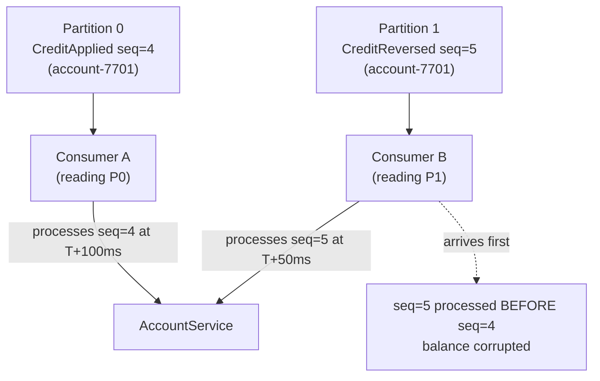
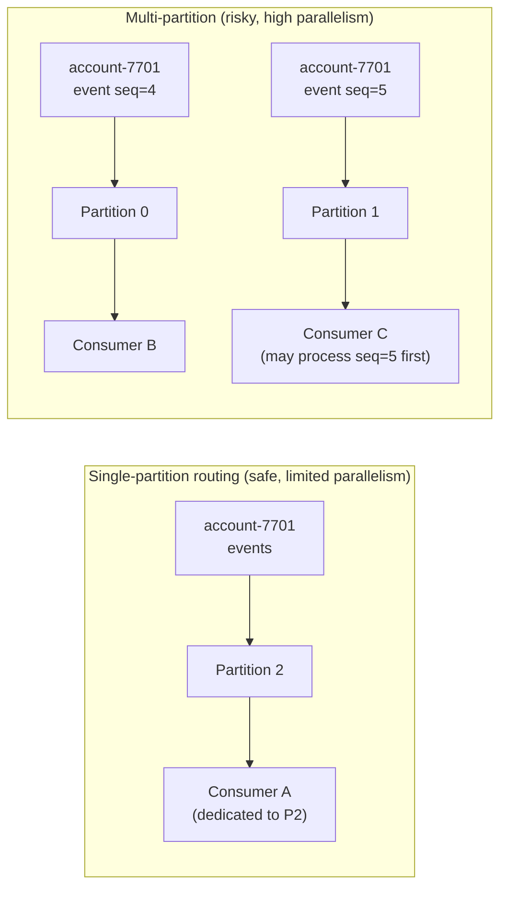

Kafka guarantees strict ordering within a single partition for a single consumer group. That guarantee is narrower than most engineers assume. A partition rebalance, a consumer lag spike, or a multi-partition topic with account events spread across partitions is enough for a `CreditReversed` event to arrive before the `CreditApplied` it reverses — and an account balance to be corrupted in a way that neither the application nor the database will detect, because the SQL executed correctly. This lesson traces the exact conditions that break event ordering, then implements three defensive strategies: a sequence-number gap buffer, partition-per-entity routing, and an event-sourcing replay model that treats ordering violations as a first-class concern.

## Learning Objectives

- Explain the conditions under which Kafka's within-partition ordering guarantee breaks down: multi-partition topics, consumer group rebalances, and concurrent processing of the same partition.
- Implement a gap-buffer consumer using `ConcurrentHashMap<String, PriorityQueue<AccountEvent>>` that buffers out-of-order events and drains them once the missing sequence arrives.
- Handle the gap-timeout case with a `ScheduledExecutorService` that alerts and applies available events when a gap exceeds 5 seconds.
- Route all events for an entity to a single Kafka partition using the entity ID as the message key, and articulate the parallelism trade-off.
- Design an event-sourcing approach where balance is derived by replaying events in sequence, eliminating in-place balance updates entirely.
- Instrument an `event_gaps` monitoring table and define SLA-appropriate alerting thresholds.

## Business Context

Accord Bank, a digital retail bank with 890,000 current accounts, operates an event-driven account service where all balance mutations flow through Kafka. At 09:14 on a Monday morning, a scheduled consumer group rebalance triggered by a Kubernetes rolling deployment caused 23 partitions to be reassigned. During the 400 ms rebalance window, two consumers processing adjacent partitions both held in-flight events for a subset of accounts that happened to have events on both partitions (a known issue with the previous hash-partitioning scheme). When consumption resumed, 61 accounts had their `CreditReversed` events (sequence N+1) processed before their corresponding `CreditApplied` events (sequence N).

The balance calculation applied the reversal to the pre-credit balance, producing a value £X lower than correct. For 7 accounts the corrupted balance was below zero — which triggered automated credit freeze notifications to those customers. By the time the gap filled and the `CreditApplied` events were processed (231 ms later), the freeze notifications had already been sent and the accounts had been flagged in the fraud system. Remediation required 7 manual account reviews, 7 customer apology calls, and a Vulnerable Customer Assessment for 2 of the affected accounts under FCA CONC guidelines. The engineering postmortem identified no monitoring for sequence gaps. The gap existed for 231 ms and was entirely invisible.

## Why Kafka Ordering Breaks

Kafka guarantees that within a single partition, messages are delivered to a consumer in the order they were produced. This guarantee holds only while one consumer in the group is reading that partition. The guarantee breaks in three scenarios.



**Scenario 1 — Multi-partition topic without key-based routing**: An account's events are spread across partitions. Different consumers process them at different rates.

**Scenario 2 — Consumer group rebalance**: Partition P0 was assigned to Consumer A. During rebalance, P0 is reassigned to Consumer B. Consumer A may have already begun processing an event from P0 that Consumer B will also replay after the rebalance, or Consumer B starts at the last committed offset which may leave a gap.

**Scenario 3 — Concurrent processing within a partition**: Using `ConcurrentKafkaListenerContainerFactory` with `setConcurrency(N > 1)` for a topic without further partitioning effectively breaks ordering guarantees for that consumer group.

> [!WARNING]
> Setting `concurrency > 1` on a `@KafkaListener` processes messages from multiple partitions in parallel, which is the intended behaviour. If your topic has fewer partitions than the concurrency level, some threads will be idle. If your entity events span multiple partitions, you get out-of-order processing. The concurrency level should equal the number of partitions, and each account's events should live on exactly one partition.

## Sequence Numbers on Events

Every mutable event must carry a monotonically increasing sequence number scoped to the entity it affects.

```java
public record AccountEvent(
        UUID        accountId,
        long        sequenceNumber,    // monotonically increasing per accountId
        EventType   type,              // CREDIT_APPLIED, CREDIT_REVERSED, DEBIT_APPLIED, etc.
        long        amountCents,
        Instant     occurredAt,
        UUID        eventId,           // globally unique event ID for deduplication
        String      correlationId      // links to originating payment/transfer
) {
    public enum EventType {
        ACCOUNT_OPENED, CREDIT_APPLIED, DEBIT_APPLIED,
        CREDIT_REVERSED, DEBIT_REVERSED, ACCOUNT_CLOSED
    }
}
```

The sequence number is assigned by the producer at the time of event creation and stored in the event store. It is not a Kafka offset — it is a business-layer guarantee owned by the domain.

## Fix 1 — Gap Buffer with Priority Queue

The gap buffer holds events that have arrived out of order and drains them once the missing predecessor arrives. Each account gets its own `PriorityQueue` ordered by `sequenceNumber`.

```java
@Service
@RequiredArgsConstructor
@Slf4j
public class SequencedEventConsumer {

    private final AccountBalanceService accountBalanceService;
    private final GapMonitoringService  gapMonitoringService;

    // accountId → next expected sequence number
    private final ConcurrentHashMap<UUID, Long> expectedSequence = new ConcurrentHashMap<>();

    // accountId → buffered out-of-order events, ordered by sequence number
    private final ConcurrentHashMap<UUID, PriorityQueue<AccountEvent>> gapBuffer =
            new ConcurrentHashMap<>();

    @KafkaListener(topics = "account.events", groupId = "balance-service",
                   containerFactory = "manualAckContainerFactory")
    public void onAccountEvent(AccountEvent event, Acknowledgment ack) {
        processEvent(event);
        ack.acknowledge();
    }

    private void processEvent(AccountEvent event) {
        UUID accountId = event.accountId();
        long expected  = expectedSequence.getOrDefault(accountId, 1L);

        if (event.sequenceNumber() == expected) {
            apply(event);
            expectedSequence.put(accountId, expected + 1);
            drainBuffer(accountId);                     // apply any buffered successors

        } else if (event.sequenceNumber() > expected) {
            // Event arrived early — buffer it
            log.warn("Gap detected: accountId={} expected={} received={}",
                    accountId, expected, event.sequenceNumber());
            bufferEvent(event);
            gapMonitoringService.recordGap(accountId, expected, event.sequenceNumber());

        } else {
            // event.sequenceNumber() < expected → already processed (duplicate)
            log.warn("Stale/duplicate event ignored: accountId={} seq={} expected={}",
                    accountId, event.sequenceNumber(), expected);
        }
    }

    private void bufferEvent(AccountEvent event) {
        gapBuffer.computeIfAbsent(
                event.accountId(),
                k -> new PriorityQueue<>(Comparator.comparingLong(AccountEvent::sequenceNumber))
        ).add(event);
    }

    private void drainBuffer(UUID accountId) {
        PriorityQueue<AccountEvent> buffer = gapBuffer.get(accountId);
        if (buffer == null || buffer.isEmpty()) return;

        long nextExpected = expectedSequence.get(accountId);
        while (!buffer.isEmpty() && buffer.peek().sequenceNumber() == nextExpected) {
            AccountEvent next = buffer.poll();
            apply(next);
            nextExpected++;
            expectedSequence.put(accountId, nextExpected);
            gapMonitoringService.clearGap(accountId, next.sequenceNumber());
        }
    }

    private void apply(AccountEvent event) {
        accountBalanceService.applyEvent(event);
        log.debug("Applied event: accountId={} seq={} type={}",
                event.accountId(), event.sequenceNumber(), event.type());
    }
}
```

## Fix 2 — Gap Timeout Handling

A gap that never fills is worse than a gap that is detected quickly. A missing event (dropped by the producer, lost in a DLT) will stall the account's event stream indefinitely if there is no timeout.

```java
@Component
@RequiredArgsConstructor
@Slf4j
public class GapTimeoutMonitor {

    private final SequencedEventConsumer eventConsumer;
    private final AlertingService        alertingService;
    private final AccountBalanceService  accountBalanceService;

    // accountId → timestamp when the gap was first detected
    private final ConcurrentHashMap<UUID, Instant> gapDetectedAt = new ConcurrentHashMap<>();

    private static final Duration GAP_TIMEOUT  = Duration.ofSeconds(5);
    private static final Duration CHECK_INTERVAL = Duration.ofSeconds(1);

    @Scheduled(fixedDelayString = "1000")   // every 1 second
    public void checkForStaleGaps() {
        Instant now      = Instant.now();
        Instant deadline = now.minus(GAP_TIMEOUT);

        eventConsumer.getOpenGaps().forEach((accountId, expectedSeq) -> {
            Instant detectedAt = gapDetectedAt.computeIfAbsent(accountId, k -> now);

            if (detectedAt.isBefore(deadline)) {
                log.error("Gap timeout: accountId={} missingSeq={} gapAge={}ms",
                        accountId, expectedSeq,
                        Duration.between(detectedAt, now).toMillis());

                alertingService.page(PagerDutyAlert.high()
                        .summary("Account event gap timeout: " + accountId)
                        .details(Map.of("accountId", accountId,
                                        "missingSequence", expectedSeq,
                                        "gapAgeMs", Duration.between(detectedAt, now).toMillis()))
                        .build());

                // Apply buffered events that follow the gap — balance will be inaccurate
                // but the account unblocks. Flag for manual reconciliation.
                eventConsumer.forceApplyBuffered(accountId);
                accountBalanceService.flagForReconciliation(accountId,
                        "gap-timeout: missing seq=" + expectedSeq);
                gapDetectedAt.remove(accountId);
            }
        });
    }
}
```

> [!NOTE]
> The force-apply-on-timeout strategy deliberately accepts a potentially incorrect balance in order to keep the account processing. The `flagForReconciliation` mark ensures the nightly reconciliation job will catch and correct the discrepancy. An alternative is to halt processing for the affected account and raise a P0 incident — appropriate for high-value accounts. The choice is a business policy, not a technical one.

## Fix 3 — Kafka Partition-per-Account Routing

The simplest architectural fix: ensure all events for an account always land in the same Kafka partition by using `accountId` as the message key. Kafka's default `DefaultPartitioner` uses a consistent hash of the key modulo the partition count.

```java
@Service
@RequiredArgsConstructor
public class AccountEventProducer {

    private final KafkaTemplate<String, AccountEvent> kafkaTemplate;

    private static final String TOPIC = "account.events";

    public void publish(AccountEvent event) {
        // Using accountId as the key guarantees same-partition delivery
        kafkaTemplate.send(TOPIC, event.accountId().toString(), event)
                .whenComplete((result, ex) -> {
                    if (ex != null) {
                        throw new EventPublishingException("Failed to publish event", ex);
                    }
                    log.debug("Published: accountId={} seq={} partition={}",
                            event.accountId(), event.sequenceNumber(),
                            result.getRecordMetadata().partition());
                });
    }
}
```

### Parallelism Trade-off



The trade-off is real: partition-per-account routing limits parallelism to one consumer per account at a time. For a topic with 100 partitions processing 1 million accounts, each partition handles 10,000 accounts. A single slow account does not stall others on different partitions. But if one account generates 50,000 events per second (a hot merchant), that account can saturate a single consumer thread.

> [!IMPORTANT]
> Never increase parallelism by consuming the same account's partition with multiple threads. The correct scaling lever is to increase the number of partitions (repartition the topic) while maintaining the invariant that all events for an account map to the same partition. Topic repartitioning requires a migration window and careful coordination with producers.

## Fix 4 — Event Sourcing: Balance as a Derived Projection

In an event-sourcing model, the balance is never stored directly. It is always derived by replaying events from sequence 1. Out-of-order delivery cannot corrupt the balance because the balance is not updated in place — it is recalculated.

```java
@Service
@RequiredArgsConstructor
public class EventSourcedAccountService {

    private final AccountEventStore eventStore;

    /**
     * Derive current balance by replaying all events in sequence order.
     * Gaps cause an exception, forcing the caller to fetch the missing event.
     */
    public BalanceResult deriveBalance(UUID accountId) {
        List<AccountEvent> events = eventStore.findByAccountIdOrderBySequenceNumber(accountId);

        validateNoGaps(accountId, events);

        long balanceCents = 0L;
        for (AccountEvent event : events) {
            balanceCents = applyEvent(balanceCents, event);
        }
        return new BalanceResult(accountId, balanceCents, events.size());
    }

    private void validateNoGaps(UUID accountId, List<AccountEvent> events) {
        for (int i = 0; i < events.size(); i++) {
            long expected = i + 1L;
            long actual   = events.get(i).sequenceNumber();
            if (actual != expected) {
                throw new EventSequenceGapException(accountId, expected, actual);
            }
        }
    }

    private long applyEvent(long currentBalance, AccountEvent event) {
        return switch (event.type()) {
            case CREDIT_APPLIED  -> currentBalance + event.amountCents();
            case DEBIT_APPLIED   -> currentBalance - event.amountCents();
            case CREDIT_REVERSED -> currentBalance - event.amountCents();
            case DEBIT_REVERSED  -> currentBalance + event.amountCents();
            default              -> currentBalance;
        };
    }
}
```

### Event Store Schema

```sql
CREATE TABLE account_events (
    id              UUID         NOT NULL DEFAULT gen_random_uuid(),
    account_id      UUID         NOT NULL,
    sequence_number BIGINT       NOT NULL,
    event_type      VARCHAR(64)  NOT NULL,
    amount_cents    BIGINT       NOT NULL DEFAULT 0,
    occurred_at     TIMESTAMPTZ  NOT NULL,
    event_id        UUID         NOT NULL,
    correlation_id  VARCHAR(128),
    metadata        JSONB,
    CONSTRAINT pk_account_events PRIMARY KEY (id),
    CONSTRAINT uq_account_sequence UNIQUE (account_id, sequence_number),
    CONSTRAINT chk_sequence_positive CHECK (sequence_number > 0)
);

CREATE INDEX idx_account_events_account_seq
    ON account_events (account_id, sequence_number);
```

The `UNIQUE (account_id, sequence_number)` constraint enforces sequence integrity at the database level. An attempt to insert a duplicate or out-of-order sequence number fails immediately.

## Operational Monitoring — Event Gaps Table

```sql
CREATE TABLE event_gaps (
    account_id          UUID         NOT NULL,
    expected_sequence   BIGINT       NOT NULL,
    received_sequence   BIGINT       NOT NULL,
    detected_at         TIMESTAMPTZ  NOT NULL DEFAULT now(),
    resolved_at         TIMESTAMPTZ,
    resolution_type     VARCHAR(32), -- FILLED, TIMEOUT_FORCE_APPLY, MANUAL
    gap_duration_ms     INTEGER GENERATED ALWAYS AS
                            (EXTRACT(EPOCH FROM (resolved_at - detected_at)) * 1000) STORED,
    CONSTRAINT pk_event_gaps PRIMARY KEY (account_id, expected_sequence)
);

-- Alert query: unresolved gaps older than 5 seconds
SELECT account_id, expected_sequence, detected_at,
       EXTRACT(EPOCH FROM (now() - detected_at)) * 1000 AS age_ms
FROM   event_gaps
WHERE  resolved_at IS NULL
AND    detected_at < now() - INTERVAL '5 seconds'
ORDER  BY detected_at;
```

Connect this query to your alerting pipeline (Prometheus recording rule or a scheduled job) to page on-call when gaps persist beyond the SLA threshold.

## Knowledge Check

**Q1: Your `account.events` topic has 32 partitions. An account receives 5 events rapidly: seq=1,2,3,4,5. seq=3 is produced to partition 15 and seq=4 is produced to partition 16 due to a producer misconfiguration that temporarily lost the partition key. Consumer A reads partition 15 and Consumer B reads partition 16. What problem arises, and what is the definitive fix at the producer level?**

A: Consumer B processes seq=4 before Consumer A processes seq=3, because the two events are on different partitions with independent ordering. If the event handler updates a balance in place, seq=4 (a debit or credit) is applied to a balance that has not yet had seq=3 applied, corrupting the account state. The definitive fix at the producer level is to ensure the account's `accountId` is always set as the Kafka message key. Kafka's default partitioner applies a consistent hash to the key, guaranteeing that all messages with the same key land on the same partition and are therefore delivered in production order to a single consumer. The misconfiguration must be detected via a producer-side assertion that rejects any `AccountEvent` publish where the message key does not match `event.accountId().toString()`.

**Q2: What is the correctness trade-off when a gap buffer applies a force-timeout after 5 seconds of waiting for a missing sequence number?**

A: Forcing buffered events when the gap has timed out means the account's balance is computed without the missing event. If seq=4 (a £200 credit) never arrives, and seq=5 (a £200 reversal) is applied anyway, the balance is £200 lower than it should be — the reversal is applied to a balance that never received the original credit. The account may be incorrectly shown as having insufficient funds or even a negative balance. The timeout strategy is an availability-over-consistency trade-off: it keeps the event stream processing rather than stalling indefinitely, but requires the account to be flagged for reconciliation and the missing event to be fetched from the event store and replayed manually. For accounts with a strict consistency requirement (e.g., regulatory reporting, real-time credit limits), the safer option is to halt processing for that account, page on-call, and fetch the missing event from the authoritative source before resuming.

## Practical Challenge

Your team maintains a multi-currency account service where each currency sub-account (GBP, EUR, USD) generates events independently. The business introduces a new event type: `FxConversionApplied`, which atomically debits EUR sub-account (seq N) and credits GBP sub-account (seq M). These two events are produced to different Kafka topics (`account.events.eur` and `account.events.gbp`).

Design an ordering strategy for this scenario:

1. How do you guarantee that the EUR debit and the GBP credit are applied atomically, even if the two Kafka messages are consumed at different times? Draw a sequence diagram showing the failure scenario where only one side is applied.
2. Extend the gap buffer implementation to support a "cross-currency hold": when `FxConversionApplied` for the EUR side is received, the EUR balance is not updated until the corresponding GBP credit is confirmed as processed (or vice versa). What data structure tracks the pending cross-currency correlation?
3. Write the `event_gaps` monitoring query that counts unresolved gaps by age bucket: 0–1s, 1–5s, 5–30s, >30s. This query will drive a Grafana panel.
4. A load test reveals that the in-memory `gapBuffer` grows unbounded under sustained out-of-order delivery. Propose a bounded eviction strategy that prevents OOM while preserving correctness guarantees.

<!-- KNOWLEDGE-CHECK
{
  "questions": [
    {
      "text": "An account.events topic has 32 partitions. A producer misconfiguration temporarily loses the partition key, causing events seq=3 and seq=4 for the same account to land on different partitions. What is the definitive fix at the producer level?",
      "options": [
        "Increase the number of partitions so the probability of events landing on the same partition increases",
        "Always set accountId as the Kafka message key; the default partitioner hashes the key consistently, guaranteeing all events for an account land on the same partition",
        "Use Kafka Streams to merge events from all partitions into a single stream",
        "Configure the consumer to read all partitions in a single thread to restore ordering"
      ],
      "correct": 1,
      "explanation": "Kafka guarantees ordering only within a single partition for a consumer group. By using accountId as the message key, the default partitioner applies a consistent hash ensuring all messages for the same account always land on the same partition, preserving delivery order. Any AccountEvent publish where the message key does not match event.accountId() should be rejected by a producer-side assertion."
    },
    {
      "text": "A gap buffer receives seq=1, seq=2, seq=4 for an account. It waits 5 seconds and then force-applies the buffered events despite seq=3 being missing. What is the correctness trade-off?",
      "options": [
        "No trade-off — force-applying after a timeout is always safe because missing events are automatically replayed by Kafka",
        "The buffered events (seq=4) are applied without seq=3, potentially computing an incorrect balance; the account must be flagged for reconciliation and the missing event fetched and replayed manually",
        "The timeout strategy violates the ACID properties of the ledger and all subsequent events are invalidated",
        "Force-applying produces a warning log but no actual correctness impact since sequence numbers are advisory"
      ],
      "correct": 1,
      "explanation": "Force-applying buffered events when a gap has timed out is an availability-over-consistency trade-off. If seq=3 was a £200 credit and seq=4 is a £200 reversal, applying seq=4 without seq=3 produces an incorrect balance — the reversal is applied to a base that never received the original credit. The account must be flagged for reconciliation and the missing event manually fetched and replayed."
    },
    {
      "text": "What is the correctness requirement that makes partition-per-entity routing the simplest and most reliable solution to out-of-order event processing?",
      "options": [
        "It guarantees exactly-once delivery by eliminating duplicate events",
        "Kafka guarantees strict in-order delivery within a single partition for a consumer group, so all events for a given entity on the same partition are always delivered in production order",
        "It eliminates the need for sequence numbers because partitions are ordered by offset",
        "It allows the consumer to parallelise event processing across multiple threads per entity"
      ],
      "correct": 1,
      "explanation": "Kafka's fundamental ordering guarantee is within-partition per consumer group. By routing all events for an entity (account) to the same partition using the entity ID as the message key, you get in-order delivery for free without any application-level buffering, gap detection, or timeout logic. The gap buffer is a defence-in-depth measure for cases where partition-per-entity routing is impractical."
    }
  ]
}
-->

<!-- PRACTICAL-CHALLENGE
{
  "title": "Build an Out-of-Order Event Handling Strategy",
  "difficulty": "advanced",
  "estimatedMinutes": 50,
  "tasks": [
    {"id": "1", "description": "Design a cross-currency ordering strategy for FxConversionApplied events that atomically debit EUR (seq N on account.events.eur) and credit GBP (seq M on account.events.gbp). Draw a sequence diagram showing the failure scenario where only one side is applied."},
    {"id": "2", "description": "Extend the gap buffer to support a cross-currency hold: when FxConversionApplied for the EUR side is received, hold the EUR balance update until the corresponding GBP credit is confirmed. Define the data structure tracking the pending cross-currency correlation."},
    {"id": "3", "description": "Write an event_gaps monitoring SQL query that counts unresolved gaps by age bucket: 0-1s, 1-5s, 5-30s, >30s. This query will drive a Grafana panel for on-call alerting."},
    {"id": "4", "description": "Design a bounded eviction strategy for the in-memory gap buffer that prevents OOM under sustained out-of-order delivery while preserving correctness guarantees. Describe the eviction policy and what happens to evicted events."}
  ]
}
-->
