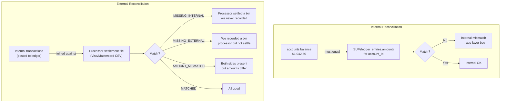
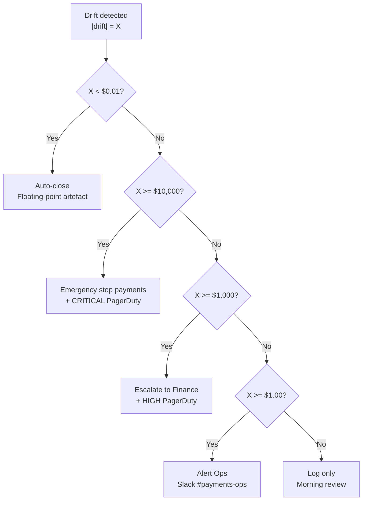

End-of-day reconciliation at a payment processor found 150 accounts where the internal ledger balance differed from the settlement file — discrepancies ranging from $0.01 to $500. The on-call engineer had no tooling to answer the most critical question in those first minutes: is any real customer money at risk right now, or is this a data artefact? This lesson builds the full reconciliation stack — internal balance checks, external settlement matching, shadow ledgers, and threshold-driven alerting — so the answer to that question is always a single query away.

## Learning Objectives

- Distinguish internal reconciliation (account balance vs. summed ledger entries) from external reconciliation (internal transactions vs. payment processor settlement file), and explain why both are required.
- Write a PostgreSQL query using `SUM` and `HAVING` to detect accounts where the stored balance has drifted from the sum of their ledger entries.
- Implement a Spring Batch `InternalReconciliationJob` that runs nightly and writes mismatches to a `reconciliation_items` table.
- Load a CSV settlement file from a payment processor and perform a full outer join against internal transaction records, classifying results as `MATCHED`, `MISSING_INTERNAL`, `MISSING_EXTERNAL`, or `AMOUNT_MISMATCH`.
- Design a shadow ledger pattern using a `shadow_balance` column updated by an independent code path, and explain what failure modes it detects that internal reconciliation misses.
- Apply threshold-based alert routing: auto-close rounding artefacts below $0.01, page operations above $1, escalate to finance above $1,000, and trigger emergency payment suspension above $10,000.

## Business Context

Meridian Payments, a US-based payment facilitator processing $4.2 billion annually for 23,000 merchant accounts, runs a nightly batch job that compares internal ledger balances against the Visa settlement file for the previous business day. On the evening of a Tuesday in Q3, the reconciliation job surfaced 150 mismatches affecting 150 distinct accounts. Discrepancies ranged from $0.01 (consistent with floating-point rounding in a currency conversion added 6 weeks earlier) to $487.33 (unexplained).

The on-call engineer had no classification tooling. Every mismatch looked identical in the alert — a UUID and two dollar amounts. Working through 150 rows manually at 11 PM took 3 hours. Of the 150 discrepancies: 142 were confirmed rounding artefacts below $0.02 and auto-resolvable; 6 were timing differences where a refund had settled on day D but was posted internally on day D+1 (a known edge case with no open ticket); and 2 were genuine unexplained discrepancies totalling $912.11, requiring finance team review. No customer money was ultimately at risk, but the 3-hour investigation delay violated Meridian's internal SLA of 45 minutes to triage any reconciliation alert. The postmortem produced three action items: automated mismatch classification, threshold-driven paging, and a shadow ledger to detect drift before EOD.

## Types of Reconciliation

Reconciliation has two distinct layers, and conflating them is the most common engineering mistake in this domain.

**Internal reconciliation** answers: does the balance stored on the `accounts` table equal the sum of all ledger entries for that account? This detects bugs in the application layer — a code path that updated `accounts.balance` but failed to write the corresponding `ledger_entries` row, or vice versa.

**External reconciliation** answers: do the transactions recorded internally match what the payment processor actually settled? This detects network failures, processor bugs, timing differences, and fraud. An account can pass internal reconciliation (balance = sum of ledger entries) while still having an external mismatch (the processor settled a different amount than what was posted internally).



> [!IMPORTANT]
> Both reconciliation types must run every day, in this order: internal first, then external. If internal reconciliation finds a mismatch, the internal ledger cannot be trusted as the source of truth for the external reconciliation join. Fix internal mismatches before interpreting external ones.

## Internal Reconciliation: Query and Job

### Detection Query

```sql
-- Detect accounts where stored balance differs from sum of ledger entries.
-- Run after all same-day postings are complete (e.g., 02:00 UTC in a batch window).
SELECT
    a.id                                                 AS account_id,
    a.balance_cents                                      AS stored_balance,
    COALESCE(SUM(le.amount_cents), 0)                    AS ledger_sum,
    a.balance_cents - COALESCE(SUM(le.amount_cents), 0)  AS drift_cents
FROM       accounts       a
LEFT JOIN  ledger_entries le ON le.account_id = a.id
WHERE      a.status = 'ACTIVE'
GROUP BY   a.id, a.balance_cents
HAVING     a.balance_cents != COALESCE(SUM(le.amount_cents), 0)
ORDER BY   ABS(a.balance_cents - COALESCE(SUM(le.amount_cents), 0)) DESC;
```

The `HAVING` clause filters to only drifted accounts. For a database with 2 million active accounts this query completes in under 30 seconds with a covering index on `ledger_entries(account_id, amount_cents)`.

### InternalReconciliationJob

```java
@Configuration
@RequiredArgsConstructor
public class InternalReconciliationJobConfig {

    private final JobBuilderFactory      jobs;
    private final StepBuilderFactory     steps;
    private final DataSource             dataSource;
    private final ReconciliationWriter   reconciliationWriter;

    @Bean
    public Job internalReconciliationJob() {
        return jobs.get("internalReconciliationJob")
                .start(detectDriftStep())
                .build();
    }

    @Bean
    public Step detectDriftStep() {
        return steps.get("detectDriftStep")
                .<InternalMismatch, InternalMismatch>chunk(500)
                .reader(driftReader())
                .writer(reconciliationWriter)
                .faultTolerant()
                .skipLimit(0)           // zero tolerance: any exception fails the job
                .build();
    }

    @Bean
    @StepScope
    public JdbcCursorItemReader<InternalMismatch> driftReader() {
        return new JdbcCursorItemReaderBuilder<InternalMismatch>()
                .name("driftReader")
                .dataSource(dataSource)
                .sql("""
                    SELECT a.id           AS account_id,
                           a.balance_cents AS stored_balance,
                           COALESCE(SUM(le.amount_cents), 0) AS ledger_sum,
                           a.balance_cents - COALESCE(SUM(le.amount_cents), 0) AS drift_cents
                    FROM       accounts a
                    LEFT JOIN  ledger_entries le ON le.account_id = a.id
                    WHERE      a.status = 'ACTIVE'
                    GROUP BY   a.id, a.balance_cents
                    HAVING     a.balance_cents != COALESCE(SUM(le.amount_cents), 0)
                    """)
                .rowMapper((rs, rowNum) -> new InternalMismatch(
                        rs.getObject("account_id", UUID.class),
                        rs.getLong("stored_balance"),
                        rs.getLong("ledger_sum"),
                        rs.getLong("drift_cents")
                ))
                .build();
    }
}

public record InternalMismatch(
        UUID accountId,
        long storedBalanceCents,
        long ledgerSumCents,
        long driftCents       // positive = balance overstated; negative = understated
) {}
```

```java
@Component
@RequiredArgsConstructor
@Slf4j
public class ReconciliationWriter implements ItemWriter<InternalMismatch> {

    private final ReconciliationRunRepository  runRepository;
    private final ReconciliationItemRepository itemRepository;
    private final AlertThresholdService        alertService;

    @Override
    public void write(List<? extends InternalMismatch> mismatches) {
        UUID runId = runRepository.currentRunId();  // set at job start
        List<ReconciliationItem> items = mismatches.stream()
                .map(m -> ReconciliationItem.fromInternal(runId, m))
                .toList();
        itemRepository.saveAll(items);

        for (InternalMismatch m : mismatches) {
            alertService.evaluate(m.driftCents(), m.accountId(), ReconciliationType.INTERNAL);
        }

        log.info("Wrote {} internal mismatches for run {}", mismatches.size(), runId);
    }
}
```

## External Reconciliation: Loading the Settlement File

The payment processor delivers a CSV at 23:30 UTC containing every transaction settled that day. Each row holds a processor reference number, merchant account ID, and settled amount in cents. The Java job performs the full outer join in memory for volumes up to ~500,000 rows; above that, load the file into a staging table and use the SQL full outer join shown below.

### SQL Full Outer Join (staging table approach for large volumes)

```sql
-- After bulk-loading the CSV into settlement_staging:
SELECT
    COALESCE(it.transaction_ref, ss.external_ref)        AS ref,
    it.amount_cents                                       AS internal_amount,
    ss.amount_cents                                       AS external_amount,
    CASE
        WHEN it.transaction_ref IS NULL          THEN 'MISSING_INTERNAL'
        WHEN ss.external_ref    IS NULL          THEN 'MISSING_EXTERNAL'
        WHEN it.amount_cents != ss.amount_cents  THEN 'AMOUNT_MISMATCH'
        ELSE                                          'MATCHED'
    END                                                   AS category
FROM       internal_transactions it
FULL OUTER JOIN settlement_staging ss
    ON  it.transaction_ref = ss.external_ref
    AND it.settlement_date = ss.settlement_date;
```

### ExternalReconciliationJob

```java
@Service
@RequiredArgsConstructor
@Slf4j
public class ExternalReconciliationJob {

    private final TransactionRepository        transactionRepository;
    private final ReconciliationItemRepository itemRepository;
    private final AlertThresholdService        alertService;

    public ReconciliationRunSummary run(UUID runId, Path settlementFile,
                                        LocalDate settlementDate) throws IOException {
        // Step 1: load settlement file into a ref → amount map
        Map<String, Long> settledAmounts = loadSettlementFile(settlementFile);

        // Step 2: load today's internal transactions
        Map<String, Long> internalAmounts = transactionRepository
                .findBySettlementDate(settlementDate)
                .stream()
                .collect(Collectors.toMap(
                        Transaction::processorReference,
                        Transaction::amountCents));

        // Step 3: full outer join in memory — classify every reference
        Set<String> allRefs = new HashSet<>();
        allRefs.addAll(settledAmounts.keySet());
        allRefs.addAll(internalAmounts.keySet());

        int matched = 0, missingInternal = 0, missingExternal = 0, amountMismatch = 0;
        List<ReconciliationItem> items = new ArrayList<>();

        for (String ref : allRefs) {
            Long external = settledAmounts.get(ref);
            Long internal = internalAmounts.get(ref);

            MismatchCategory category;
            long drift = 0L;

            if (external != null && internal != null) {
                if (external.equals(internal)) {
                    category = MismatchCategory.MATCHED;
                    matched++;
                } else {
                    category = MismatchCategory.AMOUNT_MISMATCH;
                    drift    = internal - external;   // positive = internal overstated
                    amountMismatch++;
                }
            } else if (external != null) {
                // Processor settled a transaction we have no record of internally
                category = MismatchCategory.MISSING_INTERNAL;
                drift    = -external;
                missingInternal++;
            } else {
                // We recorded it; processor did not settle it yet
                category = MismatchCategory.MISSING_EXTERNAL;
                drift    = internal;
                missingExternal++;
            }

            if (category != MismatchCategory.MATCHED) {
                items.add(ReconciliationItem.fromExternal(runId, ref, category, drift));
                alertService.evaluate(drift, ref, ReconciliationType.EXTERNAL);
            }
        }

        itemRepository.saveAll(items);
        return new ReconciliationRunSummary(runId, matched, missingInternal,
                missingExternal, amountMismatch);
    }

    private Map<String, Long> loadSettlementFile(Path file) throws IOException {
        Map<String, Long> result = new HashMap<>();
        try (BufferedReader reader = Files.newBufferedReader(file)) {
            String line;
            boolean header = true;
            while ((line = reader.readLine()) != null) {
                if (header) { header = false; continue; }   // skip CSV header row
                String[] cols = line.split(",");
                // columns: processor_ref, merchant_account_id, settled_amount_cents, currency
                result.put(cols[0].trim(), Long.parseLong(cols[2].trim()));
            }
        }
        return result;
    }
}

public enum MismatchCategory {
    MATCHED, MISSING_INTERNAL, MISSING_EXTERNAL, AMOUNT_MISMATCH
}
```

> [!WARNING]
> `MISSING_INTERNAL` is the most financially dangerous category. It means the processor debited funds from your settlement account for a transaction you have no internal record of. This is either fraud, a bug in the transaction recording path, or a race condition where the processor received an authorisation that was never persisted. These items must trigger an immediate alert regardless of amount — there is no safe minimum threshold for a transaction that should not exist.

## Shadow Ledger

A shadow ledger maintains a second, independently computed balance that runs alongside the primary balance but is updated by a completely separate code path. The two values must always agree. Divergence means one code path has a bug the other does not share.

```sql
-- Add shadow balance column to the accounts table
ALTER TABLE accounts ADD COLUMN shadow_balance_cents BIGINT NOT NULL DEFAULT 0;
```

```java
@Service
@RequiredArgsConstructor
public class ShadowLedgerService {

    private final JdbcTemplate jdbc;

    /**
     * Called AFTER the primary balance update, in a separate nested transaction.
     * Uses REQUIRES_NEW so a failure here does not roll back the primary posting;
     * it only triggers a reconciliation flag on the account.
     */
    @Transactional(propagation = Propagation.REQUIRES_NEW)
    public void applyShadowDebit(UUID accountId, long amountCents) {
        int rows = jdbc.update("""
                UPDATE accounts
                SET    shadow_balance_cents = shadow_balance_cents - ?
                WHERE  id = ?
                """, amountCents, accountId);

        if (rows != 1) {
            throw new ShadowLedgerException("Shadow debit failed for account " + accountId);
        }
    }

    @Transactional(propagation = Propagation.REQUIRES_NEW)
    public void applyShadowCredit(UUID accountId, long amountCents) {
        int rows = jdbc.update("""
                UPDATE accounts
                SET    shadow_balance_cents = shadow_balance_cents + ?
                WHERE  id = ?
                """, amountCents, accountId);

        if (rows != 1) {
            throw new ShadowLedgerException("Shadow credit failed for account " + accountId);
        }
    }
}
```

### Nightly Shadow Comparison Query

```sql
-- Accounts where shadow balance diverges from primary balance.
-- Catches bugs that affect only one of the two code paths.
SELECT
    id                   AS account_id,
    balance_cents        AS primary_balance,
    shadow_balance_cents AS shadow_balance,
    balance_cents - shadow_balance_cents AS divergence_cents
FROM   accounts
WHERE  balance_cents != shadow_balance_cents
AND    status = 'ACTIVE'
ORDER  BY ABS(balance_cents - shadow_balance_cents) DESC;
```

> [!NOTE]
> The shadow ledger pattern is most valuable when the shadow path is maintained by a different team, or even a different service consuming events from an outbox. If both paths share the same library function, a bug in that function corrupts both balances equally and the shadow will not detect it. Diversity of implementation is what gives shadow ledgers their diagnostic power — they are not useful as a performance check but as a code-path divergence detector.

## Reconciliation Schema

```sql
-- One row per nightly run, one per reconciliation type.
CREATE TABLE reconciliation_runs (
    id               UUID         NOT NULL DEFAULT gen_random_uuid(),
    run_type         VARCHAR(32)  NOT NULL,    -- INTERNAL, EXTERNAL
    business_date    DATE         NOT NULL,
    started_at       TIMESTAMPTZ  NOT NULL DEFAULT now(),
    completed_at     TIMESTAMPTZ,
    status           VARCHAR(16)  NOT NULL DEFAULT 'RUNNING', -- RUNNING, COMPLETED, FAILED
    total_checked    INTEGER      NOT NULL DEFAULT 0,
    total_mismatches INTEGER      NOT NULL DEFAULT 0,
    settlement_file  TEXT,         -- S3 URI or local path of CSV; NULL for INTERNAL runs
    CONSTRAINT pk_reconciliation_runs PRIMARY KEY (id),
    CONSTRAINT uq_run_date_type UNIQUE (business_date, run_type)
);

-- Individual mismatch items written during each run.
CREATE TABLE reconciliation_items (
    id                  UUID         NOT NULL DEFAULT gen_random_uuid(),
    run_id              UUID         NOT NULL REFERENCES reconciliation_runs(id),
    item_type           VARCHAR(16)  NOT NULL,    -- INTERNAL, EXTERNAL
    account_id          UUID,                     -- populated for INTERNAL items
    processor_reference VARCHAR(128),             -- populated for EXTERNAL items
    category            VARCHAR(32)  NOT NULL,    -- MATCHED, MISSING_INTERNAL, etc.
    drift_cents         BIGINT       NOT NULL,
    status              VARCHAR(16)  NOT NULL DEFAULT 'OPEN', -- OPEN, AUTO_CLOSED, ESCALATED, RESOLVED
    resolution_note     TEXT,
    created_at          TIMESTAMPTZ  NOT NULL DEFAULT now(),
    resolved_at         TIMESTAMPTZ,
    CONSTRAINT pk_reconciliation_items PRIMARY KEY (id)
);

CREATE INDEX idx_recon_items_run_id  ON reconciliation_items (run_id);
CREATE INDEX idx_recon_items_open    ON reconciliation_items (status) WHERE status = 'OPEN';
CREATE INDEX idx_recon_items_account ON reconciliation_items (account_id)
    WHERE account_id IS NOT NULL;
```

## Alert Thresholds and Auto-Resolution

Not all mismatches are equal. A $0.005 drift is a floating-point artefact. A $12,000 drift is a potential fraud incident. The alert routing tier classifies and routes automatically.

```java
@Service
@RequiredArgsConstructor
@Slf4j
public class AlertThresholdService {

    // All thresholds in cents
    private static final long CENTS_AUTO_CLOSE        =       1L;   // < $0.01
    private static final long CENTS_OPS_ALERT         =     100L;   // >= $1.00
    private static final long CENTS_FINANCE_ESCALATE  = 100_000L;   // >= $1,000
    private static final long CENTS_EMERGENCY_STOP    = 1_000_000L; // >= $10,000

    private final ReconciliationItemRepository itemRepository;
    private final PagerDutyService             pagerDuty;
    private final SlackNotificationService     slack;
    private final PaymentSuspensionService     paymentSuspension;

    public void evaluate(long driftCents, Object reference, ReconciliationType type) {
        long absDrift = Math.abs(driftCents);

        if (absDrift < CENTS_AUTO_CLOSE) {
            autoClose(reference, driftCents);
            return;
        }
        if (absDrift >= CENTS_EMERGENCY_STOP) {
            triggerEmergencyStop(reference, driftCents, type);
            return;
        }
        if (absDrift >= CENTS_FINANCE_ESCALATE) {
            escalateToFinance(reference, driftCents, type);
            return;
        }
        if (absDrift >= CENTS_OPS_ALERT) {
            alertOps(reference, driftCents, type);
            return;
        }
        // $0.01 to $0.99: log only, review in morning stand-up
        log.info("Low-value recon mismatch: ref={} drift={}c type={}", reference, driftCents, type);
    }

    private void autoClose(Object reference, long driftCents) {
        itemRepository.autoClose(reference, "Floating-point rounding artefact — drift < $0.01");
        log.debug("Auto-closed recon item: ref={} drift={}c", reference, driftCents);
    }

    private void alertOps(Object reference, long driftCents, ReconciliationType type) {
        slack.sendToChannel("#payments-ops",
                ":warning: Reconciliation mismatch ref=%s drift=$%.2f type=%s — investigate before 09:00"
                        .formatted(reference, driftCents / 100.0, type));
    }

    private void escalateToFinance(Object reference, long driftCents, ReconciliationType type) {
        pagerDuty.createIncident(PagerDutyIncident.builder()
                .severity(Severity.HIGH)
                .summary("Recon mismatch $%.2f — finance review required"
                        .formatted(driftCents / 100.0))
                .details(Map.of("reference", reference.toString(), "type", type.name()))
                .build());
        log.error("Finance escalation: ref={} drift={}c", reference, driftCents);
    }

    private void triggerEmergencyStop(Object reference, long driftCents, ReconciliationType type) {
        log.error("EMERGENCY: Recon drift >= $10,000 for ref={} drift={}c — suspending payments.",
                reference, driftCents);

        paymentSuspension.suspendOutboundPayments(
                SuspensionReason.RECONCILIATION_EMERGENCY,
                String.valueOf(reference));

        pagerDuty.createIncident(PagerDutyIncident.builder()
                .severity(Severity.CRITICAL)
                .summary("EMERGENCY: Recon mismatch $%.2f — payments suspended"
                        .formatted(driftCents / 100.0))
                .details(Map.of("reference", reference.toString(),
                                "type",      type.name(),
                                "action",    "OUTBOUND_PAYMENTS_SUSPENDED"))
                .build());
    }
}
```



> [!WARNING]
> The emergency payment suspension at $10,000 drift must be implemented as an immediate circuit-breaker, not a delayed alert. Outbound payments continuing while a large unexplained discrepancy is active can compound losses. The suspension should require an explicit manual override from two finance team members to lift — a four-eyes control. Document this in your runbook before you ever need it.

## Knowledge Check

**Q: An account has `balance_cents = 50000` ($500.00). The internal reconciliation query returns a ledger sum of `49999` cents. The shadow balance is also `49999`. What does this pattern tell you, and what does it rule out?**

**A:** Both the primary balance and the shadow balance agree with each other but disagree with the ledger sum. This rules out a bug that updated `balance_cents` without updating `shadow_balance_cents` — because both columns are wrong in the same direction. The most likely cause is a code path that updated both balance columns atomically but failed to write the corresponding `ledger_entries` row — perhaps a transaction that committed the account UPDATE but rolled back before the ledger INSERT, leaving no ledger record for a real balance change. The fix is to identify the transaction in the application logs, determine whether the payment was actually processed by the external processor, and either post the missing ledger entry or reverse the balance change. The shadow ledger's value here is diagnostic elimination: it narrows the investigation to the ledger-writing code path rather than the balance-update code path.

**Q: Your external reconciliation job classifies 12 transactions as `MISSING_EXTERNAL` — present internally, absent from the processor's settlement file. Finance wants to know if these represent money Meridian is owed. What are the three distinct explanations for this category, and how do you distinguish them?**

**A:** First, timing difference: the transaction was authorised before the settlement cut-off but settled after it, so it will appear in the next business day's file. Distinguish by checking whether the transaction's `settled_at` timestamp falls within the settlement window and whether it appears in the following day's file. Second, processor error: the processor failed to settle a transaction they authorised — recoverable through a chargeback or manual settlement request. Distinguish by cross-referencing the authorisation code with the processor's dispute portal. Third, internal phantom posting: a transaction was written to the internal ledger but was never actually sent to the processor — a bug in the outbound payment path, perhaps a failed network call that nonetheless committed the database row. Distinguish by checking the outbound payment gateway log for a matching HTTP response from the processor. Items in the first category auto-resolve the next day. Items in the second require finance action. Items in the third require both a ledger reversal and a root-cause fix in the payment gateway.

## Practical Challenge

Your team is building a new reconciliation pipeline for a Buy Now Pay Later product where individual instalment payments are collected via Direct Debit across a 12-month schedule. The settlement file from the Direct Debit bureau arrives 2 business days after each collection date.

1. The 2-day delay means `MISSING_EXTERNAL` items will appear for every transaction for 2 days before resolving. Design a `settlement_lag_days` field in `reconciliation_items` that suppresses alerts for expected lag, and write the SQL `UPDATE` that marks items as `AWAITING_SETTLEMENT` versus `OVERDUE` based on configurable lag thresholds per payment rail stored in a `payment_rail_config` table.

2. Some instalments are partially collected when a customer has insufficient funds — the bureau collects what is available (e.g., $47.00 of a $50.00 instalment). Write the Java logic in `ExternalReconciliationJob` to detect and separately categorise `PARTIAL_SETTLEMENT` items (amount collected is > 0 but < expected), and describe the downstream business action this category should trigger.

3. At month-end, Meridian needs a reconciliation summary report grouped by merchant and payment rail. Write the SQL query against `reconciliation_runs` and `reconciliation_items` that produces: merchant ID, payment rail, total transactions, total matched, total unresolved drift in cents, and a `risk_flag` column that is `true` when unresolved drift exceeds 0.1% of total settled volume for that merchant.

4. The finance team asks why the emergency suspension threshold is a fixed $10,000 rather than a percentage of daily settled volume. For a merchant settling $5 million per day, $10,000 represents 0.2% — arguably noise. For a merchant settling $8,000 per day, $10,000 means their entire float has gone missing. Redesign `AlertThresholdService` to support per-merchant thresholds stored in a `merchant_recon_config` table, with a fallback to global defaults for merchants without a custom config.

<!-- KNOWLEDGE-CHECK
{
  "questions": [
    {
      "text": "What is the correct order in which internal and external reconciliation must run, and why?",
      "options": [
        "Internal first, then external — because if internal mismatches exist the internal ledger cannot be trusted as source of truth for the external join",
        "External first, then internal — because the settlement file arrives before the internal batch window",
        "They can run in parallel — both are independent checks",
        "External only — internal reconciliation is optional for small discrepancies"
      ],
      "correct": 0,
      "explanation": "Internal reconciliation must run first. If the account balance diverges from the sum of ledger entries, the internal ledger is unreliable. Using an unreliable ledger as the left side of an external reconciliation join produces meaningless results. Fix internal mismatches before interpreting external ones."
    },
    {
      "text": "A reconciliation item is classified as MISSING_INTERNAL. Which of the following best describes this category and its severity?",
      "options": [
        "The transaction exists internally but was not yet settled by the processor — a normal timing difference",
        "The processor settled a transaction that has no corresponding internal record — the highest severity category, requiring immediate alert regardless of amount",
        "An amount mismatch where the external amount is higher than the internal amount",
        "A rounding artefact below $0.01 that can be auto-closed"
      ],
      "correct": 1,
      "explanation": "MISSING_INTERNAL means the processor debited funds from the settlement account for a transaction you have no internal record of. This is either fraud, a recording bug, or a race condition. It is the most financially dangerous category and must trigger an immediate alert with no minimum threshold — there is no safe rounding tolerance for a transaction that should not exist."
    },
    {
      "text": "What failure mode does the shadow ledger pattern detect that standard internal reconciliation (balance vs. ledger sum) cannot detect on its own?",
      "options": [
        "Floating-point rounding errors in currency conversion",
        "Timing differences between settlement cut-off and internal posting",
        "Bugs that affect only one of two independently maintained code paths, while both balance columns drift together and therefore still agree with each other",
        "External reconciliation mismatches where the processor amount differs from the internal amount"
      ],
      "correct": 2,
      "explanation": "The shadow ledger's diagnostic power comes from code-path diversity. If both primary and shadow balances drift in the same direction by the same amount, it means a bug updated both balance columns (possibly atomically) but failed to write the ledger entry. Internal reconciliation catches the ledger drift; the shadow confirms which code path is broken. If only one balance drifts, the bug is isolated to that code path."
    }
  ]
}
-->

<!-- PRACTICAL-CHALLENGE
{
  "title": "Build a Multi-Rail Reconciliation Engine with Per-Merchant Alert Thresholds",
  "difficulty": "advanced",
  "estimatedMinutes": 45,
  "tasks": [
    {"id": "1", "description": "Add a `payment_rail_config` table with columns `rail_name`, `settlement_lag_days`, and `auto_close_threshold_cents`. Extend `reconciliation_items` with a `settlement_lag_days` column and write the SQL UPDATE statement that marks items as AWAITING_SETTLEMENT when age < configured lag, and OVERDUE when age >= lag, using a JOIN against `payment_rail_config`."},
    {"id": "2", "description": "Implement `PartialSettlementDetector` in `ExternalReconciliationJob` that classifies items where the external amount is > 0 but < the internal expected amount as PARTIAL_SETTLEMENT (distinct from AMOUNT_MISMATCH). Describe what downstream business action this category should trigger and add it to the `MismatchCategory` enum."},
    {"id": "3", "description": "Write a SQL query against `reconciliation_runs` and `reconciliation_items` that produces a month-end summary report grouped by merchant and payment rail, including: merchant_id, rail, total_transactions, total_matched, total_unresolved_drift_cents, and a boolean `risk_flag` column set to true when unresolved drift exceeds 0.1% of total settled volume for that merchant."},
    {"id": "4", "description": "Redesign `AlertThresholdService` to load per-merchant thresholds from a `merchant_recon_config` table (columns: merchant_id, auto_close_cents, ops_alert_cents, finance_escalate_cents, emergency_stop_cents) with a fallback to global defaults. Add a Caffeine cache with 5-minute TTL so the threshold lookup does not hit the database on every evaluation. Write a unit test verifying that a merchant with a custom config uses its own thresholds, and a merchant without a row falls back to globals."}
  ]
}
-->
