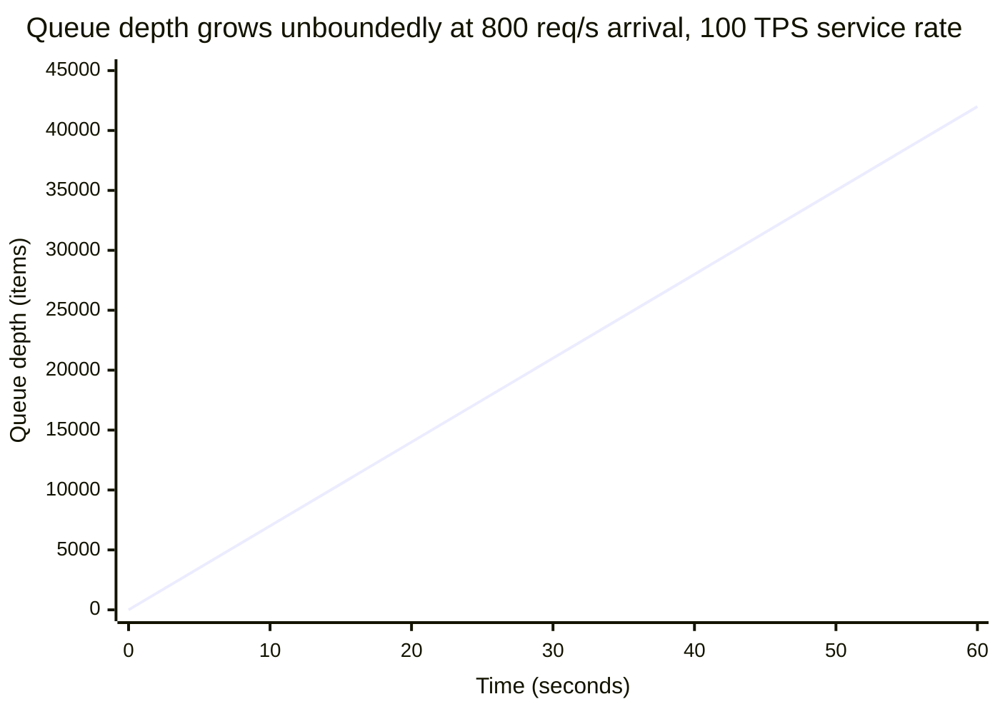
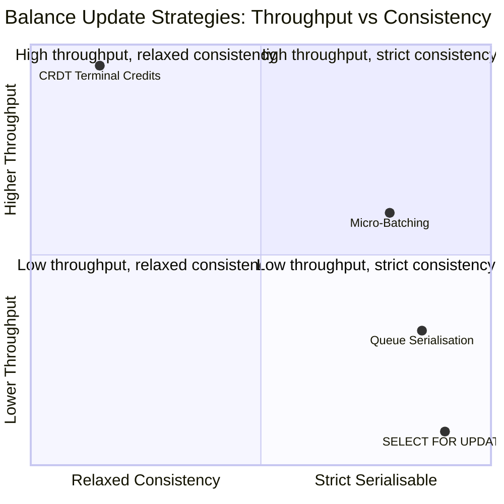

A merchant account receiving 800 concurrent debits per second broke one of the most common assumptions in banking system design: that `SELECT FOR UPDATE` is a sufficient concurrency primitive. At 800 req/s with each database lock held for 10 ms, the queue grew faster than it was drained, p99 latency climbed to 8 seconds, and payment terminals across three retail chains began timing out. This lesson traces the physics of the hot-account problem, then implements four progressively more scalable solutions — from queue serialisation through micro-batching to a CRDT-inspired reserved balance architecture that eliminates the centralised lock entirely.

## Learning Objectives

- Calculate the throughput ceiling imposed by `SELECT FOR UPDATE` and demonstrate mathematically why 800 req/s overwhelms a 10 ms lock hold time.
- Implement a per-account `LinkedBlockingQueue` serialisation service that eliminates database lock contention by funnelling all debits for an account through a single thread.
- Adapt the queue serialisation approach using Java 21 virtual threads to handle thousands of concurrent accounts without exhausting platform thread pools.
- Build a `BatchingDebitAccumulator` that collects debits over a 10 ms window and applies them as a single database UPDATE, reducing lock acquisitions by up to 8x at steady state.
- Design a CRDT-inspired terminal credits schema where each payment terminal writes independently without locking the main balance, and explain the consistency model this creates.
- Compare all four approaches — `SELECT FOR UPDATE`, queue serialisation, micro-batching, and CRDT terminal credits — across throughput, consistency, complexity, and operational risk.

## Business Context

Apex Retail, a UK omnichannel retailer, operates 1,400 payment terminals across 180 stores. All terminals debit a single pooled merchant account managed by their acquiring bank integration. On the Saturday before Christmas, a flash sale drove terminal throughput from a typical 120 req/s to 820 req/s sustained for 47 minutes. The acquiring bank's payment service used `SELECT FOR UPDATE` on the merchant account row for every debit. Each debit held the lock for approximately 11 ms (round-trip to the payment network authorisation service).

At 820 req/s, with 1 debit every 1.22 ms, but only 1 debit able to hold the lock at a time with an 11 ms hold, the queue grew at 820 − (1000/11) = 820 − 91 = **729 items per second**. Within 2 minutes the queue held over 87,000 pending debits. Database connection pool exhaustion followed at minute 3. The service began rejecting connections at minute 4. By minute 7, 23% of terminal payment attempts were failing with timeout errors. The acquiring bank's on-call team manually rate-limited the merchant to 150 req/s to stabilise the system, leaving 670 req/s of legitimate sales unprocessed and routing them to a competitor's terminal network. Estimated lost revenue: £340,000 in that 47-minute window. The root cause was a seven-line code path that had worked correctly at 120 req/s for two years.

## The Hot-Account Problem: The Physics

The throughput ceiling for `SELECT FOR UPDATE` is determined by one equation: how many times per second can one database row be exclusively locked, updated, and released?

```
max_throughput_tps = 1000 ms / lock_hold_time_ms
```

If each debit holds the lock for 10 ms (database update + application processing):

```
max_throughput_tps = 1000 / 10 = 100 TPS
```

At 800 req/s the queue grows without bound:

```
queue_growth_rate = arrival_rate - service_rate
queue_growth_rate = 800 - 100 = 700 items/second
```

After 60 seconds: 42,000 items queued. After 120 seconds: 84,000 items queued. The p99 latency for a newly arriving request grows linearly with queue depth:

```
p99_wait_ms ≈ queue_size * lock_hold_time_ms
           ≈ 42,000 * 10 = 420,000 ms (7 minutes) after 60 seconds of saturation
```

This is a Little's Law problem. The system is not degraded — it has fully saturated. No amount of connection pool tuning or query optimisation will fix it. The serialisation point must move.



> [!WARNING]
> The database connection pool will exhaust before the queue reaches these depths in practice. Each queued request holds an open connection waiting for the lock. At a 100-connection pool, the pool exhausts when queue depth reaches 100 — in roughly 0.14 seconds after saturation. All subsequent requests fail immediately with a connection acquisition timeout rather than a lock wait timeout. The visible symptom is sudden hard failure, not gradual slowdown, which is why this problem often appears without warning on monitoring dashboards.

## Fix 1: Queue Serialisation per Account

Move the serialisation point from the database to the application. Each account gets a dedicated `LinkedBlockingQueue` processed by a single thread. Database writes are non-contended because only one thread ever writes for a given account at a time.

### AccountSerializerService

```java
@Service
@Slf4j
public class AccountSerializerService {

    // accountId → dedicated single-thread executor for that account
    private final ConcurrentHashMap<UUID, ExecutorService> accountExecutors =
            new ConcurrentHashMap<>();

    // accountId → bounded pending debit queue
    private final ConcurrentHashMap<UUID, LinkedBlockingQueue<DebitRequest>> accountQueues =
            new ConcurrentHashMap<>();

    private final AccountRepository accountRepository;

    public AccountSerializerService(AccountRepository accountRepository) {
        this.accountRepository = accountRepository;
    }

    /**
     * Routes a debit request to the account's dedicated queue.
     * Returns a CompletableFuture that completes when the debit is applied.
     * Throws CardBusyException immediately if the account queue is full.
     */
    public CompletableFuture<DebitResult> submitDebit(UUID accountId, long amountCents,
                                                       String idempotencyKey) {
        CompletableFuture<DebitResult> future = new CompletableFuture<>();
        DebitRequest request = new DebitRequest(accountId, amountCents, idempotencyKey, future);

        boolean accepted = getQueue(accountId).offer(request);
        if (!accepted) {
            // Bounded queue is full — back-pressure: reject rather than block
            throw new AccountBusyException("Account " + accountId + " queue is full");
        }

        getExecutor(accountId).submit(() -> processNext(accountId));
        return future;
    }

    private void processNext(UUID accountId) {
        LinkedBlockingQueue<DebitRequest> queue = getQueue(accountId);
        DebitRequest request = queue.poll();
        if (request == null) return;

        try {
            // No SELECT FOR UPDATE needed — only one thread writes per account
            DebitResult result = accountRepository.applyDebitNoLock(
                    request.accountId(),
                    request.amountCents(),
                    request.idempotencyKey());
            request.future().complete(result);
        } catch (Exception ex) {
            request.future().completeExceptionally(ex);
            log.error("Debit failed: accountId={} amount={}",
                    accountId, request.amountCents(), ex);
        }
    }

    private LinkedBlockingQueue<DebitRequest> getQueue(UUID accountId) {
        return accountQueues.computeIfAbsent(accountId,
                k -> new LinkedBlockingQueue<>(10_000));  // bounded: 10k max pending
    }

    private ExecutorService getExecutor(UUID accountId) {
        return accountExecutors.computeIfAbsent(accountId,
                k -> Executors.newSingleThreadExecutor(
                        Thread.ofPlatform()
                              .name("account-" + accountId.toString().substring(0, 8))
                              .factory()));
    }
}

public record DebitRequest(
        UUID accountId,
        long amountCents,
        String idempotencyKey,
        CompletableFuture<DebitResult> future
) {}
```

### applyDebitNoLock SQL

```sql
-- No SELECT FOR UPDATE — only one thread calls this for a given account at a time.
-- Optimistic balance check in the WHERE clause prevents overdraft.
UPDATE accounts
SET    balance_cents   = balance_cents - ?,   -- amountCents
       last_updated_at = now(),
       version         = version + 1
WHERE  id              = ?
AND    balance_cents   >= ?                   -- amountCents: reject if insufficient funds
RETURNING balance_cents, version;
```

### Virtual Thread Variant (Java 21)

```java
@Service
@Slf4j
public class VirtualThreadAccountSerializer {

    // One semaphore per account — permits=1 means only one virtual thread writes at a time
    private final ConcurrentHashMap<UUID, Semaphore> accountSemaphores =
            new ConcurrentHashMap<>();
    private final AccountRepository accountRepository;

    public VirtualThreadAccountSerializer(AccountRepository accountRepository) {
        this.accountRepository = accountRepository;
    }

    /**
     * Virtual threads allow massive concurrency without platform thread exhaustion.
     * The Semaphore(1) ensures only one virtual thread writes per account at a time.
     * 50,000 parked virtual threads consume roughly 50 MB — equivalent to 50 platform threads.
     */
    public CompletableFuture<DebitResult> submitDebit(UUID accountId, long amountCents,
                                                       String idempotencyKey) {
        return CompletableFuture.supplyAsync(() -> {
            Semaphore semaphore = accountSemaphores.computeIfAbsent(accountId,
                    k -> new Semaphore(1));
            try {
                semaphore.acquire();   // virtual thread parks here if another write is in flight
                return accountRepository.applyDebitNoLock(accountId, amountCents, idempotencyKey);
            } catch (InterruptedException e) {
                Thread.currentThread().interrupt();
                throw new DebitInterruptedException(accountId, e);
            } finally {
                semaphore.release();
            }
        }, Executors.newVirtualThreadPerTaskExecutor());
    }
}
```

> [!NOTE]
> Virtual threads (Java 21) park cheaply on blocking operations and are created at near-zero cost. For a service with 50,000 hot accounts each needing serialisation, 50,000 parked virtual threads consume roughly 50 MB of heap — equivalent to 50 platform threads. The `Semaphore(1)` per account ensures serialisation without a dedicated thread pool per account, making this approach far more memory-efficient than platform-thread-per-account queues.

## Fix 2: Micro-Batching

Queue serialisation reduces lock contention but still issues one database UPDATE per debit. Micro-batching collects all debits that arrive within a short window (10 ms) and applies them as a single UPDATE, reducing database write amplification by the batch size.

### BatchingDebitAccumulator

```java
@Component
@Slf4j
public class BatchingDebitAccumulator {

    private final ConcurrentHashMap<UUID, List<PendingDebit>>            pendingDebits   = new ConcurrentHashMap<>();
    private final ConcurrentHashMap<UUID, List<CompletableFuture<DebitResult>>> pendingFutures = new ConcurrentHashMap<>();
    private final Object flushLock = new Object();

    private final AccountRepository       accountRepository;
    private final ScheduledExecutorService scheduler;

    public BatchingDebitAccumulator(AccountRepository accountRepository) {
        this.accountRepository = accountRepository;
        this.scheduler = Executors.newScheduledThreadPool(4);
        // Drain all accounts every 10 ms — the micro-batch window
        scheduler.scheduleAtFixedRate(this::drainAll, 10, 10, TimeUnit.MILLISECONDS);
    }

    /**
     * Accumulates a debit into the pending batch for the account.
     * Returns a Future that completes when the 10 ms batch is flushed.
     */
    public CompletableFuture<DebitResult> accumulate(UUID accountId, long amountCents,
                                                      String idempotencyKey) {
        CompletableFuture<DebitResult> future = new CompletableFuture<>();

        synchronized (flushLock) {
            pendingDebits.computeIfAbsent(accountId, k -> new ArrayList<>())
                         .add(new PendingDebit(amountCents, idempotencyKey));
            pendingFutures.computeIfAbsent(accountId, k -> new ArrayList<>())
                          .add(future);
        }

        return future;
    }

    private void drainAll() {
        Set<UUID> accounts;
        Map<UUID, List<PendingDebit>>            snapshot;
        Map<UUID, List<CompletableFuture<DebitResult>>> snapshotFutures;

        // Atomically swap pending maps so new arrivals go into fresh collections
        synchronized (flushLock) {
            accounts        = new HashSet<>(pendingDebits.keySet());
            snapshot        = new HashMap<>(pendingDebits);
            snapshotFutures = new HashMap<>(pendingFutures);
            pendingDebits.clear();
            pendingFutures.clear();
        }

        for (UUID accountId : accounts) {
            drainAccount(accountId,
                    snapshot.getOrDefault(accountId, List.of()),
                    snapshotFutures.getOrDefault(accountId, List.of()));
        }
    }

    private void drainAccount(UUID accountId,
                               List<PendingDebit> debits,
                               List<CompletableFuture<DebitResult>> futures) {
        if (debits.isEmpty()) return;

        long totalDebitCents = debits.stream()
                .mapToLong(PendingDebit::amountCents)
                .sum();

        try {
            // Single UPDATE applies all debits in this 10 ms window in one lock acquisition
            DebitResult result = accountRepository.applyBatchDebit(
                    accountId, totalDebitCents, debits.size());

            futures.forEach(f -> f.complete(result));
            log.debug("Micro-batch flushed: accountId={} debits={} totalCents={}",
                    accountId, debits.size(), totalDebitCents);

        } catch (InsufficientFundsException ex) {
            // Batch fails as a unit — callers must retry individually
            futures.forEach(f -> f.completeExceptionally(ex));
            log.warn("Micro-batch insufficient funds: accountId={} totalCents={}",
                    accountId, totalDebitCents);
        } catch (Exception ex) {
            futures.forEach(f -> f.completeExceptionally(ex));
            log.error("Micro-batch error: accountId={} totalCents={}", accountId, totalDebitCents, ex);
        }
    }
}

public record PendingDebit(long amountCents, String idempotencyKey) {}
```

### Batch UPDATE SQL

```sql
-- Applies the sum of all debits collected in the 10 ms window in a single statement.
-- One lock acquisition covers all N debits in the batch.
UPDATE accounts
SET    balance_cents   = balance_cents - ?,   -- total_debit_cents (SUM of batch)
       last_updated_at = now(),
       version         = version + 1
WHERE  id              = ?
AND    balance_cents   >= ?                   -- total_debit_cents (prevent overdraft)
RETURNING balance_cents, version;
```

At 800 req/s and a 10 ms batch window, each batch contains approximately 8 debits. The lock is acquired once per batch instead of once per debit — an 8x reduction in lock acquisitions at steady state.

> [!IMPORTANT]
> Micro-batching changes the failure semantics. If the batch UPDATE fails because total batch exceeds the balance, every debit in the batch fails together — including debits that individually would not have caused an overdraft. The standard approach is to fail all and require callers to retry individually. The retry path uses queue serialisation as a fallback and processes each debit one at a time against the available balance.

## Fix 3: CRDT-Inspired Terminal Credits

For the highest throughput requirements, eliminate the centralised balance lock entirely. Each payment terminal maintains its own `terminal_credits` row. The main balance is computed as `main_balance - SUM(terminal_credits.debited_cents)`. Terminals write to their own row without contention on the main account row. Settlement consolidates the terminal rows into the main balance nightly.

### Schema

```sql
-- Main account balance — updated only during nightly settlement
CREATE TABLE accounts (
    id                  UUID        NOT NULL DEFAULT gen_random_uuid(),
    merchant_id         UUID        NOT NULL,
    main_balance_cents  BIGINT      NOT NULL DEFAULT 0,
    last_settled_at     TIMESTAMPTZ NOT NULL DEFAULT now(),
    CONSTRAINT pk_accounts PRIMARY KEY (id)
);

-- Each terminal has its own credits row — updated concurrently, no locks on accounts needed
CREATE TABLE terminal_credits (
    id              UUID        NOT NULL DEFAULT gen_random_uuid(),
    account_id      UUID        NOT NULL REFERENCES accounts(id),
    terminal_id     VARCHAR(64) NOT NULL,
    debited_cents   BIGINT      NOT NULL DEFAULT 0,   -- cumulative debits since last settlement
    last_updated_at TIMESTAMPTZ NOT NULL DEFAULT now(),
    CONSTRAINT pk_terminal_credits PRIMARY KEY (id),
    CONSTRAINT uq_account_terminal UNIQUE (account_id, terminal_id)
);

CREATE INDEX idx_terminal_credits_account ON terminal_credits (account_id);
```

### Real-Time Balance Query

```sql
-- Effective balance = main balance minus all terminal debits since last settlement.
-- A pure read — no locks, no contention.
SELECT
    a.main_balance_cents - COALESCE(SUM(tc.debited_cents), 0) AS available_balance_cents
FROM       accounts        a
LEFT JOIN  terminal_credits tc ON tc.account_id = a.id
WHERE      a.id = ?
GROUP BY   a.main_balance_cents;
```

### Terminal Debit Service

```java
@Service
@RequiredArgsConstructor
@Slf4j
public class TerminalCreditService {

    private final JdbcTemplate jdbc;

    /**
     * Records a debit against a terminal's own row — no account-level lock.
     * Concurrent writes from different terminals do not contend with each other
     * because each terminal writes to its own row.
     */
    @Transactional
    public void recordDebit(UUID accountId, String terminalId, long amountCents) {
        // UPSERT: create terminal row on first debit, increment on subsequent debits
        int rows = jdbc.update("""
                INSERT INTO terminal_credits (account_id, terminal_id, debited_cents, last_updated_at)
                VALUES (?, ?, ?, now())
                ON CONFLICT (account_id, terminal_id)
                DO UPDATE SET debited_cents   = terminal_credits.debited_cents + EXCLUDED.debited_cents,
                              last_updated_at = now()
                """, accountId, terminalId, amountCents);

        if (rows != 1) {
            throw new TerminalCreditException(
                    "Terminal credit upsert failed: account=%s terminal=%s"
                            .formatted(accountId, terminalId));
        }

        log.debug("Terminal debit recorded: account={} terminal={} amount={}",
                accountId, terminalId, amountCents);
    }
}
```

### Nightly Settlement Consolidation

```java
@Component
@RequiredArgsConstructor
@Slf4j
public class TerminalSettlementJob {

    private final JdbcTemplate jdbc;

    @Scheduled(cron = "0 0 1 * * *")   // 01:00 UTC nightly
    @Transactional
    public void settle() {
        // 1. Subtract all terminal debits from each account's main balance
        int accountsSettled = jdbc.update("""
                UPDATE accounts a
                SET    main_balance_cents = a.main_balance_cents
                                           - (SELECT COALESCE(SUM(tc.debited_cents), 0)
                                              FROM   terminal_credits tc
                                              WHERE  tc.account_id = a.id),
                       last_settled_at = now()
                """);

        // 2. Reset all terminal credit accumulators to zero for the new day
        int terminalsReset = jdbc.update("""
                UPDATE terminal_credits
                SET    debited_cents   = 0,
                       last_updated_at = now()
                """);

        log.info("Settlement complete: {} accounts settled, {} terminal rows reset",
                accountsSettled, terminalsReset);
    }
}
```

> [!WARNING]
> The CRDT terminal credits model offers a consistency trade-off: the available balance computed by the real-time query is eventually consistent. Between the moment a terminal writes its debit and the moment another terminal reads the aggregate balance, there is a window where the available balance appears higher than it actually is. For a merchant where total terminal throughput rarely approaches the actual balance, this risk is negligible. For a prepaid card with a tight balance limit, concurrent over-spend is a real risk and this model requires a compensating overdraft tolerance or a mandatory pre-authorisation reservation step.

## Approach Comparison

| Approach | Throughput Ceiling | Consistency | Complexity | Operational Risk |
|---|---|---|---|---|
| `SELECT FOR UPDATE` | ~100 TPS (10 ms lock) | Strict serialisable | Low | Deadlock; connection pool exhaustion above ceiling |
| Queue Serialisation | ~1,000–5,000 TPS (in-memory queue) | Serialisable per account | Medium | In-memory queue lost on crash; bounded queue back-pressure must be handled |
| Micro-Batching | ~5,000–20,000 TPS (batch factor × FOR UPDATE ceiling) | Serialisable per batch | Medium-High | Batch failure affects all debits in window; partial overdraft ambiguity |
| CRDT Terminal Credits | 100,000+ TPS (write-local, no central lock) | Eventual (settlement lag) | High | Over-spend window between terminal writes; settlement job is critical path |



## Knowledge Check

**Q: A `SELECT FOR UPDATE` debit takes 8 ms on average. At what request rate does the system reach its throughput ceiling, and what happens to database connections immediately after that point?**

**A:** The throughput ceiling is `1000 ms / 8 ms = 125 TPS`. At 126 req/s the queue begins growing at 1 item per second. Each queued request holds an open database connection while waiting for the lock. At a typical pool of 100 connections, the pool exhausts when queue depth reaches 100 — roughly 100 seconds after saturation begins. Beyond pool exhaustion, every new incoming request is immediately rejected with a connection acquisition timeout rather than waiting for the lock. The failure mode transitions from slow (high latency) to hard (immediate rejection). The fix is never to increase the connection pool size — that only delays exhaustion by the ratio of the new pool size to the surplus arrival rate. The architectural fix is to reduce lock hold time or move the serialisation point out of the database.

**Q: The CRDT terminal credits model allows over-spend between terminal writes and settlement. Name two concrete controls you can add to bound the maximum over-spend exposure without reintroducing a centralised lock.**

**A:** First, a per-terminal daily debit limit enforced at the terminal row level: add a `daily_limit_cents` column to `terminal_credits` and add an application-layer guard that rejects any debit that would cause `debited_cents > daily_limit_cents`. This bounds the worst-case over-spend to `number_of_terminals * daily_limit_cents - main_balance`. If a merchant has 10 terminals each capped at $5,000/day and a $2,000 balance, the merchant explicitly accepts the possibility of a $48,000 over-spend in a pathological scenario — a business policy decision documented in the merchant agreement. Second, a periodic intra-day mini-settlement running every 15 minutes rather than nightly: `TerminalSettlementJob` runs more frequently, reducing the window during which terminal credits diverge from the main balance. The settlement frequency is a knob that trades operational overhead (more frequent jobs, more database writes) against consistency exposure (smaller over-spend window). The two controls are complementary — per-terminal limits cap the magnitude of exposure; frequent settlement caps the duration.

## Practical Challenge

Your team is tasked with redesigning the balance update path for a prepaid card product where 500,000 cardholders each have a balance with a hard spending limit. The card processor reports that 0.3% of cardholders are experiencing p99 latency above 2 seconds, all of them in the top 1% of transaction frequency.

1. Prove mathematically that the current `SELECT FOR UPDATE` implementation cannot serve a cardholder making 60 transactions per minute (1 TPS per card) if each lock hold takes 25 ms. Show what p99 latency the queueing model predicts for a single hot cardholder after 10 seconds of sustained 1 TPS arrival at a 25 ms lock hold.

2. Implement a `CardholderDebitService` that uses queue serialisation with a bounded `LinkedBlockingQueue` of capacity 50. When the queue is full, the service must reject the debit immediately with a `CardBusyException` rather than block indefinitely. Write the full class including the rejection path and explain why unbounded queues are more dangerous than bounded queues with explicit rejection in a payment context.

3. Micro-batching groups debits by a time window, but for a prepaid card you must also validate that no single debit within the batch would have individually exceeded the balance at the time it was submitted. Design a `BalanceCheckingBatchAccumulator` that pre-checks each debit against a running estimated balance before adding it to the batch, and handles the case where the batch's total exceeds the balance at flush time by processing debits individually until the balance is exhausted.

4. The CTO proposes switching the top-1% of high-frequency cardholders to the CRDT terminal credits model automatically. Write the SQL query that identifies cardholders whose `transaction_count` in the last 24 hours exceeds a configurable threshold, and describe the data migration path to move a live cardholder from the `SELECT FOR UPDATE` model to the CRDT model without a service interruption or balance discrepancy during the cutover.

<!-- KNOWLEDGE-CHECK
{
  "questions": [
    {
      "text": "A SELECT FOR UPDATE debit holds the lock for 12 ms on average. At what exact arrival rate does the queue begin growing, and what is the queue growth rate at 200 req/s?",
      "options": [
        "Ceiling is 83 TPS; at 200 req/s the queue grows at 117 items/second",
        "Ceiling is 120 TPS; at 200 req/s the queue grows at 80 items/second",
        "Ceiling is 100 TPS; at 200 req/s the queue grows at 100 items/second",
        "Ceiling is 50 TPS; at 200 req/s the queue grows at 150 items/second"
      ],
      "correct": 0,
      "explanation": "max_throughput = 1000 ms / 12 ms = 83 TPS. At 200 req/s arrival: queue_growth_rate = 200 − 83 = 117 items/second. The queue grows without bound from the moment arrival exceeds the service rate. Connection pool exhaustion follows when queue depth equals the pool size."
    },
    {
      "text": "Why does the queue serialisation approach use Propagation.REQUIRES_NEW (or a Semaphore per account for virtual threads) rather than simply retrying failed optimistic lock attempts?",
      "options": [
        "Because optimistic locking requires a version column which is expensive to maintain",
        "Because the serialisation point is moved to the application layer: only one thread writes per account at a time, eliminating database lock contention entirely rather than merely retrying it",
        "Because REQUIRES_NEW provides better performance than retries under any load level",
        "Because retries are not idempotent and will double-charge customers"
      ],
      "correct": 1,
      "explanation": "Queue serialisation moves the serialisation point from the database row lock to an in-memory queue or semaphore. The database UPDATE runs without any locking predicate because only one thread ever writes for a given account at a time — contention is prevented, not retried. Optimistic lock retries still hit the database on every conflict; queue serialisation eliminates the conflicts themselves."
    },
    {
      "text": "What is the main consistency trade-off introduced by the CRDT terminal credits model, and which prepaid card scenario makes this trade-off unacceptable without additional controls?",
      "options": [
        "The model requires eventual settlement, so customer statements are always one day delayed",
        "Between terminal writes and the balance query, the available balance appears higher than it actually is — creating an over-spend window that is unacceptable for prepaid cards with tight balance limits",
        "The nightly settlement job creates a centralised lock that defeats the purpose of the model",
        "CRDT terminal credits cannot handle partial refunds because each terminal writes independently"
      ],
      "correct": 1,
      "explanation": "The CRDT model computes available balance as main_balance minus SUM(terminal_credits). Between the moment one terminal writes a debit and another terminal reads the aggregate, there is a window where the balance appears higher than reality. For a prepaid card where balance = $5 and two terminals each see $5 available, both can proceed — resulting in a $10 over-spend. Controls like per-terminal daily limits or frequent intra-day settlement bound but do not eliminate this risk."
    }
  ]
}
-->

<!-- PRACTICAL-CHALLENGE
{
  "title": "Design a High-Throughput Concurrent Balance System for a Prepaid Card Product",
  "difficulty": "advanced",
  "estimatedMinutes": 45,
  "tasks": [
    {"id": "1", "description": "Prove mathematically that SELECT FOR UPDATE with a 25 ms lock hold cannot serve a cardholder making 60 transactions per minute. Show the max TPS, the queue growth rate at 1 req/s arrival, and the p99 latency after 10 seconds of sustained 1 TPS arrival using Little's Law."},
    {"id": "2", "description": "Implement `CardholderDebitService` using queue serialisation with a LinkedBlockingQueue of capacity 50. The submitDebit method must return a CompletableFuture<DebitResult> and throw CardBusyException immediately — without blocking — if the queue is full. Explain in code comments why unbounded queues are more dangerous than bounded queues with explicit rejection in a payment context."},
    {"id": "3", "description": "Design a BalanceCheckingBatchAccumulator that tracks a running estimated balance per account as debits accumulate during the 10 ms window. Pre-check each incoming debit against the running estimate before adding it to the batch. When the batch flushes and the actual DB balance is lower than the estimate, process debits individually until the balance is exhausted, failing remaining debits with InsufficientFundsException."},
    {"id": "4", "description": "Write the SQL query that identifies the top 1% of cardholders by transaction_count in the last 24 hours. Describe the step-by-step cutover procedure to migrate one live cardholder from SELECT FOR UPDATE to CRDT terminal credits: what happens to in-flight transactions, how you initialise the main_balance_cents column, and how you verify no discrepancy exists after cutover using a reconciliation query."}
  ]
}
-->
