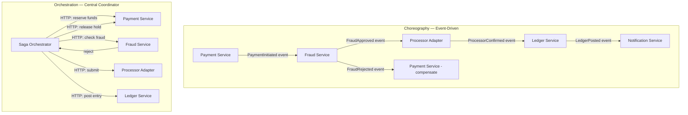

Distributed systems shattered the ACID transaction boundary. When a payment flows through a fraud-screening service, an external card processor, a ledger-posting service, and a notification gateway, there is no distributed lock that can hold all four systems in a single atomic unit without introducing catastrophic coupling. The Saga pattern replaces the monolithic transaction with a sequence of local transactions — each isolated within a single service — connected by events or an orchestrator, and reversible through compensating transactions when any step fails. For principal engineers in banking, this is not an academic construct: it is the architecture that underpins every modern payment rail, from SEPA Instant to Visa DPS. Understanding exactly when and how to apply it — and where it can silently corrupt your data — is a prerequisite for building financial systems that survive production at scale.

## Learning Objectives

- Explain why two-phase commit fails as a coordination mechanism for HTTP microservices, referencing blocking and single-point-of-failure characteristics.
- Distinguish choreography from orchestration and select the appropriate style based on service count, visibility requirements, and failure complexity.
- Design the five-step payment saga with named compensation for each forward step.
- Implement a `PaymentSagaOrchestrator` that persists saga state to a `payment_sagas` table before each external call, creating a write-ahead saga log.
- Apply the three rules of compensation design: idempotent, must eventually succeed, must not depend on the success of the step being compensated.
- Identify the dirty-read isolation hazard between concurrent sagas and implement a semantic lock using a `PENDING` reservation to prevent it.

## Business Context

In 2019, a UK challenger bank launched a Buy Now Pay Later integration involving four external services: identity verification, credit bureau, loan origination, and core banking. During the first week of production, a 4-minute credit bureau outage caused 312 loan applications to become permanently stuck. Each application had already passed identity verification and reserved credit capacity in the loan origination system, but the compensating logic had not been implemented — the team had assumed the credit bureau would always recover quickly. When it did not, those 312 applications held reserved credit limits indefinitely. The core banking service had no way to know the applications would never complete. Total frozen credit: £1.4 million. Resolution required a manual database correction script, 48 hours of engineer time, and a written explanation to the FCA. The post-mortem conclusion: "We implemented the happy path of the saga. We did not implement the saga."

## Why 2PC Fails Across HTTP Services

Two-Phase Commit requires a coordinator to issue a prepare request to all participants, wait for unanimous agreement, and then issue a commit. This model breaks down across HTTP microservices for two structural reasons.

**Blocking under failure:** During Phase 2, all participants hold their local locks waiting for the coordinator's commit message. If the coordinator crashes after sending prepare but before sending commit, every participant is blocked indefinitely. In a monolith with a single database, this failure window is milliseconds and is handled by crash recovery. Across HTTP services, there is no shared crash recovery mechanism. Each service holds its lock until it times out or is manually released.

**Network partition creates unbounded uncertainty:** If a participant receives prepare and responds "yes" but the coordinator's commit message is lost in a network partition, the participant cannot safely unilaterally abort (the coordinator may have committed other participants already) and cannot safely commit (it may be the only participant to commit). It must block until the coordinator is reachable again.

For services communicating over HTTP at scale — especially across cloud availability zones or external network boundaries — these failure modes are not edge cases. They are routine. The saga pattern accepts eventual consistency in exchange for non-blocking coordination.

> [!WARNING]
> Some teams attempt to use Spring's `JtaTransactionManager` with XA resources to get 2PC across a database and a message broker. This works within a single datacenter with homogeneous infrastructure. It does not work across HTTP service boundaries and does not compose with REST APIs. The detailed failure analysis of XA transactions is covered in Lesson 15.

## Choreography vs. Orchestration

Both styles implement the same saga concept. They differ in where the coordination logic lives.



**Choreography** suits simple, linear sagas with two or three services. Each service emits events and reacts to events from others. There is no central coordinator — the saga's state is implied by which events have been published. The drawback: when a failure occurs, diagnosing the state of a saga requires querying multiple services and correlating events by saga ID. As service count grows, the implicit choreography becomes impossible to reason about.

**Orchestration** places all coordination logic in a single orchestrator component. The orchestrator explicitly tracks saga state, calls each step, handles failures, and drives compensations. The saga's current state is always visible in one place. The drawback: the orchestrator is a new component to build, test, and operate. For payment sagas with five or more steps, non-linear branching, or partial-retry semantics, orchestration is almost always the correct choice.

> [!NOTE]
> The orchestrator does not contain business logic — it contains coordination logic. `isFraudSuspect()` belongs in the Fraud Service. The orchestrator knows only that it must call the Fraud Service and what to do based on the response (approve → proceed to step 3, reject → compensate steps 1 and 2). Keep the orchestrator thin.

## The Payment Saga: Five Steps and Their Compensations

A complete payment saga for a card-not-present transaction:

| Step | Forward Action | Compensation | Compensation Name |
|---|---|---|---|
| 1 | Reserve funds (hold on account) | Release the hold | `release_hold` |
| 2 | Fraud check (synchronous call) | No compensation needed (read-only) | — |
| 3 | Submit to external processor | Void the authorization | `void_authorization` |
| 4 | Post ledger entries | Reverse ledger entries | `reverse_ledger` |
| 5 | Release hold | — (terminal success step) | — |

The saga state machine transitions:

```
STARTED → FUNDS_RESERVED → FRAUD_APPROVED → PROCESSOR_SUBMITTED
        → LEDGER_POSTED → COMPLETED

On failure at any step:
STARTED            → COMPENSATING → FAILED
FUNDS_RESERVED     → COMPENSATING → release_hold      → FAILED
FRAUD_APPROVED     → COMPENSATING → release_hold      → FAILED
PROCESSOR_SUBMITTED→ COMPENSATING → void_authorization
                                  → release_hold      → FAILED
LEDGER_POSTED      → COMPENSATING → reverse_ledger
                                  → void_authorization
                                  → release_hold      → FAILED
```

## The Saga Orchestrator

The `payment_sagas` table persists saga state before every external call — a write-ahead saga log that survives JVM crashes:

```sql
CREATE TABLE payment_sagas (
    saga_id         UUID            NOT NULL,
    payment_id      UUID            NOT NULL,
    current_step    VARCHAR(50)     NOT NULL,
    saga_state      VARCHAR(20)     NOT NULL, -- STARTED, COMPENSATING, COMPLETED, FAILED
    step_payload    JSONB,
    created_at      TIMESTAMPTZ     NOT NULL DEFAULT now(),
    updated_at      TIMESTAMPTZ     NOT NULL DEFAULT now(),

    CONSTRAINT pk_payment_sagas PRIMARY KEY (saga_id)
);

CREATE INDEX idx_payment_sagas_state
    ON payment_sagas (saga_state)
    WHERE saga_state NOT IN ('COMPLETED', 'FAILED');
```

The orchestrator persists state transitions before each outbound call:

```java
@Service
@RequiredArgsConstructor
@Slf4j
public class PaymentSagaOrchestrator {

    private final PaymentSagaRepository sagaRepo;
    private final FundsReservationClient fundsClient;
    private final FraudCheckClient       fraudClient;
    private final ProcessorClient        processorClient;
    private final LedgerClient           ledgerClient;

    @Transactional
    public void startSaga(UUID sagaId, PaymentRequest request) {
        PaymentSaga saga = PaymentSaga.builder()
            .sagaId(sagaId)
            .paymentId(request.getPaymentId())
            .currentStep("RESERVE_FUNDS")
            .sagaState("STARTED")
            .stepPayload(toJson(request))
            .build();
        sagaRepo.save(saga);              // persist before calling out

        try {
            ReservationResult reservation =
                fundsClient.reserve(request.getAccountId(),
                                    request.getAmount());
            transitionTo(saga, "FRAUD_CHECK",
                toJson(reservation));

            FraudCheckResult fraud =
                fraudClient.check(request.getPaymentId(),
                                  request.getAmount(),
                                  request.getMerchantId());

            if (fraud.isRejected()) {
                compensate(saga, "Fraud rejection");
                return;
            }
            transitionTo(saga, "SUBMIT_PROCESSOR",
                toJson(fraud));

            ProcessorResult processor =
                processorClient.submit(request, reservation);
            transitionTo(saga, "POST_LEDGER",
                toJson(processor));

            ledgerClient.postEntries(request.getPaymentId(),
                                     request.getAmount(),
                                     processor.getAuthorizationCode());
            transitionTo(saga, "RELEASE_HOLD",
                null);

            fundsClient.releaseHold(reservation.getHoldId());
            transitionTo(saga, "COMPLETED", null);
            saga.setSagaState("COMPLETED");
            sagaRepo.save(saga);

        } catch (Exception ex) {
            log.error("Saga {} failed at step {}: {}",
                sagaId, saga.getCurrentStep(), ex.getMessage());
            compensate(saga, ex.getMessage());
        }
    }

    @Transactional
    private void compensate(PaymentSaga saga, String reason) {
        saga.setSagaState("COMPENSATING");
        sagaRepo.save(saga);

        switch (saga.getCurrentStep()) {
            case "RELEASE_HOLD", "POST_LEDGER" -> {
                safeCompensate(() ->
                    ledgerClient.reverseEntries(saga.getPaymentId()),
                    "reverse_ledger", saga);
                // fall through to void processor
            }
            case "SUBMIT_PROCESSOR" -> {
                safeCompensate(() ->
                    processorClient.voidAuthorization(saga.getPaymentId()),
                    "void_authorization", saga);
                // fall through to release hold
            }
            case "FRAUD_CHECK", "RESERVE_FUNDS" -> {
                safeCompensate(() ->
                    fundsClient.releaseHold(saga.getPaymentId()),
                    "release_hold", saga);
            }
        }

        saga.setSagaState("FAILED");
        sagaRepo.save(saga);
    }

    private void safeCompensate(Runnable action,
                                 String compensationName,
                                 PaymentSaga saga) {
        int attempts = 0;
        while (attempts < 10) {
            try {
                action.run();
                return;
            } catch (Exception ex) {
                attempts++;
                log.warn("Compensation {} attempt {} failed for saga {}: {}",
                    compensationName, attempts,
                    saga.getSagaId(), ex.getMessage());
                if (attempts < 10) {
                    sleep(Duration.ofSeconds(attempts)); // exponential-ish backoff
                }
            }
        }
        // After 10 attempts, raise an alert for manual intervention
        alertingService.raiseCompensationAlert(saga.getSagaId(),
                                               compensationName);
    }

    @Transactional
    private void transitionTo(PaymentSaga saga,
                               String nextStep,
                               String payload) {
        saga.setCurrentStep(nextStep);
        saga.setStepPayload(payload);
        saga.setUpdatedAt(OffsetDateTime.now());
        sagaRepo.save(saga);              // write-ahead before next external call
    }
}
```

> [!IMPORTANT]
> The `sagaRepo.save(saga)` call in `transitionTo` persists the new step name BEFORE the outbound network call. This is the write-ahead saga log. If the JVM crashes after saving `SUBMIT_PROCESSOR` but before the processor responds, a recovery process (a scheduled job or restart-time scan) can find sagas in non-terminal states and resume or compensate them. Without this write-ahead discipline, the saga's current state is unknown after a crash.

## Compensation Design Rules

Three rules govern compensation design. Violating any one of them will produce a saga that cannot recover from failures.

**Rule 1 — Compensations must be idempotent.** The saga may call `releaseHold` multiple times if the network fails between the call and the response. The funds service must check whether the hold is already released before attempting to release it again. Use the `holdId` or `sagaId` as the idempotency key.

**Rule 2 — Compensations must eventually succeed.** A compensation that can permanently fail leaves the system in a state where it cannot reach a consistent terminal state. If `reverseEntries` can fail because the ledger service is down, the saga must retry indefinitely (with backoff) or escalate to human intervention. It must never give up and leave uncommitted ledger entries in place.

**Rule 3 — Compensations must not depend on the success of the step they are compensating.** `void_authorization` must work even if the original `submit` to the processor returned an ambiguous response. The compensation must carry enough context — stored in `payment_sagas.step_payload` — to execute without calling back to the failing step.

```java
// BAD: compensation depends on data from the failing step's response
public void compensateProcessor(UUID paymentId) {
    // This fails if the processor submit never returned a response
    String authCode = processorResponseCache.get(paymentId);
    processorClient.void(authCode);
}

// GOOD: compensation uses data persisted before the external call
public void compensateProcessor(UUID paymentId) {
    PaymentSaga saga = sagaRepo.findByPaymentId(paymentId);
    // sagaId is sufficient for the processor to look up and void
    processorClient.voidBySagaId(saga.getSagaId());
}
```

> [!WARNING]
> Never design a compensation that calls the same external service that just failed. If the processor is down, `void_authorization` must either use a secondary endpoint, queue the void for later execution, or accept that the authorization will expire naturally (after providing an alert). Cascading the original failure into the compensation produces a compensation that also fails — Rule 2 violation.

## Saga Isolation: Dirty Reads and Semantic Locks

Sagas do not hold database locks between steps. This creates an isolation hazard: a second saga can read data that the first saga has modified but not yet committed to a final state.

**Example:** Customer has £1,000. Saga A reserves £800. Saga B reads the account balance before Saga A's ledger posting completes and sees £1,000 — the original balance — because the reservation is a hold, not a debit. Saga B reserves £900. Both sagas succeed. The account has been overdrawn by £700.

The countermeasure is a **semantic lock**: a status field on the entity being modified that signals "in-progress" to concurrent readers.

```sql
-- Reservation record with semantic lock
INSERT INTO account_holds (
    hold_id, account_id, amount, status, saga_id, created_at
) VALUES (
    gen_random_uuid(), :accountId, :amount,
    'PENDING',          -- semantic lock
    :sagaId, now()
);
```

When computing available balance, include pending holds:

```sql
SELECT
    a.balance
    - COALESCE(SUM(h.amount) FILTER (WHERE h.status = 'PENDING'), 0)
    - COALESCE(SUM(h.amount) FILTER (WHERE h.status = 'RESERVED'), 0)
    AS available_balance
FROM accounts a
LEFT JOIN account_holds h
    ON h.account_id = a.id
   AND h.status IN ('PENDING', 'RESERVED')
WHERE a.id = :accountId
GROUP BY a.balance;
```

The `PENDING` status acts as an in-progress marker. Any concurrent saga that reads available balance will correctly see the in-progress hold as already claimed. When the saga completes successfully, the hold transitions from `PENDING` to `RESERVED` and eventually to `RELEASED` or converted to a debit. When the saga compensates, the hold is deleted.

## Knowledge Check

**Q1: A saga's `compensate` method calls `fundsClient.releaseHold()`, which throws a `RemoteServiceException` on the first attempt. The retry loop eventually succeeds on the third attempt. The `sagaRepo.save(saga)` with `sagaState = "FAILED"` runs after the successful compensation. If the JVM crashes between the third `releaseHold` success and the `sagaRepo.save("FAILED")`, what happens on restart — and is this safe?**

On restart, a recovery job finds the saga in `sagaState = "COMPENSATING"` with `currentStep = "RESERVE_FUNDS"`. It re-executes the compensation, calling `releaseHold` again. Because `releaseHold` is designed to be idempotent (Rule 1), the second call either finds the hold already released and returns success, or finds nothing to release. The saga then transitions to `FAILED` and is persisted. The system reaches a consistent state. This is safe precisely because idempotent compensations make the recovery path indistinguishable from the original compensation path.

**Q2: Why is orchestration preferred over choreography when a payment saga has more than four steps, non-linear branching, or partial-retry requirements?**

In choreography, the saga's state is implicit — it must be inferred by correlating events across multiple services. When a failure occurs mid-saga, diagnosing the current state requires querying each participant and reconstructing the event sequence, which is error-prone and slow. Non-linear branching (e.g., "if fraud score > 0.7, skip the processor and reject immediately; if 0.4–0.7, require additional verification") becomes a hidden coupling across services, since each service must know the branching logic of its neighbors. Orchestration externalizes all of this into a single, testable, observable component. The orchestrator's state machine can be unit-tested in isolation, the `payment_sagas` table provides a single source of truth for saga state, and monitoring dashboards can query that table to show stuck, compensating, and completed sagas without touching the participant services.

## Practical Challenge

Design and implement a complete payment saga for a cross-border wire transfer involving five services: compliance screening, FX rate locking, debit of source account, credit of correspondent bank via SWIFT, and credit of destination account.

1. Define the `payment_sagas` table schema with appropriate columns for a five-step saga, including a `step_payload JSONB` column to carry compensation context.
2. Implement the `WireTransferSagaOrchestrator` with all five forward steps and their compensations. Write-ahead persist saga state before each external call.
3. Implement the `safeCompensate` method with exponential backoff (delays: 1s, 2s, 4s, 8s, 16s, then alert) for each compensation step.
4. Add a semantic lock on the source account using an `account_holds` table with a `PENDING` status, and write the SQL query that computes available balance including all pending holds.
5. Write a test that verifies: when the SWIFT correspondent call fails, the saga compensates the FX rate lock, the debit, and the compliance screen (if applicable) in the correct reverse order, and that each compensation is called exactly once even if the JVM is simulated to restart mid-compensation.

As an extension, evaluate whether this saga should use choreography for the notification and audit trail steps (which are fire-and-forget and do not require compensation) while retaining orchestration for the financial steps.

<!-- KNOWLEDGE-CHECK
{
  "questions": [
    {
      "text": "A saga's compensate() method successfully calls releaseHold() on the third attempt. The JVM crashes immediately after the successful network call, before sagaRepo.save(saga) with sagaState = FAILED can persist. What happens on restart, and why is this safe?",
      "options": [
        "The saga is lost permanently because the FAILED state was never persisted",
        "On restart the recovery job finds the saga in COMPENSATING state, re-executes releaseHold() which is idempotent and succeeds or no-ops, then transitions to FAILED — the system reaches a consistent terminal state",
        "The saga retries the forward step because COMPENSATING is treated as a recoverable state",
        "The recovery job cannot determine whether releaseHold() succeeded or failed, so it escalates to manual review without retrying"
      ],
      "correct": 1,
      "explanation": "The write-ahead saga log persists state before each outbound call. A crash between the successful compensation and the FAILED state write leaves the saga in COMPENSATING. Recovery re-executes releaseHold(). Because compensation Rule 1 requires idempotency, the second call either finds the hold already released (no-op) or successfully releases it. The saga then transitions to FAILED and is committed. Idempotent compensations make the recovery path indistinguishable from the initial compensation path."
    },
    {
      "text": "Why is orchestration preferred over choreography for a payment saga with five or more steps and non-linear branching?",
      "options": [
        "Orchestration uses fewer Kafka topics, reducing infrastructure costs",
        "In choreography the saga state is implicit and must be reconstructed by correlating events across services; with non-linear branching each service must encode neighbour logic, making failures hard to diagnose and monitor from a single source of truth",
        "Choreography cannot implement compensation because events are immutable",
        "Orchestration is required by financial regulators for audit trail purposes"
      ],
      "correct": 1,
      "explanation": "In choreography, diagnosing a failed saga requires querying multiple services and correlating events by saga ID — error-prone under non-linear branching where each service must know its neighbours' business logic. Orchestration externalises all coordination into a single testable component. The payment_sagas table provides a single observable source of truth; monitoring dashboards can query it to show stuck, compensating, and completed sagas without touching participant services."
    },
    {
      "text": "What is a semantic lock in the context of saga isolation, and which concurrent scenario does it prevent?",
      "options": [
        "A database row-level lock held across saga steps to prevent any concurrent access",
        "A PENDING status field on the entity being modified that signals an in-progress saga, so concurrent sagas include it when computing available balance — preventing two sagas from both seeing the full balance and both proceeding to overdraft the account",
        "A distributed lock in Redis that serialises all sagas for a given account",
        "An optimistic version column on the account that causes the second saga to retry"
      ],
      "correct": 1,
      "explanation": "Without a semantic lock, two sagas reading the same account balance before either posts its debit can both see the full balance and both reserve amounts that together exceed the balance. A PENDING hold written as the first saga step acts as a visible in-progress marker. Concurrent sagas include PENDING holds when computing available balance, correctly reducing the apparent balance. No cross-service database lock is held — only the application-layer status field communicates the in-progress state."
    }
  ]
}
-->

<!-- PRACTICAL-CHALLENGE
{
  "title": "Build a Five-Step Cross-Border Wire Transfer Saga with Full Compensation",
  "difficulty": "advanced",
  "estimatedMinutes": 45,
  "tasks": [
    {"id": "1", "description": "Define the payment_sagas table schema for a five-step wire transfer saga (compliance screening, FX rate locking, debit of source account, SWIFT credit, destination account credit). Include a step_payload JSONB column to carry compensation context, a saga_state VARCHAR(20), and a partial index that filters to only non-terminal sagas. Document what data each step must write to step_payload to enable its compensation without calling the failing service again."},
    {"id": "2", "description": "Implement WireTransferSagaOrchestrator with all five forward steps and their compensations. Each call to transitionTo() must persist the new step name to payment_sagas BEFORE the outbound network call — write-ahead discipline. Implement the compensation cascade correctly: a failure at step 3 (debit source) must compensate step 2 (FX rate lock) and step 1 (compliance reservation), but not step 4 or 5 which were never executed."},
    {"id": "3", "description": "Implement safeCompensate() with exponential backoff using delays 1s, 2s, 4s, 8s, 16s, then alert. Use a @Component AlertingService that fires a CompensationAlert when retries are exhausted. Write a unit test that injects a mock compensation action which fails 4 times then succeeds on the 5th, and asserts the delays match the exponential schedule and the alert is NOT fired (success before exhaustion)."},
    {"id": "4", "description": "Add an account_holds table with a PENDING status as the semantic lock for the source account. Write the SQL query that computes available balance including all PENDING and RESERVED holds. Write a test that starts two concurrent WireTransferSagaOrchestrator executions both drawing from the same source account with insufficient combined balance, and asserts that exactly one succeeds and the other fails during the reserve step — not during ledger posting."}
  ]
}
-->
