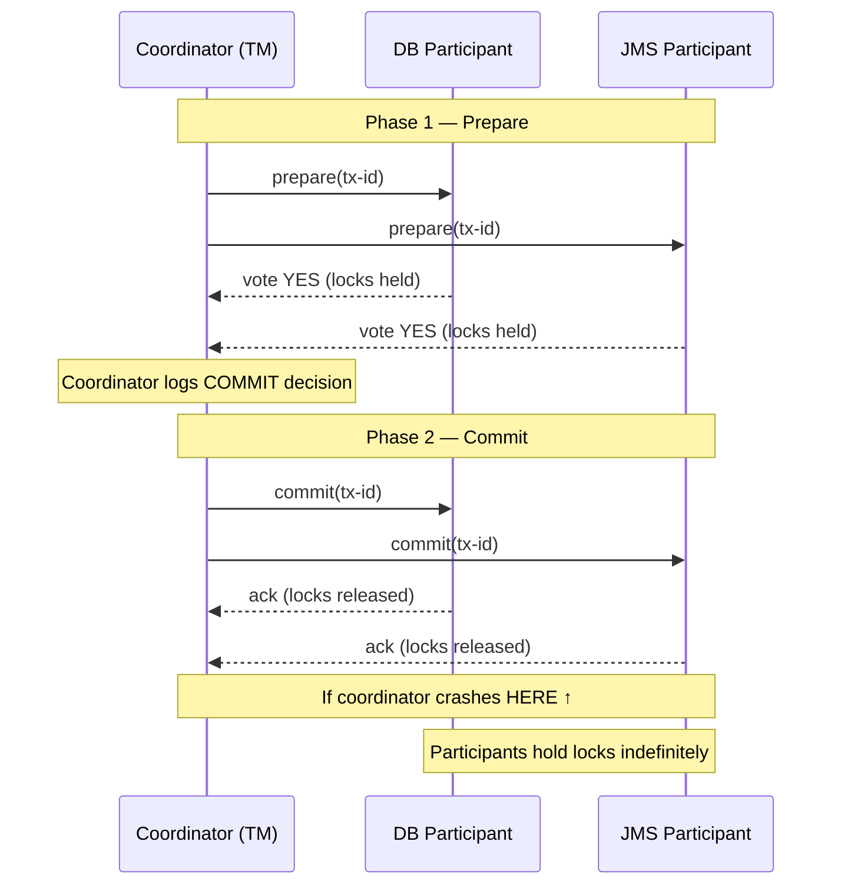
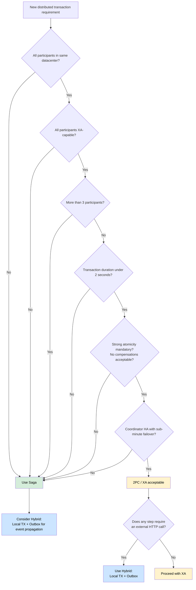
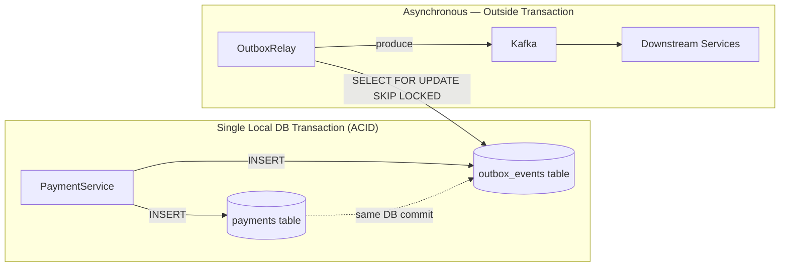

The question of whether to use two-phase commit or a saga is not an ideological one — it is an engineering decision driven by the failure characteristics of your specific infrastructure. Principal engineers who default to "sagas everywhere because 2PC is bad" or "2PC because we need ACID" without analyzing the deployment context are trading one set of failure modes for another without understanding either. Two-phase commit provides linearizability and atomicity at the cost of blocking under coordinator failure. Sagas provide non-blocking coordination at the cost of eventual consistency, dirty reads, and compensation complexity. Both are legitimate tools. The goal of this lesson is to give you the decision framework to choose correctly — and to understand the hybrid pattern that sidesteps the trade-off for the most common fintech use case.

## Learning Objectives

- Describe the two phases of 2PC, specifying which resources are locked during each phase and for how long.
- Explain three failure modes unique to 2PC: coordinator crash in Phase 2, network partition during commit, and participant timeout uncertainty.
- Implement an XA transaction in Java spanning a PostgreSQL database and a JMS queue using Spring's `JtaTransactionManager`.
- Enumerate the saga trade-offs: eventual consistency, dirty reads, compensation requirements, and non-blocking coordination.
- Apply the five-factor decision framework to select 2PC vs. saga for a given architectural context.
- Implement the hybrid pattern: local ACID transaction for financial records combined with the Transactional Outbox for event propagation.
- Read and interpret the decision flowchart to quickly classify a new integration scenario.

## Business Context

In 2017, a Tier-1 US bank's treasury system used XA transactions to coordinate writes across its core banking database, a risk calculation database, and a JMS message queue. Under normal operation, the system processed 8,000 transactions per day with sub-second commit times. During a planned failover test of the Oracle RAC cluster acting as the XA coordinator, 23 transactions entered a "in doubt" state: each participant had voted "yes" in Phase 1 but the coordinator crashed before delivering Phase 2 commit messages. All 23 transactions held row-level locks on both databases for 4 hours — the duration of the unplanned incident response. The locked rows included high-value positions on interest rate swaps. The risk system could not recompute valuations for those positions, causing incorrect risk reports to be delivered to the trading desk. Post-mortem finding: "XA provides atomicity but not availability. Under coordinator failure, we have neither." The team subsequently migrated to a saga with a local DB transaction plus outbox, which they described as "2PC minus the coordinator" — a description this lesson will make precise.

## 2PC Mechanics: Locks, Phases, and the Coordinator

Two-phase commit is a protocol executed by a coordinator (typically a transaction manager) across two or more participant resource managers (databases, message brokers, etc.).

**Phase 1 — Prepare:** The coordinator sends a `prepare` message to each participant. Each participant executes its portion of the transaction, flushes changes to durable storage (write-ahead log), and responds with `yes` (ready to commit) or `no` (abort). Critically: the participant does not commit. It holds its locks and awaits Phase 2.

**Phase 2 — Commit or Abort:** If all participants voted `yes`, the coordinator logs "commit" to its own durable log, then sends `commit` to each participant. Each participant commits, releases locks, and acknowledges. If any participant voted `no`, the coordinator sends `abort` to all participants.



The critical vulnerability is visible in the diagram: if the coordinator crashes after logging its commit decision but before delivering commit messages to participants, those participants hold their locks indefinitely. They cannot unilaterally commit (they might be the only committer) and cannot unilaterally abort (the coordinator may have already committed others). They are blocked until the coordinator recovers.

## XA Transactions in Java

The Java Transaction API (JTA) exposes XA coordination through `javax.transaction.xa.XAResource`. Spring wraps this with `JtaTransactionManager`. A typical configuration spanning a PostgreSQL database and an ActiveMQ JMS queue:

```java
@Configuration
public class XaTransactionConfig {

    @Bean
    public PlatformTransactionManager transactionManager(
            UserTransaction userTransaction,
            TransactionManager transactionManager) {
        return new JtaTransactionManager(
            userTransaction, transactionManager);
    }

    @Bean
    public DataSource xaDataSource() {
        // PostgreSQL XA datasource via Atomikos or Bitronix
        AtomikosDataSourceBean ds = new AtomikosDataSourceBean();
        ds.setUniqueResourceName("payments-db");
        ds.setXaDataSourceClassName(
            "org.postgresql.xa.PGXADataSource");
        ds.setXaProperties(pgXaProperties());
        ds.setMaxPoolSize(20);
        return ds;
    }

    @Bean
    public ConnectionFactory xaConnectionFactory() {
        // ActiveMQ XA connection factory
        AtomikosConnectionFactoryBean cf =
            new AtomikosConnectionFactoryBean();
        cf.setUniqueResourceName("payments-jms");
        cf.setXaConnectionFactory(
            new ActiveMQXAConnectionFactory(
                "tcp://broker:61616"));
        return cf;
    }
}
```

The service method looks identical to a standard Spring `@Transactional` method — the XA coordination is transparent:

```java
@Service
@RequiredArgsConstructor
public class PaymentProcessingService {

    private final PaymentRepository paymentRepo;
    private final JmsTemplate        jmsTemplate;

    // JtaTransactionManager coordinates XA across DB + JMS
    @Transactional(transactionManager = "transactionManager")
    public void processPayment(PaymentRequest request) {
        Payment payment = paymentRepo.save(Payment.from(request));

        // This JMS send is part of the SAME XA transaction as the DB write.
        // If the DB commit fails, the JMS message is also rolled back.
        jmsTemplate.convertAndSend(
            "payments.initiated",
            new PaymentInitiatedMessage(payment.getId(),
                                        payment.getAmount()));
    }
}
```

This is genuine atomicity across two resource managers. The XA coordinator (Atomikos in this example) manages the two-phase commit protocol transparently.

> [!NOTE]
> XA transactions require XA-capable drivers and connection pools. Not all JDBC drivers support XA fully; PostgreSQL's `PGXADataSource` does, but its XA implementation has known limitations with certain transaction patterns. Test XA failure scenarios explicitly in a staging environment before relying on them in production. Atomikos and Bitronix are the two most widely deployed open-source JTA transaction managers for Spring; Bitronix reached end-of-life in 2016 so Atomikos is the current recommendation.

## 2PC Failure Modes

**Failure Mode 1 — Coordinator crash in Phase 2.** The coordinator crashes after writing its commit decision to its own log, before all participants receive the commit message. Participants that did not receive the commit message hold locks and cannot proceed. Recovery requires the coordinator to restart, read its log, and re-send outstanding commit messages. During this window — which may last minutes in a production incident — all locked rows are unavailable.

**Failure Mode 2 — Network partition during commit.** The coordinator sends commit to Participant 1 successfully. The network partitions, and the commit message never reaches Participant 2. Participant 1 commits and releases locks. Participant 2 holds its locks waiting for a message that will not arrive until connectivity is restored. The two participants are now inconsistent: one has committed, one has not. This cannot occur with a single-database local transaction.

**Failure Mode 3 — Participant timeout under coordinator overload.** If the coordinator is slow to send Phase 2 messages (high GC pause, CPU saturation), participants may time out waiting and must decide whether to abort unilaterally. Most XA implementations do not allow unilateral abort after a "yes" vote; the participant must wait. Under sustained coordinator overload, all XA-coordinated transactions effectively halt.

```java
// Demonstrating coordinator timeout — this is what NOT to do in production
// under high load: each @Transactional method holds XA locks during
// the full processing time

@Transactional(transactionManager = "transactionManager")
public void riskyPaymentWithSlowExternalCall(PaymentRequest request) {
    paymentRepo.save(Payment.from(request));      // DB lock acquired

    // DANGER: This external HTTP call holds XA locks on the DB
    // for the duration of the HTTP timeout.
    // Under slow upstream, all payment DB rows are locked.
    ExternalApiResult result = externalApi.call(request); // 30s timeout

    jmsTemplate.convertAndSend("events", result);
}
```

> [!WARNING]
> Never perform network I/O inside an XA transaction boundary. The XA lock duration equals the wall-clock time of the entire `@Transactional` method. A 30-second HTTP call inside an XA transaction holds database row locks for 30 seconds, blocking every other transaction that needs those rows. This is the most common XA performance disaster in production fintech systems.

## Saga Trade-offs

Sagas address 2PC's blocking failures by accepting a different set of constraints.

**Eventual consistency:** A saga's constituent local transactions commit independently. Between the first and last step, the system is in a partially committed state. External observers (other services, reporting queries) may see intermediate states. This is fundamentally different from 2PC's atomicity guarantee.

**Dirty reads between concurrent sagas:** As detailed in Lesson 14, two sagas modifying the same account can read each other's in-progress state. Semantic locks are required to prevent this, but they add complexity and must be designed explicitly for each saga type.

**Compensation complexity:** Every step that modifies state needs an idempotent compensation. For five-step sagas, this means five additional operations to design, implement, test, and monitor. Compensation failures require escalation paths (retry with backoff, dead-letter, human alerting).

**Non-blocking coordination:** When a saga step fails, the orchestrator immediately begins compensation. No other saga or transaction is blocked. The system degrades gracefully under participant unavailability rather than seizing up.

**Works across HTTP and heterogeneous systems:** Sagas coordinate via HTTP calls or events. They work across any service that exposes an API or emits events, regardless of database technology, cloud provider, or programming language. 2PC requires XA-capable resource managers and a shared transaction manager.

## Decision Framework: When to Use Each



**Use 2PC when all five conditions hold:**
1. All participants are in the same datacenter (sub-millisecond coordinator round trips).
2. All participants expose XA-capable resource managers (PostgreSQL, ActiveMQ, IBM MQ).
3. Three or fewer participants (each additional participant multiplies the failure surface).
4. Transaction duration is under 2 seconds including all participant processing.
5. Strong atomicity is a hard requirement and compensations are not acceptable (e.g., regulatory ledger entries that must be atomically paired with their confirmation message).

**Use Saga when any of these apply:**
- Any participant is reached over HTTP or is in a different datacenter.
- Any participant is a third-party service (card processor, SWIFT, credit bureau).
- More than three participants.
- Long-running steps (fraud check, compliance screen, manual review).
- Compensations are well-defined and implementable as idempotent operations.

> [!IMPORTANT]
> The "fewer than three participants" rule for 2PC is a heuristic, not a hard limit. With three participants, a coordinator crash in Phase 2 means two participants hold locks while one may have committed — a three-way inconsistency that is exponentially harder to diagnose and resolve than a two-way inconsistency. For financial systems where "in doubt" transactions require manual resolution, every additional XA participant multiplies the incident response cost.

## The Hybrid Pattern: Best of Both Worlds

For the most common fintech use case — a service that must reliably publish events after committing a financial record — neither pure 2PC nor pure saga is the optimal solution. The hybrid pattern combines a local ACID transaction (for the financial record) with the Transactional Outbox pattern (for event propagation).

```java
@Service
@RequiredArgsConstructor
public class PaymentService {

    private final PaymentRepository     paymentRepo;
    private final OutboxEventRepository outboxRepo;

    // Single LOCAL transaction — no XA, no distributed coordinator
    @Transactional
    public Payment createPayment(PaymentRequest request) {
        // Step 1: Financial record — ACID within this single DB transaction
        Payment payment = paymentRepo.save(Payment.from(request));

        // Step 2: Outbox event — SAME local transaction, same DB, same commit
        OutboxEvent event = OutboxEvent.of(
            "Payment",
            payment.getId().toString(),
            "PaymentInitiated",
            toJson(payment)
        );
        outboxRepo.save(event);

        // Both writes commit atomically here.
        // No XA coordinator. No distributed lock.
        return payment;
    }
}
```

The relay (Lesson 13's `OutboxRelay`) then asynchronously delivers the outbox event to Kafka, downstream services, or the saga orchestrator. This achieves:

- **ACID for the financial record** — the payment and its outbox event are atomically committed in a single local PostgreSQL transaction.
- **Non-blocking event delivery** — the Kafka publish happens asynchronously, outside the local transaction, via the relay.
- **No XA coordinator** — there is no distributed transaction manager to crash, no participants to leave "in doubt," and no cross-system locks.
- **At-least-once delivery with idempotent consumers** — the relay may deliver the event more than once after a crash-restart cycle; downstream consumers deduplicate by outbox event ID (covered in Lesson 13).

This pattern is used by virtually every high-volume payment system that has migrated away from XA. It is what the treasury system in the Business Context section adopted after their 2017 incident.



> [!NOTE]
> The hybrid pattern is not a workaround. It is the architecturally correct solution for the most common fintech transaction pattern: "write a financial record and reliably notify downstream systems." The key insight is that the outbox table is not a secondary concern — it is part of the financial record. The event is as durable as the payment itself because they share the same ACID transaction.

## Comparison Summary

| Dimension | 2PC / XA | Saga | Hybrid (Local TX + Outbox) |
|---|---|---|---|
| Atomicity | True atomic across participants | Eventual (compensations) | Atomic for local record; eventual for events |
| Blocking under failure | Yes — participants hold locks | No | No |
| Works across HTTP | No | Yes | Yes (via relay/orchestrator) |
| Compensation required | No | Yes | No for financial record; yes for downstream saga steps |
| Operational complexity | High (XA driver, TM, "in doubt" recovery) | Medium (orchestrator, compensation logic) | Low (single DB, standard relay) |
| Throughput | Limited by lock duration | High | High |
| Consistency model | Strong | Eventual | Strong locally; eventual for propagated events |
| Recommended use | Intra-datacenter, homogeneous, ≤3 participants, short duration | Microservices, heterogeneous, long-running | Financial record + event notification (default recommendation) |

## Knowledge Check

**Q1: A coordinator crashes in Phase 2 of a 2PC transaction after sending commit to Participant 1 (database) but before sending commit to Participant 2 (JMS broker). Participant 2 is holding its JMS message in a prepared state. Describe the exact recovery procedure and the state of the system during the recovery window.**

During the recovery window, Participant 2 holds its JMS message uncommitted and cannot process new messages on the same XA session. The database (Participant 1) has already committed its row — it is visible to other transactions. The system is inconsistent: the payment row exists in the database, but the corresponding JMS message has not been delivered. When the coordinator restarts, it reads its transaction log, finds the commit decision for this transaction, and re-sends the commit message to Participant 2. Participant 2 commits its prepared message and releases the session. The recovery procedure requires: (1) coordinator has a durable transaction log that survived the crash, (2) Participant 2 retains its prepared state across the coordinator's downtime, (3) the coordinator contacts all participants to deliver outstanding Phase 2 decisions on startup. The duration of the inconsistency window equals the coordinator's recovery time — typically seconds to minutes, but potentially hours if the coordinator's storage is unavailable. During this window, any process reading the payment row will see a committed payment for which no downstream notification has been sent.

**Q2: A team argues they should use 2PC instead of a saga for their payment processing system because "sagas don't provide ACID and we're a bank." Construct the specific counterargument using the five decision-framework criteria, given that their system calls a third-party card processor over HTTPS and has a fraud-screening step that takes 200ms to 2 seconds.**

The five-factor framework disqualifies 2PC here on multiple criteria. First, the third-party card processor is reached over HTTPS — it is not an XA-capable resource manager and cannot participate in an XA transaction. This alone makes 2PC inapplicable regardless of the other criteria. Second, the fraud-screening step takes up to 2 seconds, which means the XA transaction would hold database locks for up to 2 seconds per payment — at any meaningful transaction volume, this serializes payment processing entirely. Third, calling an external service over HTTP inside an XA boundary is the exact failure pattern documented in the "Warning" callout: network latency becomes lock duration. The correct response to "we're a bank, we need ACID" is: "We provide ACID for our local financial records via a single PostgreSQL transaction. We provide reliable eventual consistency for cross-service coordination via the saga pattern with well-defined compensations. The combination gives us durability for financial data and resilience for distributed coordination — which is what banking systems at scale actually require."

## Practical Challenge

A financial services firm runs a loan disbursement workflow that spans three systems: a loan origination database (PostgreSQL), a core banking ledger (Oracle), and a notification service (REST API over HTTPS). The engineering team is debating between XA 2PC (using Atomikos to span PostgreSQL and Oracle) and a saga with outbox.

1. Apply the five-factor decision framework to this scenario and document the analysis for each criterion.
2. Identify which of the three systems disqualifies 2PC, and explain why.
3. Design the hybrid solution: define the `loan_disbursements` and `outbox_events` tables, implement `LoanDisbursementService.disburse()` as a local `@Transactional` method writing both records, and sketch the saga orchestrator that uses the outbox event to trigger the Oracle ledger write and the notification API call.
4. For the Oracle ledger write (which is a financial record and cannot be lost), explain whether you would use a saga step with compensation, an XA transaction within the same datacenter as Oracle, or a different mechanism — and justify your choice using the decision framework.
5. Write a runbook for the "loan disbursement saga stuck in COMPENSATING state" incident. Include the SQL queries to diagnose which step failed, the procedure for manual compensation if the automated retry has exhausted its limit, and the notification to send to the affected customer.

<!-- KNOWLEDGE-CHECK
{
  "questions": [
    {
      "text": "A coordinator crashes in Phase 2 after sending commit to the database participant but before sending commit to the JMS broker participant. Describe the state of the system during recovery and the exact recovery procedure.",
      "options": [
        "Both participants roll back automatically — 2PC guarantees atomicity even under coordinator failure",
        "The database has committed (payment row visible), the JMS broker holds its message uncommitted and cannot process new messages on that XA session — the system is inconsistent until the coordinator restarts, reads its log, and re-sends the commit to the JMS participant",
        "The JMS participant times out and aborts unilaterally, then the database rolls back to match",
        "The database row is marked IN_DOUBT and both participants wait until a DBA manually resolves the transaction"
      ],
      "correct": 1,
      "explanation": "Participant 2 (JMS) holds its prepared message and cannot process new messages on the same XA session. Participant 1 (DB) has already committed — its row is visible to other transactions. The system is inconsistent: the payment exists in the database but no downstream notification has been sent. Recovery requires the coordinator to restart, read its durable transaction log, find the commit decision, and re-send commit to Participant 2. Duration of inconsistency equals coordinator recovery time — seconds to minutes normally, potentially hours if coordinator storage is unavailable."
    },
    {
      "text": "A team argues they need 2PC for their payment system because sagas don't provide ACID. Their system calls a third-party card processor over HTTPS and has a fraud-screening step taking 200ms–2s. Which decision-framework criterion most definitively disqualifies 2PC here?",
      "options": [
        "More than three participants — the system has four services",
        "The third-party card processor is reached over HTTPS and is not an XA-capable resource manager — 2PC cannot coordinate with it regardless of any other criteria",
        "Transaction duration exceeds 2 seconds — XA locks would be held too long",
        "The system is in a different datacenter from the coordinator"
      ],
      "correct": 1,
      "explanation": "The third-party card processor is reached over HTTPS. It has no XA interface, no XA-capable resource manager, and cannot participate in a two-phase commit protocol. This single criterion makes 2PC inapplicable regardless of participant count, duration, or topology. Even if all other criteria were met, you cannot include an external REST API in an XA transaction. The correct response is a saga with compensation."
    },
    {
      "text": "What makes the hybrid pattern (local ACID transaction + Transactional Outbox) superior to both pure 2PC and pure saga for the most common fintech use case?",
      "options": [
        "It eliminates the need for idempotent consumers because the outbox guarantees exactly-once delivery",
        "It provides ACID for the financial record via a single local PostgreSQL transaction, non-blocking event delivery via the relay, and no distributed coordinator — combining strong local consistency with high availability at the event propagation layer",
        "It uses XA transactions internally but hides them from application code for simplicity",
        "It requires fewer compensating transactions than a saga because the outbox handles rollbacks automatically"
      ],
      "correct": 1,
      "explanation": "The hybrid pattern is architecturally correct for 'write a financial record and reliably notify downstream systems.' The payment and its outbox event commit atomically in one local PostgreSQL transaction — no XA coordinator, no distributed locks. The relay then publishes asynchronously with at-least-once semantics, and idempotent consumers handle duplicates. This achieves ACID locally, non-blocking delivery globally, and avoids both 2PC's blocking failures and saga's compensation complexity for the write path."
    }
  ]
}
-->

<!-- PRACTICAL-CHALLENGE
{
  "title": "Design a Hybrid Loan Disbursement Architecture Using the Five-Factor Decision Framework",
  "difficulty": "advanced",
  "estimatedMinutes": 45,
  "tasks": [
    {"id": "1", "description": "Apply the five-factor decision framework to the loan disbursement scenario (PostgreSQL loan origination DB, Oracle banking ledger, REST notification API). Document each of the five criteria explicitly: same datacenter?, XA-capable participants?, participant count, transaction duration, and atomicity requirement. Identify which criterion disqualifies 2PC and explain why."},
    {"id": "2", "description": "Design the hybrid solution: define loan_disbursements and outbox_events tables (DDL), implement LoanDisbursementService.disburse() as a local @Transactional method that writes both records atomically, and sketch the saga orchestrator that uses the outbox event to trigger the Oracle ledger write (which must be treated as a critical financial step, not a notification) and the REST notification call."},
    {"id": "3", "description": "For the Oracle ledger write, evaluate three options: (a) saga step with compensation, (b) XA transaction within the same datacenter as Oracle using Atomikos, (c) separate outbox-driven local transaction on Oracle. Apply the decision framework to each and justify your final recommendation. Consider specifically: what happens if the Oracle write fails and there is no compensation defined."},
    {"id": "4", "description": "Write the runbook for 'loan disbursement saga stuck in COMPENSATING state.' Include: the SQL query to find all sagas in non-terminal states older than 30 minutes, the SQL to identify which step payload was last persisted, the manual compensation procedure (what SQL or API calls to make), the two-officer sign-off requirement, and the customer notification template including what to say and what not to promise."}
  ]
}
-->
