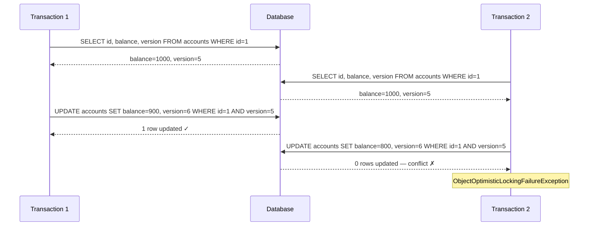
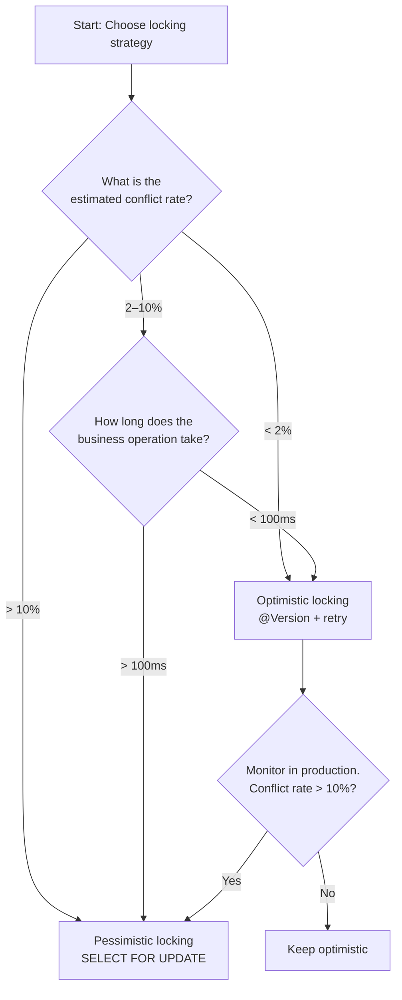

Optimistic locking is the high-throughput alternative to row-level locks. Instead of holding a database lock for the duration of a transaction, you read freely and then verify at write time that nobody else modified the row since you read it. In banking systems where most accounts are read far more often than they are written, optimistic locking can eliminate lock contention entirely — until it cannot, and that failure mode is the part most engineers underestimate.

## Learning Objectives

- Explain the read-then-CAS mechanic and when it outperforms pessimistic locking
- Implement JPA `@Version` on a financial entity and handle `ObjectOptimisticLockingFailureException`
- Build a retry wrapper that isolates each attempt in its own transaction
- Calculate the break-even conflict rate beyond which optimistic locking costs more than it saves
- Write a raw SQL CAS update that guards against overdraft and concurrent modification simultaneously
- Apply version-on-parent to protect a child collection (payment batch items) from concurrent mutation

## Business Context

In April 2022, a European neobank processed a marketing campaign that triggered 40,000 simultaneous balance-update requests across 8,000 accounts — roughly five concurrent writers per account on average. Their implementation used `@Version` with a single retry. Under that load the conflict rate on popular accounts reached 60%. With three retries the system issued 2.4× the intended database writes, saturating the write replica connection pool. The service degraded for 11 minutes while engineers scrambled to raise the pool limit.

The root cause was not the choice of optimistic locking itself — it was deploying optimistic locking in a write-heavy burst scenario with no circuit breaker to fall back to pessimistic locking. The post-incident rule they adopted: **measure conflict rate per aggregate type in production; if P95 conflict rate exceeds 10% for any aggregate, switch that aggregate to `SELECT FOR UPDATE`.**

That rule, and the instrumentation to enforce it, is what this lesson teaches.

## How Optimistic Locking Works

Optimistic locking assumes conflicts are rare. The protocol is:

1. Read the row (no lock acquired). Record the current `version` value.
2. Modify the in-memory state.
3. Issue `UPDATE … WHERE id = ? AND version = ?`. Increment version.
4. If the update affected 0 rows, another writer already changed the row. Conflict — retry or fail.

No lock is held between steps 1 and 3. If the system is under low write contention, every update succeeds on the first attempt and the throughput is limited only by CPU and network, not by lock wait queues.



## JPA `@Version` Implementation

JPA manages the version column automatically. Annotate one field with `@Version` and the ORM handles the rest.

```java
@Entity
@Table(name = "accounts")
public class Account {

    @Id
    @GeneratedValue(strategy = GenerationType.UUID)
    private UUID id;

    @Column(nullable = false, unique = true)
    private String accountNumber;

    @Column(nullable = false, precision = 19, scale = 4)
    private BigDecimal balance;

    @Enumerated(EnumType.STRING)
    @Column(nullable = false)
    private AccountStatus status;

    @Version
    @Column(nullable = false)
    private long version;   // JPA increments this on every UPDATE

    @Column(nullable = false)
    private Currency currency;

    @Column(nullable = false, updatable = false)
    private Instant createdAt;

    @Column(nullable = false)
    private Instant updatedAt;

    // Domain method — business logic stays in the entity
    public void debit(BigDecimal amount) {
        Objects.requireNonNull(amount, "amount must not be null");
        if (amount.compareTo(BigDecimal.ZERO) <= 0) {
            throw new IllegalArgumentException("Debit amount must be positive");
        }
        if (status != AccountStatus.ACTIVE) {
            throw new AccountNotActiveException(id);
        }
        if (balance.compareTo(amount) < 0) {
            throw new InsufficientFundsException(id, balance, amount);
        }
        this.balance = balance.subtract(amount);
        this.updatedAt = Instant.now();
    }

    public void credit(BigDecimal amount) {
        Objects.requireNonNull(amount, "amount must not be null");
        if (amount.compareTo(BigDecimal.ZERO) <= 0) {
            throw new IllegalArgumentException("Credit amount must be positive");
        }
        if (status != AccountStatus.ACTIVE) {
            throw new AccountNotActiveException(id);
        }
        this.balance = balance.add(amount);
        this.updatedAt = Instant.now();
    }

    // Getters omitted for brevity
}
```

The DDL that backs this entity:

```sql
CREATE TABLE accounts (
    id            UUID         NOT NULL DEFAULT gen_random_uuid(),
    account_number VARCHAR(34)  NOT NULL,
    balance        NUMERIC(19,4) NOT NULL DEFAULT 0,
    status         VARCHAR(20)  NOT NULL DEFAULT 'ACTIVE',
    currency       CHAR(3)      NOT NULL DEFAULT 'GBP',
    version        BIGINT       NOT NULL DEFAULT 0,
    created_at     TIMESTAMPTZ  NOT NULL DEFAULT now(),
    updated_at     TIMESTAMPTZ  NOT NULL DEFAULT now(),

    CONSTRAINT pk_accounts PRIMARY KEY (id),
    CONSTRAINT uq_account_number UNIQUE (account_number),
    CONSTRAINT chk_balance_non_negative CHECK (balance >= 0)
);
```

JPA generates this SQL on every `save()` call:

```sql
UPDATE accounts
   SET balance    = ?,
       status     = ?,
       updated_at = ?,
       version    = version + 1
 WHERE id      = ?
   AND version = ?;   -- the CAS predicate
```

> [!IMPORTANT]
> Never call `setVersion()` manually. JPA owns the version field. If you copy an entity from one context to another and accidentally reset the version to 0, the next save will succeed incorrectly — overwriting changes made since version 0 was current.

## Handling `ObjectOptimisticLockingFailureException`

A conflict throws `ObjectOptimisticLockingFailureException` (Spring Data) or `OptimisticLockException` (JPA). Both must be caught **outside** the transaction boundary — the transaction is already marked for rollback when the exception is thrown.

```java
@Service
@RequiredArgsConstructor
public class AccountDebitService {

    private final AccountRepository accountRepository;

    // Each attempt runs in its own transaction so we re-read the latest version.
    // REQUIRES_NEW suspends any outer transaction — critical for correctness.
    @Transactional(propagation = Propagation.REQUIRES_NEW)
    public void debitOnce(UUID accountId, BigDecimal amount, String idempotencyKey) {
        Account account = accountRepository.findById(accountId)
            .orElseThrow(() -> new AccountNotFoundException(accountId));
        account.debit(amount);
        // JPA flush on commit — version check happens here
    }
}
```

```java
@Service
@RequiredArgsConstructor
public class RetryingDebitService {

    private final AccountDebitService accountDebitService;
    private final ConflictRateRecorder conflictRateRecorder;

    // @Retryable is applied at the proxy level, outside any transaction.
    @Retryable(
        retryFor  = ObjectOptimisticLockingFailureException.class,
        maxAttempts = 3,
        backoff = @Backoff(delay = 50, multiplier = 2, random = true)
    )
    public void debit(UUID accountId, BigDecimal amount, String idempotencyKey) {
        try {
            accountDebitService.debitOnce(accountId, amount, idempotencyKey);
        } catch (ObjectOptimisticLockingFailureException ex) {
            conflictRateRecorder.increment(accountId);
            throw ex;   // rethrow so @Retryable sees it
        }
    }

    @Recover
    public void recoverFromConflict(
            ObjectOptimisticLockingFailureException ex,
            UUID accountId,
            BigDecimal amount,
            String idempotencyKey) {
        // All 3 attempts exhausted. Log with full context, alert on-call.
        throw new OptimisticLockExhaustedException(
            "Failed to debit account %s after 3 attempts".formatted(accountId), ex);
    }
}
```

> [!WARNING]
> Do not annotate the `@Retryable` method with `@Transactional`. If you do, the entire retry loop runs inside one transaction, the transaction is rolled back on the first conflict, and the retry attempt tries to flush a stale entity from the already-rolled-back persistence context. Each attempt must start a fresh transaction with a fresh entity load — that is the purpose of `Propagation.REQUIRES_NEW` on the inner service.

## The Cost of Conflicts Under Load

Optimistic locking looks free because it holds no locks. But every conflict wastes work:

- One full DB round-trip for the failed `UPDATE`
- One full DB round-trip for the re-read on retry
- CPU for the application logic executed on the failed attempt

**Break-even math:**

| Scenario | TPS | Conflict Rate | Attempts | Wasted DB calls/sec |
|---|---|---|---|---|
| Low contention | 100 | 2% | 1.02 avg | ~2 |
| Medium contention | 100 | 20% | 1.44 avg | ~88 |
| High contention | 100 | 40% | 1.96 avg | ~192 |

At 20% conflict rate with 3 max retries, the expected number of DB write attempts per logical operation is:

```
E[attempts] = 1 + 0.20 + 0.20² + ... ≈ 1.25 (for geometric series with p=0.20)
Wasted calls = 100 TPS × (1.25 - 1.0) × 2 round-trips = 50 extra round-trips/sec
```

That is 50 extra round-trips per second that produce no business value. Beyond 10% conflict rate the marginal cost of optimistic locking typically exceeds the marginal benefit over `SELECT FOR UPDATE`.

> [!NOTE]
> Measure your actual conflict rate using a Micrometer counter. Instrument the `@Recover` method and the catch block in the retry wrapper. If `conflict_rate_per_minute / total_writes > 0.10` for a given aggregate type, it is time to switch to pessimistic locking for that aggregate.

## Database-Level CAS

For the highest-throughput path, bypass JPA entirely and issue a CAS update as a single SQL statement. This is a single round-trip, no entity load, no persistence context overhead.

```java
@Repository
public interface AccountRepository extends JpaRepository<Account, UUID> {

    /**
     * Atomically debits an account.
     * Returns 1 if the update succeeded, 0 if version mismatch or insufficient funds.
     */
    @Modifying
    @Query("""
        UPDATE accounts
           SET balance    = balance - :amount,
               version    = version + 1,
               updated_at = now()
         WHERE id         = :accountId
           AND version    = :expectedVersion
           AND balance   >= :amount
           AND status     = 'ACTIVE'
        """)
    int casDebit(
        @Param("accountId") UUID accountId,
        @Param("amount") BigDecimal amount,
        @Param("expectedVersion") long expectedVersion
    );
}
```

```java
@Service
@RequiredArgsConstructor
public class HighThroughputDebitService {

    private final AccountRepository accountRepository;
    private final AccountQueryRepository accountQueryRepository;

    @Transactional
    public void debit(UUID accountId, BigDecimal amount) {
        // Read current version — lightweight projection, no full entity load
        AccountVersionProjection current =
            accountQueryRepository.findVersionById(accountId)
                .orElseThrow(() -> new AccountNotFoundException(accountId));

        int updated = accountRepository.casDebit(accountId, amount, current.version());

        if (updated == 0) {
            // Could be version mismatch OR insufficient funds — distinguish if needed
            Account account = accountRepository.findById(accountId).orElseThrow();
            if (account.getBalance().compareTo(amount) < 0) {
                throw new InsufficientFundsException(accountId, account.getBalance(), amount);
            }
            throw new OptimisticLockConflictException(accountId, current.version());
        }
    }
}
```

```sql
-- The projection query — avoids loading the full entity for the version check
SELECT id, version, balance
  FROM accounts
 WHERE id = ?;
```

## Optimistic Locking for Collections — Version on Parent

A common mistake: child entities (`PaymentBatchItem`) have no `@Version` on themselves. Two threads concurrently add items to the same `PaymentBatch` and each succeeds independently, producing a corrupted batch. The fix is to version the **parent** entity and invalidate any stale view of the collection.

```java
@Entity
@Table(name = "payment_batches")
public class PaymentBatch {

    @Id
    @GeneratedValue(strategy = GenerationType.UUID)
    private UUID id;

    @Column(nullable = false)
    private String batchReference;

    @Enumerated(EnumType.STRING)
    private BatchStatus status;

    @Version
    private long version;

    @OneToMany(mappedBy = "batch", cascade = CascadeType.ALL, orphanRemoval = true)
    @OrderBy("sequenceNumber ASC")
    private List<PaymentBatchItem> items = new ArrayList<>();

    public void addItem(PaymentBatchItem item) {
        if (status != BatchStatus.OPEN) {
            throw new BatchNotOpenException(id);
        }
        item.setBatch(this);
        item.setSequenceNumber(items.size() + 1);
        items.add(item);
        // JPA will increment version on flush because the parent is dirty
    }

    public void submit() {
        if (items.isEmpty()) {
            throw new EmptyBatchException(id);
        }
        this.status = BatchStatus.SUBMITTED;
    }
}
```

When thread A adds item 5 and thread B concurrently adds item 5 to the same batch, one of their `UPDATE payment_batches SET version=? WHERE id=? AND version=?` calls returns 0 rows — conflict. The losing thread retries and re-reads the batch, now seeing the item added by the winning thread, before adding its own item with the correct sequence number.

## Optimistic vs. Pessimistic: Decision Framework



| Dimension | Optimistic | Pessimistic |
|---|---|---|
| Lock held duration | Zero | Full transaction |
| Throughput under low contention | Excellent | Good |
| Throughput under high contention | Poor (retries cascade) | Predictable |
| Deadlock risk | None | Present |
| Read scalability | Reads are always free | Reads block writers |
| Complexity | Low | Medium (ordering required) |
| Best for | Account reads, config | Transfers, payment processing |

## Knowledge Check

**Q1: Why must each retry attempt of an optimistic lock conflict run in a new transaction (`REQUIRES_NEW`) rather than simply retrying within the original transaction?**

A: When `ObjectOptimisticLockingFailureException` is thrown, the current transaction is marked for rollback. The JPA persistence context associated with that transaction is in an inconsistent state — the entity it holds still carries the stale version number that caused the conflict. If you catch the exception and retry within the same transaction, you re-use the stale entity and issue the same failing CAS update again. `REQUIRES_NEW` forces a fresh transaction boundary, which creates a fresh persistence context, which forces a re-read from the database — this time reading the version written by the conflicting transaction.

**Q2: A team reports that their optimistic locking implementation causes intermittent data corruption: occasionally two concurrent debits both succeed and the final balance is only reduced by one amount instead of two. What is the most likely cause?**

A: The version column is not being checked. The most likely causes are: (a) the `@Version` column was added to the entity but the database column was not added to the table (JPA silently skips the predicate if the column does not exist in some configurations); (b) the developer is using a native `@Query` for the debit that does not include the `AND version = ?` predicate; or (c) the entity is loaded with `EntityManager.find()` using `LockModeType.NONE` and then saved via a custom bulk update that bypasses JPA version management. In all cases the `UPDATE` statement must include `AND version = ?` to guarantee the CAS semantic.

## Practical Challenge

**Scenario:** You are building the balance-update service for a prepaid card issuer. Cards are topped up by a third-party provider that sends bursts of 500 concurrent credit requests at card-reload time (e.g., salary day). You observe conflict rates of 35% on the busiest cards during the first 60 seconds of each reload window.

**Task:**

1. Instrument the existing `@Retryable` debit service to emit a Micrometer `Counter` named `optimistic.lock.conflicts` tagged with `aggregate_type` and `account_id` (truncated to prevent cardinality explosion — use account tier instead of raw ID).

2. Write a `ConflictRateCircuitBreaker` Spring component that reads the per-tier conflict rate every 30 seconds. If the rate exceeds 10%, it flips a `boolean` flag for that tier. The `RetryingDebitService` checks this flag and routes to a `PessimisticDebitService` (using `SELECT FOR UPDATE`) instead of the optimistic path.

3. Write a SQL CAS update that handles both the balance check and the version check in a single statement, returning a `result_code` of `'OK'`, `'INSUFFICIENT_FUNDS'`, or `'VERSION_CONFLICT'` using a PostgreSQL `DO` block or a PL/pgSQL function.

4. Write a JUnit 5 test that launches 50 concurrent threads all trying to debit £10 from an account with £100 balance, using `CountDownLatch` and `ExecutorService`. Assert that exactly 10 debits succeed, the rest throw `InsufficientFundsException` or `OptimisticLockExhaustedException`, and the final balance is exactly £0.00.

> [!IMPORTANT]
> The circuit breaker must be safe to read from multiple threads simultaneously. Use `ConcurrentHashMap` for the flag storage and avoid any synchronised blocks in the hot read path — the routing decision is made on every transaction and must add less than 1 microsecond of overhead.

<!-- KNOWLEDGE-CHECK
{
  "questions": [
    {
      "text": "Why must each retry attempt of an optimistic lock conflict run in a new transaction (Propagation.REQUIRES_NEW) rather than retrying within the original transaction?",
      "options": [
        "Because REQUIRES_NEW reduces database connection usage by releasing and re-acquiring the connection between retries",
        "Because when ObjectOptimisticLockingFailureException is thrown the current transaction is marked for rollback, and the JPA persistence context holds the stale entity version — retrying in the same context re-issues the same failing CAS update with the same stale version",
        "Because Spring @Retryable does not work inside an active transaction boundary",
        "Because optimistic locking requires SERIALIZABLE isolation which cannot be nested"
      ],
      "correct": 1,
      "explanation": "When an optimistic lock conflict is thrown, the current transaction is marked for rollback and the JPA persistence context is in an inconsistent state — the entity still carries the stale version that caused the conflict. Retrying within the same transaction re-uses the stale entity and issues the same failing UPDATE with version = stale_version. REQUIRES_NEW forces a fresh transaction and persistence context, which forces a re-read from the database — this time reading the version committed by the conflicting transaction."
    },
    {
      "text": "A team reports that their @Version optimistic locking implementation causes intermittent data corruption: two concurrent debits both succeed but only one amount is reflected in the final balance. What is the most likely root cause?",
      "options": [
        "The @Retryable maxAttempts is set too low, causing some retries to be silently dropped",
        "The version column check is not being applied — either the @Version column exists in the entity but not the DB table, the debit uses a native @Query without AND version = ?, or a bulk UPDATE bypasses JPA version management",
        "The @Version field type is long instead of Long, causing null pointer exceptions that are swallowed",
        "The persistence context is shared across threads, allowing one thread to overwrite another's entity state"
      ],
      "correct": 1,
      "explanation": "If the UPDATE does not include AND version = ? the CAS semantic is broken — both concurrent updates succeed because neither checks the version. Common causes: the @Version column was added to the entity but not the database schema (JPA may silently skip the predicate); a native @Query for the debit omits the version predicate; or a custom bulk update bypasses JPA version management entirely. The fix is to verify the generated SQL includes the version predicate on every write path."
    },
    {
      "text": "At what conflict rate does the break-even math show optimistic locking costs more than it saves, and what should you do when this threshold is crossed in production?",
      "options": [
        "5% — switch to SERIALIZABLE isolation at this threshold",
        "10% — instrument with a Micrometer counter, and when P95 conflict rate exceeds 10% for an aggregate type, switch that aggregate to SELECT FOR UPDATE",
        "25% — optimistic locking is still more efficient below 25% because retries are fast",
        "1% — any conflict indicates high contention requiring pessimistic locking immediately"
      ],
      "correct": 1,
      "explanation": "Above 10% conflict rate, the marginal cost of optimistic locking (failed UPDATE + re-read + retry cycle per conflict) typically exceeds the marginal benefit over SELECT FOR UPDATE. Each conflict wastes a full DB round-trip for the failed UPDATE plus another for the re-read on retry. Measure with a Micrometer counter on the @Recover method and the catch block. If conflict_rate_per_minute / total_writes > 0.10 for a given aggregate type, switch to pessimistic locking for that aggregate."
    }
  ]
}
-->

<!-- PRACTICAL-CHALLENGE
{
  "title": "Build a Conflict-Rate Circuit Breaker That Routes Between Optimistic and Pessimistic Locking",
  "difficulty": "advanced",
  "estimatedMinutes": 45,
  "tasks": [
    {"id": "1", "description": "Instrument the existing @Retryable debit service to emit a Micrometer Counter named optimistic.lock.conflicts tagged with aggregate_type and account_tier (not raw account_id — use a tier enum STANDARD/PREMIUM/ENTERPRISE to prevent cardinality explosion). Also emit a Counter named optimistic.lock.attempts for every debit attempt. The conflict rate is conflicts/attempts per 30-second window."},
    {"id": "2", "description": "Implement ConflictRateCircuitBreaker as a Spring @Component that reads the per-tier conflict rate from the Micrometer registry every 30 seconds using a @Scheduled method. If the rate exceeds 10% for a tier, set a flag in a ConcurrentHashMap<AccountTier, Boolean>. The RetryingDebitService checks this flag on every call and routes to PessimisticDebitService (SELECT FOR UPDATE) instead of the optimistic path. Use a ConcurrentHashMap — no synchronized blocks on the read path."},
    {"id": "3", "description": "Write a SQL CAS update function in PL/pgSQL that handles both balance check and version check in a single atomic statement, returning a result_code of OK, INSUFFICIENT_FUNDS, or VERSION_CONFLICT without requiring a separate SELECT. The function signature should be: SELECT * FROM debit_account(p_account_id UUID, p_amount NUMERIC, p_expected_version BIGINT)."},
    {"id": "4", "description": "Write a JUnit 5 test that launches 50 concurrent threads all trying to debit £10 from an account with £100 balance using CountDownLatch and ExecutorService. Assert: exactly 10 debits succeed, the rest throw InsufficientFundsException or OptimisticLockExhaustedException, and the final balance is exactly £0.00. Run the test twice — once with the circuit breaker in optimistic mode and once with it forced to pessimistic mode — and assert the same final balance in both cases."}
  ]
}
-->
