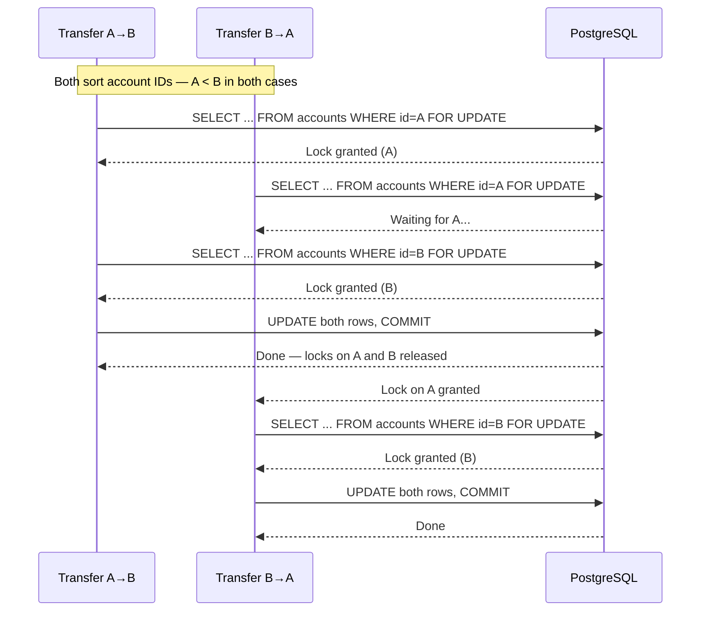

Pessimistic locking assumes the worst: another transaction is about to touch the same row, so the database acquires an exclusive lock the moment you read it. In payment systems this is not paranoia — it is the correct default for any operation where the cost of a conflict exceeds the cost of waiting. Optimistic locking wins when conflicts are rare; pessimistic locking wins when they are not, and when user-facing correctness cannot tolerate a retry loop.

## Learning Objectives

- Explain the semantics of `SELECT FOR UPDATE`, `SKIP LOCKED`, and `NOWAIT` and when to choose each
- Implement `@Lock(LockModeType.PESSIMISTIC_WRITE)` on a Spring Data repository method
- Prevent deadlocks in fund-transfer flows by enforcing canonical lock ordering
- Describe how PostgreSQL detects deadlocks via its wait-for graph algorithm
- Use PostgreSQL advisory locks for distributed leader election and background job exclusivity
- Query `pg_locks` and `pg_stat_activity` to diagnose lock contention in production

## Business Context

In March 2023 a mid-sized UK payments processor experienced a P1 incident during end-of-month bulk settlement. A batch job retried 12,000 failed payment records while the reconciliation job ran concurrently. Both jobs used optimistic locking with a single retry. Because 94% of the records were contested by both jobs simultaneously, the conflict rate exploded to 87% and each retry re-entered the same hot rows. The system issued 3.1× the expected database writes before the connection pool exhausted at 22:14 UTC. Settlement was delayed by 47 minutes, violating a Faster Payments SLA and triggering a £180,000 penalty from the scheme operator.

Post-incident review concluded that the batch job — which processed rows sequentially and never needed concurrent access to the *same* row from two threads — should have used `SELECT FOR UPDATE SKIP LOCKED` from the start. That variant is entirely non-blocking: each worker claims a row exclusively and skips any row already claimed by a peer. The incident drove the team to mandate pessimistic locking for all batch consumers and reserve optimistic locking for real-time, user-initiated mutations on low-contention accounts.

## SELECT FOR UPDATE: Row-Level Exclusive Locks

`SELECT FOR UPDATE` appends an exclusive lock to each row in the result set before returning them to the application. No other transaction can acquire a conflicting lock on those rows until the holding transaction commits or rolls back. The rows are still visible to plain `SELECT` queries (PostgreSQL uses MVCC for readers), but any attempt to lock them — including another `SELECT FOR UPDATE` — will block.

```sql
-- PostgreSQL: lock one account row for the duration of this transaction
BEGIN;
SELECT id, balance, version
  FROM accounts
 WHERE id = $1
   FOR UPDATE;

UPDATE accounts
   SET balance = balance - $2
 WHERE id = $1;

COMMIT;
```

In JPA, the equivalent is `LockModeType.PESSIMISTIC_WRITE`. Declare a dedicated repository method so the lock intent is explicit at the call site.

```java
@Repository
public interface AccountRepository extends JpaRepository<Account, UUID> {

    // Standard read — no lock
    Optional<Account> findById(UUID id);

    // Exclusive lock — must be called inside a transaction
    @Lock(LockModeType.PESSIMISTIC_WRITE)
    @Query("SELECT a FROM Account a WHERE a.id = :id")
    Optional<Account> findByIdForUpdate(@Param("id") UUID id);
}
```

```java
@Service
@RequiredArgsConstructor
public class WithdrawalService {

    private final AccountRepository accountRepository;

    @Transactional
    public void withdraw(UUID accountId, BigDecimal amount) {
        Account account = accountRepository.findByIdForUpdate(accountId)
            .orElseThrow(() -> new AccountNotFoundException(accountId));

        if (account.getBalance().compareTo(amount) < 0) {
            throw new InsufficientFundsException(accountId, amount);
        }

        account.setBalance(account.getBalance().subtract(amount));
        // JPA flushes the UPDATE on commit; the lock is released at that point
    }
}
```

> [!IMPORTANT]
> `findByIdForUpdate` must only be called inside a `@Transactional` method. If called outside a transaction the lock is acquired and immediately released, providing no protection. Spring will not throw an exception — the method simply executes as a plain `SELECT`.

## SKIP LOCKED and NOWAIT

PostgreSQL provides two non-blocking variants for specific use cases.

**`SKIP LOCKED`** skips rows that are already locked rather than waiting for them. This is the correct choice for work-queue consumers: multiple threads can process independent rows in parallel with zero contention.

```java
@Repository
public interface PaymentJobRepository extends JpaRepository<PaymentJob, UUID> {

    // Claim up to 50 unprocessed jobs; skip any already claimed by a peer worker
    @Lock(LockModeType.PESSIMISTIC_WRITE)
    @QueryHints(@QueryHint(name = "javax.persistence.lock.timeout", value = "-2"))
    @Query("""
        SELECT j FROM PaymentJob j
         WHERE j.status = 'PENDING'
         ORDER BY j.createdAt
         LIMIT 50
        """)
    List<PaymentJob> claimNextBatch();
}
```

The hint value `-2` maps to `FOR UPDATE SKIP LOCKED` in Hibernate's PostgreSQL dialect. Value `0` maps to `FOR UPDATE NOWAIT`.

**`NOWAIT`** raises an error immediately if any row in the result is already locked. Use this for user-facing operations where forcing the user to wait is unacceptable — the application can return a fast 409 Conflict rather than hanging until the holder commits.

```java
@Lock(LockModeType.PESSIMISTIC_WRITE)
@QueryHints(@QueryHint(name = "javax.persistence.lock.timeout", value = "0"))
@Query("SELECT a FROM Account a WHERE a.id = :id")
Optional<Account> findByIdNowait(@Param("id") UUID id);
```

```java
@Transactional
public void processUserTransfer(UUID accountId, BigDecimal amount) {
    try {
        Account account = accountRepository.findByIdNowait(accountId)
            .orElseThrow(() -> new AccountNotFoundException(accountId));
        // ... debit logic
    } catch (PessimisticLockingFailureException ex) {
        // Another request is mid-flight on this account; tell the caller to retry
        throw new AccountTemporarilyUnavailableException(accountId);
    }
}
```

> [!NOTE]
> The lock timeout hint is Hibernate-vendor-specific. In a PostgreSQL deployment `javax.persistence.lock.timeout = 0` translates to `FOR UPDATE NOWAIT` and `-2` translates to `FOR UPDATE SKIP LOCKED`. Always verify hint behaviour after upgrading Hibernate or switching database vendors.

## Deadlock Prevention: Canonical Lock Ordering

A deadlock occurs when Transaction A holds a lock that Transaction B wants, while Transaction B holds a lock that Transaction A wants. For fund transfers — which must lock two account rows — the risk is real: two simultaneous transfers in opposite directions will deadlock if each transaction locks its own source account first.

```
Transfer A→B: locks account A, then tries to lock account B  ─┐
Transfer B→A: locks account B, then tries to lock account A  ─┴─ DEADLOCK
```

PostgreSQL detects deadlocks by periodically traversing its wait-for graph (a directed graph where an edge from T1 to T2 means T1 is waiting for a lock T2 holds). When the traversal finds a cycle, PostgreSQL chooses one transaction as the victim and rolls it back with error code `40P01`. The default detection interval (`deadlock_timeout`) is 1 second — meaning your application hangs for up to a second before the error is raised.

The classical prevention technique is **canonical lock ordering**: always acquire locks in the same global order. For account transfers, sort by account ID before locking. If every transaction acquires the numerically smaller UUID first, a cycle in the wait-for graph is structurally impossible.

```java
@Service
@RequiredArgsConstructor
public class TransferService {

    private final AccountRepository accountRepository;

    @Transactional
    public void transfer(UUID fromId, UUID toId, BigDecimal amount) {
        // Canonical ordering: lock the account with the smaller UUID value first.
        // Both transfer directions will acquire locks in the same order,
        // making a deadlock cycle impossible.
        UUID firstId  = fromId.compareTo(toId) < 0 ? fromId : toId;
        UUID secondId = fromId.compareTo(toId) < 0 ? toId   : fromId;

        Account first  = accountRepository.findByIdForUpdate(firstId)
            .orElseThrow(() -> new AccountNotFoundException(firstId));
        Account second = accountRepository.findByIdForUpdate(secondId)
            .orElseThrow(() -> new AccountNotFoundException(secondId));

        // Re-map to semantic roles now that both rows are safely locked
        Account source      = first.getId().equals(fromId) ? first  : second;
        Account destination = first.getId().equals(fromId) ? second : first;

        if (source.getBalance().compareTo(amount) < 0) {
            throw new InsufficientFundsException(source.getId(), amount);
        }

        source.setBalance(source.getBalance().subtract(amount));
        destination.setBalance(destination.getBalance().add(amount));
    }
}
```



> [!WARNING]
> Canonical ordering only prevents deadlocks within a single code path. If a third service acquires locks on the same rows in a different order — for example, a background reconciliation job that sorts by `account_number` rather than UUID — deadlocks will still occur between services. Enforce lock ordering across *all* services that touch the same tables and document the rule in a shared Architecture Decision Record.

## PostgreSQL Advisory Locks

Advisory locks are application-level locks managed by PostgreSQL but entirely outside the row/table locking system. They carry no semantic meaning to the database; they are simply named mutex slots that your application can acquire and release. They are ideal for:

- **Distributed leader election**: ensure only one pod runs a scheduled job at a time across a multi-instance deployment
- **Background job exclusivity**: prevent two instances from processing the same logical entity simultaneously without holding a row lock for the full processing duration

The key is a `BIGINT`. For domain objects, `hashtext(key_string)::bigint` produces a stable hash. Use `pg_try_advisory_xact_lock` for transaction-scoped locks (auto-released on commit/rollback) or `pg_try_advisory_lock` for session-scoped locks that must be explicitly released.

```java
@Repository
public interface AdvisoryLockRepository {

    // Transaction-scoped: automatically released when the transaction ends.
    // Returns true if the lock was acquired; false if another holder exists.
    @Query(value = "SELECT pg_try_advisory_xact_lock(:key)", nativeQuery = true)
    boolean tryAcquireTransactionLock(@Param("key") long key);

    @Query(value = "SELECT pg_try_advisory_lock(:key)", nativeQuery = true)
    boolean tryAcquireSessionLock(@Param("key") long key);

    @Query(value = "SELECT pg_advisory_unlock(:key)", nativeQuery = true)
    boolean releaseSessionLock(@Param("key") long key);
}
```

```java
@Service
@RequiredArgsConstructor
public class SettlementJobService {

    private final AdvisoryLockRepository lockRepository;
    private final SettlementProcessor processor;

    // A fixed key ensures only one JVM instance runs settlement at a time.
    private static final long SETTLEMENT_LOCK_KEY = 0x5345544C4D4E5401L;

    @Transactional
    public void runDailySettlement(LocalDate settlementDate) {
        boolean acquired = lockRepository.tryAcquireTransactionLock(SETTLEMENT_LOCK_KEY);
        if (!acquired) {
            log.info("Settlement already running on another instance — skipping");
            return;
        }
        // Lock held for the duration of this transaction; released on commit
        processor.settle(settlementDate);
    }
}
```

For long-running processing that spans multiple transactions, use a session-scoped advisory lock:

```java
@Transactional(propagation = Propagation.NOT_SUPPORTED) // runs outside any transaction
public void processPaymentFile(UUID fileId) {
    long lockKey = fileId.getMostSignificantBits() ^ fileId.getLeastSignificantBits();

    boolean acquired = lockRepository.tryAcquireSessionLock(lockKey);
    if (!acquired) {
        log.warn("File {} is already being processed on another instance", fileId);
        return;
    }
    try {
        fileProcessor.process(fileId); // may span several internal transactions
    } finally {
        lockRepository.releaseSessionLock(lockKey); // must always be called
    }
}
```

> [!NOTE]
> Session-scoped advisory locks are **not** released by transaction rollback. If the application crashes before the `finally` block executes, the lock remains held until the database connection is closed. For this reason, prefer transaction-scoped advisory locks whenever the work fits inside a single transaction boundary.

## Monitoring Lock Contention

Two PostgreSQL system views are essential for diagnosing lock problems in production.

**`pg_locks`** shows every lock currently held or awaited across all sessions:

```sql
-- Find all blocked transactions and the query that is blocking them
SELECT
    blocked.pid                              AS blocked_pid,
    blocked_activity.query                   AS blocked_query,
    blocking.pid                             AS blocking_pid,
    blocking_activity.query                  AS blocking_query,
    blocked_activity.wait_event              AS wait_event,
    now() - blocked_activity.query_start     AS blocked_duration
FROM pg_locks           AS blocked
JOIN pg_stat_activity   AS blocked_activity
    ON blocked_activity.pid = blocked.pid
JOIN pg_locks           AS blocking
    ON  blocking.transactionid = blocked.transactionid
    AND blocking.pid           <> blocked.pid
JOIN pg_stat_activity   AS blocking_activity
    ON blocking_activity.pid = blocking.pid
WHERE NOT blocked.granted
ORDER BY blocked_duration DESC;
```

**`pg_stat_activity`** provides full query text and wait-event type. Filter on `wait_event_type = 'Lock'` to isolate transactions waiting on row locks specifically:

```sql
SELECT
    pid,
    usename,
    application_name,
    state,
    wait_event_type,
    wait_event,
    now() - query_start  AS query_age,
    left(query, 120)     AS query_snippet
FROM pg_stat_activity
WHERE wait_event_type = 'Lock'
ORDER BY query_age DESC;
```

Add an alert when any transaction has been waiting longer than 5 seconds. In a healthy system under normal load, lock waits should be sub-millisecond; waits in the seconds range indicate missing canonical ordering, a long-running transaction holding locks, or an unexpected workload spike.

```java
@Component
@RequiredArgsConstructor
public class LockWaitMetrics {

    private final JdbcTemplate jdbc;
    private final MeterRegistry meterRegistry;

    @Scheduled(fixedDelay = 10_000)
    public void recordLockWaitCount() {
        Integer count = jdbc.queryForObject("""
            SELECT COUNT(*)
              FROM pg_stat_activity
             WHERE wait_event_type = 'Lock'
            """, Integer.class);

        Gauge.builder("db.lock.waiting_transactions",
                      () -> count != null ? count : 0)
             .description("Transactions currently waiting for a row lock")
             .register(meterRegistry);
    }
}
```

> [!WARNING]
> Never run lock diagnostic queries against a heavily loaded production database without checking query plan costs first. `pg_locks` and `pg_stat_activity` are virtual tables, but joining them on a 1,000-connection instance can consume noticeable CPU. Run these queries from a monitoring replica or via a dedicated low-priority connection pool.

## Knowledge Check

**Q1: A payment API endpoint must debit an account and return a response within 200 ms. The account row is currently locked by another transaction that has held it for 150 ms. Which variant should you use — `FOR UPDATE`, `FOR UPDATE NOWAIT`, or `FOR UPDATE SKIP LOCKED` — and why?**

Use `FOR UPDATE NOWAIT`. The endpoint must not wait an unknown duration for the holder to release. `NOWAIT` causes PostgreSQL to raise an error immediately, which the service translates into an HTTP 409 Conflict response. The client can retry after a short backoff. `SKIP LOCKED` does not apply here because the endpoint must process *this specific* account, not any available row from a pool. Plain `FOR UPDATE` would block until the holder commits, almost certainly violating the 200 ms SLA.

**Q2: Two services both use canonical lock ordering, but the transfer service sorts by UUID while the reconciliation service was recently updated to sort by `account_number` (VARCHAR). Can a deadlock still occur?**

Yes. Canonical ordering only prevents deadlocks when *all* participants use the *same* ordering. Sorting by UUID may produce the order [A, B] for two accounts. Sorting by `account_number` may produce the order [B, A] for the same accounts. This creates the classic conditions for a cycle in the wait-for graph. The fix is to establish a single global ordering rule — UUID or a stable numeric surrogate — and enforce it via a shared library method such as `LockOrderingUtils.sortForLocking(List<UUID> ids)` used by every service.

## Practical Challenge

A fintech startup runs a micro-lending platform. Each evening a batch job processes up to 50,000 loan repayment records. The job runs across four pods, each pulling records from a PostgreSQL table `loan_repayments(id UUID, loan_id UUID, status TEXT, amount NUMERIC, due_at TIMESTAMPTZ)`. Records have `status = 'PENDING'` when awaiting processing.

**Task 1 — Claim without contention.** Implement a Spring Data repository method `claimNextBatch(int batchSize)` that selects up to `batchSize` PENDING records, locks them with `SKIP LOCKED` so pods do not compete, and returns the claimed records. Provide the native SQL query and the repository method signature with appropriate JPA annotations.

**Task 2 — Safe concurrent transfer.** Upon processing a repayment, the batch job must debit the borrower's `wallet_accounts` row and credit the lender's row in a single transaction. Both rows must be locked before either balance is modified. Implement `RepaymentProcessor.applyRepayment(UUID borrowerId, UUID lenderId, BigDecimal amount)` with correct canonical lock ordering. Show how you sort the two IDs before calling `findByIdForUpdate`.

**Task 3 — Exclusive job guard.** Only one pod should run the daily interest-accrual job. Implement `InterestAccrualJob.run(LocalDate date)` using a transaction-scoped advisory lock. Derive the lock key deterministically from the job name and date using `hashtext('interest_accrual:' || date::text)::bigint`. Provide the native query and the service method.

**Task 4 — Monitoring alert.** Write a SQL query that returns, for each table currently involved in a lock wait, the table name, the count of blocked transactions, and the maximum wait duration. Explain how you would surface this as a Micrometer gauge in a Spring Boot application and what alert threshold you would configure for a payments system with a 500 ms P99 SLA.

<!-- KNOWLEDGE-CHECK
{
  "questions": [
    {
      "text": "A payment API endpoint must debit a specific account and return within 200 ms. The account row is currently locked by another transaction that has held it for 150 ms. Which SELECT FOR UPDATE variant should you use and why?",
      "options": [
        "FOR UPDATE — wait for the lock to be released; 150 ms hold means the account will be free in time",
        "FOR UPDATE SKIP LOCKED — skip this account and process a different one from the pool",
        "FOR UPDATE NOWAIT — raise an error immediately so the service can return a fast 409, allowing the client to retry after a short backoff rather than hanging and violating the SLA",
        "Plain SELECT without locking — the endpoint does not need to modify the row for a balance check"
      ],
      "correct": 2,
      "explanation": "FOR UPDATE NOWAIT causes PostgreSQL to raise an error immediately if any row in the result is already locked. The service catches PessimisticLockingFailureException and returns HTTP 409 Conflict, allowing the client to retry. FOR UPDATE would block for an unknown duration — the holder's remaining hold time is unknown and could easily exceed the 200 ms SLA. SKIP LOCKED applies to work queues where any available row is acceptable, not to endpoints that must process a specific account."
    },
    {
      "text": "Two services use canonical lock ordering, but the transfer service sorts by UUID while the reconciliation service was recently updated to sort by account_number (VARCHAR). Can a deadlock occur between them?",
      "options": [
        "No — both services still acquire exactly two locks, so the total lock count prevents cycles",
        "Yes — sorting by UUID may produce order [A, B] while sorting by account_number may produce [B, A] for the same two accounts, creating a cycle in the wait-for graph",
        "No — PostgreSQL's deadlock detection algorithm resolves this automatically within 1 second",
        "Yes — but only when both services run the exact same transaction concurrently, which is rare"
      ],
      "correct": 1,
      "explanation": "Canonical ordering only prevents deadlocks when ALL participants use the SAME ordering. If UUID order produces [A, B] but account_number order produces [B, A] for accounts A and B, the classic deadlock conditions exist: service 1 locks A then waits for B, service 2 locks B then waits for A — a cycle. The fix is a single global ordering rule enforced via a shared LockOrderingUtils.sortForLocking() method used by every service that touches the same tables."
    },
    {
      "text": "What is the correct use case for transaction-scoped advisory locks (pg_try_advisory_xact_lock) versus session-scoped advisory locks (pg_try_advisory_lock), and what is the operational risk of using session-scoped locks?",
      "options": [
        "Transaction-scoped locks are for single-row operations; session-scoped locks are for multi-table operations",
        "Transaction-scoped locks auto-release on commit/rollback and are preferred when work fits in one transaction; session-scoped locks persist across transactions but are NOT released on rollback — if the application crashes before the finally block, the lock remains held until the connection closes",
        "Session-scoped locks are more efficient because they avoid re-acquiring the lock on each transaction retry",
        "Transaction-scoped locks can only be used with FOR UPDATE while session-scoped locks work independently"
      ],
      "correct": 1,
      "explanation": "Transaction-scoped advisory locks (pg_try_advisory_xact_lock) are automatically released when the transaction commits or rolls back — no explicit release needed. Session-scoped locks (pg_try_advisory_lock) persist across transaction boundaries and must be explicitly released via pg_advisory_unlock. The critical risk: if the application crashes before the finally block executes, the session-scoped lock remains held until the database connection is forcibly closed. Prefer transaction-scoped locks whenever work fits in a single transaction."
    }
  ]
}
-->

<!-- PRACTICAL-CHALLENGE
{
  "title": "Implement Pessimistic Locking for a Multi-Pod Loan Repayment Batch Processor",
  "difficulty": "advanced",
  "estimatedMinutes": 45,
  "tasks": [
    {"id": "1", "description": "Implement a Spring Data repository method claimNextBatch(int batchSize) for the loan_repayments table that selects up to batchSize PENDING records using FOR UPDATE SKIP LOCKED so multiple pods do not compete for the same rows. Provide the native SQL query and the repository method signature with @Lock, @QueryHints, and @Query annotations. Explain why SKIP LOCKED is correct here rather than NOWAIT."},
    {"id": "2", "description": "Implement RepaymentProcessor.applyRepayment(UUID borrowerId, UUID lenderId, BigDecimal amount) that debits the borrower's wallet_accounts row and credits the lender's row in a single transaction. Both rows must be locked before either balance is modified. Implement canonical lock ordering by sorting the two UUIDs before calling findByIdForUpdate. Explain in a code comment why this ordering prevents deadlocks when two concurrent repayments involve the same two wallets in opposite roles."},
    {"id": "3", "description": "Implement InterestAccrualJob.run(LocalDate date) using a transaction-scoped advisory lock. Derive the lock key deterministically using hashtext('interest_accrual:' || date::text)::bigint via a native query. The job must check the lock result and log a message if another instance is already running, returning immediately without processing. Provide both the native query bean and the service method."},
    {"id": "4", "description": "Write a SQL query against pg_locks and pg_stat_activity that returns: table_name, blocked_transaction_count, max_wait_duration_ms for all tables currently involved in lock waits. Implement this as a Micrometer Gauge updated every 10 seconds using @Scheduled. Configure an alert threshold: for a 500 ms P99 SLA, at what max_wait_duration_ms should you fire a P2 alert? Justify your threshold with reference to Little's Law and typical lock hold times."}
  ]
}
-->
