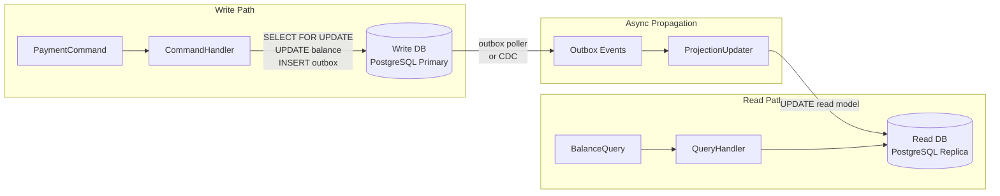

Command Query Responsibility Segregation is not an architecture pattern that solves performance — it is a pattern that honestly reflects that writing and reading in a high-throughput payment system have fundamentally different requirements. Writes need serialisable isolation, row-level locks, and strict consistency; reads need sub-millisecond latency at scale, often serving hundreds of queries per second for dashboards, mobile apps, and downstream APIs simultaneously. Attempting to serve both from a single normalised schema under a single data model is the root cause of most payment system read-performance problems.

## Learning Objectives

- Articulate why the write model and read model in payment systems have incompatible consistency requirements
- Implement a `PaymentCommandHandler` that processes commands against the write store with `SELECT FOR UPDATE`
- Design a denormalised `AccountSummaryView` read table optimised for high-frequency balance queries
- Build an `AccountProjectionUpdater` that consumes outbox events and maintains the read model asynchronously
- Configure separate `DataSource` beans for the write (leader) database and read (replica) database in Spring Boot
- Test CQRS flows end-to-end using `Awaitility` to handle eventual consistency in assertions

## Business Context

In November 2022 a Southeast Asian super-app processed 2.4 million payment transactions per hour during a regional double-11 sale. The engineering team had a single PostgreSQL write primary serving both payment mutations and balance queries. At peak load, balance read queries — triggered by the mobile app polling every 3 seconds for 15 million active users — consumed 60% of the primary's I/O capacity. Lock wait times on the `accounts` table reached 800 ms. Payment authorisation latency degraded from a P99 of 90 ms to 4.2 seconds and 340,000 payment attempts failed with timeout errors during the 90-minute peak window. The revenue impact was estimated at $2.3 million USD.

Post-incident the team implemented CQRS with a PostgreSQL streaming replica serving all read traffic. The write primary handled only mutations. During the following year's double-11 event under higher load, write-path P99 latency was 87 ms and no payment failures were attributed to database contention. The read replica served 420 million balance queries during the peak hour with a P99 of 11 ms.

## The Core Separation: Why Payments Need CQRS

The write path and read path in a payment system have opposed requirements that cannot be satisfied simultaneously from a single data model.

| Dimension | Write Path | Read Path |
|---|---|---|
| Consistency | Serialisable or repeatable-read; overdraft impossible | Eventual; milliseconds of lag is acceptable |
| Locking | Row-level exclusive locks for balance mutations | No locks; plain `SELECT` |
| Schema | Normalised; enforces referential integrity | Denormalised; balance pre-aggregated |
| Throughput | Bounded by lock contention on hot accounts | Horizontally scalable across replicas |
| Failure mode | Must fail fast and hard | Can serve stale data gracefully |



## The Command Side

All mutations to account state go through the command handler. The handler acquires an exclusive lock, validates business rules, mutates the row, and appends an outbox event in the same transaction.

```java
public sealed interface PaymentCommand permits DebitAccountCommand, CreditAccountCommand,
                                               FreezeAccountCommand, ReversePaymentCommand {
    UUID accountId();
    UUID idempotencyKey();
}

public record DebitAccountCommand(
    UUID        accountId,
    UUID        idempotencyKey,
    BigDecimal  amount,
    String      reference,
    UUID        correlationId
) implements PaymentCommand {}
```

```java
@Service
@RequiredArgsConstructor
public class PaymentCommandHandler {

    private final AccountRepository    accountRepository;
    private final OutboxRepository     outboxRepository;
    private final IdempotencyRepository idempotencyRepository;

    @Transactional
    public void handle(DebitAccountCommand command) {
        // Idempotency guard: reject duplicates before touching the account
        if (idempotencyRepository.exists(command.idempotencyKey())) {
            log.info("Duplicate command {}; skipping", command.idempotencyKey());
            return;
        }

        // Exclusive lock — no concurrent mutation can proceed until this transaction commits
        Account account = accountRepository.findByIdForUpdate(command.accountId())
            .orElseThrow(() -> new AccountNotFoundException(command.accountId()));

        if (account.getBalance().compareTo(command.amount()) < 0) {
            throw new InsufficientFundsException(command.accountId(), command.amount());
        }

        account.setBalance(account.getBalance().subtract(command.amount()));

        // Append to outbox in the same transaction — guaranteed delivery to projection
        OutboxEvent outbox = OutboxEvent.builder()
            .aggregateId(command.accountId())
            .eventType("AccountDebited")
            .payload(toJson(command))
            .build();

        outboxRepository.save(outbox);
        idempotencyRepository.record(command.idempotencyKey());
    }
}
```

> [!IMPORTANT]
> The outbox insert and the balance update must be in the **same** database transaction. If they are split across two operations, a crash between the two leaves the write store updated but the projection permanently stale. The transactional outbox pattern guarantees that either both succeed or neither does.

## The Read Side: Denormalised View

The read model is not a normalised relational schema — it is a pre-computed answer to the most common queries the application asks.

```sql
CREATE TABLE account_summary_view (
    account_id              UUID           NOT NULL PRIMARY KEY,
    account_number          VARCHAR(34)    NOT NULL,
    owner_display_name      TEXT           NOT NULL,
    current_balance         NUMERIC(19, 4) NOT NULL,
    available_balance       NUMERIC(19, 4) NOT NULL,  -- balance minus pending holds
    currency_code           CHAR(3)        NOT NULL,
    frozen                  BOOLEAN        NOT NULL DEFAULT FALSE,
    last_transaction_at     TIMESTAMPTZ,
    last_transaction_amount NUMERIC(19, 4),
    monthly_debit_total     NUMERIC(19, 4) NOT NULL DEFAULT 0,
    monthly_credit_total    NUMERIC(19, 4) NOT NULL DEFAULT 0,
    updated_at              TIMESTAMPTZ    NOT NULL DEFAULT now()
);

-- Supports the common "accounts owned by user" query
CREATE INDEX ix_account_summary_view_owner
    ON account_summary_view (owner_display_name);
```

The query handler reads exclusively from this view:

```java
@Service
@RequiredArgsConstructor
public class AccountQueryHandler {

    private final AccountSummaryViewRepository readRepository;

    // No transaction needed — read replica, plain SELECT
    public AccountSummaryDto getAccountSummary(UUID accountId) {
        return readRepository.findById(accountId)
            .map(this::toDto)
            .orElseThrow(() -> new AccountNotFoundException(accountId));
    }

    public List<AccountSummaryDto> getAccountsForUser(UUID userId) {
        return readRepository.findByUserId(userId)
            .stream()
            .map(this::toDto)
            .toList();
    }
}
```

## The Projection Updater

The projection updater consumes outbox events and applies them to the read model. It runs asynchronously — typically polled every 50–200 ms — and must be idempotent.

```java
@Component
@RequiredArgsConstructor
public class AccountProjectionUpdater {

    private final OutboxRepository         outboxRepository;
    private final AccountSummaryRepository summaryRepository;
    private final JdbcTemplate             writeJdbc; // connected to write-side DB
    private final ObjectMapper             objectMapper;

    @Scheduled(fixedDelay = 100) // poll every 100 ms
    @Transactional
    public void pollAndProject() {
        List<OutboxEvent> events = outboxRepository.claimUnpublished(50);
        for (OutboxEvent event : events) {
            try {
                applyToReadModel(event);
                outboxRepository.markPublished(event.getId());
            } catch (Exception ex) {
                log.error("Failed to project event {}", event.getId(), ex);
                outboxRepository.markFailed(event.getId(), ex.getMessage());
            }
        }
    }

    private void applyToReadModel(OutboxEvent event) {
        switch (event.getEventType()) {
            case "AccountDebited"  -> applyDebit(event);
            case "AccountCredited" -> applyCredit(event);
            case "AccountFrozen"   -> applyFreeze(event);
            default -> log.warn("Unknown event type: {}", event.getEventType());
        }
    }

    private void applyDebit(OutboxEvent event) {
        DebitAccountCommand cmd = deserialize(event.getPayload(), DebitAccountCommand.class);
        summaryRepository.applyDebit(
            cmd.accountId(),
            cmd.amount(),
            Instant.now()
        );
    }
}
```

```java
@Repository
public interface AccountSummaryRepository extends JpaRepository<AccountSummaryView, UUID> {

    @Modifying
    @Query("""
        UPDATE AccountSummaryView v SET
            v.currentBalance       = v.currentBalance - :amount,
            v.availableBalance     = v.availableBalance - :amount,
            v.lastTransactionAt    = :transactedAt,
            v.lastTransactionAmount = :amount,
            v.monthlyDebitTotal    = v.monthlyDebitTotal + :amount,
            v.updatedAt            = now()
         WHERE v.accountId = :accountId
        """)
    void applyDebit(
        @Param("accountId")    UUID accountId,
        @Param("amount")       BigDecimal amount,
        @Param("transactedAt") Instant transactedAt
    );
}
```

> [!NOTE]
> The projection updater runs against the **write** database — it reads from the outbox table and writes to the summary view, both of which live on the write side. The read replica receives these changes via PostgreSQL streaming replication, typically within 10–100 ms. This is the propagation path that creates the eventual consistency window.

## Separate DataSource Configuration

Spring Boot must route commands to the leader and queries to the replica. Use separate `DataSource` beans with qualifier annotations.

```java
@Configuration
public class DataSourceConfig {

    @Bean
    @Primary
    @ConfigurationProperties("spring.datasource.write")
    public DataSource writeDataSource() {
        return DataSourceBuilder.create().build();
    }

    @Bean("readDataSource")
    @ConfigurationProperties("spring.datasource.read")
    public DataSource readDataSource() {
        return DataSourceBuilder.create().build();
    }

    @Bean
    @Primary
    public JdbcTemplate writeJdbcTemplate(@Qualifier("writeDataSource") DataSource ds) {
        return new JdbcTemplate(ds);
    }

    @Bean("readJdbcTemplate")
    public JdbcTemplate readJdbcTemplate(@Qualifier("readDataSource") DataSource ds) {
        return new JdbcTemplate(ds);
    }

    @Bean
    @Primary
    public LocalContainerEntityManagerFactoryBean entityManagerFactory(
            @Qualifier("writeDataSource") DataSource dataSource,
            EntityManagerFactoryBuilder builder) {
        return builder.dataSource(dataSource)
                      .packages("com.bank.payments.domain")
                      .build();
    }
}
```

```yaml
# application.yml
spring:
  datasource:
    write:
      url: jdbc:postgresql://payments-primary.internal:5432/payments
      username: ${DB_WRITE_USER}
      password: ${DB_WRITE_PASSWORD}
      hikari:
        maximum-pool-size: 20
        connection-timeout: 3000
    read:
      url: jdbc:postgresql://payments-replica.internal:5432/payments
      username: ${DB_READ_USER}
      password: ${DB_READ_PASSWORD}
      hikari:
        maximum-pool-size: 50       # read replica serves more concurrent queries
        connection-timeout: 1000
```

> [!WARNING]
> Injecting the wrong `DataSource` into the wrong handler is a silent bug. A `QueryHandler` that accidentally targets the write database under heavy read load re-introduces the exact contention problem CQRS was adopted to solve. Use integration tests that verify each handler's connection — query the `inet_server_addr()` or `pg_is_in_recovery()` function and assert the expected value.

## Handling Eventual Consistency

The read model is milliseconds behind the write model. For most queries this is acceptable. For read-your-own-writes — a user submits a payment and immediately checks their balance — the lag is perceptible and potentially confusing.

Three strategies address this:

**1. Route immediate reads to the write store.** For a short window after a write (typically 500 ms), route balance queries for that account to the write database. After that window, the replica is consistent and normal routing resumes.

```java
@Service
@RequiredArgsConstructor
public class BalanceQueryRouter {

    private final AccountSummaryRepository readRepository;
    private final AccountRepository        writeRepository;
    private final Cache<UUID, Instant>     recentWriteCache; // Caffeine, TTL 500ms

    public AccountSummaryDto getBalance(UUID accountId) {
        if (recentWriteCache.getIfPresent(accountId) != null) {
            // Recent write detected — read from write store for consistency
            Account account = writeRepository.findById(accountId)
                .orElseThrow(() -> new AccountNotFoundException(accountId));
            return toSummaryDto(account);
        }
        return readRepository.findById(accountId)
            .map(this::toDto)
            .orElseThrow(() -> new AccountNotFoundException(accountId));
    }

    public void recordRecentWrite(UUID accountId) {
        recentWriteCache.put(accountId, Instant.now());
    }
}
```

**2. Return the new balance in the command response.** The command handler computed the new balance before committing. Return it directly in the HTTP response so the client does not need to issue a read at all.

**3. Version-stamp the read model.** Include the write transaction ID or event sequence in the read model row. The client can pass the expected version as a query parameter; the query handler waits (with a timeout) until the read model has applied that version.

## Testing CQRS with Awaitility

CQRS flows are inherently asynchronous. Standard synchronous assertions fail because the read model is not yet updated when the test asserts immediately after the command. Use `Awaitility` to poll until the expected state materialises.

```java
@SpringBootTest
@Transactional(propagation = Propagation.NOT_SUPPORTED) // prevent test transaction wrapping
class PaymentCqrsIntegrationTest {

    @Autowired PaymentCommandHandler   commandHandler;
    @Autowired AccountQueryHandler     queryHandler;
    @Autowired AccountRepository       accountRepository;

    @Test
    void debitCommandUpdatesReadModelWithinOneSecond() {
        // Arrange: create account with balance 500
        UUID accountId = createTestAccount(new BigDecimal("500.00"));

        DebitAccountCommand command = new DebitAccountCommand(
            accountId,
            UUID.randomUUID(),   // idempotencyKey
            new BigDecimal("150.00"),
            "TEST-REF-001",
            UUID.randomUUID()
        );

        // Act: submit command to write path
        commandHandler.handle(command);

        // Assert write store updated immediately
        Account written = accountRepository.findById(accountId).orElseThrow();
        assertThat(written.getBalance()).isEqualByComparingTo("350.00");

        // Assert read model updated within 1 second (projection runs every 100 ms)
        await()
            .atMost(1, SECONDS)
            .pollInterval(50, MILLISECONDS)
            .untilAsserted(() -> {
                AccountSummaryDto summary = queryHandler.getAccountSummary(accountId);
                assertThat(summary.currentBalance())
                    .isEqualByComparingTo("350.00");
                assertThat(summary.lastTransactionAmount())
                    .isEqualByComparingTo("150.00");
            });
    }

    @Test
    void duplicateCommandIsIdempotent() {
        UUID accountId       = createTestAccount(new BigDecimal("1000.00"));
        UUID idempotencyKey  = UUID.randomUUID();

        DebitAccountCommand command = new DebitAccountCommand(
            accountId, idempotencyKey, new BigDecimal("200.00"), "REF-002", UUID.randomUUID()
        );

        // Submit the same command twice
        commandHandler.handle(command);
        commandHandler.handle(command); // should be a no-op

        // Balance should reflect only one debit
        await()
            .atMost(1, SECONDS)
            .pollInterval(50, MILLISECONDS)
            .untilAsserted(() -> {
                AccountSummaryDto summary = queryHandler.getAccountSummary(accountId);
                assertThat(summary.currentBalance()).isEqualByComparingTo("800.00");
            });
    }
}
```

> [!NOTE]
> `Propagation.NOT_SUPPORTED` on the test class is essential. If the test runs inside a Spring-managed transaction, the outbox insert and the balance update are both visible within the test transaction but not yet committed to the database. The projection poller, which runs in its own transaction, cannot see uncommitted rows and will never project. The `await` will time out every time.

## Knowledge Check

**Q1: A mobile banking app displays the account balance immediately after a successful payment submission. The command handler returns HTTP 200 but the read model is 200 ms behind. What three strategies can prevent the user from seeing a stale balance, and what are the trade-offs of each?**

First, return the computed balance in the command response body — the handler already knows the new balance before committing, so include it in the JSON payload. The client displays this value directly without issuing a follow-up GET. Trade-off: the client must handle the response specially; the read model is still eventually consistent for other callers. Second, route the user's next read to the write database for a short TTL (e.g., 500 ms) using a Caffeine cache keyed by account ID. Trade-off: the write database receives some read traffic, partially defeating the CQRS isolation goal, though the volume is low (one read per recent write). Third, version-stamp read model rows and have the client include the expected sequence in the query; the query handler waits up to 500 ms for the replica to reach that version. Trade-off: adds complexity to the query API and ties the client to internal sequencing concepts.

**Q2: The projection updater processes outbox events every 100 ms. During a database failover, the updater fails for 45 seconds. When the primary recovers, 450 outbox events have accumulated. What must be true about the updater for the read model to become fully consistent after recovery, and how do you verify this in a test?**

The updater must be **idempotent** — applying the same event twice must produce the same result as applying it once — and **at-least-once** — it must not skip any events if the outbox poll fails partway through. The `WHERE last_event_seq < :seq` or equivalent guard achieves idempotency. The outbox's `claimUnpublished` method with `markPublished` after success ensures at-least-once delivery. To verify: in an integration test, insert 100 synthetic outbox events with known amounts, start the updater, kill it after 30 events, restart it, then assert via `Awaitility` that all 100 events are reflected in the read model and that the final balance equals the sum of all 100 event amounts (not 130).

## Practical Challenge

A digital wallet provider is rebuilding its transaction history feature. Currently, the mobile app queries the write database directly for transaction history, contributing 70% of all database queries. The write database P99 query latency for history queries is 320 ms.

**Task 1 — Command handler.** Implement `WalletCommandHandler.handle(TransferCommand)` where `TransferCommand` carries a sender ID, recipient ID, amount, and idempotency key. The handler must debit the sender and credit the recipient in a single transaction using canonical lock ordering. Both balance changes and two outbox events (`WalletDebited`, `WalletCredited`) must be committed atomically.

**Task 2 — Read model schema.** Design a `wallet_transaction_history_view` table that supports the query "return the last 50 transactions for wallet X, with running balance". Include all columns needed to serve this query without joining to any other table. Write the `SELECT` statement that the query handler would execute.

**Task 3 — Projection updater.** Implement `WalletHistoryProjectionUpdater` that consumes `WalletDebited` and `WalletCredited` outbox events and maintains `wallet_transaction_history_view`. The updater must be idempotent — if the same event is processed twice, the history table must not contain a duplicate row.

**Task 4 — DataSource routing test.** Write a Spring integration test that submits a `TransferCommand` and verifies (a) the write database reflects the correct balances immediately after the command, (b) the read model reflects the correct transaction history within 1 second, and (c) the query handler never touches the write database — verified by asserting `pg_is_in_recovery()` returns `true` for every connection the query handler uses.

<!-- KNOWLEDGE-CHECK
{
  "questions": [
    {
      "text": "A mobile banking app displays the account balance immediately after a successful payment submission. The command handler returns HTTP 200 but the read model is 200 ms behind. Which strategy is simplest and adds zero read-side traffic to the write database?",
      "options": [
        "Route the user's next balance read to the write database for 500 ms using a Caffeine cache keyed by account ID",
        "Return the computed new balance directly in the HTTP 200 command response body — the command handler already knows the balance before committing, so the client displays it without issuing a follow-up GET",
        "Version-stamp the read model and have the client poll with the expected sequence number until the replica catches up",
        "Increase the read replica replication lag SLA from 200 ms to 50 ms"
      ],
      "correct": 1,
      "explanation": "Returning the new balance in the command response requires zero additional infrastructure, adds no read traffic to the write database, and requires no client-side polling. The command handler computed the new balance (write store debit) before committing — including it in the JSON response body costs nothing. The read-your-own-writes problem is solved at source. The other strategies all add complexity or write-database read traffic."
    },
    {
      "text": "Why must the CQRS integration test use @Transactional(propagation = Propagation.NOT_SUPPORTED) at the test class level rather than the default @Transactional?",
      "options": [
        "NOT_SUPPORTED disables connection pooling so the test always gets a fresh database connection",
        "If the test runs inside a Spring-managed transaction, the outbox insert and balance update are uncommitted — the projection poller runs in its own transaction and cannot see uncommitted rows, so the Awaitility assertion times out every time",
        "NOT_SUPPORTED prevents Hibernate from flushing dirty entities, which would corrupt the test data",
        "The test uses multiple DataSources and Spring @Transactional cannot span two DataSources"
      ],
      "correct": 1,
      "explanation": "If the test runs inside a Spring @Transactional boundary, the outbox insert and balance update are both visible within the test transaction but not yet committed to the database. The projection poller runs in its own separate transaction and uses READ COMMITTED isolation — it cannot see the uncommitted rows. The Awaitility await block polls the read model indefinitely, timing out every time. NOT_SUPPORTED ensures each database operation commits immediately, making data visible to the poller."
    },
    {
      "text": "The projection updater runs against the write database and updates account_summary_view. How does the read replica receive these changes, and what is the name for the resulting consistency model?",
      "options": [
        "The projection updater writes directly to both the write database and the read replica simultaneously via a dual-write pattern",
        "The write database propagates changes to the read replica via PostgreSQL streaming replication (typically 10–100 ms lag); queries against the replica see a slightly stale but consistent snapshot — this is eventual consistency",
        "The read replica polls the write database every 100 ms for new account_summary_view rows using the outbox relay pattern",
        "The changes are synchronously replicated via XA transactions before the command handler returns"
      ],
      "correct": 1,
      "explanation": "The projection updater writes to account_summary_view on the write (primary) database. PostgreSQL streaming replication asynchronously propagates committed changes to the read replica, typically within 10–100 ms under normal load. Queries against the replica see a consistent snapshot that may be slightly behind the primary. This is eventual consistency: the read model is not immediately consistent with the write store, but it converges to consistency within the replication lag window."
    }
  ]
}
-->

<!-- PRACTICAL-CHALLENGE
{
  "title": "Build a CQRS Wallet Transaction History Feature with DataSource Routing",
  "difficulty": "advanced",
  "estimatedMinutes": 45,
  "tasks": [
    {"id": "1", "description": "Implement WalletCommandHandler.handle(TransferCommand) where TransferCommand carries sender_id, recipient_id, amount, and idempotency_key. The handler must debit the sender and credit the recipient in a single transaction using canonical lock ordering (sort the two UUIDs before calling findByIdForUpdate). Both balance changes and two outbox events (WalletDebited, WalletCredited) must be committed atomically. Add an idempotency guard using idempotencyRepository.exists(key) before touching any wallet."},
    {"id": "2", "description": "Design wallet_transaction_history_view with all columns needed to serve 'return the last 50 transactions for wallet X with running balance' without joining any other table. Required columns: wallet_id, transaction_id (unique), direction (DEBIT/CREDIT), amount, running_balance_after, counterparty_wallet_id, reference, created_at, event_sequence. Write the SELECT statement the query handler executes, ordered by created_at DESC with LIMIT 50."},
    {"id": "3", "description": "Implement WalletHistoryProjectionUpdater that consumes WalletDebited and WalletCredited outbox events and maintains wallet_transaction_history_view. Use INSERT ... ON CONFLICT (transaction_id) DO NOTHING to make the updater idempotent — if the same event is processed twice, the history table must not contain a duplicate row. Write a test that processes the same event twice and asserts exactly one row exists with COUNT(id) = 1."},
    {"id": "4", "description": "Write a Spring integration test that submits a TransferCommand and verifies three properties: (a) the write database reflects correct balances immediately after the command returns; (b) wallet_transaction_history_view reflects the transaction within 1 second using Awaitility with 50 ms poll interval; (c) every JDBC connection used by AccountQueryHandler targets the read replica — verified by executing SELECT pg_is_in_recovery() on the query handler's DataSource and asserting it returns true."}
  ]
}
-->
