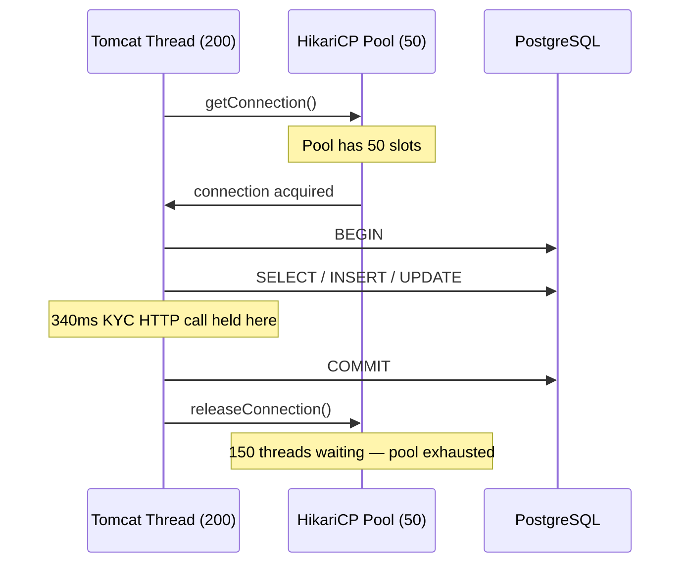
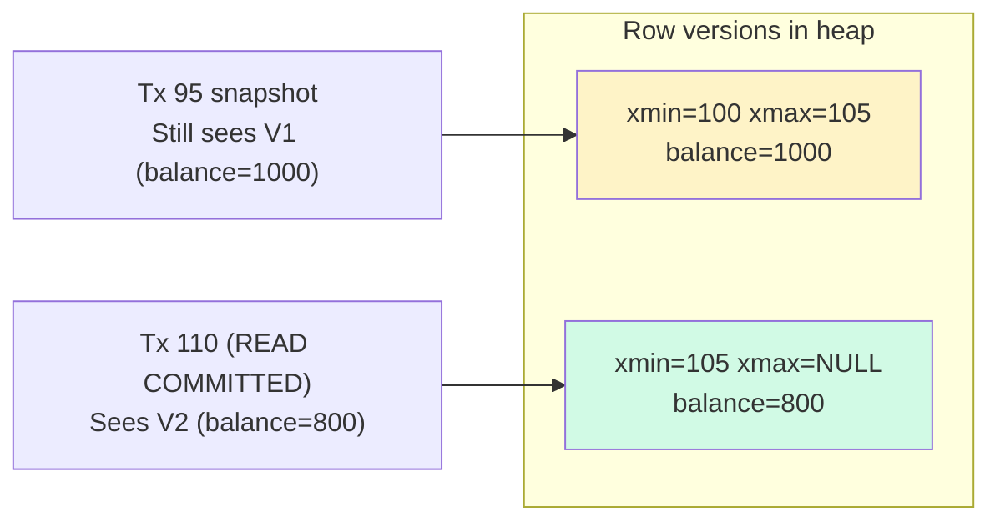

The gap between JVM concurrency primitives and database transaction semantics is one of the most reliable sources of production incidents in banking systems. A thread holds a database connection for the entire duration of a `@Transactional` method, isolation levels determine which concurrent anomalies are possible, and Hibernate's first-level cache can silently serve stale data while balances diverge on-screen. These are not theoretical concerns — they appear repeatedly in post-incident reviews at digital banks, payment processors, and core banking vendors. This lesson maps the exact interaction points between Spring, Hibernate, and PostgreSQL so that you can reason about them precisely before they cause a production outage.

## Learning Objectives

By the end of this lesson you will be able to:

- Explain why the N+1 connection problem occurs and how virtual threads change the calculus
- Identify the thread-boundary rules of Spring `@Transactional` and avoid the `@Async` propagation trap
- Select the correct isolation level for a given concurrent anomaly scenario
- Explain PostgreSQL MVCC and how it differs from lock-based isolation
- Reproduce and fix the stale-read bug caused by Hibernate's first-level cache
- Apply `@Transactional(readOnly = true)` correctly to replica routing and dirty-check savings
- Diagnose and resolve `LazyInitializationException` without the OSIV anti-pattern

## Business Context

In Q3 2023, a European neo-bank operating on a Spring Boot 3 / PostgreSQL stack experienced a full payment processing outage lasting 47 minutes during morning peak hours. The root cause was connection pool exhaustion: HikariCP was configured with `maximumPoolSize=50`, while the Tomcat thread pool had grown to 200 threads under load. Each inbound HTTP request held a connection open for an average of 340 ms due to a downstream KYC service call made *inside* the `@Transactional` boundary. The pool hit zero available connections, new requests queued, timeouts cascaded, and the payment API returned 503s to 180,000 customers.

The fix required three changes: moving the KYC call outside the transaction boundary, reducing the Tomcat thread pool, and migrating to virtual threads with a connection pool sized to the actual database capacity (120 connections on a 32-vCPU RDS instance). Recovery of lost customer trust cost the bank approximately €2.1 million in regulatory fines and customer compensation under PSD2 Article 90.

> [!WARNING]
> Never call a remote HTTP service, send a Kafka message, or perform any I/O with unpredictable latency inside a `@Transactional` method. The database connection is held open for the entire duration of the method.

## The N+1 Connection Problem

Every `@Transactional` method acquires a connection from the pool at method entry and returns it only at method exit (commit or rollback). With a traditional thread-per-request model, one HTTP thread equals one potential concurrent connection holder.



With 200 Tomcat threads and a 50-connection pool, 150 threads stall the moment all connections are taken. The fix is not simply to increase the pool — PostgreSQL has hard limits on concurrent connections (typically `max_connections = 100–200` on managed instances), and each connection consumes approximately 5 MB of server memory plus a backend process.

**Sizing rule:** `pool_size ≈ (db_cpu_cores × 2) + effective_spindle_count`. For a 32-vCPU RDS instance: `32 × 2 = 64` connections is a reasonable ceiling.

### Virtual Threads Change the Model

Java 21 virtual threads (JEP 444) are cheap: millions can exist simultaneously, and when a virtual thread blocks on I/O it unmounts from its carrier thread without consuming an OS thread. This means you can have thousands of in-flight requests without thousands of OS threads. However, **database connections are still a finite resource** — virtual threads do not eliminate pool exhaustion; they make it *more* likely without deliberate sizing because the JVM can now create far more concurrent `@Transactional` contexts than before.

```java
// application.properties — Project Loom virtual thread executor
spring.threads.virtual.enabled=true

# HikariCP — size to DB capacity, NOT to request concurrency
spring.datasource.hikari.maximum-pool-size=64
spring.datasource.hikari.minimum-idle=16
spring.datasource.hikari.connection-timeout=3000
spring.datasource.hikari.keepalive-time=60000
```

> [!NOTE]
> With virtual threads enabled, `maximumPoolSize` becomes the primary backpressure knob. Set it deliberately. A pool timeout of 3 seconds is preferable to silently queuing requests for 30 seconds, which masks the real problem.

## Spring `@Transactional` and Thread Boundaries

Spring binds the active transaction to the **current thread** via `TransactionSynchronizationManager`, which wraps a `ThreadLocal`. This has a critical implication: **spawning a new thread from within a transaction does not propagate that transaction to the new thread**.

### The @Async Trap

```java
@Service
@RequiredArgsConstructor
public class PaymentService {

    private final LedgerRepository ledgerRepository;
    private final AuditService auditService;

    // BUG: @Async method does NOT participate in the caller's transaction.
    @Transactional
    public void processPayment(PaymentRequest request) {
        ledgerRepository.post(request.toJournalEntry());

        // This runs in a NEW thread managed by the @Async executor.
        // It sees its own transaction context — or none at all.
        // The audit write may commit even if the outer transaction rolls back.
        auditService.recordAsync(request.getId());
    }
}

@Service
public class AuditService {

    private final AuditRepository auditRepository;

    @Async
    @Transactional  // Opens a NEW, independent transaction on a different thread
    public void recordAsync(UUID paymentId) {
        auditRepository.save(new AuditEntry(paymentId));
        // This commits independently — orphaned audit record if payment fails.
    }
}
```

**The correct fix:** perform the audit write synchronously within the same transaction, or publish a domain event and let a separate outbox/listener handle the audit asynchronously *after* the transaction commits.

```java
@Transactional
public void processPayment(PaymentRequest request) {
    ledgerRepository.post(request.toJournalEntry());

    // Synchronous — participates in the same transaction.
    // Both commit or both roll back together.
    auditRepository.save(new AuditEntry(request.getId()));
}
```

> [!IMPORTANT]
> `@Async` and `@Transactional` on the same call site means two independent transactions on two different threads. This breaks atomicity. The audit entry can persist even when the payment ledger entry does not.

## Isolation Levels and the Lost-Update Scenario

PostgreSQL supports three practical isolation levels. The default for most applications — and most Spring datasource configurations — is `READ COMMITTED`.

| Level | Dirty Read | Non-Repeatable Read | Phantom Read | Lost Update |
|---|---|---|---|---|
| READ COMMITTED | Prevented | Possible | Possible | Possible |
| REPEATABLE READ | Prevented | Prevented | Prevented* | Prevented |
| SERIALIZABLE | Prevented | Prevented | Prevented | Prevented |

*PostgreSQL REPEATABLE READ prevents phantoms via MVCC snapshot isolation.

### READ_COMMITTED Lost-Update

```sql
-- Transaction A (account balance = 1000)
BEGIN;
SELECT balance FROM accounts WHERE id = 42;
-- returns 1000

-- Transaction B starts concurrently
BEGIN;
SELECT balance FROM accounts WHERE id = 42;
-- also returns 1000

-- Transaction A writes
UPDATE accounts SET balance = 1000 - 200 WHERE id = 42; -- balance = 800
COMMIT;

-- Transaction B writes (based on stale read of 1000)
UPDATE accounts SET balance = 1000 - 300 WHERE id = 42; -- balance = 700
COMMIT;

-- Final balance: 700 — the 200 debit from Transaction A is LOST
-- Correct balance should be: 1000 - 200 - 300 = 500
```

### REPEATABLE_READ Prevents It

Under `REPEATABLE READ`, Transaction B's snapshot was taken at its `BEGIN`. When it attempts the `UPDATE`, PostgreSQL detects the conflict and raises:

```
ERROR: could not serialize access due to concurrent update
```

The application must catch this error, retry the transaction, and re-read the balance.

```java
@Transactional(isolation = Isolation.REPEATABLE_READ)
public void debit(UUID accountId, long amountCents) {
    Account account = accountRepository.findById(accountId)
        .orElseThrow(() -> new AccountNotFoundException(accountId));

    if (account.getBalanceCents() < amountCents) {
        throw new InsufficientFundsException(accountId);
    }

    account.setBalanceCents(account.getBalanceCents() - amountCents);
    accountRepository.save(account);
    // PostgreSQL raises SerializationFailure if a concurrent UPDATE
    // has committed since this transaction's snapshot.
    // The caller must catch and retry.
}
```

### PostgreSQL MVCC

PostgreSQL does not use read locks for isolation. Instead it uses **Multi-Version Concurrency Control (MVCC)**: every row version is tagged with the transaction IDs that created and expired it (`xmin`, `xmax`). A snapshot-consistent read returns the version visible at the snapshot point without blocking writers.



Dead row versions are cleaned up by `VACUUM`. Autovacuum lag under heavy write load is a common cause of table bloat in high-throughput payment systems.

## Hibernate First-Level Cache and Stale Reads

Within a single transaction (Hibernate `Session`), every entity loaded by primary key is cached in the first-level cache (the persistence context). A subsequent load of the same ID returns the cached object without hitting the database.

```java
@Transactional
public void demonstrateStaleness(UUID accountId) {
    // First load — hits the database
    Account account = accountRepository.findById(accountId).orElseThrow();
    System.out.println(account.getBalanceCents()); // 1000

    // Another thread commits an UPDATE: balance = 800

    // Second load — returns CACHED object, no DB round-trip
    Account sameAccount = accountRepository.findById(accountId).orElseThrow();
    System.out.println(sameAccount.getBalanceCents()); // Still 1000 — STALE
}
```

**Fix:** call `entityManager.refresh(entity)` to discard the cached version and reload from the database.

```java
@Service
@RequiredArgsConstructor
public class BalanceService {

    private final AccountRepository accountRepository;
    private final EntityManager entityManager;

    @Transactional(isolation = Isolation.REPEATABLE_READ)
    public long getAuthorizedBalance(UUID accountId) {
        Account account = accountRepository.findById(accountId).orElseThrow();

        // Force reload from database, bypassing first-level cache.
        // Use when you must observe the most recent committed state
        // and cannot rely on the session snapshot.
        entityManager.refresh(account);

        return account.getBalanceCents();
    }
}
```

> [!WARNING]
> `entityManager.refresh()` issues a `SELECT` against the database, discarding any unsaved changes on the in-memory entity. Never call it after modifying an entity but before saving — your modifications will be silently lost.

## `@Transactional(readOnly = true)`

Marking a transaction read-only achieves two things in a Spring + Hibernate stack:

1. **Hibernate skips dirty checking** at flush time, since no writes are expected. For sessions that load many entities, this avoids the full entity comparison scan at flush.
2. **Spring routes to a read replica** if a `LazyConnectionDataSourceProxy` with a routing datasource is configured — a common pattern for high-read payment dashboards.

```java
@Service
@RequiredArgsConstructor
public class AccountQueryService {

    private final AccountRepository accountRepository;
    private final LedgerRepository ledgerRepository;

    // Routes to replica; Hibernate skips dirty checking at flush
    @Transactional(readOnly = true)
    public AccountStatement getStatement(UUID accountId, LocalDate from, LocalDate to) {
        Account account = accountRepository.findById(accountId).orElseThrow();
        List<LedgerEntry> entries = ledgerRepository
            .findByAccountIdAndCreatedAtBetween(
                accountId,
                from.atStartOfDay(),
                to.atTime(23, 59, 59));
        return AccountStatement.of(account, entries);
    }
}
```

```java
// Replica routing datasource configuration
@Bean
public DataSource routingDataSource(
        @Qualifier("primaryDataSource") DataSource primary,
        @Qualifier("replicaDataSource") DataSource replica) {
    TransactionRoutingDataSource routing = new TransactionRoutingDataSource();
    routing.setPrimary(primary);
    routing.setReplica(replica);
    return new LazyConnectionDataSourceProxy(routing);
}

public class TransactionRoutingDataSource extends AbstractRoutingDataSource {
    @Override
    protected Object determineCurrentLookupKey() {
        return TransactionSynchronizationManager.isCurrentTransactionReadOnly()
            ? "replica"
            : "primary";
    }
}
```

## `LazyInitializationException` and the OSIV Anti-Pattern

Hibernate loads `@OneToMany` and `@ManyToMany` associations lazily by default. Accessing the collection outside an active `Session` (transaction) triggers a `LazyInitializationException`.

```java
// BROKEN — no transaction context in the controller layer
@GetMapping("/accounts/{id}")
public AccountDto getAccount(@PathVariable UUID id) {
    Account account = accountService.findById(id); // transaction closes here
    // Session is closed. Accessing the lazy collection throws:
    // org.hibernate.LazyInitializationException: failed to lazily initialize
    //   a collection of role: Account.entries, no session or session was closed
    account.getEntries().size(); // BOOM
}
```

### The OSIV Anti-Pattern

"Open Session in View" (OSIV) keeps the Hibernate session open for the entire HTTP request lifecycle — including view rendering and controller execution. Spring Boot enables OSIV by default (`spring.jpa.open-in-view=true`). This prevents `LazyInitializationException` but at the cost of holding a database connection open during the view rendering phase, contributing directly to the connection exhaustion problem described above.

```properties
# Disable OSIV — the correct production setting for banking applications
spring.jpa.open-in-view=false
```

**Correct fixes:**

```java
// Option 1: Load within a @Transactional(readOnly=true) service method
@Transactional(readOnly = true)
public AccountDto findById(UUID id) {
    Account account = accountRepository.findById(id).orElseThrow();
    // Eagerly initialise within the transaction
    Hibernate.initialize(account.getEntries());
    return AccountDto.from(account);
}

// Option 2: DTO projection — no entity loaded, no lazy associations
@Query("""
    SELECT new com.bank.dto.AccountSummaryDto(
        a.id, a.iban, a.balanceCents, COUNT(e.id)
    )
    FROM Account a
    LEFT JOIN LedgerEntry e ON e.accountId = a.id
    WHERE a.id = :accountId
    GROUP BY a.id, a.iban, a.balanceCents
    """)
AccountSummaryDto findSummaryById(@Param("accountId") UUID accountId);
```

> [!NOTE]
> DTO projections are the preferred pattern for read-heavy payment dashboards. They transfer only the columns needed, avoid entity lifecycle management overhead, and work correctly with `readOnly = true` replica routing.

## Knowledge Check

**Q1: A payment service has 300 virtual threads concurrently executing `@Transactional` methods against a PostgreSQL instance with `max_connections = 100`. HikariCP is configured with `maximumPoolSize = 300`. What will happen?**

A: PostgreSQL will reject connection attempts beyond its `max_connections` limit with `FATAL: sorry, too many clients already`. HikariCP will surface this as a `SQLException`. Even if `max_connections` were increased, PostgreSQL performance degrades sharply above approximately `2 × cpu_cores` concurrent active queries due to lock contention and context switching in the backend processes. The correct configuration is `maximumPoolSize` set to roughly `2 × db_cpu_cores` — well below `max_connections` to leave headroom for admin connections and monitoring agents.

---

**Q2: A service method is annotated `@Transactional` and calls an `@Async` method on another bean. The outer method throws an exception and rolls back. Will the work done inside the `@Async` method also roll back?**

A: No. `@Async` runs the method in a separate thread with its own transaction context (or no transaction if not annotated `@Transactional`). Spring's `TransactionSynchronizationManager` stores the active transaction in a `ThreadLocal`, which is not inherited by child threads. The `@Async` work runs independently and, if it committed before the outer rollback, that commit is permanent. The correct solution is either to perform both operations synchronously in a single transaction, or to use the Transactional Outbox pattern to defer the async work until after the outer transaction commits successfully.

## Practical Challenge

Your team operates a card-authorization service that processes 2,000 authorizations per second at peak. The service runs on Spring Boot 3.2, Java 21, Hibernate 6, and PostgreSQL 15, backed by a 24-vCPU RDS instance.

**Task 1 — Pool Sizing:** Calculate the optimal HikariCP `maximumPoolSize`. Show your reasoning. What `connection-timeout` value would you set, and why?

**Task 2 — Isolation Bug:** A load test reveals occasional double-spend: a customer's balance goes negative despite a check at the start of the transaction. Identify which isolation level would prevent this, write the corrected `@Transactional` annotation, and explain what happens at the database level when a conflict is detected.

**Task 3 — Cache Bug:** The authorization service loads an `Account` entity, checks the available credit, then posts a hold entry. Under load, stale balances are being used for the credit check because a previous read in the same session cached the account. Write the corrected service method using `entityManager.refresh()`. Explain when you would *not* use `refresh()`.

**Task 4 — OSIV Removal:** `spring.jpa.open-in-view` is `true` (the Spring Boot default). The service has a REST endpoint that returns an `AccountDto` including a list of recent transactions fetched via a lazy `@OneToMany`. Disable OSIV and rewrite the service layer to fix the resulting `LazyInitializationException` using a DTO projection JPQL query.

<!-- KNOWLEDGE-CHECK
{
  "questions": [
    {
      "text": "A payment service runs 300 virtual threads concurrently, each executing a @Transactional method. HikariCP is configured with maximumPoolSize=300. PostgreSQL has max_connections=100. What will happen?",
      "options": [
        "Virtual threads park cheaply so all 300 can run concurrently without hitting the connection limit",
        "PostgreSQL rejects connections beyond max_connections with FATAL: sorry, too many clients already. HikariCP surfaces this as SQLException. The correct fix is maximumPoolSize ≈ 2 × db_cpu_cores, well below max_connections",
        "HikariCP queues the excess requests internally until connections free up — no errors occur",
        "PostgreSQL accepts all 300 connections but degrades linearly — performance drops 3x"
      ],
      "correct": 1,
      "explanation": "PostgreSQL enforces max_connections as a hard limit. Any connection attempt beyond it fails immediately with FATAL. Virtual threads make pool exhaustion MORE likely, not less — they allow far more concurrent @Transactional contexts than platform threads, so a misconfigured pool hits its ceiling faster. The correct sizing rule is pool_size ≈ 2 × db_cpu_cores (not request concurrency), leaving headroom for admin connections. Virtual threads are not a substitute for deliberate pool sizing."
    },
    {
      "text": "A service method is annotated @Transactional and calls an @Async method on another bean. The outer method throws an exception and rolls back. Will the work inside the @Async method also roll back?",
      "options": [
        "Yes — Spring propagates the rollback to all child operations including @Async methods",
        "No — @Async runs on a separate thread with its own transaction context via ThreadLocal; the @Async work runs independently and if it committed before the outer rollback, that commit is permanent",
        "It depends — if the @Async method is annotated @Transactional(propagation = MANDATORY) it will roll back",
        "Yes — if both methods use the same EntityManager they share the same transaction"
      ],
      "correct": 1,
      "explanation": "Spring's TransactionSynchronizationManager stores the active transaction in a ThreadLocal. ThreadLocals are NOT inherited by child threads. @Async submits the method to a separate thread pool thread which starts with no inherited transaction context. If the @Async method is annotated @Transactional, it opens a NEW independent transaction on its thread. That transaction commits independently — a subsequent rollback of the outer transaction cannot un-commit it. The orphaned audit record persists even though the payment does not."
    },
    {
      "text": "What are the two specific benefits of @Transactional(readOnly = true) in a Spring + Hibernate stack, and what must be configured for it to route queries to a read replica?",
      "options": [
        "It makes all queries use SERIALIZABLE isolation for stronger consistency; routing requires a separate DataSource bean",
        "It skips Hibernate dirty checking at flush time (no entity comparison scan for read-only sessions), and routes to a read replica when a LazyConnectionDataSourceProxy with a TransactionRoutingDataSource is configured to check TransactionSynchronizationManager.isCurrentTransactionReadOnly()",
        "It enables connection multiplexing so multiple read queries share one database connection",
        "It automatically caches all query results in Hibernate's second-level cache for the transaction duration"
      ],
      "correct": 1,
      "explanation": "readOnly=true provides two benefits: (1) Hibernate skips the dirty-check scan at flush time — for sessions that load many entities, this avoids comparing every loaded entity against its snapshot before the transaction closes. (2) With a LazyConnectionDataSourceProxy wrapping a TransactionRoutingDataSource that checks isCurrentTransactionReadOnly(), the connection acquisition is deferred until the first actual query, at which point the routing datasource directs read-only transactions to the replica and read-write transactions to the primary."
    }
  ]
}
-->

<!-- PRACTICAL-CHALLENGE
{
  "title": "Fix Connection Pool Exhaustion, Isolation Bugs, and OSIV Issues in a Card Authorization Service",
  "difficulty": "advanced",
  "estimatedMinutes": 45,
  "tasks": [
    {"id": "1", "description": "Calculate the optimal HikariCP maximumPoolSize for a 24-vCPU RDS PostgreSQL instance running the card authorization service. Show your reasoning using the formula pool_size ≈ (db_cpu_cores × 2) + effective_spindle_count. Set connection-timeout to 3000 ms and explain why 3 seconds is preferable to 30 seconds as a timeout value. Identify the current production anti-pattern where a KYC HTTP call with a 10-second timeout runs inside the @Transactional boundary and calculate how many concurrent requests exhaust the pool."},
    {"id": "2", "description": "A load test reveals occasional double-spend: a customer's balance goes negative despite an insufficient-funds check at the start of the transaction. Write the corrected @Transactional annotation using REPEATABLE_READ isolation and explain what PostgreSQL does at the database level when it detects a concurrent UPDATE on the same row during the transaction. Write a test that launches two concurrent debit threads and asserts exactly one succeeds while the other receives a SerializationFailureException that the service retries."},
    {"id": "3", "description": "The authorization service loads an Account entity, checks available credit, then posts a hold entry. Under load, stale balances from the Hibernate first-level cache are being used for the credit check. Write the corrected BalanceService.getAuthorizedBalance() method using entityManager.refresh() to bypass the cache. Explain in comments under what two conditions you would NOT call refresh(): (a) after modifying the entity but before saving, and (b) in read-only transactions where the first-level cache is intentionally providing a consistent snapshot."},
    {"id": "4", "description": "spring.jpa.open-in-view is true. A REST endpoint returns AccountDto including recent transactions from a lazy @OneToMany. Disable OSIV by setting spring.jpa.open-in-view=false in application.properties. Fix the resulting LazyInitializationException by rewriting the service method as a DTO projection JPQL query that selects id, iban, balanceCents, and COUNT of recent transactions in a single query without loading full entity objects. Annotate the new method with @Transactional(readOnly = true) and explain how this enables replica routing."}
  ]
}
-->
