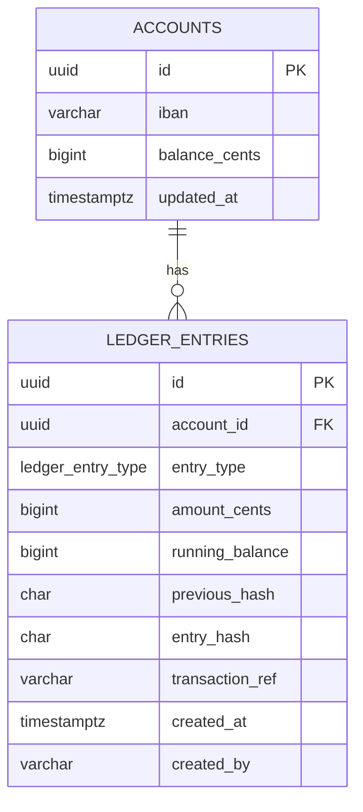
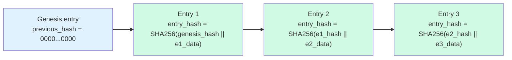

A financial audit trail is not a feature — it is a legal obligation. PCI-DSS, SOX, and PSD2 each require that records of financial transactions be immutable, tamper-evident, and retained for defined periods. When regulators or forensic auditors examine a system after a fraud event, they will ask two questions: can you prove what happened, and can you prove that the records have not been altered? This lesson builds an audit trail that answers both questions definitively, from the database schema and permissions layer through to the cryptographic hash chain and point-in-time query API.

## Learning Objectives

By the end of this lesson you will be able to:

- Identify the regulatory drivers for immutable audit logs (PCI-DSS, SOX, PSD2)
- Design an append-only ledger schema with running balance and enforce it at the database level
- Implement PostgreSQL row security and privilege revocation to prevent mutations
- Build a SHA-256 hash chain in Java that links each ledger entry to its predecessor
- Use Hibernate Envers `@Audited` and `AuditReader` for point-in-time entity queries
- Design a partition-and-archival strategy for a ledger that grows indefinitely
- Write a verification job that detects hash chain tampering

## Business Context

In 2022, a major US payments processor was fined $80 million by the OCC after an internal fraud investigation found that a database administrator had retroactively altered transaction timestamps to cover up a settlement timing error. The alteration was possible because the application role had `UPDATE` and `DELETE` privileges on the transaction table. No hash chain or write-once enforcement existed. The DBA's actions went undetected for 11 months because the audit log was implemented as a mutable table in the same database — also modified.

The remediation required rebuilding the entire transaction history from external bank statement feeds, a process that cost $4.3 million in engineering labour and delayed a planned IPO by two quarters. Had the team implemented an append-only ledger with database-enforced immutability and a cryptographic hash chain, the tampering would have been mathematically detectable on the next nightly verification run.

> [!IMPORTANT]
> The application role that writes ledger entries must never hold `UPDATE` or `DELETE` privileges on the ledger table. Immutability must be enforced by the database — not by application discipline alone.

## Append-Only Ledger Schema

The fundamental design constraint is simple: **never `UPDATE` or `DELETE` a ledger entry**. Every financial event is a new row. The running balance is computed at insert time and stored alongside the entry for fast retrieval, but the source of truth is always the full sequence of entries.

```sql
CREATE TYPE ledger_entry_type AS ENUM (
    'CREDIT',
    'DEBIT',
    'FEE',
    'INTEREST',
    'REVERSAL',
    'ADJUSTMENT'
);

CREATE TABLE ledger_entries (
    id               UUID         NOT NULL DEFAULT gen_random_uuid(),
    account_id       UUID         NOT NULL,
    entry_type       ledger_entry_type NOT NULL,
    amount_cents     BIGINT       NOT NULL,       -- always positive; sign from entry_type
    running_balance  BIGINT       NOT NULL,       -- balance after this entry
    previous_hash    CHAR(64)     NOT NULL,       -- SHA-256 of previous entry (hex)
    entry_hash       CHAR(64)     NOT NULL,       -- SHA-256(previous_hash || entry_data)
    transaction_ref  VARCHAR(64)  NOT NULL,       -- idempotency key / external reference
    created_at       TIMESTAMPTZ  NOT NULL DEFAULT now(),
    created_by       VARCHAR(128) NOT NULL,       -- service account or user principal
    CONSTRAINT pk_ledger_entries PRIMARY KEY (id),
    CONSTRAINT uq_transaction_ref UNIQUE (transaction_ref)
);

-- Composite index — most queries filter by account and time range
CREATE INDEX idx_ledger_account_time
    ON ledger_entries (account_id, created_at DESC);

-- Covering index for running-balance lookups
CREATE INDEX idx_ledger_account_balance
    ON ledger_entries (account_id, created_at DESC)
    INCLUDE (running_balance);
```



> [!NOTE]
> `amount_cents` is always stored as a positive integer. The semantic sign (credit increases balance, debit decreases it) is derived from `entry_type`. This avoids the ambiguity of a signed amount where the caller must know the account type to interpret the sign correctly.

## Database Enforcement: Row Security and Privilege Revocation

Application-layer validation is insufficient. A compromised service account, a misconfigured ORM, or a direct database connection bypasses all application guards. Immutability must be enforced at the database level.

```sql
-- Step 1: Revoke mutation privileges from the application role
REVOKE UPDATE, DELETE ON ledger_entries FROM app_role;
REVOKE TRUNCATE ON ledger_entries FROM app_role;

-- Step 2: Row-level security as a belt-and-suspenders measure
ALTER TABLE ledger_entries ENABLE ROW LEVEL SECURITY;
ALTER TABLE ledger_entries FORCE ROW LEVEL SECURITY;

-- Allow INSERT (new entries only) and SELECT for the application role
CREATE POLICY ledger_insert ON ledger_entries
    FOR INSERT TO app_role
    WITH CHECK (true);

CREATE POLICY ledger_select ON ledger_entries
    FOR SELECT TO app_role
    USING (true);

-- Explicitly deny UPDATE and DELETE (belt-and-suspenders)
CREATE POLICY no_update ON ledger_entries
    FOR UPDATE USING (false);

CREATE POLICY no_delete ON ledger_entries
    FOR DELETE USING (false);

-- Step 3: Grant DBA role SELECT-only for audits; separate privileged role for schema changes
GRANT SELECT ON ledger_entries TO dba_audit_role;
```

> [!WARNING]
> `FORCE ROW LEVEL SECURITY` applies policies even to the table owner. Without it, the table owner bypasses RLS. Always set both `ENABLE` and `FORCE` on audit tables.

## Hash Chain for Tamper Evidence

A hash chain makes tampering mathematically detectable. Each entry stores the SHA-256 hash of the previous entry's hash concatenated with the current entry's data. Altering any historical entry invalidates every subsequent hash in the chain, which a nightly verification job will detect.



```java
@Component
@RequiredArgsConstructor
public class LedgerHashChain {

    private static final String GENESIS_HASH = "0".repeat(64);
    private static final String HASH_ALGORITHM = "SHA-256";

    /**
     * Compute the entry_hash for a new ledger entry.
     * previousHash is the entry_hash of the most recent entry for this account,
     * or GENESIS_HASH if this is the first entry.
     */
    public String computeEntryHash(String previousHash, LedgerEntryData data) {
        String input = previousHash
            + data.id()
            + data.accountId()
            + data.entryType()
            + data.amountCents()
            + data.runningBalance()
            + data.transactionRef()
            + data.createdAt().toInstant().toEpochMilli();
        try {
            MessageDigest digest = MessageDigest.getInstance(HASH_ALGORITHM);
            byte[] hashBytes = digest.digest(input.getBytes(StandardCharsets.UTF_8));
            return HexFormat.of().formatHex(hashBytes);
        } catch (NoSuchAlgorithmException e) {
            throw new IllegalStateException("SHA-256 not available", e);
        }
    }

    /**
     * Verify the full hash chain for a given account.
     * Returns the index of the first broken link, or -1 if the chain is intact.
     */
    public int verifyChain(List<LedgerEntry> entriesAscending) {
        String expectedPreviousHash = GENESIS_HASH;
        for (int i = 0; i < entriesAscending.size(); i++) {
            LedgerEntry entry = entriesAscending.get(i);
            if (!entry.getPreviousHash().equals(expectedPreviousHash)) {
                return i;
            }
            String recomputedHash = computeEntryHash(
                expectedPreviousHash,
                LedgerEntryData.from(entry));
            if (!recomputedHash.equals(entry.getEntryHash())) {
                return i;
            }
            expectedPreviousHash = entry.getEntryHash();
        }
        return -1; // chain intact
    }
}
```

```java
@Service
@RequiredArgsConstructor
public class LedgerEntryWriter {

    private final LedgerEntryRepository repository;
    private final LedgerHashChain hashChain;

    @Transactional
    public LedgerEntry post(PostEntryCommand command) {
        // Retrieve the most recent hash for this account, serialising concurrent inserts
        String previousHash = repository
            .findTopByAccountIdOrderByCreatedAtDesc(command.accountId())
            .map(LedgerEntry::getEntryHash)
            .orElse(LedgerHashChain.GENESIS_HASH);

        long runningBalance = computeRunningBalance(command);

        UUID entryId = UUID.randomUUID();
        String entryHash = hashChain.computeEntryHash(previousHash,
            new LedgerEntryData(
                entryId.toString(), command.accountId().toString(),
                command.entryType().name(), command.amountCents(),
                runningBalance, command.transactionRef(),
                Instant.now()));

        LedgerEntry entry = LedgerEntry.builder()
            .id(entryId)
            .accountId(command.accountId())
            .entryType(command.entryType())
            .amountCents(command.amountCents())
            .runningBalance(runningBalance)
            .previousHash(previousHash)
            .entryHash(entryHash)
            .transactionRef(command.transactionRef())
            .createdBy(command.principal())
            .build();

        return repository.save(entry);
    }

    private long computeRunningBalance(PostEntryCommand command) {
        long current = repository
            .findTopByAccountIdOrderByCreatedAtDesc(command.accountId())
            .map(LedgerEntry::getRunningBalance)
            .orElse(0L);
        return switch (command.entryType()) {
            case CREDIT, INTEREST -> current + command.amountCents();
            case DEBIT, FEE       -> current - command.amountCents();
            case REVERSAL         -> current + command.amountCents();
            case ADJUSTMENT       -> current + command.amountCents();
        };
    }
}
```

## Hibernate Envers for Point-in-Time Queries

Hibernate Envers provides entity-level audit history without bespoke trigger logic. It intercepts Hibernate flushes and writes revision records to `*_aud` tables alongside a `revinfo` table.

```java
@Entity
@Table(name = "accounts")
@Audited  // Envers will track all changes to this entity
@Data
public class Account {

    @Id
    private UUID id;

    private String iban;

    private long balanceCents;

    @Enumerated(EnumType.STRING)
    private AccountStatus status;

    @Version
    private long version;
}
```

```sql
-- Tables created by Envers automatically:
-- revinfo          (rev SERIAL, revtstmp BIGINT)
-- accounts_aud     (id UUID, rev INT FK revinfo, revtype SMALLINT,
--                   iban VARCHAR, balance_cents BIGINT, status VARCHAR)
-- revtype: 0=INSERT, 1=UPDATE, 2=DELETE
```

```java
@Service
@RequiredArgsConstructor
public class AccountAuditService {

    private final AuditReader auditReader;  // inject via AuditReaderFactory.get(entityManager)

    /**
     * Retrieve the state of an account as it was at a specific point in time.
     * Used by compliance officers during fraud investigations.
     */
    public Optional<Account> getAccountAtPointInTime(UUID accountId, Instant asOf) {
        List<Number> revisions = auditReader.getRevisions(Account.class, accountId);

        return revisions.stream()
            .map(rev -> auditReader.getRevisionDate(rev))
            .filter(date -> !date.toInstant().isAfter(asOf))
            .max(Comparator.naturalOrder())
            .map(date -> {
                Number rev = auditReader.getRevisionNumberForDate(date);
                return auditReader.find(Account.class, accountId, rev);
            });
    }

    /**
     * Return the full revision history of an account for an audit report.
     */
    public List<AccountRevision> getFullHistory(UUID accountId) {
        AuditQuery query = auditReader.createQuery()
            .forRevisionsOfEntity(Account.class, false, true)
            .add(AuditEntity.id().eq(accountId))
            .addOrder(AuditEntity.revisionNumber().asc());

        return ((List<?>) query.getResultList()).stream()
            .map(row -> {
                Object[] tuple = (Object[]) row;
                Account snapshot = (Account) tuple[0];
                DefaultRevisionEntity revision = (DefaultRevisionEntity) tuple[1];
                RevisionType revType = (RevisionType) tuple[2];
                return new AccountRevision(snapshot, revision.getRevisionDate(), revType);
            })
            .toList();
    }
}
```

> [!NOTE]
> Envers audit tables grow without bound. For high-volume accounts with thousands of daily state changes, consider archiving `*_aud` rows older than a configurable horizon to cold storage, keeping only a summary snapshot in the hot table.

## Operational: Partitioning and Archival

A ledger for a mid-sized bank with 1 million active accounts at 10 transactions per account per day accumulates 3.65 billion rows per year at approximately 350 bytes per row — roughly 1.3 TB annually. Partition by year to enable efficient archival and time-range queries.

```sql
-- Range-partition the ledger by year for archival efficiency
CREATE TABLE ledger_entries (
    id               UUID         NOT NULL,
    account_id       UUID         NOT NULL,
    entry_type       ledger_entry_type NOT NULL,
    amount_cents     BIGINT       NOT NULL,
    running_balance  BIGINT       NOT NULL,
    previous_hash    CHAR(64)     NOT NULL,
    entry_hash       CHAR(64)     NOT NULL,
    transaction_ref  VARCHAR(64)  NOT NULL,
    created_at       TIMESTAMPTZ  NOT NULL,
    created_by       VARCHAR(128) NOT NULL
) PARTITION BY RANGE (created_at);

-- Create annual partitions; automate with pg_partman
CREATE TABLE ledger_entries_2024
    PARTITION OF ledger_entries
    FOR VALUES FROM ('2024-01-01') TO ('2025-01-01');

CREATE TABLE ledger_entries_2025
    PARTITION OF ledger_entries
    FOR VALUES FROM ('2025-01-01') TO ('2026-01-01');

CREATE TABLE ledger_entries_2026
    PARTITION OF ledger_entries
    FOR VALUES FROM ('2026-01-01') TO ('2027-01-01');

-- Index on the most selective columns per partition
CREATE INDEX ON ledger_entries_2026 (account_id, created_at DESC);
```

```java
// Archival job — runs annually, moves cold partitions to S3-backed tablespace
@Component
@RequiredArgsConstructor
public class LedgerArchivalJob {

    private final JdbcTemplate jdbc;
    private final S3LedgerArchive s3Archive;

    @Scheduled(cron = "0 0 2 1 1 *") // 02:00 on 1 Jan every year
    public void archivePreviousYear() {
        int archiveYear = Year.now().getValue() - 7; // retain 7 years hot
        String partition = "ledger_entries_" + archiveYear;

        // Export partition to Parquet on S3 for cold storage
        s3Archive.exportPartition(partition, archiveYear);

        // Detach and drop the hot partition after verification
        jdbc.execute("ALTER TABLE ledger_entries DETACH PARTITION " + partition);
        jdbc.execute("DROP TABLE " + partition);
    }
}
```

Regulatory retention requirements under PCI-DSS Requirement 10.7 mandate one year online and one year accessible archive. Many banks extend this to 7–10 years to satisfy SOX Section 802 and local banking law requirements.

## Knowledge Check

**Q1: A developer proposes adding a `status` column to the `ledger_entries` table so that entries can be marked `PENDING` or `SETTLED`. Why is this problematic for an immutable ledger, and what is the correct design?**

A: Updating a `status` column on an existing row violates the append-only constraint. It also makes the tamper-evidence hash chain unverifiable, since the hash was computed over the original row data. The correct design is to post a new ledger entry of type `SETTLEMENT` that references the original entry's `transaction_ref`. State transitions are expressed as new entries, not mutations. If a view of "current status" is needed, it is derived from the most recent entry for a given `transaction_ref`, not stored on any single row.

---

**Q2: Hibernate Envers is auditing the `Account` entity. A compliance officer asks for the account's balance as it stood on 14 March 2025 at 09:47 UTC. What Envers API calls accomplish this, and what are the limitations of this approach?**

A: Use `AuditReader.getRevisionNumberForDate(new Date(instant.toEpochMilli()))` to find the revision that was current at that timestamp, then `AuditReader.find(Account.class, accountId, revisionNumber)` to retrieve the entity snapshot. The limitation is that Envers captures state at the Hibernate flush boundary, not at the SQL transaction boundary — if the entity was updated multiple times within a single flush, only the final state within that flush is recorded. Additionally, Envers records the state of JPA-managed fields; any columns updated via native SQL bypass Envers entirely and will not appear in the audit history.

## Practical Challenge

Your team is building the audit trail infrastructure for a new PSD2-compliant payment institution. The regulator requires that all payment events be immutable, tamper-evident, and queryable at any point in time for the previous 7 years.

**Task 1 — Schema:** Design the complete `ledger_entries` DDL including partitioning strategy, indexes, constraints, and the `CREATE TYPE` for entry types. Justify each index.

**Task 2 — Enforcement:** Write the SQL to revoke mutation privileges from the application role and implement row security policies. Explain why both mechanisms are needed.

**Task 3 — Hash Chain:** Implement a `HashChainVerificationJob` that queries all entries for a given account in ascending order and verifies the full hash chain, logging the first broken link with enough context (entry ID, sequence number, stored hash, computed hash) for a forensic analyst to investigate. The job should run nightly and alert via a `VerificationFailureEvent`.

**Task 4 — Point-in-Time:** A fraud analyst reports a suspicious transaction and asks for the account balance as of exactly 72 hours before the transaction timestamp. Using Hibernate Envers, implement a REST endpoint `GET /accounts/{id}/balance?asOf={iso8601}` that returns the account snapshot at that moment, including revision metadata (who changed it and when).

<!-- KNOWLEDGE-CHECK
{
  "questions": [
    {
      "text": "A developer proposes adding a status column to ledger_entries so entries can be marked PENDING or SETTLED. Why is this problematic for an immutable ledger, and what is the correct design?",
      "options": [
        "Adding columns to ledger_entries requires a schema migration that may lock the table — use a separate status table instead",
        "Updating a status column on an existing row violates the append-only constraint and breaks the hash chain (the hash was computed over the original row data) — the correct design is to post a new ledger entry of type SETTLEMENT referencing the original transaction_ref, expressing state transitions as new entries not mutations",
        "The status column should use a VARCHAR instead of an ENUM to allow future values without schema changes",
        "The status column is acceptable as long as it is not included in the hash chain computation"
      ],
      "correct": 1,
      "explanation": "Updating a posted ledger entry violates the append-only constraint required by financial record-keeping regulations. It also invalidates the cryptographic hash chain — the entry_hash was computed over the original row data, so any mutation produces a hash that no longer matches. The correct pattern is to post a new entry (e.g., type SETTLEMENT) with a reference to the original transaction_ref. State transitions are expressed as facts that happened, not as mutations of existing facts."
    },
    {
      "text": "What must be true about the application role's privileges on the ledger_entries table to enforce immutability, and why is application-layer validation alone insufficient?",
      "options": [
        "The application role needs SELECT and INSERT only; UPDATE and DELETE must be REVOKED at the database level — application-layer checks can be bypassed by a compromised service account, a misconfigured ORM, or a direct database connection",
        "The application role needs all privileges but the application code must check a boolean flag before executing any UPDATE",
        "Row-level security alone is sufficient — no privilege changes are needed",
        "The application role should use a read-only connection that prevents all mutations"
      ],
      "correct": 0,
      "explanation": "The OCC fine in the business context was possible precisely because the application role had UPDATE and DELETE privileges — a DBA used them directly. Application-layer validation is bypassed by any direct database connection, a misconfigured ORM, or a compromised service account. Database-level enforcement (REVOKE UPDATE, DELETE, TRUNCATE from app_role) is the only durable guarantee. Row-level security (FORCE ROW LEVEL SECURITY) adds a belt-and-suspenders layer but is secondary to privilege revocation."
    },
    {
      "text": "What is the operational risk of using pg_partman to manage annual ledger partitions, and what is the retention strategy for partitions older than 7 years under PCI-DSS Requirement 10.7?",
      "options": [
        "Annual partitions cause index bloat — use monthly partitions instead and retain 84 monthly partitions",
        "If pg_partman fails to create next year's partition before year-end, inserts will fail — monitor partition creation; for partitions older than 7 years, detach from the main table and export to cold storage (e.g., S3 Parquet) before dropping, retaining at least 1 year online and 1 year accessible archive",
        "Partitions cannot be detached without downtime — archive by moving rows to a separate cold table in the same database",
        "PCI-DSS requires all ledger data to remain in hot storage for 10 years — no archival is permitted"
      ],
      "correct": 1,
      "explanation": "pg_partman automates partition creation but requires monitoring to ensure the next partition exists before year-end — an INSERT into a date range with no matching partition fails. PCI-DSS Requirement 10.7 mandates 1 year online and 1 year accessible archive. Many banks extend to 7–10 years for SOX Section 802 and local banking law. The correct archival strategy is: detach old partitions from the main table (preserving the partition as a standalone table), export to cold storage (S3/Parquet), verify the export, then drop the partition from the hot database."
    }
  ]
}
-->

<!-- PRACTICAL-CHALLENGE
{
  "title": "Build a PSD2-Compliant Immutable Audit Trail with Hash Chain Verification",
  "difficulty": "advanced",
  "estimatedMinutes": 45,
  "tasks": [
    {"id": "1", "description": "Design the complete ledger_entries DDL with range partitioning by created_at (annual partitions), all required indexes (composite on account_id+created_at DESC, covering index including running_balance, partial index on transaction_ref), and a CREATE TYPE for entry types. Justify each index with the query pattern it supports. Include the CONSTRAINT chk_amount_positive and CONSTRAINT uq_transaction_ref constraints."},
    {"id": "2", "description": "Write the SQL to revoke UPDATE, DELETE, and TRUNCATE from the application role app_role on ledger_entries. Enable and FORCE row-level security. Create policies: ledger_insert (FOR INSERT WITH CHECK (true)), ledger_select (FOR SELECT USING (true)), no_update (FOR UPDATE USING (false)), no_delete (FOR DELETE USING (false)). Explain why both REVOKE and RLS are needed — what scenario does each defend against that the other does not?"},
    {"id": "3", "description": "Implement HashChainVerificationJob as a nightly @Scheduled job that iterates over all accounts with activity in the last 7 days, calls LedgerHashChain.verifyChain() for each, and for the first broken link logs: account_id, sequence_number_of_broken_entry, stored_previous_hash, expected_previous_hash, stored_entry_hash, recomputed_entry_hash. Publish a VerificationFailureEvent via the outbox pattern so the alert is delivered even if the application restarts immediately after detection."},
    {"id": "4", "description": "Implement REST endpoint GET /accounts/{id}/balance?asOf={iso8601} using Hibernate Envers AuditReader. The endpoint must return: account_id, balance_cents at the requested point-in-time, the revision number, revision timestamp, and the principal that made the last change before asOf. Handle the case where no revision exists before asOf (account did not exist yet) by returning HTTP 404 with a descriptive message. Document the two Envers limitations that a compliance officer must understand when interpreting point-in-time results."}
  ]
}
-->
