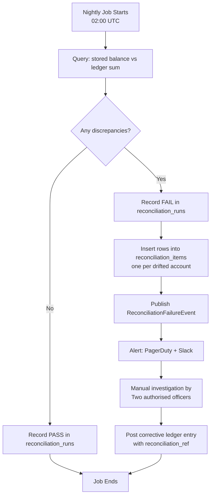
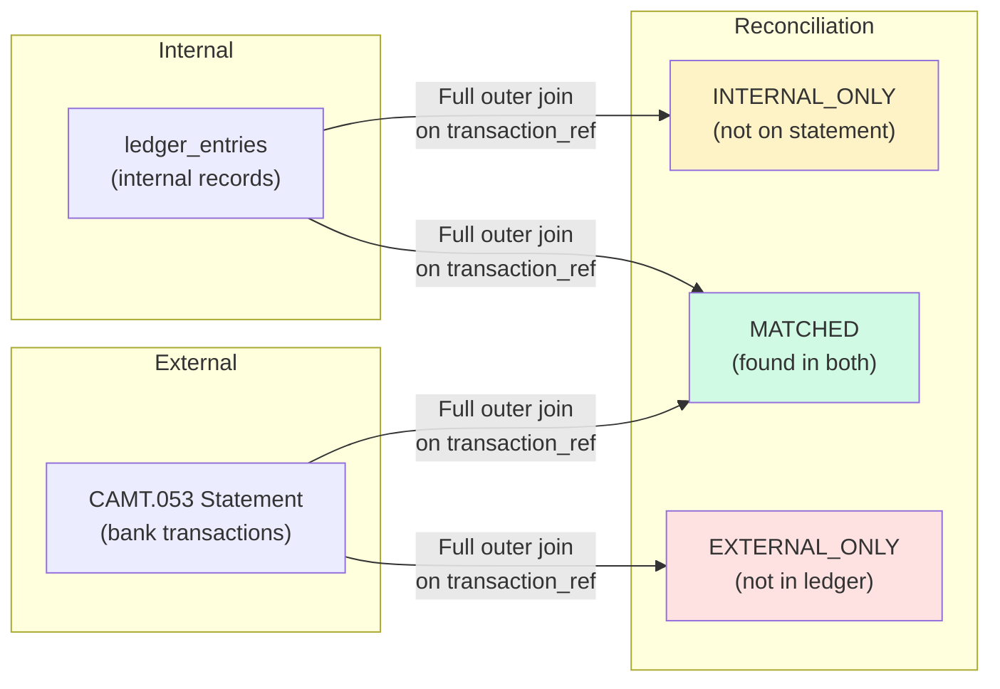

Balance reconciliation is the control mechanism that detects when the financial system lies. A running balance stored on an account row is a performance optimisation — a cache of the mathematical truth that lives in the ledger entry sequence. Like all caches, it can drift. Concurrent update races, rolled-back transactions whose balance update landed, infrastructure failover mid-write, or a silent ORM bug can all cause the account row to report a balance that disagrees with the sum of its entries. Reconciliation finds those disagreements before a customer, a regulator, or an auditor does. This lesson builds the full reconciliation stack: internal spot checks, shadow balances, external ISO 20022 statement matching, and the schema that makes the results auditable.

## Learning Objectives

By the end of this lesson you will be able to:

- Explain why a denormalised running balance can drift from the ledger sum
- Write a SQL spot-check query that identifies drifted accounts
- Implement a shadow balance updated by an independent code path
- Apply a zero-tolerance policy and distinguish detection from correction
- Parse an ISO 20022 CAMT.053 bank statement and match entries against internal ledger records
- Design `reconciliation_runs` and `reconciliation_items` tables to make results auditable
- Implement a nightly `ReconciliationJob` using Spring Batch

## Business Context

In 2021, a UK challenger bank discovered during a routine audit that 1,247 customer accounts had balances that disagreed with the sum of their ledger entries, with discrepancies ranging from 1 cent to £4,312. The total gross discrepancy was £127,000. The root cause was a Kafka consumer that updated the account balance using an optimistic locking pattern but silently swallowed `OptimisticLockingFailureException` and logged a warning rather than retrying. The consumer had been deployed nine months earlier; the discrepancy had been accumulating since then.

The bank was required to report the incident to the FCA under COND 2.4 (Adequate Resources). It took three weeks and £380,000 in engineering labour to reconcile the affected accounts against the correct ledger sums and determine which customers were owed refunds. The correct balance was computed from the append-only ledger, confirming the value of maintaining the ledger as the source of truth. A nightly reconciliation job catching the first divergence the morning after the bad deployment would have reduced the correction window from nine months to 24 hours.

> [!IMPORTANT]
> Never auto-correct a balance discrepancy from code. Always raise an alert, produce an audit record, and require manual sign-off from two authorised officers before any corrective entry is posted. Auto-correction can mask the root cause and compound errors.

## Internal Spot-Check: Ledger Sum vs. Stored Balance

The definitive test is a SQL query that computes the sum of all ledger entries per account and compares it to the stored balance. This should run nightly, ideally on a read replica to avoid contention on the primary.

```sql
-- Identify accounts where the stored balance disagrees with the ledger sum.
-- Run against a consistent read snapshot (REPEATABLE READ or point-in-time replica).
SELECT
    a.id                                              AS account_id,
    a.iban,
    a.balance_cents                                   AS stored_balance,
    COALESCE(SUM(
        CASE
            WHEN le.entry_type IN ('CREDIT', 'INTEREST', 'REVERSAL', 'ADJUSTMENT')
                THEN  le.amount_cents
            WHEN le.entry_type IN ('DEBIT', 'FEE')
                THEN -le.amount_cents
        END
    ), 0)                                             AS computed_balance,
    a.balance_cents - COALESCE(SUM(
        CASE
            WHEN le.entry_type IN ('CREDIT', 'INTEREST', 'REVERSAL', 'ADJUSTMENT')
                THEN  le.amount_cents
            WHEN le.entry_type IN ('DEBIT', 'FEE')
                THEN -le.amount_cents
        END
    ), 0)                                             AS drift_cents
FROM accounts a
LEFT JOIN ledger_entries le ON le.account_id = a.id
GROUP BY a.id, a.iban, a.balance_cents
HAVING a.balance_cents != COALESCE(SUM(
    CASE
        WHEN le.entry_type IN ('CREDIT', 'INTEREST', 'REVERSAL', 'ADJUSTMENT')
            THEN  le.amount_cents
        WHEN le.entry_type IN ('DEBIT', 'FEE')
            THEN -le.amount_cents
    END
), 0)
ORDER BY ABS(drift_cents) DESC;
```



> [!WARNING]
> Run the spot-check query inside a `REPEATABLE READ` transaction to get a consistent snapshot. Without a consistent snapshot, concurrent commits can cause false positives — an entry written after the account balance was read will make the account appear to have a surplus.

## Shadow Balance Pattern

A shadow balance is a second `balance_cents` column (`shadow_balance_cents`) updated by an entirely independent code path — typically a Kafka consumer that processes a separate event stream, using different ORM queries and different connection pools. If the two balances agree, both code paths are correct. If they diverge, at least one is broken.

```sql
ALTER TABLE accounts
    ADD COLUMN shadow_balance_cents BIGINT NOT NULL DEFAULT 0;

-- Index for fast nightly comparison
CREATE INDEX idx_accounts_balance_drift
    ON accounts (id)
    WHERE balance_cents != shadow_balance_cents;
```

```java
// Primary path — HTTP request handler → @Transactional service
@Transactional
public void creditAccount(UUID accountId, long amountCents, String ref) {
    Account account = accountRepository.findByIdForUpdate(accountId);
    account.setBalanceCents(account.getBalanceCents() + amountCents);
    accountRepository.save(account);
    ledgerRepository.save(LedgerEntry.credit(accountId, amountCents, ref));
}

// Shadow path — independent Kafka consumer on a different consumer group
// Uses a separate Spring application context with a different datasource bean
@KafkaListener(topics = "payment-events", groupId = "shadow-balance-consumer")
@Transactional("shadowTransactionManager")
public void updateShadowBalance(PaymentEvent event) {
    // Deliberately uses a different query to avoid sharing a code path
    jdbcTemplate.update(
        "UPDATE accounts SET shadow_balance_cents = shadow_balance_cents + ? WHERE id = ?",
        event.amountCents(), event.accountId());
}
```

```sql
-- Nightly shadow balance comparison
SELECT
    id,
    iban,
    balance_cents,
    shadow_balance_cents,
    balance_cents - shadow_balance_cents AS drift_cents
FROM accounts
WHERE balance_cents != shadow_balance_cents
ORDER BY ABS(balance_cents - shadow_balance_cents) DESC;
```

> [!NOTE]
> The shadow balance and the primary balance will naturally diverge briefly during normal operation due to event processing lag. Apply a grace window (e.g., accounts with no activity in the last 60 seconds) before flagging a divergence as a discrepancy.

## Zero-Tolerance Policy

Reconciliation in banking operates on a zero-tolerance basis. Any discrepancy greater than zero cents requires investigation. There is no "acceptable rounding error". The reasons are both regulatory (PCI-DSS Requirement 12.3, SOX Section 404) and operational — small discrepancies that are tolerated tend to grow.

```java
@Component
@RequiredArgsConstructor
public class ReconciliationPolicy {

    // No tolerance. Any non-zero drift is a failure.
    private static final long DRIFT_TOLERANCE_CENTS = 0L;

    public ReconciliationResult evaluate(List<BalanceDrift> drifts) {
        List<BalanceDrift> failures = drifts.stream()
            .filter(d -> Math.abs(d.driftCents()) > DRIFT_TOLERANCE_CENTS)
            .toList();

        if (failures.isEmpty()) {
            return ReconciliationResult.pass();
        }

        long totalGrossDrift = failures.stream()
            .mapToLong(d -> Math.abs(d.driftCents()))
            .sum();

        return ReconciliationResult.fail(failures, totalGrossDrift);
    }
}
```

Correction requires a formal process: two authorised officers sign off, a corrective ledger entry is posted with `entry_type = ADJUSTMENT` and a `transaction_ref` that references the reconciliation run ID, and the corrective entry is included in the audit trail. Code must never auto-correct silently.

## External Reconciliation: ISO 20022 CAMT.053

Internal reconciliation checks ledger entries against account balances. External reconciliation checks ledger entries against the bank's own bank statement — the CAMT.053 "Bank-to-Customer Account Report" published by the correspondent bank or card scheme each business day.



```java
@Component
@RequiredArgsConstructor
public class Camt053Parser {

    /**
     * Parse a CAMT.053 XML statement using JAXB-generated classes
     * from the ISO 20022 schema (pain.001.001.11, camt.053.001.08).
     */
    public List<ExternalTransaction> parse(InputStream camt053Xml) {
        try {
            JAXBContext context = JAXBContext.newInstance(BankToCustomerStatementV08.class);
            Unmarshaller unmarshaller = context.createUnmarshaller();
            BankToCustomerStatementV08 statement =
                (BankToCustomerStatementV08) unmarshaller.unmarshal(camt053Xml);

            return statement.getStmt().stream()
                .flatMap(stmt -> stmt.getNtry().stream())
                .map(entry -> new ExternalTransaction(
                    entry.getNtryRef(),
                    entry.getAmt().getValue().movePointRight(2).longValueExact(), // to cents
                    entry.getCdtDbtInd().value(),  // "CRDT" or "DBIT"
                    entry.getBookgDt().getDt().toGregorianCalendar()
                        .toZonedDateTime().toInstant()))
                .toList();
        } catch (JAXBException e) {
            throw new Camt053ParseException("Failed to parse CAMT.053 statement", e);
        }
    }
}
```

```java
@Component
@RequiredArgsConstructor
public class ExternalReconciliationJob {

    private final LedgerEntryRepository ledgerRepository;
    private final Camt053Parser camt053Parser;
    private final ReconciliationRunRepository runRepository;
    private final ReconciliationItemRepository itemRepository;

    @Transactional
    public ReconciliationRun reconcile(UUID accountId, InputStream statementXml, LocalDate valueDate) {
        List<ExternalTransaction> external = camt053Parser.parse(statementXml);
        List<LedgerEntry> internal = ledgerRepository
            .findByAccountIdAndCreatedAtBetween(
                accountId,
                valueDate.atStartOfDay(ZoneOffset.UTC).toInstant(),
                valueDate.plusDays(1).atStartOfDay(ZoneOffset.UTC).toInstant());

        Map<String, ExternalTransaction> externalByRef = external.stream()
            .collect(Collectors.toMap(ExternalTransaction::reference, Function.identity()));
        Map<String, LedgerEntry> internalByRef = internal.stream()
            .collect(Collectors.toMap(LedgerEntry::getTransactionRef, Function.identity()));

        ReconciliationRun run = runRepository.save(ReconciliationRun.builder()
            .accountId(accountId)
            .valueDate(valueDate)
            .runAt(Instant.now())
            .status(ReconciliationStatus.IN_PROGRESS)
            .build());

        List<ReconciliationItem> items = new ArrayList<>();

        // MATCHED — found in both internal and external
        internalByRef.forEach((ref, internalEntry) -> {
            if (externalByRef.containsKey(ref)) {
                ExternalTransaction ext = externalByRef.get(ref);
                ReconciliationItemStatus status = internalEntry.getAmountCents()
                    == ext.amountCents()
                    ? ReconciliationItemStatus.MATCHED
                    : ReconciliationItemStatus.AMOUNT_MISMATCH;
                items.add(ReconciliationItem.matched(run, ref, internalEntry, ext, status));
            } else {
                // INTERNAL_ONLY — in ledger but not on bank statement
                items.add(ReconciliationItem.internalOnly(run, ref, internalEntry));
            }
        });

        // EXTERNAL_ONLY — on bank statement but not in ledger
        externalByRef.forEach((ref, ext) -> {
            if (!internalByRef.containsKey(ref)) {
                items.add(ReconciliationItem.externalOnly(run, ref, ext));
            }
        });

        itemRepository.saveAll(items);

        long breakCount = items.stream()
            .filter(i -> i.getStatus() != ReconciliationItemStatus.MATCHED)
            .count();

        run.setStatus(breakCount == 0
            ? ReconciliationStatus.PASSED
            : ReconciliationStatus.FAILED);
        run.setBreakCount((int) breakCount);

        return runRepository.save(run);
    }
}
```

## Reconciliation Schema

The reconciliation schema is itself append-only: runs and items are never updated after the fact. Corrections produce new runs.

```sql
CREATE TYPE reconciliation_status AS ENUM (
    'IN_PROGRESS', 'PASSED', 'FAILED', 'SUPERSEDED'
);

CREATE TYPE reconciliation_item_status AS ENUM (
    'MATCHED',
    'AMOUNT_MISMATCH',
    'INTERNAL_ONLY',
    'EXTERNAL_ONLY'
);

CREATE TABLE reconciliation_runs (
    id              UUID                  NOT NULL DEFAULT gen_random_uuid(),
    account_id      UUID                  NOT NULL,
    value_date      DATE                  NOT NULL,
    run_at          TIMESTAMPTZ           NOT NULL DEFAULT now(),
    status          reconciliation_status NOT NULL,
    break_count     INT                   NOT NULL DEFAULT 0,
    run_by          VARCHAR(128)          NOT NULL,
    CONSTRAINT pk_reconciliation_runs PRIMARY KEY (id)
);

CREATE TABLE reconciliation_items (
    id                    UUID                        NOT NULL DEFAULT gen_random_uuid(),
    run_id                UUID                        NOT NULL,
    transaction_ref       VARCHAR(64)                 NOT NULL,
    status                reconciliation_item_status  NOT NULL,
    internal_amount_cents BIGINT,
    external_amount_cents BIGINT,
    internal_entry_id     UUID,
    external_booking_date DATE,
    notes                 TEXT,
    CONSTRAINT pk_reconciliation_items PRIMARY KEY (id),
    CONSTRAINT fk_reconciliation_items_run
        FOREIGN KEY (run_id) REFERENCES reconciliation_runs (id)
);

-- Fast lookup of all breaks for a given run
CREATE INDEX idx_recon_items_run_status
    ON reconciliation_items (run_id, status)
    WHERE status != 'MATCHED';

-- Look up all reconciliation runs for a given account and date
CREATE INDEX idx_recon_runs_account_date
    ON reconciliation_runs (account_id, value_date DESC);
```

> [!NOTE]
> `INTERNAL_ONLY` items require investigation: a payment may have been posted to the ledger but not yet settled with the correspondent bank, or it may represent a fraud case where funds were moved in the internal ledger without a corresponding external transfer. Neither should be dismissed without review.

## Knowledge Check

**Q1: The nightly spot-check query runs at 02:00 UTC and reports zero discrepancies. At 09:00 UTC, an analyst notices that account `acc-7781` has a stored balance of £10,000 but its ledger entries sum to £9,850. How did this discrepancy appear after a clean nightly run, and what does this tell you about the architecture?**

A: The discrepancy was introduced by a transaction that committed between 02:00 UTC (when the snapshot was taken) and 09:00 UTC (when the analyst noticed it). The nightly run was correct at the time of its snapshot — the bug surfaced in the subsequent nine hours. This tells you two things: (1) the spot-check is not real-time; discrepancies can accumulate for up to 24 hours before detection, and (2) the system has a code path that can update `balance_cents` without posting a corresponding ledger entry, or vice versa. The shadow balance pattern would have provided an earlier warning: if the shadow balance (updated by the independent Kafka consumer) also shows £10,000, the bug is in the primary write path; if the shadow shows £9,850, the bug is in the event that drives the shadow.

---

**Q2: During external reconciliation against the CAMT.053 statement, 23 items are categorised as `EXTERNAL_ONLY` — present on the bank statement but absent from the internal ledger. What are the two most likely causes, and what must an engineer check before concluding either?**

A: The two most likely causes are: (1) the idempotency key / `transaction_ref` used externally does not match the `transaction_ref` stored in the ledger — the join key is wrong, not the data; and (2) a genuine posting failure — the external transaction arrived (the bank debited the correspondent account) but the internal ledger write failed silently, perhaps due to a Kafka consumer crash or an unhandled database exception that was caught and logged rather than re-thrown. Before concluding either, the engineer must check: (a) the mapping logic between CAMT.053 `NtryRef` and the internal `transaction_ref` format for each `EXTERNAL_ONLY` item, (b) the application logs for the booking date window for any exception stack traces or idempotency mismatches, and (c) the dead-letter queue for the payment processing consumer for any unprocessed messages from that date.

## Practical Challenge

Your team is building the reconciliation infrastructure for a PSD2-licensed payment institution that processes 50,000 transactions per day across 200,000 active accounts.

**Task 1 — Spot-Check Query:** Write the production-grade SQL spot-check query using a `REPEATABLE READ` transaction and including window functions to also identify accounts where the `running_balance` stored on the most recent ledger entry disagrees with `balance_cents` on the account row. These are two distinct failure modes — explain both.

**Task 2 — Shadow Balance:** Design the Kafka consumer that maintains the shadow balance. What guarantees does the consumer need in terms of delivery semantics (at-least-once vs. exactly-once)? How do you handle the grace window for in-flight events? Write the nightly comparison query.

**Task 3 — Zero-Tolerance Workflow:** Implement a `ReconciliationAlertService` that, upon receiving a `ReconciliationFailureEvent`, sends a structured alert (account ID, drift cents, run ID, link to reconciliation items) to a Slack webhook and creates a `IncidentTicket` in your incident management system. The alert must not auto-correct the balance.

**Task 4 — External Reconciliation:** You receive a CAMT.053 file for the previous business day containing 1,847 entries. Write the full `ExternalReconciliationJob` Spring Batch step that: reads the CAMT.053 file, performs the full outer join against the ledger, writes `reconciliation_items`, and produces a summary report with counts of MATCHED / INTERNAL_ONLY / EXTERNAL_ONLY / AMOUNT_MISMATCH. The job must be idempotent — rerunning it for the same account and value date should supersede the previous run, not duplicate it.

<!-- KNOWLEDGE-CHECK
{
  "questions": [
    {
      "text": "The nightly spot-check runs at 02:00 UTC and reports zero discrepancies. At 09:00 UTC an analyst notices account acc-7781 has stored balance £10,000 but ledger entries sum to £9,850. How did a discrepancy appear after a clean run?",
      "options": [
        "The nightly run had a bug and missed this account — the spot-check query needs to be fixed",
        "The discrepancy was introduced by a transaction that committed between 02:00 UTC (snapshot time) and 09:00 UTC — the nightly run was correct at snapshot time; the system has a code path that can update balance_cents without posting a corresponding ledger entry",
        "The ledger entries table was manually modified by a DBA after the nightly run completed",
        "Floating-point rounding in a currency conversion accumulated over 9 hours"
      ],
      "correct": 1,
      "explanation": "The nightly run was correct at snapshot time — the discrepancy did not exist at 02:00 UTC. It was introduced sometime in the 7 hours that followed. This reveals two things: (1) discrepancies can accumulate for up to 24 hours before detection; and (2) there is a code path that updates balance_cents without posting a matching ledger entry, or posts a ledger entry without updating the balance. The shadow balance pattern provides earlier warning: comparing shadow vs. primary balance identifies which code path is broken."
    },
    {
      "text": "During external reconciliation against a CAMT.053 statement, 23 items are categorised as EXTERNAL_ONLY. What are the two most likely root causes, and what must you check before concluding either?",
      "options": [
        "Database replication lag and Kafka consumer lag — check replication slot status and consumer group offsets",
        "Wrong join key (transaction_ref format mismatch between CAMT.053 NtryRef and internal ref) OR genuine posting failure (external transaction arrived but internal ledger write failed silently) — check the ref mapping logic for each EXTERNAL_ONLY item and application logs/DLQ for exceptions on the booking date",
        "Settlement timing differences that resolve the next business day — wait 24 hours before investigating",
        "CAMT.053 file corruption and XML parsing errors — re-request the file from the correspondent bank"
      ],
      "correct": 1,
      "explanation": "EXTERNAL_ONLY means the bank statement has a transaction your ledger does not. Before concluding fraud or a posting failure, check: (a) the mapping between CAMT.053 NtryRef and internal transaction_ref format — a format mismatch makes a matched transaction appear as EXTERNAL_ONLY; (b) application logs and dead-letter queues for the booking date window for unhandled exceptions or idempotency mismatches. Items with wrong join keys resolve with a mapping fix. Items with genuine posting failures require a corrective ledger entry with two-officer sign-off."
    },
    {
      "text": "Why must a zero-tolerance policy (any drift > 0 cents requires investigation) be maintained for balance reconciliation, and what is the correct process when a discrepancy is found?",
      "options": [
        "Zero-tolerance is a regulatory requirement under PCI-DSS; small discrepancies can be auto-corrected by code if below $1 to avoid alert fatigue",
        "Zero-tolerance is required by PCI-DSS Requirement 12.3 and SOX Section 404; small discrepancies that are tolerated tend to grow; the correct process is alert, audit record, and manual sign-off from two authorised officers before posting any corrective entry — code must never auto-correct silently",
        "Zero-tolerance means all discrepancies pause payment processing until resolved",
        "Zero-tolerance applies only to external reconciliation; internal reconciliation allows a $0.01 rounding tolerance"
      ],
      "correct": 1,
      "explanation": "Zero-tolerance is both regulatory (PCI-DSS, SOX) and operational — tolerating small discrepancies creates a normalisation of deviance where growing errors go unnoticed. The correct correction process requires: (1) raise an alert and create an audit record of the discrepancy, (2) manual investigation to identify the root cause, (3) explicit sign-off from two authorised officers (four-eyes control), (4) post a corrective ledger entry of type ADJUSTMENT referencing the reconciliation run ID. Auto-correction from code masks root causes and can compound errors."
    }
  ]
}
-->

<!-- PRACTICAL-CHALLENGE
{
  "title": "Build a Production-Grade Reconciliation Infrastructure for a PSD2 Payment Institution",
  "difficulty": "advanced",
  "estimatedMinutes": 45,
  "tasks": [
    {"id": "1", "description": "Write the production SQL spot-check query inside a BEGIN; SET TRANSACTION ISOLATION LEVEL REPEATABLE READ; block. Extend it with a window function (LAST_VALUE or first_value OVER PARTITION BY account_id ORDER BY created_at DESC) to also identify accounts where the running_balance on the most recent ledger entry disagrees with balance_cents on the account row. These are two distinct failure modes — explain both: (a) balance updated without ledger entry, and (b) ledger entry posted without balance update."},
    {"id": "2", "description": "Design the Kafka consumer that maintains shadow_balance_cents. The consumer must be idempotent (at-least-once delivery) using a processed_shadow_events table. Define the grace window policy: skip shadow comparison for accounts with payment_events posted within the last 60 seconds. Write the nightly comparison SQL query and implement a @Scheduled job that publishes ShadowBalanceDriftEvent for any account where |balance_cents - shadow_balance_cents| > 0 outside the grace window."},
    {"id": "3", "description": "Implement ReconciliationAlertService that, upon receiving a ReconciliationFailureEvent, sends a structured Slack webhook alert (account_id, drift_cents, run_id, link to reconciliation_items) and creates an IncidentTicket in the incident management system. The service must be idempotent at the alert level — if the same run_id fires the event twice, only one Slack message and one ticket are created. The alert payload must NOT include any instruction to auto-correct the balance."},
    {"id": "4", "description": "Implement the ExternalReconciliationJob Spring Batch step as an idempotent job: before processing, check if a reconciliation_run already exists for the same account_id and value_date with status != SUPERSEDED — if so, UPDATE its status to SUPERSEDED before creating a new run. Use a Spring Batch JobParameters with account_id+value_date as the unique key to prevent two simultaneous runs for the same parameters. The job must produce a summary with counts of MATCHED/INTERNAL_ONLY/EXTERNAL_ONLY/AMOUNT_MISMATCH and store the counts in reconciliation_runs.break_count."}
  ]
}
-->
