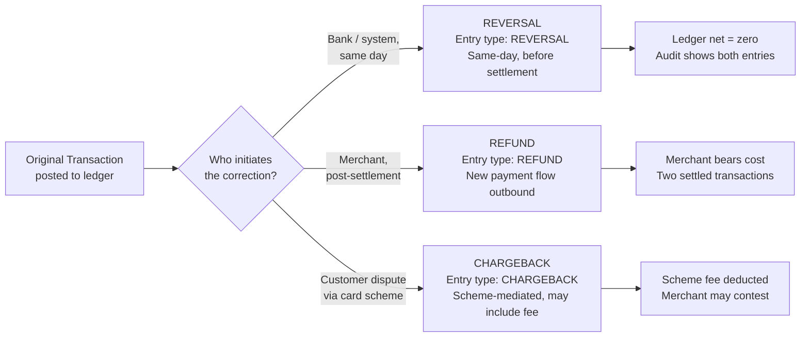
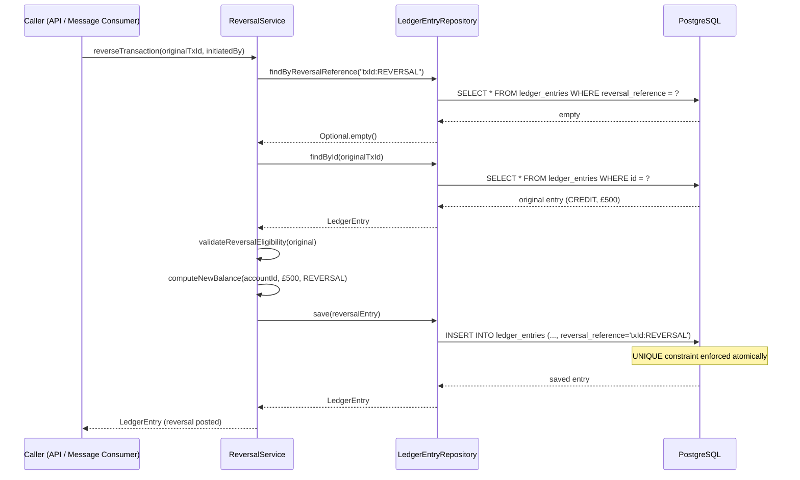

In financial systems, mistakes happen: a payment is sent to the wrong account, a card transaction is disputed, a batch job double-posts an entry. The disciplined response is never to delete or update the original record. Instead, you append a new transaction that neutralises the effect of the first. This is a **compensating transaction** — an immutable, traceable correction that preserves the full audit trail required by regulators and reconciliation systems. Getting compensation right is one of the clearest marks of a principal-level financial engineer.

## Learning Objectives

- Distinguish between reversal, refund, and chargeback and select the correct ledger entry type for each
- Design a compensation schema that makes double-reversal structurally impossible through database constraints
- Implement idempotent reversal logic in Java with a deterministic `reversal_reference` key
- Enforce the partial-reversal business rule: cumulative reversals cannot exceed the original amount
- Parse an ISO 20022 CAMT.056 payment recall message in Java using JAXB
- Write tests that verify balance invariants, idempotency, and boundary conditions for partial reversals

## Business Context

In 2023, a major European payment processor experienced a P1 incident during a batch salary run. A bug in their overnight job submitted 14,000 payroll credits twice. The engineering team's first instinct was to issue a corrective batch that deleted the duplicate rows from the ledger. Their compliance officer stopped them: deleting posted ledger entries would violate the firm's FCA record-keeping obligations and would cause the reconciliation run to fail catastrophically because external bank statements already reflected the original credits.

The correct fix was to post 14,000 compensating debit entries — one per duplicated credit — each referencing the original transaction it was reversing. The ledger balance returned to correct, the audit trail was intact, every entry was traceable, and the reconciliation job processed normally the next morning. The recovery took four hours instead of the two days a deletion-and-repost approach would have required.

That incident illustrates the foundational rule of financial ledger engineering: **the ledger is append-only. Corrections are new entries, never mutations of existing ones.**

## Reversal vs. Refund vs. Chargeback

These three terms are used interchangeably in conversation but represent fundamentally different workflows, different ledger entry types, and different regulatory treatments.



| Dimension | Reversal | Refund | Chargeback |
|---|---|---|---|
| Initiator | Bank / system | Merchant | Customer via card scheme |
| Timing | Same business day, pre-settlement | Post-settlement, any time | 60–120 days from transaction |
| Settlement impact | Cancels original | New outbound payment | Clawback from merchant |
| Ledger entry type | `REVERSAL` | `REFUND` | `CHARGEBACK` |
| Fee | None | None | Scheme fee (e.g., £15–£25 Visa) |
| Regulatory classification | Internal correction | Commercial agreement | Dispute resolution |

The distinction matters for downstream systems. Reconciliation jobs must know whether a negative entry offsets a same-day credit (reversal) or represents an independent outbound payment (refund). Fraud analytics must distinguish merchant-initiated refunds from scheme-mediated chargebacks. Never conflate them in a single `entry_type = 'NEGATIVE'` column.

## The Append-Only Ledger Schema

The compensating transaction schema extends the ledger with a self-referencing foreign key: every compensation row points back to the original transaction it is offsetting.

```sql
CREATE TABLE ledger_entries (
    id                    UUID          NOT NULL DEFAULT gen_random_uuid(),
    account_id            UUID          NOT NULL,
    transaction_id        UUID          NOT NULL,  -- the business transaction this entry belongs to
    entry_type            VARCHAR(20)   NOT NULL,  -- CREDIT, DEBIT, REVERSAL, REFUND, CHARGEBACK
    amount                NUMERIC(19,4) NOT NULL,
    currency              CHAR(3)       NOT NULL,
    running_balance       NUMERIC(19,4) NOT NULL,
    reversal_of_entry_id  UUID          NULL REFERENCES ledger_entries(id),
    reversal_reference    VARCHAR(100)  NULL,      -- deterministic key for idempotency
    posted_at             TIMESTAMPTZ   NOT NULL DEFAULT now(),
    value_date            DATE          NOT NULL,
    description           VARCHAR(255)  NOT NULL,
    created_by            VARCHAR(100)  NOT NULL,  -- service or operator that created the entry
    metadata              JSONB         NULL,

    CONSTRAINT pk_ledger_entries PRIMARY KEY (id),
    CONSTRAINT uq_reversal_reference UNIQUE (reversal_reference),  -- prevents double-reversal
    CONSTRAINT chk_entry_type CHECK (entry_type IN ('CREDIT','DEBIT','REVERSAL','REFUND','CHARGEBACK')),
    CONSTRAINT chk_amount_positive CHECK (amount > 0)  -- amount is always positive; sign comes from entry_type
);

CREATE INDEX idx_ledger_account_posted ON ledger_entries (account_id, posted_at DESC);
CREATE INDEX idx_ledger_reversal_of    ON ledger_entries (reversal_of_entry_id)
    WHERE reversal_of_entry_id IS NOT NULL;
```

> [!IMPORTANT]
> The `UNIQUE(reversal_reference)` constraint is the structural guarantee against double-reversal. It is not optional. Business logic checks are necessary but not sufficient — only the database constraint provides a durable, concurrent-safe guarantee.

## Idempotent Reversal: The Deterministic Reference Key

The reversal reference is constructed deterministically from the original transaction ID plus a suffix. This means that no matter how many times the reversal service is called — due to retries, network timeouts, or at-least-once delivery from a message queue — only one reversal entry is ever inserted.

```java
public final class ReversalReferenceGenerator {

    private ReversalReferenceGenerator() {}

    /**
     * Generates a deterministic reversal reference for a full reversal.
     * Format: "{originalTransactionId}:REVERSAL"
     */
    public static String forFullReversal(UUID originalTransactionId) {
        return originalTransactionId.toString() + ":REVERSAL";
    }

    /**
     * Generates a deterministic reversal reference for a named partial reversal.
     * The reason code makes multiple partial reversals of the same transaction possible
     * while keeping each individual partial reversal idempotent.
     * Format: "{originalTransactionId}:PARTIAL:{reasonCode}"
     */
    public static String forPartialReversal(UUID originalTransactionId, String reasonCode) {
        Objects.requireNonNull(reasonCode, "reasonCode must not be null");
        if (reasonCode.isBlank() || reasonCode.length() > 50) {
            throw new IllegalArgumentException("reasonCode must be 1–50 characters");
        }
        return originalTransactionId.toString() + ":PARTIAL:" + reasonCode.toUpperCase();
    }
}
```

The service uses this key as the idempotency guard before attempting the insert:

```java
@Service
@RequiredArgsConstructor
@Slf4j
public class ReversalService {

    private final LedgerEntryRepository ledgerEntryRepository;
    private final AccountRepository accountRepository;

    @Transactional
    public LedgerEntry reverseTransaction(ReversalRequest request) {
        String reversalReference = ReversalReferenceGenerator
            .forFullReversal(request.originalTransactionId());

        // Idempotency check — return existing reversal if one already exists
        Optional<LedgerEntry> existing =
            ledgerEntryRepository.findByReversalReference(reversalReference);
        if (existing.isPresent()) {
            log.info("Reversal already exists for transaction {}, returning existing entry {}",
                request.originalTransactionId(), existing.get().getId());
            return existing.get();
        }

        LedgerEntry original = ledgerEntryRepository.findById(request.originalTransactionId())
            .orElseThrow(() -> new EntryNotFoundException(request.originalTransactionId()));

        validateReversalEligibility(original);

        // The reversal amount equals the original amount for a full reversal.
        // The sign (debit vs credit) is the mirror of the original entry type.
        EntryType reversalType = mirrorEntryType(original.getEntryType());
        BigDecimal newBalance = computeNewBalance(request.accountId(), original.getAmount(), reversalType);

        LedgerEntry reversal = LedgerEntry.builder()
            .accountId(original.getAccountId())
            .transactionId(UUID.randomUUID())
            .entryType(reversalType)
            .amount(original.getAmount())
            .currency(original.getCurrency())
            .runningBalance(newBalance)
            .reversalOfEntryId(original.getId())
            .reversalReference(reversalReference)
            .valueDate(request.valueDate())
            .description("Reversal of entry " + original.getId())
            .createdBy(request.initiatedBy())
            .build();

        return ledgerEntryRepository.save(reversal);
    }

    private void validateReversalEligibility(LedgerEntry original) {
        if (original.getEntryType() == EntryType.REVERSAL) {
            throw new ReversalOfReversalException(original.getId());
        }
        if (original.getReversalOfEntryId() != null) {
            throw new ReversalOfReversalException(original.getId());
        }
    }

    private EntryType mirrorEntryType(EntryType original) {
        return switch (original) {
            case CREDIT -> EntryType.REVERSAL;  // reversal of a credit is a debit-equivalent
            case DEBIT  -> EntryType.REVERSAL;  // both map to REVERSAL; amount sign is implicit
            default -> throw new IllegalArgumentException(
                "Cannot reverse entry of type: " + original);
        };
    }
}
```

> [!NOTE]
> Both credit reversals and debit reversals use `EntryType.REVERSAL`. The direction of the balance effect is inferred: reversing a credit reduces the balance; reversing a debit increases it. The service computes the balance delta based on the original entry type, not the reversal entry type.

## Partial Reversal: Enforcing the Business Rule

A partial reversal releases only part of the original transaction amount. The core business rule is: **the sum of all partial reversals against a single original entry must not exceed that entry's amount.** This requires a sum query before inserting the new reversal.

```java
@Transactional
public LedgerEntry partiallyReverse(PartialReversalRequest request) {
    String reversalReference = ReversalReferenceGenerator
        .forPartialReversal(request.originalEntryId(), request.reasonCode());

    // Idempotency check
    Optional<LedgerEntry> existing =
        ledgerEntryRepository.findByReversalReference(reversalReference);
    if (existing.isPresent()) {
        return existing.get();
    }

    LedgerEntry original = ledgerEntryRepository.findById(request.originalEntryId())
        .orElseThrow(() -> new EntryNotFoundException(request.originalEntryId()));

    // Business rule: sum of all prior reversals + this reversal <= original amount
    BigDecimal alreadyReversed = ledgerEntryRepository
        .sumReversedAmountForEntry(request.originalEntryId())
        .orElse(BigDecimal.ZERO);

    BigDecimal totalAfterThisReversal = alreadyReversed.add(request.reversalAmount());

    if (totalAfterThisReversal.compareTo(original.getAmount()) > 0) {
        throw new PartialReversalExceedsOriginalException(
            request.originalEntryId(),
            original.getAmount(),
            alreadyReversed,
            request.reversalAmount()
        );
    }

    BigDecimal newBalance = computeNewBalance(
        original.getAccountId(), request.reversalAmount(), EntryType.REVERSAL);

    LedgerEntry reversal = LedgerEntry.builder()
        .accountId(original.getAccountId())
        .transactionId(UUID.randomUUID())
        .entryType(EntryType.REVERSAL)
        .amount(request.reversalAmount())
        .currency(original.getCurrency())
        .runningBalance(newBalance)
        .reversalOfEntryId(original.getId())
        .reversalReference(reversalReference)
        .valueDate(request.valueDate())
        .description("Partial reversal of entry " + original.getId()
            + ": " + request.reasonCode())
        .createdBy(request.initiatedBy())
        .build();

    return ledgerEntryRepository.save(reversal);
}
```

The repository query that sums prior reversals:

```sql
-- Sum all reversal amounts already posted against a given original entry
SELECT COALESCE(SUM(amount), 0)
  FROM ledger_entries
 WHERE reversal_of_entry_id = :originalEntryId
   AND entry_type = 'REVERSAL';
```

```java
@Repository
public interface LedgerEntryRepository extends JpaRepository<LedgerEntry, UUID> {

    Optional<LedgerEntry> findByReversalReference(String reversalReference);

    @Query("""
        SELECT SUM(e.amount)
          FROM LedgerEntry e
         WHERE e.reversalOfEntryId = :originalEntryId
           AND e.entryType = 'REVERSAL'
        """)
    Optional<BigDecimal> sumReversedAmountForEntry(@Param("originalEntryId") UUID originalEntryId);

    long countByReversalOfEntryId(UUID originalEntryId);
}
```

> [!WARNING]
> The partial reversal validation is subject to a time-of-check/time-of-use (TOCTOU) race condition if two partial reversal requests arrive concurrently for the same original entry. The `UNIQUE(reversal_reference)` constraint handles exact duplicates, but two requests with different reason codes can both pass the sum check and together exceed the original amount. Mitigate this with a `SELECT ... FOR UPDATE` on the original entry row during the validation window, or with a database-level trigger that enforces the cumulative constraint.

## ISO 20022 CAMT.056 Payment Recall

CAMT.056 (`FIToFIPaymentCancellationRequest`) is the ISO 20022 message used by one financial institution to request that another reverse a payment it initiated. It is the standard mechanism for bank-to-bank payment recalls in SEPA and many domestic schemes.

A minimal CAMT.056 structure looks like this:

```xml
<?xml version="1.0" encoding="UTF-8"?>
<Document xmlns="urn:iso:std:iso:20022:tech:xsd:camt.056.001.08">
  <FIToFIPmtCxlReq>
    <Assgnmt>
      <Id>RECALL-2024-001-XYZ</Id>
      <Assgnr><Agt><FinInstnId><BICFI>BARCGB22XXX</BICFI></FinInstnId></Agt></Assgnr>
      <Assgne><Agt><FinInstnId><BICFI>HSBCGB2LXXX</BICFI></FinInstnId></Agt></Assgne>
      <CreDtTm>2024-03-15T10:30:00Z</CreDtTm>
    </Assgnmt>
    <Undrlyg>
      <TxInf>
        <CxlId>CXL-20240315-001</CxlId>
        <OrgnlGrpInf>
          <OrgnlMsgId>MSG-20240315-PAY-001</OrgnlMsgId>
          <OrgnlMsgNmId>pacs.008.001.08</OrgnlMsgNmId>
        </OrgnlGrpInf>
        <OrgnlTxId>TXN-20240315-98765</OrgnlTxId>
        <OrgnlIntrBkSttlmAmt Ccy="GBP">5000.00</OrgnlIntrBkSttlmAmt>
        <CxlRsnInf>
          <Rsn><Cd>DUPL</Cd></Rsn>
          <AddtlInf>Duplicate salary payment identified during reconciliation</AddtlInf>
        </CxlRsnInf>
      </TxInf>
    </Undrlyg>
  </FIToFIPmtCxlReq>
</Document>
```

Common CAMT.056 cancellation reason codes used in practice:

| Code | Meaning | Typical trigger |
|---|---|---|
| `DUPL` | Duplicate payment | Batch job double-posting |
| `FRAD` | Fraudulent origin | AML / fraud system detection |
| `TECH` | Technical problem | Settlement system error |
| `CUST` | Customer request | Customer contacts bank |
| `UPAY` | Underpayment | Amount error |

Parsing the recall in Java using JAXB with the Jakarta namespace:

```java
import jakarta.xml.bind.JAXBContext;
import jakarta.xml.bind.JAXBException;
import jakarta.xml.bind.Unmarshaller;
import java.io.StringReader;

@Service
@Slf4j
public class Camt056RecallProcessor {

    private final JAXBContext jaxbContext;
    private final ReversalService reversalService;

    public Camt056RecallProcessor(ReversalService reversalService) throws JAXBException {
        // JAXBContext is thread-safe and expensive to create — build once at startup
        this.jaxbContext = JAXBContext.newInstance(Document.class);
        this.reversalService = reversalService;
    }

    public RecallResult processRecall(String camt056Xml) {
        Document document = unmarshal(camt056Xml);
        FIToFIPaymentCancellationRequestV08 request =
            document.getFIToFIPmtCxlReq();

        TransactionInformation32 txInfo = request.getUndrlyg()
            .getFirst()
            .getTxInf()
            .getFirst();

        String originalTxId  = txInfo.getOrgnlTxId();
        String reasonCode    = txInfo.getCxlRsnInf().getFirst().getRsn().getCd();
        String assignmentId  = request.getAssgnmt().getId();

        log.info("Processing CAMT.056 recall: assignmentId={}, originalTxId={}, reason={}",
            assignmentId, originalTxId, reasonCode);

        ReversalRequest reversalRequest = ReversalRequest.builder()
            .originalTransactionId(UUID.fromString(originalTxId))
            .initiatedBy("CAMT056:" + assignmentId)
            .valueDate(LocalDate.now())
            .build();

        try {
            LedgerEntry reversal = reversalService.reverseTransaction(reversalRequest);
            return RecallResult.accepted(assignmentId, reversal.getId());
        } catch (EntryNotFoundException ex) {
            log.warn("CAMT.056 recall references unknown transaction: {}", originalTxId);
            return RecallResult.rejected(assignmentId, "TRANSACTION_NOT_FOUND");
        } catch (ReversalOfReversalException ex) {
            log.warn("CAMT.056 recall targets an already-reversed entry: {}", originalTxId);
            return RecallResult.rejected(assignmentId, "ALREADY_REVERSED");
        }
    }

    private Document unmarshal(String xml) {
        try {
            Unmarshaller unmarshaller = jaxbContext.createUnmarshaller();
            return (Document) unmarshaller.unmarshal(new StringReader(xml));
        } catch (JAXBException ex) {
            throw new InvalidCamt056MessageException("Failed to parse CAMT.056 message", ex);
        }
    }
}
```

> [!NOTE]
> The JAXB classes (`Document`, `FIToFIPaymentCancellationRequestV08`, etc.) are generated from the ISO 20022 XSD schemas published at `https://www.iso20022.org/catalogue-messages/iso-20022-messages-archive`. In a production project these generated classes live in a separate `iso20022-model` Maven module shared across all message-type processors.

## End-to-End Reversal Flow



## Testing Reversal Logic

Well-structured tests verify four independent behaviours: balance invariant after reversal, double-reversal rejection, partial reversal within limit, and partial reversal above limit.

```java
@SpringBootTest
@Transactional
class ReversalServiceTest {

    @Autowired ReversalService reversalService;
    @Autowired LedgerEntryRepository ledgerEntryRepository;
    @Autowired AccountRepository accountRepository;

    private UUID accountId;
    private LedgerEntry originalCredit;

    @BeforeEach
    void setUp() {
        accountId = createTestAccount(new BigDecimal("1000.00"));
        originalCredit = postCredit(accountId, new BigDecimal("500.00"));
    }

    @Test
    @DisplayName("Balance after full reversal equals balance before original transaction")
    void fullReversal_restoresBalanceToPreTransactionState() {
        BigDecimal balanceBeforeOriginal =
            originalCredit.getRunningBalance().subtract(originalCredit.getAmount());

        LedgerEntry reversal = reversalService.reverseTransaction(ReversalRequest.builder()
            .originalTransactionId(originalCredit.getId())
            .initiatedBy("test-service")
            .valueDate(LocalDate.now())
            .build());

        assertThat(reversal.getRunningBalance())
            .isEqualByComparingTo(balanceBeforeOriginal);
    }

    @Test
    @DisplayName("Calling reverseTransaction twice returns the same entry — idempotent")
    void doubleReversal_isIdempotent_returnsSameEntry() {
        ReversalRequest request = ReversalRequest.builder()
            .originalTransactionId(originalCredit.getId())
            .initiatedBy("test-service")
            .valueDate(LocalDate.now())
            .build();

        LedgerEntry first  = reversalService.reverseTransaction(request);
        LedgerEntry second = reversalService.reverseTransaction(request);

        assertThat(second.getId()).isEqualTo(first.getId());
        assertThat(ledgerEntryRepository.countByReversalOfEntryId(originalCredit.getId()))
            .isEqualTo(1);
    }

    @Test
    @DisplayName("Partial reversal within original amount is accepted")
    void partialReversal_withinLimit_succeeds() {
        LedgerEntry partial = reversalService.partiallyReverse(PartialReversalRequest.builder()
            .originalEntryId(originalCredit.getId())
            .reversalAmount(new BigDecimal("200.00"))
            .reasonCode("PARTIAL_DISPUTE")
            .initiatedBy("test-service")
            .valueDate(LocalDate.now())
            .build());

        assertThat(partial.getAmount()).isEqualByComparingTo("200.00");
        assertThat(partial.getEntryType()).isEqualTo(EntryType.REVERSAL);
    }

    @Test
    @DisplayName("Partial reversal that would exceed original amount is rejected")
    void partialReversal_exceedingOriginal_throwsException() {
        // Post £300 partial reversal — within the £500 limit
        reversalService.partiallyReverse(PartialReversalRequest.builder()
            .originalEntryId(originalCredit.getId())
            .reversalAmount(new BigDecimal("300.00"))
            .reasonCode("FIRST_PARTIAL")
            .initiatedBy("test-service")
            .valueDate(LocalDate.now())
            .build());

        // Attempt £250 more — total would be £550, exceeding £500
        assertThatThrownBy(() -> reversalService.partiallyReverse(
            PartialReversalRequest.builder()
                .originalEntryId(originalCredit.getId())
                .reversalAmount(new BigDecimal("250.00"))
                .reasonCode("SECOND_PARTIAL")
                .initiatedBy("test-service")
                .valueDate(LocalDate.now())
                .build()))
            .isInstanceOf(PartialReversalExceedsOriginalException.class)
            .hasMessageContaining("500.00");
    }
}
```

> [!IMPORTANT]
> The `doubleReversal_isIdempotent_returnsSameEntry` test should also be run with concurrent callers to verify that the `UNIQUE(reversal_reference)` constraint catches a true race condition at the database level. Use `@RepeatedTest(10)` with two threads launched via `CompletableFuture` to simulate concurrent requests hitting the service simultaneously.

## Knowledge Check

**Q1: A developer proposes handling reversals by adding a `reversed = true` flag to the original ledger entry and skipping it in balance calculations. What are the two critical problems with this approach?**

A: First, it violates the append-only audit trail requirement. Modifying a posted ledger entry is prohibited under most financial record-keeping regulations (e.g., FCA SYSC, PCI-DSS). External reconciliation systems — including SWIFT and ISO 20022 settlement statements — will have already recorded the original entry; changing the internal ledger creates a mismatch that breaks reconciliation. Second, the approach is not atomic. If the `UPDATE` to set `reversed = true` and the balance adjustment are separate operations, a failure between them produces an inconsistent state: the entry is marked reversed but the balance has not been corrected, or vice versa. The compensating transaction approach combines both effects in a single new INSERT that is atomic, leaves the original entry unchanged, and can be re-played safely on retry.

**Q2: Your partial reversal service passes all unit tests but you observe occasional cases in production where the cumulative reversal amount exceeds the original transaction amount. The sum-check query and insert are inside a single `@Transactional` method. What is the root cause and what are two valid remedies?**

A: The root cause is a TOCTOU (time-of-check/time-of-use) race condition. Two concurrent partial reversal requests both read the current sum (e.g., £0), both calculate that their requested amount (e.g., £400 each) fits within the original £500, and both proceed to insert. Because neither transaction holds a lock on the original entry row, both inserts succeed — the cumulative total becomes £800. Remedy one: add `SELECT ... FOR UPDATE` on the original ledger entry row at the start of the partial reversal transaction, serialising concurrent partial reversals for the same original entry. Remedy two: add a database-level trigger that recalculates the cumulative sum on each insert into `ledger_entries` and raises an exception if the new total exceeds the original amount. The trigger executes atomically within the inserting transaction and cannot be bypassed by the application layer.

## Practical Challenge

**Scenario:** You are building the compensation module for a real-time payments platform. The platform processes SEPA Instant Credit Transfers and must handle CAMT.056 payment recalls within the 10-business-day recall window defined by the scheme.

**Task:**

1. Extend the `ledger_entries` schema to add a `recall_window_expires_at` column (computed as `posted_at + INTERVAL '10 business days'`). Write a PostgreSQL function `is_within_recall_window(entry_id UUID) RETURNS BOOLEAN` that returns `true` if the current timestamp is before the recall window expiry. Integrate this check into the `validateReversalEligibility` method.

2. Implement a `RecallWindowScheduler` Spring component using `@Scheduled(cron = "0 0 18 * * MON-FRI")` to query for all entries whose recall window expires at end-of-day and publish a `RecallWindowClosingEvent` to a Kafka topic for downstream notification to originators.

3. Write a `Camt056MessageValidator` that validates an incoming CAMT.056 XML against the ISO 20022 XSD schema before unmarshalling. Use `javax.xml.validation.SchemaFactory` with the XSD loaded from the classpath. Return a `ValidationResult` record containing `boolean valid` and `List<String> errors`.

4. Write an integration test that posts a credit entry, then submits two concurrent CAMT.056 recall requests for the same transaction using `CompletableFuture.allOf(...)`. Assert that exactly one reversal is committed and the other either returns the existing reversal (idempotent path) or is rejected with a database constraint violation that the service translates to a `DuplicateReversalException`.

> [!IMPORTANT]
> The CAMT.056 processor must be idempotent at the message level as well as the transaction level. Use the CAMT.056 `Assgnmt/Id` (assignment ID) as a second idempotency key in a separate `processed_recalls` table. This guards against the case where the same recall message is delivered twice over the interbank network, even if it references two different internal transaction IDs.

<!-- KNOWLEDGE-CHECK
{
  "questions": [
    {
      "text": "A developer proposes handling reversals by adding a reversed=true flag to the original ledger entry and skipping it in balance calculations. What are the two critical problems with this approach?",
      "options": [
        "The flag approach is slower than posting a new entry because it requires an UPDATE instead of an INSERT",
        "It violates the append-only regulatory requirement (modifying posted records breaks FCA/PCI-DSS obligations and invalidates external reconciliation) AND the UPDATE is not atomic with the balance adjustment — a failure between them leaves the system in an inconsistent state where the entry is marked reversed but the balance is not corrected",
        "Flags are not supported by standard JAXB parsers used for ISO 20022 messages",
        "The flag cannot distinguish full reversals from partial reversals without an additional amount column"
      ],
      "correct": 1,
      "explanation": "Two critical problems: (1) Modifying a posted ledger entry violates append-only record-keeping requirements under FCA SYSC and PCI-DSS. External reconciliation systems have already recorded the original entry — changing it internally creates a mismatch. (2) The UPDATE to set reversed=true and the balance adjustment are non-atomic operations. A failure between them produces an inconsistent state. The compensating transaction approach combines both effects in a single atomic INSERT, leaves the original unchanged, is re-playable on retry, and preserves the full audit trail."
    },
    {
      "text": "What is the TOCTOU race condition in partial reversal processing, and what are two valid remedies?",
      "options": [
        "Two partial reversals with the same reason code arrive simultaneously — the UNIQUE(reversal_reference) constraint handles this",
        "Two partial reversals with DIFFERENT reason codes both pass the cumulative sum check concurrently and together exceed the original amount — remedy 1: SELECT ... FOR UPDATE on the original entry during validation; remedy 2: a database trigger that recalculates the cumulative sum on each INSERT and raises an exception if the new total exceeds the original",
        "The sum query and INSERT are not in the same transaction, allowing the sum to change between check and insert",
        "The partial reversal runs in READ COMMITTED isolation which allows phantom reads to show a stale cumulative sum"
      ],
      "correct": 1,
      "explanation": "UNIQUE(reversal_reference) only prevents exact duplicates (same reason code). Two concurrent requests with different reason codes both execute the cumulative sum query before either has committed, both see the current sum as, say, £0, both calculate that their £400 request fits within a £500 original, and both insert — resulting in £800 total. Remedy 1: SELECT ... FOR UPDATE on the original entry serialises concurrent partial reversals for the same original. Remedy 2: a database trigger re-sums on each INSERT and raises an exception if the total exceeds the original — atomically enforced, cannot be bypassed by the application layer."
    },
    {
      "text": "What distinguishes a REVERSAL from a REFUND, and why does this distinction matter for downstream reconciliation systems?",
      "options": [
        "They are functionally identical — the distinction is only cosmetic for customer statements",
        "A REVERSAL is a same-day, pre-settlement bank/system-initiated correction that nets to zero; a REFUND is a post-settlement, merchant-initiated new outbound payment — reconciliation systems must distinguish them because a reversal cancels a settled transaction while a refund represents two separate settled transactions with different cash flows",
        "A REVERSAL can only be initiated by the card scheme while a REFUND can be initiated by the merchant",
        "A REFUND requires a new ISO 20022 CAMT.056 message while a REVERSAL uses CAMT.053"
      ],
      "correct": 1,
      "explanation": "The distinction is critical for reconciliation. A REVERSAL cancels the original transaction before or at settlement — the net effect is zero, with two ledger entries that sum to zero. A REFUND is an independent new outbound payment that settles separately — both the original debit and the refund credit appear on bank statements as separate settled transactions. Conflating them breaks external reconciliation: a system expecting two matched pairs instead sees one matched pair and two unmatched singles, generating false INTERNAL_ONLY and EXTERNAL_ONLY items."
    }
  ]
}
-->

<!-- PRACTICAL-CHALLENGE
{
  "title": "Build a SEPA Instant Recall System with CAMT.056 Processing and Idempotent Reversal",
  "difficulty": "advanced",
  "estimatedMinutes": 45,
  "tasks": [
    {"id": "1", "description": "Extend the ledger_entries schema with a recall_window_expires_at column computed as posted_at + INTERVAL '10 business days' (use a PostgreSQL function that skips weekends). Write PostgreSQL function is_within_recall_window(entry_id UUID) RETURNS BOOLEAN. Integrate this check into validateReversalEligibility() — throw RecallWindowExpiredException if the window has closed, with the expiry timestamp in the exception message."},
    {"id": "2", "description": "Implement RecallWindowScheduler using @Scheduled(cron = '0 0 18 * * MON-FRI') that queries for all ledger entries where recall_window_expires_at < now() + INTERVAL '1 hour' AND recall_window_expires_at > now() AND no reversal exists. For each such entry, publish a RecallWindowClosingEvent to Kafka via the outbox pattern. Write a test that inserts an entry with recall_window_expires_at = now() + 30 minutes and verifies the event is published on the next scheduler tick."},
    {"id": "3", "description": "Write Camt056MessageValidator that validates incoming CAMT.056 XML against the ISO 20022 XSD schema using javax.xml.validation.SchemaFactory before unmarshalling. Load the XSD from the classpath at startup (not per-request). Return a ValidationResult record(boolean valid, List<String> errors). Write a unit test that provides a malformed CAMT.056 (missing required Assgnmt/Id element) and asserts valid=false with a non-empty errors list containing the missing element path."},
    {"id": "4", "description": "Write an integration test that posts a credit entry, then submits two concurrent CAMT.056 recall requests for the same transaction using CompletableFuture.allOf() with a fixed thread pool of 2. Assert: exactly one reversal row exists in ledger_entries (countByReversalOfEntryId = 1), the second concurrent call either returns the existing reversal (idempotent path) or is translated to DuplicateReversalException from the UNIQUE(reversal_reference) constraint violation. Use @RepeatedTest(10) to verify the race condition is consistently handled."}
  ]
}
-->
