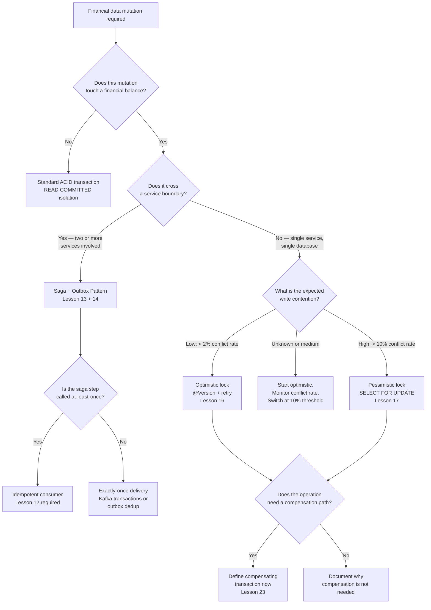
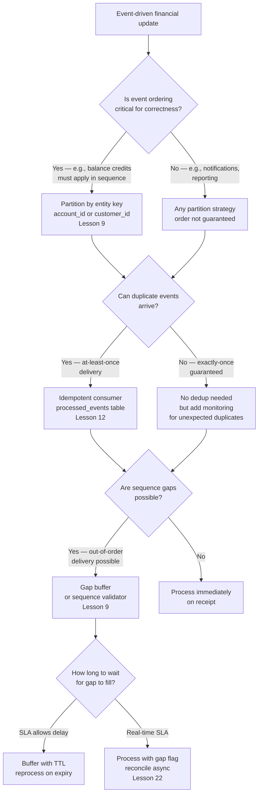
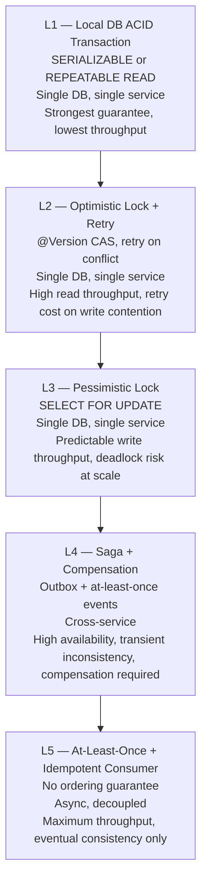

Across the twenty-three lessons of Track 6 you have built a toolkit: optimistic locks, pessimistic locks, outbox patterns, sagas, idempotent consumers, event sourcing, audit trails, compensating transactions, and reconciliation jobs. The hardest part of principal engineering is not implementing any one of these — it is choosing the right one for the situation in front of you, articulating the trade-offs to your team, and committing to a design that will hold under production conditions you have not yet seen. This capstone lesson synthesises Track 6 into a decision framework you can apply immediately.

## Learning Objectives

- Articulate the fundamental tension between strong consistency and high throughput in financial systems
- Apply a decision tree to any financial data mutation to select the correct concurrency and durability strategy
- Apply a second decision tree to event-processing scenarios where ordering, duplication, and gaps are possible
- Rank the five correctness levels in the hierarchy and know when to descend to a lower level
- Identify the four most common anti-patterns in financial systems and the production incidents they cause
- Use the Principal Engineer checklist to review any financial mutation before it goes to production
- Complete a Financial Integrity Decision Record for a new feature

## Business Context

In 2024, a tier-1 UK bank's payments team shipped a new real-time standing-order engine. Under load testing it passed all correctness checks. On the first real payroll Friday, with 400,000 concurrent standing orders firing between 06:00 and 08:00, the system deadlocked. Two services — the balance deduction service and the beneficiary credit service — both used `SELECT FOR UPDATE` and acquired locks in opposite order depending on which side initiated the transfer. Within four minutes, 90% of transactions were waiting for locks held by other waiting transactions. The service was unavailable for 47 minutes.

The engineering post-mortem identified the root cause as a design decision made without a framework: the team had applied `SELECT FOR UPDATE` everywhere because "it's the safe option." Pessimistic locking is safe for a single service. Across two services acquiring locks in an uncoordinated order, it is a deadlock machine. The correct design for cross-service financial mutations is a saga with compensation — not distributed two-phase locking.

That 47-minute outage is what this framework is designed to prevent.

## The Fundamental Tension

Every financial system lives on a spectrum between two poles:

**Strong consistency (SERIALIZABLE isolation + FOR UPDATE):** The database guarantees that every transaction sees a view of the data consistent with a serial execution order. No anomalies — no dirty reads, no non-repeatable reads, no phantom reads. The price is that conflicting transactions must wait for one another. Under high concurrency this means queuing, and queuing means latency. At extreme load it means deadlocks.

**Eventual consistency (saga + idempotency + at-least-once delivery):** Each service performs its own ACID transaction. Cross-service consistency is achieved by eventually executing all steps in a saga and compensating if any step fails. No cross-service locking, no distributed wait queues. The price is complexity: every step must be idempotent, every failure must have a compensation, and the system is transiently inconsistent between saga steps.

There is no universal right answer. The right answer depends on the nature of the data, the business tolerance for transient inconsistency, the transaction volume, and the latency requirement. The framework below gives you the question sequence to arrive at the right answer systematically.

## Decision Tree: Data Mutations

Use this tree whenever you are designing a service that modifies financial data.



The most important branch is the cross-service split at node D. If the mutation crosses a service boundary, pessimistic locking is structurally incompatible with the design — you cannot hold a database lock across an HTTP call or a Kafka message. The correct instrument is always a saga.

## Decision Tree: Event Processing

Use this tree when designing a Kafka consumer or event-driven processor that updates financial state.



## The Correctness Hierarchy

Not all correctness guarantees are equal. The hierarchy below ranks five levels from strongest to most relaxed. Descend only as far as your business requirements demand — each level down adds complexity that must be earned by a genuine performance or availability requirement.



| Level | Use when | Do not use when |
|---|---|---|
| L1 | Single-service balance updates, ledger postings | Cross-service, high throughput |
| L2 | Read-heavy aggregates, low write contention | Write bursts, > 10% conflict rate |
| L3 | Transfers, batch payment processing | Cross-service (deadlock risk) |
| L4 | Cross-service financial workflows | Single-service (over-engineered) |
| L5 | Notifications, analytics, audit log fans | Balance mutations (correctness risk) |

**Descending the hierarchy is a deliberate trade-off, not a shortcut.** When you move from L1 to L4, you are trading the database's ACID guarantee for a distributed saga you must design, implement, monitor, and compensate. That is a valid trade-off for cross-service payments. It is not a valid trade-off for a simple single-service balance update where L1 is fully sufficient.

> [!IMPORTANT]
> Never use L5 (at-least-once + idempotent consumer) for balance mutations. The eventual consistency window — however short — means that a customer's balance may be temporarily wrong. For read-only projections, audit fans, and notification pipelines, L5 is excellent. For anything that changes a financial balance, the minimum is L4 with compensation defined.

## Anti-Patterns Table

The following anti-patterns appear repeatedly in financial system post-mortems. Each has a characteristic production incident signature.

| Anti-pattern | Description | Production incident it causes |
|---|---|---|
| Fix duplicates manually | Duplicate events detected in production are corrected by ad-hoc SQL run by an engineer | Correction SQL is run twice; engineer makes a sign error; balance drifts by 2× the amount. Detected days later in reconciliation. |
| Optimistic locking everywhere | `@Version` applied to all entities regardless of write contention profile | Salary day: burst of 500 concurrent updates to the same account. Conflict rate hits 60%. Retry storm saturates the DB connection pool. Service degrades for 11 minutes. |
| One big transaction | A single database transaction spans balance deduction, ledger posting, Kafka publish, and external API call | The external API call times out at 30 seconds. The transaction is held open, holding row locks, for 30 seconds × 100 concurrent requests = connection pool exhaustion. |
| 2PC across services | Two-phase commit used to coordinate updates across two microservice databases | The coordinator crashes after phase 1. All participants are stuck in prepared state. Manual intervention required to resolve. Standing orders blocked for 2 hours. |

The common thread across all four anti-patterns is the same: an engineer applied a tool they understood well (SQL, `@Version`, transactions, 2PC) without asking whether the tool fit the problem. The framework in this lesson is the question sequence that surfaces the mismatch before code is written.

> [!WARNING]
> Two-phase commit (2PC) across microservice databases should be treated as a last resort, not a first option. It couples the availability of both databases to the availability of the coordinator. In a microservices architecture where services are designed to fail independently, 2PC reintroduces a single point of failure at the distributed transaction level. Use saga + compensation instead.

## The Principal Engineer Checklist

Before any financial data mutation goes to production, verify the following five properties. Each item on the checklist corresponds to a lesson in Track 6.

**Idempotency** — Can this operation be safely retried? Is there a unique constraint, a `processed_events` table, or a database-level idempotency key that prevents double-posting? (Lessons 3, 12)

**Audit trail** — Will every execution of this operation produce a traceable record with who initiated it, when, what changed, and from what previous state? Is the audit table append-only? (Lesson 21)

**Compensation defined** — If this operation succeeds but a downstream step fails, is there a compensation transaction defined and tested? Is the compensation idempotent? (Lesson 14, 23)

**Monitoring** — Are there metrics for this operation's error rate, latency, conflict rate (if optimistic), and lock wait time (if pessimistic)? Is there an alert that fires before SLA is breached? (Lessons 16, 17)

**Reconciliation job** — Is there a scheduled job that independently verifies the correctness of this operation's output by comparing it to an external source of truth? Does it alert on discrepancy? (Lesson 22)

```java
/**
 * Checklist as code — a marker annotation that documents compliance.
 * Applied at the service class level to signal that the five properties
 * have been reviewed for this service.
 */
@Target(ElementType.TYPE)
@Retention(RetentionPolicy.RUNTIME)
@Documented
public @interface FinancialIntegrityReviewed {
    String idempotencyKey();          // e.g., "UNIQUE(idempotency_key) on payments table"
    String auditTrail();              // e.g., "LedgerAuditInterceptor + append-only audit_log"
    String compensationDefined();     // e.g., "ReversalService.reverseTransaction()"
    String monitoring();              // e.g., "payment.error.rate + payment.lock.wait Micrometer"
    String reconciliationJob();       // e.g., "DailyBalanceReconciliationJob @ 02:00 UTC"
}

// Applied to a service:
@Service
@FinancialIntegrityReviewed(
    idempotencyKey      = "UNIQUE(idempotency_key) on ledger_entries",
    auditTrail          = "LedgerAuditInterceptor writes to audit_log on every mutation",
    compensationDefined = "ReversalService.reverseTransaction() tested in ReversalServiceTest",
    monitoring          = "ledger.posting.errors + ledger.lock.wait.p99 in Grafana dashboard",
    reconciliationJob   = "NightlyLedgerReconciliationJob compares to core banking GL @ 03:00 UTC"
)
public class LedgerPostingService {
    // ...
}
```

## Financial Integrity Decision Record

A Financial Integrity Decision Record (FIDR) is a lightweight architectural decision record scoped to financial data mutations. It documents the choices made, the trade-offs accepted, and the safeguards in place. It is the artefact that lets a new engineer understand why the system is designed the way it is, and that lets a regulator or auditor verify that correctness was deliberate.

```
# Financial Integrity Decision Record

## Service / Feature
Standing Order Execution Engine — v2 real-time processing

## Date
2024-03-15

## Authors
Jane Smith (Principal Engineer), Raj Patel (Tech Lead)

## Context
The existing batch standing order engine runs nightly. Business requirement: execute
standing orders in real-time within 10 seconds of trigger time. Expected volume:
400,000 standing orders on payroll Fridays between 06:00–08:00 UTC.

## Decision

### Concurrency strategy
Saga + Outbox (Correctness Level 4).
Rationale: standing order execution touches two service boundaries (Balance Service,
Beneficiary Notification Service). Single-service pessimistic locking cannot span
service boundaries without introducing deadlock risk (see 2024 incident post-mortem).

### Idempotency mechanism
Each saga step carries a deterministic idempotency key:
  "{standingOrderId}:{executionDate}:{stepName}"
Stored in processed_saga_steps (UNIQUE constraint). At-least-once Kafka delivery
is safe because duplicate messages are detected and skipped at the step boundary.

### Compensation
If the beneficiary credit step fails after the balance deduction succeeds,
ReversalService.reverseTransaction() is called with reason code TECH.
Compensation is idempotent (UNIQUE reversal_reference).

### Audit trail
Every saga step transition is written to saga_execution_log (append-only).
Balance deductions write to ledger_entries (append-only).
Both tables are retained for 7 years per FCA record-keeping requirements.

### Monitoring
Alerts:
- standing_order.saga.failure.rate > 0.1% over 5 minutes → PagerDuty P2
- standing_order.execution.p99 > 8 seconds → PagerDuty P2 (SLA is 10 seconds)
- compensation.trigger.rate > 0.01% over 1 hour → PagerDuty P1

### Reconciliation
NightlyStandingOrderReconciliationJob (03:00 UTC) compares executed standing orders
to the core banking system's standing order register. Discrepancy > 0 → alert.

## Trade-offs accepted
Transient inconsistency: between balance deduction and beneficiary credit, the
ledger balance is reduced but the beneficiary has not yet received the credit.
This window is bounded by the Kafka consumer SLA (< 500ms in normal operation).
Business has accepted this window; it is disclosed in the product terms.

## Alternatives considered
L3 (pessimistic lock across services): rejected — deadlock risk demonstrated
in load test (see 2024 incident).
L1 (single distributed transaction / 2PC): rejected — couples availability of
Balance DB and Notification DB; not acceptable per our HA requirements.

## Reviewed by
[ ] Architecture review board
[ ] Compliance (FCA SYSC record-keeping checklist)
[ ] Security (data classification review)
```

> [!NOTE]
> The FIDR is not a heavyweight process document. It is a Markdown file checked into the repository alongside the code it describes. A good FIDR takes 30–60 minutes to write and prevents hours of reverse-engineering when the system behaves unexpectedly in production. Make it a team norm that every new financial data mutation requires one.

## Putting It Together: A Decision Walk-Through

To illustrate the framework in action, consider a new feature: **same-day salary advance** — a customer requests £500 against their next payroll credit, available immediately.

**Step 1 — Does the mutation touch a financial balance?** Yes — the advance reduces available balance and creates a liability.

**Step 2 — Does it cross a service boundary?** Yes — the Advance Service must coordinate with the Ledger Service (debit available balance) and the Repayment Service (register repayment obligation on payroll date).

**Decision: Saga + Outbox (L4).** Pessimistic locking and 2PC are ruled out at this step.

**Step 3 — Are saga steps called at-least-once?** Yes — the outbox consumer uses Kafka with at-least-once delivery.

**Decision: Idempotent consumer required.** Each saga step stores its idempotency key in `processed_saga_steps`.

**Step 4 — Is ordering critical?** Yes — the advance debit must be posted before the repayment obligation is registered. Use a single saga with ordered steps, not parallel fan-out.

**Step 5 — Checklist:**
- Idempotency: `UNIQUE("{advanceId}:{stepName}")` in `processed_saga_steps`. Check.
- Audit trail: `LedgerAuditInterceptor` captures every mutation. Check.
- Compensation: If repayment registration fails, `ReversalService` reverses the advance debit. Check.
- Monitoring: `advance.saga.failure.rate` alert configured at 0.1%. Check.
- Reconciliation: `NightlyAdvanceReconciliationJob` compares outstanding advances to core GL. Check.

**Output: FIDR written, design reviewed, feature greenlit.**

The whole walk-through takes under 10 minutes once the framework is internalised. That is the return on the investment you made across the twenty-four lessons of Track 6.

## Implementing the Saga State Machine

For cross-service financial workflows at L4, the saga orchestrator is the component that enforces correctness. A well-implemented orchestrator is both a state machine and a checkpointing system: it persists each state transition to the database before making the next service call, so that a crash at any point leaves the saga in a recoverable state.

```sql
CREATE TABLE saga_executions (
    id               UUID         NOT NULL DEFAULT gen_random_uuid(),
    saga_type        VARCHAR(50)  NOT NULL,  -- e.g., 'STANDING_ORDER', 'ADVANCE', 'BNPL'
    business_key     VARCHAR(100) NOT NULL,  -- e.g., standingOrderId:executionDate
    state            VARCHAR(30)  NOT NULL,
    payload          JSONB        NOT NULL,  -- saga context: amounts, account IDs, step results
    last_error       TEXT         NULL,
    created_at       TIMESTAMPTZ  NOT NULL DEFAULT now(),
    updated_at       TIMESTAMPTZ  NOT NULL DEFAULT now(),
    completed_at     TIMESTAMPTZ  NULL,

    CONSTRAINT pk_saga_executions PRIMARY KEY (id),
    CONSTRAINT uq_saga_business_key UNIQUE (saga_type, business_key)
);

CREATE INDEX idx_saga_state ON saga_executions (state) WHERE state NOT IN ('COMPLETED', 'FAILED');
```

The partial state machine skeleton for a cross-service payment saga:

```java
public enum SagaState {
    INITIATED,
    STEP_1_BALANCE_RESERVED,
    STEP_2_LEDGER_POSTED,
    STEP_3_NOTIFICATION_SENT,
    COMPLETED,
    COMPENSATING_STEP_2,
    COMPENSATING_STEP_1,
    COMPENSATED,
    FAILED
}

@Service
@RequiredArgsConstructor
@Slf4j
public class PaymentSagaOrchestrator {

    private final SagaExecutionRepository sagaExecutionRepository;
    private final BalanceService balanceService;
    private final LedgerService ledgerService;
    private final NotificationOutboxService notificationOutboxService;
    private final ReversalService reversalService;

    @Transactional
    public SagaExecution startOrResume(String sagaType, String businessKey, SagaPayload payload) {
        // Resume if already started (idempotent at the saga level)
        return sagaExecutionRepository.findBySagaTypeAndBusinessKey(sagaType, businessKey)
            .map(this::resume)
            .orElseGet(() -> start(sagaType, businessKey, payload));
    }

    private SagaExecution start(String sagaType, String businessKey, SagaPayload payload) {
        SagaExecution execution = SagaExecution.builder()
            .sagaType(sagaType)
            .businessKey(businessKey)
            .state(SagaState.INITIATED)
            .payload(payload)
            .build();
        // Persist INITIATED state before any service call
        execution = sagaExecutionRepository.save(execution);
        return advance(execution);
    }

    private SagaExecution resume(SagaExecution execution) {
        log.info("Resuming saga {} from state {}", execution.getBusinessKey(), execution.getState());
        return switch (execution.getState()) {
            case INITIATED                -> advance(execution);
            case STEP_1_BALANCE_RESERVED  -> advanceFromStep1(execution);
            case STEP_2_LEDGER_POSTED     -> advanceFromStep2(execution);
            case COMPENSATING_STEP_2      -> compensateStep2(execution);
            case COMPENSATING_STEP_1      -> compensateStep1(execution);
            case COMPLETED, COMPENSATED, FAILED -> execution;  // terminal states
            default -> throw new IllegalSagaStateException(execution.getId(), execution.getState());
        };
    }

    private SagaExecution advance(SagaExecution execution) {
        try {
            // Step 1: reserve balance
            BalanceReservationResult reservation = balanceService.reserve(
                execution.getPayload().accountId(),
                execution.getPayload().amount(),
                execution.getBusinessKey() + ":RESERVE"
            );
            execution.getPayload().setReservationId(reservation.reservationId());
            execution = transitionTo(execution, SagaState.STEP_1_BALANCE_RESERVED);
            return advanceFromStep1(execution);
        } catch (Exception ex) {
            return failSaga(execution, "Step 1 (balance reserve) failed: " + ex.getMessage());
        }
    }

    private SagaExecution advanceFromStep1(SagaExecution execution) {
        try {
            // Step 2: post to ledger
            LedgerEntry entry = ledgerService.postDebit(
                execution.getPayload().accountId(),
                execution.getPayload().amount(),
                execution.getBusinessKey() + ":LEDGER"
            );
            execution.getPayload().setLedgerEntryId(entry.getId());
            execution = transitionTo(execution, SagaState.STEP_2_LEDGER_POSTED);
            return advanceFromStep2(execution);
        } catch (Exception ex) {
            execution = transitionTo(execution, SagaState.COMPENSATING_STEP_1);
            return compensateStep1(execution);
        }
    }

    private SagaExecution advanceFromStep2(SagaExecution execution) {
        try {
            // Step 3: publish notification via outbox (fire-and-forget at L5)
            notificationOutboxService.enqueue(execution.getPayload().toNotificationEvent());
            return transitionTo(execution, SagaState.COMPLETED);
        } catch (Exception ex) {
            // Notification failure does not warrant compensation of the financial steps.
            // Log and alert; the outbox relay will retry.
            log.error("Notification outbox enqueue failed for saga {}: {}",
                execution.getBusinessKey(), ex.getMessage());
            return transitionTo(execution, SagaState.COMPLETED);
        }
    }

    // Each transition is persisted in its own @Transactional call so a crash
    // after the write but before the next service call leaves the saga in a
    // known, resumable state.
    @Transactional(propagation = Propagation.REQUIRES_NEW)
    public SagaExecution transitionTo(SagaExecution execution, SagaState newState) {
        execution.setState(newState);
        execution.setUpdatedAt(Instant.now());
        if (newState == SagaState.COMPLETED || newState == SagaState.COMPENSATED
                || newState == SagaState.FAILED) {
            execution.setCompletedAt(Instant.now());
        }
        return sagaExecutionRepository.save(execution);
    }

    private SagaExecution compensateStep2(SagaExecution execution) {
        reversalService.reverseTransaction(ReversalRequest.builder()
            .originalTransactionId(execution.getPayload().ledgerEntryId())
            .initiatedBy("SAGA_COMPENSATION:" + execution.getBusinessKey())
            .valueDate(LocalDate.now())
            .build());
        execution = transitionTo(execution, SagaState.COMPENSATING_STEP_1);
        return compensateStep1(execution);
    }

    private SagaExecution compensateStep1(SagaExecution execution) {
        balanceService.releaseReservation(
            execution.getPayload().reservationId(),
            execution.getBusinessKey() + ":RELEASE"
        );
        return transitionTo(execution, SagaState.COMPENSATED);
    }

    private SagaExecution failSaga(SagaExecution execution, String reason) {
        execution.setLastError(reason);
        return transitionTo(execution, SagaState.FAILED);
    }
}
```

> [!WARNING]
> The `transitionTo` method uses `Propagation.REQUIRES_NEW` to persist each state transition in its own independent transaction. This is deliberate: if the outer saga transaction rolls back (e.g., because a service call throws), the state transition must still be committed so that the saga can be resumed from the correct checkpoint on the next attempt. Without `REQUIRES_NEW`, a rollback of the outer transaction would also roll back the state transition, leaving the saga in its previous state and causing the failed step to be retried — which may produce a duplicate side effect if the step was partially executed.

## Monitoring Financial Integrity at Scale

The Principal Engineer checklist includes monitoring, but monitoring for financial integrity is more specific than generic service metrics. The following four metric categories are non-negotiable for any financial mutation service.

**Idempotency collision rate:** Count how often an idempotency key arrives that already exists in the `processed_events` or `processed_saga_steps` table. A healthy system has a low but non-zero collision rate (from legitimate retries). A sudden spike in collision rate signals a producer bug or a runaway retry loop — both require immediate investigation.

```java
@EventListener
public void onDuplicateDetected(IdempotencyKeyCollisionEvent event) {
    meterRegistry.counter("financial.idempotency.collision",
        "service", event.serviceName(),
        "operation", event.operationName()
    ).increment();
}
```

**Compensation trigger rate:** Count how often a saga enters a `COMPENSATING_*` state. In a healthy system this rate is very low — well below 0.1%. A rising compensation rate signals that a downstream service is degrading or that a race condition is producing failures that did not appear in testing.

**Saga stuck rate:** Count sagas that have been in a non-terminal state for longer than twice their expected SLA. A saga stuck in `STEP_1_BALANCE_RESERVED` for more than 30 seconds (when the normal SLA is 5 seconds) is a strong signal of a downstream outage. Alert at P1.

**Reconciliation discrepancy count:** The nightly reconciliation job is the last line of defence. Its output — the number of transactions that do not match the external source of truth — should be zero. Instrument it as a gauge metric. Any non-zero reading should page on-call immediately.

```java
@Scheduled(cron = "0 30 3 * * *")  // 03:30 UTC nightly
public void runReconciliation() {
    ReconciliationResult result = reconciliationEngine.reconcile(LocalDate.now().minusDays(1));

    // This gauge is read by the alerting system.
    // Any value > 0 triggers a P1 alert.
    meterRegistry.gauge("financial.reconciliation.discrepancy_count",
        result.discrepancyCount());

    if (result.discrepancyCount() > 0) {
        alertingService.raiseP1(
            "Reconciliation discrepancy detected: %d transactions mismatch"
                .formatted(result.discrepancyCount()),
            result.discrepancies()
        );
    }
}
```

> [!NOTE]
> Reconciliation discrepancies are not always caused by bugs in the system under review. Common false positives include: timing differences (a transaction posted at 23:59:59 that the external system records on the next day), currency conversion rounding (sub-cent differences in multi-currency accounts), and feed delivery delays from the external system. Build a discrepancy classifier into your reconciliation job that distinguishes these known categories from genuine errors, so that the on-call engineer receives a pre-triage alert rather than raw data.

## Knowledge Check

**Q1: A team is building a new FX conversion feature. The conversion touches the customer's GBP account (debit), creates a EUR balance (credit), and publishes an FX rate snapshot to a reporting service. The team proposes wrapping all three operations in a single `@Transactional` method. What is wrong with this design and what should it be changed to?**

A: There are two problems. First, the Kafka publish inside a `@Transactional` method creates a dual-write problem: if the database transaction commits but the Kafka publish fails (or vice versa), the two systems are permanently inconsistent. The correct pattern is Transactional Outbox (Lesson 13): the Kafka message is written as a row in an `outbox` table inside the same database transaction. A separate relay process reads from the outbox and publishes to Kafka, guaranteeing that publish happens if and only if the transaction committed. Second, publishing to a reporting service is a fire-and-forget, non-financial operation that belongs at L5 (at-least-once + idempotent consumer) — it should not be coupled to the correctness of the FX conversion, which belongs at L4. Mixing L4 (saga for the GBP/EUR balance update) and L5 (reporting fan-out) in a single transaction inflates the blast radius: a reporting publish failure would roll back a valid FX conversion.

**Q2: A principal engineer is reviewing a pull request for a new batch payment processor. The code uses `@Version` on the `Account` entity with a single retry. The batch processes 50,000 payments against 5,000 accounts. What question should the principal engineer ask in the review and what change should they require before approving?**

A: The critical question is: what is the expected conflict rate for each account during the batch run? With 50,000 payments across 5,000 accounts, there are on average 10 writes per account in the batch window. If the batch runs all payments concurrently, the conflict rate per account will be very high — potentially 50–80% — far above the 10% threshold where optimistic locking costs more than it saves. The required change: instrument the conflict rate with a Micrometer counter before merging, and add a circuit breaker (or simply use `SELECT FOR UPDATE` for batch runs) that switches to pessimistic locking for accounts that exceed the 10% conflict threshold. Additionally, the single-retry configuration should be increased to at least three retries with exponential backoff, and the `@Recover` method should alert operations rather than silently failing the payment.

## Practical Challenge

**Scenario:** You are onboarding as the principal engineer for a retail bank's new Buy Now Pay Later (BNPL) product. You have been handed a design document that describes the following data flow:

1. Customer approves a BNPL purchase at checkout.
2. BNPL Service calls Merchant Service to reserve the purchase amount.
3. BNPL Service calls Credit Service to open a credit line and debit the first instalment.
4. BNPL Service calls Ledger Service to post the purchase credit to the customer's account.
5. BNPL Service publishes a `BnplPurchaseApproved` event to Kafka for the notification service.

The existing implementation uses a single `@Transactional` method that makes all four service calls and the Kafka publish inside one Spring transaction.

**Task:**

1. Identify every violation of the correctness hierarchy, the anti-patterns table, and the Principal Engineer checklist in the existing design. Write your findings as review comments, referencing the specific lesson from Track 6 for each finding.

2. Redesign the BNPL flow as a saga with an outbox. Define the saga steps, the idempotency key for each step, and the compensation action for each step. Present this as a Mermaid sequence diagram.

3. Write the `BnplSagaOrchestrator` class skeleton in Java. It should use a state machine pattern (enum `BnplSagaState`) with states `INITIATED`, `MERCHANT_RESERVED`, `CREDIT_OPENED`, `LEDGER_POSTED`, `COMPLETED`, `COMPENSATING`, `COMPENSATED`, `FAILED`. Each state transition should be persisted to a `bnpl_saga_executions` table before the next step is attempted.

4. Complete a Financial Integrity Decision Record for the redesigned BNPL flow, filling in all seven sections from the template in this lesson.

> [!IMPORTANT]
> The saga state machine must be idempotent at the orchestrator level: if the orchestrator crashes and restarts, it must be able to resume from the last persisted state without re-executing completed steps or skipping incomplete ones. This requires that each step checks the current saga state before executing and that state transitions are written transactionally with the step's side effect using the outbox pattern.

<!-- KNOWLEDGE-CHECK
{
  "questions": [
    {
      "text": "A team is building an FX conversion feature that debits a GBP account, credits a EUR account, and publishes an FX rate snapshot to a reporting service — all inside a single @Transactional method with a kafkaTemplate.send() call. What are the two specific problems with this design?",
      "options": [
        "The transaction is too long and will cause connection pool exhaustion; the reporting publish should be on a separate thread",
        "The Kafka publish inside @Transactional creates a dual-write problem (DB commits but Kafka publish can fail or vice versa, leaving systems permanently inconsistent) AND publishing to a reporting service inside a financial transaction mixes L4 and L5 — a reporting publish failure should not roll back a valid FX conversion",
        "The GBP and EUR accounts require two separate transactions since they are different currencies",
        "kafkaTemplate.send() is not thread-safe and should be called outside @Transactional"
      ],
      "correct": 1,
      "explanation": "Two distinct problems: (1) Dual-write hazard — kafkaTemplate.send() is not part of the JPA transaction. If the DB commits but Kafka is unavailable, the event is lost permanently. The fix is Transactional Outbox: write the Kafka message as an outbox row in the same DB transaction. (2) Mixing correctness levels — the GBP/EUR balance update requires L4 (saga with compensation) while the reporting fan-out belongs at L5 (at-least-once, idempotent consumer). Coupling them means a reporting failure rolls back a valid financial transaction, which is incorrect."
    },
    {
      "text": "A principal engineer is reviewing a batch payment processor that uses @Version with one retry for 50,000 payments across 5,000 accounts. What is the critical question to ask in the code review, and what change is required before approval?",
      "options": [
        "Ask whether the batch uses Spring Batch or a plain loop — Spring Batch is required for jobs over 10,000 records",
        "Ask what the expected conflict rate per account will be during the batch run — with 10 average writes per account running concurrently, the conflict rate will far exceed the 10% threshold where optimistic locking costs more than it saves; require a circuit breaker that uses SELECT FOR UPDATE for accounts exceeding the threshold, and increase max retries to 3 with exponential backoff",
        "Ask whether the @Version column type is long or Long — primitive types cause NullPointerExceptions on first insert",
        "Ask whether the batch runs at peak hours — if not, optimistic locking is always safe regardless of conflict rate"
      ],
      "correct": 1,
      "explanation": "With 50,000 payments across 5,000 accounts, there are on average 10 concurrent writes per account in the batch window. Under concurrent execution the conflict rate can reach 50–80% per account — far above the 10% threshold. At that conflict rate, optimistic locking issues more database writes per logical operation than pessimistic locking and can saturate the connection pool. Required changes: (1) instrument conflict rate with a Micrometer counter; (2) add a circuit breaker that routes high-contention accounts to SELECT FOR UPDATE; (3) increase max retries to 3 with exponential backoff; (4) @Recover method must alert operations, not silently fail the payment."
    },
    {
      "text": "According to the correctness hierarchy, at which level should a cross-service payment flow that modifies two separate microservice databases be implemented, and why?",
      "options": [
        "L1 — SERIALIZABLE isolation provides the strongest guarantee and is always the safest choice",
        "L3 — SELECT FOR UPDATE across both services provides serialisable consistency without 2PC overhead",
        "L4 — Saga + Compensation via Outbox, because L3 (pessimistic locking) cannot hold a database lock across a service boundary or HTTP call without introducing deadlock risk and distributed lock coupling",
        "L5 — At-least-once delivery with idempotent consumers is sufficient for most payment use cases"
      ],
      "correct": 2,
      "explanation": "The critical branch in the decision tree: when a mutation crosses a service boundary, pessimistic locking is structurally incompatible — you cannot hold a database lock across an HTTP call or Kafka message. 2PC is excluded when participants include external HTTP services or when coordinator availability is a concern. The correct instrument is L4: Saga + Outbox. Each service performs its own ACID transaction; cross-service consistency is achieved by eventually executing all steps with well-defined compensations for each failure path."
    }
  ]
}
-->

<!-- PRACTICAL-CHALLENGE
{
  "title": "Design and Document a BNPL Saga with Full Integrity Checklist Compliance",
  "difficulty": "advanced",
  "estimatedMinutes": 45,
  "tasks": [
    {"id": "1", "description": "Review the existing BNPL implementation (single @Transactional spanning four HTTP service calls and one kafkaTemplate.send()). Write review comments identifying every violation: (a) which anti-pattern each issue matches from the Anti-Patterns Table, (b) which correctness hierarchy level is violated and what level is required, (c) which item on the Principal Engineer checklist is not satisfied, referencing the specific Track 6 lesson for each finding."},
    {"id": "2", "description": "Redesign the BNPL flow as a saga with an outbox. Define the five saga steps (merchant reservation, credit line opening, first instalment debit, ledger credit, notification), the idempotency key format for each step (e.g., '{bnplPurchaseId}:{stepName}'), and the compensation action for each step. Present as a Mermaid sequenceDiagram showing both the happy path and the compensation path when the ledger credit step fails."},
    {"id": "3", "description": "Write BnplSagaOrchestrator as a Spring @Service with enum BnplSagaState (INITIATED, MERCHANT_RESERVED, CREDIT_OPENED, LEDGER_POSTED, COMPLETED, COMPENSATING, COMPENSATED, FAILED). Each state transition must be persisted to bnpl_saga_executions via transitionTo() using Propagation.REQUIRES_NEW before the next step executes. Implement startOrResume() that finds an existing saga by business_key and resumes from the last persisted state rather than re-executing completed steps."},
    {"id": "4", "description": "Complete a Financial Integrity Decision Record (FIDR) for the redesigned BNPL flow with all seven sections: Service/Feature, Date/Authors, Context, Decision (concurrency strategy, idempotency mechanism, compensation, audit trail, monitoring), Trade-offs accepted, Alternatives considered with reasons for rejection, and Reviewed-by checkboxes. The FIDR must reference the correctness level selected (L4), the monitoring alert thresholds, and the reconciliation job that will verify correctness nightly."}
  ]
}
-->
