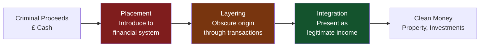
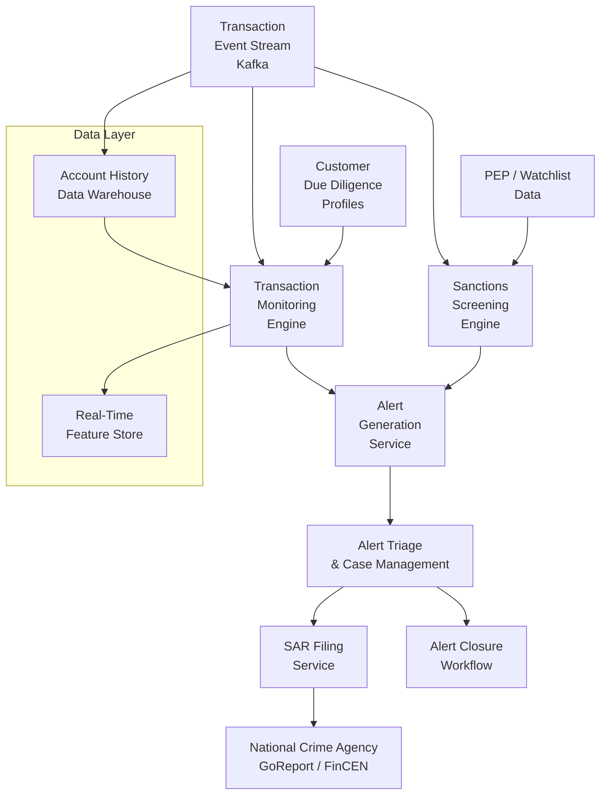
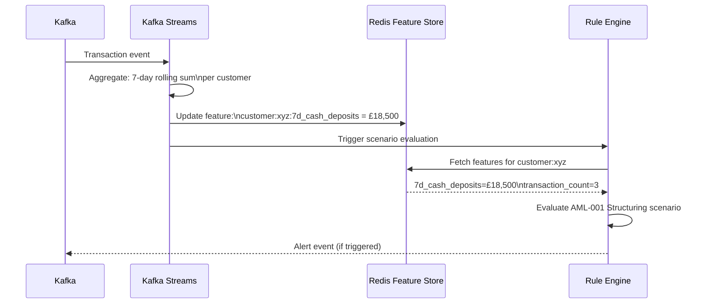
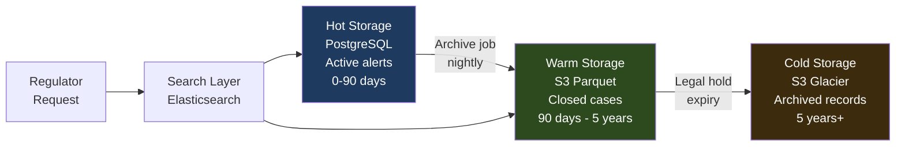

# AML Architecture — Anti-Money Laundering Systems Design

> [!NOTE]
> Anti-money laundering (AML) systems are both a regulatory mandate and a complex engineering challenge. This lesson examines the architecture of transaction monitoring systems, alert generation, and the technical patterns that make large-scale AML programmes operationally sustainable.

## The Regulatory Context

Under the Financial Action Task Force (FATF) recommendations and national regulations (UK POCA 2002, US Bank Secrecy Act, EU AMLD6), financial institutions must:

1. **Monitor** customer transactions for suspicious activity
2. **Screen** transactions against sanctions lists
3. **File** Suspicious Activity Reports (SARs) with the relevant authority
4. **Maintain** records for a minimum of 5 years
5. **Conduct** ongoing due diligence on customers

Non-compliance consequences include licence revocation, unlimited fines (Danske Bank paid $2B in 2022), and criminal liability for directors.

---

## The Three Stages of Money Laundering

Understanding what you are detecting shapes what you build:



| Stage | Money Laundering Typologies | AML Detection Signals |
|---|---|---|
| **Placement** | Cash structuring (smurfing), cash-intensive business deposits | Transactions just below reporting thresholds, multiple small deposits |
| **Layering** | Wire transfers through multiple jurisdictions, shell companies | Rapid round-trip transfers, high-risk jurisdiction exposure, PEP connections |
| **Integration** | Real estate purchases, luxury goods, loan-back schemes | Large unexplained asset purchases, loan repayments from unexpected sources |

---

## High-Level AML System Architecture



---

## Transaction Monitoring Engine — Core Architecture

The transaction monitoring engine evaluates every transaction against a library of **scenarios** — rule-based patterns that identify suspicious behaviour.

### Rule Engine Design

```java
// Rule definition — each scenario captures a specific money laundering typology
public interface AmlScenario {
    String getScenarioId();
    String getTypology();           // e.g., "STRUCTURING", "RAPID_MOVEMENT"
    AlertSeverity getSeverity();
    boolean evaluate(TransactionContext context);
    AlertEvidence collectEvidence(TransactionContext context);
}

// Structuring detection: transactions just below reporting thresholds
@Component
public class StructuringScenario implements AmlScenario {
    
    private static final BigDecimal REPORTING_THRESHOLD = new BigDecimal("10000");
    private static final BigDecimal STRUCTURING_WINDOW  = new BigDecimal("9000");
    private static final int LOOKBACK_DAYS = 7;
    private static final int MIN_TRANSACTIONS = 3;

    @Override
    public String getScenarioId() { return "AML-001"; }
    
    @Override
    public String getTypology() { return "STRUCTURING"; }
    
    @Override
    public AlertSeverity getSeverity() { return AlertSeverity.HIGH; }

    @Override
    public boolean evaluate(TransactionContext ctx) {
        // Detect multiple cash deposits, each below reporting threshold,
        // aggregating to above threshold within the lookback window
        List<Transaction> recentCashDeposits = ctx.getTransactions().stream()
            .filter(t -> t.getType() == TransactionType.CASH_DEPOSIT)
            .filter(t -> t.getAmount().compareTo(STRUCTURING_WINDOW) >= 0)
            .filter(t -> t.getAmount().compareTo(REPORTING_THRESHOLD) < 0)
            .filter(t -> t.getTimestamp().isAfter(now().minusDays(LOOKBACK_DAYS)))
            .collect(toList());

        if (recentCashDeposits.size() < MIN_TRANSACTIONS) {
            return false;
        }

        BigDecimal aggregate = recentCashDeposits.stream()
            .map(Transaction::getAmount)
            .reduce(BigDecimal.ZERO, BigDecimal::add);

        return aggregate.compareTo(REPORTING_THRESHOLD) >= 0;
    }

    @Override
    public AlertEvidence collectEvidence(TransactionContext ctx) {
        // Collect the specific transactions that triggered the scenario
        List<Transaction> evidence = ctx.getTransactions().stream()
            .filter(t -> t.getType() == TransactionType.CASH_DEPOSIT)
            .filter(t -> t.getAmount().compareTo(REPORTING_THRESHOLD) < 0)
            .filter(t -> t.getTimestamp().isAfter(now().minusDays(LOOKBACK_DAYS)))
            .collect(toList());
            
        return AlertEvidence.builder()
            .scenarioId(getScenarioId())
            .transactions(evidence)
            .aggregateAmount(evidence.stream().map(Transaction::getAmount)
                .reduce(BigDecimal.ZERO, BigDecimal::add))
            .build();
    }
}
```

### Windowed Aggregation Pattern

Many AML scenarios require aggregation over time windows. This is architecturally challenging at scale.



```java
// Kafka Streams: 7-day rolling window for cash deposit aggregation
StreamsBuilder builder = new StreamsBuilder();

KStream<String, Transaction> transactions = builder.stream("transactions");

// Filter to cash deposits only
KStream<String, Transaction> cashDeposits = transactions
    .filter((key, txn) -> txn.getType() == TransactionType.CASH_DEPOSIT);

// Aggregate into 7-day rolling windows keyed by customer ID
KTable<Windowed<String>, BigDecimal> weeklyAggregates = cashDeposits
    .selectKey((key, txn) -> txn.getCustomerId())
    .groupByKey()
    .windowedBy(TimeWindows.ofSizeWithNoGrace(Duration.ofDays(7)))
    .aggregate(
        () -> BigDecimal.ZERO,
        (customerId, txn, aggregate) -> aggregate.add(txn.getAmount()),
        Materialized.with(Serdes.String(), bigDecimalSerde)
    );

// Forward aggregation updates to the feature store for real-time scenario evaluation
weeklyAggregates.toStream()
    .foreach((windowedKey, aggregate) ->
        featureStore.update(windowedKey.key(), "7d_cash_deposits", aggregate));
```

---

## Alert Management — Reducing Analyst Fatigue

The critical operational challenge in AML is alert volume. A naive rule engine generates thousands of false positives per day, overwhelming analysts and causing real cases to be missed.

### Alert Scoring and Prioritisation

```java
// Multi-dimensional alert scoring
public class AlertScoringService {

    public AlertScore score(AmlAlert alert, CustomerProfile customer) {
        int baseScore = alert.getScenario().getSeverity().getBaseScore();
        
        // Risk multipliers
        int riskMultiplier = calculateRiskMultiplier(customer, alert);
        
        // Recency boost: same customer triggered another alert in past 30 days
        int recencyBoost = alertRepository
            .countRecentAlerts(customer.getId(), Duration.ofDays(30)) > 0 ? 15 : 0;
        
        // PEP / adverse media boost
        int pepBoost = customer.isPep() ? 25 : 0;
        
        // High-risk jurisdiction boost
        int jurisdictionBoost = alert.involvesHighRiskJurisdiction() ? 20 : 0;

        int totalScore = Math.min(100, baseScore + riskMultiplier 
            + recencyBoost + pepBoost + jurisdictionBoost);

        return AlertScore.builder()
            .score(totalScore)
            .priority(AlertPriority.fromScore(totalScore))
            .reasoning(buildScoreReasoning(baseScore, recencyBoost, pepBoost, jurisdictionBoost))
            .build();
    }
    
    private int calculateRiskMultiplier(CustomerProfile customer, AmlAlert alert) {
        return switch (customer.getRiskRating()) {
            case HIGH     -> 20;
            case MEDIUM   -> 10;
            case LOW      -> 0;
            case STANDARD -> -5;  // Established, long-standing customer
        };
    }
}
```

### Alert Deduplication

```java
// Prevent the same suspicious behaviour from generating duplicate alerts
// Uses a 72-hour deduplication window per customer per scenario
public class AlertDeduplicationService {

    private static final Duration DEDUP_WINDOW = Duration.ofHours(72);

    public boolean isDuplicate(AmlAlert newAlert) {
        String dedupKey = buildDedupKey(newAlert);
        
        // Check if a similar alert exists within the deduplication window
        Optional<AmlAlert> existing = alertRepository.findByDedupKey(
            dedupKey, 
            Instant.now().minus(DEDUP_WINDOW)
        );
        
        if (existing.isPresent()) {
            // Merge evidence into existing alert rather than creating a new one
            alertRepository.mergeEvidence(existing.get().getId(), newAlert.getEvidence());
            return true;
        }
        
        return false;
    }

    private String buildDedupKey(AmlAlert alert) {
        // Key = customer + scenario + time bucket (day precision)
        return DigestUtils.sha256Hex(
            alert.getCustomerId() + ":" +
            alert.getScenarioId() + ":" +
            alert.getTriggeredAt().truncatedTo(ChronoUnit.DAYS)
        );
    }
}
```

---

## Audit Trail Requirements

AML systems have strict record-keeping requirements. Every decision must be auditable for 5+ years with tamper evidence.

```java
// Immutable audit event — stored in an append-only log
@Value
@Builder
public class AmlAuditEvent {
    String eventId;           // UUID
    String alertId;
    String customerId;
    AuditEventType eventType; // ALERT_GENERATED, ANALYST_DECISION, SAR_FILED
    String actorId;           // system or analyst ID
    Instant timestamp;
    String decision;          // CLOSE_FALSE_POSITIVE, ESCALATE, FILE_SAR
    String reasoning;         // analyst notes (required for SAR filing)
    String previousHash;      // hash of prior event — tamper-evident chain
    String eventHash;         // SHA-256 of this event's content
}

// Audit log service — append-only, never allows updates
@Service
public class AmlAuditService {
    
    @Transactional
    public void record(AmlAuditEvent event) {
        // Chain the hash to previous event for tamper evidence
        String previousHash = auditRepository.getLatestHash(event.getAlertId())
            .orElse("GENESIS");
        
        AmlAuditEvent chainedEvent = event.toBuilder()
            .previousHash(previousHash)
            .eventHash(computeHash(event, previousHash))
            .build();
        
        auditRepository.insert(chainedEvent);  // INSERT only — no UPDATE or DELETE
    }

    private String computeHash(AmlAuditEvent event, String previousHash) {
        String content = event.getAlertId() + event.getTimestamp() + 
                         event.getDecision() + event.getActorId() + previousHash;
        return DigestUtils.sha256Hex(content);
    }
}
```

---

## Regulatory Data Retention Architecture



The retention architecture must support:
- **Sub-second retrieval** of active alert data (analyst workflow)
- **5-minute retrieval** of cases from the past year (audit requests)
- **24-hour retrieval** of archived records 5+ years old (court orders)
- **Cryptographic verification** that records have not been altered

<!-- KNOWLEDGE-CHECK
{
  "questions": [
    {
      "id": "q1",
      "text": "An AML analyst reports that the structuring scenario (AML-001) is generating hundreds of false positives for small business customers who make regular daily cash deposits. What is the principal engineer's recommended fix?",
      "options": [
        "Increase the reporting threshold from £10,000 to £50,000 to reduce alerts",
        "Disable the scenario until a better one can be written",
        "Add a customer risk segmentation layer: suppress AML-001 for customers with an established cash deposit pattern and Low risk rating, with a 30-day lookback",
        "Move to a pure ML-based approach and remove all rule-based scenarios"
      ],
      "correct": 2,
      "explanation": "Adding contextual suppression based on customer risk profile and established behaviour patterns reduces false positives without disabling legitimate detection. Changing the threshold is a regulatory risk. Disabling the scenario removes a mandated detection capability. Pure ML without rules fails regulatory explainability requirements."
    },
    {
      "id": "q2",
      "text": "Your AML transaction monitoring system must process 50,000 transactions per second at peak. The rule engine evaluates 40 scenarios per transaction. What is the most scalable architecture?",
      "options": [
        "Process each transaction synchronously in a monolithic rule engine",
        "Pre-compute customer risk features in a feature store; evaluate lightweight rules against features rather than raw transaction data",
        "Sample transactions — only evaluate 10% for AML scenarios",
        "Increase database read replicas to handle the scenario evaluation load"
      ],
      "correct": 1,
      "explanation": "Pre-computing features (rolling window aggregates, customer risk scores) in a feature store separates the expensive aggregation from the lightweight evaluation. Rules evaluate pre-computed features rather than scanning transaction history per transaction. This is the industry standard approach (used by Visa, Mastercard, Stripe). Sampling misses real suspicious activity. Synchronous processing cannot scale to 50k TPS with 40 scenarios."
    },
    {
      "id": "q3",
      "text": "A SAR (Suspicious Activity Report) was filed 3 years ago. A regulator now requests the complete audit trail for that case, including who made every decision and when. Your audit log shows a gap of 2 days where no events were recorded for that alert. What do you do?",
      "options": [
        "Reconstruct the missing events from analyst memory",
        "Backfill the audit log with estimated events to cover the gap",
        "Report the gap accurately to the regulator — do not fabricate records; investigate whether a system outage caused the gap and document the finding",
        "Close the regulator's request with the records you have"
      ],
      "correct": 2,
      "explanation": "Fabricating or reconstructing audit records is a criminal offence in most jurisdictions. The correct response is transparent disclosure of the gap, investigation of its cause, and documentation of the finding. If the gap was caused by a system outage, that becomes part of the evidence. Regulators expect accurate records, not perfect ones."
    },
    {
      "id": "q4",
      "text": "The alert deduplication service uses a 72-hour window. An analyst closes an alert as 'false positive' at hour 48. At hour 71, new evidence arrives that the same customer has conducted additional suspicious transactions. What happens?",
      "options": [
        "A new alert is generated immediately since the original was closed",
        "The deduplication prevents any alert for 72 hours regardless of new evidence",
        "The deduplication key includes the analyst decision — a new alert is generated post-closure regardless of the window",
        "The new transactions are silently merged into the closed alert"
      ],
      "correct": 2,
      "explanation": "The deduplication key should not suppress alerts once the original has been closed by an analyst. Deduplication is for preventing duplicate open alerts — once a decision has been made, new evidence should generate a fresh alert. The dedup logic should check for OPEN alerts within the window, not all alerts."
    }
  ]
}
-->

<!-- PRACTICAL-CHALLENGE
{
  "title": "AML Architecture \u2014 Anti-Money Laundering Systems Design \u2014 Production Implementation",
  "difficulty": "advanced",
  "estimatedMinutes": 90,
  "tasks": [
    {
      "id": "1",
      "description": "Design the Kafka Streams topology"
    },
    {
      "id": "2",
      "description": "Model the alert severity scoring"
    },
    {
      "id": "3",
      "description": "Design the audit schema"
    },
    {
      "id": "4",
      "description": "Write a Testcontainers integration test"
    }
  ]
}
-->
