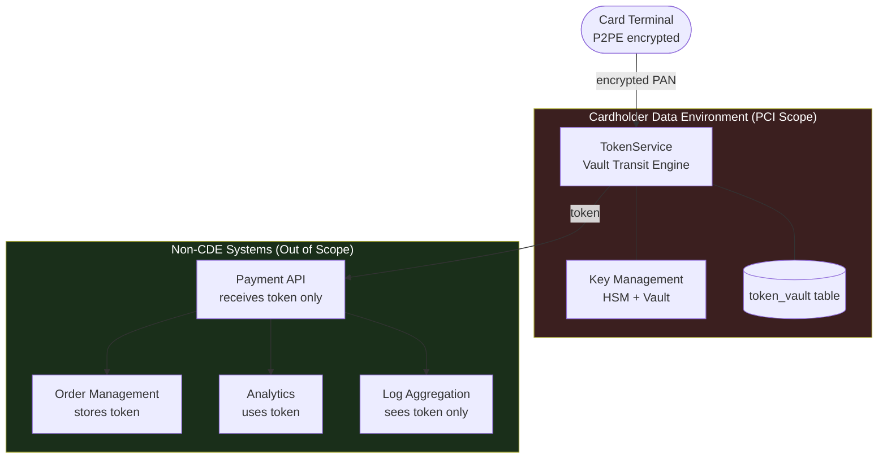

The Payment Card Industry Data Security Standard governs every system that stores, processes, or transmits cardholder data. A PCI audit is not merely a compliance checkbox — the scope of that audit is an architectural decision that determines the complexity, cost, and risk of your entire card infrastructure. Engineers who understand scope reduction strategies can shrink a PCI audit from examining 500 systems to 12. Those who do not can inadvertently pull every microservice, logging pipeline, and analytics warehouse into the Cardholder Data Environment.

This lesson teaches PCI DSS from the architect's perspective: how to draw the CDE boundary, how tokenisation collapses scope, how to implement PAN handling correctly in Java, and what the audit-relevant requirements demand from your code.

## Learning Objectives

By the end of this lesson you will be able to:

- Define the Cardholder Data Environment (CDE) and explain which systems fall within PCI scope
- Apply scope reduction strategies — tokenisation and Point-to-Point Encryption (P2PE) — to minimise audit surface
- Implement PAN tokenisation using HashiCorp Vault's Transit Secrets Engine in Java
- Annotate sensitive fields with `@MaskPan` to prevent PANs from appearing in logs
- Design network segmentation between CDE and non-CDE zones
- Implement Requirement 10 (audit logging) with the mandatory event types
- Explain Requirement 6 (secure development) and integrate SAST into CI
- Distinguish between SAQ eligibility and full PCI DSS assessment

## Business Context

In 2013, Target Corporation suffered a breach affecting 40 million payment card records. The breach entered through an HVAC vendor's network credentials. The vendor's network was connected to Target's corporate network, which was connected to the point-of-sale network. Because Target had not segmented its CDE from adjacent systems, the blast radius was catastrophic. Post-breach costs exceeded $292 million — before civil litigation.

For engineers the lesson is architectural: **network segmentation is a PCI requirement, not a best practice**. PCI DSS Requirement 1 mandates firewall controls isolating the CDE. The 2024 version of PCI DSS v4.0 adds further controls around multi-factor authentication, software supply chain security, and targeted risk analysis. The architectural decisions you make at design time determine whether a breach of a peripheral system can reach card data at all.

## PCI DSS Scope — The CDE Boundary

The **Cardholder Data Environment** is defined as:

> All system components that store, process, or transmit cardholder data (CHD) or sensitive authentication data (SAD), plus the security systems that protect them.

**Cardholder Data (CHD):** Primary Account Number (PAN), cardholder name, expiry date, service code.

**Sensitive Authentication Data (SAD):** Full magnetic stripe, CVV/CVC, PIN block. SAD must **never** be stored after authorisation, even encrypted.

| Data Element | Storage Permitted? | Encryption Required? |
|---|---|---|
| PAN | Yes, with controls | Yes |
| Cardholder name | Yes | Recommended |
| Expiry date | Yes | Recommended |
| Service code | Yes | Recommended |
| Full magnetic stripe | **NO** | — |
| CVV/CVC | **NO** | — |
| PIN / PIN block | **NO** | — |

> [!WARNING]
> Storing CVV — even encrypted — is a PCI DSS violation that invalidates your compliance. It is not a risk decision; it is a prohibition. If your code ever persists a CVV field to any storage, it is non-compliant regardless of encryption.

## Scope Reduction Strategies

The most valuable engineering decision in PCI architecture is reducing scope before the audit starts.

**Tokenisation** replaces the PAN with a non-sensitive surrogate token. The token can be stored and used by any downstream system without that system being in PCI scope, because the token has no value outside your tokenisation service.

**Point-to-Point Encryption (P2PE)** encrypts card data at the point of capture (card terminal) using a key the merchant never holds. Data enters and leaves the merchant's environment encrypted; the merchant's systems never see the PAN in cleartext.



## PAN Tokenisation Implementation

HashiCorp Vault's Transit Secrets Engine provides encryption suitable for PAN tokenisation:

```java
@Service
@RequiredArgsConstructor
@Slf4j
public class TokenService {

    private final VaultTemplate vaultTemplate;
    private static final String KEY_NAME = "pan-tokenisation-key";

    /**
     * Tokenises a PAN. The returned CardToken is the only object
     * that flows outside the CDE. The PAN is NEVER logged.
     */
    public CardToken tokenise(String pan) {
        validatePanFormat(pan);

        String ciphertext = vaultTemplate.opsForTransit()
            .encrypt(KEY_NAME,
                VaultTransitOperations.Plaintext.of(pan.getBytes(StandardCharsets.UTF_8)))
            .getCiphertext();

        String last4 = pan.substring(pan.length() - 4);
        String bin   = pan.substring(0, 6);

        // Safe: BIN identifies card network/issuer, last4 is non-sensitive alone
        log.info("PAN tokenised bin={} last4={}", bin, last4);

        return CardToken.builder()
            .token(ciphertext)
            .last4(last4)
            .bin(bin)
            .createdAt(Instant.now())
            .build();
    }

    /**
     * Detokenises only within the CDE service boundary.
     * Access is restricted by network policy — non-CDE services
     * have no route to this endpoint.
     */
    public String detokenise(String token) {
        byte[] plaintext = vaultTemplate.opsForTransit()
            .decrypt(KEY_NAME, token)
            .getPlaintext();
        return new String(plaintext, StandardCharsets.UTF_8);
    }

    private void validatePanFormat(String pan) {
        if (pan == null || !pan.matches("\\d{13,19}")) {
            throw new InvalidPanException("PAN format validation failed");
        }
        if (!luhnCheck(pan)) {
            throw new InvalidPanException("PAN fails Luhn check");
        }
    }

    private boolean luhnCheck(String pan) {
        int sum = 0;
        boolean alternate = false;
        for (int i = pan.length() - 1; i >= 0; i--) {
            int n = Character.getNumericValue(pan.charAt(i));
            if (alternate) {
                n *= 2;
                if (n > 9) n -= 9;
            }
            sum += n;
            alternate = !alternate;
        }
        return sum % 10 == 0;
    }
}
```

> [!NOTE]
> `CardToken` is the only type that flows outside the CDE. It contains `token`, `last4`, and `bin`. It never contains the full PAN. All downstream services — order management, analytics, reconciliation — receive a `CardToken`, never a `String pan`.

## @MaskPan — Preventing PAN Leakage into Logs

One of the most common PCI failures is PAN appearing in application logs. A single log statement `log.info("Processing card {}", pan)` sends millions of PANs to your log aggregation platform, pulling it into PCI scope.

```java
/**
 * Marks a field or parameter as containing a PAN.
 * Used by the PanMaskingConverter and static analysis rules
 * to prevent logging of raw PANs.
 */
@Target({ElementType.FIELD, ElementType.PARAMETER})
@Retention(RetentionPolicy.RUNTIME)
@Documented
public @interface MaskPan {
    // Mask pattern: show BIN (6) and last 4, replace middle
    // e.g. 4111111111111111 → 411111******1111
}

public final class PanMasker {

    private static final Pattern PAN_PATTERN =
        Pattern.compile("\\b(\\d{6})\\d{6,9}(\\d{4})\\b");

    private PanMasker() {}

    /**
     * Scans any string and masks PAN-like sequences.
     * Applied by a Logback MessageConverter on every log line.
     */
    public static String maskPansInString(String input) {
        if (input == null) return null;
        return PAN_PATTERN.matcher(input).replaceAll("$1******$2");
    }
}
```

Register as a Logback `MessageConverter` in `logback-spring.xml` so it fires globally without per-developer discipline:

```xml
<!-- logback-spring.xml -->
<conversionRule conversionWord="maskedMsg"
    converterClass="com.example.pci.logging.PanMaskingConverter"/>
<appender name="CONSOLE" class="ch.qos.logback.core.ConsoleAppender">
  <encoder>
    <pattern>%d{ISO8601} %-5level [%thread] %logger - %maskedMsg%n</pattern>
  </encoder>
</appender>
```

## Key Management Lifecycle (Requirement 3.7)

| Phase | Control | PCI DSS v4.0 Requirement |
|---|---|---|
| **Generation** | HSM or Vault — never software-only | Req 3.7.1 |
| **Distribution** | Encrypted key exchange; no cleartext in transit | Req 3.7.2 |
| **Storage** | Key encrypted by Key Encryption Key (KEK) | Req 3.7.3 |
| **Use** | Purpose-specific keys (tokenisation ≠ storage encryption) | Req 3.7.4 |
| **Rotation** | Annual minimum; Vault `auto_rotate_period` = 8760h | Req 3.7.5 |
| **Retirement** | Vault key version archival; mark min_decryption_version | Req 3.7.6 |
| **Destruction** | Documented ceremony with dual control and written record | Req 3.7.7 |

## Requirement 10 — Audit Logging

PCI DSS Requirement 10 mandates audit logs for specific event types. Logs must be tamper-evident and retained for 12 months (3 months immediately available):

```java
public enum PciAuditEventType {
    USER_ACCESS_CARDHOLDER_DATA,   // Req 10.2.1
    PRIVILEGED_ACTION,              // Req 10.2.2
    AUDIT_LOG_ACCESS,               // Req 10.2.3
    FAILED_ACCESS_ATTEMPT,          // Req 10.2.4
    AUTH_MECHANISM_USE,             // Req 10.2.5
    AUDIT_LOG_LIFECYCLE,            // Req 10.2.6
    SYSTEM_OBJECT_CHANGE            // Req 10.2.7
}

@Service
@RequiredArgsConstructor
public class PciAuditLogger {

    private final PciAuditEventRepository repository;

    public void log(PciAuditEventType type, String userId, String action,
                    String resourceId, String outcome, String remoteIp) {
        PciAuditEvent event = PciAuditEvent.builder()
            .id(UUID.randomUUID())
            .eventType(type)
            .userId(userId)
            .action(action)
            .resourceId(resourceId)
            .outcome(outcome)
            .remoteIp(remoteIp)
            .occurredAt(Instant.now())
            .build();
        repository.save(event);
    }
}
```

## Requirement 6 — Secure Development and SAST in CI

PCI DSS v4.0 Requirement 6 mandates security controls throughout the development lifecycle:

| Sub-requirement | Control | CI Implementation |
|---|---|---|
| Req 6.2 | Bespoke software protection against known vulnerabilities | OWASP Dependency-Check, Snyk |
| Req 6.3 | Security vulnerabilities identified and addressed | SAST: SpotBugs + Find Security Bugs |
| Req 6.4 | Public-facing web applications protected from attacks | WAF; OWASP ZAP in pipeline |

```yaml
# .github/workflows/pci-security-checks.yml (excerpt)
- name: SAST — Find Security Bugs
  run: mvn spotbugs:check -Dspotbugs.includeFilterFile=spotbugs-security-filter.xml

- name: Dependency vulnerability scan
  run: mvn org.owasp:dependency-check-maven:check
       -DfailBuildOnCVSS=7

- name: PAN leak detection in source
  run: grep -r --include="*.java" -E '\b[0-9]{13,19}\b' src/ && exit 1 || exit 0
```

## SAQ vs Full PCI DSS Assessment

| Assessment Type | Who Qualifies | Key Condition |
|---|---|---|
| **SAQ A** | Card-not-present merchants | All CHD functions outsourced; no electronic storage of CHD |
| **SAQ A-EP** | E-commerce merchants | Third-party payment page but merchant controls the page |
| **SAQ D — Merchants** | All others | Store/process/transmit CHD directly |
| **SAQ D — Service Providers** | Service providers | Store/process/transmit CHD on behalf of merchants |
| **Full ROC** | Level 1 merchants/SPs | > 6M transactions/year or mandated by card brand |

> [!IMPORTANT]
> If you use Stripe, Braintree, or Adyen with their hosted fields (card data never touches your servers), you likely qualify for SAQ A. If your servers ever touch a PAN — even in memory — you need at minimum SAQ D. This architecture decision is worth engineering time before the first line of code.

## Knowledge Check

**Q1: Your team is building a payment processing service. A developer proposes logging the full request object for debugging, which includes the `cardNumber` field. What are the PCI DSS implications, and how do you fix it?**

A: Logging a PAN violates PCI DSS Requirement 3.4 (render PAN unreadable anywhere it is stored) and Requirement 10 (log contents must not contain sensitive data). The log aggregation system would immediately enter PCI scope. The fix is multi-layered: (1) Apply the `@MaskPan` annotation to the `cardNumber` field and configure a Logback `MessageConverter` to scrub PAN patterns from all log output. (2) Override `toString()` on the payment request object to mask the card number. (3) Add a SAST rule to the CI pipeline that flags any method call where a parameter annotated `@MaskPan` is passed directly to a logging method. (4) Use a data-class design where the `CardToken` replaces `cardNumber` at the API boundary — the PAN never enters the payment service at all.

**Q2: What is the difference between tokenisation and encryption for PCI scope reduction, and when would you choose each?**

A: Tokenisation replaces the PAN with a surrogate value that has no algorithmic relationship to the original; it cannot be reversed without access to the token vault. Downstream systems storing or processing tokens are entirely out of PCI scope. Encryption reversibly transforms the PAN; any system with access to the decryption key is in scope, and key management must meet PCI Requirement 3.7. For scope reduction, tokenisation is superior — it removes scope rather than merely hardening it. Choose tokenisation for any system that uses the card reference for recurring billing, order correlation, or analytics. Choose encryption only where you must recover the original PAN — e.g., within the CDE itself when preparing an authorisation request to the card network.

## Practical Challenge

**Scenario:** Your fintech is launching a card-issuing product. You are designing the data infrastructure from scratch and want to minimise PCI scope to a single internal service with a CDE boundary at the network layer.

**Task 1 — TokenService integration test:** Write a Spring Boot integration test using Testcontainers to spin up a Vault instance. Configure the Transit Secrets Engine, generate a tokenisation key, and verify that `tokenise()` produces a non-PAN token and `detokenise()` recovers the original PAN. Assert that the token does not contain the original PAN as a substring. Assert that tokenising the same PAN twice produces different ciphertexts (Vault Transit uses nonce-based encryption).

**Task 2 — PAN log scanner:** Write a utility class `PanLogScanner` with a method `List<LogLineViolation> scan(Path logFile)` that reads a log file and returns every line containing an unmasked PAN-pattern (using the Luhn check for validation). Include the line number, the matched sequence, and the log file path in each violation. This becomes a CI quality gate that fails the build if violations are found.

**Task 3 — Network segmentation design:** Draw (as a Mermaid diagram) the network architecture for a card-issuing platform with: (a) a CDE subnet containing the TokenService, Vault cluster, and card authorisation service; (b) a DMZ containing the public-facing API gateway; (c) a corporate subnet containing analytics, logging, and internal tooling. Mark all firewall boundaries and label which traffic crosses each boundary with the protocol and port.

**Task 4 — Requirement 10 test:** Write a JUnit 5 test that calls `TokenService.detokenise()` with a valid token and verifies that a `PciAuditEvent` of type `USER_ACCESS_CARDHOLDER_DATA` was persisted with the correct `userId`, `resourceId` (the token), and `outcome = "SUCCESS"`. Use an in-memory H2 repository. Assert that `occurredAt` is within 2 seconds of the call time.

<!-- KNOWLEDGE-CHECK
{
  "questions": [
    {
      "text": "What is the primary advantage of tokenisation over encryption for PCI DSS scope reduction?",
      "options": ["Tokenisation is faster than encryption", "Tokenisation removes systems from PCI scope entirely because tokens have no algorithmic relationship to the PAN; encryption merely hardens in-scope systems", "Tokenisation is cheaper to implement than key management", "Tokenisation satisfies Requirement 3 without any additional controls"],
      "correct": 1,
      "explanation": "Systems storing tokens are entirely out of PCI scope because a token cannot be reversed without access to the token vault. Encryption keeps systems in scope since any system with access to the decryption key remains a CDE component subject to all PCI requirements."
    },
    {
      "text": "A developer proposes logging full payment request objects for debugging, which includes a cardNumber field. What is the most critical PCI DSS violation this creates?",
      "options": ["It violates Requirement 6 on secure development", "It violates Requirement 3.4 (PAN must be unreadable where stored) and immediately brings the log aggregation system into PCI scope", "It violates Requirement 8 on user authentication", "It is only a violation if the logs are stored longer than 90 days"],
      "correct": 1,
      "explanation": "PCI DSS Requirement 3.4 mandates that PANs be rendered unreadable anywhere they are stored. A PAN in a log file means every log aggregation system, SIEM, and log archive enters the Cardholder Data Environment — dramatically expanding audit scope and cost."
    },
    {
      "text": "Which SAQ type applies to an e-commerce merchant using Stripe hosted fields where card data never touches their servers?",
      "options": ["Full ROC (Report on Compliance)", "SAQ D — Merchants", "SAQ A-EP", "SAQ A"],
      "correct": 3,
      "explanation": "SAQ A applies when all cardholder data functions are fully outsourced, the merchant does not store, process, or transmit CHD electronically, and no electronic storage of CHD occurs on the merchant's systems. Using hosted payment fields from Stripe or Braintree where the PAN never touches merchant servers qualifies for SAQ A."
    }
  ]
}
-->

<!-- PRACTICAL-CHALLENGE
{
  "title": "Design and Implement a PCI-Scoped Tokenisation Service",
  "difficulty": "advanced",
  "estimatedMinutes": 70,
  "tasks": [
    {"id": "1", "description": "Implement a TokenService backed by HashiCorp Vault Transit Secrets Engine with tokenise(pan) and detokenise(token) methods. Write a Spring Boot integration test using Testcontainers to spin up a Vault instance, configure the Transit engine, and verify that the same PAN tokenised twice produces different ciphertexts and that detokenisation recovers the original value."},
    {"id": "2", "description": "Write a PanLogScanner utility with a scan(Path logFile) method that reads a log file line by line and returns every line containing an unmasked PAN pattern (validated using the Luhn algorithm). Include line number, matched sequence, and file path in each LogLineViolation. Add this as a CI quality gate that fails the build if violations are found."},
    {"id": "3", "description": "Implement a @PciAuditLog AOP aspect that intercepts all method calls within the CDE package, extracts the caller identity from the security context, records a PciAuditEvent with the method name, parameters (masked), and outcome (SUCCESS or FAILURE with exception type), and persists it to a PCI audit log table that has UPDATE and DELETE revoked at the database level."},
    {"id": "4", "description": "Design a Mermaid network diagram showing: a CDE subnet containing the TokenService, Vault cluster, and card authorisation service; a DMZ containing the public API gateway; a corporate subnet containing analytics and logging. Label all firewall boundaries with protocol and port. Document which traffic crosses each boundary and why each crossing is necessary."}
  ]
}
-->
