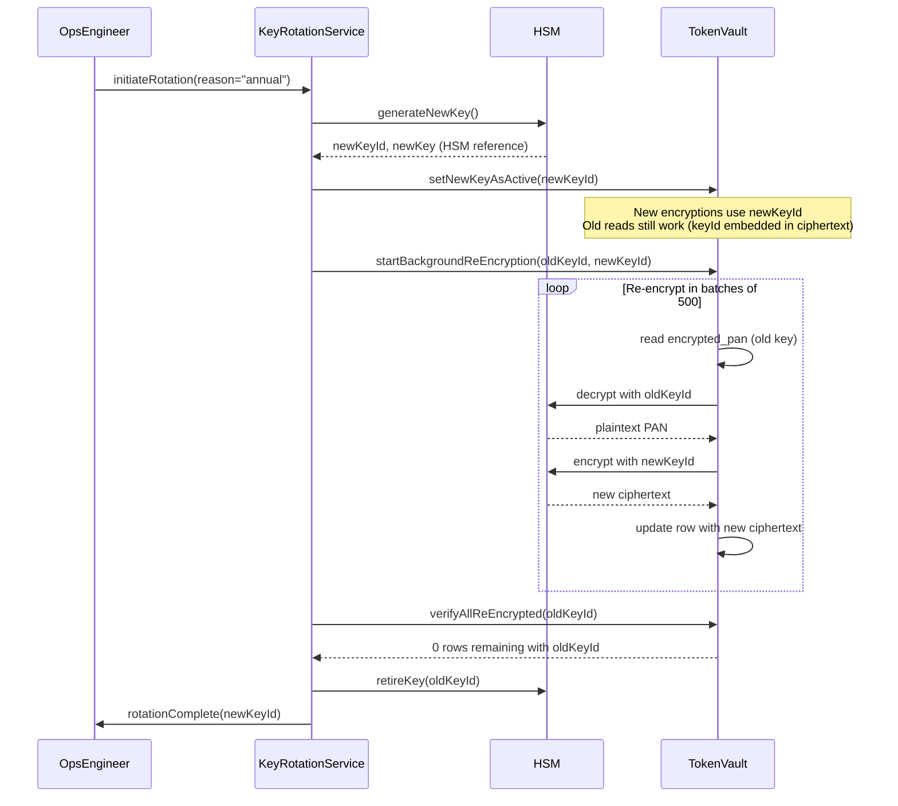

# PCI DSS Architecture — Cardholder Data Environment Design

## Overview

PCI DSS (Payment Card Industry Data Security Standard) is the contractual and regulatory framework governing how organisations that store, process, or transmit cardholder data must secure that data. Version 4.0.1 (current as of 2025) comprises 12 requirements mapping directly to engineering decisions: network segmentation, access control, encryption, vulnerability management, monitoring, and testing.

This lesson covers the engineering architecture of a compliant Cardholder Data Environment (CDE): scope reduction through tokenisation, field-level encryption for data at rest, TLS enforcement, HSM key management, audit log tamper-evidence, and the testing regime required by Requirements 6, 10, and 11. These are not checkbox exercises — they represent engineering patterns that prevent real financial crime.

---

## 1. PCI DSS Overview — 12 Requirements Mapped to Engineering

### 1.1 The 12 Requirements

| Req | Category | Engineering Obligation |
|-----|----------|----------------------|
| 1 | Network security | Firewalls and routers that restrict CDE ingress/egress |
| 2 | Secure configurations | No vendor defaults; hardened OS and application configs |
| 3 | Cardholder data at rest | Encrypt PAN; minimise storage; mask in display |
| 4 | Data in transit | TLS 1.2+ enforced; never transmit PAN over unencrypted channels |
| 5 | Malware protection | Anti-malware on all system components in CDE |
| 6 | Secure software development | SAST/DAST in pipeline; patch management within 1 month |
| 7 | Access control | Need-to-know; least privilege for CDE access |
| 8 | Identity and authentication | MFA for all non-console CDE access; no shared accounts |
| 9 | Physical security | Physical access controls to CDE servers |
| 10 | Audit logs | Tamper-evident logs retained for 12 months; alert within 24h |
| 11 | Security testing | ASV scans quarterly; penetration test annually |
| 12 | Information security policy | Written policies; annual review; risk assessments |

### 1.2 SAQ vs ROC

| Assessment Type | Who Uses It | Complexity |
|----------------|-------------|------------|
| SAQ A | Card-not-present merchants fully outsourcing card data to payment gateway | Low |
| SAQ A-EP | E-commerce merchants with payment page on their domain | Medium |
| SAQ D | Merchants storing or processing PAN themselves | High |
| ROC (Report on Compliance) | Level 1 merchants (>6M transactions/year) and all service providers | Full audit by QSA |

For a fintech processing card payments directly (card issuing, acquiring, or card-present POS), a full ROC with a Qualified Security Assessor (QSA) is required at Level 1.

### 1.3 Merchant Levels

| Level | Volume Threshold | Assessment |
|-------|-----------------|------------|
| 1 | > 6 million Visa/Mastercard transactions/year | Annual ROC by QSA |
| 2 | 1–6 million transactions/year | Annual SAQ or ROC |
| 3 | 20,000–1 million e-commerce transactions/year | Annual SAQ |
| 4 | < 20,000 e-commerce OR any other up to 1 million | Annual SAQ (Acquirer may require ROC) |

---

## 2. CDE Scope Reduction

### 2.1 The Most Powerful Compliance Engineering Decision

The single highest-impact engineering choice is **scope reduction**: designing the system so that the smallest possible surface area handles cardholder data. Every system that never touches a PAN, CVV, or expiry date is outside scope and requires no PCI DSS controls.

The primary mechanism is outsourcing card data capture and storage to a certified payment gateway or token vault:

```
WITHOUT SCOPE REDUCTION (high scope):

  ┌────────────────────────────────────────────────────────────────┐
  │                         IN SCOPE (CDE)                         │
  │  Mobile App  ──►  API Gateway  ──►  Payment Service  ──►  DB   │
  │                                     stores PAN                  │
  └────────────────────────────────────────────────────────────────┘

WITH SCOPE REDUCTION (low scope):

  ┌─────────────────┐           ┌────────────────────────────────┐
  │  OUT OF SCOPE   │           │       IN SCOPE (CDE)           │
  │                 │           │                                │
  │  Mobile App     │   token   │  API Gateway  ──►  Payment     │
  │  (SDK sends PAN │──────────►│               ◄── Service      │
  │  directly to    │           │  token vault      (token only) │
  │  payment gateway│           │  (gateway)                     │
  │  via iframe/SDK)│           └────────────────────────────────┘
  └─────────────────┘
  
  Your API never sees the PAN. Your database never stores it.
  Your engineers never have access to cardholder data.
```

### 2.2 Residual CDE When Tokenisation Is Used

Even after outsourcing card capture, the following components remain in scope:
- The token vault API (if self-hosted)
- The key management system (HSM)
- The network path between your application and the token vault
- Audit logs that contain cardholder data references

---

## 3. Network Segmentation Architecture

### 3.1 Zone Design

A PCI-compliant network is divided into zones with explicit, auditable firewall rules between them:

```
┌───────────────────────────────────────────────────────────────────┐
│                         INTERNET                                  │
└──────────────────────────────┬────────────────────────────────────┘
                               │  HTTPS :443 only
                    ┌──────────▼──────────┐
                    │      DMZ            │
                    │  Web Application    │
                    │  Firewall (WAF)     │
                    │  Load Balancer      │
                    └──────────┬──────────┘
                               │  :8443 (mTLS)
         ┌─────────────────────▼──────────────────────┐
         │              APPLICATION ZONE               │
         │  Payment API  │  Auth Service  │  Webhooks   │
         │  (token-only) │                │             │
         └───────────────┬────────────────┬────────────┘
                         │                │
           :5432 strict  │                │  :443 egress only
     ┌───────────────────▼────┐  ┌────────▼────────────────┐
     │   CARD PROCESSING ZONE │  │  INTERNAL SERVICES ZONE │
     │  Token Vault Service   │  │  Fraud Detection        │
     │  HSM Integration       │  │  Reporting              │
     │  PAN Encryption svc    │  │  Analytics (no PAN)     │
     │  Audit Log Shipper     │  └─────────────────────────┘
     └───────────────────┬────┘
                         │  :5432 primary only
                ┌────────▼────────┐
                │   DATA ZONE     │
                │  Token Vault DB │
                │  Audit Log DB   │
                │  (encrypted at  │
                │   rest, AES-256)│
                └─────────────────┘
```

### 3.2 Firewall Rule Principles

```
Requirement 1 engineering rules:
- Default DENY on all inter-zone traffic
- Explicit ALLOW rules: source IP range, destination port, protocol
- No "ANY → ANY" rules
- Outbound from CDE: only to defined external endpoints (card schemes, PSP)
- All firewall changes logged with change ticket reference

Example explicit allow rules:
  Application Zone → Card Processing Zone:
    ALLOW TCP 10.10.1.0/24 → 10.10.2.0/24 :8443

  Card Processing Zone → Data Zone:
    ALLOW TCP 10.10.2.5/32 → 10.10.3.10/32 :5432

  Card Processing Zone → Internet (card scheme):
    ALLOW TCP 10.10.2.5/32 → 185.60.0.0/16 :443

  DENY ALL (implicit final rule, all zones)
```

---

## 4. Tokenisation

### 4.1 Tokenisation Concept

Tokenisation replaces a PAN (Primary Account Number — the 16-digit card number) with a non-sensitive surrogate value (the token). The token is useless to an attacker because there is no mathematical relationship between the token and the PAN; the mapping is stored only in the token vault.

```
Tokenisation request:
  PAN:   4111 1111 1111 1111
  Token: tok_7f3a9b2e4c1d8f56

PAN-to-token mapping stored in encrypted vault:
  ┌──────────────────────────────────────────────────┐
  │  token_vault table (encrypted at rest)           │
  │  token                 │  encrypted_pan  │ ...   │
  │  tok_7f3a9b2e4c1d8f56 │  <AES-256 blob> │ ...   │
  └──────────────────────────────────────────────────┘

The token can be stored in merchant databases, logs, emails.
The PAN cannot leave the vault.
```

### 4.2 Token Vault Schema

```sql
CREATE TABLE token_vault (
    token            VARCHAR(40)  PRIMARY KEY,
    encrypted_pan    BYTEA        NOT NULL,  -- AES-256-GCM encrypted
    pan_last_four    CHAR(4)      NOT NULL,  -- for display/identification (not sensitive)
    pan_hash         BYTEA        NOT NULL,  -- SHA-256 of PAN for lookup
    card_type        VARCHAR(20)  NOT NULL,  -- VISA, MASTERCARD, AMEX
    expiry_month     SMALLINT     NOT NULL,
    expiry_year      SMALLINT     NOT NULL,
    created_at       TIMESTAMPTZ  NOT NULL DEFAULT now(),
    created_by_svc   VARCHAR(100) NOT NULL,
    last_accessed_at TIMESTAMPTZ,
    access_count     BIGINT       NOT NULL DEFAULT 0,
    is_active        BOOLEAN      NOT NULL DEFAULT true
);

-- Index for detokenisation lookup (token → PAN)
CREATE UNIQUE INDEX idx_token_vault_token ON token_vault (token);

-- Index for pan_hash lookup (PAN → token), used for deduplication
CREATE INDEX idx_token_vault_pan_hash ON token_vault (pan_hash);

-- Row-level security: only token vault service can access this table
ALTER TABLE token_vault ENABLE ROW LEVEL SECURITY;

CREATE POLICY token_vault_service_only ON token_vault
    USING (current_user = 'token_vault_svc');
```

### 4.3 Java Tokenisation Service

```java
@Service
@Slf4j
public class TokenisationService {

    private final TokenVaultRepository vaultRepo;
    private final PanEncryptionService encryptionService;
    private final TokenGenerator tokenGenerator;

    /**
     * Tokenise a PAN. If the PAN has been tokenised before,
     * returns the existing token (idempotent).
     */
    public TokenisationResult tokenise(String pan) {
        validatePanFormat(pan);

        byte[] panHash = encryptionService.hash(pan);

        // Check for existing token (avoid creating duplicates for the same card)
        Optional<TokenRecord> existing = vaultRepo.findByPanHash(panHash);
        if (existing.isPresent()) {
            return TokenisationResult.existing(existing.get().token());
        }

        // Encrypt PAN for storage
        EncryptedValue encryptedPan = encryptionService.encrypt(pan);

        TokenRecord record = TokenRecord.builder()
            .token(tokenGenerator.generate())
            .encryptedPan(encryptedPan.ciphertext())
            .panLastFour(pan.substring(pan.length() - 4))
            .panHash(panHash)
            .cardType(detectCardType(pan))
            .build();

        vaultRepo.save(record);

        // NEVER log the full PAN — only the token and last four
        log.info("Tokenised card ending {} → token {}", record.panLastFour(), record.token());

        return TokenisationResult.created(record.token());
    }

    /**
     * Detokenise: retrieve PAN from token.
     * This operation is audited. Only payment processing paths should call this.
     */
    @Audited(operation = "DETOKENISE")
    public String detokenise(String token) {
        TokenRecord record = vaultRepo.findByToken(token)
            .orElseThrow(() -> new TokenNotFoundException(token));

        String pan = encryptionService.decrypt(record.encryptedPan());

        vaultRepo.recordAccess(token, Instant.now());

        return pan;
    }

    private void validatePanFormat(String pan) {
        if (pan == null || !pan.matches("\\d{13,19}")) {
            throw new InvalidPanException("PAN must be 13-19 digits");
        }
        // Luhn check
        if (!LuhnValidator.isValid(pan)) {
            throw new InvalidPanException("PAN fails Luhn check");
        }
    }
}

public class TokenGenerator {
    private static final SecureRandom SECURE_RANDOM = new SecureRandom();

    public String generate() {
        byte[] bytes = new byte[20];
        SECURE_RANDOM.nextBytes(bytes);
        return "tok_" + HexFormat.of().formatHex(bytes);
    }
}
```

---

## 5. Field-Level Encryption for PAN at Rest (AES-256-GCM)

### 5.1 Why AES-256-GCM

AES-256-GCM (Galois/Counter Mode) is the NIST-recommended authenticated encryption algorithm for data at rest. It provides:
- **Confidentiality**: 256-bit key space prevents brute force
- **Integrity**: GCM authentication tag detects tampering
- **Authenticity**: the tag is tied to Additional Authenticated Data (AAD), binding the ciphertext to its context

Requirement 3.5 mandates strong cryptography for PAN storage. AES-256-GCM satisfies this requirement.

### 5.2 Java AES-256-GCM Implementation

```java
@Service
public class PanEncryptionService {

    private static final String ALGORITHM     = "AES/GCM/NoPadding";
    private static final int    GCM_IV_LENGTH = 12;   // 96 bits recommended by NIST
    private static final int    GCM_TAG_BITS  = 128;  // 128-bit authentication tag

    private final HsmKeyProvider hsmKeyProvider;

    /**
     * Encrypt a PAN using AES-256-GCM.
     * The IV is randomly generated per encryption and prepended to the ciphertext.
     * The key ID is embedded in the output for key rotation support.
     */
    public EncryptedValue encrypt(String pan) {
        try {
            SecretKey key = hsmKeyProvider.getCurrentEncryptionKey();
            String keyId  = hsmKeyProvider.getCurrentKeyId();

            // Generate fresh 12-byte random IV for each encryption
            byte[] iv = new byte[GCM_IV_LENGTH];
            new SecureRandom().nextBytes(iv);

            Cipher cipher = Cipher.getInstance(ALGORITHM);
            GCMParameterSpec spec = new GCMParameterSpec(GCM_TAG_BITS, iv);
            cipher.init(Cipher.ENCRYPT_MODE, key, spec);

            // Additional Authenticated Data: bind ciphertext to key ID
            // Prevents an attacker from re-using ciphertext with a different key
            cipher.updateAAD(keyId.getBytes(StandardCharsets.UTF_8));

            byte[] ciphertext = cipher.doFinal(pan.getBytes(StandardCharsets.UTF_8));

            // Output format: [keyId length 2 bytes][keyId][IV 12 bytes][ciphertext+tag]
            ByteBuffer output = ByteBuffer.allocate(2 + keyId.length() + GCM_IV_LENGTH + ciphertext.length);
            byte[] keyIdBytes = keyId.getBytes(StandardCharsets.UTF_8);
            output.putShort((short) keyIdBytes.length);
            output.put(keyIdBytes);
            output.put(iv);
            output.put(ciphertext);

            return new EncryptedValue(output.array(), keyId);

        } catch (GeneralSecurityException e) {
            throw new EncryptionException("Failed to encrypt PAN", e);
        }
    }

    /**
     * Decrypt a PAN. Supports key rotation — uses the key ID embedded in the
     * ciphertext to look up the correct decryption key.
     */
    public String decrypt(byte[] encryptedValue) {
        try {
            ByteBuffer buf = ByteBuffer.wrap(encryptedValue);

            // Parse key ID
            short keyIdLength = buf.getShort();
            byte[] keyIdBytes = new byte[keyIdLength];
            buf.get(keyIdBytes);
            String keyId = new String(keyIdBytes, StandardCharsets.UTF_8);

            // Parse IV
            byte[] iv = new byte[GCM_IV_LENGTH];
            buf.get(iv);

            // Parse ciphertext
            byte[] ciphertext = new byte[buf.remaining()];
            buf.get(ciphertext);

            // Retrieve the key that was used to encrypt
            SecretKey key = hsmKeyProvider.getKeyById(keyId);

            Cipher cipher = Cipher.getInstance(ALGORITHM);
            GCMParameterSpec spec = new GCMParameterSpec(GCM_TAG_BITS, iv);
            cipher.init(Cipher.DECRYPT_MODE, key, spec);
            cipher.updateAAD(keyId.getBytes(StandardCharsets.UTF_8));

            byte[] plaintext = cipher.doFinal(ciphertext);
            return new String(plaintext, StandardCharsets.UTF_8);

        } catch (AEADBadTagException e) {
            throw new TamperDetectedException("PAN ciphertext integrity check failed", e);
        } catch (GeneralSecurityException e) {
            throw new DecryptionException("Failed to decrypt PAN", e);
        }
    }

    public byte[] hash(String pan) {
        try {
            MessageDigest sha256 = MessageDigest.getInstance("SHA-256");
            // Salt the hash to prevent rainbow table attacks against PAN hashes
            sha256.update(hsmKeyProvider.getPanHashSalt());
            return sha256.digest(pan.getBytes(StandardCharsets.UTF_8));
        } catch (NoSuchAlgorithmException e) {
            throw new RuntimeException("SHA-256 not available", e);
        }
    }
}
```

---

## 6. TLS 1.3 Enforcement

### 6.1 Requirement 4 Engineering

Requirement 4 mandates that PAN is never transmitted over unencrypted networks and that weak protocols (SSL, TLS 1.0, TLS 1.1) are disabled. TLS 1.2 is the minimum; TLS 1.3 is preferred.

```yaml
# application.yml — TLS configuration for Spring Boot embedded Tomcat
server:
  port: 8443
  ssl:
    enabled: true
    enabled-protocols:
      - TLSv1.3
      - TLSv1.2          # allowed for compatibility with legacy PSP integrations
    ciphers:
      - TLS_AES_256_GCM_SHA384         # TLS 1.3
      - TLS_CHACHA20_POLY1305_SHA256   # TLS 1.3
      - TLS_AES_128_GCM_SHA256         # TLS 1.3
      - TLS_ECDHE_RSA_WITH_AES_256_GCM_SHA384  # TLS 1.2 strong
      - TLS_ECDHE_RSA_WITH_AES_128_GCM_SHA256  # TLS 1.2 strong
    # Explicitly disabled (never allow these):
    # RC4, DES, 3DES, EXPORT ciphers, NULL ciphers, ANON ciphers
    key-store: /etc/ssl/keystore.p12
    key-store-type: PKCS12
    key-store-password: "${TLS_KEYSTORE_PASSWORD}"
    client-auth: need    # mutual TLS for internal CDE-to-CDE communication
    trust-store: /etc/ssl/truststore.p12
    trust-store-type: PKCS12
    trust-store-password: "${TLS_TRUSTSTORE_PASSWORD}"
```

```java
// Programmatic TLS enforcement and cipher verification
@Configuration
public class TlsEnforcementConfig {

    @Bean
    public SSLContext strictTlsContext() throws Exception {
        SSLContext context = SSLContext.getInstance("TLS");
        context.init(null, null, null);

        SSLParameters params = context.getDefaultSSLParameters();

        // Reject any connection not using TLS 1.2 or 1.3
        params.setProtocols(new String[]{"TLSv1.3", "TLSv1.2"});

        // Log if a connection negotiates TLS 1.2 (should be TLS 1.3 for new clients)
        return context;
    }

    // Reject HTTP (non-TLS) connections at the application level
    @Bean
    public SecurityFilterChain securityFilterChain(HttpSecurity http) throws Exception {
        return http
            .requiresChannel(channel -> channel.anyRequest().requiresSecure())
            .headers(headers -> headers
                .httpStrictTransportSecurity(hsts -> hsts
                    .maxAgeInSeconds(31536000)   // 1 year
                    .includeSubDomains(true)
                    .preload(true)
                )
            )
            .build();
    }
}
```

---

## 7. HSM for Key Management

### 7.1 Why HSMs Are Required

A Hardware Security Module (HSM) is a tamper-resistant physical device that generates, stores, and uses cryptographic keys. Keys never leave the HSM in plaintext — all cryptographic operations are performed inside the hardware. PCI DSS Requirement 3.7 mandates key management procedures; for Level 1 merchants and service providers, HSM-backed key management is the expected standard.

### 7.2 Key Ceremony

A key ceremony is the formal, witnessed procedure for generating a master key. The key ceremony typically involves:
- Custodians (at least M of N must be present, e.g. 3 of 5)
- Each custodian holds a smart card/token containing a key component
- The HSM combines the components (XOR of key shares) to form the master key
- The ceremony is video-recorded and witnessed

```
Key Hierarchy:

  ┌───────────────────────────────────┐
  │  HSM (Hardware)                   │
  │  ┌─────────────────────────────┐  │
  │  │  Master Key (MK)            │  │  ← Generated in key ceremony, never exported
  │  │  (never leaves HSM)         │  │
  │  └────────────┬────────────────┘  │
  └───────────────┼───────────────────┘
                  │ wraps
  ┌───────────────▼───────────────────┐
  │  Key Encryption Key (KEK)         │  ← Stored encrypted under MK
  │  (encrypted, stored in KMS DB)    │
  └────────────┬──────────────────────┘
               │ wraps
  ┌────────────▼──────────────────────┐
  │  Data Encryption Keys (DEK)       │  ← One per data classification
  │  (encrypted under KEK)            │  ← Rotated annually or on compromise
  └───────────────────────────────────┘
```

### 7.3 DUKPT PIN Block Encryption

DUKPT (Derived Unique Key Per Transaction) is used for encrypting PIN blocks in card-present payment terminals. Each transaction uses a unique derived key, so compromise of one transaction's key does not compromise any other.

```java
/**
 * DUKPT PIN block decryption using HSM.
 * In production this delegates all cryptographic operations to the HSM
 * via PKCS#11 (SunPKCS11 provider or Luna/Thales SDK).
 *
 * This is a simplified representation showing the API contract.
 * Never implement DUKPT key derivation in software for production use.
 */
@Service
public class DukptPinDecryptionService {

    private final HsmClient hsmClient; // Thales/Entrust/nShield SDK

    /**
     * Decrypt a PIN block received from a POS terminal.
     *
     * @param encryptedPinBlock  The encrypted PIN block (8 bytes, ISO 9564 Format 0)
     * @param ksn                Key Serial Number from the terminal (10 bytes)
     * @param pan                PAN for XOR into ISO Format 0 PIN block
     * @return                   The clear PIN (4–12 digits)
     */
    public String decryptPinBlock(byte[] encryptedPinBlock, byte[] ksn, String pan) {
        // All key derivation and decryption happens inside HSM
        // The clear PIN block NEVER exists outside the HSM
        HsmDecryptPinRequest req = HsmDecryptPinRequest.builder()
            .encryptedPinBlock(encryptedPinBlock)
            .ksn(ksn)
            .pan(pan)
            .keyType(HsmKeyType.BDK)         // Base Derivation Key — stored in HSM
            .pinBlockFormat(PinBlockFormat.ISO_9564_FORMAT_0)
            .build();

        HsmDecryptPinResponse resp = hsmClient.decryptPin(req);

        if (!resp.isSuccess()) {
            throw new PinDecryptionException("HSM returned error: " + resp.getErrorCode());
        }

        return resp.getClearPin(); // 4–12 digit string
    }
}

// HSM Key Provider for DEK management
@Service
public class HsmKeyProvider {

    private final PKCS11KeyStore hsmKeyStore;
    private final KeyMetadataRepository keyMetadataRepo;

    public SecretKey getCurrentEncryptionKey() {
        KeyMetadata current = keyMetadataRepo.findCurrentActive()
            .orElseThrow(() -> new KeyManagementException("No active encryption key"));
        // Key retrieved from HSM — it is a reference to the HSM-held key,
        // not the raw key bytes
        return hsmKeyStore.getKey(current.hsmKeyLabel(), current.hsmKeyPin());
    }

    public SecretKey getKeyById(String keyId) {
        KeyMetadata meta = keyMetadataRepo.findById(keyId)
            .orElseThrow(() -> new KeyNotFoundException(keyId));
        return hsmKeyStore.getKey(meta.hsmKeyLabel(), meta.hsmKeyPin());
    }

    public String getCurrentKeyId() {
        return keyMetadataRepo.findCurrentActive()
            .map(KeyMetadata::keyId)
            .orElseThrow(() -> new KeyManagementException("No active encryption key"));
    }

    public byte[] getPanHashSalt() {
        return hsmKeyStore.generateOrRetrieveHmacKey("pan-hash-salt");
    }
}
```

---

## 8. Requirement 6 — SAST/DAST in Pipeline

### 8.1 Secure Development Lifecycle

Requirement 6 mandates that security is built into the development process. For a fintech engineering team, this means:

```mermaid
flowchart LR
    subgraph Developer Workstation
        DEV[Code Written]
        PRESCAN[Pre-commit hook<br/>Secrets scanner<br/>SpotBugs]
    end
    subgraph CI Pipeline
        SAST[SAST<br/>Semgrep / Checkmarx<br/>SpotBugs Security Rules]
        SCA[SCA<br/>OWASP Dependency Check<br/>Snyk]
        UNIT[Unit + Integration<br/>Tests]
        BUILD[Docker Image Build]
        IMGSCAN[Image Scan<br/>Trivy / Grype]
    end
    subgraph CD Pipeline
        DAST[DAST<br/>OWASP ZAP<br/>against staging]
        IAST[IAST<br/>Contrast / Seeker<br/>in staging load tests]
        PENTEST[Manual Pen Test<br/>Annually / on major change]
    end
    subgraph Production
        PROD[Deploy to Prod]
        WAF[WAF active<br/>virtual patching]
    end

    DEV --> PRESCAN --> SAST --> SCA --> UNIT --> BUILD --> IMGSCAN --> DAST --> IAST --> PENTEST --> PROD --> WAF
```



### 8.2 Pipeline Gate Configuration

```yaml
# .github/workflows/pci-security-checks.yml
name: PCI DSS Security Pipeline

on: [push, pull_request]

jobs:
  sast:
    name: SAST — Static Analysis
    runs-on: ubuntu-latest
    steps:
      - uses: actions/checkout@v4

      - name: SpotBugs with Security Plugins
        run: mvn spotbugs:check -Dspotbugs.includeFilterFile=spotbugs-security.xml

      - name: Semgrep SAST
        uses: returntocorp/semgrep-action@v1
        with:
          config: >-
            p/java
            p/owasp-top-ten
            p/pci-dss
          auditOn: push
          generateSarif: "1"

      - name: Upload SARIF to GitHub Security
        uses: github/codeql-action/upload-sarif@v3
        with:
          sarif_file: semgrep.sarif

  sca:
    name: SCA — Dependency Vulnerabilities
    runs-on: ubuntu-latest
    steps:
      - uses: actions/checkout@v4

      - name: OWASP Dependency Check
        uses: dependency-check/Dependency-Check_Action@main
        with:
          project: payment-service
          path: .
          format: HTML
          args: >
            --failOnCVSS 7
            --enableRetired
            --suppression dependency-check-suppressions.xml

      - name: Fail on Critical CVEs
        # Pipeline FAILS if any dependency has CVSS >= 7.0
        run: |
          if grep -q "CVSS Score.*[7-9]\." dependency-check-report.html; then
            echo "CRITICAL: High-severity CVEs detected. Build blocked."
            exit 1
          fi

  dast:
    name: DAST — Dynamic Analysis
    needs: [sast, sca]
    runs-on: ubuntu-latest
    services:
      payment-service:
        image: ${{ env.PAYMENT_SERVICE_IMAGE }}
        ports: ["8443:8443"]
    steps:
      - name: OWASP ZAP Full Scan
        uses: zaproxy/action-full-scan@v0.10.0
        with:
          target: 'https://localhost:8443'
          rules_file_name: zap-rules.tsv
          cmd_options: '-a -j -l WARN'
```

---

## 9. Requirement 10 — Audit Log Tamper-Evidence with HMAC Chain

### 9.1 Why Tamper-Evidence Matters

Requirement 10 mandates audit logs that cannot be modified without detection. If an attacker gains CDE access and deletes or modifies audit logs covering their tracks, compliance investigators cannot reconstruct the attack. Tamper-evident logs use a hash chain: each log entry includes a hash that covers the previous entry, so any modification breaks the chain.

### 9.2 HMAC Chain Implementation

```java
@Service
public class TamperEvidentAuditLogger {

    private final AuditLogRepository repository;
    private final HmacKeyProvider hmacKeyProvider;
    private final AtomicLong sequenceCounter;

    private static final String HMAC_ALGORITHM = "HmacSHA256";

    @PostConstruct
    public void init() {
        // Load sequence from last persisted entry on startup
        long lastSeq = repository.findMaxSequence().orElse(0L);
        sequenceCounter = new AtomicLong(lastSeq);
    }

    /**
     * Write a tamper-evident audit log entry.
     * Each entry contains an HMAC computed over:
     *  - this entry's fields
     *  - the previous entry's HMAC (the chain link)
     */
    public AuditLogEntry log(AuditEvent event) {
        long sequence     = sequenceCounter.incrementAndGet();
        String prevHmac   = repository.findHmacBySequence(sequence - 1)
                                .orElse("GENESIS"); // first entry has no predecessor
        Instant now       = Instant.now();

        // Build the message to authenticate
        String message = buildChainMessage(sequence, event, prevHmac, now);
        byte[] hmac    = computeHmac(message, hmacKeyProvider.getCurrentKey());
        String hmacHex = HexFormat.of().formatHex(hmac);

        AuditLogEntry entry = AuditLogEntry.builder()
            .sequence(sequence)
            .eventType(event.type())
            .actorId(event.actorId())
            .resourceType(event.resourceType())
            .resourceId(event.resourceId())
            .outcome(event.outcome())
            .ipAddress(event.ipAddress())
            .timestamp(now)
            .previousHmac(prevHmac)
            .hmac(hmacHex)
            .hmacKeyId(hmacKeyProvider.getCurrentKeyId())
            .build();

        repository.save(entry);
        return entry;
    }

    /**
     * Verify chain integrity from startSequence to endSequence.
     * Returns the first broken link, or empty if chain is intact.
     */
    public Optional<Long> verifyChain(long startSequence, long endSequence) {
        String expectedPrevHmac = startSequence == 1 ? "GENESIS"
            : repository.findHmacBySequence(startSequence - 1).orElse("GENESIS");

        for (long seq = startSequence; seq <= endSequence; seq++) {
            AuditLogEntry entry = repository.findBySequence(seq)
                .orElse(null);

            if (entry == null) {
                log.error("CHAIN BROKEN: missing sequence {}", seq);
                return Optional.of(seq);
            }

            if (!entry.previousHmac().equals(expectedPrevHmac)) {
                log.error("CHAIN BROKEN at sequence {}: expected prevHmac={} actual={}",
                    seq, expectedPrevHmac, entry.previousHmac());
                return Optional.of(seq);
            }

            // Recompute HMAC and verify
            SecretKey key = hmacKeyProvider.getKeyById(entry.hmacKeyId());
            String message = buildChainMessage(seq, entry.toEvent(), entry.previousHmac(), entry.timestamp());
            byte[] expectedHmac = computeHmac(message, key);
            String expectedHmacHex = HexFormat.of().formatHex(expectedHmac);

            if (!MessageDigest.isEqual(
                    HexFormat.of().parseHex(entry.hmac()),
                    HexFormat.of().parseHex(expectedHmacHex))) {
                log.error("CHAIN BROKEN at sequence {}: HMAC mismatch — entry has been tampered",
                    seq);
                return Optional.of(seq);
            }

            expectedPrevHmac = entry.hmac();
        }

        return Optional.empty(); // chain is intact
    }

    private String buildChainMessage(long sequence, AuditEvent event,
                                     String prevHmac, Instant timestamp) {
        return sequence + "|" + event.type() + "|" + event.actorId() + "|"
             + event.resourceType() + "|" + event.resourceId() + "|"
             + event.outcome() + "|" + event.ipAddress() + "|"
             + timestamp.toEpochMilli() + "|" + prevHmac;
    }

    private byte[] computeHmac(String message, SecretKey key) {
        try {
            Mac mac = Mac.getInstance(HMAC_ALGORITHM);
            mac.init(key);
            return mac.doFinal(message.getBytes(StandardCharsets.UTF_8));
        } catch (GeneralSecurityException e) {
            throw new HmacComputationException("Failed to compute audit HMAC", e);
        }
    }
}
```

---

## 10. Requirement 11 — ASV Scans and Penetration Testing

### 10.1 ASV Quarterly Scans

Approved Scanning Vendor (ASV) scans test the external attack surface of CDE-facing systems quarterly. The scan must pass (no unresolved High or Critical findings) before the quarterly attestation is submitted to the acquiring bank.

```
ASV Scan Scope for a Payment Service:
  External IP ranges:
    ├── WAF public IP(s)
    ├── Payment API public endpoint
    ├── Webhook receiver public endpoint
    └── Any other CDE-reachable external IP

Findings to remediate BEFORE quarterly attestation:
  Critical (CVSS 9.0+): within 30 days of discovery
  High (CVSS 7.0–8.9): within 60 days of discovery
  Medium/Low: document with risk acceptance

Findings that may NOT be risk-accepted for ASV pass:
  - Open ports that allow direct CDE access
  - Unpatched operating system vulnerabilities
  - SSL/TLS downgrade vulnerabilities
  - Cross-site scripting on card data input fields
```

### 10.2 Penetration Testing

Requirement 11.4 mandates penetration testing at least annually and after any significant infrastructure change. For fintech, this typically means:

| Test Type | Frequency | Scope |
|-----------|-----------|-------|
| External network penetration test | Annually + after major change | All CDE-facing external IPs |
| Internal network penetration test | Annually | CDE internal network paths |
| Application penetration test | Annually + after major release | Payment API, token vault API |
| Social engineering test | Annually | CDE-access staff |
| Wireless scan | Annually | Any wireless near CDE |

---

## 11. Key Rotation Without Downtime

Key rotation replaces the active encryption key with a new one without service interruption. The process leverages the key ID embedded in each ciphertext (see Section 5.2).



```java
@Service
public class KeyRotationService {

    private final HsmKeyProvider hsmKeyProvider;
    private final TokenVaultRepository vaultRepo;
    private final PanEncryptionService encryptionService;
    private final KeyRotationAuditLog auditLog;

    @Transactional(propagation = Propagation.NOT_SUPPORTED)
    public KeyRotationResult rotate(String reason) {
        auditLog.rotationStarted(reason);

        String oldKeyId = hsmKeyProvider.getCurrentKeyId();
        String newKeyId = hsmKeyProvider.generateNewKey();
        hsmKeyProvider.setActiveKey(newKeyId);

        log.info("Key rotation started: {} → {}", oldKeyId, newKeyId);

        // Re-encrypt all tokens that use the old key
        // Process in batches to avoid locking the entire table
        long reEncrypted = 0;
        List<TokenRecord> batch;

        do {
            batch = vaultRepo.findByKeyIdBatch(oldKeyId, 500);
            for (TokenRecord record : batch) {
                try {
                    String pan = encryptionService.decryptWithKey(record.encryptedPan(), oldKeyId);
                    EncryptedValue newCiphertext = encryptionService.encryptWithKey(pan, newKeyId);
                    vaultRepo.updateEncryptedPan(record.token(), newCiphertext.ciphertext(), newKeyId);
                    reEncrypted++;
                } catch (Exception e) {
                    log.error("Re-encryption failed for token {}", record.token(), e);
                    auditLog.reEncryptionFailed(record.token(), e.getMessage());
                }
            }
        } while (!batch.isEmpty());

        // Verify no remaining rows with old key
        long remaining = vaultRepo.countByKeyId(oldKeyId);
        if (remaining > 0) {
            throw new KeyRotationException(
                "Key rotation incomplete: " + remaining + " tokens still encrypted under " + oldKeyId
            );
        }

        hsmKeyProvider.retireKey(oldKeyId);
        auditLog.rotationCompleted(oldKeyId, newKeyId, reEncrypted);

        return new KeyRotationResult(oldKeyId, newKeyId, reEncrypted);
    }
}
```

---

## 12. Production Pitfalls

### Pitfall 1: Logging PAN in Application Logs (Requirement 3 Violation)

The most common PCI DSS violation is inadvertent logging of PANs in application logs. This typically happens when a developer logs a request object or exception without realising it contains cardholder data.

```java
// WRONG: logging the full payment request — may contain PAN
log.info("Processing payment request: {}", paymentRequest.toString());
// If paymentRequest has a cardNumber field, it now appears in logs

// WRONG: logging the exception which may include the PAN in its message
try {
    tokenisationService.tokenise(pan);
} catch (Exception e) {
    log.error("Tokenisation failed for pan: " + pan, e); // PAN in log!
}

// CORRECT: mask sensitive fields in toString() and log safely
public class PaymentRequest {
    private final String cardNumber;
    // ...

    @Override
    public String toString() {
        // Mask: show only last 4 digits
        String masked = cardNumber != null && cardNumber.length() >= 4
            ? "****-****-****-" + cardNumber.substring(cardNumber.length() - 4)
            : "****";
        return "PaymentRequest{cardNumber='" + masked + "', amount=" + amount + "}";
    }
}

// CORRECT: never include PAN in exception messages
try {
    tokenisationService.tokenise(pan);
} catch (InvalidPanException e) {
    // Log card type and last 4 only
    log.error("Tokenisation failed for card ending {}: {}",
        pan.substring(pan.length() - 4), e.getMessage());
    throw e;
}

// CORRECT: configure Logback to redact PAN patterns from all log output
// logback-spring.xml
// <appender name="CONSOLE" class="ch.qos.logback.core.ConsoleAppender">
//   <encoder class="ch.qos.logback.core.encoder.LayoutWrappingEncoder">
//     <layout class="com.bank.logging.PanRedactingLayout"/>
//   </layout>
// </appender>
```

**Mitigation**: Add a CI check that scans committed code for PAN-pattern strings in log statements. Use a custom Logback Layout that applies a regex to mask 13–19 digit sequences before writing to any appender.

### Pitfall 2: CDE Scope Creep Through Shared Infrastructure

Connecting a non-CDE service (e.g., marketing analytics) to the same database cluster or message broker as the CDE pulls that entire service into PCI DSS scope. This dramatically increases the compliance burden and creates attack paths.

```
WRONG: shared infrastructure expands scope

  ┌──────────────────────────────────────────────────────────────┐
  │                 SHARED KAFKA CLUSTER                         │
  │  ┌─────────────────┐              ┌───────────────────────┐  │
  │  │ Payment Service │              │ Marketing Analytics   │  │
  │  │ (CDE - in scope)│ publishes to │ (NOT CDE - but now    │  │
  │  │                 │───────────── │ in scope because it   │  │
  │  │ PaymentProcessed│    shared    │ shares the broker!)   │  │
  │  │ event (no PAN)  │    topic     │                       │  │
  │  └─────────────────┘              └───────────────────────┘  │
  └──────────────────────────────────────────────────────────────┘

CORRECT: separate brokers or strict topic isolation

  ┌──────────────────────────────┐  ┌──────────────────────────────┐
  │  CDE KAFKA (in scope)        │  │  INTERNAL KAFKA (out of scope)│
  │  Payment topics only         │  │  Anonymised events only       │
  │  Restricted network access   │  │  Open to internal services    │
  └───────────────┬──────────────┘  └──────────────────────────────┘
                  │ enriched, PAN-free events
                  │ forwarded via secure bridge
                  └─────────────────────────────►
```

### Pitfall 3: Insufficient Key Access Control Enabling Key Exfiltration

If the application server can read the HSM-wrapped DEK directly (e.g., from an environment variable or config file), an attacker who compromises the application can steal both the encrypted data and the key.

```java
// WRONG: loading the raw key from an environment variable
String rawKeyBase64 = System.getenv("ENCRYPTION_KEY_BASE64");
byte[] rawKeyBytes  = Base64.getDecoder().decode(rawKeyBase64);
SecretKey key       = new SecretKeySpec(rawKeyBytes, "AES");
// Raw key bytes are in JVM memory — heap dump reveals the key

// WRONG: loading key from filesystem (even if permission-restricted)
byte[] keyBytes = Files.readAllBytes(Path.of("/etc/keys/dek.bin"));
// File can be read by any process running as the same OS user

// CORRECT: key operations delegated to HSM via PKCS#11
// The application NEVER holds raw key bytes
Provider pkcs11Provider = Security.getProvider("SunPKCS11");
KeyStore hsmKeyStore = KeyStore.getInstance("PKCS11", pkcs11Provider);
hsmKeyStore.load(null, hsmPin);
Key hsmKey = hsmKeyStore.getKey("pan-dek-v3", null);
// hsmKey is a KeyStore.SecretKeyEntry that wraps an HSM key reference
// Cryptographic operations are performed inside the HSM hardware
// Raw key bytes are never materialised in JVM heap

// ALSO: use envelope encryption via cloud KMS if HSM is not available
// (AWS KMS, GCP Cloud KMS, Azure Key Vault)
// The DEK is stored encrypted (wrapped) by the KMS master key
// The KMS never reveals the master key — only wraps/unwraps DEKs
```

**Mitigation**: Mandate that all key operations go through the HSM or cloud KMS SDK. Add a SAST rule that flags any use of `SecretKeySpec` with a byte array sourced from environment variables or file reads in the token vault service.

---

## 13. Checklist

### Architecture and Scope

- [ ] CDE network diagram current, reviewed by QSA within 12 months
- [ ] All in-scope systems inventoried with justification for scope inclusion
- [ ] Scope reduction implemented: PAN capture via payment gateway iframe/SDK where possible
- [ ] Firewall default-deny rules in place with explicit allow-list
- [ ] Non-CDE services have no network path to CDE data zone
- [ ] Shared infrastructure (Kafka, Redis) separated for CDE vs non-CDE workloads

### Encryption and Key Management

- [ ] AES-256-GCM used for PAN at rest; IV generated per encryption; key ID embedded in ciphertext
- [ ] HSM used for master key storage; raw key bytes never materialise in application memory
- [ ] Annual key rotation procedure documented and rehearsed
- [ ] Key rotation verified: 0 rows remaining under old key before retiring key
- [ ] TLS 1.2 minimum; TLS 1.3 preferred; SSL/TLS 1.0/1.1 disabled and confirmed by scan
- [ ] mTLS enforced for all intra-CDE service-to-service communication

### Audit Logging

- [ ] HMAC chain implemented; daily chain verification job running
- [ ] Log retention: 12 months total (3 months immediately available, 9 months archived)
- [ ] Audit logs shipped to separate, isolated SIEM within 60 seconds of event
- [ ] Alert: audit log gap > 5 minutes (possible log deletion attempt)
- [ ] Log content: timestamp, event type, actor, resource, outcome, IP address — no PAN

### Security Testing

- [ ] SAST in CI pipeline; build fails on CVSS >= 7.0 findings
- [ ] SCA in CI pipeline; build fails on CVSS >= 7.0 dependency vulnerabilities
- [ ] DAST run against staging on every release candidate
- [ ] ASV external scan completed quarterly; all High/Critical findings resolved
- [ ] Annual penetration test report provided to QSA; findings remediated within agreed SLA
- [ ] PAN-in-logs detection: regex scanner in CI and runtime Logback layout masking

---

<!-- KNOWLEDGE-CHECK
{"questions":[{"text":"Why does connecting a marketing analytics service to the same Kafka cluster as the payment service expand PCI DSS scope?","options":["Kafka does not support encryption so both services become non-compliant","Shared infrastructure means that an attacker who compromises the marketing service gains a network path into the same message broker used by the CDE, pulling the marketing service into scope","Kafka is not an approved technology for PCI DSS environments","Marketing analytics services always process cardholder data"],"correct":1,"explanation":"PCI DSS scope includes any system component that is connected to systems that store, process, or transmit cardholder data, or that could impact their security. Sharing a message broker creates a network connectivity path. Even if no PAN flows to the marketing service, the shared infrastructure means the marketing service is in scope and must meet all 12 PCI DSS requirements."},{"text":"In the AES-256-GCM PAN encryption implementation, why is a fresh random IV generated for each encryption operation rather than using a fixed IV?","options":["A fixed IV would be too slow for high-throughput processing","Using the same IV with the same key for two different plaintexts allows an attacker to XOR the two ciphertexts and derive information about both plaintexts, breaking confidentiality","A fixed IV fails the GCM authentication tag verification","Requirement 3.5 explicitly mandates random IVs"],"correct":1,"explanation":"GCM is a stream cipher mode. If the same IV is reused with the same key, an attacker who obtains two ciphertexts can XOR them to cancel the keystream and recover XOR of the two plaintexts. This is catastrophic for PAN encryption. A fresh random IV per encryption guarantees that each ciphertext is produced with a unique keystream."},{"text":"What is the correct order for key rotation in a token vault to avoid service downtime?","options":["Generate new key, retire old key, re-encrypt all data, serve requests","Generate new key, set it as active for new encryptions, re-encrypt existing data in background batches using embedded key ID, verify 0 rows remain under old key, then retire old key","Re-encrypt all data, generate new key, retire old key","Retire old key, generate new key, re-encrypt all data"],"correct":1,"explanation":"The key ID is embedded in each ciphertext, so decryption can still use the old key while the new key handles new encryptions. This allows zero-downtime rotation: the new key is set active immediately, background re-encryption proceeds in batches, and the old key is only retired after all ciphertexts have been re-encrypted under the new key and verified."}]}
-->

<!-- PRACTICAL-CHALLENGE
{"title":"Build a PCI DSS Compliant Token Vault and Audit System","difficulty":"advanced","estimatedMinutes":120,"tasks":[{"id":"1","description":"Implement a TokenisationService with tokenise() and detokenise() methods. The tokenise method must: validate PAN format and Luhn check, compute a salted SHA-256 hash of the PAN for deduplication lookup, encrypt the PAN using AES-256-GCM with a fresh random 12-byte IV per call and the key ID embedded in the ciphertext format [2-byte keyIdLen][keyId][12-byte IV][ciphertext], and return an existing token if the PAN hash already exists. The detokenise method must be annotated @Audited and must call vaultRepo.recordAccess()."},{"id":"2","description":"Implement the PanEncryptionService.encrypt() and decrypt() methods using AES/GCM/NoPadding with a 128-bit authentication tag. The encrypt method must embed the key ID in the output using the ByteBuffer format described in the lesson. The decrypt method must parse the key ID from the ciphertext and retrieve the correct key from HsmKeyProvider.getKeyById(). It must throw TamperDetectedException specifically when AEADBadTagException is caught."},{"id":"3","description":"Implement TamperEvidentAuditLogger with log() and verifyChain() methods. The log method must compute an HmacSHA256 over a pipe-delimited string containing sequence, event fields, timestamp milliseconds, and the previous entry's HMAC, using the current HMAC key from HsmKeyProvider. The verifyChain method must iterate from startSequence to endSequence, verifying both the previousHmac field and recomputing the HMAC for each entry, returning the sequence number of the first broken link."},{"id":"4","description":"Implement a KeyRotationService.rotate() method that: generates a new key via HsmKeyProvider.generateNewKey(), sets it as active, then re-encrypts all TokenRecord rows in batches of 500 that have the old key ID, verifies 0 rows remain under the old key ID before calling hsmKeyProvider.retireKey(), and writes rotation-started and rotation-completed entries to the audit log. The method must use Propagation.NOT_SUPPORTED so it runs outside any ambient transaction."}]}
-->
