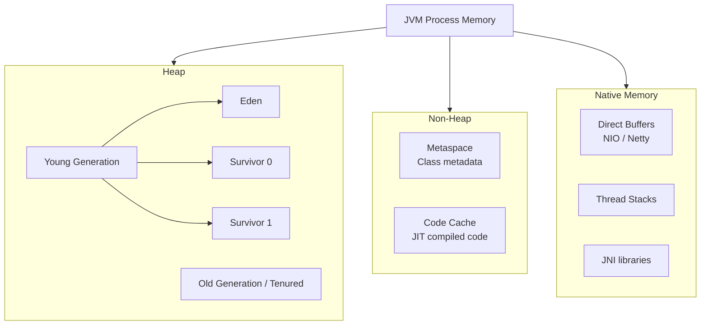
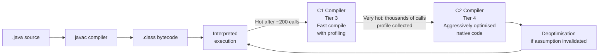

# داخليات JVM — نموذج الذاكرة وتحميل الأصناف وJIT

> [!NOTE]
> فهم داخليات JVM شرط مسبق لهندسة أداء ذات معنى. فدون نموذج ذهني لطريقة تخصيص Java للذاكرة، وترجمتها للشيفرة، وإدارتها للخيوط، أنت تخمّن التحسينات.

## نموذج ذاكرة JVM

يقسم JVM الذاكرة إلى مناطق متمايزة، لكل منها دورة حياة وسلوك جمع قمامة مختلفان.



### مناطق الـ Heap — حيث تعيش كائناتك

**فضاء Eden** — تُخصص الكائنات الجديدة هنا. تخصيص سريع بتقديم المؤشر. ويُجمع كثيرًا (Minor GC).

**فضاءا Survivor ‏(S0/S1)** — تُنقل إليهما الكائنات التي تنجو من Minor GC. وتُنسخ بين S0 وS1 في كل Minor GC. وتُرقّى الكائنات إلى الجيل القديم بعد عدد قابل للضبط من دورات GC (الافتراضي: 15 في G1GC).

**الجيل القديم (Tenured)** — الكائنات طويلة العمر. ويُجمع أقل تكرارًا (Major/Full GC). وهو المصدر الأساسي لزمن توقف GC في الأنظمة المالية.

**Metaspace** — بيانات وصف الأصناف (واصفات الدوال، وبيانات الحقول، والـ bytecode). وعلى خلاف PermGen (الذي أزيل في Java 8)، يعيش Metaspace في الذاكرة الأصلية وينمو ديناميكيًا — وافتراضيًا لا يحدّه إلا الذاكرة المتاحة؛ واضبط `-XX:MaxMetaspaceSize` لتقييده. وتسربات محمّلات الأصناف تسبب نفاد ذاكرة Metaspace.

## تخصيص الكائنات — ماذا يحدث حين تكتب `new`

```java
// This one line triggers several JVM mechanisms
PaymentEvent event = new PaymentEvent(txnId, amount, timestamp);
```

1. **التخصيص في TLAB ‏(مخزن تخصيص محلي للخيط)** — لكل خيط جزء خاص من Eden يخصص فيه دون تزامن. فيقوم `new` بتقديم مؤشر بسيط داخل الـ TLAB — شبه مجاني.

2. **إذا امتلأ الـ TLAB** — اطلب TLAB جديدًا من Eden. وإذا امتلأ Eden ← يُطلق Minor GC.

3. **التعامل مع الكائنات الكبيرة** — في G1، الكائن الذي يبلغ نصف منطقة على الأقل (`G1HeapRegionSize / 2`) يكون *ضخمًا* (humongous): يحصل على منطقة (أو مناطق) متجاورة خاصة به، تُخصص خارج Eden وتُعامل كجزء من الجيل القديم. ومعظم رسائل الدفع أصغر بكثير، لكن ملفات الدفعات الكبيرة ومخازن التقارير قد تتجاوز هذه العتبة بسهولة.

```java
// Performance trap: large buffers become humongous objects
// Regions are 1–32 MB (G1 picks the size from the heap size); with 4 MB
// regions the humongous threshold is 2 MB. A 50 KB SWIFT message is NOT
// humongous — but a 3 MB payment batch file is.
byte[] batchFile = new byte[3 * 1024 * 1024];  // 3 MB → humongous with 4 MB regions

// Better: reuse buffers from a pool (often off-heap) instead of allocating
// a fresh large array per file — Netty's pooled ByteBuf allocator does this
ByteBuf pooledBuf = allocator.buffer(3 * 1024 * 1024);
try {
    // use buffer
} finally {
    pooledBuf.release();  // back to the pool, not left for the GC
}
```

## جمع القمامة — G1GC وZGC

### ‏G1GC — الافتراضي للأنظمة المالية (Java 9+)

يقسم G1 ‏(Garbage First) الـ heap إلى **مناطق** متساوية الحجم (نحو 1–32 ميغابايت). ويهدف إلى تحقيق هدف زمن توقف قابل للضبط بجمع المناطق ذات أكثر قمامة أولًا (ومن هنا الاسم "Garbage First").

```
Heap: 8GB, divided into 2048 regions of 4MB each
Regions labelled: Eden, Survivor, Old, Humongous (large objects)

G1 Minor GC: collect all Eden regions → ~5-50ms pause
G1 Mixed GC: collect Eden + some Old regions → ~10-100ms pause
G1 Full GC: collect everything → ~500ms-5s pause (avoid at all costs)
```

**معاملات الضبط الأساسية:**

```
-XX:MaxGCPauseMillis=50          # G1 targets 50ms pauses (best effort)
-XX:G1HeapRegionSize=4m          # 4MB regions for 8GB heap
-XX:+UnlockExperimentalVMOptions # the next two flags are EXPERIMENTAL options
-XX:G1NewSizePercent=20          # Young gen minimum 20% of heap
-XX:G1MaxNewSizePercent=40       # Young gen maximum 40% of heap
-XX:InitiatingHeapOccupancyPercent=45  # Start concurrent marking at 45% full
                                       # (G1 adapts this itself by default)
```

ابدأ بـ `-XX:MaxGCPauseMillis` وحجم الـ heap فقط: فتثبيت أحجام الجيل الشاب يسلب G1 المساحة التي يستخدمها لتحقيق هدف التوقف. ولا تغيّر خيارات أخرى إلا حين تُظهر سجلات GC سببًا.

### ‏ZGC — توقفات أقل من مللي ثانية (جاهز للإنتاج منذ Java 15)

يستخدم ZGC حواجز التحميل والضغط المتزامن لتحقيق أزمنة توقف أقل من مللي ثانية بغض النظر عن حجم الـ heap. وهو الخيار الصحيح لمعالجات الدفع الحساسة للزمن.

```
Enable with: -XX:+UseZGC
(Generational ZGC is the default mode since JDK 23; the old
 non-generational mode was removed in JDK 24.)

ZGC pause times: < 1ms (independent of heap size)
ZGC throughput: typically somewhat lower than G1 (concurrent work costs CPU)
ZGC heap overhead: needs extra headroom to keep allocating while it collects

When to use ZGC:
✓ Payment authorisation latency SLO < 50ms P99
✓ Large heaps (tens of GB), where G1 pauses grow
✓ You can spend some CPU/memory for consistently low pauses
(Measure both collectors on YOUR workload — the trade-off varies.)
```

## مترجم JIT — كيف تصبح Java سريعة

تُفسَّر Java (عند البدء) وتُترجم (وقت التشغيل) معًا. ويحسّن مترجم JIT ‏(Just-In-Time) مسارات الشيفرة الساخنة تدريجيًا.



### مستويات ترجمة JIT

| المستوى | الترجمة | متى | الاستخدام |
|---|---|---|---|
| 0 | تفسير | دائمًا | البدء |
| 1 | C1، دون توصيف | الدوال البسيطة (مثل getters) | لا شيء إضافي يُكسب |
| 2 | C1، توصيف محدود | حين يكون طابور C2 مشغولًا | خطوة مؤقتة |
| 3 | C1، توصيف كامل | الشيفرة الساخنة | التوصيف لـ C2 |
| 4 | C2، محسّن | الشيفرة الساخنة جدًا | المسار الحرج للدفع |

(العتبات الدقيقة — نحو مئات الاستدعاءات للمستوى 3 وآلاف للمستوى 4 — تعتمد على حلقات الرجوع وأطوال الطوابير.)

**إحماء JIT** فخ أداء في الأنظمة المالية. فمعالج دفع يُعاد تشغيله تحت الحمل سيخدم طلبات بطيئة حتى يعيد JIT ترجمة المسارات الساخنة. وهذا يستغرق 1–5 دقائق عند حركة الإنتاج.

```java
// JVM options that help with warmup:
// -XX:CompileThreshold=...       # IGNORED with tiered compilation (the default)
// -XX:+TieredCompilation          # default since Java 8 — leave it on
// AOT / CDS: class-data sharing archives (and the AOT cache of JDK 24+,
//   JEP 483) cut class-loading time at startup; CRaC snapshots go further
// -XX:+UseStringDeduplication     # reduces heap for String-heavy workloads

// Application-level warmup: exercise the hot code paths BEFORE the pod
// reports ready. Use a side-effect-free path — synthetic requests must never
// reach the real card network, write ledger rows or send notifications.
@Component
@RequiredArgsConstructor
@Slf4j
public class JitWarmup {

    private final PaymentValidationAndPricing pipeline;   // pure, in-memory logic
    private final ApplicationEventPublisher publisher;

    @EventListener(ApplicationReadyEvent.class)
    public void warmUpCriticalPaths() {
        AvailabilityChangeEvent.publish(publisher, this, ReadinessState.REFUSING_TRAFFIC);
        for (int i = 0; i < 20_000; i++) {
            pipeline.validateAndPrice(PaymentRequest.synthetic(i));   // no I/O
        }
        AvailabilityChangeEvent.publish(publisher, this, ReadinessState.ACCEPTING_TRAFFIC);
        log.info("JIT warmup complete — critical payment paths compiled");
    }
}
```

## تحميل الأصناف — تسربات الذاكرة من محمّلات الأصناف

تحميل الأصناف هو الآلية التي يحمّل بها JVM ملفات `.class` إلى Metaspace. وفي التطبيقات التي تحمّل الأصناف ديناميكيًا (OSGi، وأنظمة الإضافات، وإعادة التحميل الساخن)، تسبب تسربات محمّلات الأصناف نفاد Metaspace.

```java
// ClassLoader leak pattern (common in OSGi, plugin systems, Groovy DSLs)
// Every script compiled by Groovy becomes a NEW class in a GroovyClassLoader.
// A class can only be unloaded together with its class loader.

// Leaky: compiling the same rules again and again
GroovyShell shell = new GroovyShell();
Script script = shell.parse(ruleScript);   // a new class on every call
script.run();
// In a rule engine evaluating 100 scripts/second: Metaspace fills up

// ALSO leaky: one shared GroovyShell — its class loader keeps EVERY class it
// ever compiled, so evicting a script from a cache frees nothing.

// Fix: compile each distinct rule ONCE, in its own class loader, and cache
// the compiled class. When an entry is evicted, the class and its loader
// become unreachable together and Metaspace can be reclaimed.
@Component
public class GroovyRuleCache {

    private final LoadingCache<String, Class<? extends Script>> cache = CacheBuilder.newBuilder()
        .maximumSize(500)
        .expireAfterAccess(1, TimeUnit.HOURS)
        .build(CacheLoader.from(this::compile));

    @SuppressWarnings("unchecked")
    private Class<? extends Script> compile(String source) {
        GroovyClassLoader loader = new GroovyClassLoader(getClass().getClassLoader());
        return (Class<? extends Script>) loader.parseClass(source);
    }

    public Object evaluate(String source, Binding binding) throws Exception {
        // A NEW Script instance per evaluation: instances hold their binding
        // and are not thread-safe; the CLASS is what we cache
        Script script = cache.getUnchecked(source).getDeclaredConstructor().newInstance();
        script.setBinding(binding);
        return script.run();
    }
}
```

## قراءة سجلات GC — تشخيص مشكلات الإنتاج

فعّل تسجيل GC في كل خدمة مالية. فهو الأداة الأولى لتشخيص قفزات الزمن.

```bash
# Java 17 GC log flags
-Xlog:gc*:file=/var/log/app/gc.log:time,uptime,level,tags:filecount=10,filesize=50m
```

يبدو سجل G1GC السليم هكذا:

```
[2024-11-07T14:23:01.123+0000] GC(42) Pause Young (Normal) (G1 Evacuation Pause) 
  512M->128M(8192M) 18.432ms
```

ويُظهر السجل المشكل:

```
[2024-11-07T14:23:45.456+0000] GC(43) Pause Full (G1 Compaction Pause)
  7680M->512M(8192M) 4823.167ms   ← 4.8 second Full GC → P1 incident
```

**الأسباب الجذرية لـ Full GC في الأنظمة المالية:**

1. **فشل التخصيص الضخم** — الكائنات الكبيرة (دفعات رسائل الدفع، ومخازن التقارير) تُغرق G1
2. **فشل الترقية** — يمتلئ الجيل القديم قبل أن يستعيده GC المتزامن
3. **نفاد Metaspace** — تسرب محمّل أصناف (Groovy، والانعكاس، وتوليد الـ bytecode)
4. **استدعاء System.gc() صراحة** — تستدعيه المكتبات. وفضّل `-XX:+ExplicitGCInvokesConcurrent` (يحوّله إلى دورة متزامنة) على `-XX:+DisableExplicitGC`: فالـ JDK نفسه يستدعي `System.gc()` لتحرير المخازن المباشرة عندما تنخفض الذاكرة المباشرة، وتعطيله قد يحوّل ذلك إلى `OutOfMemoryError: Direct buffer memory`.

<!-- KNOWLEDGE-CHECK
{
  "questions": [
    {
      "id": "q1",
      "text": "تعالج خدمة الدفع لديك 500 معاملة في الثانية. وبعد نشر إصدار جديد، تلاحظ أن زمن P99 يبلغ 800 مللي ثانية في أول 3 دقائق، ثم ينخفض إلى 45 مللي ثانية الطبيعية. ما السبب الأرجح؟",
      "options": [
        "في الإصدار الجديد خطأ يستغرق 3 دقائق ليستقر",
        "إحماء ترجمة JIT — يُفسَّر المسار الحرج للدفع حتى يترجمه JVM، ثم ينخفض إلى أداء الشيفرة الأصلية المترجمة",
        "يستغرق مجمع اتصالات قاعدة البيانات 3 دقائق للإحماء",
        "يستغرق موازن الحمل 3 دقائق لتوزيع الحركة بالتساوي"
      ],
      "correct": 1,
      "explanation": "هذا سلوك إحماء JIT الكلاسيكي. يفسّر JVM الشيفرة عند البدء؛ وبعد بضع مئات من الاستدعاءات يترجم C1 مسار الدفع، وبعد آلاف الاستدعاءات (مع بيانات التوصيف) ينتج C2 شيفرة أصلية محسّنة — فينخفض الزمن كثيرًا. والإصلاح إحماء على مستوى التطبيق على مسار بلا آثار جانبية قبل أن تُبلغ النسخة عن جاهزيتها، بالإضافة إلى وسائل تسريع البدء مثل CDS / ذاكرات AOT."
    },
    {
      "id": "q2",
      "text": "تلاحظ توقفات Full GC متكررة من 3–5 ثوانٍ في مستهلك Kafka يعالج ملفات دفعات مدفوعات SWIFT بحجم نحو 3 ميغابايت لكل منها، على heap بحجم 8 غيغابايت في G1 بمناطق 4 ميغابايت. ما السبب الجذري الأرجح؟",
      "options": [
        "مستهلك Kafka لا يلتزم بالإزاحات بتكرار كافٍ",
        "مصفوفات البايت بحجم 3 ميغابايت تتجاوز عتبة الكائنات الضخمة في G1 (نصف منطقة = 2 ميغابايت)، فيحصل كل منها على مناطق متجاورة خاصة خارج Eden؛ وتحت معدلات تخصيص عالية تملأ الجيل القديم وتجزّئه أسرع مما يستعيده GC المتزامن",
        "هدف توقف GC مضبوط بحدة شديدة عند -XX:MaxGCPauseMillis=10",
        "رسائل SWIFT تحتوي أحرف Unicode تتعامل معها Java ببطء"
      ],
      "correct": 1,
      "explanation": "مع مناطق 4 ميغابايت، أي كائن بحجم 2 ميغابايت أو أكثر يكون ضخمًا. فتُخصص كل مصفوفة دفعة بحجم 3 ميغابايت في مناطق مخصصة متجاورة خارج Eden وتُحسب ضمن الجيل القديم. وبمعدلات عالية يملأ ذلك الـ heap ويجزّئه، وحين لا يجد G1 مناطق حرة متجاورة يرجع إلى Full GC. والإصلاحات: أعد استخدام مخازن مجمّعة (غالبًا خارج الـ heap)، أو عالج الملف كتدفق بدل تحميله كاملًا، أو ارفع G1HeapRegionSize كي لا تبقى الكائنات ضخمة."
    },
    {
      "id": "q3",
      "text": "متى يجب أن تختار ZGC بدل G1GC لخدمة مالية؟",
      "options": [
        "دائمًا — ZGC أفضل من G1GC تمامًا",
        "عندما يكون SLO لزمن P99 ضيقًا جدًا (< 50 مللي ثانية) وتستطيع قبول إنتاجية أقل بنسبة 5–15% مقابل توقفات GC مضمونة أقل من مللي ثانية",
        "عندما يكون الـ heap صغيرًا (< 4 غيغابايت) وتحتاج بدءًا سريعًا",
        "عندما تعمل على Windows Server"
      ],
      "correct": 1,
      "explanation": "يبادل ZGC بعض الإنتاجية مقابل توقفات أقل من مللي ثانية. فلواجهة تفويض دفع بـ SLO لزمن P99 قدره 50 مللي ثانية، يخرق توقف G1 بمقدار 100 مللي ثانية الـ SLO — وZGC يلغي ذلك. أما لمهمة معالجة دفعية بلا SLO للزمن، فإنتاجية G1GC الأعلى أفضل. ويعتمد الاختيار على ملف زمن الـ SLO لديك."
    },
    {
      "id": "q4",
      "text": "يسبب محرك قواعد عمل قائم على Groovy في خدمة كشف احتيال نفاد ذاكرة Metaspace بعد 24 ساعة من التشغيل. ما السبب الجذري الأرجح؟",
      "options": [
        "يولّد Groovy كثيرًا من الـ bytecode فيملأ الـ heap",
        "كل تقييم قاعدة ينشئ GroovyShell جديدًا (محمّل أصناف)، فيحمّل أصنافًا في Metaspace؛ ولأن المحمّلات لا تُحرر أبدًا، يمتلئ Metaspace مع الوقت",
        "يجب زيادة Metaspace بـ -XX:MaxMetaspaceSize",
        "Groovy غير متوافق مع إصدارات JVM الحديثة"
      ],
      "correct": 1,
      "explanation": "تقييم سكربتات Groovy عبر GroovyShell يحوّل كل ترجمة إلى صنف جديد في GroovyClassLoader. ولا يمكن تفريغ صنف إلا مع محمّل أصنافه. فإذا لم تُحرر المحمّلات (أو كان محمّل مشترك يحتفظ بكل صنف ترجمه)، تتراكم الأصناف. والإصلاح ترجمة كل قاعدة مميزة مرة واحدة في محمّل خاص بها وتخزين الصنف المترجم، لا مجرد زيادة حجم Metaspace."
    }
  ]
}
-->

<!-- PRACTICAL-CHALLENGE
{
  "title": "داخليات JVM — التشخيص في الإنتاج",
  "difficulty": "advanced",
  "estimatedMinutes": 90,
  "tasks": [
    {"id": "1", "description": "شخّص السبب الجذري: تُظهر خدمة دفع زمن P99 قدره 800 مللي ثانية في أول دقائق بعد كل نشر، وتوقفات متعددة الثواني أحيانًا لاحقًا في اليوم. واشرح أي الأعراض تشير إلى إحماء JIT وأيها تشير إلى GC، وما الأدلة التي ستجمعها لكل منهما."},
    {"id": "2", "description": "حلّل سجل GC: لأسطر سجل G1 تتضمن 'Pause Young (Normal)' و'Pause Young (Concurrent Start) (G1 Humongous Allocation)' وسطرًا واحدًا 'Pause Full (G1 Compaction Pause)' مدته 4.8 ثانية، اشرح معنى كل سطر وما الذي أدى على الأرجح إلى Full GC."},
    {"id": "3", "description": "اكتب الأوامر لجمع الأدلة بأمان في الإنتاج: تفريغ heap بـ jcmd <pid> GC.heap_dump (ولماذا يوقف JVM)، ومدرج أصناف بـ jcmd <pid> GC.class_histogram، وتفاصيل Metaspace بـ jcmd <pid> VM.metaspace."},
    {"id": "4", "description": "اقترح ثلاثة تغييرات في خيارات JVM للخدمة وبرر كلًا منها من الأدلة: مثلًا هدف زمن توقف، أو منطقة G1 أكبر أو ZGC للمخازن الكبيرة، أو تسجيل GC مع التدوير، و-XX:+ExplicitGCInvokesConcurrent بدل -XX:+DisableExplicitGC."}
  ]
}
-->
