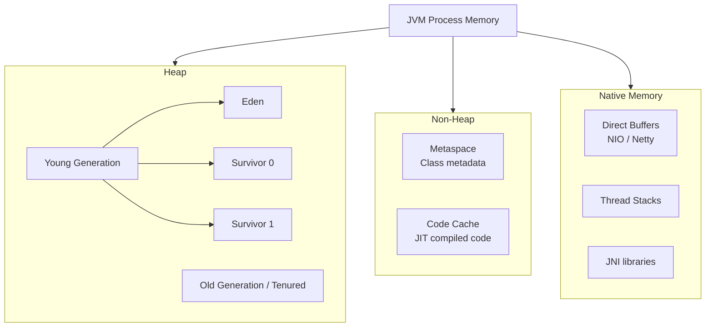
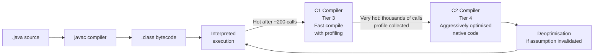

# JVM Internals — Memory Model, Class Loading, and JIT

> [!NOTE]
> Understanding JVM internals is prerequisite to meaningful performance engineering. Without a mental model of how Java allocates memory, compiles code, and manages threads, you are guessing at optimisations.

## The JVM Memory Model

The JVM partitions memory into distinct regions, each with different lifecycle and garbage collection behaviour.



### Heap Regions — Where Your Objects Live

**Eden Space** — New objects are allocated here. Fast bump-pointer allocation. Collected frequently (Minor GC).

**Survivor Spaces (S0/S1)** — Objects that survive Minor GC are moved here. Copied between S0 and S1 on each Minor GC. Objects are promoted to Old Generation after a configurable number of GC cycles (default: 15 for G1GC).

**Old Generation (Tenured)** — Long-lived objects. Collected less frequently (Major/Full GC). The primary source of GC pause latency in financial systems.

**Metaspace** — Class metadata (method descriptors, field metadata, bytecode). Unlike PermGen (removed in Java 8), Metaspace lives in native memory and grows dynamically — by default it is limited only by available memory; set `-XX:MaxMetaspaceSize` to cap it. Class loader leaks cause Metaspace OOM.

---

## Object Allocation — What Happens When You Write `new`

```java
// This one line triggers several JVM mechanisms
PaymentEvent event = new PaymentEvent(txnId, amount, timestamp);
```

1. **TLAB allocation (Thread-Local Allocation Buffer)** — Each thread has a private chunk of Eden to allocate into without synchronisation. `new` does a simple pointer bump within the TLAB — essentially free.

2. **If TLAB is full** — Request a new TLAB from Eden. If Eden is full → trigger Minor GC.

3. **Large object handling** — In G1, an object of at least half a region (`G1HeapRegionSize / 2`) is *humongous*: it gets its own contiguous region(s), allocated outside Eden and treated as part of the Old Generation. Most payment messages are far smaller, but large batch files and report buffers can easily cross this threshold.

```java
// Performance trap: large buffers become humongous objects
// Regions are 1–32 MB (G1 picks the size from the heap size); with 4 MB
// regions the humongous threshold is 2 MB. A 50 KB SWIFT message is NOT
// humongous — but a 3 MB payment batch file is.
byte[] batchFile = new byte[3 * 1024 * 1024];  // 3 MB → humongous with 4 MB regions

// Better: reuse buffers from a pool (often off-heap) instead of allocating
// a fresh large array per file — Netty's pooled ByteBuf allocator does this
ByteBuf pooledBuf = allocator.buffer(3 * 1024 * 1024);
try {
    // use buffer
} finally {
    pooledBuf.release();  // back to the pool, not left for the GC
}
```

---

## Garbage Collection — G1GC and ZGC

### G1GC — The Default for Financial Systems (Java 9+)

G1 (Garbage First) divides the heap into equal-sized **regions** (~1-32MB). It aims to meet a configurable pause time goal by collecting the regions with the most garbage first (hence "Garbage First").

```
Heap: 8GB, divided into 2048 regions of 4MB each
Regions labelled: Eden, Survivor, Old, Humongous (large objects)

G1 Minor GC: collect all Eden regions → ~5-50ms pause
G1 Mixed GC: collect Eden + some Old regions → ~10-100ms pause
G1 Full GC: collect everything → ~500ms-5s pause (avoid at all costs)
```

**Key tuning parameters:**
```
-XX:MaxGCPauseMillis=50          # G1 targets 50ms pauses (best effort)
-XX:G1HeapRegionSize=4m          # 4MB regions for 8GB heap
-XX:+UnlockExperimentalVMOptions # the next two flags are EXPERIMENTAL options
-XX:G1NewSizePercent=20          # Young gen minimum 20% of heap
-XX:G1MaxNewSizePercent=40       # Young gen maximum 40% of heap
-XX:InitiatingHeapOccupancyPercent=45  # Start concurrent marking at 45% full
                                       # (G1 adapts this itself by default)
```

Start with only `-XX:MaxGCPauseMillis` and a heap size: fixing young-generation sizes takes away the room G1 uses to meet the pause goal. Change other flags only when GC logs show a reason.

### ZGC — Sub-Millisecond Pauses (Java 15+ Production Ready)

ZGC uses load barriers and concurrent compaction to achieve pause times under 1ms regardless of heap size. It is the right choice for latency-sensitive payment processors.

```
Enable with: -XX:+UseZGC
(Generational ZGC is the default mode since JDK 23; the old
 non-generational mode was removed in JDK 24.)

ZGC pause times: < 1ms (independent of heap size)
ZGC throughput: typically somewhat lower than G1 (concurrent work costs CPU)
ZGC heap overhead: needs extra headroom to keep allocating while it collects

When to use ZGC:
✓ Payment authorisation latency SLO < 50ms P99
✓ Large heaps (tens of GB), where G1 pauses grow
✓ You can spend some CPU/memory for consistently low pauses
(Measure both collectors on YOUR workload — the trade-off varies.)
```

---

## The JIT Compiler — How Java Gets Fast

Java is both interpreted (at startup) and compiled (at runtime). The JIT (Just-In-Time) compiler progressively optimises hot code paths.



### JIT Compilation Tiers

| Tier | Compilation | When | Use |
|---|---|---|---|
| 0 | Interpreted | Always | Startup |
| 1 | C1, no profiling | Trivial methods (e.g. getters) | Nothing more to gain |
| 2 | C1, limited profiling | When the C2 queue is busy | Temporary step |
| 3 | C1, full profiling | Hot code | Profiling for C2 |
| 4 | C2, optimised | Very hot code | Payment critical path |

(The exact thresholds — roughly hundreds of invocations for tier 3 and thousands for tier 4 — depend on loop back-edges and queue lengths.)

**JIT warmup** is a performance trap in financial systems. A payment processor that restarts under load will serve slow requests until JIT has re-compiled the hot paths. This takes 1-5 minutes at production traffic.

```java
// JVM options that help with warmup:
// -XX:CompileThreshold=...       # IGNORED with tiered compilation (the default)
// -XX:+TieredCompilation          # default since Java 8 — leave it on
// AOT / CDS: class-data sharing archives (and the AOT cache of JDK 24+,
//   JEP 483) cut class-loading time at startup; CRaC snapshots go further
// -XX:+UseStringDeduplication     # reduces heap for String-heavy workloads

// Application-level warmup: exercise the hot code paths BEFORE the pod
// reports ready. Use a side-effect-free path — synthetic requests must never
// reach the real card network, write ledger rows or send notifications.
@Component
@RequiredArgsConstructor
@Slf4j
public class JitWarmup {

    private final PaymentValidationAndPricing pipeline;   // pure, in-memory logic
    private final ApplicationEventPublisher publisher;

    @EventListener(ApplicationReadyEvent.class)
    public void warmUpCriticalPaths() {
        AvailabilityChangeEvent.publish(publisher, this, ReadinessState.REFUSING_TRAFFIC);
        for (int i = 0; i < 20_000; i++) {
            pipeline.validateAndPrice(PaymentRequest.synthetic(i));   // no I/O
        }
        AvailabilityChangeEvent.publish(publisher, this, ReadinessState.ACCEPTING_TRAFFIC);
        log.info("JIT warmup complete — critical payment paths compiled");
    }
}
```

---

## Class Loading — Memory Leaks from ClassLoader

Class loading is the mechanism by which JVM loads `.class` files into Metaspace. In applications that dynamically load classes (OSGi, plugin systems, hot-reload), ClassLoader leaks cause Metaspace OOM.

```java
// ClassLoader leak pattern (common in OSGi, plugin systems, Groovy DSLs)
// Every script compiled by Groovy becomes a NEW class in a GroovyClassLoader.
// A class can only be unloaded together with its class loader.

// Leaky: compiling the same rules again and again
GroovyShell shell = new GroovyShell();
Script script = shell.parse(ruleScript);   // a new class on every call
script.run();
// In a rule engine evaluating 100 scripts/second: Metaspace fills up

// ALSO leaky: one shared GroovyShell — its class loader keeps EVERY class it
// ever compiled, so evicting a script from a cache frees nothing.

// Fix: compile each distinct rule ONCE, in its own class loader, and cache
// the compiled class. When an entry is evicted, the class and its loader
// become unreachable together and Metaspace can be reclaimed.
@Component
public class GroovyRuleCache {

    private final LoadingCache<String, Class<? extends Script>> cache = CacheBuilder.newBuilder()
        .maximumSize(500)
        .expireAfterAccess(1, TimeUnit.HOURS)
        .build(CacheLoader.from(this::compile));

    @SuppressWarnings("unchecked")
    private Class<? extends Script> compile(String source) {
        GroovyClassLoader loader = new GroovyClassLoader(getClass().getClassLoader());
        return (Class<? extends Script>) loader.parseClass(source);
    }

    public Object evaluate(String source, Binding binding) throws Exception {
        // A NEW Script instance per evaluation: instances hold their binding
        // and are not thread-safe; the CLASS is what we cache
        Script script = cache.getUnchecked(source).getDeclaredConstructor().newInstance();
        script.setBinding(binding);
        return script.run();
    }
}
```

---

## Reading GC Logs — Diagnosing Production Issues

Enable GC logging in every financial service. It is the first tool for diagnosing latency spikes.

```bash
# Java 17 GC log flags
-Xlog:gc*:file=/var/log/app/gc.log:time,uptime,level,tags:filecount=10,filesize=50m
```

A healthy G1GC log looks like:
```
[2024-11-07T14:23:01.123+0000] GC(42) Pause Young (Normal) (G1 Evacuation Pause) 
  512M->128M(8192M) 18.432ms
```

A problematic log shows:
```
[2024-11-07T14:23:45.456+0000] GC(43) Pause Full (G1 Compaction Pause)
  7680M->512M(8192M) 4823.167ms   ← 4.8 second Full GC → P1 incident
```

**Root causes of Full GC in financial systems:**

1. **Humongous allocation failure** — Large objects (payment message batches, report buffers) overwhelm G1
2. **Promotion failure** — Old generation fills before concurrent GC can reclaim it
3. **Metaspace exhaustion** — ClassLoader leak (Groovy, reflection, bytecode generation)
4. **Explicit System.gc()** — Called by libraries. Prefer `-XX:+ExplicitGCInvokesConcurrent` (turns it into a concurrent cycle) over `-XX:+DisableExplicitGC`: the JDK itself calls `System.gc()` to free direct buffers when direct memory runs low, and disabling it can turn that into an `OutOfMemoryError: Direct buffer memory`.

<!-- KNOWLEDGE-CHECK
{
  "questions": [
    {
      "id": "q1",
      "text": "Your payment service processes 500 TPS. After deploying a new version, you observe that P99 latency is 800ms for the first 3 minutes, then drops to normal 45ms. What is the most likely cause?",
      "options": [
        "The new version has a bug that takes 3 minutes to stabilise",
        "JIT compilation warmup — the payment critical path is being interpreted until JVM compiles it, then drops to compiled native performance",
        "The database connection pool takes 3 minutes to warm up",
        "The load balancer takes 3 minutes to route traffic evenly"
      ],
      "correct": 1,
      "explanation": "This is classic JIT warmup behaviour. The JVM interprets code at startup; after a few hundred calls the payment path is compiled by C1, and after thousands of calls (with profile data) C2 produces optimised native code — latency then drops dramatically. The fix is application-level warmup on a side-effect-free path before the pod reports ready, plus startup aids such as CDS / AOT caches."
    },
    {
      "id": "q2",
      "text": "You observe frequent Full GC pauses of 3-5 seconds in a Kafka consumer that processes SWIFT payment batch files of about 3 MB each, on an 8 GB G1 heap with 4 MB regions. What is the likely root cause?",
      "options": [
        "The Kafka consumer is not committing offsets frequently enough",
        "The 3 MB byte arrays exceed G1's humongous threshold (half a region = 2 MB), so each one gets its own contiguous regions outside Eden; under high allocation rates they fill the old generation and fragment it faster than concurrent GC can reclaim",
        "The GC pause goal is set too aggressively at -XX:MaxGCPauseMillis=10",
        "SWIFT messages contain Unicode characters that Java handles slowly"
      ],
      "correct": 1,
      "explanation": "With 4 MB regions, any object of 2 MB or more is humongous. Each 3 MB batch array is allocated in contiguous dedicated regions outside Eden and counted as old generation. At high rates this fills and fragments the heap, and when G1 cannot find contiguous free regions it falls back to a Full GC. Fixes: reuse pooled (often off-heap) buffers, stream the file instead of loading it whole, or raise G1HeapRegionSize so the objects are no longer humongous."
    },
    {
      "id": "q3",
      "text": "When should you choose ZGC over G1GC for a financial service?",
      "options": [
        "Always — ZGC is strictly better than G1GC",
        "When your P99 latency SLO is very tight (< 50ms) and you can accept 5-15% lower throughput for guaranteed sub-millisecond GC pauses",
        "When your heap is small (< 4GB) and you need fast startup",
        "When you are running on Windows Server"
      ],
      "correct": 1,
      "explanation": "ZGC trades throughput (~5-15% lower) for guaranteed sub-millisecond pauses. For a payment authorisation API with a 50ms P99 SLO, a 100ms G1 GC pause breaches the SLO — ZGC eliminates this. For a batch processing job with no latency SLO, G1GC's higher throughput is preferable. The choice depends on the latency profile of your SLO."
    },
    {
      "id": "q4",
      "text": "A Groovy-based business rules engine in a fraud detection service causes Metaspace OOM after 24 hours of operation. What is the most likely root cause?",
      "options": [
        "Groovy generates too much bytecode, filling up the heap",
        "Each rule evaluation creates a new GroovyShell (ClassLoader), loading classes into Metaspace; since the ClassLoaders are never freed, Metaspace fills up over time",
        "Metaspace needs to be increased with -XX:MaxMetaspaceSize",
        "Groovy is incompatible with modern JVM versions"
      ],
      "correct": 1,
      "explanation": "Groovy script evaluation through GroovyShell creates a new ClassLoader for each compilation. Each ClassLoader holds references to its compiled classes in Metaspace. If GroovyShell instances are not GC'd (or reused), all their classes accumulate. The fix is caching compiled scripts and reusing ClassLoaders, not just increasing Metaspace size."
    }
  ]
}
-->

<!-- PRACTICAL-CHALLENGE
{
  "title": "JVM Internals — Production Diagnosis",
  "difficulty": "advanced",
  "estimatedMinutes": 90,
  "tasks": [
    {
      "id": "1",
      "description": "Diagnose the root cause: a payment service shows P99 latency of 800ms for the first minutes after every deployment, and occasional multi-second pauses later in the day. Explain which symptoms point to JIT warmup and which point to GC, and what evidence you would collect for each."
    },
    {
      "id": "2",
      "description": "Analyse the GC log: given G1 log lines with 'Pause Young (Normal)', 'Pause Young (Concurrent Start) (G1 Humongous Allocation)' and one 'Pause Full (G1 Compaction Pause)' of 4.8s, explain what each line means and what most likely led to the Full GC."
    },
    {
      "id": "3",
      "description": "Write the commands to capture evidence safely in production: a heap dump with jcmd <pid> GC.heap_dump (and why it pauses the JVM), a class histogram with jcmd <pid> GC.class_histogram, and Metaspace details with jcmd <pid> VM.metaspace."
    },
    {
      "id": "4",
      "description": "Propose three JVM flag changes for the service and justify each from the evidence: for example a pause-time goal, a larger G1 region size or ZGC for large buffers, GC logging with rotation, and -XX:+ExplicitGCInvokesConcurrent instead of -XX:+DisableExplicitGC."
    }
  ]
}
-->
