## نظرة عامة

توقفات جمع القمامة من أخبث مشكلات الأداء في تطبيقات التقنية المالية المبنية على JVM. فهي متقطعة، وغير مرئية في لوحات APM ما لم تربط البيانات بعناية، وأسبابها الجذرية مدفونة في مخرجات سجلات GC الخام التي لا يفتحها معظم المهندسين. وتوقف واحد من نوع stop-the-world لمدة 400 مللي ثانية أثناء تدفق تفويض دفع يبدو من منظور المستدعي مطابقًا لمهلة شبكة — لكن الإصلاح مختلف تمامًا. ويعلّمك هذا الدرس قراءة سجلات GC بطلاقة، وتحديد أسباب التوقف الأهم في أنظمة الدفع، واستخراج إشارة كمية من السجل الخام قبل أن تلجأ إلى أي خيار ضبط.

## أهداف التعلم

بنهاية هذا الدرس ستكون قادرًا على:

- ضبط JVM لإخراج سجلات GC منظمة باستخدام إطار التسجيل الموحد (`-Xlog`)
- تحليل سطر سجل G1GC وتحديد الـ heap قبل/بعد، ومدة التوقف، وسببه
- تصنيف أسباب التوقف (G1 Evacuation Pause، وG1 Humongous Allocation، وMetadata GC Threshold، وAllocation Failure) وشرح علاج كل منها
- استخدام GCEasy أو GCViewer لعرض تكرار التوقفات، والإنتاجية، واتجاهات استخدام الـ heap
- تحديد نمط تكرار توقف عالٍ (> توقف واحد/ثانية) من السجل الخام
- تقدير المجموعة الحية (live set) لـ JVM من بيانات سجل GC واستخدامها لتحجيم الـ heap
- ربط أوقات توقفات GC بقفزات زمن p99 من أداة APM أو سجلات الوصول
- تفسير مخرجات `-Xlog:gc+ergo*` (خليفة الخيار المحذوف `-XX:+PrintAdaptiveSizePolicy`) لفهم كيف يعدّل JVM أحجام الأجيال

## سياق العمل

*مثال مركّب:* يشغّل معالج دفع أوروبي خدمة مطابقة أوامر بـ Java 17 / G1GC على heap بحجم 16 غيغابايت. وخلال ساعات التداول الذروة (09:00–10:30 بتوقيت وسط أوروبا) قفز زمن p99 لتأكيد الأوامر من 4 مللي ثانية إلى 380–520 مللي ثانية كل 90–120 ثانية. فصعّد فريق المناوبة إلى فريق قاعدة البيانات، الذي لم يجد استعلامات بطيئة. ولم يجد فريق الشبكة فقدًا للحزم. وبعد أسبوعين من تحقيق غير حاسم، فعّل مهندس SRE تسجيل GC ورفع السجل إلى GCEasy.

كشف التحليل:
- **متوسط توقف GC: ‏310 مللي ثانية** (G1 Mixed GC)
- **تكرار التوقف: 1.2 توقف/ثانية** في الذروة — 72 توقفًا في الدقيقة
- **السبب الجذري: تخصيصات G1 الضخمة** — كانت الخدمة تحمّل حمولات دفعات بحجم 32 ميغابايت في مصفوفات `byte[]` مفردة؛ كل منها كان ضخمًا، فملأ مناطق الجيل القديم وظل يطلق دورات GC إضافية
- **الحل**: إلغاء التسلسل بالتدفق على أجزاء أبقى التخصيصات الفردية تحت عتبة الكائنات الضخمة (نصف منطقة 8 ميغابايت = 4 ميغابايت)؛ فانخفض p99 إلى 6 مللي ثانية خلال نشر واحد

كلّف الحادث أموالًا حقيقية في غرامات الـ SLA. وكان تسجيل GC متاحًا طوال الوقت — لكنه لم يكن مفعّلًا فحسب.

## تفعيل تسجيل GC

يحل إطار التسجيل الموحد في JVM ‏(`-Xlog`، الذي قُدّم في JDK 9) محل خليط الخيارات القديمة مثل `-XX:+PrintGCDetails` و`-XX:+PrintGCDateStamps`. وتعبير خيار واحد يغطي كل ما تحتاجه في الإنتاج:

```bash
# Production-safe GC logging — minimal overhead (~1% CPU)
-Xlog:gc*:file=/var/log/app/gc.log:time,uptime,level,tags:filecount=10,filesize=50m
```

| المكوّن | المعنى |
|---|---|
| `gc*` | كل مواضيع السجل المتعلقة بـ GC ‏(gc، وgc+heap، وgc+phases، وgc+age، وgc+humongous، إلخ) |
| `file=/var/log/app/gc.log` | الكتابة إلى ملف (لا إلى stdout) لتجنب التداخل مع سجلات التطبيق |
| `time,uptime,level,tags` | المزخرفات: الوقت الفعلي، ومدة تشغيل JVM، ومستوى السجل، ووسوم الموضوع |
| `filecount=10,filesize=50m` | التدوير: احتفظ بـ 10 ملفات × 50 ميغابايت = 500 ميغابايت كحد أقصى على القرص |

لتفاصيل أدق أثناء الضبط (لا في الإنتاج):

```bash
# Extended tuning flags — higher overhead, use in staging only
# (The old -XX:+PrintAdaptiveSizePolicy / -XX:+PrintTenuringDistribution flags
#  were removed in JDK 9 — the JVM refuses to start with them. Their output
#  now comes from the gc+ergo and gc+age tags.)
-Xlog:gc*,gc+heap=debug,gc+age=trace,gc+phases=debug,gc+ergo*=debug:file=gc-detailed.log:time,uptime,level,tags
```

> [!NOTE]
> يضيف `-Xlog:gc*` مع المزخرفات أعلاه أقل من 1% من حمل المعالج في الإنتاج. ويمنع تدوير الملفات استهلاك القرص بلا حدود. ولا يوجد سبب وجيه لتشغيل JVM في الإنتاج دون تفعيل تسجيل GC.

## تشريح سجل GC — قراءة سطر G1GC

يبدو سطر سجل جمع شاب (Young Collection) في G1GC هكذا:

```
[2026-11-08T09:14:33.221+0000][12.456s][info][gc] GC(42) Pause Young (Normal) (G1 Evacuation Pause) 2048M->1536M(8192M) 18.743ms
[2026-11-08T09:14:33.221+0000][12.456s][info][gc,cpu] GC(42) User=0.14s Sys=0.01s Real=0.019s
```

التفكيك مع الشرح:

```
[2026-11-08T09:14:33.221+0000]  ← Wall-clock timestamp (ISO-8601)
[12.456s]                        ← JVM uptime at pause start
[info][gc]                       ← Log level and topic
GC(42)                           ← GC event sequence number
Pause Young (Normal)             ← Pause type and subtype (Normal / Concurrent Start / Mixed)
(G1 Evacuation Pause)            ← Pause CAUSE — most important field
2048M->1536M(8192M)              ← Heap before → after (heap capacity)
18.743ms                         ← Stop-the-world pause duration
```

جمع G1 مختلط (Mixed GC، وهو المكلف الذي يجمع أيضًا مناطق من الجيل القديم):

```
[2026-11-08T09:16:45.332+0000][144.567s][info][gc] GC(97) Pause Young (Mixed) (G1 Evacuation Pause) 6144M->5888M(8192M) 287.441ms
[2026-11-08T09:16:45.332+0000][144.567s][info][gc,heap] GC(97) Eden regions: 512->0(512)
[2026-11-08T09:16:45.332+0000][144.567s][info][gc,heap] GC(97) Survivor regions: 32->24(64)
[2026-11-08T09:16:45.332+0000][144.567s][info][gc,heap] GC(97) Old regions: 1024->986(2048)
[2026-11-08T09:16:45.332+0000][144.567s][info][gc,heap] GC(97) Humongous regions: 48->48(48)
```

التوقف البالغ 287 مللي ثانية هنا علامة تحذير: فتوقفات Mixed GC التي تتجاوز 200 مللي ثانية في نظام دفع تدل إما على أن الـ heap صغير جدًا أو أن إشغال الجيل القديم ينمو أسرع مما يستطيع G1 استعادته.

## تصنيف أسباب التوقف

فهم *لماذا* توقف GC أهم من معرفة مدة توقفه.

| سبب التوقف | ماذا يعني | الإصلاح المعتاد |
|---|---|---|
| **G1 Evacuation Pause** | امتلأ Eden — جمع شاب (أو مختلط) مجدول | حميد عادة؛ اضبط `-XX:MaxGCPauseMillis` |
| **G1 Humongous Allocation** | دفع تخصيص ضخم (كائن ≥ 50% من منطقة) إشغال الجيل القديم فوق عتبة الوسم، فيبدأ G1 دورة متزامنة بتوقف شاب | قلّل حجم الكائن (عالج الحمولات الكبيرة كتدفق) أو زِد `-XX:G1HeapRegionSize` |
| **Metadata GC Threshold** | بلغ Metaspace عتبته الحالية — تحميل الأصناف أطلق GC | ابحث عن تسربات محمّلات الأصناف؛ اضبط `-XX:MetaspaceSize` / `-XX:MaxMetaspaceSize` |
| **Allocation Failure** | تعذّر تلبية تخصيص (يظهر مع Parallel/Serial GC، ومع Full GC في G1) | الـ heap صغير جدًا أو معدل التخصيص عالٍ جدًا |
| **Ergonomics** | قرر الضبط الذاتي لـ Parallel GC الجمع (ليس سببًا في G1) | متوقع؛ راقبه إن تكرر كثيرًا |
| **G1 Compaction Pause** | رجوع إلى Full GC — لا يستطيع G1 استعادة مساحة كافية | خطير: الـ heap صغير جدًا أو تسرب كائنات ضخمة |

```java17
// Detecting humongous allocation candidates — objects > half region size
// G1HeapRegionSize defaults: heap / 2048, rounded to a power of 2 (1–32 MB)
// With 8 GB heap → 4 MB regions → humongous threshold = 2 MB
// With -XX:G1HeapRegionSize=8m → humongous threshold = 4 MB

// PROBLEM: This allocates a humongous object per message
public FIXMessage parseMessage(byte[] rawPayload) {
    // rawPayload may be 5–40 MB — lands in humongous region, triggers GC
    return FIXMessageParser.parse(rawPayload);
}

// SOLUTION: Stream-parse, never materialise the full payload
public void parseMessageStreaming(InputStream rawStream,
                                   FIXMessageHandler handler) throws IOException {
    // Parse in chunks of ≤ 1 MB — fits in Eden, GC-friendly
    FIXStreamParser.parseChunked(rawStream, 1 << 20, handler);
}
```

## التحليل بـ GCEasy وGCViewer

‏GCEasy ‏(gceasy.io، خدمة مستضافة) وGCViewer (مفتوح المصدر، يعمل محليًا) أداتان شائعتان لعرض بيانات سجل GC. وقد تكشف سجلات GC أسماء المضيفين والمسارات، فاتبع قواعد حوكمة البيانات لديك قبل رفع سجلات الإنتاج إلى خدمة طرف ثالث. وتنتج الأداتان:

- **مدرج تكراري لمدد توقف GC** — حدّد p99 للتوقف
- **تكرار التوقف عبر الزمن** — حدّد الأنماط الدورية
- **مخطط استخدام الـ heap** — لترى هل ينمو الـ heap (تسرب) أم مستقر (محدود)
- **إنتاجية GC** — نسبة الوقت خارج GC (الهدف > 95%)
- **تقدير المجموعة الحية** — حجم الـ heap بعد Full GC = المجموعة الحية

> [!IMPORTANT]
> **إنتاجية GC < 95%** تعني أن تطبيقك يقضي أكثر من 5% من وقت المعالج في جمع القمامة. ولخدمة معالجة دفع هذا غير مقبول — فهو يعني أن كل 20 مللي ثانية عمل يرافقها 1 مللي ثانية من حمل GC على الأقل. وعند إنتاجية < 90%، تكون الخدمة في أزمة GC.

مقاييس GCEasy الأساسية التي يجب فحصها فورًا:

```
GC Throughput:        98.3%     ← GOOD (target > 95%)
Avg GC Pause:         22 ms     ← ACCEPTABLE for G1
Max GC Pause:         310 ms    ← INVESTIGATE
GC Pause Frequency:   0.18/sec  ← GOOD (target < 1/sec)
Heap After Full GC:   3.2 GB    ← Live set = 3.2 GB
```

## تكرار التوقف — قاعدة التوقف الواحد في الثانية

لخدمة دفع منخفضة الزمن، **أكثر من توقف GC واحد في الثانية علامة تحذير**. فعند هذا التكرار تتداخل نسبة كبيرة من الطلبات مع توقف — والأهم أن معدل التخصيص مرتفع بما يكفي لأن يمتلئ الجيل القديم وتتبعه الجمعات المختلطة المكلفة.

```mermaid
gantt
    title GC Pause Frequency Timeline — Peak Hour Analysis
    dateFormat  HH:mm:ss
    axisFormat  %H:%M:%S
    section 09:00–09:05 (Healthy)
    Young GC 18ms   : done, 09:00:12, 1s
    Young GC 21ms   : done, 09:01:45, 1s
    Young GC 19ms   : done, 09:03:08, 1s
    section 09:05–09:10 (Degraded)
    Young GC 25ms   : active, 09:05:00, 1s
    Young GC 29ms   : active, 09:05:08, 1s
    Young GC 31ms   : active, 09:05:15, 1s
    Young GC 28ms   : active, 09:05:22, 1s
    Mixed GC 287ms  : crit, 09:06:14, 3s
    section 09:10–09:15 (Critical — > 1/sec)
    Young GC 35ms   : crit, 09:10:00, 1s
    Humongous 44ms  : crit, 09:10:00, 1s
    Young GC 38ms   : crit, 09:10:01, 1s
    Alloc Fail 412ms: crit, 09:10:02, 5s
```



لعدّ التوقفات في الثانية من سجل GC خام بأدوات الصدفة:

```bash
# Count pauses per second (Unix shell)
grep "Pause" gc.log \
  | awk '{print $1}' \
  | sed 's/\[//;s/\..*//' \
  | sort | uniq -c \
  | awk '$1 > 1 {print "HIGH FREQUENCY at " $2 ": " $1 " pauses/sec"}'

# Extract all pause durations for statistical analysis
grep "Pause" gc.log \
  | grep -oP '\d+\.\d+ms' \
  | sed 's/ms//' \
  | awk '{ sum+=$1; count++; if($1>max) max=$1 }
         END { printf "Count: %d, Avg: %.1fms, Max: %.1fms\n", count, sum/count, max }'
```

## تقدير المجموعة الحية من سجلات GC

**المجموعة الحية** (live set) هي أدنى قدر من الـ heap يحتاجه التطبيق فعلًا. وتساوي إشغال الـ heap مباشرة بعد Full GC أو بعد مرحلة Remark ناجحة في G1.

```
# Live set = heap size after old-gen collection stabilises
# Look for the minimum "after" value across all GC events:

[09:00:15.332][gc] GC(102) Pause Young (Normal) 4096M->3812M(8192M) 22ms
                                                        ^^^^
                                               Heap after = 3,812 MB

# Track the "after" trendline over 30 minutes:
# Flat line = live set is bounded = no memory leak
# Rising line = live set grows = memory leak

# After Full GC specifically gives clearest live set signal:
[09:12:44.001][gc] GC(201) Pause Full (G1 Compaction Pause) 8190M->3201M(8192M) 4432ms
                                                                   ^^^^
                                                 Live set ≈ 3.2 GB
```

> [!TIP]
> قاعدة تقريبية لتحجيم الـ heap في G1GC: اضبط `-Xmx` على **المجموعة الحية × 2.5** كحد أدنى. فمع مجموعة حية 3.2 غيغابايت، استخدم heap بحجم 8 غيغابايت على الأقل. والتحجيم الناقص يجبر G1 على تشغيل Mixed GC بحدة زائدة، فيزيد تكرار التوقفات ومدتها.

## ربط توقفات GC بزمن p99

تتيح لك أوقات توقفات GC المقارنة مع أداة APM لديك (Datadog، وGrafana، إلخ) لتأكيد أن GC هو سبب قفزات الزمن — لا الشبكة، ولا قاعدة البيانات:

```java17
// GC notification listener — record pause start/end for correlation
import com.sun.management.GarbageCollectionNotificationInfo;

public class GCPauseMetrics {

    public static void install(MeterRegistry registry) {
        for (GarbageCollectorMXBean bean :
                ManagementFactory.getGarbageCollectorMXBeans()) {

            if (!(bean instanceof NotificationEmitter emitter)) continue;

            emitter.addNotificationListener((notification, handback) -> {
                if (!notification.getType().equals(
                        GarbageCollectionNotificationInfo.GARBAGE_COLLECTION_NOTIFICATION))
                    return;

                var info = GarbageCollectionNotificationInfo
                    .from((CompositeData) notification.getUserData());
                var gcInfo = info.getGcInfo();

                long durationMs = gcInfo.getDuration();
                String cause    = info.getGcCause();
                String action   = info.getGcAction();

                // Concurrent cycles also send notifications — their duration
                // is NOT a pause. Keep only the stop-the-world events.
                if (action.contains("concurrent") || cause.contains("Concurrent")) return;

                // Micrometer's built-in JvmGcMetrics already publishes
                // "jvm.gc.pause" — use another name, or just use that one.
                registry.timer("app.gc.pause",
                    "cause",  cause,
                    "action", action)
                    .record(durationMs, TimeUnit.MILLISECONDS);

                if (durationMs > 100) {
                    log.warn("GC pause {}ms — cause={} action={}", durationMs, cause, action);
                }
            }, null, null);
        }
    }
}
```

```yaml
# Grafana panel: overlay GC pauses on p99 latency
# Alert: p99 spike AND GC pause within same 5s window → GC root cause confirmed
panels:
  - title: "p99 Latency + GC Pauses"
    targets:
      - expr: histogram_quantile(0.99, rate(http_server_requests_seconds_bucket[1m]))
        legendFormat: "p99 latency"
      - expr: rate(jvm_gc_pause_seconds_sum[1m])
        legendFormat: "GC pause rate"
```

## سجلات الضبط الذاتي (Ergonomics) كدليل للضبط

يُظهر `-Xlog:gc+ergo*=debug` (خليفة الخيار المحذوف `-XX:+PrintAdaptiveSizePolicy` في التسجيل الموحد) منطق JVM الداخلي في تحجيم الأجيال. مثال مبسط:

```
[gc+ergo] GC(42) Heap expansion:
  capacity: 4096M → 5120M
  reason: allocation rate 850 MB/s exceeds GC throughput
  eden new size: 1024M → 1280M

[gc+ergo] GC(97) Pauses are too long (287ms > MaxGCPauseMillis 200ms)
  Reducing CSet size from 24 regions to 16 regions
  Next mixed GC will be less ambitious
```

يخبرك هذا بأن:
- الـ heap يتوسع تحت الحمل — اضبط `-Xms` مساويًا لـ `-Xmx` (واختياريًا `-XX:+AlwaysPreTouch` لحجز الصفحات عند البدء بدل أثناء الحركة)
- التوقفات تتجاوز `MaxGCPauseMillis` — يتراجع G1، ما يعني أن الاستعادة ستتأخر
- يحاول JVM الضبط الذاتي لكنه يفشل — ويلزم ضبط يدوي

## تدوير سجلات GC والممارسة التشغيلية

```bash
# Full JVM startup flags for a payment service (Java 17, G1GC)
java \
  -Xms8g -Xmx8g \
  -XX:+UseG1GC \
  -XX:MaxGCPauseMillis=200 \
  -XX:G1HeapRegionSize=8m \
  -XX:+AlwaysPreTouch \
  -Xlog:gc*,gc+heap=debug,gc+ergo=debug:file=/var/log/app/gc-%t.log:time,uptime,level,tags:filecount=10,filesize=50m \
  -XX:+HeapDumpOnOutOfMemoryError \
  -XX:HeapDumpPath=/var/log/app/heap-dump.hprof \
  -jar payment-service.jar
```

> [!WARNING]
> لا تكتب السجل إلى stdout ‏(`-Xlog:gc*::stdout`). فعادة يستهلك stdout مشغّل سجلات Docker/systemd يخزّن الكتابات مؤقتًا وقد يضيف زمنًا أو يُسقط رسائل تحت ضغط الإدخال/الإخراج. واكتب سجلات GC إلى ملف مخصص على وحدة تخزين ليست على مسار الإدخال/الإخراج الحرج للتطبيق.

---

<!-- KNOWLEDGE-CHECK [
  {
    "id": "kc-gc02-01",
    "question": "يُظهر سطر سجل GC: `Pause Young (Normal) (G1 Humongous Allocation) 4096M->3840M(8192M) 44ms`. ماذا يخبرك هذا وما الإصلاح الأرجح؟",
    "options": [
      "توقف JVM لأن Eden امتلأ أثناء جمع شاب عادي؛ الإصلاح بزيادة حجم Eden",
      "دفع تخصيص ضخم (كائن بحجم 50% على الأقل من منطقة G1) الإشغال فوق عتبة الوسم وأطلق هذا التوقف الشاب؛ الإصلاح بتقليل أحجام الكائنات أو زيادة حجم المنطقة",
      "ينفد Metaspace لدى JVM؛ الإصلاح بزيادة -XX:MaxMetaspaceSize",
      "أطلق JVM جمعًا كاملًا لأن الـ heap استُنفد؛ الإصلاح بزيادة -Xmx"
    ],
    "correct": 1,
    "explanation": "‏'G1 Humongous Allocation' كسبب لتوقف شاب يعني أن كائنًا ضخمًا — نصف منطقة G1 على الأقل — خُصص في مناطق خاصة به خارج Eden، فدفع إشغال الجيل القديم فوق العتبة التي يبدأ عندها G1 دورة وسم متزامنة؛ ثم يبدأ G1 تلك الدورة بتوقف شاب. والتخصيصات الضخمة المتكررة تملأ الـ heap وتجزّئه. والإصلاح إما تقليل حجم الكائن تحت عتبة الكائنات الضخمة (مثلًا تحليل الحمولات الكبيرة كتدفق بدل تحميلها كاملة) أو زيادة -XX:G1HeapRegionSize ‏(مثلًا إلى 16 ميغابايت لتصبح العتبة 8 ميغابايت)."
  },
  {
    "id": "kc-gc02-02",
    "question": "تلاحظ 1.8 توقف GC في الثانية خلال ساعات الذروة. ومدة كل توقف 20–25 مللي ثانية فقط، فيجادل مهندس بأنه لا مشكلة. ما الرد الصحيح؟",
    "options": [
      "أوافق — توقفات 20 مللي ثانية مقبولة لخدمة دفع",
      "لا أوافق — 1.8 توقف/ثانية يعني أن كل طلب تقريبًا يدوم أكثر من 500 مللي ثانية سيتأثر بتوقف واحد على الأقل؛ ومعدل التخصيص مرتفع جدًا",
      "أوافق — توقفات Mixed GC فوق 200 مللي ثانية وحدها تستحق التحقيق",
      "لا أوافق — لكن فقط لأنه يجب ربط التوقفات باستخدام Metaspace أولًا"
    ],
    "correct": 1,
    "explanation": "مدة التوقف وتكراره مشكلتان مستقلتان. فعند 1.8 توقف/ثانية، أي طلب يتجاوز زمن p99 له نحو 600 مللي ثانية سيصادف إحصائيًا توقفًا واحدًا على الأقل. والأهم أن تكرار التوقف العالي يدل على معدل تخصيص غير مستدام — فالتطبيق ينشئ قمامة أسرع مما يستطيع G1 جمعه بارتياح. وهذا تحذير من أن توقفات Mixed GC ستسوء مع امتلاء الجيل القديم. ويجب تقليل معدل التخصيص."
  }
] -->


<!-- PRACTICAL-CHALLENGE {
  "id": "pc-gc-analysis",
  "title": "تحليل سجل GC: تشخيص حادث زمن استجابة",
  "description": "لسجل GC مدته 30 دقيقة من خدمة دفع تعاني قفزات في زمن p99، نفّذ تحليل سبب جذري كاملًا.",
  "tasks": [
    {
      "id": "pc-gca-01",
      "description": "اكتب سلسلة خيارات JVM الدقيقة لتفعيل تسجيل GC مع تدوير الملفات (10 ملفات × 50 ميغابايت) يلتقط كل مواضيع gc بالإضافة إلى gc+ergo=debug، مع المزخرفات time وuptime وlevel وtags. ويجب أن يكون ملف السجل في /var/log/app/gc.log."
    },
    {
      "id": "pc-gca-02",
      "description": "حلّل مقتطف سجل GC التالي واستخرج: (أ) سبب التوقف، (ب) الـ heap قبل/بعد/السعة، (ج) مدة التوقف، (د) هل يدل على مشكلة. المقتطف: `[2026-11-08T10:15:22.441+0000][3722.1s][info][gc] GC(1204) Pause Young (Mixed) (G1 Evacuation Pause) 7936M->7680M(8192M) 341.2ms`"
    },
    {
      "id": "pc-gca-03",
      "description": "نفّذ صنف GCPauseAlertListener يسجّل NotificationListener على كل GarbageCollectorMXBeans. ويجب أن يُصدر عداد Micrometer باسم `gc.pause.alert` بوسم `severity=critical` عندما يتجاوز أي توقف منفرد 200 مللي ثانية، ويسجّل تحذيرًا يتضمن سبب GC وإجراءه ومدته."
    },
    {
      "id": "pc-gca-04",
      "description": "يُظهر تقرير GCEasy: إنتاجية GC ‏91%، ومتوسط التوقف 55 مللي ثانية، وأقصى توقف 620 مللي ثانية، والـ heap بعد Full GC ‏5.1 غيغابايت، و-Xmx الحالي 6 غيغابايت. اكتب تشخيصك (أي مقياس أخطر ولماذا) وتغييرات خيارات JVM التي توصي بها مع التبرير."
    }
  ]
} -->
