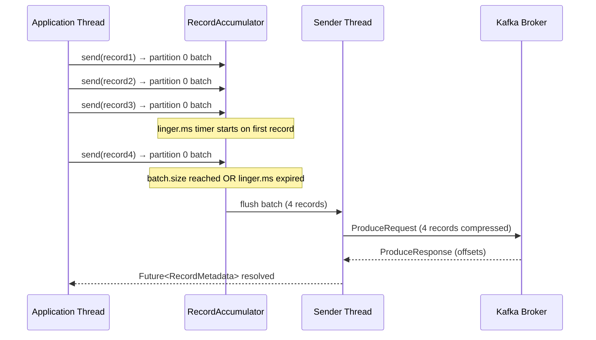

# ضبط منتج Kafka — الإنتاجية والزمن والديمومة المالية

> [!NOTE]
> لإعداد منتج Kafka أثر مباشر على الإنتاجية، والزمن من الطرف إلى الطرف، وديمومة الرسائل. ومنذ Kafka 3.0 صارت الإعدادات الافتراضية للمنتج متينة (`acks=all`، و`enable.idempotence=true`)، لكنها غير مضبوطة للإنتاجية، وما زالت أنظمة كثيرة تشغّل عملاء أقدم أو تتجاوز الإعدادات الافتراضية. وللأنظمة المالية، اضبط كل قيمة متعلقة بالديمومة صراحة واضبط التجميع لحملك.

## أهداف التعلم

بنهاية هذا الدرس ستكون قادرًا على:

1. شرح مفاضلة الإنتاجية مقابل الزمن التي يتحكم فيها `linger.ms` و`batch.size`
2. اختيار خوارزمية الضغط المناسبة لحمولات الرسائل المالية
3. ضبط `acks=all` مع منتجات idempotent لديمومة بمستوى مالي
4. ضبط `max.in.flight.requests.per.connection` بشكل صحيح مع تفعيل الـ idempotence
5. تحجيم `buffer.memory` و`max.block.ms` للتعامل مع الضغط العكسي دون فقد صامت للبيانات
6. ضبط `retries` و`delivery.timeout.ms` لمنع فقد الرسائل عند الأعطال العابرة
7. استخدام `RecordMetadata` لتأكيد قبول الوسيط للرسالة
8. تطبيق الضبط على جانب المستهلك بـ `fetch.min.bytes` و`max.poll.records`

## سياق العمل

*مثال مركّب:* كانت منتجات معالج دفع تعمل بـ `acks=1` — الافتراضي لعملاء Kafka قبل 3.0، وما زال تجاوزًا شائعًا "من أجل الأداء". فكان الوسيط يؤكد الرسائل بعد أن تكتبها النسخة القائدة فقط. وحين فشل وسيط في منتصف النسخ، فُقدت عدة مئات من أحداث الدفع: فالقائد أكدها، لكن التابعين لم يستلموها بعد. وكانت الأحداث المفقودة ردود تأكيد دفع لم تستلمها خدمات التسوية اللاحقة قط. والتقطت المطابقة التباين بعد ساعات كثيرة، بعد خلل محاسبي كبير وحادث طويل. وكان الإصلاح تغيير إعداد: `acks=all` (مع `min.insync.replicas=2`). والدرس: تحقق مما تعمل به منتجاتك فعلًا — ولا تفترض الإعدادات الافتراضية أبدًا.

## الإنتاجية مقابل الزمن — المفاضلة الأساسية

لا ترسل منتجات Kafka كل رسالة منفردة افتراضيًا. بل تجمّع الرسائل قبل إرسالها إلى الوسيط، ما يحسّن الإنتاجية كثيرًا مقابل زمن إضافي لكل رسالة.



**`linger.ms`** — المدة التي ينتظرها المنتج لتجميع السجلات قبل إرسال دفعة. كان الافتراضي `0` (أرسل فورًا — أقصى قابلية للتنبؤ بالزمن، وأدنى إنتاجية) وصار `5` منذ Kafka 4.0 ‏(KIP-1030). وضبط `linger.ms=5` يخبر المنتج بالانتظار حتى 5 مللي ثانية لوصول سجلات أخرى، فيملأ الدفعة قبل الإرسال.

**`batch.size`** — أقصى حجم بالبايت لدفعة واحدة لكل قسم (partition). الافتراضي `16384` ‏(16 كيلوبايت). وتُرسل الدفعة حالما تبلغ هذا الحجم، بغض النظر عن `linger.ms`. وزيادته إلى `65536` ‏(64 كيلوبايت) أو `131072` ‏(128 كيلوبايت) يحسّن الإنتاجية لتدفقات أحداث الدفع عالية الحجم.

```java
// Low-latency configuration — payment authorisation confirmations
// Latency matters: each ms adds to SLO
Properties lowLatency = new Properties();
lowLatency.put(ProducerConfig.LINGER_MS_CONFIG, 0);           // Send immediately
lowLatency.put(ProducerConfig.BATCH_SIZE_CONFIG, 16_384);     // 16KB batch
lowLatency.put(ProducerConfig.COMPRESSION_TYPE_CONFIG, "lz4"); // Fast compression

// High-throughput configuration — payment event log, audit trail
// Throughput matters: millions of events/second
Properties highThroughput = new Properties();
highThroughput.put(ProducerConfig.LINGER_MS_CONFIG, 10);        // Wait 10ms
highThroughput.put(ProducerConfig.BATCH_SIZE_CONFIG, 131_072);  // 128KB batch
highThroughput.put(ProducerConfig.COMPRESSION_TYPE_CONFIG, "zstd"); // Best ratio
```

## الضغط — اختيار الخوارزمية للحمولات المالية

يدعم Kafka أربع خوارزميات ضغط. ولحمولات الرسائل المالية (أحداث دفع JSON، ومعاملات مرمّزة بـ Avro)، يقلل الضغط عرض نطاق الشبكة واستخدام قرص الوسيط بـ 60–80%.

| الخوارزمية | نسبة الضغط | كلفة المعالج | الأنسب لـ |
|---|---|---|---|
| ‏`none` | ‏1.0x | لا شيء | التصحيح فقط |
| ‏`gzip` | ‏2.5–3.5x | مرتفعة | الحجم المنخفض، والأرشفة |
| ‏`snappy` | ‏1.8–2.5x | منخفضة | افتراضي متوازن |
| ‏`lz4` | ‏1.6–2.2x | منخفضة جدًا | الحساس للزمن |
| ‏`zstd` | ‏2.8–4.0x | متوسطة | سجلات التدقيق عالية الحجم |

لتدفقات أحداث الدفع حيث أجسام الرسائل كائنات `PaymentEvent` مرمّزة بـ JSON ‏(نحو 500 بايت لكل منها)، يحقق `lz4` تخفيضًا بنحو 40% في بايتات الشبكة بحمل معالج ضئيل على العتاد الحديث. ولسجلات التدقيق عالية الحجم حيث تحتوي الدفعات آلاف الأحداث متشابهة البنية، يحقق `zstd` ضغطًا بنسبة 70–80%.

```java
@Configuration
public class KafkaProducerConfig {

    @Bean
    public ProducerFactory<String, PaymentEvent> paymentEventProducerFactory(
            @Value("${kafka.bootstrap-servers}") String bootstrapServers) {
        Map<String, Object> config = new HashMap<>();

        // "${...}" inside a Java string is NOT resolved -- inject the value
        config.put(ProducerConfig.BOOTSTRAP_SERVERS_CONFIG, bootstrapServers);
        config.put(ProducerConfig.KEY_SERIALIZER_CLASS_CONFIG, StringSerializer.class);
        config.put(ProducerConfig.VALUE_SERIALIZER_CLASS_CONFIG, JsonSerializer.class);

        // Compression — lz4 for latency-sensitive payment events
        config.put(ProducerConfig.COMPRESSION_TYPE_CONFIG, "lz4");

        // Batching — tuned for payment volumes (~50K TPS)
        config.put(ProducerConfig.LINGER_MS_CONFIG, 5);
        config.put(ProducerConfig.BATCH_SIZE_CONFIG, 65_536);  // 64KB

        // Durability — financial grade
        config.put(ProducerConfig.ACKS_CONFIG, "all");
        config.put(ProducerConfig.ENABLE_IDEMPOTENCE_CONFIG, true);
        config.put(ProducerConfig.MAX_IN_FLIGHT_REQUESTS_PER_CONNECTION, 5);

        // Reliability
        config.put(ProducerConfig.RETRIES_CONFIG, Integer.MAX_VALUE);
        config.put(ProducerConfig.DELIVERY_TIMEOUT_MS_CONFIG, 120_000); // 2 minutes

        // Buffer sizing
        config.put(ProducerConfig.BUFFER_MEMORY_CONFIG, 67_108_864L); // 64MB
        config.put(ProducerConfig.MAX_BLOCK_MS_CONFIG, 60_000);       // 1 minute block

        return new DefaultKafkaProducerFactory<>(config);
    }
}
```

## الديمومة المالية — acks والـ Idempotence والطلبات قيد الإرسال

للبيانات المالية، يجب ضبط ثلاثة معاملات معًا. وضبط أي منها دون الآخرين يترك ثغرة.

**`acks=all`** — لا يؤكد الوسيط طلب الإنتاج إلا بعد أن تكتب كل النسخ المتزامنة (ISR) الرسالة. وهذا يضمن أنه إذا فشل القائد، فإن التابع الذي يصبح القائد الجديد يملك الرسالة أصلًا.

```java
// WRONG — acks=1 means only leader persists before ack
// A leader failure before replication = message loss
config.put(ProducerConfig.ACKS_CONFIG, "1");  // DO NOT USE for financial data

// CORRECT — acks=all waits for all ISR replicas
config.put(ProducerConfig.ACKS_CONFIG, "all");
// Also set min.insync.replicas=2 on the topic (with replication factor 3):
// kafka-configs.sh --bootstrap-server broker:9092 --alter \
//   --entity-type topics --entity-name payment-events \
//   --add-config min.insync.replicas=2
```

**`enable.idempotence=true`** — دون الـ idempotence، قد تسبب مهلة شبكة أثناء طلب إنتاج إعادة المنتج للمحاولة وكتابة الوسيط للرسالة مرتين. ولأحداث الدفع يعني هذا معالجة مكررة. والـ idempotence يعيّن معرّف منتج ورقمًا تسلسليًا لكل سجل، فيتيح للوسيط كشف التكرارات وتجاهلها.

**`max.in.flight.requests.per.connection`** — مع تفعيل الـ idempotence، يمكن أن يصل إلى 5 (Kafka 1.1+). ودون الـ idempotence، فضبطه فوق 1 يخاطر بإعادة ترتيب الرسائل عند إعادة المحاولة. والجمع بين `enable.idempotence=true` و`max.in.flight.requests.per.connection=5` يعني أن إعادات محاولة المنتج لا تسبب تكرارات ولا إعادة ترتيب داخل القسم، مع إبقاء الخط ممتلئًا. لكنه ليس exactly-once من الطرف إلى الطرف: فالمنتج المُعاد تشغيله يحصل على معرّف جديد، وقد يعالج المستهلكون سجلًا مرتين، لذا يجب أن يكون المستهلكون idempotent أيضًا (أو استخدم معاملات Kafka لتدفقات القراءة-المعالجة-الكتابة).

```java
// The three-way configuration that provides financial-grade producer guarantees
config.put(ProducerConfig.ACKS_CONFIG, "all");
config.put(ProducerConfig.ENABLE_IDEMPOTENCE_CONFIG, true);
config.put(ProducerConfig.MAX_IN_FLIGHT_REQUESTS_PER_CONNECTION, 5);
// Together: no loss once acknowledged + no duplicates from retries, per partition
// (Since Kafka 3.0 these are the defaults -- set them explicitly anyway)
```

> [!WARNING]
> يتطلب `enable.idempotence=true` ‏`acks=all`. فإذا ضبطت صراحة `enable.idempotence=true` مع `acks=1` أو `acks=0`، يرمي المنتج `ConfigException` عند البدء. (وإذا ضبطت `acks=1` فقط وتركت الـ idempotence على الافتراضي، فإن Kafka 3.x يعطّل الـ idempotence بصمت.) ويجب استخدام هذه الإعدادات معًا.

## ذاكرة المخزن والضغط العكسي

يتحكم `buffer.memory` في إجمالي بايتات الذاكرة التي يستخدمها المنتج لتخزين السجلات المنتظرة الإرسال. وحين يمتلئ المخزن، يحجب `send()` الخيط المستدعي حتى `max.block.ms`؛ وبعدها يفشل الإرسال بـ `BufferExhaustedException` (نوع من `TimeoutException`)، يُبلّغ عنه عبر المستقبل (future) والاستدعاء الراجع.

```java
// Default buffer.memory is 32MB — often too small for high-volume payment processors
// A payment processor at 50K TPS with 500-byte messages produces 25MB/s
// If the broker is slow (GC pause, network hiccup), buffer fills in ~1 second

config.put(ProducerConfig.BUFFER_MEMORY_CONFIG, 134_217_728L); // 128MB
config.put(ProducerConfig.MAX_BLOCK_MS_CONFIG, 30_000);        // 30 seconds

// Handle send failures explicitly — do NOT silently drop payments.
// (The most robust design is the transactional outbox from track 05: write the
//  event in the SAME database transaction as the payment and relay it to Kafka
//  afterwards, so no event depends on the producer buffer at all.)
KafkaTemplate<String, PaymentEvent> kafkaTemplate = new KafkaTemplate<>(producerFactory);
kafkaTemplate.setProducerListener(new ProducerListener<>() {
    @Override
    public void onError(ProducerRecord<String, PaymentEvent> record,
                        RecordMetadata metadata,
                        Exception exception) {
        // Called for ANY send failure (buffer full, delivery timeout, ...).
        // CRITICAL: a payment event that could not be sent must be persisted elsewhere
        // Options: write to outbox table, circuit break the payment, alert on-call
        log.error("Failed to buffer payment event: {}", record.value().getPaymentId(), exception);
        outboxService.persistForRetry(record.value());
        alertingService.notify(AlertLevel.P2, "Kafka producer buffer full — payment events queued to outbox");
    }
});
```

## إعادات المحاولة ومهلة التسليم

يتحكم `retries` في عدد مرات إعادة المنتج لمحاولة إرسال فاشل. و`delivery.timeout.ms` هو الحد الأعلى للوقت الكلي من `send()` إلى التأكيد أو الفشل النهائي — ويشمل كل إعادات المحاولة والانتظارات ووقت الإرسال.

```java
// Set retries to Integer.MAX_VALUE and control total retry window via delivery.timeout.ms
// This is the Kafka-recommended approach since version 2.1
config.put(ProducerConfig.RETRIES_CONFIG, Integer.MAX_VALUE);
config.put(ProducerConfig.DELIVERY_TIMEOUT_MS_CONFIG, 120_000); // 2-minute delivery window
config.put(ProducerConfig.REQUEST_TIMEOUT_MS_CONFIG, 30_000);   // 30s per request attempt
config.put(ProducerConfig.RETRY_BACKOFF_MS_CONFIG, 100);        // 100ms between retries

// Using RecordMetadata for explicit confirmation
public CompletableFuture<PaymentConfirmation> sendPaymentEvent(PaymentEvent event) {
    ProducerRecord<String, PaymentEvent> record = new ProducerRecord<>(
        "payment-events",
        event.getAccountId().toString(),  // partition key — same account → same partition → ordered
        event
    );

    return kafkaTemplate.send(record)
        .thenApply(result -> {
            RecordMetadata metadata = result.getRecordMetadata();
            log.debug("Payment event confirmed: topic={} partition={} offset={}",
                metadata.topic(), metadata.partition(), metadata.offset());
            return new PaymentConfirmation(
                event.getPaymentId(),
                metadata.topic(),
                metadata.partition(),
                metadata.offset(),
                Instant.ofEpochMilli(metadata.timestamp())
            );
        })
        .exceptionally(ex -> {
            log.error("Payment event delivery failed after retries: paymentId={}",
                event.getPaymentId(), ex);
            // Terminal failure — escalate to outbox/DLT.
            // Careful: a delivery timeout does NOT prove the broker never wrote
            // the record. Re-sending from the outbox can create a duplicate,
            // so consumers must de-duplicate (e.g. by paymentId).
            throw new PaymentEventDeliveryException(event.getPaymentId(), ex);
        });
}
```

## الضبط على جانب المستهلك

يجب أن يُكمّل ضبطَ المنتج ضبطُ المستهلك. فالمنتج المضبوط جيدًا الذي ينشئ دفعات كبيرة سيختنق بمستهلك يجلب سجلًا واحدًا في كل مرة.

```java
@Bean
public ConsumerFactory<String, PaymentEvent> paymentEventConsumerFactory(
        @Value("${kafka.bootstrap-servers}") String bootstrapServers) {
    Map<String, Object> config = new HashMap<>();

    config.put(ConsumerConfig.BOOTSTRAP_SERVERS_CONFIG, bootstrapServers);
    config.put(ConsumerConfig.GROUP_ID_CONFIG, "payment-processor-group");
    config.put(ConsumerConfig.KEY_DESERIALIZER_CLASS_CONFIG, StringDeserializer.class);
    config.put(ConsumerConfig.VALUE_DESERIALIZER_CLASS_CONFIG, JsonDeserializer.class);
    config.put(JsonDeserializer.TRUSTED_PACKAGES, "com.example.payments.events");

    // If producers use Kafka transactions, read only committed records
    config.put(ConsumerConfig.ISOLATION_LEVEL_CONFIG, "read_committed");

    // Fetch tuning — wait until at least 1KB is available before returning
    // Reduces fetch request count under light load
    config.put(ConsumerConfig.FETCH_MIN_BYTES_CONFIG, 1_024);        // 1KB minimum
    config.put(ConsumerConfig.FETCH_MAX_WAIT_MS_CONFIG, 500);        // Wait up to 500ms
    config.put(ConsumerConfig.MAX_PARTITION_FETCH_BYTES_CONFIG, 1_048_576); // 1MB per partition

    // Batch size — process up to 500 records per poll
    // Tune based on processing time: max.poll.interval.ms must exceed batch processing time
    config.put(ConsumerConfig.MAX_POLL_RECORDS_CONFIG, 500);
    config.put(ConsumerConfig.MAX_POLL_INTERVAL_MS_CONFIG, 300_000); // 5 minutes

    // Offset management — manual commit for financial data
    // Auto-commit can mark messages as processed before your code actually processes them
    config.put(ConsumerConfig.ENABLE_AUTO_COMMIT_CONFIG, false);

    return new DefaultKafkaConsumerFactory<>(config);
}
```

> [!TIP]
> للمستهلكين الماليين، عطّل الالتزام التلقائي في Kafka ‏(`ENABLE_AUTO_COMMIT_CONFIG=false`) ودع حاوية المستمع تلتزم — فوضعها الافتراضي `AckMode.BATCH` يلتزم بعد عودة المستمع، أو استخدم `MANUAL` / `MANUAL_IMMEDIATE` لتلتزم بنفسك. فالالتزام التلقائي يلتزم بمؤقت، لا عند نجاح المعالجة: فإذا سُلّم العمل لخيوط أخرى، قد تُلتزم إزاحات لسجلات لم تُعالج قط، ثم يفقدها التعطل. والتزم فقط بعد اكتمال منطق العمل — واجعل المعالجة idempotent، لأن بعض السجلات ستُسلّم مجددًا بعد التعطل.

## نتائج القياس — الافتراضي مقابل المضبوط

نتائج توضيحية لعنقود من 3 وسطاء مع رسائل أحداث دفع بحجم نحو 480 بايت. وستختلف أرقامك — فقِس دائمًا على عتادك وحمولاتك.

| الإعداد | الإنتاجية (رسالة/ث) | ‏P99 لزمن الإنتاج | ‏P99.9 لزمن الإنتاج | نسبة الضغط |
|---|---|---|---|---|
| الافتراضي القديم (`acks=1`، `linger=0`، `batch=16KB`، بلا ضغط) | 42,000 | ‏12 مللي ثانية | ‏48 مللي ثانية | ‏1.0x |
| ‏`acks=all`، idempotent، `linger=0`، بلا ضغط | 31,000 | ‏18 مللي ثانية | ‏65 مللي ثانية | ‏1.0x |
| ‏`acks=all`، idempotent، `linger=5ms`، lz4 | 78,000 | ‏22 مللي ثانية | ‏55 مللي ثانية | ‏1.6x |
| ‏`acks=all`، idempotent، `linger=10ms`، zstd، دفعة 128KB | 124,000 | ‏28 مللي ثانية | ‏70 مللي ثانية | ‏2.9x |

في هذا المثال يقدم الإعداد المضبوط نحو 3 أضعاف إنتاجية الإعدادات الافتراضية القديمة مع الحفاظ على ضمانات الديمومة. والزمن الإضافي في P99 بنحو 10 مللي ثانية من التجميع ضئيل لمعظم معالجة الأحداث المالية — وقلة من المسارات فقط، مثل تأكيدات التفويض، تحتاج زمن إنتاج منخفضًا جدًا في Kafka.

## اختبار المعرفة

**س1: منتج أحداث الدفع لديك مضبوط بـ `acks=1`، و`enable.idempotence=false`، و`max.in.flight.requests.per.connection=5`. يفشل قائد الوسيط أثناء النسخ. ما أسوأ نتيجة؟**

**ج:** مع `acks=1`، يؤكد القائد الرسائل قبل اكتمال النسخ. وحين يفشل القائد، تُفقد نهائيًا الرسائل التي أُكدت ولم تُنسخ بعد إلى تابعي ISR. فالقائد الجديد (تابع سابق) لا يملك تلك الرسائل. ولتدفق أحداث دفع يعني هذا أحداث دفع مفقودة لا تستلمها خدمات التسوية أبدًا، ما يتطلب مطابقة يدوية. والإصلاح `acks=all` مع `min.insync.replicas=2` على الموضوع.

**س2: تزيد `batch.size` من 16 كيلوبايت إلى 128 كيلوبايت في منتج أحداث دفع. فتزيد الإنتاجية كثيرًا لكن زمن P99 يرتفع من 15 مللي ثانية إلى 85 مللي ثانية. ما سبب زيادة الزمن وكيف تصلحه؟**

**ج:** ‏`batch.size` وحده لا يؤخر الإرسال: فمع `linger.ms=0` تُرسل الدفعة حالما يتفرغ المرسل. والسبب المعتاد `linger.ms` غير صفري (مضبوط صراحة، أو الافتراضي 5 مللي ثانية منذ Kafka 4.0، أو قيمة أكبر): فمع `batch.size` أكبر تمتلئ الدفعة أقل، فتنتظر سجلات أكثر مدة linger كاملة. والطلبات الأكبر تستغرق أيضًا وقتًا أطول للإرسال والنسخ، وإذا امتلأ `buffer.memory` يبدأ `send()` نفسه بالحجب. فافحص `linger.ms`، ومقاييس المنتج `record-queue-time-avg/max` و`bufferpool-wait-time`، وأبقِ `linger.ms` صغيرًا (1–5 مللي ثانية) مقارنة بالـ SLO — ولأحداث الدفع، فإن `batch.size=64KB` مع `linger.ms=5` نقطة بداية متوازنة.

## التحدي العملي

**السيناريو:** تحسّن خط أحداث دفع قائمًا على Kafka يعمل حاليًا بـ 28,000 رسالة/ثانية (الهدف: 100,000 رسالة/ثانية) بزمن P99 قدره 95 مللي ثانية (الـ SLO: ‏50 مللي ثانية). ويستخدم المنتج الإعداد الافتراضي باستثناء `acks=all`.

**المهام:**

1. **تدقيق الإعداد**: اذكر كل قيم إعداد المنتج الافتراضية التي يُرجح أنها تخنق الإنتاجية عند 28 ألف رسالة/ثانية. ولكل منها، اقترح القيمة المضبوطة واشرح الأثر المتوقع.

2. **إعداد الـ Idempotence**: اكتب إعداد المنتج الكامل (كـ `Map<String, Object>` في Java) لمنتج idempotent بمستوى مالي يحقق > 80 ألف رسالة/ثانية بزمن P99 < 50 مللي ثانية. وضمّن تعليقًا يبرر كل إعداد غير افتراضي.

3. **تنفيذ المستهلك**: اكتب دالة `@KafkaListener` في Spring Kafka تعالج دفعة من سجلات `PaymentEvent` مع التزام يدوي بالإزاحات. ويجب أن: (أ) تعالج كل سجلات الدفعة، (ب) تلتزم بالإزاحات فقط عند نجاح الدفعة كاملة، (ج) تتعامل مع فشل معالجة سجلات فردية دون فقد سجلات أخرى في الدفعة، (د) تنشر سجل رسائل ميتة (dead-letter) للأحداث الفاشلة نهائيًا.

4. **اختبار الضغط العكسي**: اكتب اختبار تكامل JUnit باستخدام وسيط Kafka مضمّن يبيّن `BufferExhaustedException` حين يمتلئ مخزن المنتج. واضبط الاختبار بـ `buffer.memory=16384` ‏(16 كيلوبايت)، وأرسل 1,000 سجل، وأكّد أن السجلات تُعاد توجيهها إلى جدول الصندوق الصادر (outbox) حين يُستنفد المخزن.

<!-- KNOWLEDGE-CHECK
{
  "questions": [
    {
      "text": "منتج أحداث دفع يستخدم acks=1، وenable.idempotence=false، وmax.in.flight.requests.per.connection=5. يفشل قائد الوسيط أثناء النسخ. ما أسوأ نتيجة؟",
      "options": [
        "يعيد المنتج المحاولة وتُسلّم كل الرسائل مرة واحدة بالضبط",
        "الرسائل التي أكدها القائد الفاشل ولم تُنسخ بعد إلى تابعي ISR تُفقد نهائيًا، ما يتطلب مطابقة يدوية",
        "يتحول المنتج تلقائيًا إلى acks=all عند فشل القائد",
        "تُفقد فقط رسائل الدفعة الحالية؛ والرسائل المرسلة سابقًا آمنة"
      ],
      "correct": 1,
      "explanation": "مع acks=1، يؤكد القائد الرسائل قبل نسخها. وحين يفشل القائد، قد لا يملك القائد الجديد (تابع سابق) الرسائل المؤكدة. فتُفقد نهائيًا. ولأحداث الدفع، يعني هذا أن خدمات التسوية لا تستلم تلك الأحداث أبدًا. والإصلاح: استخدم acks=all مع min.insync.replicas=2 وenable.idempotence=true."
    },
    {
      "text": "لماذا تسبب زيادة batch.size من 16 كيلوبايت إلى 128 كيلوبايت ارتفاع زمن P99 من 15 إلى 85 مللي ثانية في بعض الإعدادات؟",
      "options": [
        "الدفعات الأكبر تجعل وسيط Kafka يحتفظ بالرسالة أطول قبل الالتزام إلى القرص",
        "مع حجم دفعة أكبر، تنتظر الدفعات الممتلئة جزئيًا أطول لتجميع بيانات كافية قبل الإرسال، خاصة إذا كان linger.ms غير صفري؛ وزيادة الزمن تدل على أن linger.ms يجعل الدفعات تنتظر",
        "الدفعات الأكبر تتطلب وقت معالج أكثر للضغط، فيزيد زمن المنتج خطيًا",
        "دفعات 128 كيلوبايت تتجاوز max.message.bytes الافتراضي في Kafka فتُرفض بصمت ويُعاد إرسالها"
      ],
      "correct": 1,
      "explanation": "‏batch.size وحده لا يضيف زمنًا — فالمنتج يرسل حالما تمتلئ الدفعة أو يتفرغ المرسل. فإذا زاد الزمن كثيرًا، فإن linger.ms أكبر من 0 (صراحة، أو الافتراضي 5 مللي ثانية منذ Kafka 4.0)، فتنتظر السجلات مدة linger.ms. ومع batch.size أكبر تمتلئ الدفعة أقل، فيصبح linger.ms العامل المهيمن على الزمن. والإصلاح إبقاء linger.ms صغيرًا (1–5 مللي ثانية) مقارنة بالـ SLO."
    },
    {
      "text": "ما الغرض من enable.idempotence=true في منتج Kafka مالي، وما القيد الذي يفرضه على الإعداد؟",
      "options": [
        "يمنع المستهلكين المكررين بتتبع إزاحات مجموعة المستهلكين",
        "يمنع التكرارات وإعادة الترتيب الناتجة عن إعادات محاولة المنتج بإعطاء كل منتج PID وأرقامًا تسلسلية لكل قسم؛ ويتطلب acks=all وmax.in.flight.requests.per.connection <= 5",
        "يفعّل معاملات Kafka للكتابات الذرية عبر مواضيع متعددة",
        "لا أثر له في Kafka 3.x حيث الـ idempotence مفعّل دائمًا افتراضيًا"
      ],
      "correct": 1,
      "explanation": "يعطي enable.idempotence=true المنتج معرّف منتج (PID) ويرقّم كل سجل لكل قسم. ويستخدم الوسيط الأرقام التسلسلية لتجاهل التكرارات ورفض الدفعات خارج الترتيب الناتجة عن إعادات المحاولة. ويتطلب acks=all (كي لا تُفقد كتابة مؤكدة عند تغيير القائد، فيكسر ذلك التسلسل) وmax.in.flight.requests.per.connection <= 5 (عدد الدفعات التي يتتبعها الوسيط لكل منتج). وهو الافتراضي منذ Kafka 3.0. لكنه ليس exactly-once من الطرف إلى الطرف: فيجب أن يبقى المستهلكون idempotent، أو استخدم المعاملات."
    }
  ]
}
-->

<!-- PRACTICAL-CHALLENGE
{
  "title": "ضبط منتج Kafka لخط أحداث دفع بـ 100 ألف رسالة/ثانية",
  "difficulty": "advanced",
  "estimatedMinutes": 60,
  "tasks": [
    {"id": "1", "description": "اكتب إعداد المنتج الكامل Map<String, Object> لمنتج idempotent بمستوى مالي يستهدف > 80 ألف رسالة/ثانية بزمن P99 < 50 مللي ثانية، مع تعليق يبرر كل إعداد غير افتراضي."},
    {"id": "2", "description": "نفّذ دالة @KafkaListener في Spring Kafka تعالج دفعة من سجلات PaymentEvent مع التزام يدوي بالإزاحات، وتتعامل مع فشل سجلات فردية دون فقد سجلات أخرى في الدفعة، وتنشر سجلات رسائل ميتة للأحداث الفاشلة نهائيًا."},
    {"id": "3", "description": "اكتب بديلًا بنمط الصندوق الصادر (outbox) يعيد توجيه أحداث الدفع إلى جدول outbox في PostgreSQL حين يُستنفد مخزن منتج Kafka ‏(BufferExhaustedException)، مع مستطلع في الخلفية يعيد محاولة مدخلات الصندوق الصادر."},
    {"id": "4", "description": "اكتب اختبار تكامل JUnit باستخدام وسيط Kafka مضمّن يتحقق من: التسليم الـ idempotent (أرسل الحدث نفسه مرتين، وأكّد أن المستهلك يستلمه مرة واحدة)، والرجوع إلى الصندوق الصادر عند استنفاد المخزن حين buffer.memory=16384."}
  ]
}
-->
