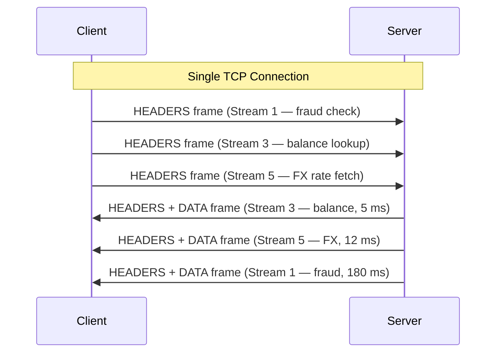

# أداء HTTP/2 وgRPC — تعدد إرسال الاتصالات

تنقل أنظمة التقنية المالية الحديثة كميات هائلة من الرسائل الصغيرة بين الخدمات المصغرة: تفويضات الدفع، وإشارات الاحتيال، واستعلامات الرصيد، وتأكيدات التسوية. ولم يُصمم HTTP/1.1 لهذا الحمل. أما HTTP/2، وgRPC المبني فوقه، فيغيّران جذريًا ملف أداء الاتصال بين الخدمات. ويفحص هذا الدرس آليات البروتوكول، ومسار التكامل مع Java، ومفاضلات الإنتاج التي يجب أن تفهمها قبل إدخال gRPC إلى منصة دفع.

## 1. قيود HTTP/1.1

قبل فهم مكاسب HTTP/2، يجب أن تستوعب ما يكلفك إياه HTTP/1.1.

### 1.1 حجب رأس الطابور (Head-of-Line Blocking)

‏HTTP/1.1 بروتوكول طلب-رد فوق تدفق TCP واحد مرتب. فإذا شغلت استجابة بطيئة (مثل البحث عن درجة احتيال) الاتصال، يجب أن ينتظر كل طلب لاحق خلفها. وتتحايل المتصفحات على ذلك بفتح ستة اتصالات لكل أصل. وتفعل الخدمات الشيء نفسه بمجمعات الاتصالات، لكن ذلك يضاعف حمل TCP فقط.

```
HTTP/1.1 timeline on a single connection:

Client          Server
  |--[REQ A]-->  |
  |              |  (Server processing A — 200 ms)
  |--[REQ B]-->  |   <--- queued, cannot proceed
  |              |
  |<--[RES A]--  |
  |<--[RES B]--  |
```

كل طلب متزامن إضافي يتطلب اتصال TCP منفصلًا (مصافحة ثلاثية، وبدء بطيء، ومصافحة TLS). ولبوابة دفع تجري 20 استدعاءً لاحقًا لكل معاملة، يكون هذا كارثيًا.

### 1.2 الترويسات المطوّلة

يرسل HTTP/1.1 الترويسات كنص عادي مع كل طلب. وترويسة Authorization نموذجية وحدها قد تبلغ 500 بايت. وعند 50,000 طلب في الثانية، يكون ذلك 25 ميغابايت/ثانية من الحمل الصافي لمجرد رمز JWT رأيته ألف مرة.

### 1.3 لا دفع من الخادم

لا يستطيع الخادم إرسال بيانات سيحتاجها العميل على نحو متوقع بشكل استباقي. فكل تفاعل يبدأه العميل حصرًا. (أضاف HTTP/2 "الدفع من الخادم"، لكن المتصفحات تخلت عنه وgRPC لا يستخدمه؛ وطلبات التدفق في gRPC هي الإجابة العملية للبيانات التي يبدأها الخادم.)

## 2. آليات HTTP/2

يحل HTTP/2 المشكلتين الأوليين بطبقة تأطير ثنائية فوق اتصال TCP واحد.

### 2.1 التدفقات متعددة الإرسال

يُدخل HTTP/2 مفهوم **التدفق (stream)**: تسلسل ثنائي الاتجاه من الإطارات داخل اتصال TCP واحد. وتتداخل التدفقات المتعددة على مستوى الإطار.



التدفقات مستقلة. فالتدفق البطيء (التدفق 1) لا يحجب التدفقات السريعة (التدفقان 3 و5). وهذا يلغي حجب رأس الطابور الخاص بـ HTTP/1.1 على مستوى التطبيق.

**ملاحظة عن حجب رأس الطابور على مستوى TCP:** ‏TCP نفسه تدفق بايتات مرتب، فالحزمة المفقودة ما زالت تحجب كل تدفقات HTTP/2 حتى إعادة الإرسال. ويحل HTTP/3 ‏(QUIC) ذلك على مستوى النقل، لكن HTTP/2 كافٍ للاتصال داخل مركز البيانات حيث فقد الحزم نادر.

### 2.2 ضغط الترويسات HPACK

يحتفظ HPACK بجدول ديناميكي لأزواج اسم-قيمة الترويسات المرئية سابقًا على الجانبين. وتشير الطلبات اللاحقة إلى مدخلات الجدول بفهرس (1–2 بايت) بدل تكرار النص الكامل.

```
Request 1: Authorization: Bearer eyJhbGc...  → 512 bytes
Request 2: Authorization: Bearer eyJhbGc...  → 2 bytes (index reference)
           Content-Type: application/grpc    → 2 bytes (index reference)
```

في خدمة دفع تجري آلاف الاستدعاءات في الثانية إلى الخدمة اللاحقة نفسها، يزيل ضغط HPACK عادة معظم حمل الترويسات. (وقد تعلّم التنفيذات عمدًا الترويسات الحساسة مثل `authorization` بأنها "لا تُفهرس أبدًا" لأسباب أمنية؛ فتُرسل حينها كاملة في كل مرة.)

### 2.3 التحكم في التدفق في HTTP/2

لكل تدفق وللاتصال كله نافذة استقبال (65,535 بايت وفق مواصفة HTTP/2؛ ويبدأ grpc-java بنافذة أكبر ويمكنه ضبطها تلقائيًا). ويجب ألا يتجاوز المرسلون النافذة. ويُصدر المستقبلون إطارات WINDOW_UPDATE لزيادة السعة. وهذا يمنع منتجًا سريعًا من إغراق مستهلك بطيء — المفهوم نفسه للتحكم في التدفق في TCP لكن على مستوى HTTP.

## 3. بنية gRPC

‏gRPC إطار RPC عالي الأداء من Google يستخدم HTTP/2 كطبقة نقل وProtocol Buffers ‏(protobuf) كصيغة التسلسل الافتراضية.

### 3.1 أنماط الاتصال

يدعم gRPC أربعة أنماط اتصال:

| النمط | الوصف | حالة استخدام في التقنية المالية |
|---|---|---|
| ‏Unary | طلب واحد، رد واحد | تفويض الدفع |
| تدفق من الخادم | طلب واحد، تدفق من الردود | تنبيهات الاحتيال الفورية |
| تدفق من العميل | تدفق من الطلبات، رد واحد | رفع دفعة تسوية |
| تدفق ثنائي الاتجاه | تدفق مزدوج كامل | موجز دفتر الأوامر الحي |

### 3.2 تسلسل Protocol Buffers

‏Protobuf صيغة تسلسل ثنائية محايدة للغة. ومقارنة بـ JSON:

- **الحجم:** رسائل Protobuf عادة أصغر بـ 3–10 مرات. رسالة دفع بـ 15 حقلًا: JSON نحو 450 بايت، وProtobuf نحو 90 بايت.
- **السرعة:** تحليل/تسلسل Protobuf أسرع بـ 5–10 مرات من JSON. لا تحليل نصوص، ولا بحث عن أسماء الحقول.
- **فرض المخطط:** ملف `.proto` هو العقد ويولّد شيفرة ذات أنواع. لكن التغييرات الكاسرة للتوافق على السلك (إعادة استخدام رقم حقل أو تغييره، أو تغيير نوع) لا يلتقطها المترجم — فأضف فحص مخطط مثل `buf breaking` إلى CI.

**مقياس توضيحي (مليون دورة ترميز/فك ترميز لرسالة دفع، Java):**

```
JSON (Jackson):
  Serialise:   1,240 ms  (1.24 µs/msg)
  Deserialise: 1,890 ms  (1.89 µs/msg)
  Average message size: 423 bytes

Protobuf 3:
  Serialise:    190 ms  (0.19 µs/msg)  → 6.5x faster
  Deserialise:  210 ms  (0.21 µs/msg)  → 9.0x faster
  Average message size:  87 bytes      → 4.9x smaller
```

## 4. تعريف Proto لخدمة الدفع

أنشئ `src/main/proto/payment/v1/payment_service.proto`:

```protobuf
syntax = "proto3";

package payment.v1;

option java_package = "com.fintech.payment.grpc";
option java_outer_classname = "PaymentServiceProto";
option java_multiple_files = true;

import "google/protobuf/timestamp.proto";

// ---- Messages ----

message PaymentRequest {
  string payment_id       = 1;
  string source_account   = 2;
  string target_account   = 3;
  int64  amount_cents      = 4;   // minor units; avoid floating point
                                  // (JPY has 0 decimals, BHD has 3 -- the
                                  //  currency defines the scale)
  string currency          = 5;   // ISO 4217
  string idempotency_key   = 6;
  map<string, string> metadata = 7;
}

message PaymentResponse {
  string payment_id    = 1;
  PaymentStatus status = 2;
  string auth_code     = 3;
  google.protobuf.Timestamp processed_at = 4;
  string failure_reason = 5;
}

enum PaymentStatus {
  PAYMENT_STATUS_UNSPECIFIED = 0;
  PAYMENT_STATUS_APPROVED    = 1;
  PAYMENT_STATUS_DECLINED    = 2;
  PAYMENT_STATUS_PENDING     = 3;
}

message StreamPaymentRequest {
  string account_id = 1;
  google.protobuf.Timestamp since = 2;
}

message PaymentEvent {
  string payment_id    = 1;
  PaymentStatus status = 2;
  int64  amount_cents   = 3;
  google.protobuf.Timestamp event_time = 4;
}

// ---- Service ----

service PaymentService {
  // Unary: authorise a single payment
  rpc AuthorisePayment(PaymentRequest) returns (PaymentResponse);

  // Server streaming: stream payment events for an account
  rpc StreamAccountPayments(StreamPaymentRequest) returns (stream PaymentEvent);

  // Client streaming: upload a batch of payments, receive summary
  rpc UploadBatch(stream PaymentRequest) returns (BatchSummary);

  // Bidirectional: live payment feed with acknowledgements
  rpc PaymentFeed(stream PaymentRequest) returns (stream PaymentResponse);
}

message BatchSummary {
  int32 total_received = 1;
  int32 approved       = 2;
  int32 declined       = 3;
  int64 total_amount_cents = 4;
}
```

## 5. إعداد gRPC في Spring Boot

### 5.1 الاعتماديات (Maven)

```xml
<dependencies>
    <!-- gRPC Spring Boot Starter (community project; 3.x for Spring Boot 3).
         Alternative: the official Spring gRPC project (org.springframework.grpc). -->
    <dependency>
        <groupId>net.devh</groupId>
        <artifactId>grpc-spring-boot-starter</artifactId>
        <version>3.1.0.RELEASE</version>
    </dependency>

    <!-- Generated stubs use @javax.annotation.Generated -->
    <dependency>
        <groupId>org.apache.tomcat</groupId>
        <artifactId>annotations-api</artifactId>
        <version>6.0.53</version>
        <scope>provided</scope>
    </dependency>

    <!-- Protobuf runtime -->
    <dependency>
        <groupId>com.google.protobuf</groupId>
        <artifactId>protobuf-java</artifactId>
        <version>3.25.3</version>
    </dependency>

    <!-- gRPC stubs -->
    <dependency>
        <groupId>io.grpc</groupId>
        <artifactId>grpc-stub</artifactId>
        <version>1.63.0</version>
    </dependency>
    <dependency>
        <groupId>io.grpc</groupId>
        <artifactId>grpc-protobuf</artifactId>
        <version>1.63.0</version>
    </dependency>
</dependencies>

<build>
    <extensions>
        <extension>
            <groupId>kr.motd.maven</groupId>
            <artifactId>os-maven-plugin</artifactId>
            <version>1.7.1</version>
        </extension>
    </extensions>
    <plugins>
        <plugin>
            <groupId>org.xolstice.maven.plugins</groupId>
            <artifactId>protobuf-maven-plugin</artifactId>
            <version>0.6.1</version>
            <configuration>
                <protocArtifact>com.google.protobuf:protoc:3.25.3:exe:${os.detected.classifier}</protocArtifact>
                <pluginId>grpc-java</pluginId>
                <pluginArtifact>io.grpc:protoc-gen-grpc-java:1.63.0:exe:${os.detected.classifier}</pluginArtifact>
            </configuration>
            <executions>
                <execution>
                    <goals>
                        <goal>compile</goal>
                        <goal>compile-custom</goal>
                    </goals>
                </execution>
            </executions>
        </plugin>
    </plugins>
</build>
```

### 5.2 إعداد الخادم

```yaml
# application.yml
grpc:
  server:
    port: 9090
    max-inbound-message-size: 10MB
    max-inbound-metadata-size: 8KB
    keep-alive-time: 30s
    keep-alive-timeout: 10s
    # Clients below ping every 30s; the server must PERMIT pings that often.
    # The default (5 min) makes the server close such connections with
    # GOAWAY "too_many_pings".
    permit-keep-alive-time: 20s
    permit-keep-alive-without-calls: true
```

### 5.3 تنفيذ الخادم

```java
package com.fintech.payment.grpc;

import com.fintech.payment.grpc.PaymentServiceGrpc.PaymentServiceImplBase;
import io.grpc.Status;
import io.grpc.StatusRuntimeException;
import io.grpc.stub.StreamObserver;
import net.devh.boot.grpc.server.service.GrpcService;
import org.slf4j.Logger;
import org.slf4j.LoggerFactory;
import org.springframework.beans.factory.annotation.Autowired;

import java.time.Instant;

@GrpcService
public class PaymentGrpcService extends PaymentServiceImplBase {

    private static final Logger log = LoggerFactory.getLogger(PaymentGrpcService.class);

    private final PaymentProcessor paymentProcessor;
    private final PaymentEventRepository eventRepository;

    @Autowired
    public PaymentGrpcService(PaymentProcessor paymentProcessor,
                              PaymentEventRepository eventRepository) {
        this.paymentProcessor = paymentProcessor;
        this.eventRepository = eventRepository;
    }

    @Override
    public void authorisePayment(PaymentRequest request,
                                  StreamObserver<PaymentResponse> responseObserver) {
        try {
            // Input validation
            validatePaymentRequest(request);

            // Process payment
            PaymentResult result = paymentProcessor.authorise(
                request.getPaymentId(),
                request.getSourceAccount(),
                request.getTargetAccount(),
                request.getAmountCents(),
                request.getCurrency(),
                request.getIdempotencyKey()
            );

            PaymentResponse.Builder builder = PaymentResponse.newBuilder()
                .setPaymentId(result.paymentId())
                .setStatus(result.approved()
                    ? PaymentStatus.PAYMENT_STATUS_APPROVED
                    : PaymentStatus.PAYMENT_STATUS_DECLINED)
                .setProcessedAt(toProtoTimestamp(result.processedAt()));
            // Protobuf setters reject null -- a declined payment has no auth code
            if (result.authCode() != null) {
                builder.setAuthCode(result.authCode());
            }
            PaymentResponse response = builder.build();

            responseObserver.onNext(response);
            responseObserver.onCompleted();

        } catch (ValidationException e) {
            responseObserver.onError(
                Status.INVALID_ARGUMENT
                    .withDescription(e.getMessage())
                    .asRuntimeException()
            );
        } catch (InsufficientFundsException e) {
            responseObserver.onError(
                Status.FAILED_PRECONDITION
                    .withDescription("Insufficient funds")
                    .asRuntimeException()
            );
        } catch (Exception e) {
            log.error("Unexpected error processing payment {}", request.getPaymentId(), e);
            responseObserver.onError(
                Status.INTERNAL
                    .withDescription("Payment processing failed")
                    .asRuntimeException()
            );
        }
    }

    @Override
    public void streamAccountPayments(StreamPaymentRequest request,
                                       StreamObserver<PaymentEvent> responseObserver) {
        String accountId = request.getAccountId();
        Instant since = toInstant(request.getSince());

        var serverObserver = (ServerCallStreamObserver<PaymentEvent>) responseObserver;

        // Stream events — each onNext() queues one message for the client.
        // Note: onNext() never blocks; if the client reads slowly, messages pile
        // up in memory. For large streams, send only while
        // serverObserver.isReady() and continue in setOnReadyHandler(...).
        try (var eventStream = eventRepository.streamByAccount(accountId, since)) {
            eventStream.forEach(event -> {
                // Stop work for a client that has gone away (cancel, deadline)
                if (serverObserver.isCancelled()) {
                    throw Status.CANCELLED.asRuntimeException();
                }
                PaymentEvent protoEvent = PaymentEvent.newBuilder()
                    .setPaymentId(event.paymentId())
                    .setStatus(toProtoStatus(event.status()))
                    .setAmountCents(event.amountCents())
                    .setEventTime(toProtoTimestamp(event.eventTime()))
                    .build();
                responseObserver.onNext(protoEvent);
            });
            responseObserver.onCompleted();
        } catch (StatusRuntimeException e) {
            // Client cancelled — this is normal, do not log as error
            log.debug("Client cancelled stream for account {}", accountId);
        } catch (Exception e) {
            log.error("Stream error for account {}", accountId, e);
            responseObserver.onError(
                Status.INTERNAL.withDescription("Stream interrupted").asRuntimeException()
            );
        }
    }

    @Override
    public StreamObserver<PaymentRequest> uploadBatch(
            StreamObserver<BatchSummary> responseObserver) {

        return new StreamObserver<>() {
            private int totalReceived = 0;
            private int approved = 0;
            private int declined = 0;
            private long totalAmountCents = 0;

            @Override
            public void onNext(PaymentRequest request) {
                totalReceived++;
                totalAmountCents += request.getAmountCents();
                try {
                    PaymentResult result = paymentProcessor.authorise(
                        request.getPaymentId(),
                        request.getSourceAccount(),
                        request.getTargetAccount(),
                        request.getAmountCents(),
                        request.getCurrency(),
                        request.getIdempotencyKey()
                    );
                    if (result.approved()) approved++; else declined++;
                } catch (Exception e) {
                    declined++;
                    log.warn("Batch payment {} failed: {}", request.getPaymentId(), e.getMessage());
                }
            }

            @Override
            public void onError(Throwable t) {
                log.error("Client stream error during batch upload", t);
            }

            @Override
            public void onCompleted() {
                responseObserver.onNext(
                    BatchSummary.newBuilder()
                        .setTotalReceived(totalReceived)
                        .setApproved(approved)
                        .setDeclined(declined)
                        .setTotalAmountCents(totalAmountCents)
                        .build()
                );
                responseObserver.onCompleted();
            }
        };
    }

    private void validatePaymentRequest(PaymentRequest request) {
        if (request.getPaymentId().isBlank()) {
            throw new ValidationException("payment_id is required");
        }
        if (request.getAmountCents() <= 0) {
            throw new ValidationException("amount_cents must be positive");
        }
        if (request.getCurrency().length() != 3) {
            throw new ValidationException("currency must be ISO 4217 (3 chars)");
        }
    }

    // helper methods omitted for brevity
    private com.google.protobuf.Timestamp toProtoTimestamp(Instant instant) {
        return com.google.protobuf.Timestamp.newBuilder()
            .setSeconds(instant.getEpochSecond())
            .setNanos(instant.getNano())
            .build();
    }

    private Instant toInstant(com.google.protobuf.Timestamp ts) {
        return Instant.ofEpochSecond(ts.getSeconds(), ts.getNanos());
    }

    private PaymentStatus toProtoStatus(String status) {
        return switch (status) {
            case "APPROVED" -> PaymentStatus.PAYMENT_STATUS_APPROVED;
            case "DECLINED" -> PaymentStatus.PAYMENT_STATUS_DECLINED;
            default          -> PaymentStatus.PAYMENT_STATUS_PENDING;
        };
    }
}
```

## 6. معترِضات gRPC ‏(Interceptors)

المعترِضات هي مكافئ مرشحات servlet في gRPC. وتُنفذ قبل كل استدعاء RPC وبعده.

### 6.1 معترِض المصادقة

```java
package com.fintech.payment.grpc.interceptor;

import io.grpc.*;
import net.devh.boot.grpc.server.interceptor.GrpcGlobalServerInterceptor;
import org.springframework.beans.factory.annotation.Autowired;

@GrpcGlobalServerInterceptor
public class AuthenticationInterceptor implements ServerInterceptor {

    // Metadata key for the JWT token
    public static final Metadata.Key<String> AUTHORIZATION_KEY =
        Metadata.Key.of("authorization", Metadata.ASCII_STRING_MARSHALLER);

    // Context key to pass the authenticated principal downstream
    public static final Context.Key<AuthPrincipal> AUTH_PRINCIPAL =
        Context.key("authPrincipal");

    @Autowired
    private JwtValidator jwtValidator;

    @Override
    public <ReqT, RespT> ServerCall.Listener<ReqT> interceptCall(
            ServerCall<ReqT, RespT> call,
            Metadata headers,
            ServerCallHandler<ReqT, RespT> next) {

        String authHeader = headers.get(AUTHORIZATION_KEY);

        if (authHeader == null || !authHeader.startsWith("Bearer ")) {
            call.close(
                Status.UNAUTHENTICATED.withDescription("Missing Authorization header"),
                new Metadata()
            );
            return new ServerCall.Listener<>() {};
        }

        String token = authHeader.substring(7);
        try {
            AuthPrincipal principal = jwtValidator.validate(token);
            Context ctx = Context.current().withValue(AUTH_PRINCIPAL, principal);
            return Contexts.interceptCall(ctx, call, headers, next);
        } catch (TokenExpiredException e) {
            call.close(
                Status.UNAUTHENTICATED.withDescription("Token expired"),
                new Metadata()
            );
            return new ServerCall.Listener<>() {};
        } catch (InvalidTokenException e) {
            call.close(
                Status.UNAUTHENTICATED.withDescription("Invalid token"),
                new Metadata()
            );
            return new ServerCall.Listener<>() {};
        }
    }
}
```

### 6.2 معترِض التتبع

```java
@GrpcGlobalServerInterceptor
public class TracingInterceptor implements ServerInterceptor {

    public static final Metadata.Key<String> TRACE_ID_KEY =
        Metadata.Key.of("x-trace-id", Metadata.ASCII_STRING_MARSHALLER);

    @Override
    public <ReqT, RespT> ServerCall.Listener<ReqT> interceptCall(
            ServerCall<ReqT, RespT> call,
            Metadata headers,
            ServerCallHandler<ReqT, RespT> next) {

        String traceId = Optional.ofNullable(headers.get(TRACE_ID_KEY))
            .orElse(UUID.randomUUID().toString());

        // Add the trace ID to the response headers when the service sends them.
        // (Calling call.sendHeaders() here would make the service's own
        //  first onNext() fail: headers may only be sent once.)
        ServerCall<ReqT, RespT> tracedCall =
            new ForwardingServerCall.SimpleForwardingServerCall<>(call) {
                @Override
                public void sendHeaders(Metadata responseHeaders) {
                    responseHeaders.put(TRACE_ID_KEY, traceId);
                    super.sendHeaders(responseHeaders);
                }
            };

        // The handler runs LATER, in listener callbacks, often on another
        // thread -- so set the MDC around each callback, not just here.
        ServerCall.Listener<ReqT> delegate = next.startCall(tracedCall, headers);
        return new ForwardingServerCallListener.SimpleForwardingServerCallListener<>(delegate) {
            private void withMdc(Runnable r) {
                MDC.put("traceId", traceId);
                try { r.run(); } finally { MDC.remove("traceId"); }
            }
            @Override public void onMessage(ReqT message) { withMdc(() -> super.onMessage(message)); }
            @Override public void onHalfClose() { withMdc(super::onHalfClose); }
            @Override public void onCancel() { withMdc(super::onCancel); }
            @Override public void onComplete() { withMdc(super::onComplete); }
        };
    }
}
// In production, prefer OpenTelemetry's gRPC instrumentation and the W3C
// "traceparent" header over a home-made x-trace-id.
```

## 7. قناة gRPC وتجميع الاتصالات

تعدد `ManagedChannel` في gRPC التدفقات أصلًا فوق اتصال HTTP/2 واحد. وللإنتاجية العالية جدًا قد تحتاج اتصالات أكثر: لا يملك grpc-java إعداد "حجم مجمع"، فإما أن تنشئ بضع قنوات وتوزع الاستدعاءات عليها، أو تستخدم موازنة الحمل على جانب العميل (`defaultLoadBalancingPolicy("round_robin")` مع اسم يُحل إلى عدة خوادم).

```java
package com.fintech.payment.grpc.client;

import io.grpc.*;
import org.springframework.context.annotation.Bean;
import org.springframework.context.annotation.Configuration;

import java.util.concurrent.TimeUnit;

@Configuration
public class GrpcClientConfiguration {

    // shutdown() is a ManagedChannel method -- the channel is what must be closed
    @Bean(destroyMethod = "shutdown")
    public ManagedChannel paymentServiceChannel() {
        return ManagedChannelBuilder
            .forAddress("payment-service.internal", 9090)
            .useTransportSecurity()                  // TLS with proper certs
            // HTTP/2 keep-alive: PING every 30s (server must permit this rate)
            .keepAliveTime(30, TimeUnit.SECONDS)
            .keepAliveTimeout(10, TimeUnit.SECONDS)
            .keepAliveWithoutCalls(true)
            .maxInboundMessageSize(10 * 1024 * 1024)
            // Default deadline applied to EACH call (see interceptor below)
            .intercept(new DefaultDeadlineInterceptor(5, TimeUnit.SECONDS))
            .build();
    }

    // Do NOT do this: newBlockingStub(ch).withDeadlineAfter(5, SECONDS) in a
    // bean. A deadline is an absolute point in time, computed when the stub is
    // created -- five seconds after start-up, EVERY call would fail.
    @Bean
    public PaymentServiceGrpc.PaymentServiceBlockingStub paymentServiceBlockingStub(
            ManagedChannel paymentServiceChannel) {
        return PaymentServiceGrpc.newBlockingStub(paymentServiceChannel);
    }

    @Bean
    public PaymentServiceGrpc.PaymentServiceStub paymentServiceAsyncStub(
            ManagedChannel paymentServiceChannel) {
        return PaymentServiceGrpc.newStub(paymentServiceChannel);
    }
}

/** Gives every call a deadline unless the caller already set one. */
class DefaultDeadlineInterceptor implements ClientInterceptor {
    private final long duration;
    private final TimeUnit unit;

    DefaultDeadlineInterceptor(long duration, TimeUnit unit) {
        this.duration = duration;
        this.unit = unit;
    }

    @Override
    public <ReqT, RespT> ClientCall<ReqT, RespT> interceptCall(
            MethodDescriptor<ReqT, RespT> method, CallOptions options, Channel next) {
        if (options.getDeadline() == null) {
            options = options.withDeadlineAfter(duration, unit);   // fresh per call
        }
        return next.newCall(method, options);
    }
}
```

## 8. المهل النهائية (Deadlines) وانتشار الإلغاء

تنتشر المهل النهائية في gRPC من الطرف إلى الطرف. فإذا ضبط العميل الأعلى مهلة 5 ثوانٍ، ترث كل استدعاءات RPC اللاحقة الميزانية المتبقية.

```java
@Service
public class PaymentOrchestrator {

    private final FraudServiceGrpc.FraudServiceBlockingStub fraudStub;
    private final LedgerServiceGrpc.LedgerServiceBlockingStub ledgerStub;

    public PaymentResult process(PaymentRequest request) {
        // The deadline is set on the stub — it propagates to all downstream calls
        // automatically if you use the same context.
        // Here we set a per-call deadline explicitly.

        FraudCheckResponse fraud;
        try {
            fraud = fraudStub
                .withDeadlineAfter(1500, TimeUnit.MILLISECONDS)
                .checkFraud(FraudCheckRequest.newBuilder()
                    .setPaymentId(request.getPaymentId())
                    .setAmountCents(request.getAmountCents())
                    .build());

        } catch (StatusRuntimeException e) {
            // Nothing has been debited yet: declining is safe here
            log.warn("Fraud check failed for payment {}: {}",
                request.getPaymentId(), e.getStatus().getCode());
            return PaymentResult.declined("FRAUD_CHECK_UNAVAILABLE");
        }

        if (fraud.getRiskScore() > 80) {
            return PaymentResult.declined("HIGH_FRAUD_RISK");
        }

        try {
            LedgerResponse ledger = ledgerStub
                .withDeadlineAfter(2000, TimeUnit.MILLISECONDS)
                .debitAccount(DebitRequest.newBuilder()
                    .setAccountId(request.getSourceAccount())
                    .setAmountCents(request.getAmountCents())
                    .setIdempotencyKey(request.getIdempotencyKey())  // safe to retry/query
                    .build());

            return PaymentResult.approved(ledger.getAuthCode());

        } catch (StatusRuntimeException e) {
            return switch (e.getStatus().getCode()) {
                // The debit MAY have happened: the request can reach the ledger
                // even though our call timed out. Never report "declined" here --
                // record PENDING and resolve it by querying the ledger with the
                // idempotency key (or retrying with the same key).
                case DEADLINE_EXCEEDED, UNAVAILABLE, UNKNOWN, INTERNAL -> {
                    log.warn("Ledger outcome unknown for payment {}: {}",
                        request.getPaymentId(), e.getStatus().getCode());
                    yield PaymentResult.pending("LEDGER_OUTCOME_UNKNOWN");
                }
                case FAILED_PRECONDITION -> PaymentResult.declined("INSUFFICIENT_FUNDS");
                default -> {
                    log.error("gRPC error for payment {}", request.getPaymentId(), e);
                    yield PaymentResult.declined("PROCESSING_ERROR");
                }
            };
        }
    }
}
```

### 8.1 مرجع رموز حالة gRPC

| الرمز | المعنى | السبب المعتاد |
|---|---|---|
| ‏OK | نجاح | — |
| ‏INVALID_ARGUMENT | طلب سيئ | فشل التحقق |
| ‏NOT_FOUND | مورد مفقود | حساب مجهول |
| ‏ALREADY_EXISTS | تكرار | إعادة استخدام مفتاح idempotency نفسه مع طلب *مختلف* (إعادة المحاولة الحقيقية يجب أن تحصل على النتيجة الأصلية) |
| ‏FAILED_PRECONDITION | مخالفة قاعدة عمل | رصيد غير كافٍ |
| ‏UNAUTHENTICATED | بيانات اعتماد مفقودة/غير صالحة | ‏JWT منتهي الصلاحية |
| ‏PERMISSION_DENIED | مصادَق لكن غير مسموح | نطاق خاطئ |
| ‏RESOURCE_EXHAUSTED | تجاوز حد المعدل | طلبات كثيرة جدًا |
| ‏DEADLINE_EXCEEDED | انتهاء المهلة | خدمة لاحقة بطيئة |
| ‏UNAVAILABLE | الخدمة متوقفة | شبكة/تعطل |
| ‏INTERNAL | خطأ في الخادم | استثناء غير متوقع |

## 9. مخطط بنية التدفقات متعددة الإرسال

```
+----------------------------------+
|          Payment Gateway         |
+----------------------------------+
         |
         | Single TCP Connection (TLS)
         | HTTP/2 Multiplexed
         |
+--------+---------------------------+
|  Stream 1: AuthorisePayment (5ms)  |
|  Stream 3: FraudCheck (180ms)      |
|  Stream 5: BalanceLookup (3ms)     |
|  Stream 7: FXRateLookup (12ms)     |
|  Stream 9: LedgerDebit (8ms)       |
+------------------------------------+
         |
+--------+---------------------------+
|       Downstream gRPC Service      |
|   (fraud-service:9090)             |
+------------------------------------+

HTTP/1.1, ONE connection (requests wait for each other):
  Total time = 5 + 180 + 3 + 12 + 8 = 208ms

HTTP/1.1, 5 parallel connections:
  Total time = max(...) = 180ms -- but 5 connections to open, keep warm
  and pool per downstream (5 × TCP + TLS handshakes on a cold start)

HTTP/2 (1 connection, 5 streams):
  Total time = max(5, 180, 3, 12, 8) = 180ms
  One handshake, amortised to near zero; far fewer sockets per instance
```

## 10. مزالق الإنتاج

### المزلق 1: عدم ضبط المهل النهائية — إنشاء استدعاءات RPC ميتة حية

**المشكلة:** دون مهلة نهائية، تجعل خدمة لاحقة معلّقة الخيط المستدعي ينتظر إلى ما لا نهاية. وتحت الحمل، تُستنفد مجمعات الخيوط وتتجمد الخدمة كلها.

**النهج الخاطئ:**

```java
// No deadline — this call can hang forever
PaymentResponse response = paymentStub.authorisePayment(request);
```

**النهج الصحيح:**

```java
// Always set a deadline. Budget: total SLA minus processing overhead.
// If your SLA is 500ms and local processing takes 50ms, allow 400ms downstream.
PaymentResponse response = paymentStub
    .withDeadlineAfter(400, TimeUnit.MILLISECONDS)
    .authorisePayment(request);
```

**قاعدة ميزانية المهلة:** اضبط المهل عند كل قفزة. فإذا كان SLA لواجهتك 500 مللي ثانية ولديك ثلاثة استدعاءات RPC متتابعة (الاحتيال: 150 مللي ثانية، والدفتر: 100 مللي ثانية، والإشعار: 50 مللي ثانية)، فخصص ميزانية لكل منها بهامش واضبطها صراحة. وينشر سياق gRPC المهلة المتبقية إلى الاستدعاءات المتداخلة تلقائيًا داخل سياق الخيط نفسه.

### المزلق 2: مشاركة قناة واحدة للاستدعاءات الحاجبة وغير المتزامنة

**المشكلة:** افتراضيًا يشغّل grpc-java الاستدعاءات الراجعة لديك على مجمع خيوط مشترك متغير الحجم (منفصل عن حلقة أحداث الشبكة في Netty). والاستدعاءات الراجعة لاستدعاء واحد تعمل واحدة تلو الأخرى، فالعمل الحاجب في `onNext` يوقف ذلك التدفق، وكثير من هذه التدفقات قد يشغل خيوطًا كثيرة.

**النهج الخاطئ:**

```java
// Using the default channel executor for blocking database calls inside a streaming observer
paymentStub.streamAccountPayments(request, new StreamObserver<PaymentEvent>() {
    @Override
    public void onNext(PaymentEvent event) {
        // BAD: blocking DB call on the gRPC executor thread
        database.save(event);  // may block for 50ms
    }
});
```

**النهج الصحيح:**

```java
// Offload blocking work to a dedicated executor
// (Bounded pool. For long streams also use flow control -- request(n) on
//  the call -- so a fast server cannot fill this executor's queue.)
ExecutorService dbExecutor = Executors.newFixedThreadPool(20);

paymentStub.streamAccountPayments(request, new StreamObserver<PaymentEvent>() {
    @Override
    public void onNext(PaymentEvent event) {
        dbExecutor.submit(() -> database.save(event));
    }
});
```

أو استخدم القناة غير المتزامنة مع منفذ مخصص على القناة:

```java
ManagedChannel channel = ManagedChannelBuilder
    .forAddress("payment-service", 9090)
    .executor(Executors.newFixedThreadPool(50))  // dedicated executor
    .build();
```

### المزلق 3: تجاهل gRPC-Web وتوافق موازن الحمل

**المشكلة:** يحتاج gRPC القياسي HTTP/2 من الطرف إلى الطرف ويستخدم ترويسات HTTP/2 الختامية (trailers) لحمل حالة الاستدعاء. وموازنات الحمل أو الوكلاء غير المضبوطين لـ gRPC (مثل التي تتحدث HTTP/1.1 إلى الخادم الخلفي) تُسقط الترويسات الختامية أو تأطير HTTP/2، فتتعلق الاستدعاءات أو تفشل.

**الأعراض:**
- تنجح استدعاءات gRPC في الاختبارات المباشرة بين الخدمات لكنها تفشل حين تمر عبر موازن الحمل.
- أخطاء `DEADLINE_EXCEEDED` أو `UNAVAILABLE` من موازن الحمل، لا من الخدمة.

**الحلول:**

```yaml
# Option 1: Use an LB that supports gRPC natively
# AWS ALB with target group protocol gRPC (supported since 2020)
# annotation on Service in Kubernetes:
# alb.ingress.kubernetes.io/backend-protocol-version: GRPC

# Option 2: Use a gRPC-aware proxy: Envoy, or nginx (grpc_pass, 1.13.10+)
# nginx.conf for gRPC:
server {
    listen 443 http2 ssl;
    location / {
        grpc_pass grpc://upstream_grpc;
    }
}

# Option 3: Use gRPC-Web for browser clients
# Add grpc-web transcoder in Envoy or use grpc-web-proxy
```

```java
// For internal service-to-service: always use h2 (TLS) not h2c (cleartext)
// unless you have a service mesh (Istio/Linkerd) handling mTLS.
ManagedChannel channel = ManagedChannelBuilder
    .forAddress("payment-service.internal", 9090)
    .useTransportSecurity()  // TLS — do not use usePlaintext() in production
    .build();
```

## 11. ملخص مقارنة الأداء

```
Illustrative scenario: Payment Gateway calling 5 downstream services per transaction
Throughput target: 10,000 transactions/second

HTTP/1.1 (connection pool, 10 conns per service):
  Connections: 5 services × 10 = 50 TCP connections per gateway instance
  Header overhead at 10k TPS: ~25 MB/s (50k calls/s × ~500 bytes of headers)
  P99 latency: higher under load (requests queue for free connections)

gRPC/HTTP/2:
  Connections: 5 services × 1-2 TCP connections per gateway instance
  Header overhead at 10k TPS: a few MB/s (HPACK compressed)
  P99 latency: lower (parallel streams, no request queueing per connection)
  Payload reduction: several times smaller (protobuf vs JSON)
```

## قائمة الفحص

- [ ] ملف `.proto` يعرّف كل الرسائل والخدمات بأرقام حقول مستقرة (لا تُعِد استخدام رقم حقل أبدًا)
- [ ] لكل استدعاء gRPC مهلة نهائية، تُضبط لكل استدعاء (لا مرة واحدة على stub طويل العمر أبدًا)
- [ ] معترِض المصادقة يتحقق من JWT في كل استدعاء
- [ ] معترِض التتبع ينشر `x-trace-id` عبر سلسلة الاستدعاءات
- [ ] مراقبو التدفق ينقلون العمل الحاجب إلى منفذ منفصل
- [ ] موازن الحمل مضبوط لدعم ترويسات HTTP/2 الختامية (موازن متوافق مع gRPC)
- [ ] أسماء حقول Proto بصيغة `snake_case`؛ وJava المولّدة تستخدم `camelCase` (يتولى protobuf ذلك تلقائيًا)
- [ ] المبالغ النقدية ممثلة كسنتات صحيحة، لا كفاصلة عائمة
- [ ] رموز الحالة `INTERNAL` لا تسرّب رسائل الأخطاء الداخلية إلى المستدعين
- [ ] انعكاس gRPC ‏(reflection) معطّل في الإنتاج (يكشف سطح واجهتك)
- [ ] إعدادات keep-alive متسقة بين العميل والخادم (`permitKeepAliveTime` في الخادم ≤ `keepAliveTime` في العميل) لمنع قطع الاتصال بسبب `too_many_pings`
- [ ] الكلمة المحجوزة `reserved` في Protobuf مستخدمة لأرقام الحقول المهملة لمنع إعادة الاستخدام عرضًا

<!-- KNOWLEDGE-CHECK {"questions":[{"text":"ما الآلية الأساسية التي يلغي بها HTTP/2 حجب رأس الطابور الخاص بـ HTTP/1.1 على مستوى التطبيق؟","options":["استخدام اتصالات TCP متعددة لكل مضيف","تعدد إرسال تدفقات مستقلة فوق اتصال TCP واحد كي لا يحجب تدفق بطيء غيره","ضغط أجسام الردود بـ gzip","إرسال الطلبات بالتتابع على الاتصال نفسه بترتيب صارم"],"correct":1,"explanation":"يُدخل HTTP/2 مفهوم التدفقات — تسلسلات بايتات مستقلة ثنائية الاتجاه متعددة الإرسال فوق اتصال TCP واحد. ولكل تدفق تحكمه الخاص في التدفق، فالتدفق البطيء (مثل فحص احتيال يستغرق 200 مللي ثانية) لا يؤخر تدفقًا سريعًا (مثل بحث رصيد يستغرق 3 مللي ثانية). أما التتابع (pipelining) في HTTP/1.1 فما زال يتطلب الردود بالترتيب، ما يعيد حجب رأس الطابور."},{"text":"في gRPC، ما رمز الحالة الذي يجب إعادته حين تُرفض دفعة بسبب رصيد غير كافٍ (نتيجة عمل صالحة ومتوقعة)؟","options":["INTERNAL","NOT_FOUND","FAILED_PRECONDITION","INVALID_ARGUMENT"],"correct":2,"explanation":"يدل FAILED_PRECONDITION على أن العملية رُفضت لأن النظام ليس في الحالة المطلوبة — وهنا، الحساب ليس فيه رصيد كافٍ. وINVALID_ARGUMENT للطلبات المشوّهة. وINTERNAL لأخطاء الخادم غير المتوقعة. وNOT_FOUND للموارد المفقودة. فـ FAILED_PRECONDITION هو الرمز الصحيح لمخالفات قواعد العمل في طلبات صالحة بخلاف ذلك."},{"text":"لماذا يجب تمثيل المبالغ النقدية في رسائل protobuf كسنتات صحيحة (int64) بدل حقل double أو float؟","options":["لا يدعم Protobuf أنواع الفاصلة العائمة","حساب الفاصلة العائمة أبطأ في التسلسل في protobuf","أنواع الفاصلة العائمة لا تستطيع تمثيل كل القيم العشرية بدقة، ما يؤدي إلى أخطاء تقريب في الحسابات المالية","الحقول الصحيحة تُضغط أفضل مع HPACK"],"correct":2,"explanation":"لا تستطيع الفاصلة العائمة وفق IEEE 754 تمثيل كثير من الكسور العشرية بدقة (مثلًا 0.1 + 0.2 != 0.3). وفي الأنظمة المالية يسبب هذا أخطاء تقريب متراكمة. والحل القياسي تخزين المبالغ بأصغر وحدة للعملة (السنتات، والبنسات، إلخ) في حقل صحيح. ويضغط HPACK ترويسات HTTP، لا جسم protobuf. وprotobuf يدعم double وfloat لكن استخدامهما لحقول المال مصدر معروف للأخطاء المالية."}]} -->

<!-- PRACTICAL-CHALLENGE {"title":"تنفيذ خدمة دفع بـ gRPC","difficulty":"advanced","estimatedMinutes":90,"tasks":[{"id":"task-1","description":"عرّف ملف payment.proto كاملًا بخدمة PaymentService تدعم استدعاءات AuthorisePayment الأحادية، وStreamAccountPayments بالتدفق من الخادم، وUploadBatch بالتدفق من العميل. وضمّن PaymentRequest مع idempotency_key، وPaymentResponse مع تعداد PaymentStatus، وتصريحات package/option صحيحة لـ proto3. وترجم الـ proto بـ protoc وتحقق من وجود stubs ‏Java المولّدة في target/generated-sources."},{"id":"task-2","description":"نفّذ خادم PaymentGrpcService مع استدعاء AuthorisePayment. وأضف تحققًا من المدخلات يعيد INVALID_ARGUMENT عند غياب payment_id أو مبلغ غير موجب، وFAILED_PRECONDITION للرصيد غير الكافي، وINTERNAL (دون تسريب التفاصيل الداخلية) للأخطاء غير المتوقعة. واكتب اختبار تكامل باستخدام InProcessChannelBuilder من grpc-testing للتحقق من كل مسار خطأ."},{"id":"task-3","description":"نفّذ GrpcGlobalServerInterceptor يستخرج JWT من نوع Bearer من ترويسة Authorization في البيانات الوصفية، ويتحقق منه باستخدام JwtValidator، ويخزن الهوية في مفتاح Context في gRPC، ويغلق الاستدعاء بـ UNAUTHENTICATED إذا كان الرمز مفقودًا أو غير صالح. واكتب اختبار وحدة بـ ServerCall وهمي يؤكد أن الاستدعاء يُغلق بـ UNAUTHENTICATED حين تغيب الترويسة."},{"id":"task-4","description":"اضبط ManagedChannel يشير إلى InProcessServer محلي وطبّق مهلة 400 مللي ثانية على كل استدعاء (بـ withDeadlineAfter لكل استدعاء أو بـ ClientInterceptor — لا مرة واحدة على stub طويل العمر أبدًا، لأن المهل النهائية مطلقة). وبيّن انتشار الإلغاء بحقن تأخير مصطنع قدره 500 مللي ثانية في تنفيذ الخادم والتحقق من أن العميل يستلم DEADLINE_EXCEEDED. وقِس الفرق في حجم الحمولة بين PaymentRequest مُسلسَل بـ JSON ‏(Jackson) ونظيره المُسلسَل بـ protobuf مع 15 حقلًا مملوءًا ووثّق نسبة الحجم."}]} -->
