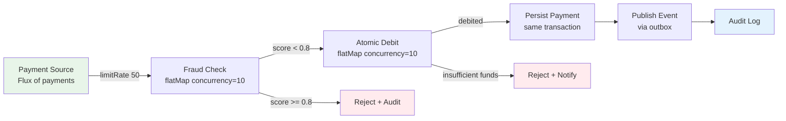
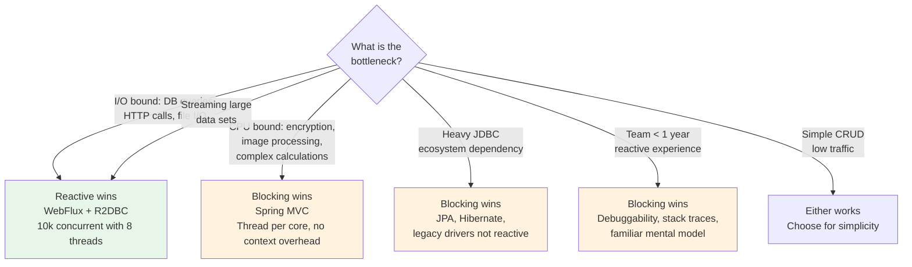

# التفاعلي مقابل الحاجب — مقارنة ملف الأداء

الاختيار بين نموذج البرمجة الحاجب والتفاعلي من أكثر القرارات المعمارية أثرًا في نظام تقنية مالية عالي الإنتاجية. ويقدم هذا الدرس مقارنة مفصلة مبنية على القياس بين النموذجين كي تتخذ القرار الصحيح لكل خدمة في منصتك — لا أن تتبع موضة فحسب.

## 1. نموذج خيط لكل طلب

يخصص Spring MVC (المبني على Servlet) خيطًا واحدًا لكل طلب HTTP وارد طوال دورة حياة الطلب. ويحجب الخيط أثناء انتظار الإدخال/الإخراج: استعلامات قاعدة البيانات، واستدعاءات HTTP للخدمات اللاحقة، أو قراءات الملفات.

```
Incoming request → Thread A acquired from pool
  Thread A: validate input    (CPU, 0.1ms)
  Thread A: query DB          (BLOCKING I/O, 80ms) ← thread sleeps here
  Thread A: call fraud API    (BLOCKING I/O, 15ms) ← thread sleeps here
  Thread A: write audit log   (BLOCKING I/O, 5ms)  ← thread sleeps here
  Thread A: serialize response (CPU, 0.2ms)
Thread A released to pool     (total: ~100ms, thread held 100ms)
```

الملاحظة الحاسمة: خيط محتجز 100 مللي ثانية، قضى 80 منها نائمًا ينتظر قاعدة البيانات، يهدر موردًا ثمينًا من نظام التشغيل.

### 1.1 تحجيم مجمع الخيوط وسقف التزامن

```yaml
# Typical Spring MVC thread pool configuration
server:
  tomcat:
    threads:
      max: 200          # Max concurrent requests
      min-spare: 10

# With 200 threads and 100ms average response time:
# Max theoretical throughput = 200 / 0.1s = 2,000 requests/second
# At 2,001 req/s, the 201st request waits for a thread

# Reality check: a payment service under Black Friday load
# 10,000 requests in flight at once (e.g. 100,000 req/s × 100ms)
# = 10,000 platform threads required
# Each reserves a stack (~1MB by default, committed lazily) plus kernel
# resources -- and the OS must schedule them all
```

الافتراضي البالغ 200 خيط مجرد قيمة بداية معقولة — وكثير من الخدمات تعمل بأكثر. والحدود الحقيقية هي الذاكرة، وحمل الجدولة، وقبل كل شيء الموارد اللاحقة التي تنتظرها تلك الخيوط. و**الخيوط الافتراضية** في Java 21 (الدرس 15) تزيل حد الخيوط مع الإبقاء على هذا الأسلوب الحاجب البسيط — فقارنها بالتفاعلي قبل الاختيار.

## 2. نموذج حلقة الأحداث

تستخدم الأنظمة التفاعلية/حلقات الأحداث عددًا صغيرًا ثابتًا من الخيوط (يستخدم Reactor Netty افتراضيًا خيط حلقة أحداث واحدًا لكل نواة معالج) وتتعامل مع آلاف العمليات المتزامنة عبر الإدخال/الإخراج غير الحاجب والاستدعاءات الراجعة.

```
Event Loop Thread 1:
  t=0ms: Accept request A, start DB query (non-blocking, registers callback)
  t=0ms: Accept request B, start DB query (non-blocking, registers callback)
  t=0ms: Accept request C, start fraud API call (non-blocking, registers callback)
  t=80ms: DB result for A arrives → continue processing A, send response A
  t=81ms: DB result for B arrives → continue processing B, send response B
  t=95ms: Fraud API result for C arrives → continue processing C, send response C

One thread serviced 3 requests that together took 255ms of I/O wait
using zero blocking and minimal CPU overhead
```

### 2.1 قياس: 10,000 اتصال متزامن

```
Blocking (Spring MVC, Tomcat, 200 threads):
  Max throughput:     200 / 0.1s = 2,000 req/s (thread pool saturated)
  Queueing:           10,000 waiting / 2,000 per second -> ~5 s
  P99 latency:        ~5,000ms (queuing behind the thread pool)
  (10,000 platform threads instead would need 10,000 stacks and a
   lot of scheduling work -- or use virtual threads)

Reactive (Spring WebFlux, Netty, one event loop per core):
  Threads used:       8 on an 8-core machine
  Max throughput:     ~10,000 in flight / 0.1s = ~100,000 req/s of I/O
                      -- in practice limited by CPU and the downstream
  P99 latency:        ~100ms + processing (no thread-pool queueing)

Caveat: if the 100ms is a DATABASE query, the limit is the connection
pool, not the thread model: 20 connections × 10 queries/s each = 200 req/s
for blocking AND reactive alike.
```

## 3. ‏Project Reactor: ‏Mono وFlux

‏Project Reactor هي المكتبة التفاعلية التي يقوم عليها Spring WebFlux. وتمثّل التسلسلات غير المتزامنة بنوعين:

- ‏`Mono<T>`: عنصر واحد أو لا شيء (مثل `CompletableFuture<T>`)
- ‏`Flux<T>`: من 0 إلى N عنصر (مثل `Stream<T>` غير متزامن)

```java
// Mono: single payment lookup
Mono<Payment> payment = paymentRepository.findById(paymentId);

// Flux: stream of incoming payments
Flux<Payment> payments = paymentRepository.findByAccountId(accountId);

// Composing operations
Mono<PaymentResponse> response = paymentRepository
    .findById(paymentId)
    .switchIfEmpty(Mono.error(new PaymentNotFoundException(paymentId)))
    .flatMap(payment -> fraudCheckService.evaluate(payment))
    .flatMap(checkedPayment -> paymentProcessor.submit(checkedPayment))
    .map(result -> new PaymentResponse(result.getId(), result.getStatus()));
```

الفرق الأساسي عن `CompletableFuture`: خطوط Reactor **كسولة** — لا يُنفذ شيء حتى يشترك مشترك. وهذا يتيح التركيب دون آثار جانبية.

## 4. ‏Spring WebFlux مقابل Spring MVC

```java
// Spring MVC — blocking controller
@RestController
@RequestMapping("/api/v1/payments")
public class PaymentControllerMvc {

    private final PaymentService paymentService; // Uses JDBC, blocking

    @PostMapping
    public ResponseEntity<PaymentResponse> submit(
            @RequestBody @Valid PaymentRequest request) {
        // Thread blocks here for the entire duration
        PaymentResult result = paymentService.process(request);
        return ResponseEntity.ok(new PaymentResponse(result));
    }
}

// Spring WebFlux — non-blocking controller
@RestController
@RequestMapping("/api/v1/payments")
public class PaymentControllerWebFlux {

    private final ReactivePaymentService paymentService; // Uses R2DBC

    @PostMapping
    public Mono<ResponseEntity<PaymentResponse>> submit(
            @RequestBody @Valid PaymentRequest request) {
        return paymentService.process(request)
            .map(result -> ResponseEntity.ok(new PaymentResponse(result)))
            .onErrorResume(ValidationException.class,
                e -> Mono.just(ResponseEntity.badRequest()
                    .body(new PaymentResponse(e.getMessage()))))
            .onErrorResume(InsufficientFundsException.class,
                e -> Mono.just(ResponseEntity.unprocessableEntity()
                    .body(new PaymentResponse(e.getMessage()))));
    }

    // Server-Sent Events: stream of real-time payment updates
    @GetMapping(value = "/stream/{accountId}",
                produces = MediaType.TEXT_EVENT_STREAM_VALUE)
    public Flux<PaymentStatusUpdate> streamUpdates(@PathVariable String accountId) {
        return paymentService.getUpdateStream(accountId)
            .limitRate(100); // Backpressure: request 100 items at a time
    }
}
```

## 5. ‏R2DBC: ‏PostgreSQL التفاعلي

‏JDBC حاجب جوهريًا — لا يستطيع العمل في نموذج حلقة الأحداث. ويوفر R2DBC ‏(Reactive Relational Database Connectivity) واجهة غير حاجبة لقواعد البيانات العلائقية.

```xml
<!-- pom.xml -->
<dependency>
    <groupId>org.springframework.boot</groupId>
    <artifactId>spring-boot-starter-data-r2dbc</artifactId>
</dependency>
<dependency>
    <groupId>org.postgresql</groupId>
    <artifactId>r2dbc-postgresql</artifactId>
</dependency>
```

```yaml
# application.yml
spring:
  r2dbc:
    url: r2dbc:postgresql://localhost:5432/payments
    username: payments_app
    password: ${DB_PASSWORD}
    pool:
      initial-size: 5
      max-size: 20
      # A PostgreSQL connection still runs ONE query at a time, reactive or
      # not: 20 connections with 50ms queries = at most ~400 queries/s.
      # Reactive saves THREADS, not database connections -- size the pool
      # for the concurrent queries the database can handle well.
```

```java
// ReactivePaymentRepository.java
public interface ReactivePaymentRepository extends R2dbcRepository<Payment, UUID> {

    // Spring Data R2DBC generates reactive implementation
    Flux<Payment> findByAccountIdAndStatusOrderByCreatedAtDesc(
        String accountId, PaymentStatus status);

    @Query("SELECT * FROM payments WHERE account_id = :accountId " +
           "AND created_at > :since LIMIT :limit")
    Flux<Payment> findRecentByAccount(
        @Param("accountId") String accountId,
        @Param("since") Instant since,
        @Param("limit") int limit);

    @Modifying
    @Query("UPDATE payments SET status = :status, updated_at = NOW() " +
           "WHERE id = :id")
    Mono<Integer> updateStatus(@Param("id") UUID id,
                               @Param("status") String status);
}

// ReactivePaymentService.java
@Service
@Slf4j
public class ReactivePaymentService {

    private static final long FAIL_OPEN_LIMIT_MINOR = 5_000;   // e.g. 50.00, documented

    private final ReactivePaymentRepository paymentRepository;
    private final ReactiveFraudCheckClient fraudCheckClient;
    private final ReactiveAuditService auditService;

    public Mono<PaymentResult> process(PaymentRequest request) {
        return Mono.just(request)
            .flatMap(this::validate)
            .flatMap(validated -> fraudCheckClient.check(validated)
                .timeout(Duration.ofSeconds(2))
                // Fail OPEN only below a documented amount threshold;
                // above it, hold the payment for review (fail closed)
                .onErrorResume(TimeoutException.class,
                    e -> Mono.just(validated.amountMinor() <= FAIL_OPEN_LIMIT_MINOR
                        ? FraudCheckResult.allowedWithoutCheck(validated)
                        : FraudCheckResult.holdForReview(validated))))
            .flatMap(this::persistPayment)
            .flatMap(payment -> auditService.log(payment)
                // Best-effort audit: swallow its errors EXPLICITLY, or the
                // payment fails too. (If the audit record is mandatory, write
                // it in the same DB transaction as the payment instead.)
                .onErrorResume(e -> {
                    log.warn("Audit log failed for payment {}", payment.getId(), e);
                    return Mono.empty();
                })
                .thenReturn(payment))
            .map(PaymentResult::fromPayment)
            .doOnSuccess(r -> log.info("Payment {} processed: {}",
                r.getPaymentId(), r.getStatus()))
            .doOnError(e -> log.error("Payment processing failed", e));
    }
}
```

## 6. الضغط العكسي مع Flux.limitRate

الضغط العكسي (backpressure) هو الآلية التي يُعلم بها المشترك الناشرَ بعدد العناصر التي يستطيع استهلاكها. ودون ضغط عكسي، قد يُغرق منتج سريع مستهلكًا بطيئًا ويسبب نفاد الذاكرة.

```java
// Processing a large batch of payments reactively
public Flux<PaymentResult> processBatch(Flux<PaymentRequest> payments) {
    return payments
        // Request 50 items at a time — backpressure to upstream
        .limitRate(50)
        // Prepare up to 10 payments concurrently (returns Mono<Payment>)
        .flatMap(request -> preparePayment(request), 10)
        // Group into batches of up to 100 (or every 50ms) for bulk inserts
        .bufferTimeout(100, Duration.ofMillis(50))
        // One batch at a time, in order
        .concatMap(batch -> paymentRepository.saveAll(batch))
        .map(PaymentResult::fromPayment);
}

// Flux.limitRate controls the demand signal sent upstream:
// Without limitRate: the next operator decides (flatMap requests its
//   concurrency, a plain subscribe() requests Long.MAX_VALUE)
// With limitRate(50): requests 50, then tops up ~38 more each time
//   ~75% of the requested items have been delivered
// (bounded demand — producer paces itself)

// Measuring backpressure effectiveness
payments
    .limitRate(50)
    .doOnRequest(n -> log.debug("Downstream requested {} items", n))
    .flatMap(this::preparePayment, 10)
    .doOnNext(p -> log.debug("Prepared payment {}", p.getId()))
    .subscribe();
```

## 7. خط دفع تفاعلي



```java
// Full reactive payment pipeline
@Service
@RequiredArgsConstructor
@Slf4j
public class ReactivePaymentPipeline {

    private static final long FAIL_OPEN_LIMIT_MINOR = 5_000;   // documented threshold

    private final FraudService fraudService;
    private final AccountService accountService;
    private final PaymentRepository paymentRepository;
    private final EventBus eventBus;

    public Flux<PaymentResult> run(Flux<PaymentRequest> source) {
        return source
            .flatMap(request -> processOne(request)
                    // Per-payment error handling: one failure must not end the
                    // whole stream, and EVERY request gets a result.
                    // (Avoid onErrorContinue: it changes the behaviour of
                    //  upstream operators in surprising ways.)
                    .onErrorResume(e -> {
                        log.error("Payment {} failed", request.getPaymentId(), e);
                        return Mono.just(PaymentResult.failed(request, "PROCESSING_ERROR"));
                    }),
                10);                                         // max 10 in flight
    }

    private Mono<PaymentResult> processOne(PaymentRequest request) {
        return fraudService.check(request)
            .timeout(Duration.ofSeconds(2))
            // Fail open only for small amounts; hold larger payments for review
            .onErrorResume(TimeoutException.class, e -> Mono.just(
                request.getAmountMinor() <= FAIL_OPEN_LIMIT_MINOR
                    ? FraudCheckResult.allowedWithoutCheck(request)
                    : FraudCheckResult.holdForReview(request)))
            .flatMap(fraud -> {
                if (fraud.isHold()) {
                    return Mono.just(PaymentResult.heldForReview(request));
                }
                if (fraud.getRiskScore() >= 0.8) {
                    // A rejection is a RESULT, not something to filter away
                    return Mono.just(PaymentResult.rejected(request, "HIGH_FRAUD_RISK"));
                }
                // Atomic debit -- never "check balance, then debit" (race):
                // UPDATE accounts SET balance = balance - :amt
                //  WHERE id = :acct AND balance >= :amt
                // Debit + payment row run in ONE transaction (TransactionalOperator),
                // and the event goes out via an outbox table (track 05).
                return accountService.debitAndRecord(request)
                    .map(debited -> debited
                        ? PaymentResult.success(request)
                        : PaymentResult.rejected(request, "INSUFFICIENT_FUNDS"));
            });
    }
}
```

## 8. معالجة الأخطاء في الخطوط التفاعلية

```java
// onErrorResume: recover by switching to an alternative Mono/Flux
public Mono<ExchangeRate> getExchangeRate(String pair) {
    return primaryRateProvider.getRate(pair)
        .onErrorResume(ServiceUnavailableException.class,
            e -> fallbackRateProvider.getRate(pair))
        .onErrorResume(Exception.class,
            e -> cachedRateService.getLastKnownRate(pair)
                .switchIfEmpty(Mono.error(
                    new NoRateAvailableException("No rate for " + pair))));
}

// retryWhen: retry with exponential backoff
public Mono<PaymentStatus> pollPaymentStatus(String paymentId) {
    return paymentGateway.getStatus(paymentId)
        .filter(status -> status != PaymentStatus.PENDING)
        .repeatWhenEmpty(flux -> flux
            .zipWith(Flux.range(1, 5), (emission, attempt) -> attempt)
            .flatMap(attempt -> Mono.delay(
                Duration.ofMillis(100L * (long) Math.pow(2, attempt)))))
        .retryWhen(Retry.backoff(3, Duration.ofMillis(200))
            .filter(e -> e instanceof TransientException)
            .doBeforeRetry(signal ->
                log.warn("Retrying payment status check, attempt {}",
                    signal.totalRetries() + 1)));
}
```

## 9. نشر سياق MDC في التفاعلي

لا يعمل ThreadLocal (الذي يستخدمه MDC داخليًا) في الخطوط التفاعلية لأن الطلب الواحد يتنقل بين الخيوط. فاستخدم `Context` في Reactor بدلًا منه.

```java
// WRONG — MDC is ThreadLocal and will be empty on reactor threads
public Mono<PaymentResult> processWithLogging(PaymentRequest request) {
    MDC.put("paymentId", request.getPaymentId()); // Set on calling thread
    return paymentRepository.findById(request.getId())
        .map(payment -> {
            // This runs on a different thread — MDC is EMPTY here
            log.info("Processing payment"); // No paymentId in log!
            return process(payment);
        });
}

// CORRECT — use Reactor Context + contextWrite
public Mono<PaymentResult> processWithLogging(PaymentRequest request) {
    return paymentRepository.findById(request.getId())
        .map(payment -> {
            // Read from Reactor Context, set MDC for this callback
            return process(payment);
        })
        .doOnEach(signal -> {
            // signal.getContextView() is available on every signal
            String paymentId = signal.getContextView()
                .getOrDefault("paymentId", "unknown");
            if (signal.isOnNext()) {
                MDC.put("paymentId", paymentId);
                log.info("Processing payment");
                MDC.remove("paymentId");
            }
        })
        // Inject context values at the subscription point
        .contextWrite(Context.of("paymentId", request.getPaymentId(),
                                 "correlationId", request.getCorrelationId()));
}

// Better approach (Reactor 3.5+, Spring Boot 3.2+): automatic context
// propagation with the Micrometer context-propagation library. It restores
// ThreadLocals such as MDC from the Reactor Context on every thread hop.
//   application.properties: spring.reactor.context-propagation=auto
//   (or call Hooks.enableAutomaticContextPropagation() at startup)
// Micrometer Tracing then puts traceId/spanId into the MDC for you.
```

## 10. متى يفوز التفاعلي ومتى يفوز الحاجب



| السيناريو | التوصية | السبب |
|----------|----------------|--------|
| ‏10 آلاف طلب متزامن مقيد بالإدخال/الإخراج | تفاعلي (أو خيوط افتراضية) | بضعة خيوط مقابل 10 آلاف خيط منصة |
| محرك حساب المدفوعات | حاجب | مقيد بالمعالج، بلا انتظار إدخال/إخراج |
| قاعدة شيفرة JPA/Hibernate قائمة | حاجب | لا مقابلات R2DBC لكل الميزات |
| تدفق الأحداث الفوري | تفاعلي | ‏Flux + SSE ملاءمة طبيعية |
| المعالجة الدفعية (الليلية) | حاجب | ‏Spring Batch، الإنتاجية لا التزامن |
| فريق جديد على التفاعلي | حاجب | أخطاء الشيفرة التفاعلية صعبة التصحيح |

## 11. مزالق الإنتاج

### المزلق 1: استدعاء حاجب داخل خط تفاعلي

هذا أكثر الأخطاء شيوعًا وخطورة. فاستدعاء واجهة حاجبة (JDBC، أو عميل HTTP متزامن) على خيط حلقة أحداث يُجوّع كل الطلبات الأخرى على ذلك الخيط.

```java
// WRONG — JdbcTemplate.query() blocks the event-loop thread
@GetMapping("/payments/{id}")
public Mono<Payment> getPayment(@PathVariable String id) {
    return Mono.fromCallable(() ->
        // jdbcTemplate is blocking — this parks the event-loop thread
        // for the duration of the DB query
        jdbcTemplate.queryForObject(
            "SELECT * FROM payments WHERE id = ?",
            paymentRowMapper, id)
    );
    // Mono.fromCallable with no scheduler change still runs on the event-loop!
}

// CORRECT — wrap blocking work in a bounded elastic scheduler
@GetMapping("/payments/{id}")
public Mono<Payment> getPayment(@PathVariable String id) {
    return Mono.fromCallable(() ->
        jdbcTemplate.queryForObject(
            "SELECT * FROM payments WHERE id = ?",
            paymentRowMapper, id)
    )
    // subscribeOn moves the execution to a separate thread pool
    // The event-loop thread is immediately freed
    .subscribeOn(Schedulers.boundedElastic());
}

// BEST — migrate to R2DBC entirely for true non-blocking DB access
@GetMapping("/payments/{id}")
public Mono<Payment> getPayment(@PathVariable String id) {
    return reactivePaymentRepository.findById(UUID.fromString(id));
}
```

كشف هذه المشكلة: استخدم BlockHound في الاختبارات:

```java
// BlockHound instruments JDK classes: on recent JDKs run tests with
// -XX:+AllowRedefinitionToAddDeleteMethods (see the BlockHound docs)
@SpringBootTest
class ReactiveBlockingDetectionTest {

    @BeforeAll
    static void installBlockHound() {
        BlockHound.install();
    }

    @Test
    void paymentServiceMustNotBlock() {
        // BlockHound throws BlockingOperationError if any blocking call
        // is made on a reactor thread during this test
        StepVerifier.create(paymentService.process(aPaymentRequest()))
            .expectNextCount(1)
            .verifyComplete();
    }
}
```

### المزلق 2: غياب الضغط العكسي على التدفقات عالية الحجم

نشر الأحداث دون ضغط عكسي إلى مستهلك بطيء يسبب تخزينًا مؤقتًا غير محدود.

```java
// RISKY — default concurrency: flatMap runs up to 256 calls at once
Flux<Payment> allPayments = paymentRepository.findAll();
allPayments
    .flatMap(payment -> expensiveProcessor.process(payment)) // may be slow
    .subscribe(result -> results.add(result));
// Reactor's flatMap does apply backpressure (it requests 256 upstream),
// but 256 concurrent calls can overwhelm expensiveProcessor or the service
// behind it. Unbounded buffering happens when a source IGNORES demand
// (e.g. Flux.create with BUFFER, below).

// CORRECT — bounded concurrency and limitRate
paymentRepository.findAll()
    .limitRate(200)       // request 200 items at a time from DB
    .flatMap(payment -> expensiveProcessor.process(payment),
             20)          // max 20 concurrent processing tasks
    .subscribe(
        result -> results.add(result),
        error -> log.error("Pipeline error", error),
        () -> log.info("Processing complete")
    );

// For streaming from Kafka or external sources, use Flux.create with
// a FluxSink.OverflowStrategy:
Flux<Payment> kafkaFlux = Flux.create(sink -> {
    kafkaConsumer.subscribe(records -> {
        records.forEach(record -> sink.next(toPayment(record)));
    });
}, FluxSink.OverflowStrategy.ERROR); // Throw if buffer overflows
// vs OverflowStrategy.DROP (drop new items)
// vs OverflowStrategy.LATEST (keep only latest)
// vs OverflowStrategy.BUFFER (unbounded — risky!)
```

### المزلق 3: عدم نشر سياق MDC — فشل صامت في ربط السجلات

تفقد السجلات معرّفات الربط في الخطوط التفاعلية، فيصبح التحقيق في حوادث الإنتاج شبه مستحيل.

```java
// WRONG — MDC.put on calling thread, lost on reactor threads
@PostMapping("/payments")
public Mono<PaymentResponse> submit(@RequestBody PaymentRequest request,
                                    @RequestHeader("X-Correlation-Id") String correlationId) {
    MDC.put("correlationId", correlationId);  // Set on HTTP thread

    return paymentService.process(request)
        .map(result -> {
            // Runs on reactor-http-nio-3 — MDC is EMPTY
            log.info("Payment processed"); // No correlationId in log output!
            return new PaymentResponse(result);
        });
    // MDC.remove() is never called — MDC leaks if thread is reused!
}

// CORRECT — contextWrite + doOnEach for MDC propagation
@PostMapping("/payments")
public Mono<PaymentResponse> submit(@RequestBody PaymentRequest request,
                                    @RequestHeader("X-Correlation-Id") String correlationId) {
    return paymentService.process(request)
        .map(result -> new PaymentResponse(result))
        .doOnEach(signal -> {
            if (!signal.isOnComplete() && !signal.isOnSubscribe()) {
                try (MDC.MDCCloseable ignored =
                        MDC.putCloseable("correlationId",
                            signal.getContextView().getOrDefault(
                                "correlationId", "unknown"))) {
                    // Log statements inside here have correlationId set
                }
            }
        })
        .contextWrite(Context.of("correlationId", correlationId));
}
```

## 12. قائمة الفحص

- [ ] لا استدعاءات حاجبة (JDBC، أو RestTemplate متزامن، أو Thread.sleep) على خيوط Reactor
- [ ] ‏BlockHound مثبت في حزمة الاختبار لكشف الحجب العرضي
- [ ] كل إدخال/إخراج حاجب مغلف بـ `.subscribeOn(Schedulers.boundedElastic())`
- [ ] ‏`limitRate()` مطبق على أي Flux مصدره قاعدة بيانات أو طابور رسائل
- [ ] معامل التزامن لـ `flatMap` مضبوط صراحة (لا تعتمد على الافتراضي 256)
- [ ] ‏`bufferTimeout` أو `window` مستخدم لإدراجات قاعدة البيانات الدفعية، لا `flatMap` لكل عنصر
- [ ] ‏`onErrorResume` لكل عنصر داخل `flatMap` — فالأخطاء غير المعالجة تنهي الـ Flux كله (تجنب `onErrorContinue`)
- [ ] ‏`retryWhen` مع تراجع أسي للأعطال العابرة، لا `retry(3)` المجرد
- [ ] ‏Reactor Context مستخدم لمعرّف الربط ونشر MDC، لا ThreadLocal
- [ ] النشر التلقائي للسياق مفعّل (`spring.reactor.context-propagation=auto`) لـ MDC
- [ ] مجمع اتصالات R2DBC محجّم للاستعلامات المتزامنة التي تتعامل معها قاعدة البيانات جيدًا — فالتفاعلي يوفر الخيوط، لا الاتصالات
- [ ] بدائل فحص الاحتيال تفشل مفتوحةً فقط تحت عتبة مبلغ موثقة
- [ ] ‏`StepVerifier` مستخدم في كل اختبارات الوحدة — لا تحجب بـ `.block()` في الاختبارات

<!-- KNOWLEDGE-CHECK
{"questions":[{"text":"خدمة Spring WebFlux تجري استدعاء JDBC داخل Mono.fromCallable() دون subscribeOn(). ما العاقبة؟","options":["a) يفشل الـ Mono فورًا بـ BlockingNotPermittedException","b) يُنفذ استدعاء JDBC على خيط حلقة الأحداث، فيحجبه ويُجوّع كل الطلبات المتزامنة الأخرى على ذلك الخيط","c) يكشف Spring الاستدعاء الحاجب تلقائيًا وينقله إلى مجمع خيوط","d) يكتمل الـ Mono طبيعيًا بزمن أعلى قليلًا"],"correct":1,"explanation":"دون subscribeOn()، ينفذ Mono.fromCallable() دالته على أي خيط يشترك فيه — وفي WebFlux هذا هو خيط حلقة الأحداث (Netty NIO). وJDBC متزامن ويحجب الخيط حتى يكتمل الاستعلام. وخلال ذلك لا يستطيع خيط حلقة الأحداث معالجة أي أحداث أخرى، فتتدهور الإنتاجية لكل الطلبات المتزامنة على ذلك الخيط. وsubscribeOn(Schedulers.boundedElastic()) ينقل التنفيذ إلى مجمع خيوط مصمم للعمل الحاجب."},{"text":"لماذا يفشل MDC القائم على ThreadLocal في خط تفاعلي، وما البديل الصحيح؟","options":["a) MDC غير آمن للخيوط ويجب ألا يُستخدم في الإنتاج أبدًا","b) قد تنفذ المعاملات التفاعلية الاستدعاءات الراجعة على خيوط غير الخيط الذي ضبط سياق MDC، فتغيب قيمة ThreadLocal؛ واستخدم Reactor Context مع contextWrite وdoOnEach بدلًا منه","c) يتطلب MDC حاوية servlet وغير متوافق مع Netty","d) يعمل MDC بشكل صحيح لكنه يتطلب MDC.clear() صراحة بعد كل معامل"],"correct":1,"explanation":"يستخدم MDC الـ ThreadLocal لتخزين أزواج المفتاح-القيمة. وفي الخط التفاعلي، يُعالج الطلب الواحد باستدعاءات راجعة قد تُنفذ على خيوط مختلفة (خيط HTTP، أو خيط مجدول، أو خيط استدعاء قاعدة البيانات). وحين ينتقل التنفيذ إلى خيط جديد، يكون ThreadLocal فارغًا عليه. أما Context في Reactor فخريطة ثابتة لكل اشتراك تتدفق عبر سلسلة المعاملات بغض النظر عن تبديل الخيوط. ويحقن contextWrite() القيم، ويقرؤها getContextView()، ويستطيع doOnEach() نقل قيم Context إلى MDC لعبارات السجل."},{"text":"في سيناريو القياس لـ 10,000 اتصال متزامن بتأخير إدخال/إخراج 100 مللي ثانية، ما المورد الأساسي الذي يستنفده الخيط الحاجب قبل أن يستنفده التفاعلي؟","options":["a) دورات المعالج — الخيوط الحاجبة تستهلك معالجًا أكثر بسبب الاستطلاع المستمر","b) مقابس الشبكة — الإدخال/الإخراج الحاجب يفتح مقابس أكثر لكل طلب","c) خيوط نظام التشغيل وذاكرتها المرتبطة — كل خيط منصة يحجز مكدسًا (نحو 1 ميغابايت افتراضيًا) ويجب أن يجدوله نظام التشغيل","d) ذاكرة الـ heap — الكائنات التفاعلية أكفأ ذاكرةً من مكدسات الخيوط"],"correct":2,"explanation":"كل خيط منصة يحجز مكدسًا (512 كيلوبايت إلى 1 ميغابايت افتراضيًا، يُلتزم بحسب الاستخدام) وموارد نواة، ويجب أن يجدول نظام التشغيل كلًا منها. لذا فـ 10,000 خيط حاجب تكلف كثيرًا من الذاكرة وتبديل السياق — أو، مع مجمع من 200 خيط، تصطف الطلبات ببساطة. أما خدمة تفاعلية تتعامل مع الـ 10,000 اتصال المتزامن نفسها فتستخدم حفنة من خيوط حلقة الأحداث (واحدًا لكل نواة) وتعتمد على إشعارات الإدخال/الإخراج غير الحاجب من نظام التشغيل. (والخيوط الافتراضية في Java 21 هي المخرج الآخر من هذا الحد.)"}]}
-->

<!-- PRACTICAL-CHALLENGE
{"title":"خط دفع تفاعلي مع الضغط العكسي ونشر السياق","difficulty":"advanced","estimatedMinutes":90,"tasks":[{"id":"1","description":"ابنِ واجهة دفع بـ Spring WebFlux بنقطتي نهاية: POST /payments (تعيد Mono<PaymentResponse>) وGET /payments/stream/{accountId} (تعيد Flux<PaymentStatusUpdate> كـ text/event-stream). واستخدم R2DBC مع قاعدة بيانات H2 في الذاكرة. وتحقق من أن نقطة POST تتعامل مع ValidationException ‏(400) وInsufficientFundsException ‏(422) عبر onErrorResume دون كشف تتبعات المكدس. واكتب اختبار تكامل WebTestClient لكل حالة خطأ."},{"id":"2","description":"نفّذ ReactivePaymentPipeline يقبل Flux<PaymentRequest> ويطبق: (1) limitRate(50)، (2) flatMap إلى فحص احتيال وهمي بتزامن أقصى 10 ومهلة ثانيتين تسمح افتراضيًا عند المهلة، (3) ترشيح لدرجة خطر < 0.7، (4) bufferTimeout(100, 50ms) للحفظ الدفعي. وثبّت BlockHound واكتب اختبار StepVerifier يثبت عدم إجراء أي استدعاء حاجب على خيط Reactor أثناء تنفيذ الخط."},{"id":"3","description":"بيّن مزلق نشر MDC وأصلحه. اكتب أولًا اختبارًا يُظهر أن MDC.get('correlationId') يعيد null داخل معامل map() حين يُضبط على الخيط المستدعي. ثم أصلحه باستخدام contextWrite(Context.of('correlationId', id)) وdoOnEach مع signal.getContextView(). واختياريًا فعّل النشر التلقائي للسياق وتحقق من ظهور معرّف الربط في مخرجات السجل أثناء تنفيذ الخط التفاعلي."},{"id":"4","description":"اكتب مقياسًا باستخدام JMH (أو حلقة مؤقتة بسيطة) يقارن إنتاجية: (أ) متحكم Spring MVC يستخدم JDBC مع Thread.sleep(50) لمحاكاة الإدخال/الإخراج، بمجمع خيوط Tomcat من 50 خيطًا؛ مقابل (ب) متحكم Spring WebFlux يستخدم Mono.delay(Duration.ofMillis(50)) مع 8 خيوط حلقة أحداث. وشغّل 500 خيط افتراضي (أو اتصال) متزامن لمدة 30 ثانية وسجّل الطلبات في الثانية وزمن P99 لكل منهما. ووثّق نتائجك في تعليق يشرح متى يكون كل نموذج أفضل."}]}
-->
